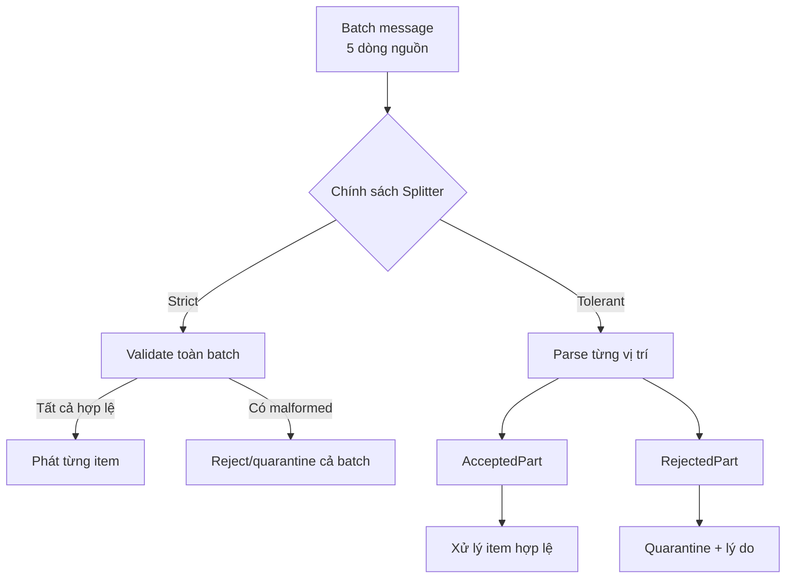
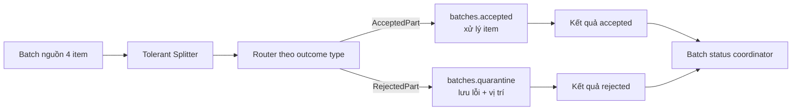
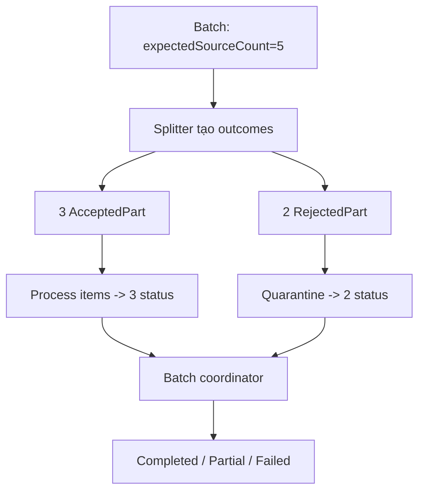

# Xử lý phần tử rỗng hoặc malformed

## 1. Bối cảnh: Splitter gặp một phần tử không dùng được

Giả sử một hệ thống nhập hàng nhận batch chứa các dòng CSV giản lược ở dạng `SKU,quantity`:

```text
batchId = BATCH-105
rawLines = [
  "SKU-A,2",
  "",
  "SKU-B,abc",
  null,
  " SKU-C,1 "
]
```

Mục tiêu của **Splitter** là tách một message chứa danh sách thành các message con để mỗi dòng hàng được xử lý độc lập. Nhưng nếu một dòng trống, `null` hoặc không parse được số lượng, ta phải quyết định: **dừng toàn bộ batch, bỏ qua dòng lỗi hay cách ly riêng dòng lỗi và tiếp tục?** Câu trả lời ảnh hưởng tới độ tin cậy, correlation, số kết quả chờ ở Aggregator, retry và khả năng đối soát.

**Splitter** là một *Enterprise Integration Pattern* (EIP) biến một thông điệp tổng hợp thành nhiều thông điệp riêng. Trong chương **Splitter** của module **SPRING_INTEGRATION_PATTERN**, chúng ta thực hành xây dựng luồng message ít phụ thuộc và dễ mở rộng bằng Spring Integration. Chủ đề này kết nối trực tiếp với Filter, Transformer, Router, Aggregator, Gateway, retry, error channel và cơ chế correlation, đồng thời đòi hỏi kiểm thử cả nhánh hợp lệ lẫn nhánh lỗi.



> **Nguyên tắc quan trọng:** Không được mặc định rằng phần tử rỗng tương đương message rỗng, rằng framework sẽ tự bỏ phần tử lỗi, hoặc rằng việc bỏ một phần tử không ảnh hưởng tới Aggregator. Chính sách xử lý phải được xác định trước khi triển khai.

## 2. Phân loại lỗi trước khi quyết định xử lý

Một message đầu vào có thể sai ở nhiều mức khác nhau:

| Trường hợp | Ví dụ | Ý nghĩa | Hướng xử lý khả thi |
| --- | --- | --- | --- |
| Payload tổng thể không hợp lệ | Không phải `BatchRequest` mong đợi | Lỗi contract / deserialization | Reject tại biên |
| Batch có danh sách `null` | `rawLines=null` | Không có cấu trúc các phần tử | Reject batch |
| Batch không có phần tử | `rawLines=[]` | Batch rỗng; có thể hợp lệ hoặc lỗi nghiệp vụ | Kết thúc rõ hoặc reject |
| Phần tử `null` | `["SKU-A,2", null]` | Thiếu một phần tử tại vị trí cụ thể | Reject batch hoặc tạo `RejectedPart` |
| Chuỗi rỗng | `""`, `"   "` | Không có nội dung có ích | Theo chính sách blank line |
| Sai cú pháp | `"SKU-B,abc"` | Không parse được quantity | Reject/cách ly item |
| Thiếu trường | `"SKU-C,"` | Cấu trúc có trường thiếu | Reject/cách ly item |
| Thừa trường | `"SKU-D,2,extra"` | Không đúng định dạng kỳ vọng | Reject/cách ly item |
| Sai ngữ nghĩa | `"SKU-E,-2"` | Parse thành công nhưng số lượng không hợp lệ | Reject/cách ly item |
| Lỗi hệ thống bên ngoài | DB timeout trong consumer | Không phải malformed element | Retry/recovery downstream |
| Duplicated delivery | Batch được broker giao lại | Input có thể vẫn hợp lệ | Idempotency theo item |

Hai lưu ý quan trọng của Java/Spring:

- **`Message` của Spring không được có payload `null`** theo hợp đồng MessageBuilder phổ biến; nhưng một payload kiểu `List` **có thể chứa phần tử `null`** nếu nó được tạo bằng một collection cho phép `null`. Hai tình huống này hoàn toàn khác nhau.
- `List.of(null)` và `List.copyOf(listContainingNull)` ném `NullPointerException`. Không dùng chúng để tạo dữ liệu test có phần tử null; có thể dùng `Arrays.asList("SKU-A,2", null)` hoặc `ArrayList`.

### 2.1. “Rỗng” có thể là một kết quả hợp lệ về nghiệp vụ

Với một batch cập nhật hàng tồn, danh sách trống có thể báo rằng **không có cập nhật nào**, là một trạng thái hoàn tất bình thường. Nhưng với batch thanh toán cần ít nhất một giao dịch, danh sách rỗng có thể vi phạm contract và phải reject.

Vì vậy cần định nghĩa riêng:

```text
EMPTY_BATCH:
  fail-fast | emit BatchCompleted(count=0) | ignore có audit

EMPTY_ELEMENT:
  reject batch | quarantine element | skip có kiểm soát

MALFORMED_ELEMENT:
  reject batch | quarantine element | repair bằng nguồn đáng tin
```

Đừng dùng chính sách “bỏ qua mọi thứ không parse được” làm mặc định, nhất là khi batch chứa giao dịch tài chính hoặc dữ liệu phải đối soát đầy đủ.

## 3. Chọn chiến lược: strict, tolerant hay skip

| Chiến lược | Cách làm | Khi phù hợp | Đánh đổi |
| --- | --- | --- | --- |
| **Strict / fail-fast** | Parse và validate tất cả item trước; chỉ phát nếu toàn bộ hợp lệ | Batch cần toàn vẹn; một lỗi làm cả batch không đáng tin | Một item lỗi chặn tất cả item tốt |
| **Tolerant / split outcomes** | Mỗi vị trí tạo một outcome hợp lệ hoặc lỗi; route riêng | ETL, nhập liệu số lượng lớn, có thể xử lý phần còn lại | Cần lưu/replay item lỗi và tổng hợp trạng thái |
| **Skip có lý do** | Bỏ item lỗi và tiếp tục, vẫn ghi metric/audit | Blank line thực sự không có ý nghĩa, policy được phê duyệt | Dễ thất lạc nếu không có dấu vết |
| **Quarantine cả batch** | Lưu input và thông tin lỗi, chờ sửa/replay | Schema không tương thích hoặc nguồn gửi sai hàng loạt | Tăng backlog và thời gian xử lý |
| **Repair/normalize** | Sửa các lỗi được quy tắc nghiệp vụ cho phép | Khoảng trắng, ký tự phân cách chuẩn hóa được | Không được tự đoán số lượng/giá trị bị thiếu |

**Strict** và **tolerant** là hai topology **thay thế nhau** trong ví dụ bên dưới. Không nối cả hai Splitter vào cùng `DirectChannel` rồi kỳ vọng mỗi message được xử lý bởi cả hai; `DirectChannel` không phải kênh broadcast.

### 3.1. Điều kiện cho phép bỏ qua dòng trắng

Ví dụ parser của một file text có quy tắc “dòng trắng chỉ để phân cách” thì có thể bỏ qua dòng trắng, miễn hệ thống:

1. Ghi rõ rule trong contract đầu vào.
2. Giữ nguyên `sourceIndex` để còn đối chiếu số dòng gốc.
3. Đếm số dòng đã skip riêng.
4. Điều chỉnh số kết quả mong đợi của Aggregator nếu có.
5. Không dùng cùng chính sách này cho `null` hoặc malformed data mà chưa được phê duyệt.

Bỏ qua một dòng blank có chủ đích khác với nuốt `NumberFormatException` và coi dòng giá trị sai như chưa từng xuất hiện.

## 4. Cách parse an toàn: giữ dấu vết vị trí gốc

Ta sẽ dùng dữ liệu Java 17+ và một định dạng demo đơn giản: mỗi dòng bắt buộc có đúng hai trường `SKU,quantity`. SKU chỉ được chứa chữ Latin in hoa, chữ số và dấu gạch nối; quantity phải là số nguyên dương.

### 4.1. Các kiểu dữ liệu

```java
import java.util.List;

record BatchRequest(String batchId, List<String> rawLines) {}

record ValidLine(
        String batchId,
        int sourceIndex,
        String sku,
        int quantity) {
    ValidLine {
        if (batchId == null || batchId.isBlank()
                || sourceIndex < 0
                || sku == null || sku.isBlank()
                || quantity <= 0) {
            throw new IllegalArgumentException("Invalid ValidLine");
        }
    }
}

final class MalformedElementException
        extends IllegalArgumentException {
    private final int sourceIndex;
    private final String reasonCode;

    MalformedElementException(int sourceIndex, String reason) {
        super("sourceIndex=" + sourceIndex + ": " + reason);
        this.sourceIndex = sourceIndex;
        this.reasonCode = reason;
    }

    int sourceIndex() {
        return sourceIndex;
    }

    String reasonCode() {
        return reasonCode;
    }
}
```

`sourceIndex` trong bài là **chỉ số phần tử của danh sách đầu vào, bắt đầu từ 0**. Nó **không phải** `sequenceNumber` của framework. Khi item thứ 2 bị bỏ, chỉ số của item thứ 3 vẫn là `2`; không đánh số lại vì điều đó làm mất khả năng đối chiếu với nguồn.

`BatchRequest` chỉ là envelope đầu vào; `List<String>` có thể là danh sách mutable. Cần quản lý quyền sở hữu dữ liệu và không để producer sửa đồng thời lúc Splitter đang đọc. Output `ValidLine` là record chứa các giá trị bất biến.

### 4.2. Parser thuần và có lý do lỗi rõ ràng

```java
import java.util.Locale;
import org.springframework.stereotype.Component;

@Component
class BatchLineParser {

    ValidLine parse(String batchId, int sourceIndex, String raw) {
        if (raw == null || raw.isBlank()) {
            throw new MalformedElementException(
                    sourceIndex, "EMPTY_OR_NULL_ELEMENT");
        }

        // -1 giữ lại trailing empty field: "SKU-A," -> 2 fields.
        String[] fields = raw.split(",", -1);
        if (fields.length != 2) {
            throw new MalformedElementException(
                    sourceIndex, "WRONG_FIELD_COUNT");
        }

        String sku = fields[0].trim().toUpperCase(Locale.ROOT);
        if (!sku.matches("[A-Z0-9-]{1,32}")) {
            throw new MalformedElementException(
                    sourceIndex, "INVALID_SKU");
        }

        String quantityText = fields[1].trim();
        int quantity;
        try {
            quantity = Integer.parseInt(quantityText);
        } catch (NumberFormatException ex) {
            throw new MalformedElementException(
                    sourceIndex, "INVALID_QUANTITY");
        }

        if (quantity <= 0) {
            throw new MalformedElementException(
                    sourceIndex, "NON_POSITIVE_QUANTITY");
        }

        return new ValidLine(batchId, sourceIndex, sku, quantity);
    }
}
```

Ở đây, `String.split(",", -1)` giữ trường rỗng ở cuối; nếu viết `split(",")` mặc định, `"SKU-A,"` có thể bị biến thành mảng chỉ còn một trường, gây khó phân loại lỗi. `trim()` và `toUpperCase(Locale.ROOT)` là quy ước chuẩn hóa cho **SKU demo này**; SKU ngoài đời có thể phân biệt chữ hoa/chữ thường, nên không áp dụng vô điều kiện.

Parser không gọi database, không gửi message, không tăng số đếm nghiệp vụ và không sửa input; cùng một `raw` và rule luôn tạo cùng kết quả hoặc cùng nhóm lỗi. Một lỗi dữ liệu có tính xác định như `INVALID_QUANTITY` thường **không thể sửa bằng retry liên tục**.

### 4.3. Tại sao không đưa raw input vào exception?

Một dòng CSV thực tế có thể chứa thông tin cá nhân, token hoặc dữ liệu nhạy cảm. Thay vì ghi `"Invalid row: " + raw` vào exception/log, ví dụ chỉ trả `sourceIndex` và mã lỗi. Nếu phải khôi phục item lỗi, lưu payload gốc trong một kho cách ly **được kiểm soát quyền và retention**, rồi dùng ID của bản ghi để tra cứu.

## 5. Chiến lược strict: kiểm tra toàn bộ rồi mới phát message con

Nếu một batch bị xem là không hợp lệ khi có **bất kỳ** dòng malformed nào, ta nên kiểm tra toàn bộ trước khi trả danh sách item cho Splitter của Spring Integration.

### 5.1. Implement Splitter bằng annotation

```java
import java.util.ArrayList;
import java.util.List;
import org.springframework.integration.annotation.Splitter;
import org.springframework.stereotype.Component;

@Component
class StrictBatchSplitter {
    private final BatchLineParser parser;

    StrictBatchSplitter(BatchLineParser parser) {
        this.parser = parser;
    }

    @Splitter(
            inputChannel = "batches.input",
            outputChannel = "batches.valid")
    public List<ValidLine> split(BatchRequest batch) {
        if (batch == null
                || batch.batchId() == null
                || batch.batchId().isBlank()
                || batch.rawLines() == null) {
            throw new IllegalArgumentException("Invalid batch envelope");
        }

        // Chụp lại cấu trúc list; không dùng List.copyOf ở đây
        // vì rawLines có thể chứa phần tử null.
        List<String> source = new ArrayList<>(batch.rawLines());
        if (source.isEmpty()) {
            throw new IllegalArgumentException("EMPTY_BATCH");
        }

        List<ValidLine> parsed = new ArrayList<>(source.size());
        for (int i = 0; i < source.size(); i++) {
            // Bất kỳ item lỗi nào -> throw trước khi trả List.
            parsed.add(parser.parse(batch.batchId(), i, source.get(i)));
        }

        return List.copyOf(parsed);
    }
}
```

**Tính chất quan trọng:** Với code này, nếu phần tử ở `sourceIndex=4` sai, Splitter **chưa trả danh sách item cho framework**; do đó không có item nào được phát ra từ **lần gọi splitter này**. Đây là *all-or-nothing ở pha parse/prepare*, **không** phải transaction bao trùm những bước downstream.

Khi tất cả item hợp lệ, framework nhận một `List<ValidLine>` rồi tạo message riêng cho từng item theo cơ chế của Splitter. Nếu consumer của item đầu đã commit mà consumer của item thứ hai ném lỗi khi dispatch, vẫn có thể có **partial success downstream**. Trường hợp này cần idempotency và recovery theo item, không được gọi là “batch atomic” chỉ vì pha parse strict.

### 5.2. Khai báo channel và consumer

```java
import org.springframework.context.annotation.Bean;
import org.springframework.context.annotation.Configuration;
import org.springframework.integration.channel.DirectChannel;
import org.springframework.integration.config.EnableIntegration;
import org.springframework.messaging.Message;
import org.springframework.messaging.MessageChannel;
import org.springframework.integration.annotation.ServiceActivator;
import org.springframework.stereotype.Component;

@Configuration
@EnableIntegration
class StrictBatchChannels {
    @Bean("batches.input")
    MessageChannel input() {
        return new DirectChannel();
    }

    @Bean("batches.valid")
    MessageChannel valid() {
        return new DirectChannel();
    }
}

interface LineProcessingService {
    void accept(ValidLine item, String eventId);
}

@Component
class ValidLineHandler {
    private final LineProcessingService service;

    ValidLineHandler(LineProcessingService service) {
        this.service = service;
    }

    @ServiceActivator(inputChannel = "batches.valid")
    public void handle(Message<ValidLine> message) {
        String eventId = (String) message.getHeaders().get("eventId");
        if (eventId == null || eventId.isBlank()) {
            throw new IllegalArgumentException("Missing eventId");
        }
        service.accept(message.getPayload(), eventId);
    }
}
```

`LineProcessingService` phải có một bean hiện thực trong ứng dụng (hoặc mock trong integration test). `DirectChannel` làm ví dụ dễ quan sát vì thông thường mỗi message được xử lý trên thread gửi, nhưng nó không tự có queue bền vững hoặc cơ chế retry.

Producer có thể phát một message:

```java
import java.util.List;
import org.springframework.messaging.support.MessageBuilder;

// input là bean MessageChannel "batches.input".
var batch = new BatchRequest("BATCH-105",
        List.of(" SKU-A,2 ", "SKU-B,1", "SKU-C,4"));
input.send(MessageBuilder.withPayload(batch)
        .setHeader("eventId", "evt-batch-105")
        .setHeader("traceId", "trace-105")
        .build());
```

Output dự kiến của phương thức splitter gồm:
`ValidLine("BATCH-105", 0, "SKU-A", 2)`,
`ValidLine("BATCH-105", 1, "SKU-B", 1)`,
`ValidLine("BATCH-105", 2, "SKU-C", 4)`.

### 5.3. Vì sao cần kiểm tra cả batch trước?

Một cách làm nguy hiểm là dùng `Stream`/Iterator đọc và phát từng item ngay khi parse xong, rồi chỉ phát hiện item lỗi ở cuối. Khi đó những item đầu đã đi qua consumer, nhưng người vận hành tưởng “batch thất bại” đồng nghĩa chưa có tác động nào.

**Prevalidation** ngăn phát item trước khi toàn bộ dữ liệu nguồn được xác nhận hợp lệ. Với batch rất lớn, prevalidation cần thêm bộ nhớ và độ trễ; có thể chia batch thành những *chunk có đơn vị commit* được định nghĩa rõ, thay vì xây một danh sách hàng triệu item trong RAM.

## 6. Chiến lược tolerant: mỗi vị trí tạo AcceptedPart hoặc RejectedPart

Trong ETL và nhập liệu nhiều dòng, đôi khi điều đúng là xử lý những dòng hợp lệ và cách ly riêng các dòng sai. Nếu chỉ `filter(x -> x != null)`, hệ thống mất dấu vết: **bao nhiêu item đã được bỏ, nằm ở vị trí nào, cần replay thế nào?**

Một cách an toàn hơn là tạo một **outcome cho mọi vị trí nguồn**.



### 6.1. Model hóa outcome có type rõ ràng

```java
sealed interface BatchPart permits AcceptedPart, RejectedPart {}

record AcceptedPart(ValidLine value) implements BatchPart {}

record RejectedPart(
        String batchId,
        int sourceIndex,
        String reasonCode) implements BatchPart {}
```

`RejectedPart` chỉ có mã lỗi và vị trí, không đưa `rawLine` nhạy cảm vào log hay channel tùy ý. Nếu cần sửa và replay riêng item, hãy lưu bản gốc trong một storage được phân quyền và gắn `itemReference` vào thông tin quarantine.

### 6.2. Splitter trả về outcome tương ứng mỗi phần tử

```java
import java.util.ArrayList;
import java.util.List;
import org.springframework.integration.annotation.Splitter;
import org.springframework.stereotype.Component;

@Component
class TolerantBatchSplitter {
    private final BatchLineParser parser;

    TolerantBatchSplitter(BatchLineParser parser) {
        this.parser = parser;
    }

    @Splitter(
            inputChannel = "batches.tolerant.input",
            outputChannel = "batches.outcomes")
    public List<BatchPart> split(BatchRequest batch) {
        if (batch == null
                || batch.batchId() == null
                || batch.batchId().isBlank()
                || batch.rawLines() == null) {
            throw new IllegalArgumentException("Invalid batch envelope");
        }

        List<String> source = new ArrayList<>(batch.rawLines());
        if (source.isEmpty()) {
            throw new IllegalArgumentException("EMPTY_BATCH");
        }

        List<BatchPart> outcomes = new ArrayList<>(source.size());
        for (int i = 0; i < source.size(); i++) {
            try {
                outcomes.add(new AcceptedPart(
                        parser.parse(batch.batchId(), i, source.get(i))));
            } catch (MalformedElementException ex) {
                outcomes.add(new RejectedPart(
                        batch.batchId(), i,
                        ex.reasonCode())); // Chỉ mã lỗi + index.
            }
        }
        return List.copyOf(outcomes);
    }
}
```

Trong phiên bản tolerant, ví dụ `["SKU-A,2", "", "SKU-B,abc", "SKU-C,1"]` tạo **4 outcomes**: 2 accepted và 2 rejected. Một `null` trong danh sách cũng được chuyển thành `RejectedPart`, không đẩy trực tiếp vào Spring Message.

`catch` ở đây **chỉ bắt lỗi cấu trúc item** do parser xác định. Không được dùng `catch (Exception ex)` bao trùm mọi lỗi I/O, database, out-of-memory hoặc lỗi lập trình rồi coi chúng là malformed data; các lỗi hạ tầng cần error handling riêng.

### 6.3. Route outcome và xử lý theo nhánh

```java
import org.springframework.integration.annotation.Router;
import org.springframework.stereotype.Component;

@Component
class BatchOutcomeRouter {

    @Router(inputChannel = "batches.outcomes")
    public String route(BatchPart part) {
        if (part instanceof AcceptedPart) {
            return "batches.accepted";
        }
        if (part instanceof RejectedPart) {
            return "batches.quarantine";
        }
        throw new IllegalStateException("Unknown outcome");
    }
}
```

Để vận hành topology này, ứng dụng phải tạo những channel `batches.tolerant.input`, `batches.outcomes`, `batches.accepted`, `batches.quarantine` và các consumer tương ứng; đây là **biến thể thay thế** cho strict pipeline ở mục 5. Consumer accepted xử lý `AcceptedPart.value()`; consumer quarantine ghi `RejectedPart` vào nơi lưu bền vững và phục vụ replay/đối soát. Chỉ khai báo một `DirectChannel` tên `batches.quarantine` **không** có nghĩa dữ liệu đã được lưu.

Nếu nghiệp vụ cho phép `skip blank line` nhưng không cho phép skip sai quantity, có thể chuyển blank thành một `SkippedPart` riêng với lý do đã phê duyệt. Không cần coi blank và malformed là một loại nếu chính sách xử lý chúng khác nhau.

## 7. Empty batch và kết quả Splitter trả zero item

Khi nguồn không có phần tử, một số triển khai Splitter có thể tạo **zero output messages**. Điều này dễ gây hiểu lầm:

- Producer thấy việc gửi vào flow không báo lỗi tức thì, nhưng downstream không nhận item nào.
- Một bước Aggregator/Coordinator đang chờ tín hiệu hoàn tất có thể **không biết batch đã kết thúc**.
- Metric “processed items” bằng 0 không phân biệt batch rỗng hợp lệ với flow bị mất message.

Ví dụ strict/tolerant trong bài **chủ động reject `EMPTY_BATCH`**. Nếu nghiệp vụ cho phép batch rỗng, nên mô hình hóa một kết quả riêng, chẳng hạn:

```java
record BatchCompleted(
        String batchId,
        int acceptedCount,
        int rejectedCount,
        String status) {}

// Ví dụ semantic event, gửi qua channel control riêng:
// BatchCompleted("BATCH-EMPTY", 0, 0, "EMPTY")
```

Sự kiện `BatchCompleted` là **thông tin điều phối ứng dụng**, không phải message con tự động của Splitter. Nó giúp workflow/Gateway biết khi nào trả lời cho yêu cầu trống. Việc phát event này cần cơ chế rõ ràng, có định danh và chống phát trùng nếu downstream có side effects.

### 7.1. Trường hợp Splitter trả `null`

`null` ở **kết quả của Splitter** khác hoàn toàn với một phần tử `null` trong danh sách kết quả. Tùy endpoint và message-producing handler, `null` có thể mang nghĩa **không tạo reply**, khiến flow dừng; không nên dùng nó làm ký hiệu chuẩn cho “không có dòng hàng” rồi mong Aggregator vẫn biết tổng số phần tử.

Ưu tiên model hóa `EMPTY_BATCH` thành một outcome/status có nghĩa rõ nếu nó là tình huống được phép xảy ra.

## 8. Sequence, correlation và Aggregator khi có item bị loại

Khi Splitter tạo nhiều message con, Spring Integration hỗ trợ metadata phục vụ **correlation** và **sequence**, thường gồm các header như `CORRELATION_ID`, `SEQUENCE_NUMBER` và `SEQUENCE_SIZE` khi được cấu hình và có đủ thông tin kích thước. Aggregator có thể dùng các thông tin đó để gom kết quả của cùng nhóm.

**Không đồng nhất ba loại định danh sau:**

| Thông tin | Vai trò | Độ ổn định |
| --- | --- | --- |
| `batchId` nghiệp vụ | Nhận dạng batch ban đầu qua replay | Nên ổn định |
| `sourceIndex` | Vị trí phần tử trong nguồn ban đầu, tính từ 0 | Ổn định nếu giữ snapshot input |
| `SEQUENCE_NUMBER` | Thứ tự message con được Splitter phát, thường tính từ 1 | Có thể đổi khi lọc/skip |
| `SEQUENCE_SIZE` | Số message trong chuỗi nếu biết/được thiết lập | Không nhất thiết bằng số item nguồn |
| `CORRELATION_ID` | Gom các message theo nhóm splitter/flow | Không mặc định giống `batchId` |
| `eventId` | Phân biệt sự kiện nghiệp vụ được phát lại | Nên giữ nguyên qua retry |

Ví dụ với 5 vị trí nguồn (3 hợp lệ, 2 lỗi):

```text
sourceIndex:   0    1    2    3    4
source item:   OK   BAD  OK   BAD  OK

Tolerant outcomes:    [A0, R1, A2, R3, A4]  -> 5 outputs
Accepted branch:      [A0, A2, A4]          -> 3 outputs
Rejected branch:      [R1, R3]              -> 2 outputs
```

Nếu Aggregator của nhánh accepted **đang kỳ vọng 5** theo sequence size từ lần split ban đầu, nó có thể chờ mãi vì chỉ nhận 3 accepted. Một `Filter` hoặc `Router` sau Splitter **không nhất thiết tự điều chỉnh** `sequenceSize` của chuỗi ban đầu.

### 8.1. Thiết kế fan-in đúng khi có reject

Có hai mô hình khác nhau:

1. **Gom mọi outcome:** cả accepted và rejected đều gửi một kết quả trạng thái về Coordinator; hoàn tất khi số outcome của batch đủ với số vị trí nguồn (hoặc có tín hiệu kết thúc tường minh).
2. **Chỉ gom accepted:** Coordinator biết trước **acceptedCount** theo policy đã chốt, hoặc nhận một terminal event cho biết tập kết quả kỳ vọng. Không dựa máy móc vào sequence size chứa cả rejected.



Với batch có thể mất message hoặc consumer lỗi, Aggregator cần thêm **timeout, release strategy, persistence và recovery**. Nếu có replay hoặc duplicate, không thể chỉ đếm số message đến mà phải deduplicate theo `(batchId, sourceIndex, outcomeType / processingStage)` hoặc khóa nghiệp vụ đã định nghĩa.

### 8.2. Không mặc định sequence header luôn đầy đủ

Nếu Splitter trả `Iterator`, `Stream` hoặc dữ liệu có số lượng không biết trước, `SEQUENCE_SIZE` có thể không phản ánh số phần tử kỳ vọng theo cách ta muốn. Bên cạnh đó, Transformer, Router, adapter hoặc logic tự tạo `Message` có thể làm mất/thay đổi metadata. Hãy đọc và kiểm tra header thực tế trong integration test của topology đang dùng; không suy luận từ kích thước list gốc khi pipeline đã lọc/route nhiều nhánh.

## 9. Retry, redelivery và poison messages

**Malformed element** (ví dụ `"SKU-B,abc"`) là lỗi có tính xác định theo parser hiện tại. Retry cùng bytes với cùng rule thường cho cùng lỗi. Ngược lại, một consumer xử lý `ValidLine` có thể gặp timeout DB hoặc HTTP 503, là lỗi tạm thời đáng thử lại.

| Lỗi | Phạm vi xử lý | Hành động phù hợp |
| --- | --- | --- |
| Thiếu/empty batch envelope | Ingress/validation | Reject batch và ghi lý do |
| `null`/blank item | Splitter/parser | Strict reject hoặc tolerant quarantine |
| Sai cú pháp/quantity | Parser | Quarantine, sửa nguồn rồi replay |
| API Catalog timeout khi enrich item | Enricher/downstream | Retry có giới hạn + backoff |
| Database tạm mất kết nối khi xử lý valid item | Consumer | Retry có giới hạn, idempotency |
| Quarantine storage thất bại | Quarantine consumer | Báo lỗi, recovery; không ACK như đã lưu |
| Broker redelivery cả batch | Ingress và toàn flow | Chống xử lý trùng theo item |
| Lỗi sau khi một phần item đã xử lý | Split output/consumer | Đối soát trạng thái từng item |

### 9.1. Tại sao `catch (Exception) { continue; }` không ổn?

Đoạn code như sau là một **phản mẫu**:

```java
for (String row : batch.rawLines()) {
    try {
        // parse + ghi DB + gửi email
    } catch (Exception ignored) {
        continue;
    }
}
```

Nó trộn cả lỗi dữ liệu và lỗi hệ thống: một database timeout có thể bị coi là item malformed và bị bỏ, trong khi nguồn có thể gửi lại cả batch vì ACK không nhất quán. Kết quả cuối cùng là **không biết item nào đã commit, item nào lỗi thật và item nào chưa từng được xử lý**.

Tách parser thuần, routing outcome và consumer nghiệp vụ sẽ làm lỗi quan sát được theo đúng giai đoạn.

### 9.2. Error channel và retry khác discard/quarantine

Với `DirectChannel`, exception đồng bộ từ Splitter/consumer có thể truyền ngược về sender. Với poller, executor hoặc message broker, exception có thể được chuyển thành `ErrorMessage` theo error handler/`errorChannel` đã cấu hình. **Error channel không tự cung cấp DLQ bền vững**; cần một endpoint lưu lỗi hoặc nguồn delivery hỗ trợ dead-letter.

Một message bị xác định malformed nên có **lý do dữ liệu** và xử lý riêng; không retry vô hạn trong cùng policy. Nếu dùng reject cả batch, có thể lưu nguyên batch ở kho bền vững, kèm `batchId`, `eventId`, vị trí lỗi và mã lỗi, để sửa rồi replay theo quy trình được duyệt.

### 9.3. Retry một item hay cả batch?

**Retry cả batch** là cách đơn giản nhưng các item tốt đã hoàn tất lần đầu có thể chạy lại. **Retry từng item** cần nhận dạng item ổn định và lưu trạng thái theo item.

Một khóa chống xử lý trùng hợp lý:

```text
(consumerName, eventId, sourceIndex)

("inventory-reservation", "evt-batch-105", 0)
("inventory-reservation", "evt-batch-105", 2)
("inventory-reservation", "evt-batch-105", 4)
```

Không dùng chỉ `eventId` vì một batch có nhiều item. Không dùng chỉ `SKU` vì cùng SKU có thể xuất hiện tại hai vị trí và mang ý nghĩa cộng dồn riêng. Khi batch có thể được sửa rồi gửi lại với **cùng** `eventId`, cần hợp đồng version/replay rõ để biết một item đã sửa có được xử lý như sự kiện mới hay không.

## 10. Idempotency và trạng thái xử lý theo item

Giả sử dòng `sourceIndex=0` đã ghi tồn kho thành công, nhưng hệ thống chết trước ACK. Broker có thể phát lại toàn bộ batch. Khi đó:

```text
First delivery:
  item[0] -> COMMITTED
  item[1] -> FAILED or not attempted

Redelivery:
  item[0] -> DUPLICATE, no second inventory update
  item[1] -> process or resume
```

Nếu thao tác nghiệp vụ và bảng dedupe nằm trong cùng DB, có thể dùng unique constraint trên `(consumer_name,event_id,source_index)`, ghi dấu và thay đổi nghiệp vụ **trong cùng transaction**. Nếu side effect đi qua một API ngoài, cần idempotency key tương ứng, hoặc query/đối soát trước retry khi phản hồi không xác định.

Đối với tolerant flow, quarantine cũng có thể cần idempotency: gửi cùng `RejectedPart` hai lần không nên tạo hai work items cần sửa nếu hợp đồng yêu cầu một công việc duy nhất. Nhưng log/metric về **delivery attempts** có thể cố ý đếm nhiều lần; hãy phân biệt attempt count với unique item count.

### 10.1. Partial success không phải all-or-nothing transaction

Strict prevalidation đảm bảo chỉ **batch hợp lệ về cấu trúc** mới bắt đầu split. Nó **không** đảm bảo những Service Activator của từng item cùng commit hoặc rollback.

Nếu nghiệp vụ yêu cầu giao dịch nguyên tử cho tất cả item, cần một thiết kế transaction ở đúng resource boundary hoặc một workflow orchestration với compensation, chứ không dựa vào `@Splitter` và `DirectChannel` tự động làm transaction phân tán.

## 11. Kiểm thử parser và strict Splitter

### 11.1. Unit test lỗi rỗng và malformed

```java
import org.junit.jupiter.api.Test;
import static org.junit.jupiter.api.Assertions.*;

class BatchLineParserTest {
    private final BatchLineParser parser = new BatchLineParser();

    @Test
    void parsesValidLineAndKeepsOriginalPosition() {
        ValidLine item = parser.parse("BATCH-105", 3, " sku-a,2 ");
        assertEquals("SKU-A", item.sku());
        assertEquals(2, item.quantity());
        assertEquals(3, item.sourceIndex());
        assertEquals("BATCH-105", item.batchId());
    }

    @Test
    void rejectsNullBlankAndMalformedQuantity() {
        assertThrows(MalformedElementException.class, () ->
                parser.parse("BATCH-105", 0, null));
        assertThrows(MalformedElementException.class, () ->
                parser.parse("BATCH-105", 1, "  "));
        assertThrows(MalformedElementException.class, () ->
                parser.parse("BATCH-105", 2, "SKU-B,abc"));
        assertThrows(MalformedElementException.class, () ->
                parser.parse("BATCH-105", 3, "SKU-B,"));
        assertThrows(MalformedElementException.class, () ->
                parser.parse("BATCH-105", 4, "SKU-B,-2"));
    }
}
```

Khi kiểm thử với `null`, truyền trực tiếp vào `parse`, **không** dùng `List.of(null)`. Nên thêm test cho input nhiều dấu phẩy, SKU quá dài, ký tự cấm, quantity overflow và dòng có khoảng trắng.

### 11.2. Test strict không phát một phần tử nào khi batch sai

```java
import java.util.Arrays;
import java.util.List;
import org.junit.jupiter.api.Test;
import static org.junit.jupiter.api.Assertions.*;

class StrictBatchSplitterTest {
    private final StrictBatchSplitter splitter =
            new StrictBatchSplitter(new BatchLineParser());

    @Test
    void returnsAllValidElementsWithSourceIndices() {
        var request = new BatchRequest(
                "BATCH-105", List.of("SKU-A,2", " SKU-B,1 "));

        List<ValidLine> result = splitter.split(request);

        assertEquals(List.of(
                new ValidLine("BATCH-105", 0, "SKU-A", 2),
                new ValidLine("BATCH-105", 1, "SKU-B", 1)), result);
    }

    @Test
    void throwsForMalformedElementEvenWhenEarlierRowsValid() {
        var request = new BatchRequest(
                "BATCH-105", Arrays.asList(
                        "SKU-A,2", "SKU-B,abc", "SKU-C,3"));

        assertThrows(MalformedElementException.class, () ->
                splitter.split(request));
    }

    @Test
    void rejectsEmptyBatchAndNullElement() {
        assertThrows(IllegalArgumentException.class, () ->
                splitter.split(new BatchRequest("BATCH-105", List.of())));
        assertThrows(MalformedElementException.class, () ->
                splitter.split(new BatchRequest("BATCH-105",
                        Arrays.asList("SKU-A,2", null))));
    }
}
```

Unit test chứng minh **cấu trúc kết quả và thứ tự parse**. Nó không tự chứng minh Spring Integration đã tạo/dispatch đúng `Message<ValidLine>`, gắn correlation headers hoặc consumer thật không bị gọi khi exception; những điều đó cần integration test.

### 11.3. Integration test với DirectChannel và Service Activator

```java
import java.util.List;
import org.junit.jupiter.api.BeforeEach;
import org.junit.jupiter.api.Test;
import org.springframework.beans.factory.annotation.Autowired;
import org.springframework.beans.factory.annotation.Qualifier;
import org.springframework.context.annotation.Bean;
import org.springframework.context.annotation.Configuration;
import org.springframework.messaging.MessageChannel;
import org.springframework.messaging.support.MessageBuilder;
import org.springframework.test.context.junit.jupiter.SpringJUnitConfig;

import static org.junit.jupiter.api.Assertions.*;
import static org.mockito.Mockito.*;

@SpringJUnitConfig(classes = {
        StrictBatchChannels.class,
        BatchLineParser.class,
        StrictBatchSplitter.class,
        ValidLineHandler.class,
        StrictBatchFlowTest.Stubs.class
})
class StrictBatchFlowTest {
    @Autowired
    @Qualifier("batches.input")
    MessageChannel input;

    @Autowired
    LineProcessingService service;

    @BeforeEach
    void resetMock() {
        reset(service);
    }

    @Test
    void emitsEachValidLineAndKeepsEventId() {
        var batch = new BatchRequest("BATCH-105",
                List.of("SKU-A,2", "SKU-B,1"));
        assertTrue(input.send(MessageBuilder.withPayload(batch)
                .setHeader("eventId", "evt-batch-105")
                .build()));

        verify(service).accept(
                new ValidLine("BATCH-105", 0, "SKU-A", 2),
                "evt-batch-105");
        verify(service).accept(
                new ValidLine("BATCH-105", 1, "SKU-B", 1),
                "evt-batch-105");
        verifyNoMoreInteractions(service);
    }

    @Test
    void malformedBatchFailsBeforeAnyLineIsDispatched() {
        var batch = new BatchRequest("BATCH-106",
                List.of("SKU-A,2", "SKU-B,not-a-number"));

        assertThrows(RuntimeException.class, () ->
                input.send(MessageBuilder.withPayload(batch)
                        .setHeader("eventId", "evt-batch-106")
                        .build()));
        verifyNoInteractions(service);
    }

    @Configuration
    static class Stubs {
        @Bean
        LineProcessingService lineProcessingService() {
            return mock(LineProcessingService.class);
        }
    }
}
```

Test này dùng `DirectChannel` để thực thi đồng bộ. Nếu đổi sang `ExecutorChannel`, queue/poller hoặc broker, kiểm tra consumer phải **đợi tín hiệu hoàn thành có timeout** thay vì verify ngay sau `send()`. Khi thử downstream failure, kiểm tra trạng thái đã commit theo từng item, không chỉ assert số lần gọi mock.

### 11.4. Kiểm thử tolerant path và số outcome

Cần có những ca riêng cho cấu hình tolerant:

| Input | Accepted | Rejected | Điều cần assert |
| --- | ---: | ---: | --- |
| `["SKU-A,2", "SKU-B,1"]` | 2 | 0 | Cả hai được xử lý |
| `["SKU-A,2", ""]` | 1 | 1 | Lỗi có `sourceIndex=1` |
| `["SKU-A,2", null]` | 1 | 1 | Không tạo message payload null |
| `["SKU-A,abc"]` | 0 | 1 | Không retry vô hạn lỗi dữ liệu |
| `[]` | 0 | 0 | `EMPTY_BATCH` được reject hoặc terminal rõ |
| `["SKU-A,2","SKU-A,3"]` | 2 | 0 | Hai vị trí vẫn độc lập |
| Toàn bộ malformed | 0 | N | Có trạng thái batch FAILED/PARTIAL rõ |
| Broker redelivery | Tùy trạng thái đã xử lý | Tùy trạng thái | Item dedupe và quarantine dedupe hoạt động |

Khi test sequence/correlation, cần quan sát **headers thực tế** ở từng `Message` con. Nếu Aggregator gom chỉ nhánh accepted, test phải chứng minh không chờ `SEQUENCE_SIZE` bao gồm rejected. Bổ sung timeout ngắn có kiểm soát cho kịch bản thiếu một kết quả và recovery sau restart.

## 12. Kinh nghiệm vận hành và bảo mật

### 12.1. Các metric đáng theo dõi

| Metric | Mục đích |
| --- | --- |
| `batches.received` | Số batch đi vào hệ thống |
| `batch.items.total` | Tổng số vị trí nguồn |
| `splitter.accepted` | Số item hợp lệ được phát |
| `splitter.rejected` | Số item lỗi theo mã lý do |
| `splitter.empty_batch` | Batch không có phần tử |
| `splitter.parse_error` | Schema/parser không hợp lệ |
| `consumer.retry` | Số lần xử lý lại downstream |
| `consumer.duplicate_suppressed` | Item được chặn duplicate |
| `quarantine.backlog` | Số item lỗi còn chờ giải quyết |
| `aggregator.timeout` | Batch chờ thiếu kết quả |
| `batch.completed` / `batch.partial` / `batch.failed` | Trạng thái tổng kết theo business contract |

Log/tracing nên có `batchId`, `eventId`, `sourceIndex`, `traceId`, `schemaVersion`, mã lỗi và tên endpoint, nhưng không ghi toàn bộ raw row nếu chứa dữ liệu nhạy cảm. Tránh dùng `eventId`/`batchId` làm nhãn metric vì số lượng giá trị quá lớn; có thể dùng mã lỗi và loại route có cardinality hữu hạn.

### 12.2. Giới hạn tài nguyên trước khi split

Một batch có thể do nguồn bên ngoài gửi đến. Trước khi tạo hàng triệu message con:

1. Giới hạn **số lượng item** của batch và **kích thước raw string** theo contract.
2. Giới hạn tổng payload bytes, số request đồng thời và timeout parse.
3. Không dùng regex phức tạp không được kiểm soát trên chuỗi cực dài.
4. Không tạo một task/executor thread cho từng dòng mà không giới hạn.
5. Với batch khổng lồ, chia thành chunk có **ID, correlation, checkpoint và semantics commit** riêng.
6. Đảm bảo vùng quarantine có retention và chính sách kiểm soát truy cập.

Nếu một phần tử chứa JSON malformed, nên parse ở tầng được thiết kế phù hợp và phân biệt **schema invalid** với **lỗi timeout khi enrich**. Không tự động sửa số lượng hoặc giá tiền bằng cách đoán.

## 13. Những lỗi thiết kế thường gặp

1. **Giả định phần tử null sẽ bị Spring Splitter bỏ qua an toàn.** Không kiểm soát được message null, sequence và lỗi.
2. **Dùng `List.of(null)` trong test** rồi nhận lỗi trước cả khi gọi Splitter.
3. **Dùng `String.split(",")` mà không xem xét trailing empty fields.** Bỏ sót phân loại lỗi thiếu trường.
4. **Phát từng phần tử rồi mới validate cả batch** nhưng tuyên bố batch là atomic.
5. **Nuốt mọi exception và `continue`.** Che mất DB timeout dưới danh nghĩa malformed.
6. **Bỏ item lỗi không có `sourceIndex`/reason.** Không thể đối soát hoặc replay chính xác.
7. **Coi `SEQUENCE_NUMBER` là vị trí trong nguồn.** Nó có thể khác sau khi skip/filter.
8. **Dùng `SEQUENCE_SIZE` của toàn bộ outcomes để Aggregator chỉ chờ accepted.** Có thể treo mãi.
9. **Coi empty batch là đã hoàn tất mà không có terminal status.** Gateway/Coordinator có thể không nhận được tín hiệu.
10. **Retry vô hạn malformed input.** Lỗi dữ liệu không tự khỏi.
11. **Dùng chỉ `eventId` làm dedupe key cho mọi phần tử.** Chặn nhầm item thứ hai của cùng batch.
12. **Coi strict prevalidation là transaction cho downstream.** Consumer có thể đã commit một phần.
13. **Dùng `nullChannel` như kho lưu lỗi.** Đây không phải DLQ bền vững.
14. **Không test partial success và redelivery.** Hệ thống có nguy cơ tác động nghiệp vụ trùng.
15. **Không giới hạn độ lớn batch** khiến split/queue/consumer bị quá tải.
16. **Log raw malformed payload** khiến dữ liệu nhạy cảm bị lan rộng.

## 14. Bài tập thực hành và tự đánh giá

**Bài tập:** Triển khai một luồng nhập tồn kho từ `InventoryBatch` gồm `batchId`, `eventId`, danh sách dòng `sku,delta` và header `traceId`. Dòng có thể rỗng, `null`, sai cú pháp hoặc `delta=0`.

1. Viết parser phân biệt `EMPTY_OR_NULL`, `INVALID_DELTA`, `WRONG_FIELD_COUNT`, `INVALID_SKU`; không lưu raw text vào exception.
2. Xây một strict Splitter và chứng minh không có message con khi item cuối malformed.
3. Xây tolerant Splitter tạo **một outcome cho mỗi vị trí**, gồm accepted và rejected.
4. Route outcome qua channel riêng, cấu hình consumer lưu quarantine bền vững.
5. Thiết kế policy cho **empty batch**: reject hoặc emit `BatchCompleted(0,0)`; giải thích vì sao không được im lặng với một workflow cần phản hồi.
6. Thử hai dòng cùng SKU nhưng khác `sourceIndex`; thiết kế khóa dedupe không làm mất dòng hợp lệ thứ hai.
7. Đưa accepted items qua Filter/Transformer rồi Aggregator; giải thích `SEQUENCE_SIZE` của splitter có thể lệch số accepted sau filter.
8. Mô phỏng DB timeout sau khi một item commit, rồi redelivery toàn batch; triển khai idempotency theo `(eventId,sourceIndex,consumer)`.
9. Kiểm thử từ chối JSON/schema malformed ở ingress khác với reject item `delta=0`.
10. Bổ sung timeout, replay, retry có giới hạn, error channel, metric số accepted/rejected/duplicate và batch status.
11. Đo memory/throughput cho batch 100, 1.000 và 50.000 phần tử; chọn giới hạn và chính sách chunking.
12. Viết integration test xác nhận `batchId`, `traceId`, `correlationId` (nếu có) và `sourceIndex` được truyền đúng sau split.

**Tự kiểm tra:** Phần tử `null` trong `List` khác gì message payload `null`? Khi nào nên fail toàn batch? Strict validation có bảo đảm transaction của toàn bộ consumer không? Vì sao bỏ phần tử sẽ tác động tới Aggregator? Retry lỗi parse `"SKU-A,abc"` có ích không? Khi batch được giao lại, làm sao tránh xử lý lại item đã hoàn tất?

**Xử lý phần tử rỗng hoặc malformed** trong Splitter không chỉ là `if (x == null)`: đó là hợp đồng về độ toàn vẹn dữ liệu, số message được phát, danh tính từng phần tử, chiến lược recovery và điều kiện kết thúc batch. Với Spring Integration, hãy làm rõ chính sách strict/tolerant, tạo outcome có thể quan sát, tách lỗi dữ liệu khỏi lỗi hạ tầng và kiểm thử sequence/correlation cùng idempotency để các flow Splitter → Router/Filter → Aggregator hoạt động đúng cả trong tình huống lỗi.
