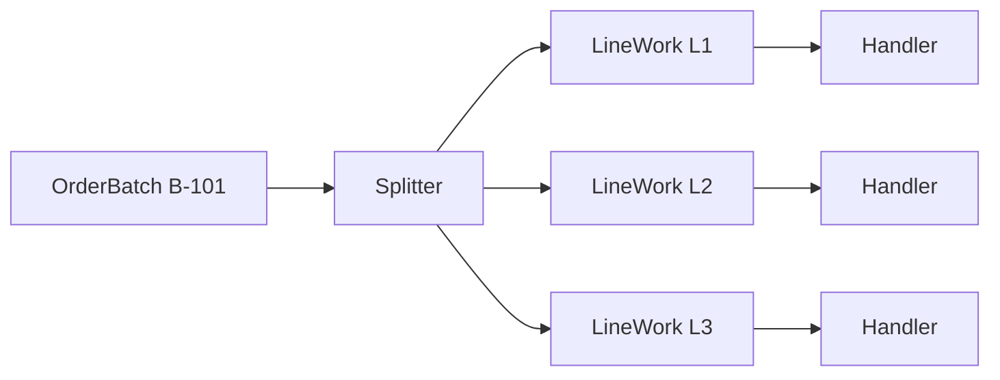
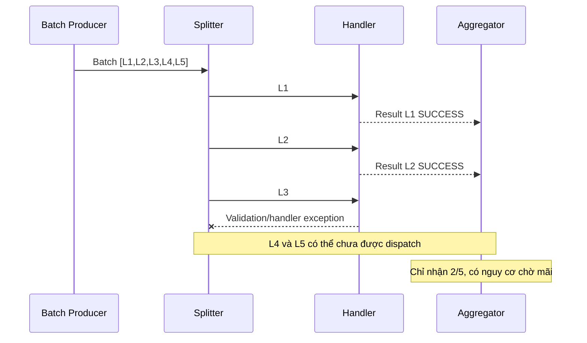
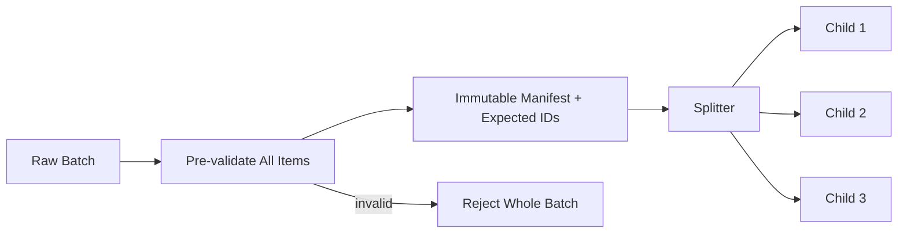
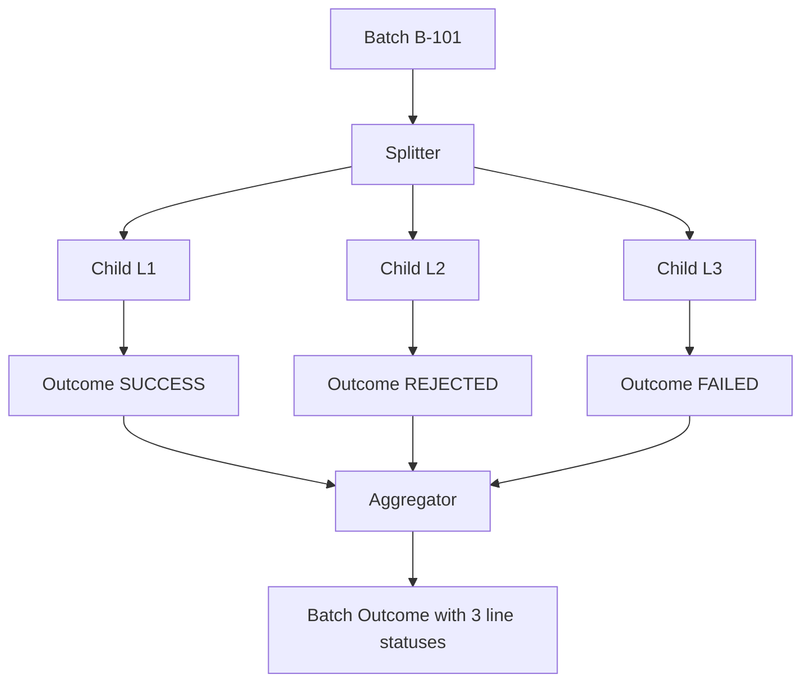
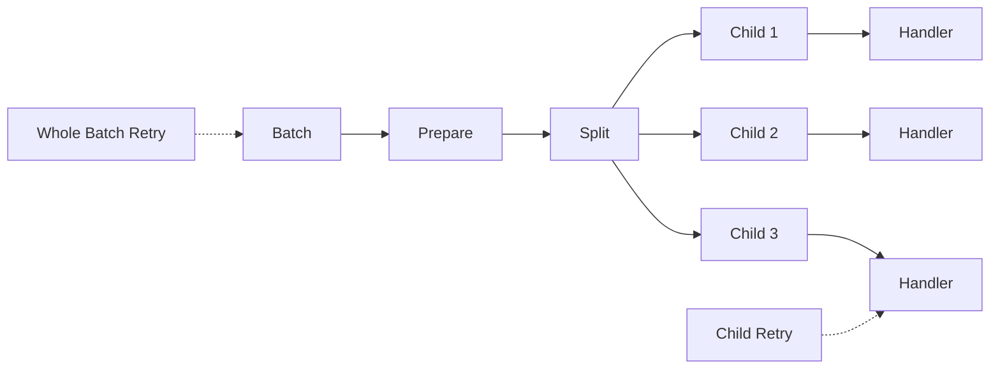
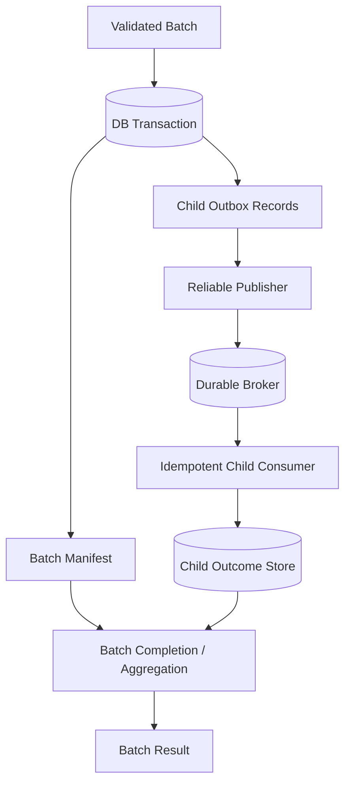
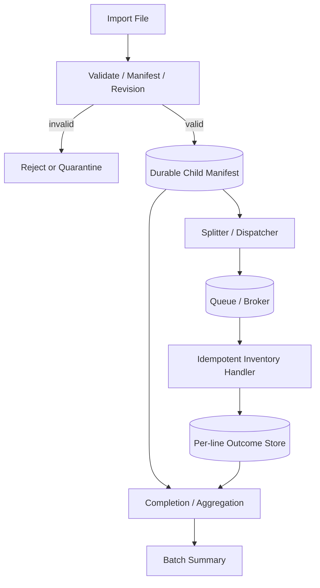

# Splitter phát hiện lỗi giữa chừng

**Splitter** là Enterprise Integration Pattern (EIP) tách một message có nội dung phức hợp thành nhiều message con để xử lý riêng. Một yêu cầu nhập kho có 100 dòng hàng có thể được tách thành 100 công việc; một tệp dữ liệu có hàng nghìn bản ghi có thể được tách thành từng record; một đơn hàng gồm nhiều item có thể đi qua nhiều handler, Router hoặc nhánh xử lý song song.

Trong kịch bản thành công, mô hình khá rõ: **một đầu vào → nhiều message con → xử lý từng phần → có thể ghép kết quả bằng Aggregator**. Nhưng nếu Splitter **phát hiện lỗi giữa chừng**, câu hỏi khó hơn nhiều: *Có bao nhiêu phần đã phát ra? Phần nào đã chạy? Phần nào có thể đã hoàn tất side effect? Retry từ đâu? Aggregator có chờ mãi những phần không được tạo ra hay không?*

Ví dụ, một batch gồm năm dòng `L1` đến `L5`. Splitter đã chuyển `L1` và `L2` tới downstream, đến `L3` mới phát hiện dữ liệu sai. Hai message đầu có thể đã được xử lý. Nếu phát lại cả batch sau khi sửa lỗi, `L1` và `L2` có thể bị thực thi lần thứ hai. Nếu downstream đã gửi lệnh giữ hàng, ghi sổ hoặc gửi thông báo, duplicate không còn là chuyện nhỏ.

Bài học **“Splitter phát hiện lỗi giữa chừng”** thuộc chương **Splitter** của module **SPRING_INTEGRATION_PATTERN**. Mục tiêu là triển khai Enterprise Integration Patterns bằng **Spring Integration** theo hướng luồng thông điệp ít phụ thuộc, dễ mở rộng, phối hợp Router, Filter, Transformer, Splitter, Aggregator, Gateway, retry, error channel, correlation, đồng thời kiểm thử và quan sát rõ từng nhánh.

Sau bài này, bạn cần phân biệt các thời điểm lỗi, mô hình hóa kết quả từng phần, kiểm soát thứ tự kiểm tra đầu vào, thiết kế retry và idempotency, xây flow Java DSL minh họa và kiểm thử lỗi xảy ra sau khi đã phát một số message con.

## 1. Splitter chia message và những điều không được tự suy diễn

Giả sử payload `OrderBatch` chứa ba dòng hàng:

```json
{
  "batchId": "B-101",
  "tenantId": "tenant-a",
  "lines": [
    {"lineId": "L1", "sku": "SKU-1", "quantity": 2},
    {"lineId": "L2", "sku": "SKU-2", "quantity": 1},
    {"lineId": "L3", "sku": "SKU-3", "quantity": 4}
  ]
}
```

Một Splitter có thể tạo ba message riêng biệt, mỗi message mang một `OrderLine` hoặc một wrapper như `LineWork`, rồi đưa chúng vào các channel downstream.



**Không có một giao dịch nguyên tử mặc định bao trùm toàn bộ việc tách và mọi side effect sau đó.** Trong Spring Integration, hành vi phụ thuộc vào loại Splitter, kết quả của phương thức chia, channel đầu ra, thread/executor, poller, adapter và cách xử lý exception.

Có ít nhất ba mốc phải phân biệt:

| Mốc | Ý nghĩa | Không được suy ra |
| --- | --- | --- |
| `CHILD_CREATED` | Đã tạo biểu diễn của message con | Message con đã gửi được |
| `CHILD_DISPATCHED` | Đã thử gửi/được channel chấp nhận theo cơ chế đó | Downstream đã hoàn tất nghiệp vụ |
| `CHILD_COMPLETED` | Handler/consumer xác nhận hoàn tất theo hợp đồng | Tất cả child khác cũng hoàn tất |

Với `DirectChannel`, việc dispatch thường gọi handler đồng bộ. Với `ExecutorChannel`, `QueueChannel` hoặc broker, việc nhận message vào một điểm trung gian và kết quả xử lý thực có thể xảy ra ở những thời điểm hoàn toàn khác nhau.

Đặc biệt, **trả về một `List` từ splitter không có nghĩa gửi cả danh sách như một transaction**. Các phần có thể được dispatch riêng; nếu handler thứ ba lỗi đồng bộ, những phần trước có thể đã thực hiện side effect.

## 2. "Lỗi giữa chừng" có những dạng nào?

Cần gọi đúng tên điểm lỗi trước khi thiết kế khôi phục.

| Loại lỗi | Ví dụ | Điều có thể đã xảy ra |
| --- | --- | --- |
| **Trước khi chia** | JSON batch không parse được, thiếu `batchId` | Chưa có child nào được tạo ở flow hiện tại |
| **Trong bước chuẩn bị** | Validation item thứ ba thất bại khi đang tạo danh sách | Có thể chưa phát child nếu toàn bộ việc chuẩn bị diễn ra trước dispatch |
| **Trong quá trình duyệt/tách** | Iterator/stream ném exception khi đọc phần tử tiếp theo | Một số child trước đó có thể đã được phát |
| **Khi dispatch child** | Queue đầy, channel không có subscriber, adapter từ chối | Một số child có thể đã được gửi, số khác chưa |
| **Handler đồng bộ lỗi** | Child `L3` gọi service và ném exception | `L1`, `L2` có thể đã hoàn tất side effect |
| **Handler bất đồng bộ lỗi** | Consumer xử lý `L3` sau khi Splitter đã trả về | Splitter đã dispatch nhiều child; lỗi phát sinh sau đó |
| **Kết quả ngoài không rõ** | HTTP timeout sau khi warehouse có thể đã giữ hàng | Không biết side effect đã xảy ra hay chưa |
| **Aggregator không đủ phần** | Một child bị Filter loại, lỗi hoặc timeout | Nhóm kết quả thiếu phần, có thể không đạt release condition |
| **Crash giữa tiến trình** | Ứng dụng chết sau khi gửi ba child | Trạng thái trong RAM có thể mất, downstream có thể đã xử lý |

### Một ví dụ theo trục thời gian



Sơ đồ thể hiện **một cấu hình xử lý đồng bộ giả định**, không phải quy luật chung rằng mọi Splitter luôn gọi tuần tự và dừng chính xác ở `L3`. Với executor, queue hoặc broker, `L4` và `L5` có thể đã enqueue trước khi lỗi của `L3` được quan sát.

**Đừng dùng số thứ tự dòng log để kết luận tất cả side effect đã commit theo thứ tự.** Phải quan sát thành công tại ranh giới nghiệp vụ.

## 3. Trước khi xử lý, phải định nghĩa hợp đồng của batch

Không thể quyết định retry chỉ bằng một exception nếu chưa rõ ứng dụng chấp nhận **thành công một phần** hay không.

Ba chính sách phổ biến:

**All-or-nothing ở cấp nghiệp vụ.** Batch chỉ được xác nhận hoàn tất khi mọi phần hợp lệ và xử lý thành công. Nếu một child lỗi, cần chặn hoàn tất, rollback trong cùng transaction nếu thật sự khả thi, hoặc **bồi hoàn** những side effect đã làm. Splitter tự nó không tạo được atomicity trên nhiều hệ thống ngoài.

**Partial success được phép.** Một batch có thể kết thúc với `3 SUCCESS, 1 REJECTED, 1 FAILED`. Phải có record kết quả cho từng child và một báo cáo cuối cùng không bỏ sót phần nào.

**Best-effort.** Một số event telemetry/analytics có thể cho phép bỏ phần sai, nhưng cần biết tỉ lệ mất dữ liệu và có định nghĩa rõ khi nào batch được xem là hoàn tất. Không nên dùng best-effort cho nghiệp vụ tiền, quyền hoặc tồn kho nếu không được phê duyệt.

Bảng quyết định:

| Câu hỏi | Một đáp án hợp lệ | Hệ quả thiết kế |
| --- | --- | --- |
| Mỗi child có side effect không? | Ghi tồn kho | Cần idempotency từng child |
| Sự thất bại của một child ảnh hưởng batch? | Có, batch phải báo `PARTIAL_FAILED` | Cần tổng hợp outcome của mọi child |
| Có thể retry riêng child lỗi? | Có | Cần manifest và trạng thái từng child |
| Có cần giữ thứ tự child? | Theo `orderId` | Không được dispatch đồng thời tùy tiện |
| Lỗ hổng có được phép? | Không | Missing child phải có timeout/reconciliation |
| Cần trả lời Gateway ngay? | Chỉ `ACCEPTED` | Phân biệt tiếp nhận batch với hoàn tất |
| Thời gian thực hiện có thể kéo dài? | Hàng phút | Cần lưu bền state, không chỉ chờ trong RAM |

Điểm mấu chốt: **batch contract xác định cách xử lý lỗi**, không phải chỉ dựa vào một tùy chọn `split()`.

## 4. Correlation và sequence metadata: hữu ích nhưng chưa đủ

Splitter trong Spring Integration thường phối hợp các metadata như `correlationId`, `sequenceNumber`, `sequenceSize` khi tạo các phần tử, tùy loại splitter, cách nó biết số phần và cấu hình liên quan.

Ví dụ về **khái niệm** khi batch có ba phần:

```text
L1: correlationId=B-101, sequenceNumber=1, sequenceSize=3
L2: correlationId=B-101, sequenceNumber=2, sequenceSize=3
L3: correlationId=B-101, sequenceNumber=3, sequenceSize=3
```

Đây là giá trị minh họa theo hợp đồng ứng dụng. Trong thực tế, **correlation header do framework gắn không nhất thiết chính là `batchId` trong payload**, và sequence metadata có thể phụ thuộc nguồn dữ liệu hoặc kiểu chia (chẳng hạn iterator/stream có kích thước chưa biết).

Các khái niệm cần phân biệt:

- **`batchId`:** định danh nghiệp vụ ổn định qua retry/replay.
- **`lineId`:** định danh child ổn định bên trong batch.
- **`correlationId`:** khóa nhóm để downstream biết những message thuộc cùng correlation scope.
- **`sequenceNumber`:** vị trí của child trong một lần split theo contract.
- **`sequenceSize`:** số phần mong đợi khi biết được; không được giả định luôn chính xác với stream động.
- **`attemptId`:** lần thử thực thi; có thể thay đổi khi retry, không thay thế business ID.

**Khuyến nghị:** Nếu kết quả từng child có tính quan trọng, hãy đặt `batchId`, `lineId` và `expectedParts` trong **payload/envelope đáng tin cậy** hoặc trạng thái batch bền vững; dùng Spring headers để hỗ trợ điều phối, không để sự an toàn phụ thuộc hoàn toàn vào các header có thể mất qua adapter.

### Khi nào Aggregator không nhận đủ nhóm?

Giả sử Aggregator được cấu hình release khi đủ năm message. Nếu Splitter gửi được hai message rồi lỗi, Aggregator có thể chỉ nhận hai và **không bao giờ đủ năm**. Cần có timeout, group-expiration policy, cơ chế tạo missing/failure outcomes hoặc workflow state bên ngoài.

Ngược lại, nếu `sequenceSize` không xác định và release strategy đoán rằng tất cả message đã tới, một nhóm có thể bị release **quá sớm**. Với luồng streaming hoặc số child thay đổi, cần tín hiệu kết thúc/manifest riêng và chính sách phát hiện thiếu.

## 5. Cách giảm khả năng lỗi giữa chừng: pre-validate và chuẩn bị danh sách trước khi split

Một cách giảm rủi ro là **kiểm tra toàn bộ batch và tạo manifest bất biến trước khi cho Splitter phát bất kỳ child nào**.



Nếu toàn bộ validation diễn ra trong một bước Transformer **trước Splitter**, lỗi ở item thứ ba có thể khiến flow từ chối batch mà **chưa có child nào được dispatch từ lần thử này**.

Nhưng giải pháp đó **không** bảo đảm side effect downstream của mọi child đều atomic: sau bước chuẩn bị, một channel/handler vẫn có thể lỗi khi phát child thứ ba, trong khi hai child đầu đã được xử lý.

### 5.1. Định nghĩa manifest và child work item

```java
import java.math.BigDecimal;
import java.util.List;

record OrderLine(
    String lineId,
    String sku,
    int quantity,
    BigDecimal unitPrice
) {}

record OrderBatch(
    String batchId,
    String tenantId,
    List<OrderLine> lines
) {
    OrderBatch {
        // Sao chép để không phụ thuộc danh sách mutable từ caller.
        lines = lines == null ? null : List.copyOf(lines);
    }
}

record LineWork(
    String batchId,
    String tenantId,
    String lineId,
    String sku,
    int quantity,
    BigDecimal unitPrice,
    int position,
    int expectedParts
) {}

record PreparedBatch(
    String batchId,
    List<LineWork> children
) {
    PreparedBatch {
        children = List.copyOf(children);
    }
}
```

`LineWork` chứa những thông tin cần thiết để child có thể xử lý độc lập. `position` và `expectedParts` là metadata **ứng dụng chủ động cung cấp**; chúng không phụ thuộc vào việc một transport có giữ Spring sequence headers hay không.

### 5.2. Kiểm tra tất cả item rồi mới tạo PreparedBatch

```java
import java.util.ArrayList;
import java.util.HashSet;
import java.util.List;
import java.util.Set;

final class BatchPreparer {

    PreparedBatch prepare(OrderBatch batch) {
        if (batch == null || isBlank(batch.batchId())
                || isBlank(batch.tenantId())
                || batch.lines() == null
                || batch.lines().isEmpty()) {
            throw new IllegalArgumentException("Invalid batch header");
        }

        // Giới hạn kích thước trước khi tạo rất nhiều child.
        if (batch.lines().size() > 1000) {
            throw new IllegalArgumentException("Batch too large");
        }

        Set<String> uniqueLineIds = new HashSet<>();
        List<LineWork> works = new ArrayList<>();
        int expected = batch.lines().size();

        for (int index = 0; index < expected; index++) {
            OrderLine line = batch.lines().get(index);

            if (line == null || isBlank(line.lineId())
                    || isBlank(line.sku())
                    || line.quantity() <= 0
                    || line.unitPrice() == null
                    || line.unitPrice().signum() < 0) {
                throw new IllegalArgumentException(
                    "Invalid line at index " + index);
            }

            if (!uniqueLineIds.add(line.lineId())) {
                throw new IllegalArgumentException(
                    "Duplicate lineId: " + line.lineId());
            }

            works.add(new LineWork(
                batch.batchId(),
                batch.tenantId(),
                line.lineId(),
                line.sku(),
                line.quantity(),
                line.unitPrice(),
                index + 1,
                expected));
        }

        return new PreparedBatch(
            batch.batchId(),
            List.copyOf(works));
    }

    private static boolean isBlank(String value) {
        return value == null || value.isBlank();
    }
}
```

Mẫu trên có các đặc điểm quan trọng:

1. **Kiểm tra toàn bộ** danh sách trước khi trả `PreparedBatch` cho Splitter.
2. Đảm bảo có `batchId`, `tenantId`, các `lineId` không trùng trong batch.
3. Giới hạn 1.000 item để tránh một message duy nhất tạo quá nhiều child.
4. Chốt `expectedParts` và `position` của từng item.
5. Không tạo side effect bên ngoài trong vòng lặp chuẩn bị.

Các giá trị như giới hạn 1.000 và cho phép `unitPrice = 0` chỉ là **chính sách minh họa**; phải điều chỉnh theo nghiệp vụ thật. Nếu `OrderBatch` từ deserializer có dữ liệu sai kiểu ngay từ đầu, lỗi có thể xảy ra trước `BatchPreparer`.

**Giới hạn:** Bộ nhớ phải chứa toàn bộ batch và danh sách child. Với dữ liệu streaming khổng lồ, pre-materialize có thể không phù hợp; khi đó cần kiểm tra từng phần, checkpoint và xử lý partial emission rõ ràng.

## 6. Ví dụ Spring Integration Java DSL: Splitter và Line Processor

Ví dụ tiếp theo dùng một luồng đồng bộ để minh họa điểm lỗi **sau khi đã phát các child trước đó**. Các thành phần được giản lược nhằm tập trung vào hành vi Splitter.

### 6.1. Gateway, handler và cấu hình

```java
import org.springframework.context.annotation.Bean;
import org.springframework.context.annotation.Configuration;
import org.springframework.integration.annotation.Gateway;
import org.springframework.integration.annotation.IntegrationComponentScan;
import org.springframework.integration.annotation.MessagingGateway;
import org.springframework.integration.channel.DirectChannel;
import org.springframework.integration.channel.QueueChannel;
import org.springframework.integration.config.EnableIntegration;
import org.springframework.integration.dsl.IntegrationFlow;
import org.springframework.messaging.MessageChannel;
import org.springframework.messaging.PollableChannel;

record LineResult(
    String batchId,
    String lineId,
    boolean success,
    String reason
) {}

interface LineProcessor {
    LineResult process(LineWork work);
}

@MessagingGateway
interface BatchGateway {
    @Gateway(requestChannel = "batches.in")
    void submit(OrderBatch batch);
}

@Configuration
@EnableIntegration
@IntegrationComponentScan
class BatchSplitConfiguration {

    @Bean
    BatchPreparer batchPreparer() {
        return new BatchPreparer();
    }

    @Bean("batches.in")
    MessageChannel batchesIn() {
        return new DirectChannel();
    }

    @Bean("lines.results")
    PollableChannel lineResults() {
        // Bộ đệm in-memory để bài test quan sát, KHÔNG tự bền vững.
        return new QueueChannel();
    }

    @Bean
    IntegrationFlow splitAndProcess(
            BatchPreparer preparer,
            LineProcessor processor) {

        return IntegrationFlow.from("batches.in")
            .transform(OrderBatch.class, preparer::prepare)
            // Trả về danh sách LineWork đã được chuẩn bị.
            .split(PreparedBatch.class, PreparedBatch::children)
            .handle(LineWork.class, (work, headers) ->
                processor.process(work))
            .channel("lines.results")
            .get();
    }
}
```

Ý tưởng Java DSL: `transform` chuẩn bị toàn bộ batch; `split` phát `LineWork`; Service Activator `handle` tạo `LineResult`; output đi vào `lines.results`. Cú pháp overload DSL và lựa chọn endpoint phụ thuộc phiên bản Spring Integration, nên khi tích hợp vào project thật cần kiểm tra API/version và dependency đang sử dụng.

Ứng dụng cần bean triển khai `LineProcessor`. `BatchGateway` cần được đăng ký bằng `@IntegrationComponentScan` hoặc cơ chế tương đương. Các channel minh họa ở đây **không thiết lập broker hay durable message store**.

### 6.2. Hai trường hợp lỗi có hậu quả rất khác nhau

**Trường hợp A — dòng thứ ba không hợp lệ trong `BatchPreparer`.** Phương thức `prepare` ném exception trước khi trả `PreparedBatch`. Trong **lần thực thi đó**, `split` chưa được gọi nên `LineProcessor` không nhận child nào.

**Trường hợp B — `LineProcessor.process(L3)` ném exception.** `PreparedBatch` đã được tạo và Splitter đã bắt đầu phân phối. Trong cấu hình đồng bộ này, `L1` và `L2` có thể đã tạo side effect, còn hành vi với `L4`/`L5` phụ thuộc cơ chế dispatch và exception. Không được coi cả batch “chưa chạy gì” chỉ vì Gateway nhận exception.

Nếu chuyển downstream sang executor/queue/broker, exception của `L3` có thể xảy ra **sau khi mọi child đã được enqueue**. Khi đó Gateway có thể trả về trước khi lỗi được phát hiện. **Kết luận về số child đã xử lý phải dựa vào trạng thái và test của cấu hình thực**.

### 6.3. Giữ batchId, lineId và correlation

Khi Transformer và Splitter tạo message mới, framework có thể bổ sung các header phục vụ grouping. Nhưng khi message đi qua adapter hoặc được replay, không nên dùng Spring message ID làm idempotency key. `LineWork(batchId, lineId, ...)` cho phép downstream tự nhận diện công việc bằng business ID ổn định, kể cả khi các header kỹ thuật thay đổi.

Nếu flow có Aggregator, bạn có thể chọn `batchId` làm correlation key cho nhóm kết quả và `lineId` để dedup từng kết quả. Cần thiết kế rõ **kết quả lỗi** sẽ được tạo ở đâu, vì endpoint ném exception không tự động phát `LineResult(success=false)`.

## 7. Nếu Splitter phát hiện lỗi khi duyệt Iterator hoặc Stream

Không phải splitter nào cũng nhận một danh sách đã được materialize. Một nguồn lớn có thể cung cấp iterator, cursor hoặc stream được đọc dần.

Giả sử một iterator hợp lệ ở hai phần đầu nhưng ném exception khi đọc phần thứ ba:

```java
import java.util.Iterator;
import java.util.NoSuchElementException;

final class FailingIterator implements Iterator<String> {
    private int index = 0;

    @Override
    public boolean hasNext() {
        return index < 5;
    }

    @Override
    public String next() {
        if (!hasNext()) {
            throw new NoSuchElementException();
        }
        index++;
        if (index == 3) {
            throw new IllegalStateException(
                "Corrupted input at record 3");
        }
        return "record-" + index;
    }
}
```

Đây là một cách **tạo lỗi giữa lúc đọc dữ liệu** để thảo luận/test. Số message con đã được phát ra trước khi exception phụ thuộc loại Splitter và cách nó duyệt/chuẩn bị kết quả. Không được suy luận chỉ từ việc iterator trả hai phần tử trước lỗi rằng Spring Integration đã chắc chắn dispatch đúng hai message; hãy kiểm tra implementation và quan sát output thực.

Khi số phần chưa biết từ đầu:

- `sequenceSize` có thể không có thông tin hữu ích về tổng số child.
- Không thể chỉ dựa vào việc “đã nhận đủ N” nếu N chưa được công bố.
- Cần một **manifest**, **end-of-stream signal**, **checkpoint**, hoặc **batch lifecycle record** để biết việc chia đã hoàn tất.
- Nếu stream có I/O, lỗi đọc nguồn và lỗi handler downstream phải được phân loại riêng.
- Phải đóng cursor/stream/tài nguyên đúng cách khi lỗi hoặc hủy xử lý.

### Mô hình stream lớn nên có checkpoint

Ví dụ một file gồm một triệu record có thể được xử lý thành các chunk nhỏ:

```text
batchId = import-2026-11-21
sourceCursor = offset 50000
lastCommittedOffset = 49899
nextChunk = records 49900..49999
status = RUNNING
```

Đây là **trạng thái ứng dụng minh họa**, không phải cấu trúc checkpoint được Splitter tự sinh. Nếu muốn restart an toàn, checkpoint phải liên kết với việc phát/ghi kết quả theo một giao thức tin cậy. Chỉ lưu `lastReadOffset` trước khi downstream commit không bảo đảm mỗi record sẽ được xử lý đúng một lần.

## 8. Vì sao retry toàn bộ batch có thể làm trùng side effect?

Giả sử hệ thống xử lý năm dòng:

```text
L1 -> inventory reserved, SUCCESS
L2 -> inventory reserved, SUCCESS
L3 -> timeout, OUTCOME_UNKNOWN
L4 -> chưa biết đã nhận hay chưa
L5 -> chưa biết đã nhận hay chưa
```

Nếu retry toàn bộ `OrderBatch`, các dòng `L1` và `L2` có thể bị giữ hàng lần hai. Với một số side effect, duplicate là lỗi nghiêm trọng; với những thao tác upsert idempotent, retry có thể an toàn hơn nhưng vẫn tốn tài nguyên.

Hai hướng phục hồi:

**A. Replay toàn bộ batch với idempotency đầy đủ.** Mỗi child có khóa ổn định; consumer kiểm tra đã xử lý, trả lại kết quả trước đó hoặc bỏ qua duplicate. Cách này dễ tổ chức lại từ nguồn, nhưng cần mọi child handler chịu được phát lại.

**B. Retry riêng child cần xử lý.** Một **manifest** đã được lưu ghi trạng thái từng child; chỉ child `PENDING`, `FAILED_RETRYABLE` hoặc `UNKNOWN` sau đối soát được đưa vào retry. Cách này phức tạp hơn nhưng giảm side effect không cần thiết.

Dù chọn cách nào, **không thể chỉ lấy exception cuối cùng của Splitter làm danh sách các child chưa xử lý**.

### Idempotency theo batch và line

Một khóa phù hợp trong nhiều nghiệp vụ:

```text
(tenantId, batchId, lineId, operationType)
```

Ví dụ, cùng `lineId=L1` có thể trải qua `VALIDATE` và `RESERVE`; nếu hai thao tác có side effect khác nhau, `operationType` giúp phân biệt phạm vi chống trùng. `attemptId` thường **không** nên nằm trong idempotency key của cùng một lệnh retry vì attempt ID thay đổi sẽ làm mất khả năng nhận diện duplicate.

Với database, record chống trùng nên được ghi **cùng transaction với side effect** khi chúng thuộc cùng database và có thể xử lý atomically. Với HTTP/provider bên ngoài, phải dùng idempotency key hoặc cơ chế đối soát mà provider hỗ trợ; một bảng dedup nội bộ không tự bảo đảm external request chưa được thực hiện trước khi timeout.

## 9. Trạng thái theo từng child: nguồn sự thật cho khôi phục

Một batch có thể có bảng manifest như sau:

| batchId | lineId | status | attempt | lastOutcome |
| --- | --- | --- | --- | --- |
| B-101 | L1 | `SUCCESS` | 1 | Reserved |
| B-101 | L2 | `SUCCESS` | 1 | Reserved |
| B-101 | L3 | `UNKNOWN` | 1 | Timeout after request |
| B-101 | L4 | `PENDING` | 0 | Not dispatched |
| B-101 | L5 | `PENDING` | 0 | Not dispatched |

Cách lưu có thể là database, message store hoặc một cơ chế orchestrator phù hợp; bảng trên là **mô hình ứng dụng**, không phải dữ liệu tự động mà Spring Integration quản lý khi gọi `split`.

Các trạng thái nên phân biệt:

- `PENDING`: chưa có attempt dispatch được ghi nhận.
- `DISPATCHED`: đã gửi theo ngữ nghĩa transport, chưa có kết quả nghiệp vụ.
- `PROCESSING`: consumer đang thực hiện.
- `SUCCESS`: side effect đã được xác nhận/commit theo hợp đồng.
- `REJECTED`: dữ liệu child không phù hợp, không tự retry.
- `FAILED_RETRYABLE`: lỗi tạm thời có thể thử lại.
- `FAILED_PERMANENT`: lỗi không thể phục hồi tự động.
- `UNKNOWN`: không thể xác định side effect có xảy ra hay chưa.

Một giá trị `DISPATCHED` **không nên được coi là `SUCCESS`** chỉ vì channel trả về thành công. Với broker, có thể dùng confirmation/ack để hiểu việc publish được chấp nhận; nhưng consumer commit side effect là một bước khác.

### Cập nhật trạng thái phải chịu được concurrency

Nếu nhiều worker có thể retry cùng `LineWork`, phải ngăn hai worker cùng thực hiện side effect trái hợp đồng. Có thể dùng optimistic concurrency, row lock, lease/fencing hoặc cơ chế broker consumer ownership. Trạng thái `PROCESSING` trong RAM không đủ để ngăn instance khác chạy cùng child sau rebalancing/restart.

Trạng thái nên đi kèm `version` hoặc `updatedAt`, nhưng **timestamp không thay thế được concurrency control**. Với timeout/lease hết hạn, một worker cũ có thể còn chạy; idempotency ở điểm side effect vẫn cần thiết.

## 10. Aggregator không thể tự suy ra child nào bị lỗi

Một Aggregator nhận các kết quả của child, nhóm theo correlation và release khi đạt điều kiện. Nếu các child lỗi bằng exception mà không phát result, Aggregator có thể **không bao giờ thấy thông tin thất bại**.



Một cách thiết kế là **chuyển kết quả mỗi child thành một message có trạng thái**, bất kể xử lý thành công hay thất bại đã được xử lý:

```java
enum LineStatus {
    SUCCESS,
    REJECTED,
    FAILED_RETRYABLE,
    FAILED_PERMANENT,
    UNKNOWN
}

record LineOutcome(
    String batchId,
    String lineId,
    int expectedParts,
    LineStatus status,
    String reasonCode
) {}
```

Khi handler gặp một lỗi đã được phân loại, một recovery flow có thể tạo `LineOutcome` và gửi vào nhánh kết quả theo hợp đồng. **Spring Integration không tự biến mọi exception thành `LineOutcome`**. Cần cấu hình retry/error advice hoặc orchestration tạo outcome đúng.

### Release condition phải dựa trên kết quả thực

Không nên release chỉ vì nhận `expectedParts` message nếu một child gửi trùng hai lần và một child khác mất: tổng message count có thể bằng N nhưng **tập line ID chưa đầy đủ**.

Một release condition ở mức nghiệp vụ có thể là:

```text
expectedIds = manifest.childIds
observedIds = distinct accepted outcomes by lineId

release when:
    every expectedId has a terminal outcome
    OR a configured timeout/partial-release policy fires

terminal statuses:
    SUCCESS | REJECTED | FAILED_PERMANENT

non-terminal statuses:
    PENDING | DISPATCHED | PROCESSING
    | FAILED_RETRYABLE | UNKNOWN
```

Danh sách terminal/non-terminal chỉ là gợi ý; nghiệp vụ có thể coi `UNKNOWN` là terminal cần manual review, nhưng phải thể hiện rõ tính chưa xác định của side effect.

Với Spring Integration Aggregator, hãy thiết kế **correlation strategy**, **release strategy**, **group timeout**, **message store**, **duplicate handling** và **group expiry** phù hợp. Các API cấu hình cụ thể phụ thuộc phiên bản framework và ngữ nghĩa mong muốn. Nếu batch kéo dài qua restart, một message group lưu trong bộ nhớ không tự đáp ứng durability.

## 11. Error channel, discard channel và failure outcome khác nhau

Trong luồng Splitter, dễ nhầm ba đường xử lý:

| Đường | Khi nào xuất hiện? | Điều cần tự thiết kế |
| --- | --- | --- |
| **Filter discard channel** | Một child bị Filter loại theo predicate | Có cần tạo rejected outcome cho Aggregator không? |
| **Error channel** | Component bắt và công bố `ErrorMessage` theo cấu hình | Làm sao lấy batchId/lineId, phân loại lỗi, retry? |
| **Child outcome channel** | Ứng dụng phát kết quả thành công/thất bại đã chuẩn hóa | Làm sao dedup, aggregate và release? |

Nếu Filter loại một child trước khi nó tạo kết quả, downstream Aggregator **không tự biết child ấy đã bị loại**. Có thể tạo `LineOutcome(REJECTED)` từ discard flow. Nếu không, release strategy cần cho phép bỏ qua có chủ đích và manifest phải biết vì sao số phần ít hơn mong đợi.

### Lỗi đồng bộ và bất đồng bộ

Trong `DirectChannel`, exception từ một handler downstream thường được đẩy lên caller đồng bộ. Trong `ExecutorChannel`, `QueueChannel` với poller hoặc inbound adapter của broker, exception có thể được bắt ở một thread khác rồi phát thành `ErrorMessage` theo cấu hình xử lý lỗi.

**Chỉ tạo bean `errorChannel` không bảo đảm mọi exception đi vào đó**, và một `ErrorMessage` chưa chắc chứa đủ business metadata nếu message gốc/header đã bị thay. Cần xác định rõ failed message, exception chain, source handler và cách tạo `LineOutcome` từ lỗi.

### Không nuốt lỗi để làm batch "thành công"

Một error handler ghi log rồi bỏ qua exception có thể khiến hệ thống quên mất một child. Nếu release strategy chỉ đếm kết quả thành công, batch sẽ chờ mãi; nếu một nơi khác coi việc không có exception là thành công, batch có thể bị báo hoàn tất giả.

Hãy đảm bảo mỗi lỗi có **kết quả quan sát được**: retry, quarantine, failure outcome, manual review hoặc phản hồi cho caller theo hợp đồng.

## 12. Retry boundary: từ trước Splitter hay tại từng child?

Vị trí retry quyết định số việc chạy lại:



**Retry toàn bộ flow từ `batches.in`:** chạy lại prepare/split và có thể dispatch lại tất cả child. Chỉ an toàn nếu downstream idempotent và quy tắc dữ liệu/replay rõ ràng.

**Retry từng handler child:** giảm công việc trùng, nhưng khi child bị mất **trước khi dispatch**, retry handler không giúp gì. Cần một manifest hoặc durable queue để phát hiện công việc chưa gửi.

**Retry tại adapter:** có thể phát lại message đã enqueue; cần xác định ack/offset, redelivery, dead-letter và duplicate tại consumer.

**Replay sau sửa dữ liệu:** số child có thể thay đổi; phải quyết định đó là *cùng batch revision* hay một batch/revision mới. Không được dùng cùng `batchId` nhưng âm thầm đổi danh sách child nếu Aggregator vẫn dựa trên manifest cũ.

### Một công thức trạng thái cần kiểm tra

```text
batch.expectedIds = {L1, L2, L3, L4, L5}
batch.successIds  = {L1, L2}
batch.retryIds    = {L3}
batch.pendingIds  = {L4, L5}

batch COMPLETE only if policy permits all terminal outcomes;
otherwise PARTIAL / RETRYING / REVIEW_REQUIRED.
```

Đừng đánh đồng **số child đã thử** với **số child có kết quả cuối**. Với queue bất đồng bộ, một child đang `DISPATCHED` có thể chưa bắt đầu xử lý.

## 13. Durable fan-out và transactional outbox khi không được mất child

Nếu xử lý batch có giá trị cao, yêu cầu là: **đã chấp nhận batch thì không được quên các child phải xử lý**, kể cả khi process chết giữa lúc phát.

Chỉ đưa toàn bộ child qua `DirectChannel` hoặc `QueueChannel` trong bộ nhớ không đáp ứng yêu cầu đó. Một hướng thường dùng:

1. Validate batch trước.
2. Ghi một **manifest** gồm batch ID và tất cả child IDs.
3. Ghi các **outbox work items** theo child trong cùng database transaction phù hợp, hoặc thiết kế nguồn sự thật tương đương.
4. Một dispatcher phát từng child ra broker/queue, dùng ack/confirm theo semantics của transport.
5. Consumer xử lý idempotent, cập nhật outcome và gửi kết quả.
6. Bộ tổng hợp dựa trên **tập child kỳ vọng** để quyết định trạng thái batch.



**Outbox không bảo đảm exactly-once delivery theo nghĩa tuyệt đối.** Publisher có thể gửi lại sau crash nếu chưa kịp ghi trạng thái đã publish; consumer phải chịu được duplicate. Nhưng manifest + outbox giúp có căn cứ bền vững để xác định child nào cần được phát, thay vì phụ thuộc vào vị trí Splitter dừng trong RAM.

Cần lưu ý transaction isolation, unique key, capacity, cleanup outbox, retry có giới hạn, backpressure và quyền theo tenant. Nếu child được gửi sang hệ thống ngoài có side effect, còn phải có idempotency key/đối soát ở đích.

### Có bắt buộc dùng outbox?

Không. Với dữ liệu best-effort, nhỏ, có thể dùng flow đồng bộ và phản hồi lỗi. Với message đã nằm trong một durable broker, có thể sử dụng hợp đồng ack/retry phù hợp và một manifest được lưu bền mà không nhất thiết phải có outbox ở mọi chỗ.

**Chọn mức bền vững theo mức độ mất mát có thể chấp nhận**, không theo tên pattern.

## 14. Thứ tự xử lý và concurrency khi một child lỗi

Nếu các child độc lập, có thể chạy song song để tăng throughput. Nếu các child là các bước thay đổi cùng một đối tượng, xử lý song song có thể phá thứ tự nghiệp vụ.

Ví dụ:

```text
L1: reserve inventory
L2: capture payment
L3: confirm order
```

Đây không còn là ba công việc độc lập; thứ tự phụ thuộc nghiệp vụ khiến **Splitter song song** không phải thiết kế phù hợp nếu không có coordinator. Routing Slip, process manager hoặc chuỗi flow tuần tự có thể biểu đạt dependency tốt hơn.

Một batch dòng hàng cũng có thể có hai dòng cùng `sku` và cùng kho. Dù khác `lineId`, side effect tồn kho có thể cùng thao tác lên một record; cần concurrency control ở database hoặc xử lý theo key.

Nếu child thứ hai lỗi trong luồng đồng bộ, việc dừng dispatch phần còn lại có thể là hành vi phù hợp với chính sách fail-fast. Nếu child xử lý bất đồng bộ, nhiều child khác có thể đã bắt đầu trước khi lỗi được quan sát. **Không thể chỉ dùng một biến `cancelled=true` rồi chắc chắn thu hồi được side effect đã xảy ra.**

### Các lựa chọn kiểm soát lỗi

| Chiến lược | Ưu điểm | Rủi ro |
| --- | --- | --- |
| **Fail fast** | Phát hiện lỗi sớm, tránh tạo thêm child nếu chưa dispatch | Vẫn có thể đã có side effect trước lỗi |
| **Continue and collect** | Có báo cáo đầy đủ theo từng child | Cần outcome chuẩn hóa, có thể tốn tài nguyên |
| **Stop per key** | Giữ thứ tự trong một aggregate | Một child lỗi có thể gây tắc nghẽn key |
| **Retry child independently** | Không phát lại child thành công | Cần manifest và idempotency |
| **Compensate succeeded children** | Hỗ trợ all-or-nothing ở mức nghiệp vụ | Bồi hoàn có thể lỗi/không đảo ngược hoàn toàn |
| **Quarantine batch** | Chặn lan truyền dữ liệu bất thường | Cần manual workflow và SLA |

Các chiến lược trên là **chính sách orchestration**, không phải một flag chung của Splitter.

## 15. Quan sát khi Splitter dừng giữa chừng

Để điều tra, cần biết:

- Tổng số child **được kỳ vọng** theo manifest.
- Số child **đã tạo/đã thử dispatch**.
- Số child **được channel/broker xác nhận tiếp nhận**.
- Số child **đã bắt đầu xử lý**.
- Số child **đã hoàn tất** theo trạng thái.
- Child nào bị lỗi, lỗi ở **prepare, split, dispatch hay handler**.
- Những child nào bị retry và phiên bản manifest nào được dùng.

Một log sự kiện có cấu trúc:

```json
{
  "event": "split_child_failed",
  "batchId": "B-101",
  "lineId": "L3",
  "tenantId": "tenant-a",
  "manifestVersion": 1,
  "expectedParts": 5,
  "attempt": 1,
  "stage": "PROCESSING",
  "reasonCode": "INVENTORY_TIMEOUT",
  "outcome": "UNKNOWN",
  "correlationId": "import-101"
}
```

Không log toàn bộ payload dòng hàng hay PII khi không cần. Các log và trace có thể bị sampling hoặc thất lạc; nếu cần đối soát tài chính, nên có **trạng thái/audit bền vững** chứ không chỉ dựa vào log.

### Metrics có ích

```text
split_batches_total{result="prepared"}
split_batches_total{result="rejected"}
split_child_dispatch_total{result="accepted"}
split_child_processing_total{result="success"}
split_child_processing_total{result="failed"}
split_pending_children{workflow="inventory"}
split_aggregator_timeouts_total{workflow="inventory"}
split_retry_total{reason="TRANSIENT_FAILURE"}
```

Đây là **metric thiết kế minh họa**, không phải những metric Spring Integration tự phát sinh đúng tên. Giữ nhãn có cardinality thấp như `workflow`, `stage`, `result`, `reason`; đừng đặt `batchId` hoặc `lineId` thành metric tag. Những ID đó nên nằm ở log/trace/audit có phân quyền.

**Tỷ lệ quan trọng:** `completedDistinctChildIds / expectedChildIds`, không phải số lần nhận message hay số attempt. Nếu child trùng được xử lý hai lần, đếm attempt có thể khiến số “đã xử lý” lớn hơn số phần kỳ vọng.

## 16. Kiểm thử lỗi trước split, giữa dispatch và sau xử lý

Một bài test chỉ kiểm tra số phần được chia thành công chưa đủ. Cần **inject lỗi đúng giai đoạn** và assert **side effect/trạng thái cuối**.

### 16.1. Ma trận kiểm thử

| Tình huống | Kỳ vọng |
| --- | --- |
| Batch ba dòng hợp lệ | Ba `LineWork` mang batch ID và line ID đúng |
| Dòng thứ ba không hợp lệ | `BatchPreparer` từ chối trước split, handler không được gọi |
| Hai dòng trùng `lineId` | Pre-validation reject, không tạo side effect |
| Batch quá kích thước | Fail fast trước khi tách |
| Handler thứ ba ném exception đồng bộ | Quan sát child trước có thể đã xử lý; không kết luận atomic rollback |
| Iterator lỗi ở lần đọc thứ ba | Xác minh thực tế số child đã phát theo implementation |
| Queue/broker đầy ở child thứ ba | Có dispatch failure/backpressure, không báo batch complete |
| Async child thứ ba timeout | Trạng thái child là FAILED/UNKNOWN, không coi batch success |
| Child L1 bị redelivery | Không thực hiện side effect lặp nếu idempotency yêu cầu |
| Retry từ trước Splitter | Các child trước có thể được phát lại, dedup bảo vệ |
| Retry chỉ L3 | L1/L2 không bị gọi lại |
| Filter loại L4 | Có RejectedOutcome hoặc điều chỉnh manifest theo hợp đồng |
| Aggregator thiếu L5 | Timeout/partial policy, không chờ vô hạn |
| Một child result trùng, một child thiếu | Aggregator không release sai chỉ vì count đủ N |
| Crash/restart giữa dispatch | Manifest/outbox/recovery đảm bảo child chưa hoàn tất được phát lại |
| Splitter dùng tenant khác | Không lẫn manifest, cache hoặc outcome giữa tenant |

### 16.2. JUnit 5: kiểm tra fail trước khi split

```java
import static org.junit.jupiter.api.Assertions.*;
import java.math.BigDecimal;
import java.util.List;
import org.junit.jupiter.api.Test;

class BatchPreparerTest {
    private final BatchPreparer preparer = new BatchPreparer();

    @Test
    void preparesEveryChildWithStableIdentifiers() {
        OrderBatch input = new OrderBatch(
            "B-101", "tenant-a",
            List.of(
                new OrderLine("L1", "SKU-1", 2,
                    new BigDecimal("100")),
                new OrderLine("L2", "SKU-2", 1,
                    new BigDecimal("200"))
            )
        );

        PreparedBatch prepared = preparer.prepare(input);

        assertEquals(2, prepared.children().size());
        assertEquals("B-101",
            prepared.children().get(0).batchId());
        assertEquals("L2",
            prepared.children().get(1).lineId());
        assertEquals(1,
            prepared.children().get(0).position());
        assertEquals(2,
            prepared.children().get(1).expectedParts());
    }

    @Test
    void rejectsBadThirdLineBeforeReturningManifest() {
        OrderBatch input = new OrderBatch(
            "B-102", "tenant-a",
            List.of(
                new OrderLine("L1", "SKU-1", 2,
                    BigDecimal.ONE),
                new OrderLine("L2", "SKU-2", 1,
                    BigDecimal.ONE),
                new OrderLine("L3", "SKU-3", -4,
                    BigDecimal.ONE)
            )
        );

        assertThrows(IllegalArgumentException.class,
            () -> preparer.prepare(input));
    }
}
```

Đây là unit test **logic chuẩn bị**. Nó cho thấy `prepare` không trả danh sách child khi có item lỗi, chứ chưa chứng minh một luồng có I/O ngoài đã không tạo side effect trước đó.

### 16.3. Test lỗi đồng bộ sau khi đã dispatch vài child

Với `BatchSplitConfiguration` ở mục 6, có thể dùng một `LineProcessor` fake/spy cho phép theo dõi thứ tự gọi và ném exception tại `L3`:

```java
import java.util.List;
import java.util.concurrent.CopyOnWriteArrayList;

final class FailingLineProcessor implements LineProcessor {
    private final List<String> started =
        new CopyOnWriteArrayList<>();

    @Override
    public LineResult process(LineWork work) {
        started.add(work.lineId());

        if ("L3".equals(work.lineId())) {
            throw new IllegalStateException(
                "Simulated failure at L3");
        }

        return new LineResult(
            work.batchId(),
            work.lineId(),
            true,
            null);
    }

    List<String> startedLineIds() {
        return List.copyOf(started);
    }
}
```

Trong integration test thực, bạn sẽ gửi một batch hợp lệ có năm dòng, cấu hình `DirectChannel` và fake processor này, rồi assert exception/các lời gọi xảy ra **theo implementation đang chạy**. Không nên khẳng định bằng lý thuyết rằng `L4` và `L5` chắc chắn không được gửi trong mọi phiên bản/cấu hình.

Một test quan trọng hơn: giả lập side effect `L1` và `L2` đã commit trước khi `L3` lỗi; sau đó **retry batch** và kiểm tra handler có idempotency không gây side effect trùng.

### 16.4. Test bất đồng bộ, timeout và khôi phục

Nếu đổi sang `QueueChannel`, executor hoặc broker:

- Không assert kết quả handler ngay sau `BatchGateway.submit`; dùng cơ chế chờ có timeout hữu hạn.
- Phân biệt enqueue thành công với result đã commit.
- Giả lập timeout sau khi external API đã thực hiện side effect.
- Cho broker redeliver child `L2`; assert idempotency key.
- Khi có Aggregator, gửi `LineOutcome` trùng `L1` và thiếu `L3`; test không release sai.
- Cho message group hết hạn; kiểm tra kết quả partial và khả năng replay/reconciliation.
- Khởi động lại consumer/dispatcher nếu dùng durable broker/outbox; kiểm tra child chưa hoàn tất được phục hồi.

Test cần kiểm tra **outcome theo batchId/lineId**, không chỉ tổng số message trên channel.

## 17. Các sai lầm thường gặp

**“Splitter bị exception thì không child nào đã chạy.”** Sai nếu lỗi xảy ra sau khi một phần message đã được dispatch hoặc xử lý. Phải xác định thời điểm lỗi.

**“Đã trả về danh sách child thì cả batch được dispatch atomically.”** Không. Materialize danh sách trước có thể tránh lỗi trong bước chuẩn bị, không tạo atomic commit cho các side effect.

**“Cứ retry toàn bộ batch là xong.”** Có nguy cơ gửi lặp child đã thành công, nhất là khi consumer thực hiện lệnh có side effect.

**“Spring message ID đủ để chống duplicate.”** Message ID framework có thể thay khi tạo message mới/replay. Cần business key ổn định như `batchId + lineId + operationType`.

**“sequenceSize luôn là số phần cuối cùng.”** Với nguồn động/stream hoặc cấu hình khác nhau, cần xác minh metadata thực tế và có manifest/end-of-stream policy.

**“Aggregator biết child bị lỗi dù không có kết quả.”** Không. Một exception không tự tạo failed outcome cho Aggregator.

**“Đếm đủ N result nghĩa là đủ N child.”** Result trùng có thể lấp chỗ của child mất. Phải so distinct IDs với manifest.

**“Có error channel nghĩa là tự retry đúng child.”** Error channel vận chuyển lỗi khi được cấu hình; retry stage, backoff và trạng thái đều phải do ứng dụng xác định.

**“Một child đã vào queue thì đã xử lý xong.”** Queue/broker nhận message không đồng nghĩa handler đã commit.

**“Filter loại một child là Aggregator tự giảm expectedParts.”** Không có điều chỉnh tự động theo ngữ nghĩa batch của bạn. Cần kết quả REJECTED hoặc policy nhóm rõ ràng.

**“Parallel Splitter luôn an toàn vì các child độc lập.”** Cùng SKU, tài khoản hoặc aggregate có thể chia sẻ state; concurrency control và ordering là yêu cầu riêng.

**“Lưu offset đọc file là đủ để recovery.”** Offset đọc trước khi side effect commit có thể khiến xử lý thiếu/trùng; checkpoint phải nhất quán với kết quả.

**“Outbox giúp exactly once nên không cần idempotency.”** Publisher/broker/consumer vẫn có thể redeliver; consumer phải chịu được duplicate.

**“Log ‘split success’ là chứng cứ mọi phần thành công.”** Phải đo số child có outcome terminal được xác nhận, và đối chiếu manifest.

## 18. Bài tập thiết kế: nhập kho 10.000 dòng và lỗi ở dòng 6.001

Một dịch vụ nhập kho nhận `InventoryImport(batchId, tenantId, records)` từ một file lớn, có **10.000** dòng. Mỗi dòng có `lineId` ổn định và lệnh cập nhật tồn kho. Hệ thống hiện tại dùng Splitter đọc streaming, rồi gọi Inventory Service cho từng dòng.

Tình huống:

1. Các dòng 1 đến 6.000 đã được gửi đi.
2. Khi đọc dòng 6.001, parser phát hiện dữ liệu hỏng.
3. Một số dòng từ 1 đến 6.000 đã commit, một số đang chờ queue; không biết chắc dòng 5.999 đã hoàn tất.
4. Người vận hành sửa file và khởi động lại import; phiên bản file mới có thể có 10.001 dòng.
5. Aggregator đang chờ báo cáo tổng hợp nhưng không biết số dòng cuối cùng đáng tin là bao nhiêu.

Hãy thiết kế hướng xử lý:



Các câu hỏi:

1. Có nên **pre-scan** file trước khi phát child không? Khi nào hai lần đọc sẽ quá đắt và nên chunk/checkpoint?
2. Vì sao `lastReadOffset=6000` không đủ chứng minh 6.000 side effect đã commit?
3. Nếu file được sửa, bạn sẽ dùng cùng `batchId` hay tạo `revision` mới? Manifest cũ được xử lý thế nào?
4. Khóa idempotency nên gồm những gì để không ghi tồn kho trùng?
5. Nếu Inventory API timeout sau khi đã commit, làm sao phân biệt `FAILED` và `UNKNOWN`?
6. Nếu các dòng có cùng `sku`, việc xử lý song song có cần giới hạn concurrency hoặc lock theo key?
7. Aggregator cần biết `expectedParts` từ đâu nếu nguồn streaming không biết số lượng ban đầu?
8. Nếu một dòng bị Filter loại, nhánh discard sẽ tạo `LineOutcome(REJECTED)` như thế nào?
9. Khi consumer crash sau khi cập nhật tồn kho nhưng trước ack, redelivery cần xử lý ra sao?
10. Những metrics/log nào phân biệt `CHILD_DISPATCHED` với `CHILD_COMPLETED`?
11. Hệ thống có được trả “đã import thành công” ngay khi Splitter phát hết message không? Vì sao?
12. Test chaos nào mô phỏng crash đúng lúc 5.999/6.001 để phát hiện missing/duplicate?

**Tiêu chí hoàn thành:** thiết kế nhận diện được lỗi ở đúng giai đoạn; giữ manifest và outcome theo từng child; retry không gây side effect trùng; có chính sách partial success/quarantine; Aggregator có release/timeout hợp lệ; và mọi trạng thái có thể đối soát sau restart.

## 19. Checklist trước khi đưa Splitter vào production

- [ ] Đã xác định chính xác ý nghĩa `batchId`, `lineId` và revision.
- [ ] Đã nêu contract: all-or-nothing, partial success hay best-effort.
- [ ] Có giới hạn size/depth của batch và kiểm tra dữ liệu đầu vào.
- [ ] Đã phân biệt lỗi prepare, split/iterate, dispatch và downstream handler.
- [ ] Đã xác định nơi nào có thể **phát message con trước khi lỗi xuất hiện**.
- [ ] Nếu pre-validate toàn bộ, hiểu rõ giới hạn memory/streaming.
- [ ] Nếu xử lý stream lớn, có checkpoint/end-of-stream/manifest đáng tin.
- [ ] Có idempotency key ổn định **theo child và operation**.
- [ ] Retry boundary không vô tình chạy lại những side effect đã thành công.
- [ ] Với external timeout, trạng thái UNKNOWN có đường đối soát.
- [ ] Có source of truth lưu **expected child IDs** và outcome khi nghiệp vụ yêu cầu.
- [ ] Aggregator được cấu hình correlation, release, timeout và duplicate policy.
- [ ] Filter discard và error flow có thể tạo failure/rejection outcome khi cần.
- [ ] Đã kiểm tra semantics đồng bộ/bất đồng bộ của channel và adapter.
- [ ] Không đánh đồng send/enqueue accepted với business completed.
- [ ] Nếu cần durability, có manifest/outbox/broker/message store thích hợp.
- [ ] Có log/metric/trace riêng cho stage, attempt, kết quả và backlog.
- [ ] Đã test invalid child đầu/cuối, lỗi sau partial dispatch, duplicate và restart.
- [ ] Đã rà soát tenant isolation, PII, dữ liệu nhạy cảm và quyền replay.

## Ghi nhớ

**Splitter phát hiện lỗi giữa chừng** không có nghĩa toàn bộ batch được hoàn tác. Message con có thể đã được gửi, đang xử lý hoặc đã hoàn thành side effect trước khi lỗi bị phát hiện. Cần phân biệt **lỗi tạo child, lỗi dispatch, lỗi handler và kết quả chưa xác định**, rồi chọn chính sách khôi phục phù hợp.

Trong **Spring Integration**, hãy chuẩn bị và validate toàn bộ batch trước khi split nếu khả thi; dùng **batchId/lineId/correlation và manifest** để kiểm soát những phần phải xử lý; thiết kế **idempotency cho từng child**, retry đúng ranh giới, error channel và failure outcome rõ ràng, cùng Aggregator có release/timeout/duplicate policy. Với nghiệp vụ không được mất phần, bổ sung lưu bền và cơ chế đối soát. **Chỉ coi batch hoàn tất khi những outcome bắt buộc đã được xác nhận theo hợp đồng**, không phải khi Splitter ngừng phát message.

