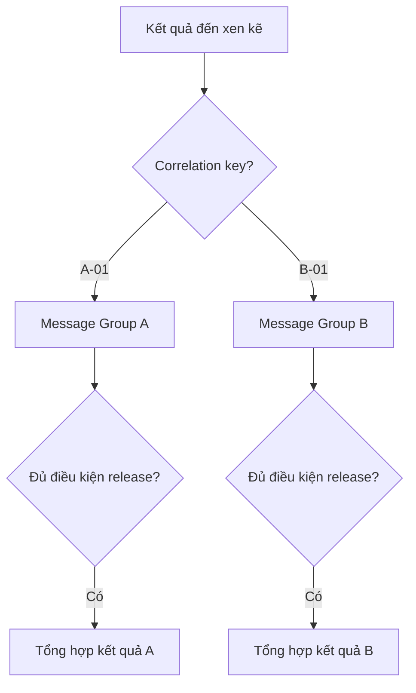
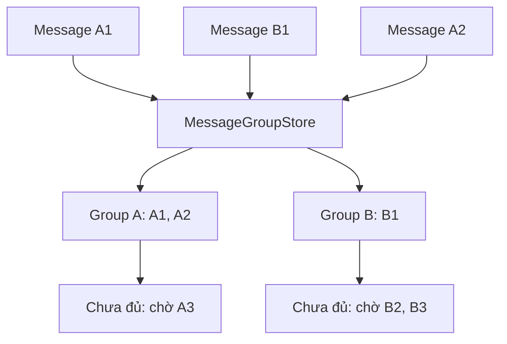
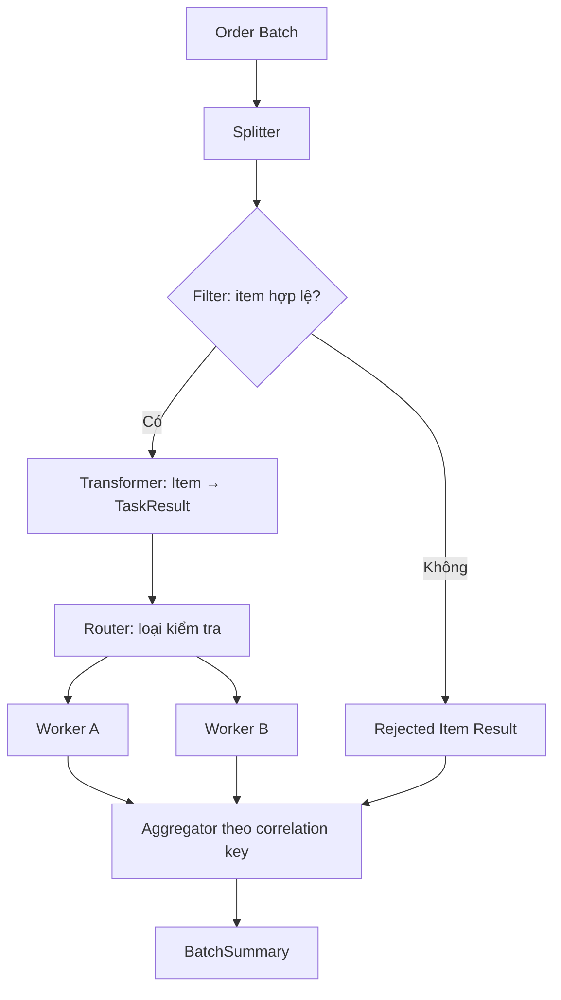
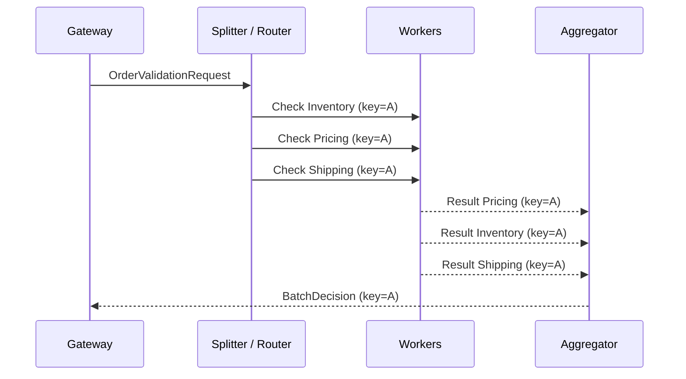

# Correlation key xác định một message group trong Aggregator

Khi một đơn hàng được chia thành nhiều Message con để kiểm tra tồn kho, giá và vận chuyển, hệ thống phải biết **những kết quả nào thuộc cùng một lần xử lý đơn hàng**. Nếu các Message đi tới Aggregator không theo thứ tự, hoặc hai yêu cầu cùng một mã đơn được thực hiện gần nhau, chỉ dựa vào thời điểm nhận hay kiểu payload sẽ rất dễ gom nhầm dữ liệu.

**Correlation key** là giá trị mà Aggregator dùng để quyết định **Message thuộc message group nào**. Những Message có cùng khóa tương quan được đưa vào cùng một nhóm; những Message có khóa khác nhau phải được giữ tách biệt. Sau đó một **release strategy** mới quyết định nhóm đã đủ điều kiện phát kết quả hay chưa. Hai trách nhiệm này liên quan nhưng không đồng nghĩa.

Bài này thuộc chương **Aggregator** của module `SPRING_INTEGRATION_PATTERN`. Module hướng tới triển khai Enterprise Integration Patterns bằng Spring Integration, kết hợp Router, Filter, Transformer, Splitter, Aggregator, Gateway, retry, error channel và correlation, đồng thời kiểm thử và theo dõi các nhánh xử lý. Trọng tâm ở đây là **cách xác định, bảo toàn, kiểm thử và vận hành correlation key để không gom nhầm Message**.

## 1. Vì sao Aggregator cần correlation key?

Giả sử hai lượt xử lý khác nhau đang chạy đồng thời:

```text
Yêu cầu A: orderId=ORD-101, attempt=A-01
  A1: inventory = OK
  A2: pricing   = OK
  A3: shipping  = OK

Yêu cầu B: orderId=ORD-202, attempt=B-01
  B1: inventory = OK
  B2: pricing   = REVIEW
  B3: shipping  = OK
```

Các kết quả có thể đến theo thứ tự thực tế:

```text
A1 → B1 → A2 → B2 → A3 → B3
```

Nếu Aggregator đơn giản lấy **ba Message liên tiếp**, nó sẽ tạo nhóm `[A1, B1, A2]`, hoàn toàn sai về nghiệp vụ. Ta cần xác định khóa nhóm trước khi quan tâm tới số lượng:



Một **message group** không nhất thiết tương ứng với một đơn hàng vĩnh viễn. Nó thường tương ứng với một **lượt xử lý**, **một batch**, **một yêu cầu Gateway** hoặc **một cửa sổ gom** xác định. Phạm vi khóa nhóm phải phù hợp với câu hỏi nghiệp vụ mà Aggregator cần trả lời.

## 2. Ba câu hỏi độc lập của Aggregator

Để tránh cấu hình nhầm, hãy tách ba câu hỏi:

| Câu hỏi | Cơ chế | Ví dụ |
| --- | --- | --- |
| **Message này thuộc nhóm nào?** | Correlation strategy | `batchAttemptKey="A-01"` |
| **Nhóm có đủ điều kiện hoàn tất chưa?** | Release strategy | Đã nhận đủ ba loại kết quả |
| **Khi hoàn tất, đầu ra là gì?** | Output processor/aggregation strategy | `BatchDecision(A-01, APPROVED)` |

Ngoài ra còn có **MessageGroupStore** để lưu các Message đang chờ, timeout/expiration để xử lý nhóm không bao giờ đầy đủ, và locking để bảo vệ thao tác trên nhóm khi nhiều luồng chạy đồng thời.

**Correlation key không phải release condition.** Việc cả ba Message cùng mang `"A-01"` chỉ nói rằng chúng nên ở cùng nhóm. Nó không nói rằng phải chờ 3, 5 hay 20 kết quả, hoặc khi nào một nhóm được xem là kết thúc.

### Tách biệt bằng ví dụ

```text
correlationStrategy(message) = message.headers["batchAttemptKey"]

releaseStrategy(group) =
    group có đủ INVENTORY, PRICING và SHIPPING

outputProcessor(group) =
    tạo BatchDecision từ ba kết quả
```

Một giải pháp có thể thay release strategy mà **không đổi correlation key**. Chẳng hạn, trước đây chờ 3 loại kết quả, sau này thêm kiểm tra FRAUD thành 4 loại; khóa lượt xử lý vẫn là `"A-01"`, nhưng điều kiện hoàn tất phải thay đổi.

## 3. Correlation key được lấy từ đâu?

Một correlation strategy là hàm:

```java
Object getCorrelationKey(Message<?> message);
```

Giá trị trả về cần ổn định cho mọi Message thuộc cùng lượt xử lý và khác biệt giữa các lượt xử lý không được trộn.

| Nguồn khóa | Ví dụ | Lưu ý |
| --- | --- | --- |
| Header do Splitter/flow đặt | `headers['correlationId']` | Phù hợp khi nguồn tạo nhóm có metadata nhất quán |
| Header nghiệp vụ theo lượt | `headers['batchAttemptKey']` | Rõ ràng khi có nhiều lần xử lý cùng đối tượng |
| Thuộc tính payload | `payload.batchId` | Hữu ích khi qua transport không giữ header nội bộ |
| Khóa tổng hợp đã chuẩn hóa | `tenantId + ':' + batchId + ':' + attemptId` | Giảm nguy cơ trùng giữa tenant/batch/attempt |
| Khóa cửa sổ | `source + ':' + windowStart` | Phải có quy tắc thời gian và xử lý event đến muộn |

Với nhóm kết quả của một lượt kiểm tra đơn hàng, **`attemptId` hoặc `batchAttemptKey`** thường rõ nghĩa hơn `orderId` đơn lẻ. Cùng một đơn có thể được kiểm tra lại sau khi giá hoặc kho thay đổi; nếu dùng cùng một key, kết quả lượt cũ và mới có thể bị gom chung.

### Correlation key không đồng nghĩa với những ID khác

- **`MessageHeaders.ID`**: định danh của một Message cụ thể. Mỗi Message con thường có ID riêng, nên lấy ID từng Message làm group key sẽ tạo các nhóm không bao giờ gặp nhau.
- **`eventId`**: định danh sự kiện nghiệp vụ. Có thể dùng nếu tất cả Message con sinh từ đúng một event, nhưng khi retry/reprocess cần xét phạm vi khóa.
- **`orderId`**: định danh thực thể. Không phân biệt hai lượt xử lý của cùng đơn hàng.
- **`traceId`**: phục vụ distributed tracing. Một trace có thể bao trùm nhiều nhóm nghiệp vụ; không nên mặc định dùng nó làm correlation key.
- **`replyChannel`**: đích gửi phản hồi; không phải một khóa nhóm nghiệp vụ.

Một khóa tốt **đủ rộng để gom đúng các Message liên quan nhưng đủ hẹp để không trộn những lượt không liên quan**.

## 4. Correlation headers và giá trị mặc định trong Spring Integration

Spring Integration dùng các metadata quen thuộc:

| Header | Ý nghĩa thường gặp |
| --- | --- |
| `IntegrationMessageHeaderAccessor.CORRELATION_ID` | Khóa để các Message liên quan được xử lý như cùng nhóm |
| `IntegrationMessageHeaderAccessor.SEQUENCE_NUMBER` | Vị trí logic của một Message trong chuỗi |
| `IntegrationMessageHeaderAccessor.SEQUENCE_SIZE` | Tổng số phần tử kỳ vọng khi nguồn biết trước |

Trong luồng **Splitter → xử lý phần tử → Aggregator**, Splitter thường gắn correlation/sequence headers để downstream có thể gom lại. Aggregator có các chiến lược mặc định dựa trên metadata này, nhưng **không nên giả định Message tự có correlation header khi chưa đi qua Splitter hoặc khi adapter đã làm mất metadata**.

Một Message có thể được biểu diễn khái niệm:

```text
payload: InventoryResult(orderId=ORD-101, status=OK)
headers:
  correlationId: group-A
  sequenceNumber: 1
  sequenceSize: 3
  eventId: evt-101
```

Thông tin `correlationId`, `sequenceNumber`, `sequenceSize` trong ví dụ chỉ cho thấy **ý nghĩa**; dạng giá trị thực tế, kiểu dữ liệu và cách tạo ID phụ thuộc endpoint, phiên bản và cấu hình.

### Không mặc định sequence number là khóa nhóm

Hai nhóm đều có thể có `sequenceNumber=1` và `sequenceNumber=2`. Nếu dùng sequence number làm correlation key, tất cả Message “thứ nhất” từ những yêu cầu khác nhau sẽ bị gom nhầm.

```text
A1: correlationId=A, sequenceNumber=1
B1: correlationId=B, sequenceNumber=1

Hai Message này KHÔNG cùng nhóm.
```

Sequence number được dùng để hiểu **vị trí trong nhóm**, còn correlation key quyết định **nhóm nào**.

## 5. Thiết kế khóa nhóm theo một lượt xử lý

Đặt khóa trước khi chia nhánh hoặc phát các công việc song song. Ví dụ có thể cấu thành:

```text
tenantId  = tenant-7
orderId   = ORD-101
attemptId = attempt-2026-001

batchAttemptKey = tenant-7:ORD-101:attempt-2026-001
```

Các kết quả từ `INVENTORY`, `PRICING` và `SHIPPING` của lượt đó đều phải mang đúng **cùng khóa**. Một attempt mới phải có khóa khác, kể cả khi `orderId` không đổi.

| Message | `batchAttemptKey` | Nhóm đúng |
| --- | --- | --- |
| Inventory lượt 1 | `tenant-7:ORD-101:attempt-1` | A |
| Pricing lượt 1 | `tenant-7:ORD-101:attempt-1` | A |
| Shipping lượt 1 | `tenant-7:ORD-101:attempt-1` | A |
| Inventory lượt 2 | `tenant-7:ORD-101:attempt-2` | B |
| Pricing lượt 2 | `tenant-7:ORD-101:attempt-2` | B |
| Inventory tenant khác | `tenant-8:ORD-101:attempt-1` | C |

Nếu hệ thống có multi-tenancy, việc quên `tenantId` trong khóa nhóm có thể là lỗi **phân tách dữ liệu và bảo mật**, chứ không chỉ là lỗi tổng hợp kết quả.

### Cân nhắc cách tạo composite key

Phép nối chuỗi `"a:b:c"` là ví dụ dễ đọc. Nếu các thành phần có thể chứa dấu `:`, cần cơ chế encode/escape hoặc một kiểu khóa có serialization chuẩn để tránh hai bộ thành phần khác nhau tạo cùng chuỗi.

Đối với broker phân tán, khóa correlation cần biểu diễn **ổn định khi serialize/deserialize**; không nên đặt một object tùy biến không có hợp đồng serialization vào header rồi mong mọi transport bảo toàn nguyên dạng.

## 6. Ví dụ thực hành: gom ba kết quả kiểm tra một đơn hàng

Ta xây dựng flow nhận `TaskResult(itemId, approved)`. Mỗi `TaskResult` thuộc một `batchAttemptKey` và được gửi qua channel `itemResultsInput`. Aggregator gom ba kết quả cho cùng lượt, sau đó phát `BatchSummary` sang `batchSummaries`.

Giả định đơn giản để tập trung vào correlation:

1. Mỗi lượt có **đúng ba kết quả**, và mỗi `itemId` là duy nhất.
2. Không có Message trùng hoặc đến muộn sau khi nhóm hoàn tất.
3. Các Message mang khóa `batchAttemptKey` tin cậy và không rỗng.
4. `DirectChannel` và `QueueChannel` chỉ phục vụ ví dụ đồng bộ trong một JVM.

**Không nên dùng nguyên các giả định này cho production.** Các phần sau sẽ bổ sung duplicate, timeout, late arrival, persistence và release condition mạnh hơn.

### 6.1. Cấu hình Java 17+ và Spring Integration

```java
package example.integration;

import java.util.List;

import org.springframework.context.annotation.Bean;
import org.springframework.context.annotation.Configuration;
import org.springframework.integration.channel.DirectChannel;
import org.springframework.integration.channel.QueueChannel;
import org.springframework.integration.config.EnableIntegration;
import org.springframework.integration.dsl.IntegrationFlow;
import org.springframework.messaging.MessageChannel;
import org.springframework.messaging.PollableChannel;

@Configuration
@EnableIntegration
public class CorrelationAggregatorConfiguration {

    public record TaskResult(String itemId, boolean approved) {
    }

    public record BatchSummary(
            String batchAttemptKey,
            int receivedCount,
            long approvedCount) {
    }

    @Bean
    public MessageChannel itemResultsInput() {
        return new DirectChannel();
    }

    @Bean
    public PollableChannel batchSummaries() {
        return new QueueChannel(20);
    }

    @Bean
    public IntegrationFlow aggregateTaskResults() {
        return IntegrationFlow.from("itemResultsInput")
                .aggregate(spec -> spec
                        .correlationStrategy(message -> {
                            Object raw = message.getHeaders()
                                    .get("batchAttemptKey");
                            if (!(raw instanceof String key)
                                    || key.isBlank()) {
                                throw new IllegalArgumentException(
                                        "batchAttemptKey is required");
                            }
                            return key;
                        })
                        .releaseStrategy(group -> group.size() == 3)
                        .outputProcessor(group -> {
                            List<TaskResult> results = group.getMessages()
                                    .stream()
                                    .map(message ->
                                            (TaskResult) message.getPayload())
                                    .toList();

                            long distinctItemIds = results.stream()
                                    .map(TaskResult::itemId)
                                    .distinct()
                                    .count();
                            if (distinctItemIds != 3) {
                                throw new IllegalStateException(
                                        "Duplicate or missing itemId");
                            }

                            long approvedCount = results.stream()
                                    .filter(TaskResult::approved)
                                    .count();
                            return new BatchSummary(
                                    String.valueOf(group.getGroupId()),
                                    results.size(),
                                    approvedCount);
                        })
                        .expireGroupsUponCompletion(true))
                .channel("batchSummaries")
                .get();
    }
}
```

### 6.2. Phân tích cấu hình

`itemResultsInput` là điểm nhận các Message kết quả, không phải channel cho Message cha. Mỗi Message phải mang:

```text
payload: TaskResult(itemId, approved)
headers.batchAttemptKey: <khóa của một lượt xử lý>
```

Các thành phần trong Aggregator:

- **`correlationStrategy`** lấy `batchAttemptKey`; thiếu khóa bị xem là lỗi dữ liệu thay vì tùy tiện đưa mọi Message thiếu khóa vào một nhóm.
- **`releaseStrategy`** hoàn tất khi nhóm đủ ba Message trong ví dụ.
- **`outputProcessor`** đọc payload từ MessageGroup, kiểm tra ba `itemId` khác nhau và tạo bản tóm tắt.
- **`expireGroupsUponCompletion(true)`** dọn nhóm sau khi hoàn tất theo cấu hình ví dụ; điều này **không tự ngăn** một Message đến muộn mang cùng key tạo một nhóm mới. Cần giải pháp late arrival ở production.
- **`batchSummaries`** nhận một Message tổng hợp, không phải từng `TaskResult`.

Trong ví dụ này, `group.getGroupId()` phản ánh khóa do correlation strategy chọn; code chuyển thành String để tạo `BatchSummary`. Danh sách `group.getMessages()` có thể không bảo đảm thứ tự phần tử theo thời gian hoặc sequence; phép đếm và duyệt ở đây **không cần thứ tự**.

### 6.3. Tại sao cần kiểm tra itemId?

Với release strategy chỉ dựa trên `group.size() == 3`, ba Message có thể là:

```text
INVENTORY, INVENTORY (bị retry trùng), PRICING
```

Aggregator đã thấy ba Message nhưng **chưa có SHIPPING**. Kiểm tra số lượng và distinct item ID trong `outputProcessor` của demo giúp phát hiện dữ liệu sai, nhưng điều đó xảy ra khi nhóm đã được release. Hệ thống thật nên **ngăn bản trùng trước khi đủ nhóm** hoặc định nghĩa một release strategy dựa trên **tập kết quả bắt buộc**, thay vì đợi release rồi báo lỗi.

## 7. Gửi Message xen kẽ hai nhóm

Một test quan trọng là Message của hai nhóm có thể đến xen kẽ mà vẫn được gom đúng:

```text
Gửi A:inventory
Gửi B:inventory
Gửi A:pricing
Gửi B:pricing
  → Chưa nhóm nào đủ ba kết quả

Gửi A:shipping
  → Chỉ nhóm A hoàn tất

Gửi B:shipping
  → Nhóm B hoàn tất
```

Ví dụ code chạy với cấu hình ở mục 6:

```java
package example.integration;

import org.springframework.context.annotation.AnnotationConfigApplicationContext;
import org.springframework.messaging.MessageChannel;
import org.springframework.messaging.PollableChannel;
import org.springframework.messaging.support.MessageBuilder;

import example.integration.CorrelationAggregatorConfiguration.TaskResult;

public class CorrelationAggregatorDemo {

    private static void send(
            MessageChannel channel,
            String groupKey,
            String itemId,
            boolean approved) {
        channel.send(MessageBuilder
                .withPayload(new TaskResult(itemId, approved))
                .setHeader("batchAttemptKey", groupKey)
                .setHeader("eventId", "event-" + groupKey)
                .build());
    }

    public static void main(String[] args) {
        try (var context = new AnnotationConfigApplicationContext(
                CorrelationAggregatorConfiguration.class)) {

            MessageChannel input =
                    context.getBean("itemResultsInput", MessageChannel.class);
            PollableChannel output =
                    context.getBean("batchSummaries", PollableChannel.class);

            send(input, "A-01", "INVENTORY", true);
            send(input, "B-01", "INVENTORY", true);
            send(input, "A-01", "PRICING", true);
            send(input, "B-01", "PRICING", false);

            System.out.println(output.receive(0)); // null: chưa đủ 3

            send(input, "A-01", "SHIPPING", true);
            System.out.println(output.receive(0)); // Summary A

            send(input, "B-01", "SHIPPING", true);
            System.out.println(output.receive(0)); // Summary B
        }
    }
}
```

Kết quả kỳ vọng ở mức payload:

```text
BatchSummary[batchAttemptKey=A-01, receivedCount=3, approvedCount=3]
BatchSummary[batchAttemptKey=B-01, receivedCount=3, approvedCount=2]
```

Các dòng này là **biểu diễn kết quả nghiệp vụ**, không phải lời hứa `System.out.println(Message<?>)` in đúng nguyên văn. Khi in Message, Spring có thể kèm cả headers.

`receive(0)` thích hợp cho demo đồng bộ vì kết quả được đưa vào queue trước khi `send()` cuối cùng trả về. Trong flow có executor, poller hoặc broker, test phải chờ bằng timeout hữu hạn; không dựa vào `Thread.sleep()` hoặc thứ tự hoàn tất giữa các nhóm.

## 8. JUnit 5: chứng minh hai group không bị trộn

Một unit test riêng cho hàm tạo khóa có thể phát hiện lỗi format, nhưng chưa chứng minh MessageGroupStore và Aggregator nhận đúng Message. Vì vậy cần **integration test** chạy qua channel thật.

```java
package example.integration;

import static org.junit.jupiter.api.Assertions.*;

import org.junit.jupiter.api.Test;
import org.springframework.context.annotation.AnnotationConfigApplicationContext;
import org.springframework.messaging.Message;
import org.springframework.messaging.MessageChannel;
import org.springframework.messaging.PollableChannel;
import org.springframework.messaging.support.MessageBuilder;

import example.integration.CorrelationAggregatorConfiguration.BatchSummary;
import example.integration.CorrelationAggregatorConfiguration.TaskResult;

class CorrelationAggregatorIntegrationTest {

    private void send(
            MessageChannel input,
            String group,
            String item,
            boolean approved) {
        assertTrue(input.send(MessageBuilder
                .withPayload(new TaskResult(item, approved))
                .setHeader("batchAttemptKey", group)
                .setHeader("eventId", "event-" + group)
                .build()));
    }

    @Test
    void interleavedMessagesAreGroupedByCorrelationKey() {
        try (var context = new AnnotationConfigApplicationContext(
                CorrelationAggregatorConfiguration.class)) {

            MessageChannel input =
                    context.getBean("itemResultsInput", MessageChannel.class);
            PollableChannel output =
                    context.getBean("batchSummaries", PollableChannel.class);

            send(input, "attempt-A", "INVENTORY", true);
            send(input, "attempt-B", "INVENTORY", true);
            send(input, "attempt-A", "PRICING", true);
            send(input, "attempt-B", "PRICING", false);

            assertNull(output.receive(0));

            send(input, "attempt-A", "SHIPPING", true);
            Message<?> first = output.receive(0);
            assertNotNull(first);
            assertInstanceOf(BatchSummary.class, first.getPayload());
            assertEquals(
                    new BatchSummary("attempt-A", 3, 3),
                    first.getPayload());

            // Nhóm B còn thiếu SHIPPING; không được release theo A.
            assertNull(output.receive(0));

            send(input, "attempt-B", "SHIPPING", true);
            Message<?> second = output.receive(0);
            assertNotNull(second);
            assertEquals(
                    new BatchSummary("attempt-B", 3, 2),
                    second.getPayload());
            assertNull(output.receive(0));
        }
    }

    @Test
    void missingCorrelationKeyCannotBeSilentlyGrouped() {
        try (var context = new AnnotationConfigApplicationContext(
                CorrelationAggregatorConfiguration.class)) {

            MessageChannel input =
                    context.getBean("itemResultsInput", MessageChannel.class);
            PollableChannel output =
                    context.getBean("batchSummaries", PollableChannel.class);

            assertThrows(RuntimeException.class, () -> input.send(
                    MessageBuilder
                            .withPayload(new TaskResult("INVENTORY", true))
                            .build()));
            assertNull(output.receive(0));
        }
    }
}
```

Test thứ nhất không chỉ đếm Message: nó chứng minh **sau bốn Message xen kẽ chưa nhóm nào đủ**, nhóm A hoàn tất độc lập khi nhận Message thứ ba của A và nhóm B vẫn chờ cho đến Message thứ ba của B.

Test thứ hai cố ý bỏ khóa `batchAttemptKey`, dùng **quy tắc validation nằm trong correlation strategy của ví dụ**. Vì input là `DirectChannel`, lỗi có thể lan về caller và bị framework bọc thành `MessagingException`; không nên khóa cứng exception wrapper cụ thể. Với flow bất đồng bộ, lỗi có thể xuất hiện ở error channel hoặc consumer thread thay vì ở lời gọi `send()`.

## 9. Release strategy: cùng khóa chưa có nghĩa là đã đủ kết quả

Trong demo, điều kiện `group.size() == 3` chỉ phù hợp với đúng ba kết quả và không có bản trùng. Hệ thống thực có thể yêu cầu:

```text
requiredResultTypes = {INVENTORY, PRICING, SHIPPING}
receivedResultTypes = {INVENTORY, SHIPPING}
```

Nhóm có hai Message đúng key nhưng **chưa đủ để quyết định**. Khi `PRICING` tới, nhóm mới hoàn tất.

### 9.1. Release theo số lượng

```java
.releaseStrategy(group -> group.size() == 3)
```

Ưu điểm là đơn giản, dễ hiểu, phù hợp test có collection cố định. Nhược điểm: nếu có duplicate hoặc kết quả thiếu loại, đủ số lượng chưa chắc đủ dữ liệu.

### 9.2. Release theo tập loại kết quả

Phương án mạnh hơn về mặt nghiệp vụ:

```java
Set<String> required = Set.of(
        "INVENTORY", "PRICING", "SHIPPING");

boolean complete = group.getMessages().stream()
        .map(m -> ((TaskResult) m.getPayload()).itemId())
        .collect(Collectors.toSet())
        .containsAll(required);
```

Đây là **đoạn Java minh họa logic release**, cần import `Set` và `Collectors` cùng các kiểu ở mục 6; chưa phải một cấu hình Spring độc lập. Khi đưa vào release strategy, vẫn phải quy định Message trùng, Message ngoài danh sách, số lượng tối đa và dữ liệu sai schema.

### 9.3. Release theo sequence size

Khi nhận các Message con từ Splitter, một release strategy có thể sử dụng `sequenceSize` được tạo ở upstream. Nhưng điều này chỉ an toàn nếu:

1. Nguồn thực sự biết số phần tử dự kiến.
2. Các Message con giữ metadata sequence khi qua Transformer/Router/adapter.
3. Không có Message bị Filter loại mà Aggregator vẫn chờ đủ số cũ.
4. Có chính sách duplicate, timeout và late arrival.

**Không dùng giá trị `sequenceSize` chưa được xác minh từ client bên ngoài để quyết định nhóm được release.**

## 10. Một MessageGroup được lưu ở đâu?

Aggregator cần giữ trạng thái khi nhóm chưa đủ. Spring Integration sử dụng một **MessageGroupStore** cho các Message đã đến.



Trong các ví dụ đơn giản, có thể dùng store **trong bộ nhớ**. Nếu JVM dừng trước khi nhóm hoàn tất, các Message chưa được lưu bền vững có nguy cơ mất. Với flow cần phục hồi qua restart, có thể thiết kế persistent `MessageGroupStore` phù hợp với hạ tầng và phiên bản Spring Integration đang dùng, cùng transaction/locking/cleanup phù hợp.

### 10.1. Correlation key là khóa tra cứu group

Về mặt ý tưởng:

```text
store.addMessageToGroup(correlationKey, message)
group = store.getMessageGroup(correlationKey)
```

Đây là pseudocode để giải thích ý nghĩa của khóa nhóm, **không phải yêu cầu bạn thao tác store thủ công** khi đang dùng Aggregator endpoint.

Nếu khóa được tính khác đi giữa hai lần nhận (`"ORD-1"` và `"ord-1"`), Message có thể bị lưu vào **hai group khác nhau** dù nghiệp vụ xem là cùng một đơn. Ngược lại, một khóa quá chung như `"ACTIVE"` có thể gom hàng nghìn yêu cầu không liên quan.

### 10.2. Tác động của số lượng nhóm chưa hoàn tất

Ngay cả khi mỗi nhóm chỉ chứa hai Message, nếu có hàng trăm nghìn `correlationKey` không bao giờ nhận phần tử cuối, store có thể tăng không giới hạn. Vì vậy cần giới hạn nhóm chờ, timeout, cơ chế expiry và giám sát.

Trong hạ tầng persistent, phải quản lý dung lượng, cleanup dữ liệu cũ, index theo key và hành vi khi nhiều instance đồng thời cập nhật cùng group.

## 11. Timeout và group expiration

Một nhóm không phải lúc nào cũng nhận đủ kết quả. Ví dụ:

```text
attempt-A:
  INVENTORY = OK
  PRICING = OK
  SHIPPING = timeout, không gửi result
```

Nếu chỉ có điều kiện `group.size()==3`, nhóm A có thể tồn tại mãi trong store nếu không có quy tắc hết hạn.

Các chính sách cần xác định:

| Chính sách | Ý nghĩa | Hệ quả nghiệp vụ |
| --- | --- | --- |
| Chờ đến khi đủ | Không release thiếu | Có nguy cơ tồn tại nhóm vô hạn |
| Group timeout | Nhóm được xử lý theo chính sách khi quá hạn | Có thể báo lỗi hoặc phát kết quả một phần |
| Send partial result | Cho phép xuất kết quả thiếu khi quá hạn | Consumer phải nhận biết thiếu dữ liệu |
| Discard/expire group | Xóa hoặc đóng nhóm theo quy tắc | Cần ghi nhận nhóm không hoàn tất |
| Retry/replay phần thiếu | Tìm lại Message đã lỗi | Cần bền vững và idempotency |

Spring Integration có cơ chế cấu hình group timeout, expiration, partial results và tùy biến timeout/error handling. Cách hoạt động cụ thể phụ thuộc phiên bản và cấu hình. **Không được coi timeout là bằng chứng nhóm đã đủ dữ liệu; timeout chỉ là quyết định ngừng chờ**.

### 11.1. Late arrival sau khi group đã hoàn tất

Giả sử nhóm `"A-01"` đã release nhưng một bản gửi lặp của `SHIPPING` đến muộn:

```text
t1: INVENTORY, PRICING, SHIPPING → release A-01
t2: SHIPPING bản lặp → vẫn mang key A-01
```

Nếu MessageGroupStore đã dọn nhóm, tùy cấu hình một nhóm mới cùng key có thể được tạo hoặc Message đến muộn có thể bị xử lý theo chính sách late arrival. Không nên suy ra rằng `.expireGroupsUponCompletion(true)` tự chặn mọi bản gửi lặp vĩnh viễn.

Muốn chặn việc tái mở một nhóm đã hoàn tất, cần **lưu trạng thái completion/deduplication đủ lâu** hoặc một cơ chế tương đương; khóa nhóm không tự mang lịch sử “đã xử lý xong”.

## 12. Duplicate Message và idempotency theo phần tử

Correlation giải quyết **Message thuộc nhóm nào**, không giải quyết **Message này có phải bản gửi trùng không**.

Ví dụ:

| Message | Group key | Item ID | Nhận xét |
| --- | --- | --- | --- |
| M1 | A | INVENTORY | Lần đầu |
| M2 | A | INVENTORY | Bản gửi lặp |
| M3 | A | PRICING | Mới |
| M4 | A | SHIPPING | Mới |

Nếu release theo `size == 3`, nhóm A có thể được đưa ra xử lý ngay sau M3, dù chưa có SHIPPING. Một chính sách bền vững cần phân biệt:

- **Message identity:** bản phát cụ thể của một Message.
- **Business result identity:** kết quả thuộc bước `INVENTORY` của attempt A.
- **Group identity:** attempt A.

Một khóa idempotency theo phần tử có thể là:

```text
idempotencyKey =
  batchAttemptKey + ":" + resultType

A:INVENTORY
A:PRICING
A:SHIPPING
```

Nếu cùng loại kết quả được phép cập nhật nhiều lần, khóa có thể cần **version** hoặc **attempt của riêng nhánh** để phân biệt bản sửa hợp lệ với bản lặp không mong muốn.

### Giữ một kết quả cho mỗi loại bằng cách nào?

Các lựa chọn:

1. Deduplication ở upstream trước Aggregator theo `batchAttemptKey` và `resultType`.
2. Lưu bản mới nhất theo version ở một state store có hợp đồng rõ.
3. Thiết kế message-group processor/release strategy có thể nhận diện bản lặp.
4. Tạo một mô hình orchestration trạng thái cố định cho những bước bắt buộc.

Một kiểm tra `.distinct()` ở output processor chỉ **phát hiện** trùng sau khi group đã release; nó không thay được cơ chế loại trùng đáng tin cậy ở điểm nhận.

## 13. Out-of-order và thứ tự phần tử trong group

Các Message có thể đến theo thứ tự khác với lúc Splitter phát:

```text
sequenceNumber: 3, 1, 2
```

Chúng vẫn có thể thuộc **cùng correlation key**. Nếu kết quả tổng hợp không phụ thuộc thứ tự, chẳng hạn đếm số nhánh đạt, có thể xử lý theo tập hợp.

Nếu cần trả về danh sách kết quả theo thứ tự dòng hàng, cần sắp xếp bằng **sequence number** hoặc **business line number** được truyền và kiểm tra:

```java
List<Message<?>> ordered = group.getMessages().stream()
        .sorted(Comparator.comparingInt(
                message -> (Integer) message.getHeaders().get(
                        IntegrationMessageHeaderAccessor.SEQUENCE_NUMBER)))
        .toList();
```

Đây là đoạn minh họa logic cần import `List`, `Message`, `Comparator` và `IntegrationMessageHeaderAccessor`, đồng thời phải **xác thực header có giá trị số nguyên hợp lệ** trước khi cast. Không nên giả định `group.getMessages()` luôn được trả theo đúng thứ tự arrival hoặc sequence.

### Sự khác nhau giữa ordering và correlation

| Tính chất | Cơ chế chính |
| --- | --- |
| Message thuộc yêu cầu nào | Correlation key |
| Message là phần thứ mấy | Sequence number hoặc line number |
| Nhóm đã đủ chưa | Release strategy |
| Kết quả tổng theo thứ tự nào | Output processor/sort |
| Một bản gửi có trùng không | Idempotency/deduplication |

Đổi thứ tự nhận **không nên làm đổi nhóm**; nhưng có thể làm đổi kết quả nếu output processor vô tình dựa vào thứ tự lưu trữ của store.

## 14. Correlation với Splitter, Router, Filter và Transformer

Một luồng thường gặp:



### 14.1. Splitter tạo nhóm, Aggregator nhận nhóm

Nếu Splitter biết số phần tử, nó có thể đặt correlation và sequence headers cho Message con. Khi các handler không làm mất metadata, Aggregator có thể sử dụng chúng để gom lại.

Nếu nhiều lần split phát sinh từ cùng `orderId`, không được tùy tiện thay `correlationId` bằng `orderId` rồi giả định nhóm vẫn tách đúng theo mỗi lần split. Khóa nhóm cần gắn với **lần xử lý thực tế**.

### 14.2. Filter có thể làm một nhóm không hoàn tất

Nếu Splitter phát ba Message với `sequenceSize=3`, nhưng Filter loại một Message khỏi đường tới Aggregator, nhóm có thể chỉ có hai kết quả và chờ mãi.

Một lựa chọn là tạo kết quả `REJECTED` cho item bị lọc và đưa về Aggregator theo **cùng correlation key**. Khi đó nhóm vẫn có ba kết quả với ba trạng thái khác nhau, cho phép đưa ra `BatchDecision` đầy đủ thay vì mất một phần tử.

### 14.3. Transformer cần giữ metadata nhóm

Transformer chuyển `RawResult` sang `TaskResult` không nên làm mất `correlationId`, `batchAttemptKey`, `sequenceNumber` hoặc dữ liệu cần để định danh phần tử. Nếu Transformer chủ động xây Message mới và bỏ hết headers, Aggregator có thể không còn biết nhóm tương ứng.

Khi đi qua HTTP, AMQP, Kafka hoặc một adapter khác, phải định nghĩa cách ánh xạ/serialize metadata quan trọng, thay vì tin rằng mọi header Java nội bộ sẽ tự đi qua transport.

### 14.4. Router và Publish–Subscribe có thể tăng số kết quả

Nếu một Message con được route tới **nhiều recipient**, một item có thể tạo hơn một kết quả. Lúc đó `sequenceSize` từ Splitter không còn phản ánh số **kết quả thực tế** mà Aggregator chờ, trừ khi có kế hoạch gom riêng.

Ví dụ, Splitter tạo hai item nhưng mỗi item phải qua cả `RISK` và `COMPLIANCE`, tổng cộng có thể có bốn kết quả. Phải xác định khóa nhóm và điều kiện release dựa trên **tập kết quả kỳ vọng** của fan-out, không mù quáng dùng `sequenceSize=2`.

## 15. Gateway, request-reply và kết quả tổng hợp

Một Gateway có thể nhận `OrderValidationRequest` và muốn trả **một quyết định cuối**. Trong luồng có nhiều Message con, Aggregator thường đóng vai trò tạo kết quả tổng để trả về.



Để Gateway thực sự nhận đúng phản hồi:

- Các Message con phải mang **cùng correlation key nghiệp vụ cho một lượt**.
- Aggregator phải nhận đủ các kết quả theo release strategy.
- Metadata cần cho reply/correlation phải còn được bảo toàn hoặc có cơ chế trả lời tường minh.
- Flow cần timeout và quy tắc phản hồi khi một worker lỗi hoặc không gửi kết quả.
- Một reply muộn của request đã timeout không được vô tình gửi thành phản hồi cho một attempt mới.

**Correlation key của Aggregator và reply correlation của Gateway có thể phục vụ hai phạm vi khác nhau.** Không nên đồng nhất chúng chỉ vì cả hai đều có chữ “correlation”. Ví dụ Aggregator gom theo `batchAttemptKey`, còn Gateway/messaging transport có thể có request ID riêng.

## 16. Concurrency, locking và persistent MessageGroupStore

Khi nhiều Message của cùng khóa đến từ nhiều thread, hai consumer có thể cùng đọc/sửa trạng thái một group gần như đồng thời. Aggregator và MessageGroupStore cần cơ chế đồng bộ phù hợp để tránh release sai hoặc ghi đè trạng thái.

### 16.1. Trong một JVM

Spring Integration cung cấp các cơ chế đồng bộ và quản lý nhóm trong endpoint/store. Dù vậy, không nên tự chia sẻ một `HashMap<String, List<Message<?>>>` mutable giữa các handler không có locking, rồi xem nó như một Aggregator an toàn luồng.

### 16.2. Nhiều JVM/instance

Nếu hai application instance cùng nhận Message của một correlation key, cần quyết định:

- Có bảo đảm mọi Message cùng key đến **cùng consumer partition** không?
- Các instance có dùng **cùng persistent store** không?
- Store có hỗ trợ concurrent updates và locking đúng phạm vi không?
- Có thể release cùng một group hai lần khi cạnh tranh không?
- Sau restart, các Message chưa hoàn tất còn trong store hay không?

Chỉ dùng một `ConcurrentHashMap` trong mỗi JVM không giúp các instance nhìn thấy cùng group. Một nhóm bị chia ra hai nơi có thể không bao giờ đủ điều kiện release.

Các lựa chọn như JDBC/MongoDB MessageGroupStore hay cấu hình broker/partition cần được đối chiếu theo dependency và phiên bản Spring Integration của dự án. Bền vững của store cũng **không tự bảo đảm exactly-once side effects ở consumer nhận kết quả tổng**.

## 17. Quan sát correlation group trong production

Khi một nhóm không hoàn tất, log chỉ ghi “Aggregator timeout” thường không đủ để tìm lỗi. Nên quan sát theo **khóa nhóm**, nhưng tránh đưa khóa có cardinality cao vào metrics tags.

Một structured log gợi ý:

```json
{
  "stage": "order-result-aggregator",
  "batchAttemptKey": "tenant-7:ORD-101:attempt-1",
  "resultType": "SHIPPING",
  "eventId": "evt-101",
  "receivedTypes": ["INVENTORY", "PRICING", "SHIPPING"],
  "expectedTypes": ["INVENTORY", "PRICING", "SHIPPING"],
  "groupStatus": "RELEASED",
  "receivedCount": 3
}
```

Schema trên là **mô hình log do ứng dụng thiết kế**, không phải log JSON mặc định do Spring Integration phát sinh. Chỉ ghi metadata cần thiết; không log toàn bộ payload có dữ liệu nhạy cảm.

| Metric đề xuất | Ý nghĩa |
| --- | --- |
| `aggregator.message.received` | Số Message đầu vào |
| `aggregator.group.created` | Số group mới được tạo |
| `aggregator.group.pending` | Số group đang chờ |
| `aggregator.group.released` | Số group đã có kết quả |
| `aggregator.group.expired` | Số group quá hạn |
| `aggregator.group.age` | Thời gian nhóm tồn tại trước khi release/expire |
| `aggregator.message.duplicate` | Số bản kết quả trùng |
| `aggregator.message.missing_key` | Số Message thiếu correlation key |
| `aggregator.message.late_arrival` | Số Message đến sau khi nhóm đóng |
| `aggregator.store.size` | Dung lượng hoặc số Message trong store |

Những metric này là **đề xuất instrument**, không phải danh mục mặc định của Micrometer/Actuator. `batchAttemptKey`, `orderId`, `eventId` nên dùng trong log hoặc trace có kiểm soát hơn là làm metric tags.

### Điều tra nhóm bị kẹt

1. Correlation key của các Message con có giống nhau chính xác không?
2. Nhóm đã nhận những kết quả nào, còn thiếu kết quả nào?
3. Có Message bị Filter loại, Router gửi nhầm hoặc Transformer làm mất header không?
4. Có Message bị lỗi trong worker hay ở transport và chưa được retry không?
5. Release strategy có đang chờ số lượng/tập loại kết quả sai không?
6. Group timeout/expiration có được cấu hình và quan sát không?
7. Có duplicate hoặc late arrival tạo trạng thái không nhất quán không?
8. Có hai instance cùng chia nhóm nhưng không dùng một store/coordinator phù hợp không?

## 18. Các lỗi thường gặp khi thiết kế correlation key

| Biểu hiện | Nguyên nhân | Cách khắc phục |
| --- | --- | --- |
| Hai đơn khác nhau bị gom chung | Correlation key quá chung, ví dụ `"ACTIVE"` | Dùng khóa định danh một lượt/batch cụ thể |
| Hai lượt kiểm tra cùng đơn bị trộn | Chỉ dùng `orderId` | Thêm `attemptId` hoặc version thích hợp |
| Mỗi Message con nằm một group | Dùng Message ID riêng làm khóa | Dùng key chung của lần split/xử lý |
| Không có group nào đủ | Correlation header mất sau Transformer/adapter | Kiểm thử header propagation/transport mapping |
| `sequenceNumber=1` của nhiều yêu cầu gom chung | Nhầm sequence với correlation | Dùng correlation ID để chọn group |
| Group đủ số nhưng thiếu loại kết quả | Duplicate được đếm như Message mới | Dedupe + release theo tập kết quả bắt buộc |
| Kết quả đến sai thứ tự và summary sai | Output processor dựa thứ tự collection | Sort theo sequence/business order khi cần |
| JVM restart làm mất nhóm đang chờ | Store chỉ ở bộ nhớ | Persistent MessageGroupStore và khôi phục phù hợp |
| Nhiều instance tạo nhóm riêng | Store/partition không thống nhất | Phối hợp partition và store/locking |
| Group chờ mãi | Một nhánh không trả kết quả, thiếu timeout | Group timeout, retry và failure policy |
| Message đến muộn tạo group mới | Group đã bị xóa, không lưu trạng thái hoàn tất | Late-arrival policy và dedup bền vững |
| Group của tenant khác bị trộn | Khóa thiếu namespace tenant | Khóa composite phân tách tenant |
| Gateway hết timeout | Aggregator không release hoặc không reply đúng request | Kiểm tra release, reply path và timeout |

## 19. Checklist kiểm thử correlation cho Aggregator

- **Group key có phạm vi rõ:** một request, một batch, một attempt hay một cửa sổ?
- **Không gom nhầm:** gửi xen kẽ Message của ít nhất hai group và kiểm tra output riêng biệt.
- **Không chia sai:** mọi Message con thuộc cùng một attempt mang cùng khóa.
- **Thiếu key phải có chính sách:** reject/error rõ, không tự gộp mọi Message thiếu khóa.
- **Release strategy tách khỏi correlation:** kiểm tra nhóm chưa đủ không được phát kết quả.
- **Kiểm thử duplicate:** cùng result type gửi hai lần không được thay thế một kết quả khác.
- **Kiểm thử out-of-order:** thay thứ tự nhận không làm đổi group hoặc summary.
- **Giữ metadata:** Transformer, Router, adapter không làm mất key cần thiết.
- **Thử Filter/drop/error:** một kết quả mất phải có timeout/failure policy.
- **Thử late arrival:** kết quả đến sau khi group đóng không tạo summary thứ hai ngoài ý định.
- **Thử restart/multi-instance nếu cần:** MessageGroupStore và coordination đáp ứng hợp đồng khôi phục.
- **Thử Gateway/response:** một yêu cầu nhận đúng một kết quả hoặc lỗi rõ ràng theo timeout.
- **Quan sát nhóm đang chờ:** log/metric có thể trả lời thiếu kết quả nào và vì sao.

**Correlation key là định danh của một nhóm Message, không phải điều kiện đủ để nhóm hoàn tất.** Khi phạm vi khóa được chọn đúng theo lượt xử lý, release strategy phản ánh tập kết quả cần nhận, và hệ thống có chính sách cho duplicate, timeout, late arrival cùng persistence, Aggregator của Spring Integration mới có thể gom dữ liệu đúng ngay cả khi các Message đến xen kẽ hoặc chạy bất đồng bộ.
