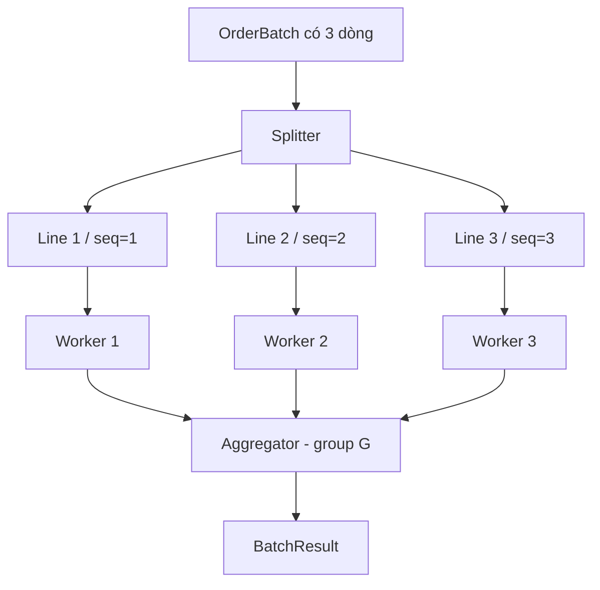
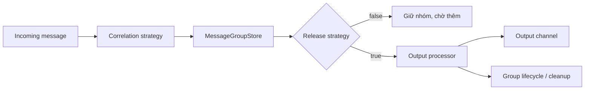
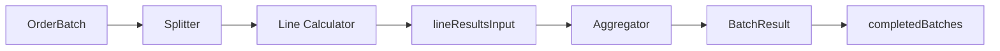
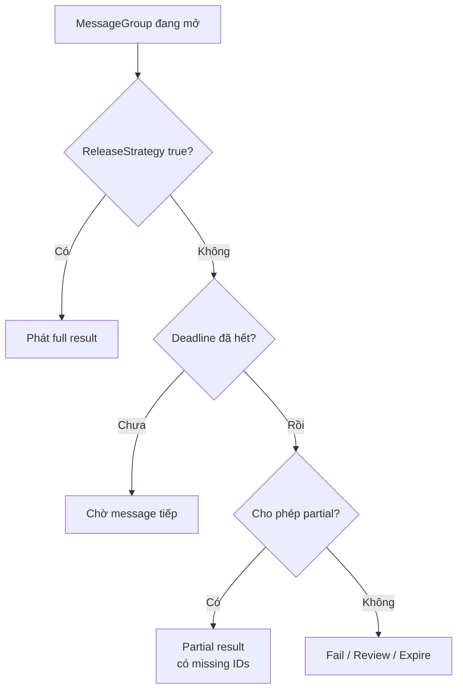
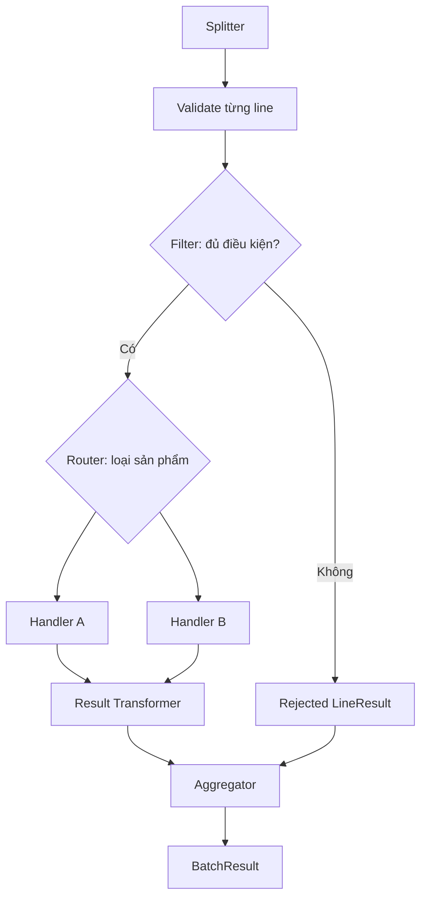
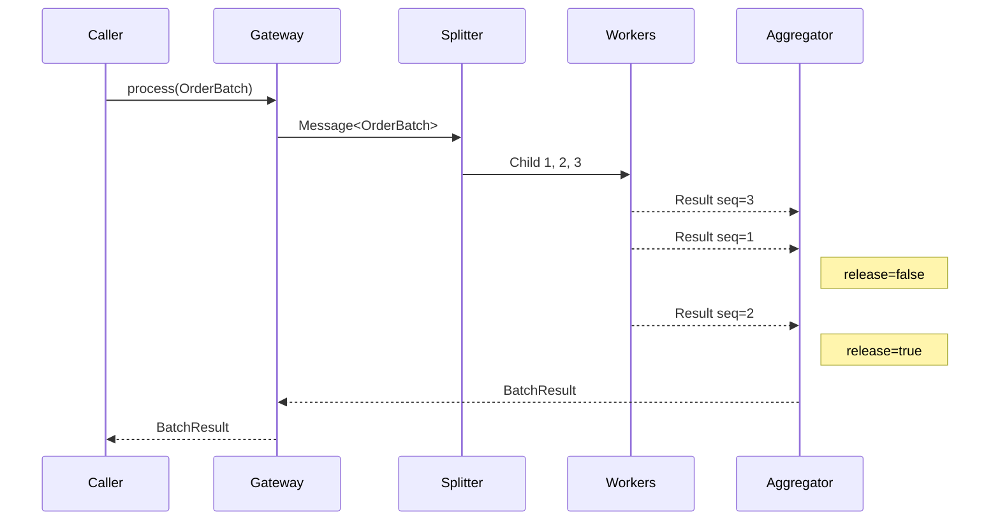
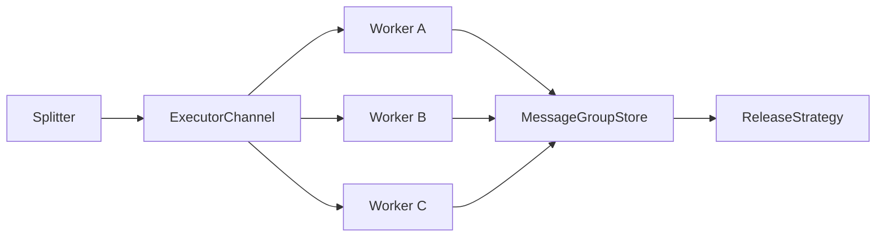
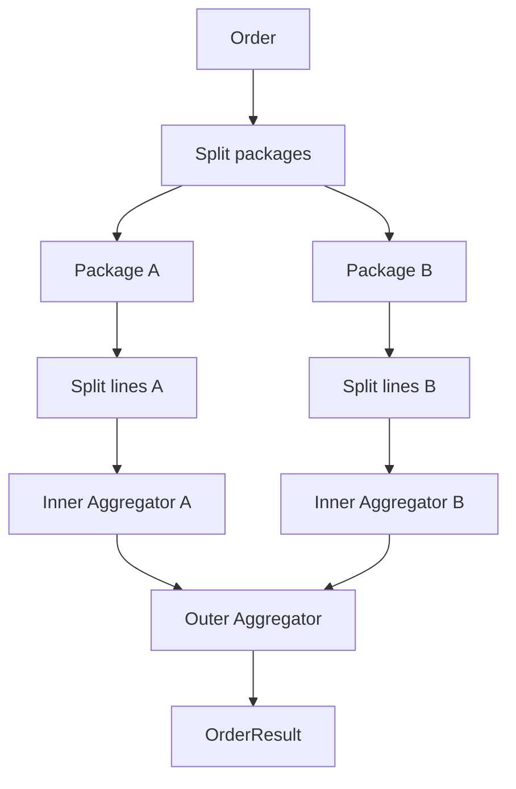

# Release strategy xác định khi nào gom xong trong Spring Integration

> **Chương:** Aggregator  
> **Bài học:** Release strategy xác định khi nào gom xong  
> **Ngữ cảnh:** Thực hành Enterprise Integration Patterns (EIP) bằng Spring Integration: Splitter, Aggregator, Router, Filter, Transformer, Gateway, retry, error channel, correlation, kiểm thử và quan sát các nhánh xử lý.

## 1. Bài toán: nhận được message cùng nhóm chưa có nghĩa đã hoàn thành

Một đơn hàng gồm ba dòng sản phẩm. Splitter tách đơn thành ba message, sau đó từng dòng được xử lý ở một handler hoặc worker khác nhau. Aggregator có trách nhiệm gom chúng thành một kết quả cuối. Nhưng các kết quả có thể về sai thứ tự, một phần tử có thể lỗi, thậm chí có message bị gửi lại.



Giả sử L-3 hoàn tất đầu tiên rồi L-1. Cả hai mang cùng `correlationId=G` nhưng Aggregator mới có **hai trong ba** kết quả. Không thể kết luận batch đã xong chỉ vì đã tạo được một nhóm.

Aggregator phải giải quyết ba câu hỏi **tách biệt**:

| Câu hỏi | Thành phần trả lời | Minh họa |
| --- | --- | --- |
| Message thuộc nhóm nào? | **Correlation strategy** | `correlationId=G` |
| Nhóm đã đủ điều kiện phát output chưa? | **Release strategy** | Đã có đủ sequence 1, 2 và 3 |
| Phát payload gì khi release? | **Output processor** | `BatchResult(total, results)` |

**Trọng tâm bài học:** `ReleaseStrategy` xác định **khi nào gom xong**, chứ không phải ai thuộc nhóm, không phải cách sắp xếp kết quả, và cũng không bảo đảm nghiệp vụ của mọi phần tử đã thành công.

### Mục tiêu học tập

Sau bài này, bạn có thể:

1. Hiểu cấu trúc `MessageGroup` và vòng đời một nhóm Aggregator.
2. Phân biệt correlation strategy, release strategy, output processor và group expiry.
3. Sử dụng `correlationId`, `sequenceNumber`, `sequenceSize` đúng nghĩa.
4. Viết release rule cho nhóm hữu hạn, kiểm tra đủ sequence và tránh release sớm do trùng message.
5. Kiểm thử message đến sai thứ tự, thiếu phần tử, nhiều nhóm xen kẽ và dữ liệu không hợp lệ.
6. Thiết kế timeout, partial result, nhóm quá hạn và message đến muộn.
7. Kết hợp Aggregator với Splitter, Filter, Router, Transformer, Gateway, retry và error channel.
8. Lập kế hoạch lưu nhóm bền vững, chống trùng và theo dõi nhóm đang chờ.

## 2. Aggregator làm việc như thế nào?

Aggregator là Enterprise Integration Pattern nhận các message liên quan đến nhau, lưu chúng vào một nhóm và tạo một output khi điều kiện release được thỏa.



Trong Spring Integration, trạng thái nhóm được truy cập qua `org.springframework.integration.store.MessageGroup`. Một `MessageGroupStore` quản lý các nhóm và những message đang chờ.

Các khái niệm cần phân biệt:

- **Accumulate:** thêm message vào nhóm được xác định bởi correlation key.
- **Evaluate:** gọi ReleaseStrategy để kiểm tra điều kiện nhóm tại thời điểm đánh giá.
- **Release:** cho phép xử lý nhóm để tạo output.
- **Complete:** cập nhật trạng thái nhóm đã xử lý theo cấu hình.
- **Expire/remove:** dọn nhóm hoặc xử lý nhóm đã hết hạn theo chính sách.

Một nhóm được release không nhất thiết bị xóa ngay và mãi mãi. Tùy cách cấu hình group store/expiry, message đến muộn có thể bị nhận diện là late message, bị bỏ hoặc dẫn đến trạng thái mới. Do đó group lifecycle là một phần của thiết kế, không phải chi tiết phụ.

### Minh họa vòng đời nhóm

```text
group=G, expected=3

T1: receive seq 3 -> group={3}     -> release=false
T2: receive seq 1 -> group={3,1}   -> release=false
T3: receive seq 2 -> group={3,1,2} -> release=true
T4: output BatchResult
T5: hoàn tất/cleanup theo policy
```

Thứ tự đến `3,1,2` không làm sai quyết định release nếu metadata và chiến lược nhóm được thiết kế đúng.

## 3. Correlation metadata: đủ nhóm là đủ cái gì?

Với hệ thống Splitter → Aggregator, mỗi message con thường có những header:

```text
payload:
  LineResult(lineId="L-2", totalMinorUnits=200000)

headers:
  correlationId         = group-101
  sequenceNumber        = 2
  sequenceSize          = 3
  businessCorrelationId = order:ORD-2048
  traceId               = trace-abc
```

| Header | Vai trò | Không nên hiểu là |
| --- | --- | --- |
| `correlationId` | ID của nhóm kỹ thuật | Luôn bằng `orderId` |
| `sequenceNumber` | Vị trí phần tử trong một lần split | Thứ tự xử lý hoàn tất |
| `sequenceSize` | Số phần tử kỳ vọng nếu đã biết | Luôn dương trong mọi stream |
| `businessCorrelationId` | Liên kết các bước nghiệp vụ | Correlation strategy mặc định của Aggregator |
| `traceId` | Theo dõi phân tán | Khóa release |
| `MessageHeaders.id` | ID từng message do framework cấp | ID chung của tất cả child |

Một đơn hàng có thể được chia thành hai nhóm ở hai giai đoạn khác nhau hoặc được replay nhiều lần. **Đừng tùy tiện dùng một `orderId` làm `correlationId` cho mọi lần split**; điều đó có thể trộn hai lần xử lý khác nhau vào một group.

### Điều kiện nhóm đầy đủ

Với `sequenceSize=3`, một rule hợp lý có thể là:

- Mọi message trong group công bố cùng expected size.
- Mọi sequence number nằm trong khoảng `1..3`.
- Tập sequence nhận được chính xác là `{1,2,3}`.
- Không có message bị trùng sequence.
- Những kết quả cần thiết đều được phát ra, kể cả kết quả thất bại nghiệp vụ nếu hợp đồng yêu cầu.

Nếu chỉ có `{1,1,2}`, group có ba message nhưng vẫn thiếu sequence 3. **Đếm message không đủ để chứng minh có đủ phần tử logic**, đặc biệt với retry/redelivery.

## 4. ReleaseStrategy là gì?

Spring Integration cung cấp interface `org.springframework.integration.aggregator.ReleaseStrategy` với ý tưởng:

```java
import org.springframework.integration.store.MessageGroup;

// Phác họa contract, không tạo interface trùng tên.
boolean canRelease(MessageGroup group);
```

Hàm nhận trạng thái nhóm và trả:

- `true` nếu nhóm đủ điều kiện release.
- `false` nếu phải tiếp tục chờ hoặc xử lý theo timeout/expiry được cấu hình.

Nên giữ ReleaseStrategy như một **hàm đọc nhanh và không có tác dụng phụ**. Một nhóm có thể được đánh giá nhiều lần khi có thêm message; không đặt việc gửi email, trừ tiền, ghi dữ liệu nghiệp vụ hay gọi API chậm ngay trong hàm `canRelease(...)`.

### SequenceSizeReleaseStrategy

`SequenceSizeReleaseStrategy` là một chiến lược quen thuộc của Spring Integration khi có sequence metadata từ Splitter và biết số lượng phần tử kỳ vọng. Đối với trường hợp thông thường, nó cho phép release theo thông tin trình tự/kích thước nhóm.

Khi cần yêu cầu mạnh hơn — ví dụ chống đếm trùng logical child, kiểm tra nhiều loại đóng góp hoặc có quorum — nên chọn hoặc tự viết release strategy đúng hợp đồng.

| Trạng thái | Expected size | Quyết định kỳ vọng |
| --- | --- | --- |
| `{1}` | 3 | Giữ nhóm |
| `{3,1}` | 3 | Giữ nhóm |
| `{3,1,2}` | 3 | Release |
| `{1,1,2}` | 3 | Không release nếu yêu cầu sequence duy nhất |
| `{1,2}` | Không biết | Cần completion policy khác |
| `{1,2,3}` nhưng size header không thống nhất | Không nhất quán | Error/recovery, không release mù |

**Lưu ý:** logic exact của default release strategy, duplicate handling và metadata phụ thuộc loại endpoint/phiên bản Spring Integration. Bảng mô tả hợp đồng chặt chẽ mà bài này sẽ tự cài và kiểm thử.

## 5. Thiết kế domain example: tổng giá trị các dòng đơn

Ta xây flow nhận `OrderBatch` gồm danh sách `OrderLine`:

1. Splitter tạo từng `OrderLine`.
2. Transformer xử lý giá và tạo `LineResult`.
3. Aggregator nhóm các kết quả.
4. ReleaseStrategy kiểm tra đủ sequence duy nhất.
5. Output processor tạo một `BatchResult`.
6. Kết quả được đưa vào `completedBatches`.



### 5.1. DTO bất biến

```java
package example.integration;

import java.util.List;

public record OrderLine(
    String lineId,
    int quantity,
    long unitPriceMinorUnits
) {}

public record OrderBatch(
    String batchId,
    List<OrderLine> lines
) {
    public OrderBatch {
        if (batchId == null || batchId.isBlank()) {
            throw new IllegalArgumentException("Thiếu batchId");
        }
        if (lines == null || lines.isEmpty()) {
            throw new IllegalArgumentException("Không có line");
        }
        lines = List.copyOf(lines);
    }
}

public record LineResult(
    String lineId,
    long totalMinorUnits,
    boolean success
) {}

public record BatchResult(
    String businessCorrelationId,
    long totalMinorUnits,
    boolean success,
    List<LineResult> lines
) {}
```

Các `public record` được đặt cạnh nhau để dễ học; khi đưa vào Java project thật, đặt mỗi record vào file riêng đúng tên hoặc điều chỉnh access modifier.

Ví dụ sử dụng `long` cho tiền đã chuẩn hóa về một đơn vị tiền nhỏ nhất duy nhất. Hệ thống đa tiền tệ cần currency/precision và chính sách cộng tiền, không được cộng những đơn vị không tương thích.

### 5.2. Tạo kết quả từng dòng

```java
package example.integration;

public final class LinePriceCalculator {

    public LineResult calculate(OrderLine line) {
        if (line.lineId() == null || line.lineId().isBlank()
                || line.quantity() <= 0
                || line.unitPriceMinorUnits() < 0) {
            throw new IllegalArgumentException(
                "OrderLine không hợp lệ");
        }

        long total = Math.multiplyExact(
            (long) line.quantity(),
            line.unitPriceMinorUnits());

        return new LineResult(line.lineId(), total, true);
    }
}
```

Calculator trả payload kết quả mới. Nó không tự chọn group hoặc thời điểm release. Trong flow Transformer chuẩn, Spring Integration thường bảo toàn headers phù hợp; khi dùng custom `Message<?>` hoặc adapter, phải test propagation thực tế.

## 6. Custom ReleaseStrategy: đủ các sequence duy nhất

Ta yêu cầu:

- Nhóm không rỗng.
- `sequenceSize` là số dương, thống nhất trong toàn group.
- Mọi `sequenceNumber` nằm trong `1..expected`.
- Không trùng sequence number.
- Có đúng expected message.

```java
package example.integration;

import java.util.HashSet;
import java.util.Set;

import org.springframework.integration.store.MessageGroup;
import org.springframework.messaging.Message;

public final class LineGroupReleaseRules {

    private LineGroupReleaseRules() {}

    public static boolean hasAllExpectedParts(MessageGroup group) {
        if (group.getMessages().isEmpty()) {
            return false;
        }

        Message<?> first = group.getMessages().iterator().next();
        Object rawSize = first.getHeaders().get("sequenceSize");
        if (!(rawSize instanceof Number sizeValue)) {
            return false;
        }

        int expected = sizeValue.intValue();
        if (expected <= 0 || group.size() != expected) {
            return false;
        }

        Set<Integer> positions = new HashSet<>();

        for (Message<?> message : group.getMessages()) {
            Object size = message.getHeaders().get("sequenceSize");
            Object sequence = message.getHeaders()
                .get("sequenceNumber");

            if (!(size instanceof Number currentSize)
                    || !(sequence instanceof Number currentSeq)
                    || currentSize.intValue() != expected) {
                return false;
            }

            int position = currentSeq.intValue();
            if (position < 1 || position > expected
                    || !positions.add(position)) {
                return false;
            }
        }

        return positions.size() == expected;
    }
}
```

Ở đây `MessageGroup.size()` chỉ là điều kiện cần; tập `positions` mới xác nhận đủ các sequence phân biệt.

**Giới hạn có chủ đích:** strategy này chỉ trả true/false. Nếu thiếu hoặc duplicate vô thời hạn, nó tiếp tục trả false. Production phải có metric, timeout/expiry và recovery; không được xem `false` mãi là một giải pháp đầy đủ.

### Vì sao không gửi output ngay trong ReleaseStrategy?

ReleaseStrategy có thể được gọi khi nhóm nhận thêm message, hoặc được đánh giá lại theo cơ chế của endpoint. Nếu hàm này gửi message hoặc tạo side effect, một lần đánh giá lặp lại có thể phát trùng. Output processor/handler mới chịu trách nhiệm tạo hoặc xử lý kết quả.

## 7. Output processor: tạo một kết quả từ nhóm

Sau khi release được cho phép, cần biến những `LineResult` thành `BatchResult`. Đó là việc của output processor, **không phải ReleaseStrategy**.

```java
import java.util.Comparator;
import java.util.List;
import org.springframework.integration.store.MessageGroup;

private static BatchResult toBatchResult(MessageGroup group) {
    List<LineResult> parts = group.getMessages().stream()
        .map(message -> (LineResult) message.getPayload())
        .sorted(Comparator.comparing(LineResult::lineId))
        .toList();

    String businessId = String.valueOf(
        group.getMessages().iterator().next()
            .getHeaders().get("businessCorrelationId"));

    long total = parts.stream()
        .mapToLong(LineResult::totalMinorUnits)
        .reduce(0L, Math::addExact);

    boolean allSuccess = parts.stream()
        .allMatch(LineResult::success);

    return new BatchResult(
        businessId, total, allSuccess, List.copyOf(parts));
}
```

Đoạn này minh họa method `toBatchResult` trong class cấu hình của phần tiếp theo. Nó sắp theo `lineId` chỉ để output ổn định; khi cần giữ **thứ tự line ban đầu**, nên dùng domain `lineIndex` hoặc `sequenceNumber` đã xác minh.

`MessageGroup.getMessages()` không nên được coi là danh sách có thứ tự nghiệp vụ. Release đúng chưa chắc output đã được sắp đúng.

## 8. Spring Integration Java DSL: kết nối Splitter và Aggregator

Ta tách thành hai flow. Cách này giúp gửi các message đã có correlation/sequence trực tiếp vào Aggregator khi kiểm thử trường hợp đến sai thứ tự, mà vẫn có một đường end-to-end từ batch gốc.

```java
package example.integration;

import java.util.Comparator;
import java.util.List;

import org.springframework.context.annotation.Bean;
import org.springframework.context.annotation.Configuration;
import org.springframework.integration.channel.DirectChannel;
import org.springframework.integration.channel.QueueChannel;
import org.springframework.integration.config.EnableIntegration;
import org.springframework.integration.dsl.IntegrationFlow;
import org.springframework.integration.store.MessageGroup;
import org.springframework.messaging.MessageChannel;

@Configuration
@EnableIntegration
public class OrderAggregationConfiguration {

    @Bean
    public MessageChannel batchInput() {
        return new DirectChannel();
    }

    @Bean
    public MessageChannel lineResultsInput() {
        return new DirectChannel();
    }

    @Bean
    public QueueChannel completedBatches() {
        return new QueueChannel();
    }

    @Bean
    public LinePriceCalculator linePriceCalculator() {
        return new LinePriceCalculator();
    }

    @Bean
    public IntegrationFlow splitAndProcessLines(
            LinePriceCalculator calculator) {

        return IntegrationFlow.from("batchInput")
            .split(OrderBatch.class, OrderBatch::lines)
            .transform(OrderLine.class, calculator::calculate)
            .channel("lineResultsInput")
            .get();
    }

    @Bean
    public IntegrationFlow aggregateLineResults() {
        return IntegrationFlow.from("lineResultsInput")
            .aggregate(spec -> spec
                .releaseStrategy(
                    LineGroupReleaseRules::hasAllExpectedParts)
                .outputProcessor(
                    OrderAggregationConfiguration::toBatchResult)
                .expireGroupsUponCompletion(true))
            .channel("completedBatches")
            .get();
    }

    private static BatchResult toBatchResult(MessageGroup group) {
        List<LineResult> parts = group.getMessages().stream()
            .map(m -> (LineResult) m.getPayload())
            .sorted(Comparator.comparing(LineResult::lineId))
            .toList();

        String businessId = String.valueOf(
            group.getMessages().iterator().next()
                .getHeaders().get("businessCorrelationId"));

        long total = parts.stream()
            .mapToLong(LineResult::totalMinorUnits)
            .reduce(0L, Math::addExact);

        boolean allSuccess = parts.stream()
            .allMatch(LineResult::success);

        return new BatchResult(
            businessId, total, allSuccess, List.copyOf(parts));
    }
}
```

### Đọc từng dòng theo đúng nhiệm vụ

- `IntegrationFlow.from("batchInput")` là điểm nhận một message chứa `OrderBatch`.
- `.split(...)` tách danh sách các dòng. Trong cấu hình Splitter tiêu chuẩn, sequence metadata được áp dụng theo cơ chế của Spring Integration.
- `.transform(...)` tạo `LineResult`, giữ metadata cần thiết qua endpoint theo cấu hình.
- `.channel("lineResultsInput")` bàn giao các kết quả cho luồng gom nhóm.
- `.aggregate(...)` sử dụng correlation strategy mặc định phù hợp với `correlationId` mà Splitter tạo, trừ khi dự án cấu hình một strategy riêng.
- `.releaseStrategy(...)` chọn điều kiện đủ sequence duy nhất.
- `.outputProcessor(...)` tính tổng và tạo `BatchResult`.
- `.expireGroupsUponCompletion(true)` liên quan đến vòng đời nhóm sau khi hoàn tất; phần xử lý message đến muộn vẫn cần có policy.
- `.channel("completedBatches")` lưu output vào `QueueChannel` để test.

**Giới hạn ví dụ:** channel đều ở trong JVM. `QueueChannel` không tự là một broker bền vững, và code chưa có HTTP API, retry advice, transaction hoặc database.

### Có thể dùng release strategy mặc định không?

Có. Với nhiều hệ thống đơn giản, Splitter có size xác định và Aggregator có default strategy/`SequenceSizeReleaseStrategy` là đủ. Ta chọn custom rule ở đây để trình bày rõ **định nghĩa hoàn tất**, đặc biệt với duplicate sequence và inconsistent metadata. Đừng viết custom code chỉ vì có thể; hãy chọn mức phức tạp phù hợp rủi ro nghiệp vụ.

## 9. JUnit 5: kiểm thử một batch đầy đủ

Để xác nhận IntegrationFlow có hoạt động thật, test phải gửi message qua `batchInput` và đọc `BatchResult` từ `completedBatches`.

```java
package example.integration;

import static org.junit.jupiter.api.Assertions.*;

import java.util.List;

import org.junit.jupiter.api.Test;
import org.springframework.beans.factory.annotation.Autowired;
import org.springframework.beans.factory.annotation.Qualifier;
import org.springframework.integration.channel.QueueChannel;
import org.springframework.messaging.Message;
import org.springframework.messaging.MessageChannel;
import org.springframework.messaging.support.MessageBuilder;
import org.springframework.test.annotation.DirtiesContext;
import org.springframework.test.context.junit.jupiter.SpringJUnitConfig;

@SpringJUnitConfig(OrderAggregationConfiguration.class)
@DirtiesContext(
    classMode = DirtiesContext.ClassMode.AFTER_EACH_TEST_METHOD)
class OrderAggregationTest {

    @Autowired
    @Qualifier("batchInput")
    private MessageChannel batchInput;

    @Autowired
    @Qualifier("lineResultsInput")
    private MessageChannel lineResultsInput;

    @Autowired
    @Qualifier("completedBatches")
    private QueueChannel completedBatches;

    @Test
    void oneBatchProducesOneResultAfterAllLines() {
        OrderBatch batch = new OrderBatch(
            "ORD-2048",
            List.of(
                new OrderLine("L-1", 2, 100_000L),
                new OrderLine("L-2", 1, 150_000L),
                new OrderLine("L-3", 3, 50_000L)
            ));

        Message<OrderBatch> input = MessageBuilder
            .withPayload(batch)
            .setHeader(
                "businessCorrelationId", "order:ORD-2048")
            .build();

        assertTrue(batchInput.send(input));

        Message<?> output = completedBatches.receive(1_000);
        assertNotNull(output);
        assertInstanceOf(BatchResult.class, output.getPayload());

        BatchResult result = (BatchResult) output.getPayload();
        assertEquals("order:ORD-2048",
            result.businessCorrelationId());
        assertEquals(500_000L, result.totalMinorUnits());
        assertTrue(result.success());
        assertEquals(3, result.lines().size());

        assertNull(completedBatches.receive(0));
    }
}
```

Tổng được tính từ `2 × 100000 + 1 × 150000 + 3 × 50000 = 500000`. Nhưng phép cộng đúng chưa đủ: test còn xác minh toàn nhóm chỉ sinh một output.

Khi flow dùng `DirectChannel` đồng bộ, kết quả thường xuất hiện trước khi lệnh gửi batch trả về. Khi chuyển sang `ExecutorChannel` hoặc broker, test cần chờ có timeout và kiểm tra eventual completion.

### Vì sao cần `@DirtiesContext` trong test minh họa?

Một số test cố tình giữ message group chưa hoàn tất trong store. Dùng context mới cho từng test giúp nhóm chưa release không ảnh hưởng test sau. Trong dự án lớn, có thể thay bằng setup/teardown group store rõ ràng, tránh khởi tạo context quá nhiều nếu test suite lớn.

## 10. Kiểm thử đến sai thứ tự: release ở thời điểm đủ nhóm

Thêm method tạo child message vào class `OrderAggregationTest` ở mục 9:

```java
private Message<LineResult> part(
        String group,
        int sequence,
        int expected,
        String lineId,
        long total) {

    return MessageBuilder
        .withPayload(new LineResult(lineId, total, true))
        .setHeader("correlationId", group)
        .setHeader("sequenceNumber", sequence)
        .setHeader("sequenceSize", expected)
        .setHeader("businessCorrelationId", "order:ORD-777")
        .build();
}
```

Sau đó kiểm thử các message được gửi theo `3 → 1 → 2`:

```java
@Test
void outOfOrderPartsOnlyReleaseWhenComplete() {
    assertTrue(lineResultsInput.send(
        part("group-777", 3, 3, "L-3", 30L)));
    assertNull(completedBatches.receive(0));

    assertTrue(lineResultsInput.send(
        part("group-777", 1, 3, "L-1", 10L)));
    assertNull(completedBatches.receive(0));

    assertTrue(lineResultsInput.send(
        part("group-777", 2, 3, "L-2", 20L)));

    Message<?> output = completedBatches.receive(1_000);
    assertNotNull(output);

    BatchResult result = (BatchResult) output.getPayload();
    assertEquals(60L, result.totalMinorUnits());
    assertEquals(3, result.lines().size());
    assertEquals("order:ORD-777",
        result.businessCorrelationId());

    assertNull(completedBatches.receive(0));
}
```

Điểm cần thấy:

1. Sau message thứ nhất, chưa đủ nhóm.
2. Sau message thứ hai, vẫn chưa đủ.
3. Khi message cuối mang sequence 2 đến, nhóm có đủ tập `{1,2,3}`.
4. ReleaseStrategy cho phép tạo **một** output.
5. Arrival order không gây release sớm hoặc làm sai total.

### Test thiếu phần tử

```java
@Test
void missingSequenceDoesNotReleaseEarly() {
    lineResultsInput.send(
        part("group-missing", 1, 3, "L-1", 10L));
    lineResultsInput.send(
        part("group-missing", 3, 3, "L-3", 30L));

    assertNull(completedBatches.receive(0));
}
```

Nếu nhóm chưa đủ, `receive(0)` không có output. Điều này **không chứng minh nhóm sẽ được dọn**; cần expiry policy để xử lý nhóm bị thiếu vĩnh viễn.

### Test sequence trùng

```java
@Test
void duplicateSequenceCannotReplaceMissingPart() {
    lineResultsInput.send(
        part("group-duplicate", 1, 3, "L-1a", 10L));
    lineResultsInput.send(
        part("group-duplicate", 1, 3, "L-1b", 10L));
    lineResultsInput.send(
        part("group-duplicate", 2, 3, "L-2", 20L));

    // Đếm thô thấy 3 message nhưng seq 3 vẫn chưa xuất hiện.
    assertNull(completedBatches.receive(0));
}
```

Custom rule của bài không tự loại message trùng khỏi store. Nó chỉ **không release một nhóm chưa hợp lệ**; production cần thêm error/cleanup/deduplication strategy.

### Test hai group xen kẽ

Bổ sung tình huống:

```text
A seq=1/2
B seq=2/2
A seq=2/2 -> A release
B seq=1/2 -> B release
```

Output A và B phải độc lập. Nếu hai output bị trộn, cần xem lại correlation key, message group store và provenance của metadata từ producer.

## 11. Đủ số message chưa chắc đủ kết quả nghiệp vụ

Để một Aggregator release đúng, cần biết **một phần tử logic** được biểu diễn thế nào.

### Duplicate và redelivery

Một broker có thể giao lại một child sau timeout. Message phát lại mang ID mới nhưng cùng `lineId` và `sequenceNumber`. Nếu dùng `group.size()==expected` đơn thuần, số lượng có thể đủ vì duplicate, trong khi một child thật chưa tới.

Các giải pháp:

- Deduplicate theo `(groupId, lineId)` hoặc `(groupId, sequenceNumber)` tại ranh giới phù hợp.
- Giữ sequence metadata ổn định khi retry đúng child.
- Dùng custom release rule kiểm tra distinct sequence hoặc distinct child ID.
- Nếu phát hiện dữ liệu nhóm sai, đưa vào quarantine/recovery thay vì chờ vô hạn.
- Có completion store để không phát lại kết quả cho group đã hoàn tất.

### Release không đồng nghĩa success

Một nhóm có đủ ba `LineResult` nhưng một phần tử có `success=false`. ReleaseStrategy vẫn có thể trả true vì **đã có kết quả từ cả ba phần tử**, còn output processor trả `BatchResult.success=false`.

```text
L-1 -> LineResult SUCCESS
L-2 -> LineResult FAILED
L-3 -> LineResult SUCCESS

group complete = true
business success = false
```

Không buộc ReleaseStrategy chỉ trả true khi mọi payload `success=true`, trừ khi nghiệp vụ thực sự muốn **chờ một sự kiện khắc phục** thay vì trả batch failure. Nếu luôn chờ success trong trường hợp thất bại vĩnh viễn, nhóm sẽ bị treo.

### Một child có nhiều kết quả

Nếu sau Splitter, mỗi line được publish tới Audit và Inventory rồi cả hai trả result, số đóng góp có thể là `3 lines × 2 types = 6`. `sequenceSize=3` của Splitter không còn mô tả đủ các đóng góp.

Nên định nghĩa contribution identity `(lineId, subscriberType)`, một release rule mới hoặc hai tầng Aggregator. Không dựa vào size từ đầu vào mà không xét số output downstream.

## 12. Không biết trước kích thước: Iterator và streaming

Một Splitter xử lý `List` thường có thể biết size. Nhưng nguồn kiểu Iterator/streaming có thể không có thông tin kích thước từ đầu.

```text
Stream:
  item 1
  item 2
  item 3
  ...
  item N?  (chưa biết trước)
```

Khi đó `sequenceSize` có thể không có giá trị hữu ích (ví dụ 0 theo cấu hình). Rule yêu cầu `expected > 0` sẽ không release. Cần một completion contract khác.

| Cơ chế | Cách xác định đã xong | Khi phù hợp |
| --- | --- | --- |
| **Completion marker** | Producer phát thông điệp kết thúc nhóm | Stream có điểm kết thúc |
| **Declared expected count** | Một event riêng công bố số phần tử dự kiến | Nguồn có metadata count đáng tin |
| **Time window** | Hết một cửa sổ xử lý được định nghĩa | Phân tích/metrics không cần đủ từng event |
| **Inactivity timeout** | Không có message mới trong một khoảng thời gian | Dữ liệu đến rải rác và cho phép partial |
| **Chunked aggregation** | Split thành nhiều batch hữu hạn | Stream lớn, cần giới hạn memory |
| **Explicit close command** | Workflow chuyển nhóm sang trạng thái sealed | Business process có lifecycle rõ |

**Không dùng `sequenceSize=0` như bằng chứng “nhóm đã đủ”**. Nó có thể biểu diễn unknown size. Một ReleaseStrategy đúng phải hiểu ý nghĩa dữ liệu trong contract.

### Empty input cũng cần hợp đồng

Một batch rỗng có thể không tạo message con nào; Aggregator không có nhóm để đánh giá. Nếu Gateway đang chờ một `BatchResult`, nó có thể timeout. Ví dụ trên cấm batch rỗng; với nghiệp vụ cho phép empty batch, hãy phát một kết quả `EMPTY` hoặc completion event riêng.

## 13. Timeout, partial release và expiry

Một nhóm không hoàn tất trong thời hạn cần có chính sách xử lý hữu hạn:



Trong Spring Integration, Aggregator có các khả năng cấu hình `groupTimeout`, group expiry và partial result tùy endpoint/phiên bản. Những tùy chọn này cần được khai báo và kiểm thử; không mặc định mọi timeout tự biến thành một error result.

### Ba chính sách khác nhau

| Chính sách | Hành động khi hết hạn | Hợp đồng |
| --- | --- | --- |
| **Fail group** | Đóng nhóm, báo lỗi hoặc yêu cầu recovery | Không phát business success |
| **Partial result** | Phát những phần có được | Payload mang `PARTIAL` và missing IDs |
| **Wait/retry externally** | Lưu state và tiếp tục ở worker sau | Có persistent workflow và deadline mới |

Ví dụ nhóm cần seq 1,2,3 nhưng chỉ nhận 1 và 3:

```text
strict:
  status=FAILED
  missingSequence=[2]

partial allowed:
  status=PARTIAL
  receivedSequence=[1,3]
  missingSequence=[2]
```

Một batch thanh toán hoặc đối soát nghiêm ngặt không nên tự coi partial như hoàn tất toàn bộ.

### Group timeout khác Gateway reply timeout

Gateway có thể hết thời gian chờ trước khi Aggregator tạo output. Khi output đến muộn, caller cũ có thể không còn chờ; ứng dụng phải biết lưu kết quả, cho truy vấn trạng thái hoặc gửi event thông báo thay vì giả định reply luôn còn người nhận.

Với workflow dài, thường nên trả `RECEIVED/PENDING` ngay rồi tiếp tục bằng message bất đồng bộ có state bền vững, không giữ HTTP request mở vô hạn.

## 14. Message đến muộn sau khi nhóm đã release

Giả sử group G đã nhận đủ sequence 1..3, phát `BatchResult` và được cleanup. Một message seq 2 bị broker redeliver sau đó.

Tùy group lifecycle và store, có thể xảy ra:

- Message bị nhận diện là late/duplicate và đưa vào nhánh discard.
- Message được chuyển đến một group đã completed, có chính sách từ chối hoặc xử lý khác.
- Nếu group đã bị xóa hết dấu vết, một group mới mang cùng correlation key có thể được tạo.
- Output cuối có thể bị tính lại hoặc không thể hoàn tất nếu không có phần tử khác.

Vì thế, **xóa group sau release không tự tạo ra bảo đảm chống trùng bền vững**.

Một thiết kế chặt chẽ có thể dùng completion record:

```text
groupKey = workflowRunId
childKey = (groupKey, lineId, operation)
completionKey = groupKey

Nếu completionKey đã COMMITTED:
    ghi nhận late child -> ignore/quarantine
Ngược lại:
    xét message theo group state hiện tại
```

Thời gian giữ completion marker phải phù hợp cửa sổ redelivery của broker và yêu cầu nghiệp vụ. Không dùng cache TTL vài phút nếu có khả năng message được phát lại sau vài ngày và việc xử lý trùng gây hậu quả đáng kể.

### Release và cleanup không nhất thiết cùng transaction

Một hệ thống có thể gặp lỗi tại các thời điểm:

1. Aggregator đánh giá release true.
2. Output processor tạo `BatchResult`.
3. Message được gửi tới downstream.
4. Group state được cập nhật/xóa.
5. Downstream thực hiện side effect và commit.

Nếu ứng dụng crash giữa các bước, việc output bị phát lại hay group state còn tồn tại tùy transaction/acknowledgement/recovery. Phải có idempotency ở downstream, không phụ thuộc duy nhất vào việc ReleaseStrategy chỉ trả true một lần.

## 15. Filter, Router và Transformer nằm giữa Splitter/Aggregator

Trong hệ thống EIP, các child message thường đi qua nhiều endpoint trước khi được gom:



### Filter loại message có thể khiến nhóm không xong

Một Filter trả false và drop một child là hành vi hợp lệ ở một flow one-way chỉ quan tâm các phần tử đã pass. Nhưng khi Aggregator đang chờ đủ `sequenceSize`, việc drop này tạo một nhóm thiếu phần tử.

Các lựa chọn:

- Đưa child bị Filter loại sang discard flow tạo `LineResult(success=false, reason=...)`.
- Nếu chỉ muốn gom những child pass, thiết kế lại expected count và completion signal thay vì giữ size ban đầu.
- Phát một completion event cho phần tử bị bỏ có chủ đích.
- Đặt expiry và trả partial/failed result theo hợp đồng.

Không sửa `sequenceSize` tùy tiện trên một child để “đánh lừa” release condition; các child còn lại có thể mang size khác và làm nhóm không nhất quán.

### Router không cần sửa group metadata

Router chọn channel theo payload/header, không cần thay `correlationId`, `sequenceNumber` và `sequenceSize`. Khi các nhánh quay về Aggregator, group metadata phải vẫn đúng.

Trong flow có nhiều nhánh xử lý song song, **thứ tự kết quả đến không phải thứ tự ban đầu**. ReleaseStrategy nên đọc trạng thái nhóm, không dựa vào việc “handler của L-3 luôn chạy cuối”.

### Transformer tạo payload mới nhưng phải giữ headers cần thiết

Một custom Transformer tự dựng `Message<?>` có thể bỏ mất correlation:

```java
public Message<LineResult> wrong(
        Message<OrderLine> input) {

    LineResult result = new LineResult(
        input.getPayload().lineId(), 0L, false);

    return MessageBuilder.withPayload(result).build();
    // Không mang group headers của input.
}
```

Mẫu trong cùng JVM:

```java
public Message<LineResult> preservingGroup(
        Message<OrderLine> input) {

    LineResult result = new LineResult(
        input.getPayload().lineId(), 0L, false);

    return MessageBuilder.withPayload(result)
        .copyHeaders(input.getHeaders())
        .build();
}
```

Ở ranh giới broker hoặc HTTP, không sao chép mù quáng mọi header như `replyChannel`/`errorChannel`; dùng header mapping phù hợp. Trong nhiều Transformer chuẩn Spring Integration đã có cơ chế bảo toàn headers, nhưng **cần test cụ thể** thay vì giả định mọi custom handler đều giống nhau.

### Service Activator trả void có thể làm thiếu nhóm

Một handler `void` ở giữa pipeline không tạo reply message để Aggregator nhận. Nếu mỗi child phải có một kết quả, handler phải trả `LineResult` hoặc một completion/error message có cấu trúc.

## 16. Publish-Subscribe và các đóng góp nhiều nhánh

Một child đôi khi được publish cho hai subscriber, ví dụ Inventory và Audit. Nếu cả hai gửi reply tới cùng Aggregator, một child tạo **hai đóng góp**.

```text
Splitter: 3 lines, sequenceSize=3
    |
    v
PublishSubscribeChannel
    +--> Inventory -> 3 results
    +--> Audit     -> 3 results

Tổng: 6 results, không phải 3.
```

Release theo `sequenceSize=3` của Splitter ban đầu không còn mô tả toàn bộ tập kết quả kỳ vọng. Nhóm có thể release sớm khi mới nhận ba trong sáu kết quả.

Hãy định nghĩa **contribution identity** rõ:

```text
(lineId, subscriberType)
(L-1, AUDIT)
(L-1, INVENTORY)
...
(L-3, INVENTORY)
```

Khi cần cả hai subscriber cho mỗi line, có thể tạo release rule đợi đủ sáu cặp duy nhất, hoặc gom kết quả của mỗi line ở Aggregator trong rồi gom ba `LineResult` ở Aggregator ngoài.

Một `PublishSubscribeChannel` tự nó **không phải Aggregator**. Nó broadcast event, còn release strategy quyết định completion của từng nhóm có cấu trúc cụ thể.

## 17. Gateway request-reply: Aggregator là nơi tạo reply cuối

Một `@MessagingGateway` có thể nhận `OrderBatch` rồi chờ `BatchResult`. Khi có nhiều child reply, cần tránh để tất cả child gửi thẳng về caller.



Thiết kế cần đảm bảo:

1. Các child đi tới Aggregator thay vì gửi nhiều reply cạnh tranh vào Gateway.
2. Aggregator có correlation strategy phù hợp và release rule rõ ràng.
3. Output processor tạo đúng một `BatchResult` theo contract.
4. Reply cuối được định tuyến về Gateway với `replyChannel` thích hợp.
5. Gateway có timeout, và nhánh fail/partial cũng có kết quả hoặc error contract.
6. Với xử lý kéo dài, caller không chờ vô hạn mà có cơ chế tra cứu trạng thái.

**Trong code demo ở mục 8**, `completedBatches` là `QueueChannel` phục vụ test, chưa phải một Gateway reply path hoàn chỉnh. Nếu thêm Gateway phải nối output thực tế về request-reply contract và test end-to-end.

### Group timeout không phải reply timeout

`groupTimeout` liên quan vòng đời nhóm Aggregator. `replyTimeout` của Gateway giới hạn caller chờ reply. Nếu Gateway hết timeout trước, Aggregator vẫn có thể tiếp tục nhận child. Cần có chính sách late result và lưu trạng thái nghiệp vụ, không xem timeout của caller như một lệnh tự động hủy toàn bộ group.

## 18. Async execution, concurrency và ordering

Sau `ExecutorChannel`, các child có thể chạy ở nhiều worker:



Những điều cần nhớ:

- Header nằm trong message có thể theo message qua ranh giới thread, nếu các endpoint bảo toàn metadata.
- `ThreadLocal`, MDC, security context, transaction của sender **không tự động** theo thread worker.
- Kết quả có thể đến theo thứ tự 3,1,2 hoặc bất kỳ thứ tự hợp lệ nào.
- Hai worker có thể cập nhật cùng group gần như đồng thời; cần group store/locking phù hợp.
- Một worker có thể fail trong khi hai worker khác đã phát side effect thành công.
- Executor quá tải hoặc bị từ chối task có thể khiến group thiếu child.

### ReleaseStrategy không nên tự tạo khóa phân tán

Cơ chế đồng bộ việc thêm message/đánh giá release thuộc Aggregator và store/transaction configuration, không phải việc tự nhốt một `synchronized` trong hàm `canRelease` rồi coi đã giải quyết concurrency giữa nhiều instance.

Nếu dùng nhiều JVM/pod và một group có child đến nhiều node, phải thiết kế group store dùng chung cùng cơ chế khóa, transaction hoặc phân vùng message theo group key. Một in-memory store riêng trên từng pod sẽ không tự thấy đủ các child nếu chúng bị phân tán.

### Ordering của output

Giả sử domain yêu cầu giữ đúng thứ tự dòng ban đầu; hãy thêm `lineIndex` hoặc dùng `sequenceNumber` đã validate để sắp output. Không mặc định iteration order của `MessageGroup.getMessages()` chính là thứ tự từ Splitter.

## 19. MessageGroupStore, persistence và idempotency

Với một ứng dụng đơn giản, Aggregator có thể giữ group trong bộ nhớ. Nhưng production cần xem xét:

- Nhóm có thể tồn tại bao lâu?
- Có được phép mất group khi ứng dụng restart không?
- Có bao nhiêu message được lưu nếu một child không bao giờ đến?
- Có nhiều node cùng cập nhật group không?
- Việc ghi group và publish output có atomic không?
- Sau crash, message/nhóm có thể được xử lý lại không?

Một `MessageGroupStore` bền vững giải quyết một phần yêu cầu lưu trữ, **không tự bảo đảm exactly-once effect** xuyên DB, broker và các handler.

### Idempotency ở hai cấp

**Cấp child:** cùng một `LineResult` redeliver không được trừ tồn kho hoặc ghi side effect hai lần. Khóa có thể là `(eventId, lineId, operationType)`.

**Cấp group:** nếu kết quả `BatchResult` được publish lại sau crash, downstream không được tạo cùng giao dịch cuối nhiều lần. Khóa có thể là `workflowRunId` hoặc `batchCompletionId` có nghĩa nghiệp vụ ổn định.

Không dùng riêng `correlationId` làm idempotency key cho từng child: cả ba child cùng nhóm có correlation giống nhau, nên sau khi xử lý một child hệ thống có thể vô tình coi các child còn lại là duplicate.

### Late arrival và completion record

Nếu group đã được xóa sau release, cần biết message đến muộn có thể tạo group mới hay không. Có thể lưu completion marker/tombstone hoặc kết quả theo ID nhóm với retention phù hợp độ trễ tối đa của broker.

Không dùng time-to-live quá ngắn nếu message có thể được giao lại sau nhiều ngày và side effect trùng gây hậu quả lớn.

## 20. Nested Aggregator: mỗi cấp có một điều kiện hoàn tất

Một đơn có nhiều kiện, mỗi kiện có nhiều dòng. Có thể cần:

1. Splitter: Order → Package.
2. Splitter: Package → Line.
3. **Inner Aggregator:** gom các line thành `PackageResult` khi đủ line.
4. **Outer Aggregator:** gom các package thành `OrderResult` khi đủ package.



Hai cấp phải có **group identity, expected size và release strategy tương ứng**, không dùng duy nhất một `correlationId=orderId` cho mọi thứ.

Với nested split/aggregation, Spring Integration có những cơ chế sequence metadata và có thể cần correlation strategy tùy chỉnh tùy cách thiết kế. Khi inner Aggregator phát `PackageResult`, phải bảo đảm outer group metadata được khôi phục/giữ đúng; nếu không, outer Aggregator có thể ghép sai hoặc không hoàn tất.

### Các test quan trọng

- Một package có một line.
- Hai package có số line khác nhau.
- Line của package A và B đến xen kẽ.
- Một line lỗi nhưng inner group vẫn phát `PackageResult.FAILED`.
- Outer group chỉ release sau khi đủ package result theo hợp đồng.
- Retry một package không trộn với package của workflow run cũ.

## 21. Error channel và retry ảnh hưởng release thế nào?

Giả sử L-2 gọi API kho và gặp timeout:

```text
L-1 -> SUCCESS
L-2 -> TIMEOUT (chưa có LineResult)
L-3 -> SUCCESS

Aggregator mới nhận hai output.
ReleaseStrategy = false.
```

Điều đó **đúng về mặt release**, nhưng chưa đủ về mặt vận hành. Hệ thống cần một chiến lược riêng cho lỗi của child.

| Tình huống | Hướng xử lý |
| --- | --- |
| Dữ liệu child sai schema | Validation error, không retry mù |
| API tạm timeout | Retry có giới hạn/backoff và idempotency |
| Child bị từ chối nghiệp vụ | Tạo kết quả lỗi có cấu trúc |
| Message không còn consumer | Phát hiện dispatch failure, recovery |
| Correlation header thiếu/sai kiểu | Quarantine hoặc sửa hợp đồng producer/mapper |
| Nhóm thiếu child sau deadline | Fail group, partial result hoặc review |
| Message đến sau completion | Late-message policy, chống phát kết quả trùng |

Một kết quả lỗi có thể có cấu trúc:

```java
public record LineOutcome(
    String lineId,
    String status,
    String errorCode,
    long totalMinorUnits
) {}
```

Nếu release cần **một kết quả từ mỗi child**, output với `status="FAILED"` vẫn là một đóng góp hợp lệ vào nhóm. Output processor đánh giá tổng hợp thành `FAILED/PARTIAL` thay vì release strategy chờ cho tới khi mọi child đều success.

### Error channel khác discard channel

- Error channel xử lý exception theo cơ chế endpoint/adapter và ranh giới đồng bộ/bất đồng bộ.
- Discard channel của Filter dành cho kết quả predicate false theo chính sách.
- Expiry/timeout của Aggregator xử lý nhóm không thể hoàn tất trong thời hạn.

Ba cơ chế có thể phối hợp nhưng không nên bị trộn thành một loại “lỗi chung” không rõ nguyên nhân.

## 22. Cross-process: mapping correlation headers

Khi message đi qua HTTP, Kafka hay AMQP, adapter quyết định header nào được serialise, tên/kiểu được encode ra sao và có thể khôi phục được không.

```text
Spring Message<LineResult>
  correlationId: UUID / String
  sequenceNumber: Integer
  sequenceSize: Integer
  businessCorrelationId: String

       |
       v
   Transport
       |
       v
Spring Message<LineResult> sau deserialize
```

Các rủi ro:

- `sequenceNumber` trở thành `byte[]`; code ép `Number` có thể lỗi.
- `sequenceSize` bị bỏ vì không nằm trong header allowlist.
- Group ID từ hai producer có cách encode khác nhau.
- `replyChannel`/`errorChannel` là object nội bộ không có ý nghĩa trực tiếp ở JVM khác.
- Producer/consumer dùng các phiên bản schema không tương thích.

Cần integration test qua transport thật hoặc môi trường tương đương, kiểm tra **tên, kiểu và ngữ nghĩa** của correlation/sequence headers. Nếu không thể giữ trực tiếp header framework, cân nhắc dùng envelope dữ liệu có version và dựng lại group metadata ở ingress của Aggregator.

Không lấy group ID do client tự gửi làm bằng chứng phân quyền tenant. Correlation là metadata điều phối, không phải authentication hay authorization.

## 23. Observability: theo dõi cả nhóm, không chỉ từng message

Chỉ log “đã nhận message” không đủ khi một nhóm bị treo. Nên theo dõi vòng đời:

```text
group=G-101 business=order:ORD-2048 expected=3

10:00:00.010 RECEIVED seq=3 groupSize=1 release=false
10:00:00.025 RECEIVED seq=1 groupSize=2 release=false
10:00:00.080 RECEIVED seq=2 groupSize=3 release=true
10:00:00.083 RELEASED lines=3 total=500000
10:00:00.085 COMPLETED group=G-101
```

Các dòng là **log minh họa**, không phải log mặc định của Spring Integration.

| Metric | Ý nghĩa |
| --- | --- |
| Active groups | Có bao nhiêu nhóm đang chờ |
| Group age | Nhóm tồn tại bao lâu |
| Messages received | Số child đã nhận |
| Releases | Số nhóm được release |
| Duplicate/invalid sequence | Số message vi phạm hợp đồng nhóm |
| Missing/expired groups | Số nhóm hết hạn |
| Partial releases | Số kết quả một phần |
| Late arrivals | Số message đến sau completion |
| Release latency | Từ child đầu tới khi phát kết quả |
| Output errors/retries | Lỗi sau khi đã release |

Dùng `businessCorrelationId`, group ID và event ID trong **structured logs/traces**, tránh dùng mỗi ID riêng lẻ làm label cho metric có cardinality cao.

### Ba mốc không được trộn

```text
RELEASE_ELIGIBLE   : nhóm thỏa ReleaseStrategy
OUTPUT_DISPATCHED  : BatchResult đã được gửi tới channel
BUSINESS_COMPLETED : downstream đã commit kết quả nghiệp vụ
```

Ngay cả khi Aggregator đã release, downstream vẫn có thể timeout hoặc thất bại. Theo dõi các trạng thái riêng giúp không báo hoàn tất giả.

## 24. Những sai lầm thường gặp

### 24.1. Nhầm correlation với release

Hai message có cùng `correlationId` chưa có nghĩa nhóm đã đủ. Grouping và completion là hai hợp đồng khác nhau.

### 24.2. Đếm N message bất kể duplicate

Ba message có thể là seq `{1,1,2}`. Release dựa vào unique child/sequence khi nghiệp vụ yêu cầu đủ các phần tử thật.

### 24.3. Không có timeout cho nhóm thiếu phần tử

Một child bị Filter drop hoặc Service Activator trả `void` làm nhóm chờ vô thời hạn. Cần recovery và expiry policy.

### 24.4. ReleaseStrategy gọi API ngoài

Một ReleaseStrategy có side effect hoặc I/O có thể được gọi nhiều lần và làm chậm Aggregator. Hãy giữ logic thuần.

### 24.5. Coi release là business success

Nhóm đủ child nhưng có `LineResult.success=false` vẫn nên tạo một kết quả cuối phản ánh thất bại, không tự coi là thành công.

### 24.6. Dùng arrival order làm thứ tự nghiệp vụ

Sau executor/broker, seq 3 có thể hoàn tất trước seq 1. Dùng sequence/domain index để sắp kết quả.

### 24.7. Dùng `orderId` cho mọi group

Replay hoặc nested split có thể trộn các nhóm khác workflow run. Xác định group scope rõ.

### 24.8. Dọn group quá sớm hoặc giữ group mãi

Xóa hết completion state gây rủi ro late-message; không dọn nhóm quá hạn gây tăng memory/store. Chọn chính sách lifecycle theo SLA.

### 24.9. Tưởng persistent MessageGroupStore giải quyết exactly-once

Storage chỉ là một phần. Cần transaction, delivery guarantee, idempotency và completion record.

### 24.10. Mất headers khi tự dựng message

Custom `MessageBuilder.withPayload(...).build()` không tự bảo toàn mọi group header. Test propagation ở từng ranh giới.

### 24.11. Các child cùng gửi reply về Gateway

Gateway chờ một kết quả tổng hợp, không phải nhiều reply cạnh tranh. Đặt Aggregator làm nơi phát final result theo contract.

### 24.12. Dùng size strategy cho stream không có size

Nguồn Iterator/stream có thể không có expected count dương. Cần completion marker/chunk/window hoặc expiry phù hợp.

## 25. Bài thực hành: Aggregator kết quả xử lý kiện hàng

**Bối cảnh:** `ShipmentBatch(batchId, packages)` có nhiều kiện, mỗi kiện đến một kho xử lý. Aggregator phát `ShipmentBatchResult`.

Yêu cầu:

1. Định nghĩa `ShipmentBatch` và `ShipmentPackage` bất biến.
2. Split thành package messages mang group correlation/sequence.
3. Giữ `businessCorrelationId` phục vụ đối soát.
4. Mỗi warehouse handler trả một `PackageResult` cho cả success và business failure.
5. Viết ReleaseStrategy đợi đủ sequence duy nhất.
6. Viết output processor tính tổng cân nặng và số package failed.
7. Kiểm thử nhóm ba package gửi theo thứ tự 3,1,2.
8. Kiểm thử nhóm A và B xen kẽ.
9. Kiểm thử duplicate seq và thiếu seq không release sai.
10. Thiết kế timeout: strict failure hoặc partial tùy business contract.
11. Xử lý unknown-size iterator bằng completion signal.
12. Thêm Filter reject một package nhưng tạo failure result cho Aggregator.
13. Thêm ExecutorChannel và kiểm tra arrival order.
14. Giả lập redelivery/late arrival và thiết kế idempotency.
15. Mô tả MessageGroupStore, transaction và broker mapping khi chạy nhiều pod.

### Bảng kết quả kỳ vọng

| Tình huống | Release | Hệ quả |
| --- | --- | --- |
| Seq 1/3 vừa tới | Chưa | Group mở |
| Seq 3/3 vừa tới | Chưa | Thiếu seq 2 |
| Seq 2/3 tới sau cùng | Có | Một BatchResult |
| Seq 1,1,2/3 | Không | Duplicate không thay seq 3 |
| Group A đủ, B chưa đủ | Chỉ A | Không trộn group |
| Một package failed nhưng có result | Có khi đủ contribution | Batch status FAILED/PARTIAL |
| Một package bị drop | Chưa, nếu cần đủ | Recovery hoặc timeout |
| Stream unknown size | Tùy completion contract | Không dùng size đơn thuần |
| Late message sau completion | Theo policy | Không phát side effect trùng |

### Câu hỏi tự đánh giá

**Câu 1.** CorrelationStrategy và ReleaseStrategy khác nhau thế nào?

*CorrelationStrategy xác định message thuộc group nào; ReleaseStrategy xác định khi nào group đủ điều kiện tạo output.*

**Câu 2.** Group có ba message và `sequenceSize=3` có luôn release an toàn không?

*Không. Phải xét duplicate, sequence metadata và định nghĩa một đóng góp hợp lệ.*

**Câu 3.** Release true có nghĩa mọi business handler thành công?

*Không. Nhóm đủ result có thể chứa những phần tử failed. Output status phải phản ánh điều đó.*

**Câu 4.** Nếu Filter drop một message con, Aggregator có thể gặp gì?

*Nhóm thiếu result và không release theo size; cần error result, completion signal hoặc expiry policy.*

**Câu 5.** Khi input là stream unknown size, release bằng cách nào?

*Dùng completion marker, count được công bố, window/chunk hoặc expiry strategy được định nghĩa rõ.*

**Câu 6.** Vì sao phải xử lý message đến muộn?

*Vì nhóm có thể đã hoàn tất hoặc bị xóa; message đến muộn có nguy cơ tạo nhóm khác hoặc gây side effect trùng.*

## 26. Checklist triển khai production

- **Group key:** có scope theo workflow run, không trộn các lần split.
- **Metadata:** `correlationId`, `sequenceNumber`, `sequenceSize` đúng và nhất quán.
- **Business correlation:** ID nghiệp vụ/tracing không ghi đè ID grouping.
- **Release rule:** có thể mô tả bằng điều kiện rõ ràng, kiểm thử độc lập.
- **Duplicate:** có deduplication/unique contribution policy.
- **Output:** có trạng thái success, partial, failed và đúng thứ tự yêu cầu.
- **Timeout:** group không được chờ vô hạn khi thiếu child.
- **Expiry:** xác định cleanup, tombstone/completion record và late-message handling.
- **Persistence:** MessageGroupStore/transaction đáp ứng yêu cầu khôi phục và concurrency.
- **Retry:** mỗi child và output group có idempotency riêng.
- **Splitter/Filter:** không vô tình loại child mà Aggregator đang đợi.
- **Router/Transformer:** giữ headers nhóm và đảm bảo mỗi nhánh có result phù hợp.
- **Gateway:** chỉ trả một final result, timeout theo tổng SLA.
- **Unknown size:** có completion signal hoặc policy thay thế.
- **Nested groups:** correlation/release strategy riêng cho từng cấp.
- **Transport:** header mapper giữ tên, giá trị và kiểu phù hợp.
- **Security:** group ID không thay thế authorization.
- **Observability:** theo dõi active group, age, duplicate, timeout, release, late arrival.
- **Tests:** full group, missing, out-of-order, duplicate, multiple groups, async và recovery.

## 27. Kết luận

**ReleaseStrategy là câu trả lời cho “khi nào Aggregator đã gom xong?”**. Correlation strategy chỉ gom các message vào đúng nhóm; output processor chỉ tạo kết quả sau khi nhóm được phép release. Trong luồng Splitter → Aggregator hữu hạn, release theo size/sequence là lựa chọn trực quan, nhưng phải xác định đúng **phần tử logic**, không đếm trùng hoặc nhầm thứ tự arrival.

Đối với hệ thống thực, một ReleaseStrategy đúng cần đi cùng timeout/expiry, chính sách partial result, idempotency, xử lý late arrival, bảo toàn correlation metadata và MessageGroupStore phù hợp. Khi các hợp đồng đó được kiểm thử, Spring Integration có thể tổng hợp kết quả từ nhiều nhánh song song theo cách dễ giải thích, dễ khôi phục và đáng tin cậy.
