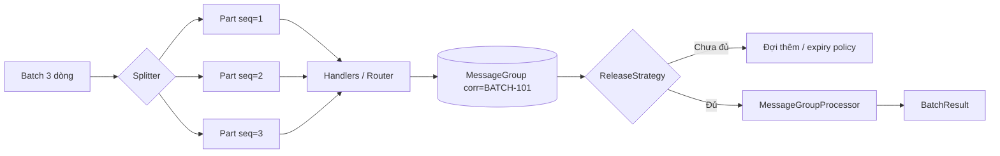
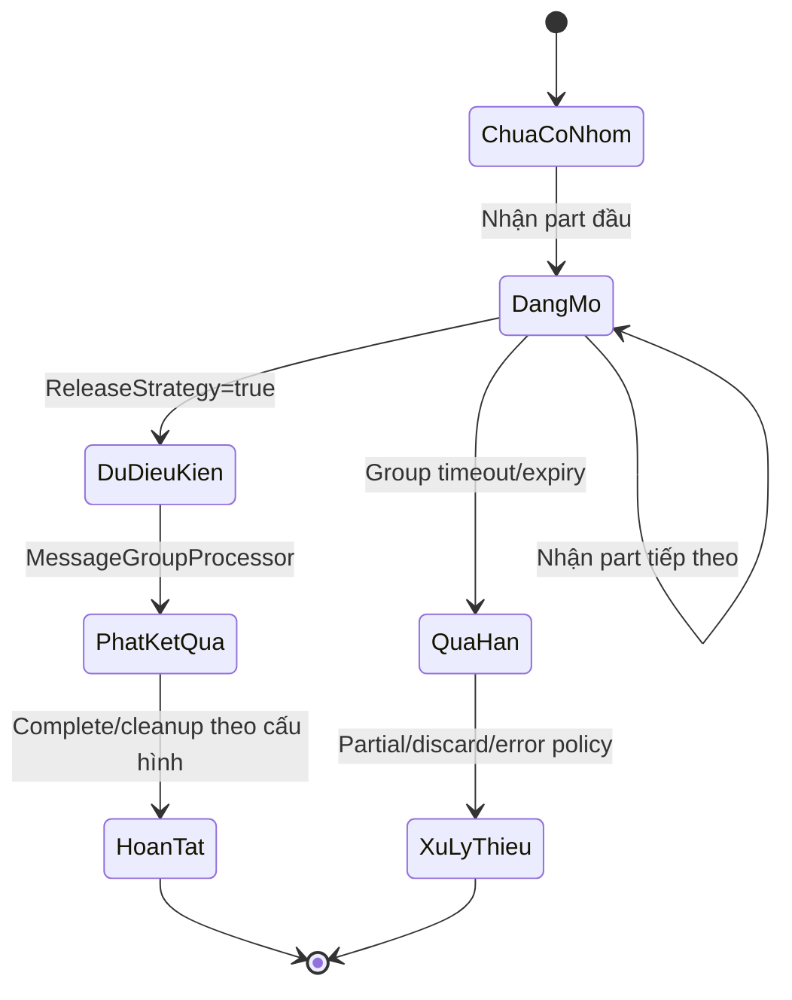
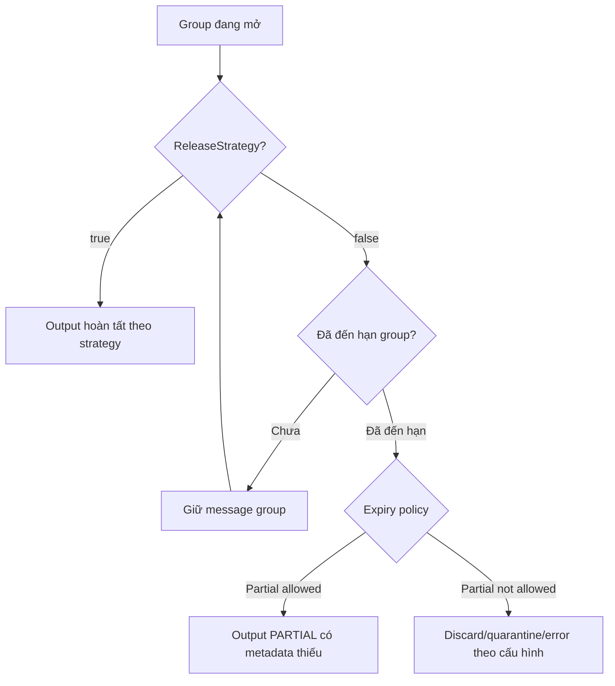
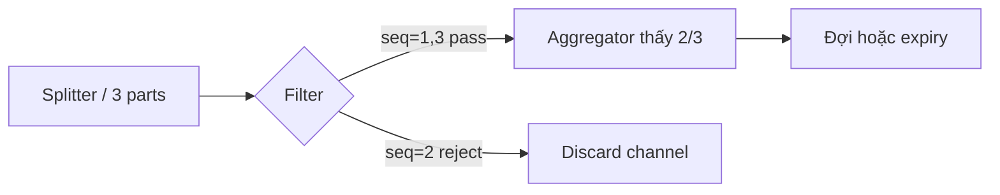
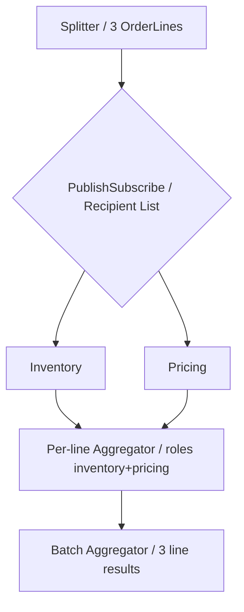

# Completion strategy và điều kiện hoàn tất

Một đơn hàng gồm bốn dòng sản phẩm được **Splitter** tách ra thành bốn message. Các dòng hàng đi qua những nhánh kiểm tra tồn kho, định giá và vận chuyển có tốc độ khác nhau. **Aggregator** nhận kết quả để tạo một câu trả lời chung cho đơn. Nhưng khi đã nhận ba kết quả, liệu đã đủ để trả lời chưa? Nếu dòng thứ tư bị Filter loại, một handler lỗi, hoặc một message được gửi lại hai lần, Aggregator cần **đợi**, **trả một phần** hay **báo thất bại**?

Đó chính là nhiệm vụ của **completion strategy** — trong API Spring Integration thường được thể hiện bằng **`ReleaseStrategy`** của Aggregator. Nó quyết định **khi nào một nhóm thông điệp đủ điều kiện được release** để tạo output. Chọn sai điều kiện sẽ khiến nhóm bị giữ vô hạn, trả kết quả quá sớm, đếm trùng message hoặc làm Gateway chờ đến timeout.

Bài **“Completion strategy và điều kiện hoàn tất”** thuộc chương **Aggregator** của module `SPRING_INTEGRATION_PATTERN`. Mục tiêu là hiểu đầy đủ vòng đời `MessageGroup`, correlation, sequence size, release strategy, group processor và group expiry; xây ví dụ Spring Integration Java DSL và JUnit 5; xử lý retry, error channel, Filter, Router, Transformer, Splitter, Gateway, Publish–Subscribe và observability để tạo các luồng tích hợp **ít phụ thuộc, dễ mở rộng và kiểm thử được**.

> **Nguyên tắc:** **`ReleaseStrategy` trả lời “nhóm này đã đủ điều kiện phát kết quả chưa?”**; **`MessageGroupProcessor` trả lời “khi phát, tạo kết quả gì?”**. **Group timeout/expiry** xử lý những nhóm không được release đúng hạn. Ba trách nhiệm này liên quan nhưng **không thay thế nhau**.

## 1. Bức tranh tổng thể: Aggregator không chỉ đếm message

Ví dụ một batch có ba dòng hàng:

```json
{
  "batchId": "BATCH-101",
  "lines": [
    {"lineId": "L-1", "sku": "PEN-01"},
    {"lineId": "L-2", "sku": "BOOK-02"},
    {"lineId": "L-3", "sku": "BAG-03"}
  ]
}
```

Một flow điển hình:



Các phần có thể **đến sai thứ tự**, bị gửi lại hoặc không bao giờ tới. Aggregator phải xác định:

1. **Tương quan:** phần nào thuộc cùng nhóm? (`correlationId` hoặc custom correlation strategy).
2. **Trạng thái nhóm:** những message nào đã đến và được lưu trong `MessageGroupStore`?
3. **Điều kiện hoàn tất:** release khi đủ N phần, đủ những phần bắt buộc, đến một tín hiệu kết thúc, đạt quorum hay hết thời hạn?
4. **Kết quả:** gộp các payload thành `BatchResult` nào; báo thành công toàn phần hay một phần?
5. **Dọn dẹp:** sau khi release, giữ hay xóa group; xử lý message đến trễ và duplicate thế nào?

**Điều kiện hoàn tất không thể suy ra chỉ từ số message đang nhìn thấy.** Nếu kỳ vọng ba phần nhưng một message bị gửi lại hai lần, group có thể chứa ba message mà vẫn thiếu một phần logic.

## 2. Các thành phần liên quan trong Spring Integration

| Thành phần | Vai trò chính | Sai lầm cần tránh |
| --- | --- | --- |
| **Correlation strategy** | Xác định `groupId` của mỗi message. | Gom theo `sequenceNumber` hoặc một ID không ổn định. |
| **`MessageGroupStore`** | Lưu các message và trạng thái nhóm cho tới khi release/expire. | Nghĩ store in-memory sẽ tự survive restart. |
| **`ReleaseStrategy`** | Trả về điều kiện có thể release nhóm. | Dùng phép đếm thô bất chấp duplicate/missing parts. |
| **`MessageGroupProcessor`** | Chuyển `MessageGroup` thành output khi release. | Trộn nghiệp vụ tạo output vào điều kiện release. |
| **Group timeout/expiry** | Xử lý nhóm bị kẹt/quá hạn theo policy. | Nhầm với reply timeout của Gateway hoặc HTTP client. |
| **Discard/late-message policy** | Xử lý message không còn thuộc group đang mở. | Để late reply âm thầm tạo kết quả thứ hai. |
| **Gateway/Reply path** | Trả phản hồi cho caller nếu luồng là request–reply. | Giả định Aggregator luôn có reply và mọi nhánh đã hoàn thành nghiệp vụ. |

Trong Spring Integration, thuật ngữ **completion strategy** thường được dùng để nói về **quy tắc đủ điều kiện hoàn tất nhóm**, nhưng API trọng tâm cần tìm là **`ReleaseStrategy`**. Ngay khi `canRelease(group)` thỏa mãn, việc xuất kết quả, xóa/giữ group và exception behavior còn tùy cấu hình Aggregator.

### 2.1. Vòng đời tối giản của một message group



Sơ đồ mô tả **các trạng thái logic**, không phải tên state machine mặc định của framework. Một số cấu hình có thể giữ group sau completion, cho phép release lại hoặc xử lý group timeout theo cách khác. Vì thế cần test **vòng đời sau khi release**, không chỉ kiểm tra message đầu tiên.

## 3. Correlation: nhóm nào đang được đánh giá?

`ReleaseStrategy` chỉ có nghĩa khi các message được gom vào **đúng nhóm**. Ví dụ:

```text
Group A: corr=A, seq=1/3, seq=2/3, seq=3/3
Group B: corr=B, seq=1/2, seq=2/2
```

Nếu gom tất cả message vào một group chung, tổng số phần có thể đạt N nhưng output trộn dữ liệu của **hai đơn hàng khác nhau**.

Trong một luồng Splitter–Aggregator tiêu chuẩn, metadata từ Splitter thường bao gồm:

- `correlationId`: định danh cùng một lần split.
- `sequenceNumber`: vị trí part trong nhóm, thường bắt đầu từ 1.
- `sequenceSize`: số phần dự kiến khi xác định được.

Tuy nhiên, `correlationId` mặc định có thể dựa trên **ID message đầu vào**, chứ không phải `batchId` nghiệp vụ. Một yêu cầu gửi lại sẽ có thể mang ID message khác, làm các phần thuộc nhóm khác. Khi cần phục hồi/replay liên tiến trình, hãy thiết kế correlation key ổn định và loại trùng một cách tường minh.

### 3.1. Một batch có hai lần gửi

```text
Message gốc lần 1: UUID-111; batchId=BATCH-101
    → corr=UUID-111, seq=1/3, 2/3, 3/3

Message gốc lần 2: UUID-222; batchId=BATCH-101
    → corr=UUID-222, seq=1/3, 2/3, 3/3
```

Nếu Aggregator gom theo correlation mặc định, đây có thể là **hai message group** dù business batch ID giống nhau. Nếu cần coi chúng là một batch, phải cấu hình **custom correlation strategy** hoặc ngăn replay trùng trước khi split. Đừng thay đổi correlation key tùy tiện khi một batch đã có group đang mở.

### 3.2. Một group có cùng correlation nhưng khác expected size

```text
part A: corr=X, seq=1, size=3
part B: corr=X, seq=2, size=4
```

Đây là **mâu thuẫn metadata** nếu hợp đồng quy định mỗi group có size cố định. Một release strategy dùng size từ “message bất kỳ” có thể phát kết quả sai. Nên validate group metadata, version/schema và các giá trị `expectedParts`/`batchId` trước khi aggregation.

## 4. Điều kiện mặc định: số phần từ Splitter

Khi Splitter tạo các phần có sequence metadata hợp lệ và Aggregator dùng cấu hình tiêu chuẩn, cơ chế release theo **số phần dự kiến** là một lựa chọn phổ biến. Có thể hiểu về mặt khái niệm:

```text
expectedParts = sequenceSize
receivedParts = số message trong group

canRelease = receivedParts đạt số phần dự kiến
```

**Đây là mô tả ý tưởng**, không phải lời hứa rằng mọi chiến lược mặc định đều chỉ chạy phép `group.size() == sequenceSize`. Những phiên bản/cấu hình Spring Integration có thể dùng release strategy có tối ưu/kiểm tra riêng; hãy kiểm thử với version thực tế.

### 4.1. Timeline nhóm nhận sai thứ tự

| Thời điểm | Message đến | `sequenceSize` | Số message đã nhận | Có thể release? |
| --- | --- | ---: | ---: | --- |
| T1 | `seq=2` | 3 | 1 | Chưa. |
| T2 | `seq=3` | 3 | 2 | Chưa. |
| T3 | `seq=1` | 3 | 3 | Có thể, nếu đúng ba phần và policy thỏa. |

**Không phải message `seq=3` là tín hiệu kết thúc.** Part mang sequence number lớn nhất có thể đến đầu tiên, còn part số 1 đến cuối. Muốn biết nhóm đầy đủ phải kiểm tra **tập phần thực tế được ghi nhận**, không chỉ “đã thấy part cuối”.

### 4.2. `sequenceSize` là expected count, không phải actual count

| Giá trị | Mô tả |
| --- | --- |
| `sequenceSize=4` | Nhóm dự kiến có bốn phần, nếu size đã biết. |
| `group.size()=3` | Group hiện đang giữ ba message. |
| `distinctPartIds=2` | Trong ba message có thể có một phần trùng. |
| `successfulParts=1` | Chỉ một phần đã xử lý nghiệp vụ thành công. |

Các số này **khác nhau**. Release theo `group.size()` có thể đúng trong một luồng tin cậy không duplicate, nhưng chưa đủ cho các luồng async/broker có redelivery hoặc fan-out.

## 5. Java DSL: Splitter → xử lý phần tử → Aggregator

Ví dụ đầu tiên không dùng broker, HTTP hoặc database để minh họa **vòng đời hoàn tất theo số phần**. Payload gồm danh sách `OrderLine`; mỗi dòng được biến thành `LineCheck` rồi Aggregator phát ra một collection.

### 5.1. DTO dữ liệu

```java
// OrderLine.java
public record OrderLine(String sku, int quantity) {}

// LineCheck.java
public record LineCheck(String sku, boolean valid) {}
```

### 5.2. IntegrationFlow

```java
// BasicAggregationConfiguration.java
import org.springframework.context.annotation.Bean;
import org.springframework.context.annotation.Configuration;
import org.springframework.integration.channel.QueueChannel;
import org.springframework.integration.config.EnableIntegration;
import org.springframework.integration.dsl.IntegrationFlow;

@Configuration
@EnableIntegration
public class BasicAggregationConfiguration {

    @Bean("batches.out")
    QueueChannel batchResults() {
        return new QueueChannel(16);
    }

    @Bean
    IntegrationFlow checkAndAggregateLines() {
        return IntegrationFlow.from("batches.in")
            .split()
            .transform(OrderLine.class, line ->
                new LineCheck(line.sku(), line.quantity() > 0))
            .aggregate()
            .channel("batches.out")
            .get();
    }
}
```

Luồng trên làm các việc:

1. `batches.in` nhận `Message<List<OrderLine>>`.
2. `.split()` phát một message cho mỗi dòng, theo cơ chế splitter tiêu chuẩn có sequence/correlation metadata khi được cấu hình phù hợp.
3. `.transform(...)` đổi payload mỗi message thành `LineCheck` và cần giữ metadata nhóm để Aggregator có thể nhận diện.
4. `.aggregate()` gom các phần và phát kết quả theo chiến lược mặc định của cấu hình.
5. `batches.out` là `QueueChannel` quan sát kết quả trong ví dụ.

**Giới hạn:** Đây là flow minh họa với ba phần đều có kết quả và hoạt động cục bộ. Kênh queue trong memory không tự có consumer, transaction, retry, persistence hoặc deadline của Gateway. Không dùng đoạn code này làm bằng chứng “batch không mất dữ liệu sau restart”.

### 5.3. JUnit 5: không release sớm và gộp đủ ba phần

```java
import static org.junit.jupiter.api.Assertions.*;

import java.util.Collection;
import java.util.List;
import java.util.Set;
import org.junit.jupiter.api.Test;
import org.springframework.beans.factory.annotation.Autowired;
import org.springframework.context.ApplicationContext;
import org.springframework.integration.channel.QueueChannel;
import org.springframework.messaging.Message;
import org.springframework.messaging.MessageChannel;
import org.springframework.messaging.support.MessageBuilder;
import org.springframework.test.context.junit.jupiter.SpringJUnitConfig;

@SpringJUnitConfig(BasicAggregationConfiguration.class)
class BasicAggregationTest {

    @Autowired ApplicationContext context;

    @Test
    void oneBatchProducesOneAggregatedResult() {
        List<OrderLine> lines = List.of(
            new OrderLine("PEN-01", 2),
            new OrderLine("BOOK-02", 1),
            new OrderLine("BAG-03", 0));

        MessageChannel input =
            context.getBean("batches.in", MessageChannel.class);
        assertTrue(input.send(
            MessageBuilder.withPayload(lines).build()));

        QueueChannel output =
            context.getBean("batches.out", QueueChannel.class);
        Message<?> resultMessage = output.receive(0);
        assertNotNull(resultMessage);

        assertInstanceOf(Collection.class, resultMessage.getPayload());
        Collection<?> results =
            (Collection<?>) resultMessage.getPayload();
        assertEquals(3, results.size());
        assertEquals(Set.of(
            new LineCheck("PEN-01", true),
            new LineCheck("BOOK-02", true),
            new LineCheck("BAG-03", false)
        ), Set.copyOf(results));
        assertNull(output.receive(0));
    }
}
```

**Test chứng minh:** ba input parts được xử lý thành ba `LineCheck`, và flow phát một kết quả tổng hợp trong cấu hình nội bộ mẫu. Nó **không chứng minh** group timeout, duplicate detection, thứ tự arrival bất đồng bộ hay retry broker.

### 5.4. Thử kiểm tra chưa đủ parts

Ở ví dụ trên, Splitter có thể xử lý liền cả danh sách trước khi test kịp đọc output. Muốn chứng minh release condition theo từng bước, cần **gửi các message phần tử trực tiếp vào một Aggregator flow riêng**, với correlation/sequence metadata chủ động:

```text
send(part seq=2, size=3) → không có output
send(part seq=1, size=3) → không có output
send(part seq=3, size=3) → nhận đúng một kết quả
```

Ví dụ JUnit ở mục 8 minh họa cách viết một **custom release strategy**, phù hợp để quan sát các tình huống này.

## 6. Một completion strategy có thể dựa trên điều kiện gì?

Không phải luồng nào cũng biết hoặc cần số phần cố định. Dưới đây là các lựa chọn phổ biến:

| Loại điều kiện | Quy tắc khái niệm | Tình huống phù hợp | Cạm bẫy |
| --- | --- | --- | --- |
| **Đủ số phần đã biết** | `receivedUniqueParts == expectedParts`. | Splitter tạo N phần hữu hạn. | Duplicate, Filter drop, sai size. |
| **Đủ những vai trò bắt buộc** | Đã có `INVENTORY` và `PRICING`. | Scatter–gather nhiều dependency. | Không được đếm hai reply từ một dependency thay cho dependency khác. |
| **End-of-stream marker** | Đã thấy tín hiệu kết thúc **và** đủ các phần trước đó. | Streaming/iterator không biết N trước. | Marker đến trước phần bị trễ; mất marker. |
| **Quorum** | Có K kết quả độc lập đủ điều kiện từ N replica. | Đọc phân tán có quorum nghiệp vụ rõ. | Các reply không độc lập hoặc không cùng version. |
| **First acceptable result** | Có một phản hồi đạt tiêu chuẩn. | Thăm dò nhiều nguồn tương đương. | Reply muộn có thể tạo output lần hai; có thể cần hủy/ignore các nhánh khác. |
| **Deadline/expiry** | Hết thời gian chờ, áp dụng policy partial/fail. | SLA không thể đợi mãi. | Timeout không chứng minh các part chưa xử lý. |
| **Explicit business completion** | Nhận trạng thái đã commit cho mọi bước bắt buộc. | Workflow nhiều service. | Cần state bền vững và idempotency; không chỉ group size. |

Chọn strategy theo **hợp đồng hoàn thành nghiệp vụ**, không theo số handler trên sơ đồ.

### 6.1. Đủ N message chưa chắc là đủ N kết quả hợp lệ

Ví dụ `expectedParts=3`, group nhận:

```text
Line 1 → SUCCESS
Line 2 → REJECTED
Line 3 → SUCCESS
```

Nhóm **đủ ba outcome** nhưng không phải **batch thành công hoàn toàn**. Một completion strategy có thể release vì **mọi phần đã có kết quả**, còn `MessageGroupProcessor` tạo `BatchResult(status=PARTIAL_FAILURE, ...)`.

Phân biệt:

- **Structural completion:** đủ kết quả cho những phần phải chờ.
- **Business success:** tất cả kết quả đạt điều kiện nghiệp vụ.

Không đồng nhất “release được” với “đơn hàng hợp lệ/đã giao dịch thành công”.

## 7. Custom release strategy: đếm phần tử duy nhất

Giả sử các message result được nhận từ broker và có thể redeliver. Ta quy định mỗi message phải mang:

```text
headers:
    batchId         = BATCH-101
    expectedParts   = 3              # Integer
    sequenceNumber  = 1, 2 hoặc 3    # Integer
payload:
    LineCheck
```

Một **custom ReleaseStrategy** có thể kiểm tra **tập số thứ tự duy nhất**, thay vì chỉ dùng tổng message trong group.

### 7.1. Pure release strategy

```java
// UniqueSequenceReleaseStrategy.java
import java.util.HashSet;
import java.util.Set;
import org.springframework.integration.IntegrationMessageHeaderAccessor;
import org.springframework.integration.aggregator.ReleaseStrategy;
import org.springframework.integration.store.MessageGroup;
import org.springframework.messaging.Message;

public final class UniqueSequenceReleaseStrategy
        implements ReleaseStrategy {

    @Override
    public boolean canRelease(MessageGroup group) {
        if (group.getMessages().isEmpty()) {
            return false;
        }

        Integer expected = null;
        Set<Integer> positions = new HashSet<>();

        for (Message<?> message : group.getMessages()) {
            Integer size = message.getHeaders().get(
                "expectedParts", Integer.class);
            Integer number = message.getHeaders().get(
                IntegrationMessageHeaderAccessor.SEQUENCE_NUMBER,
                Integer.class);

            if (size == null || size < 1 || size > 1000
                    || number == null || number < 1 || number > size) {
                return false;
            }
            if (expected == null) {
                expected = size;
            } else if (!expected.equals(size)) {
                return false;
            }
            positions.add(number);
        }
        return expected != null && positions.size() == expected;
    }
}
```

**Đọc logic:**

1. Group rỗng chưa đủ.
2. Mọi message phải có `expectedParts` và `sequenceNumber` hợp lệ.
3. Mọi message trong group phải khai **cùng expected size**.
4. Kết quả release khi **đủ các vị trí duy nhất** của nhóm.

**Giới hạn phải nói rõ:** strategy này chỉ kiểm tra *hoàn tất cấu trúc*, **không loại duplicate khỏi group** và không xác thực nội dung hai bản duplicate có giống nhau. Nếu hai message khác nhau cùng `sequenceNumber=2` đã vào group, processor phải **deduplicate có kiểm chứng hoặc báo conflict**. Ở biên vào, cần validator ném/tách lỗi cho metadata bất hợp lệ; việc strategy trả `false` mãi với group dữ liệu hỏng có thể làm group kẹt cho tới expiry.

### 7.2. Custom group processor phải tương thích release strategy

Nếu release khi đã thấy N vị trí duy nhất, **group.size() có thể lớn hơn N vì duplicate**. Không nên chỉ làm:

```java
// KHÔNG dùng để khẳng định mỗi part chỉ xuất hiện một lần:
group.getMessages().stream()
    .map(Message::getPayload)
    .toList();
```

vì output có thể chứa hai kết quả cho cùng part. Cần **identity và conflict policy**:

- Dùng `(batchId, partId)` hoặc `(correlationId, sequenceNumber)` phù hợp để nhận diện một part.
- Hai bản có **payload giống nhau** có thể được gộp như duplicate theo hợp đồng.
- Hai bản có **payload mâu thuẫn** phải được phân loại lỗi và đối soát, không âm thầm chọn bản đến trước.
- Nếu side effect đã diễn ra trong handler, deduplicate tại Aggregator **quá muộn** để ngăn side effect trùng; cần idempotent consumer trước đó.

Ví dụ một processor chỉ minh họa **cách sắp xếp/dedup khi payload trùng hoàn toàn**:

```java
import java.util.Map;
import java.util.TreeMap;
import org.springframework.integration.IntegrationMessageHeaderAccessor;
import org.springframework.integration.store.MessageGroup;
import org.springframework.messaging.Message;

final class BatchGroupProcessor {
    static java.util.List<LineCheck> uniqueOrdered(MessageGroup group) {
        Map<Integer, LineCheck> byPosition = new TreeMap<>();

        for (Message<?> message : group.getMessages()) {
            Integer number = message.getHeaders().get(
                IntegrationMessageHeaderAccessor.SEQUENCE_NUMBER,
                Integer.class);
            LineCheck result = (LineCheck) message.getPayload();
            LineCheck prior = byPosition.putIfAbsent(number, result);
            if (prior != null && !prior.equals(result)) {
                throw new IllegalStateException(
                    "Conflicting duplicate for sequence " + number);
            }
        }
        return java.util.List.copyOf(byPosition.values());
    }
}
```

Trong production, cần cả **schema/identity validation** và xử lý ngoại lệ rõ; đoạn này giả định message đã qua kiểm tra type/null/permission. Đừng dùng `sequenceNumber` đơn lẻ làm idempotency key xuyên nhiều batch; processor chỉ làm việc **trong một group đã correlation đúng**.

## 8. Dùng custom strategy trong IntegrationFlow và kiểm thử release

Ví dụ **độc lập** với flow `batches.in` ở mục 5: producer hoặc một adapter gửi các message `LineCheck` đã có header `batchId`, `expectedParts` và `sequenceNumber` vào `parts.completed.in`.

### 8.1. Cấu hình Aggregator

```java
// CustomAggregationConfiguration.java
import org.springframework.context.annotation.Bean;
import org.springframework.context.annotation.Configuration;
import org.springframework.integration.channel.QueueChannel;
import org.springframework.integration.config.EnableIntegration;
import org.springframework.integration.dsl.IntegrationFlow;

@Configuration
@EnableIntegration
public class CustomAggregationConfiguration {

    @Bean("batches.completed")
    QueueChannel completedBatches() {
        return new QueueChannel(8);
    }

    @Bean
    IntegrationFlow aggregateCompletedParts() {
        return IntegrationFlow.from("parts.completed.in")
            .aggregate(spec -> spec
                .correlationStrategy(
                    message -> message.getHeaders().get("batchId"))
                .releaseStrategy(new UniqueSequenceReleaseStrategy())
                .outputProcessor(BatchGroupProcessor::uniqueOrdered))
            .channel("batches.completed")
            .get();
    }
}
```

Ở đây:

- `correlationStrategy` nhóm theo **business batch ID đã được xác thực**.
- `releaseStrategy` kiểm tra tập sequence number duy nhất.
- `outputProcessor` tạo `List<LineCheck>` theo đúng thứ tự gốc và phát hiện duplicate mâu thuẫn.
- `batches.completed` lưu kết quả để test đọc.

**Lưu ý API:** đây là minh họa sử dụng DSL của các phiên bản Spring Integration hỗ trợ `aggregate(spec -> ...)`, `correlationStrategy`, `releaseStrategy` và `outputProcessor`. Khi triển khai module thực tế, kiểm tra chữ ký của phiên bản thư viện và test integration với đúng dependencies.

### 8.2. JUnit 5: thiếu part thì chưa release

```java
import static org.junit.jupiter.api.Assertions.*;

import java.util.List;
import org.junit.jupiter.api.Test;
import org.springframework.beans.factory.annotation.Autowired;
import org.springframework.context.ApplicationContext;
import org.springframework.integration.IntegrationMessageHeaderAccessor;
import org.springframework.integration.channel.QueueChannel;
import org.springframework.messaging.Message;
import org.springframework.messaging.MessageChannel;
import org.springframework.messaging.support.MessageBuilder;
import org.springframework.test.context.junit.jupiter.SpringJUnitConfig;

@SpringJUnitConfig(CustomAggregationConfiguration.class)
class CompletionStrategyTest {

    @Autowired ApplicationContext context;

    private void sendPart(int number, int expected, LineCheck payload) {
        MessageChannel input =
            context.getBean("parts.completed.in", MessageChannel.class);

        Message<LineCheck> message = MessageBuilder
            .withPayload(payload)
            .setHeader("batchId", "BATCH-101")
            .setHeader("expectedParts", expected)
            .setHeader(
                IntegrationMessageHeaderAccessor.SEQUENCE_NUMBER, number)
            .build();
        assertTrue(input.send(message));
    }

    @Test
    void releasesOnlyAfterAllThreeDistinctPartsArrive() {
        QueueChannel output = context.getBean(
            "batches.completed", QueueChannel.class);

        sendPart(2, 3, new LineCheck("BOOK-02", true));
        assertNull(output.receive(0));

        sendPart(3, 3, new LineCheck("BAG-03", false));
        assertNull(output.receive(0));

        sendPart(1, 3, new LineCheck("PEN-01", true));
        Message<?> result = output.receive(0);
        assertNotNull(result);

        assertEquals(List.of(
            new LineCheck("PEN-01", true),
            new LineCheck("BOOK-02", true),
            new LineCheck("BAG-03", false)
        ), result.getPayload());

        assertNull(output.receive(0));
    }
}
```

**Test này chứng minh:** group không release sau 1/3 hay 2/3, rồi trả đúng danh sách sau 3/3 dù phần đến theo thứ tự 2, 3, 1. Nó **không kiểm thử** crash/restart, late message, duplicate có payload xung đột, timeout hoặc retry từ broker.

Đây là test giả định một `QueueChannel` đồng bộ nội bộ. Với executor/broker, cần chờ theo điều kiện và timeout. Tránh tái dùng cùng `batchId` cho nhiều test trong một context còn giữ group hoặc completed-group state.

### 8.3. Test duplicate phải kiểm tra cả group lẫn output

Một bộ test mở rộng nên gửi:

```text
seq=1, payload=PEN
seq=2, payload=BOOK
seq=2, payload=BOOK  (duplicate hợp lệ)
seq=3, payload=BAG
```

Kết quả mong đợi tùy policy: **một** kết quả cho mỗi part, không nhân đôi BOOK. Nếu gửi `seq=2` với payload **khác nhau**, cần **báo lỗi conflict** chứ không im lặng release output tùy ý.

Chú ý: test cần xét liệu **MessageGroupStore** và completed-group handling của phiên bản cấu hình cho phép duplicate song song hay chặn trước; không hứa chỉ có một behavior mặc định.

## 9. Release theo role thay vì số message

Trong scatter–gather, một đơn cần **hai loại dữ liệu**: `INVENTORY` và `PRICING`. Mỗi dependency có thể retry hoặc trả kết quả lặp.

```text
Batch X:
    inventory reply #1
    inventory reply #2  (retry)
    pricing reply #1
```

Nếu release khi `group.size() >= 2` thì Aggregator có thể hoàn tất **ngay sau hai inventory reply**, khi chưa có pricing.

Điều kiện đúng hơn:

```text
receivedRoles = {role của từng message hợp lệ trong group}
requiredRoles = {INVENTORY, PRICING}

canRelease = receivedRoles containsAll requiredRoles
```

### 9.1. Ví dụ strategy dựa trên tập role

```java
import java.util.Set;
import java.util.stream.Collectors;
import org.springframework.integration.aggregator.ReleaseStrategy;
import org.springframework.integration.store.MessageGroup;

final class RequiredRolesReleaseStrategy implements ReleaseStrategy {
    private static final Set<String> REQUIRED =
        Set.of("INVENTORY", "PRICING");

    @Override
    public boolean canRelease(MessageGroup group) {
        Set<String> roles = group.getMessages().stream()
            .map(m -> m.getHeaders().get("resultRole"))
            .filter(String.class::isInstance)
            .map(String.class::cast)
            .collect(Collectors.toSet());
        return roles.containsAll(REQUIRED);
    }
}
```

Điều kiện này minh họa **sự đầy đủ theo loại kết quả**. Trong production, còn phải kiểm tra cùng `orderId`, version nhất quán, chữ ký/nguồn đáng tin, success/error outcome và duplicate conflict. Không dùng hai message `INVENTORY` thay cho kết quả `PRICING`.

### 9.2. Khi có recipient tùy chọn

Nếu Notification chỉ được gọi khi `notificationAllowed=true`, số recipient thực sự được chọn có thể thay đổi theo từng message. Đừng hard-code `expectedParts=3` cho mọi request khi đôi lúc chỉ có hai reply bắt buộc. Có thể:

1. Tính **expectedRoles** trước khi scatter.
2. Gắn metadata nhóm một cách được xác thực.
3. Group release khi mọi **required role** đều có outcome.
4. Timeout/expiry cho optional role; không giữ toàn bộ request vì một nhánh phụ chậm.

**Publish–Subscribe** hoặc **Recipient List** có thể tạo nhiều message cho cùng part; sequence metadata của Splitter **không tự đếm đúng số reply** khi xuất hiện thêm tầng fan-out.

## 10. Completion theo quorum, first success và end marker

### 10.1. Quorum

Với ba replica đọc trạng thái, một nghiệp vụ có thể quyết định chỉ cần **hai kết quả độc lập và đủ điều kiện**. Nhưng release khi `group.size() >= 2` sẽ sai nếu hai message đến từ **cùng replica**, hoặc hai reply mâu thuẫn version.

Một quorum strategy phải xét:

- Identity **riêng của từng replica/nguồn**.
- Version hoặc thời điểm snapshot được dùng.
- Cách kiểm tra các giá trị **có đồng thuận** hay không.
- Chính sách đối với reply trễ hoặc không đồng thuận.
- Cần bao nhiêu nguồn tối thiểu để quyết định an toàn.

Đây là một **business rule**, không phải tính năng “đếm 2 message” thuần túy của Aggregator.

### 10.2. First acceptable result

Một số luồng chỉ cần **kết quả đầu tiên đạt tiêu chuẩn** từ nhiều dịch vụ tương đương. Release condition có thể là:

```text
exists(result where result.status == ACCEPTED)
```

Khi release sớm, những reply còn lại có thể vẫn đang chạy. Phải có **late arrival policy** và khi cần cơ chế cancellation riêng. Đừng tưởng release output sẽ tự hủy HTTP call hoặc transaction ngoài hệ thống.

### 10.3. End-of-stream/completion marker

Khi nguồn là `Iterator` hoặc stream chưa biết số phần, `sequenceSize` có thể không cho một N dương đáng tin. Ta có thể dùng **completion marker**, nhưng cần chú ý:

```text
PART seq=1
PART seq=2
COMPLETE expected=3
PART seq=3 (đến sau marker do mạng/queue)
```

Nếu release ngay khi thấy marker, kết quả thiếu part số 3. Contract tốt có thể là **đã thấy marker và đã nhận đủ tập part được marker xác định**. Marker phải có correlation ID, version và expected count/watermark đáng tin; nếu không có, dùng timeout/partial policy phù hợp.

Không mặc định Aggregator Spring Integration sẽ hiểu một payload `END` do ứng dụng tự tạo nếu chưa có custom release strategy.

## 11. Group timeout và expiry: đường thoát khi không bao giờ đủ

Một nhóm có thể không bao giờ thỏa `ReleaseStrategy`:

- Filter đã loại một phần mà không phát `REJECTED` outcome.
- Router chuyển một message vào nhánh unmatched không nối lại Aggregator.
- Handler chết hoặc message mất qua transport.
- Consumer quá tải, một part tới rất muộn.
- Duplicate khiến số part duy nhất thấp hơn N.
- `sequenceSize` sai hoặc nhóm không có completion marker.

Không nên giữ nhóm đó mãi trong memory hoặc persistent store. Cần **group timeout/expiry**.

### 11.1. Timeout và release là hai đường khác nhau



**Group timeout** không có nghĩa business success, cũng không đảm bảo framework tự tạo domain error `BatchFailed`. Tùy cấu hình, framework có thể phát partial result, expire/discard group hoặc hành xử khác. Ứng dụng cần chuyển thành **kết quả nghiệp vụ rõ nghĩa** và kiểm thử hậu quả.

### 11.2. Ví dụ DSL cho partial result on expiry

```java
// Ví dụ cấu hình thay thế, không ghép đồng thời
// với một aggregator khác trên cùng input channel.
@Bean
IntegrationFlow aggregateWithDeadline() {
    return IntegrationFlow.from("parts.deadline.in")
        .aggregate(spec -> spec
            .groupTimeout(5_000)
            .sendPartialResultOnExpiry(true))
        .channel("batches.deadline.out")
        .get();
}
```

**Giới hạn của snippet:** cần có bean channel `batches.deadline.out`, correlation/sequence headers hoặc strategy phù hợp và scheduler/lifecycle đúng phiên bản. `sendPartialResultOnExpiry(true)` là **chính sách gửi phần đang có khi group hết hạn**, **không biến các phần thiếu thành thành công**. Nếu output phải là `BatchReceipt(status=PARTIAL)`, cần **group processor/Transformer** tạo trạng thái nghiệp vụ ấy.

Không suy rằng `groupTimeout(5_000)` luôn là một deadline 5 giây tính từ HTTP request ở mọi cấu hình: thời điểm đánh giá/scheduling group có semantics riêng và có thể bị ảnh hưởng bởi các message đến tiếp, scheduler hoặc group store. Nếu cần deadline tuyệt đối cho batch, lưu `deadlineAt` hoặc thông tin tương đương và kiểm tra ở logic riêng.

### 11.3. Partial result chỉ an toàn nếu caller hiểu “thiếu”

Ví dụ một kết quả có cấu trúc:

```json
{
  "batchId": "BATCH-101",
  "status": "PARTIAL_FAILURE",
  "expectedParts": 3,
  "receivedParts": 2,
  "missingPartIds": ["L-2"],
  "results": [
    {"lineId": "L-1", "status": "CHECKED"},
    {"lineId": "L-3", "status": "CHECKED"}
  ]
}
```

Đây là **schema đề xuất do ứng dụng định nghĩa**, không phải payload mặc định của Aggregator. Để xác định `missingPartIds` chính xác, cần biết **danh sách part dự kiến và các part ID đã nhận**; không thể suy ra thông tin này chỉ từ `group.size()` nếu các message có thể trùng.

Nếu quy trình xử lý tài chính **không được phép kết thúc một phần**, nên trả trạng thái thất bại/chờ đối soát theo hợp đồng thay vì tạo output giống một đơn đã xử lý đủ.

## 12. Late arrivals, completed groups và re-aggregation

Sau khi release hoặc expire, một message trễ có thể đến:

```text
T1: nhận seq=1/3
T2: nhận seq=2/3
T3: hết group timeout → phát PARTIAL
T4: seq=3/3 đến muộn
```

Câu hỏi cần thiết kế:

1. Part số 3 bị **discard/quarantine** hay tạo một bản cập nhật kết quả?
2. Nếu group đã xóa, có nên **tạo group mới cùng correlation key**?
3. Nếu kết quả partial đã trả cho Gateway, làm sao báo cập nhật sau đó?
4. Nếu part 3 có side effect, có tạo **hai kết quả batch** hoặc sửa trạng thái đã final?
5. Bao lâu cần giữ **completed-group marker/tombstone** để nhận diện part trễ?

Trong Spring Integration, việc giữ/xóa group sau completion, xử lý empty group, late messages và release lại phụ thuộc **cấu hình MessageGroupStore và Aggregator**. Không nên giả định mọi cấu hình sẽ tự bỏ tất cả message đến muộn. Phải thử đúng API/phiên bản và chọn policy:

| Policy | Khi dùng | Rủi ro |
| --- | --- | --- |
| **Ignore late result** | Reply chỉ hữu ích trong một deadline cố định. | Mất thông tin cập nhật nếu không có nơi lưu. |
| **Quarantine and reconcile** | Kết quả muộn cần được kiểm tra thủ công hoặc qua worker. | Cần quy trình vận hành, retention và quyền truy cập. |
| **Update previously partial result** | Nghiệp vụ hỗ trợ chuyển `PARTIAL → COMPLETE`. | Cần versioned state, idempotency và notification. |
| **Start a new group** | Chỉ nếu thật sự là **một thế hệ batch mới**. | Dễ tạo hai kết quả nếu cùng correlation ID bị tái sử dụng. |

**Group timeout, output timeout và process cancellation là ba chuyện khác nhau.** Aggregator hết hạn nhóm không làm mọi HTTP call ở nhánh downstream tự bị ngắt.

## 13. Filter và Router ảnh hưởng thế nào đến điều kiện hoàn tất?

### 13.1. Filter drop một phần

Giả sử Splitter tạo ba part với `sequenceSize=3`; Filter loại `seq=2` vì quantity không hợp lệ.



Nếu Aggregator mặc định phải nhận ba phần, **nó không tự trừ part bị Filter discard khỏi sequenceSize**. Cách xử lý:

- **Trả outcome cho reject:** `LineCheck(status=REJECTED)` tới Aggregator, giữ part identity/correlation.
- **Lọc trước khi Splitter:** nếu hợp đồng chỉ xử lý các line hợp lệ và không cần result cho line lỗi.
- **Partial completion:** cho phép expiry/release thiếu phần theo một business policy minh bạch.

### 13.2. Router đưa một phần sang nhánh không trả lời

Một Router chuyển SKU không hỗ trợ đến `orders.unmatched`; nếu nhánh này không tạo reply, Aggregator có thể bị kẹt tương tự. Router **không cập nhật số phần kỳ vọng**.

Khi một part bị từ chối theo nghiệp vụ, tốt nhất tạo **một outcome hợp lệ của part đó** (success/rejected/error) để group có thể trả kết quả tổng thể rõ, thay vì để Aggregator đoán rằng part đã biến mất.

### 13.3. Transformer có thể làm mất header

Nếu mỗi part được chuyển đổi từ `OrderLine` sang `LineCheck` nhưng code tự tạo `Message<?>` mới và không giữ correlation/sequence, Aggregator có thể:

- tạo group mới theo correlation không mong muốn;
- không tìm được số phần để release;
- phát message vào error path hoặc chờ vô hạn.

Hãy kiểm thử **headers thực tế ngay trước Aggregator** khi có Transformer, HTTP/Kafka/AMQP/JMS adapter hoặc custom endpoint. Không log toàn bộ message/hồ sơ khách hàng chỉ để debug một header.

## 14. Splitter lồng nhau và fan-out làm thay đổi số kết quả kỳ vọng

Một batch có **3 đơn**, mỗi đơn có **2 dòng**:

```text
Batch
  → Outer Splitter: 3 Orders
      → Inner Splitter: 2 Lines / Order
      → Line handlers
      → Inner Aggregator: 1 OrderResult / Order
  → Outer Aggregator: 3 OrderResult → BatchResult
```

Ở đây, có **hai cấp completion strategy**:

| Cấp | Group identity | Expected results |
| --- | --- | --- |
| Inner: line → order | `orderId` hoặc inner correlation | Hai dòng/đơn, nếu biết trước. |
| Outer: order → batch | `batchId` hoặc outer correlation | Ba kết quả đơn. |

Không thể mặc định một cặp header `sequenceNumber/sequenceSize` duy nhất mô tả đầy đủ **cả hai cấp**. Inner Splitter có thể thay metadata; cần bảo toàn khóa batch/outer sequence riêng và cấu hình các strategy theo cấp.

### 14.1. Fan-out mỗi part đến hai service



Số kết quả thực tế có thể là **3 × 2 = 6**, không phải ba. Thiết kế tốt thường:

1. **Gom hai role của mỗi line** thành một `LineResult`.
2. **Gom ba `LineResult`** thành `BatchResult`.

Nếu dùng một Aggregator duy nhất mà vẫn giữ `sequenceSize=3` từ Splitter gốc, nó có thể release sau ba trong sáu reply và làm thiếu một số role. Phải định nghĩa expectedRoles/part identity và release condition theo **đúng tầng**.

## 15. Retry, duplicate, idempotency và khả năng lưu bền

### 15.1. Một part có thể được giao lại

```text
Broker deliver: (batch=X, part=L-2)
Handler commit DB
Consumer crash trước ack
Broker redeliver: (batch=X, part=L-2)
```

Broker có thể giao lại cùng message; Aggregator có thể gặp hai message mang cùng part ID. **Release strategy không thay thế idempotent consumer**:

- Handler cần tránh thực hiện side effect lần hai.
- Input Aggregator nên validate identity/version và deduplicate.
- Output processor cần bảo vệ khi duplicate khác payload.
- Completed-group state cần xử lý late redelivery.

Một idempotency key phù hợp có thể là `(batchId, partId, action)` theo business contract, lưu bền bằng transaction hoặc cơ chế đồng thời an toàn. **`sequenceNumber` riêng lẻ không thể làm khóa chống trùng global**.

### 15.2. MessageGroupStore và restart

Mặc định, các ví dụ trong JVM có thể giữ group trong memory. Nếu process chết sau khi Aggregator nhận hai trên ba part:

```text
Group X:
    seq=1/3 đã nhận
    seq=2/3 đã nhận
    [JVM crash]
    seq=3/3 đến sau restart
```

Nếu không có phục hồi group state, hệ thống có thể **thiếu hai message đầu**, dù part thứ ba vẫn tới. Với yêu cầu bền vững:

- Chọn **persistent MessageGroupStore** theo hạ tầng phù hợp.
- Xem xét transaction/ack boundary giữa broker và group store.
- Có recovery khi crash **trước/sau khi release output**.
- Định nghĩa retention/expiry cho nhóm hoàn tất và nhóm kẹt.
- Kiểm thử duplicate và replay; **không hứa exactly-once end-to-end** chỉ nhờ dùng persistent store.

### 15.3. Cạnh tranh nhiều thread/instance

Hai message cùng correlation có thể tới đồng thời qua các thread hoặc nhiều consumer. Group store/locking/transaction phải có semantics phù hợp để không:

- làm mất một part khi hai thread cập nhật cùng group;
- cùng release một group hai lần;
- xử lý duplicate trước/sau release không nhất quán;
- tạo output sai khi một instance restart.

Đừng tự dùng `HashMap<String,List<Message<?>>>` không đồng bộ cho Aggregator production. Spring Integration có hạ tầng MessageGroupStore/locking; cần cấu hình và thử đúng deployment, đặc biệt nếu nhiều instance cùng chia sẻ store.

## 16. Gateway request–reply: release không đồng nghĩa caller đã nhận reply

Một Java Gateway có thể đưa batch vào Splitter và chờ `BatchReceipt`:

```java
import java.util.List;
import org.springframework.integration.annotation.MessagingGateway;

@MessagingGateway(defaultRequestChannel = "batches.in")
interface BatchGateway {
    BatchReceipt process(List<OrderLine> lines);
}

// BatchReceipt là DTO do ứng dụng định nghĩa.
// Cần flow tạo đúng loại reply, không chỉ aggregate thành Collection.
```

Ví dụ `BasicAggregationConfiguration` ở mục 5 **chưa cung cấp `BatchReceipt`** cho Gateway, vì output hiện là collection đi vào queue quan sát. Trong hệ thống thật, cần thêm group processor/Transformer tạo receipt và đảm bảo **reply path** hoạt động.

### 16.1. Ba mốc thời gian không giống nhau

| Mốc | Ý nghĩa |
| --- | --- |
| **Group release** | Aggregator thấy nhóm đủ điều kiện phát output theo strategy. |
| **Aggregator expiry/timeout** | Nhóm chưa đạt điều kiện trong thời hạn/chính sách và được xử lý theo expiry path. |
| **Gateway reply timeout** | Caller không nhận được reply đúng hạn, dù group có thể hoàn tất sau đó. |

Ngoài ra còn **channel send timeout**, HTTP/database client timeout và deadline nghiệp vụ toàn flow. Một `Gateway reply timeout` **không tự hủy những handler còn chạy** hoặc rollback DB commit đã xảy ra.

### 16.2. Không biến partial output thành success giả

Nếu Gateway cần phản hồi trong hai giây, còn một part chậm năm giây, có thể trả:

```json
{
  "batchId": "BATCH-101",
  "status": "PENDING",
  "expectedParts": 3,
  "completedParts": 2
}
```

Nhưng đây phải là **business response có chủ đích**, không phải giá trị framework tự phát khi `replyTimeout` hết hạn. Khi partial/pending được phép, caller cần cách **tra cứu trạng thái sau** hoặc nhận event hoàn tất; nếu không, sẽ không biết part cuối đã xử lý hay chưa.

## 17. Error channel, rejection và timeout: không trộn các outcome

| Trường hợp | Ý nghĩa | Xử lý phù hợp |
| --- | --- | --- |
| `ReleaseStrategy=false` | Nhóm **chưa đủ điều kiện**. | Giữ group, chờ thêm hoặc expiry. |
| Filter `false` | Một part không đạt predicate. | Có rejected outcome hoặc discard/partial policy. |
| Router unmatched | Không tìm được destination. | Default/quarantine/error rõ, tránh mất part âm thầm. |
| Handler ném exception | Lỗi xử lý. | Error flow/ retry theo sync/async boundary; không tự là một result part. |
| Group timeout | Chờ đủ parts quá hạn. | Partial/fail/expiry policy tường minh. |
| Gateway reply timeout | Caller thiếu phản hồi trong deadline. | Trả trạng thái/tái tra cứu, idempotency khi retry. |
| Message duplicate | Một part đã thấy được giao lại. | Dedupe và kiểm tra side effect. |
| Output channel đầy | Không bàn giao được aggregated result. | Backpressure/recovery, không báo hoàn thành giả. |

**Error channel** không tự thay thế `ReleaseStrategy`. Lỗi đồng bộ có thể truyền ngược caller; async/poller/adapter có thể tạo `ErrorMessage` khi cấu hình phù hợp. Một `ErrorMessage` **không tự trở thành `LineCheck(REJECTED)`** cho group đang đợi, trừ khi ứng dụng chuyển đổi nó thành outcome hợp lệ và bảo toàn correlation/part identity.

### 17.1. Retry toàn flow dễ nhân side effect

Nếu một part thất bại và Gateway retry **toàn bộ batch**, các part đã thành công có thể được xử lý lại. Chính sách tốt cần:

1. Biết **phần nào** đã commit.
2. Retry có giới hạn **ở bước lỗi**, khi operation idempotent.
3. Tránh duplicate side effect bằng identity ổn định.
4. Đảm bảo nhóm Aggregator không nhầm retry với part mới.
5. Xác định contract cho batch đang ở trạng thái **PARTIAL/PENDING**.

Không đổi `sequenceSize` để “bù” cho một part retry; đó là metadata số phần dự kiến, không phải attempt count.

## 18. Bảo mật của completion metadata

Một client không được tin cậy có thể gửi:

```text
correlationId = batch-of-another-tenant
expectedParts = 999999999
sequenceNumber = 1
resultRole = ADMIN_APPROVED
```

Nếu Aggregator dùng trực tiếp để tạo group/release, có nguy cơ trộn dữ liệu giữa tenant, giữ group quá lớn, kéo dài TTL hoặc chấp nhận kết quả giả.

Các biện pháp nên có:

- **Xác thực nguồn và authorization** trước khi cho tham gia group.
- Dựng correlation/part identity từ dữ liệu đã xác thực.
- Giới hạn `expectedParts`, số group mở, group age, memory/disk quota.
- Kiểm tra `sequenceNumber` và `resultRole` thuộc tập giá trị hợp lệ.
- Không nhận `COMPLETE` marker hoặc role bắt buộc từ client bất kỳ.
- Không đưa email, token, số tài khoản vào correlation/headers hoặc log.
- Không dump toàn bộ `MessageGroup` vào error log/metric labels.
- Thiết kế retention và quyền truy cập cho persistent group store, DLQ và event replay.

**Một điều kiện release đúng về số học chưa chắc đúng về bảo mật.** Chỉ dùng các outcome đến từ các dependency được phép và thuộc đúng batch/tenant.

## 19. Observability: biết vì sao nhóm chưa release

Một Aggregator có `group.size=2` chưa chắc bị lỗi. Nếu expected size là 3 thì nó đang đợi; nếu group đã quá hạn thì nó có thể cần partial/fail; nếu 2 message đều cùng part ID thì mới chỉ có một kết quả logic.

| Tín hiệu đề xuất | Mục đích |
| --- | --- |
| `aggregator_groups_open` | Số nhóm đang chờ. |
| `aggregator_group_age_seconds` | Phát hiện nhóm kẹt hoặc vượt deadline. |
| `aggregator_expected_parts` | Số phần dự kiến khi có metadata. |
| `aggregator_received_messages_total` | Số message đã vào nhóm, **có thể gồm duplicate**. |
| `aggregator_unique_parts_total` | Số part logic đã nhận, theo identity của ứng dụng. |
| `aggregator_release_total{reason=...}` | Release vì full, quorum, first-acceptable, marker, partial… |
| `aggregator_expiry_total` | Số nhóm hết hạn. |
| `aggregator_duplicate_total` | Số part lặp được phát hiện. |
| `aggregator_conflicting_duplicate_total` | Hai bản cùng ID nhưng nội dung mâu thuẫn. |
| `aggregator_late_result_total` | Kết quả đến sau completion/expiry. |
| `aggregator_processing_errors_total` | Lỗi release policy/output processor/group store. |
| `aggregator_completion_latency` | Từ part đầu đến lúc phát kết quả. |

Đây là **gợi ý đo lường**, không phải tất cả metric tự xuất hiện khi gọi `.aggregate()`. Nếu dùng histogram, phân tách những dependency/channel hữu hạn để phát hiện nhánh chậm.

### 19.1. Structured log minh họa

```text
event=aggregator_waiting
flow=orderBatch
group_ref=opaque-batch-ref
expected_parts=3
received_messages=3
received_unique_parts=2
missing_parts=1
release_condition=ALL_UNIQUE_PARTS
outcome=WAITING
```

```text
event=aggregator_group_expired
flow=orderBatch
group_ref=opaque-batch-ref
expected_parts=3
received_unique_parts=2
outcome=PARTIAL_FAILURE
```

Đây là log do ứng dụng thiết kế; `missing_parts` chỉ tính đúng khi có identity/tập phần kỳ vọng. Không dùng mỗi `group_ref`/`correlationId` làm **metric label** (high cardinality). Logs/traces có thể dùng ID mờ theo chính sách phân quyền.

### 19.2. Chẩn đoán một nhóm bị kẹt

Khi một group không release, kiểm tra theo thứ tự:

1. **Correlation key** của tất cả part có giống đúng group không?
2. **ExpectedParts/sequenceSize** có nhất quán, hợp lệ và thực sự biết trước không?
3. Có **Filter drop** hoặc **Router unmatched** khiến một part không trở lại?
4. Có duplicate làm **`group.size()` khác số part duy nhất** không?
5. Một handler đang retry/timeout, hay reply đã vào **error channel/DLQ**?
6. Group timeout/expiry có được cấu hình và scheduler đang chạy không?
7. Output processor hoặc output channel có thất bại sau khi canRelease=true không?
8. Group store có mất trạng thái/lock khi restart hoặc nhiều instance không?

Không chỉ tăng `groupTimeout` để “giải quyết” thiếu part hoặc lỗi correlation. Tăng thời gian chỉ kéo dài tồn đọng nếu nguyên nhân là **không có một part hợp lệ nào sẽ đến**.

## 20. Bài tập thực hành

**Bài 1 — Đọc timeline.** Một group `expected=4` nhận seq 2, 4, 1, 3 theo thứ tự đó. Ghi trạng thái group sau mỗi bước và giải thích vì sao `seq=4` đến sớm không chứng minh nhóm hoàn tất.

**Bài 2 — Custom expected count.** Sửa `UniqueSequenceReleaseStrategy` để đọc metadata `expectedParts` đã validate, giới hạn tối đa 200 và từ chối nhất quán khi có hai size khác nhau trong cùng group. Viết test cho size thiếu, âm, quá lớn.

**Bài 3 — Duplicate.** Gửi seq 1, seq 2, seq 2, seq 3 với payload seq 2 trùng nhau; xác minh output chỉ có ba phần. Đổi payload seq 2 lần thứ hai và xác minh conflict được phân loại rõ.

**Bài 4 — Required roles.** Một message được fan-out đến Inventory và Pricing. Viết `ReleaseStrategy` chỉ release khi đã nhận đủ **hai role**, không release vì hai reply của Inventory.

**Bài 5 — Filter bỏ part.** Splitter tạo năm part, một part bị Filter reject. Thiết kế `LineCheck(REJECTED)` để Aggregator vẫn tạo `BatchResult` đủ năm outcomes.

**Bài 6 — Partial expiry.** Cho Aggregator chỉ nhận 2/3 part và đến hạn. So sánh `sendPartialResultOnExpiry=true` với policy fail/quarantine; định nghĩa JSON phản hồi không đánh dấu thành công sai.

**Bài 7 — Late result.** Cho part cuối tới sau khi nhóm đã expire. Thử policy discard, quarantine và cập nhật partial result; thiết kế idempotency và completed-group retention.

**Bài 8 — Streaming unknown size.** Chia một Iterator không biết trước N. Thiết kế completion marker có watermark/expected count hoặc group timeout, và giải thích vì sao marker đến chưa chắc đồng nghĩa mọi part đã tới.

**Bài 9 — Nested group.** Một file gồm ba order, mỗi order hai line; định nghĩa inner/outer correlation, hai release strategy và cách bảo toàn metadata qua Transformer.

**Bài 10 — Gateway timeout.** Caller chỉ đợi tối đa hai giây; group cần ba reply, một reply đến sau năm giây. Đề xuất `PENDING`/query status flow, không khẳng định Gateway timeout hủy handler.

**Bài 11 — Crash/restart.** Nhận 2/3 parts rồi restart service với persistent MessageGroupStore; xác minh part thứ ba làm group hoàn tất và không release lại khi broker redeliver duplicate.

**Bài 12 — Dashboard.** Tạo các metric open groups, unique parts, duplicate, release reason, group age và late results. Xác định cảnh báo cho số nhóm vượt hạn thay vì chỉ đo message throughput.

## 21. Checklist trước khi đưa Aggregator vào production

| Câu hỏi | Tiêu chí cần xác minh |
| --- | --- |
| Mục tiêu hoàn tất là gì? | Có **structural completion** và **business success** riêng. |
| Correlation strategy đúng chưa? | Group theo batch/order/role đã xác thực, không trộn tenant. |
| Có xác định được expected parts không? | Biết N, hoặc có marker/quorum/expiry policy thay thế. |
| Sequence metadata đáng tin không? | Kiểm tra type, phạm vi và consistency giữa các message. |
| ReleaseStrategy rõ không? | Có điều kiện cụ thể, thuần, có test cho thiếu/trùng/đến sai thứ tự. |
| Processor tạo output đúng không? | Có schema BatchResult, sắp xếp/dedup/conflict policy. |
| Filter/Router có làm mất part không? | Có rejected/error outcome hoặc partial policy. |
| Fan-out làm số reply tăng không? | Đủ expected roles/recipient, không chỉ `sequenceSize` gốc. |
| Có nested split/aggregate không? | Có correlation và completion riêng từng tầng. |
| Có timeout/expiry không? | Có deadline, partial/fail/quarantine và late-result policy. |
| Có duplicate/replay không? | Có stable event/part ID và idempotency trước side effect. |
| MessageGroupStore có đủ durability không? | Có persistence/recovery/locking phù hợp hạ tầng. |
| Có nhiều thread/instance không? | Test race, duplicate release, group store consistency. |
| Gateway có request–reply không? | Có reply contract, deadline và trạng thái pending/partial khi cần. |
| Error channel có được hiểu đúng không? | Không coi ErrorMessage tự là part outcome; test sync/async. |
| Có bảo mật group metadata không? | Có auth, allowlist, size/quota limits, không lộ PII/secret. |
| Có observability theo group không? | Theo dõi expected/received/unique/age/release/expiry. |
| Có test lỗi thực tế chưa? | Có missing part, duplicate conflict, late arrival, restart và queue full. |

## Kết luận

**Completion strategy và điều kiện hoàn tất** là trái tim của **Aggregator**. Trong Spring Integration, **`ReleaseStrategy`** quyết định **khi nào nhóm đủ điều kiện phát kết quả**, còn **`MessageGroupProcessor`** quyết định **kết quả ấy là gì**. **Correlation strategy** bảo đảm những part đúng nhóm được gom với nhau; **group timeout/expiry** xử lý trường hợp không thể đạt điều kiện đúng hạn. Đây là các trách nhiệm riêng, không thể thay thế bằng một phép `group.size() == N` cho mọi bài toán.

Một Aggregator đáng tin cần **định nghĩa rõ expected outcomes, kiểm soát duplicate và part thiếu, phân biệt hoàn tất với thành công nghiệp vụ**, đồng thời thiết kế late reply, persistent group state, retry, idempotency và observability. Khi đặt trong luồng Splitter, Filter, Router, Transformer, Recipient List/Publish–Subscribe và Gateway, điều kiện hoàn tất đúng sẽ giúp hệ thống **không trả kết quả quá sớm, không chờ vô hạn và có khả năng phục hồi khi một nhánh xử lý thất bại**.
