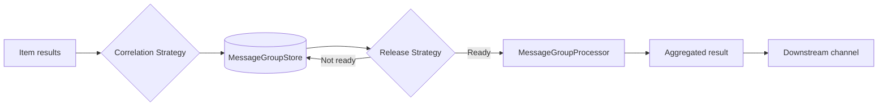
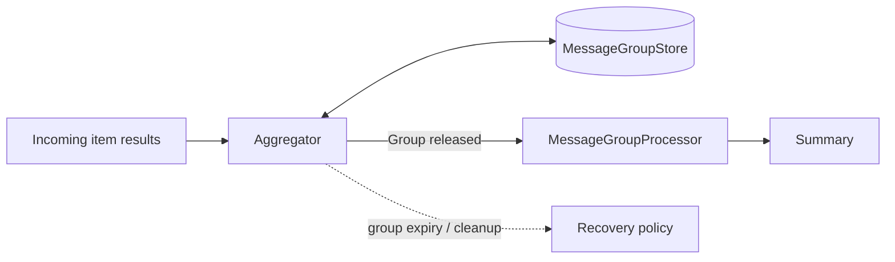
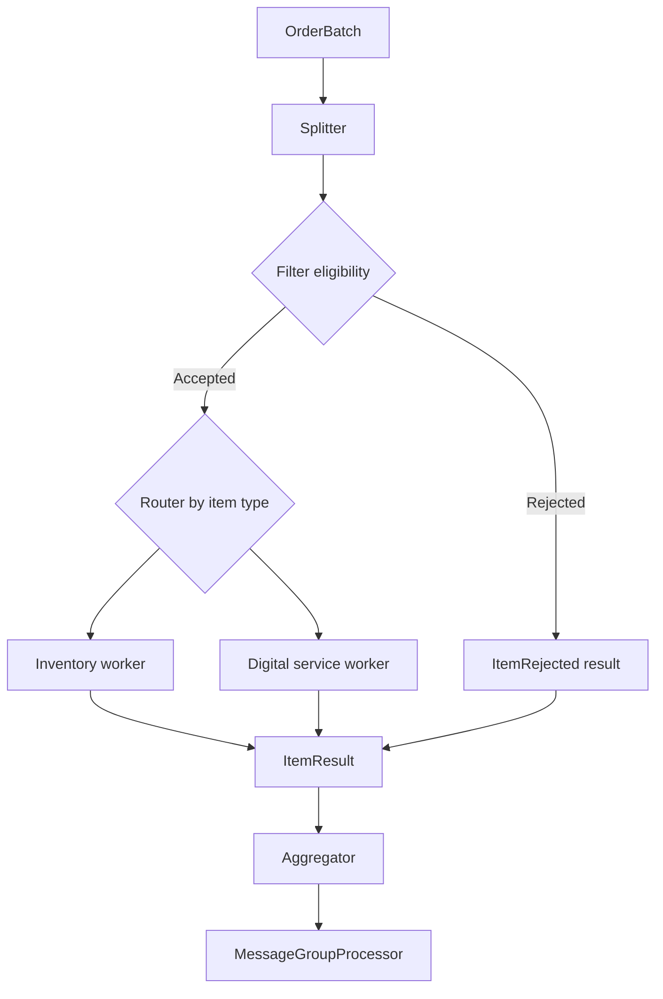
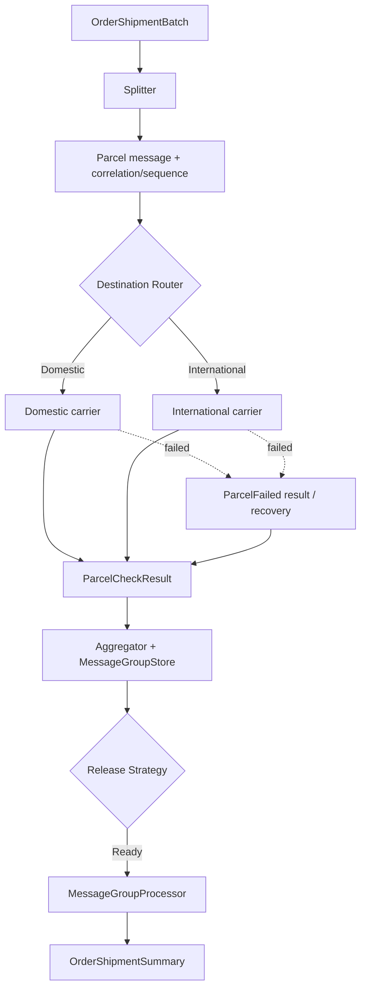

# MessageGroupProcessor xử lý group

Trong **Spring Integration**, một **Aggregator** không đơn thuần nối nhiều payload thành một danh sách. Nó phải xác định **những message nào thuộc cùng một nhóm**, **khi nào nhóm đã đủ điều kiện xử lý**, và **kết quả đại diện cho cả nhóm sẽ được tạo ra như thế nào**. Phần cuối cùng — biến một `MessageGroup` thành một kết quả tổng hợp — chính là trách nhiệm của **`MessageGroupProcessor`**.

Ví dụ, một đơn hàng có ba dòng hàng được Splitter tách thành ba yêu cầu kiểm tra tồn kho. Các kết quả có thể tới Aggregator theo thứ tự 3 → 1 → 2. Khi đủ các kết quả được chờ, ứng dụng muốn tạo một `OrderAllocationSummary` có số dòng được cấp hàng, số dòng bị từ chối và danh sách lý do. Ta không nên để từng handler con tự đoán khi nào toàn bộ đơn hoàn tất; Aggregator và `MessageGroupProcessor` có vai trò rõ ràng trong công việc này.

Bài học thuộc chương **Aggregator** của module `SPRING_INTEGRATION_PATTERN`, hướng tới triển khai các **Enterprise Integration Patterns** với Spring Integration: phối hợp Router, Filter, Transformer, Splitter, Aggregator, Gateway, retry, error channel và correlation thành các luồng message ít phụ thuộc, dễ mở rộng, kiểm thử và quan sát được.

**Sau bài này, bạn có thể:**

- Giải thích ranh giới giữa **correlation strategy**, **MessageGroupStore**, **release strategy** và **MessageGroupProcessor**.
- Hiểu đầu vào `MessageGroup`, cách duyệt các `Message<?>` của group và cách sinh kết quả tổng hợp.
- Tạo custom `MessageGroupProcessor` bằng Java, nối vào Aggregator bằng Java DSL và kiểm thử kết quả qua channel thật.
- Tránh nhầm **thứ tự message đến** với `sequenceNumber` hoặc thứ tự nghiệp vụ.
- Xử lý những tình huống group thiếu message, chứa duplicate, release từng phần, có late arrival hoặc hết thời gian chờ.
- Thiết kế idempotency, error handling, group store, correlation và giám sát phù hợp với môi trường đa luồng/đa instance.

## 1. MessageGroupProcessor đứng ở bước nào?

Một Aggregator thường cần bốn trách nhiệm được tách biệt:



Đây là sơ đồ logic; thứ tự gọi nội bộ và việc lưu/xóa group cụ thể còn phụ thuộc phiên bản Spring Integration và cấu hình Aggregator.

| Thành phần | Câu hỏi mà nó trả lời | Ví dụ |
| --- | --- | --- |
| **Correlation strategy** | “Message này thuộc group nào?” | Lấy `correlationId=order-run-42`. |
| **MessageGroupStore** | “Những message nào đã tới và cần giữ trong group?” | Lưu result cho LINE-1, LINE-2, LINE-3. |
| **Release strategy** | “Đã đủ điều kiện gom chưa?” | Đã nhận đủ ba phần tử theo contract. |
| **`MessageGroupProcessor`** | “Từ group đã sẵn sàng, tạo output gì?” | `OrderAllocationSummary(total=3, allocated=2, rejected=1)`. |
| **Output channel / endpoint** | “Kết quả tổng hợp đi tiếp tới đâu?” | `batchSummaries`, Gateway reply hoặc broker adapter. |

**Quy tắc cốt lõi:** `MessageGroupProcessor` **không quyết định group key**, không tự xác nhận message đã đủ và không tự quản lý retention của group. Nó **xử lý nội dung group khi Aggregator yêu cầu**, thường sau khi release strategy trả kết quả cho phép.

Không nên viết một processor tự lưu kết quả nhóm vào database rồi cho rằng nó thay thế hoàn toàn group store, release policy, transaction và downstream output.

## 2. `MessageGroup` thực sự chứa những gì?

Spring Integration biểu diễn group bằng `org.springframework.integration.store.MessageGroup`. Một group quản lý những Spring `Message<?>` cùng khóa tương quan, bên cạnh metadata/trạng thái mà store hoặc cơ chế grouping hỗ trợ.

Hình dung:

```text
MessageGroup
├── groupId: "order-run-42"
├── messages
│   ├── Message<ItemAllocationResult> { seq=3, size=3 }
│   ├── Message<ItemAllocationResult> { seq=1, size=3 }
│   └── Message<ItemAllocationResult> { seq=2, size=3 }
└── metadata/trạng thái thuộc store và vòng đời group
```

Các `Message` có thể đến **không theo thứ tự**, kể cả khi Splitter phát theo thứ tự. Đừng dựa vào thứ tự duyệt của `group.getMessages()` để quyết định `LINE-1` đứng trước `LINE-2`: thứ tự quan sát có thể chịu ảnh hưởng bởi executor, queue, broker, retry hoặc store.

### Hai mức ID không nên nhập nhằng

| ID/metadata | Vai trò | Sai lầm hay gặp |
| --- | --- | --- |
| `MessageHeaders.id` | Nhận diện một Spring message cụ thể. | Dùng làm khóa nghiệp vụ bền vững khi replay. |
| `correlationId` | Nhận diện một group các message liên quan. | Dùng `customerType` hoặc `routeName` chung cho mọi đơn. |
| `sequenceNumber` | Vị trí phần tử trong một lượt tách/sequence. | Coi là thứ tự hoàn thành. |
| `sequenceSize` | Số lượng phần tử được dự kiến trong sequence khi biết. | Coi luôn đúng nếu Filter đã bỏ phần tử. |
| `batchId` | ID của lô theo hợp đồng nghiệp vụ. | Giả định luôn bằng correlation header do Splitter sinh. |
| `eventId` / `commandId` | Định danh nghiệp vụ dùng theo contract. | Thay bằng message ID của lần truyền. |
| `traceId` | Theo dõi hành trình message. | Dùng làm khóa group hoặc bằng chứng phân quyền. |

Với Splitter áp dụng sequence metadata, `correlationId` thường bắt nguồn từ **ID của message đầu vào tại lượt split**. Nếu message được tạo lại khi replay, group key kỹ thuật có thể đổi. Nếu nghiệp vụ cần nhận diện cùng một batch qua nhiều lần phát, hãy giữ `batchId` và `runId`/`attemptId` có ý nghĩa trong payload hoặc envelope bền vững.

## 3. Giao diện `MessageGroupProcessor`

Trong Spring Integration, một custom processor có thể hiện thực:

```java
import org.springframework.integration.aggregator.MessageGroupProcessor;
import org.springframework.integration.store.MessageGroup;

public final class ExampleGroupProcessor implements MessageGroupProcessor {

    @Override
    public Object processMessageGroup(MessageGroup group) {
        // Đọc những message trong group đã được đưa ra xử lý.
        // Kết quả được Aggregator dùng để tạo output theo semantics endpoint.
        return group.getMessages().size();
    }
}
```

Phương thức trung tâm là **`processMessageGroup(MessageGroup group)`**. Trong ví dụ, nó trả số lượng message trong group dưới dạng payload kết quả. Nhưng ứng dụng thực tế thường cần một **DTO tổng hợp có kiểu**, không chỉ count.

Một số điểm cần lưu ý:

1. **Đầu vào là group, không phải một message riêng lẻ.** Không chỉ đọc `group.getOne()` rồi coi đó là toàn bộ dữ liệu.
2. **Dữ liệu là các `Message<?>`.** Có thể đọc payload, headers, correlation và sequence của từng message; kiểm tra kiểu dữ liệu thay vì cast thiếu kiểm soát.
3. **Kết quả là đối tượng Java** theo hợp đồng của downstream. Có những cách xử lý trả payload hoặc `Message<?>`; semantics về headers/output phụ thuộc processor/endpoint, cần kiểm thử phiên bản đang dùng.
4. **Không hứa thứ tự mặc định.** Nếu output cần giữ thứ tự ban đầu, hãy sort theo sequence hoặc trường thứ tự nghiệp vụ phù hợp.
5. **Không nên thay đổi group ngay trong processor.** Quản lý group lifecycle thuộc Aggregator/store; side effects phức tạp có thể khiến retry và transaction khó dự đoán.
6. **Processor có thể thất bại.** Exception khi gom dữ liệu không tự đồng nghĩa từng item đã xử lý thất bại; cần error/recovery policy riêng.

### Phân biệt “xử lý group” với “nhóm đã đủ”

Giả sử nhóm cần ba kết quả, hiện chỉ nhận được hai:

```text
Group X:
  seq=1 / size=3
  seq=3 / size=3
```

Nếu chính sách release yêu cầu đủ ba, `MessageGroupProcessor` **chưa được gọi** để tạo kết quả cuối. Khi seq=2 đến và group đủ điều kiện, Aggregator mới yêu cầu processor tổng hợp. Nếu hệ thống cấu hình **partial release** hoặc timeout để xuất nhóm chưa đủ, processor có thể nhận một group có **ít hơn** số lượng kỳ vọng. Vì vậy processor phải kiểm tra **hợp đồng đầu vào của chính mình**, không chỉ tin rằng mọi group đều đầy đủ trong mọi cấu hình.

## 4. Bảng hợp đồng cho kết quả tổng hợp

Xét nghiệp vụ kiểm tra khả năng cấp hàng của một đơn gồm nhiều dòng:

```text
Line 1: SKU-A -> ALLOCATED
Line 2: SKU-B -> REJECTED (OUT_OF_STOCK)
Line 3: SKU-C -> ALLOCATED
```

Payload đầu vào ở mỗi message:

```java
record ItemAllocationResult(
        String batchId,
        String lineId,
        boolean allocated,
        String reasonCode
) {}
```

Output mong muốn:

```java
import java.util.List;

record OrderAllocationSummary(
        String batchId,
        int receivedCount,
        int allocatedCount,
        int rejectedCount,
        List<String> rejectedLineIds
) {}
```

| Dữ liệu | Nguồn | Quy tắc tổng hợp |
| --- | --- | --- |
| `batchId` | Payload mỗi item. | Tất cả item phải thuộc cùng business batch; không lấy tùy ý item đầu. |
| `receivedCount` | Số item thực sự trong group được xử lý. | Phân biệt với `sequenceSize` kỳ vọng. |
| `allocatedCount` | Những item có `allocated=true`. | Đếm theo item duy nhất, không theo số lần delivery. |
| `rejectedCount` | Những item có `allocated=false`. | Không tự biến thành lỗi hạ tầng; có thể là kết quả nghiệp vụ. |
| `rejectedLineIds` | `lineId` của item không được cấp hàng. | Sắp xếp ổn định nếu downstream yêu cầu. |
| `processingStatus` (nếu bổ sung) | Từ kết quả và chính sách hoàn tất nhóm. | Phân biệt `COMPLETE`, `PARTIAL`, `FAILED`; không mặc định group release là thành công. |

**Một batch summary không nhất thiết là quyết định thanh toán.** Processor tổng hợp kết quả inventory, còn việc quyết định cho phép tiếp tục đơn hàng có thể nằm ở service/Router phía sau dựa trên summary. Điều này giữ EIP tách trách nhiệm.

## 5. Viết `MessageGroupProcessor` với kiểm tra tính toàn vẹn

Ví dụ dưới đây dùng **Java 17+** và output bất biến. Processor yêu cầu group **đầy đủ**, headers sequence chính xác và tất cả item có cùng `batchId`.

```java
import java.util.ArrayList;
import java.util.Comparator;
import java.util.HashSet;
import java.util.List;
import java.util.Set;

import org.springframework.integration.IntegrationMessageHeaderAccessor;
import org.springframework.integration.aggregator.MessageGroupProcessor;
import org.springframework.integration.store.MessageGroup;
import org.springframework.messaging.Message;

final class OrderAllocationGroupProcessor implements MessageGroupProcessor {

    private static int sequence(Message<?> message) {
        Object value = message.getHeaders().get(
                IntegrationMessageHeaderAccessor.SEQUENCE_NUMBER);

        if (!(value instanceof Integer number) || number < 1) {
            throw new IllegalArgumentException("INVALID_SEQUENCE_NUMBER");
        }
        return number;
    }

    private static int expectedSize(Message<?> message) {
        Object value = message.getHeaders().get(
                IntegrationMessageHeaderAccessor.SEQUENCE_SIZE);

        if (!(value instanceof Integer count) || count < 1) {
            throw new IllegalArgumentException("INVALID_SEQUENCE_SIZE");
        }
        return count;
    }

    @Override
    public Object processMessageGroup(MessageGroup group) {
        List<Message<?>> ordered = new ArrayList<>(group.getMessages());
        if (ordered.isEmpty()) {
            throw new IllegalArgumentException("EMPTY_ALLOCATION_GROUP");
        }

        ordered.sort(Comparator.comparingInt(
                OrderAllocationGroupProcessor::sequence));

        int expected = expectedSize(ordered.get(0));
        if (ordered.size() != expected) {
            throw new IllegalStateException("INCOMPLETE_ALLOCATION_GROUP");
        }

        Set<Integer> seenPositions = new HashSet<>();
        List<String> rejectedLines = new ArrayList<>();
        int allocated = 0;
        String batchId = null;

        for (Message<?> message : ordered) {
            int position = sequence(message);
            if (position > expected || !seenPositions.add(position)
                    || expectedSize(message) != expected) {
                throw new IllegalArgumentException("INVALID_GROUP_SEQUENCE");
            }

            if (!(message.getPayload() instanceof ItemAllocationResult item)) {
                throw new IllegalArgumentException("UNEXPECTED_ITEM_TYPE");
            }
            if (item.batchId() == null || item.batchId().isBlank()
                    || item.lineId() == null || item.lineId().isBlank()) {
                throw new IllegalArgumentException("INVALID_ITEM_ID");
            }
            if (batchId == null) {
                batchId = item.batchId();
            } else if (!batchId.equals(item.batchId())) {
                throw new IllegalArgumentException("MIXED_BUSINESS_BATCH");
            }

            if (item.allocated()) {
                allocated++;
            } else {
                rejectedLines.add(item.lineId());
            }
        }

        return new OrderAllocationSummary(
                batchId,
                ordered.size(),
                allocated,
                rejectedLines.size(),
                List.copyOf(rejectedLines)
        );
    }
}
```

### Vì sao cần kiểm tra dù Aggregator đã có release strategy?

**Release strategy** quyết định **khi nào gọi processor**, không phải là bộ xác thực toàn bộ hợp đồng nghiệp vụ. Ví dụ, cấu hình đếm ba message có thể nhận `seq=1`, `seq=1` và `seq=2`, nhưng đây **chưa phải** ba vị trí khác nhau. Custom processor ném `INVALID_GROUP_SEQUENCE` giúp không xuất nhầm summary như thể mọi line đều hoàn tất.

Tuy nhiên, kiểm tra bên trong processor **không giải quyết mọi trường hợp duplicate**. Nếu release strategy đã quyết định sai và transaction/nhóm bị ảnh hưởng, exception của processor chỉ làm lộ vấn đề, không tự cung cấp deduplication hoặc khôi phục. Với hệ thống phải chịu duplicate delivery, cần **deduplication trước group** hoặc một release strategy hiểu item identity/sequence, cùng trạng thái xử lý bền vững.

### Đầu ra là payload, không phải một lệnh side effect

Phương thức `processMessageGroup()` ở trên chỉ tạo `OrderAllocationSummary`. Nó **không**:

- Gọi gateway thanh toán.
- Ghi kết quả ra database.
- ACK một record Kafka.
- Gửi email cho khách.
- Tự xóa group khỏi store.

Các tác vụ đó thuộc downstream endpoint hoặc lifecycle/transaction policy tương ứng. Processor thuần giúp dữ liệu dễ test, dễ replay, dễ giải thích khi có lỗi.

## 6. Nối custom processor vào Aggregator bằng Java DSL

Ví dụ cấu hình một Aggregator có input `allocationResults` và output `batchSummaries`. Ta sử dụng **release strategy dựa trên sequence size** cho **message được giả định đã qua kiểm tra, không có duplicate**, đồng thời custom processor đảm nhiệm tạo summary.

```java
import org.springframework.context.annotation.Bean;
import org.springframework.context.annotation.Configuration;
import org.springframework.integration.aggregator.MessageGroupProcessor;
import org.springframework.integration.aggregator.SimpleSequenceSizeReleaseStrategy;
import org.springframework.integration.channel.DirectChannel;
import org.springframework.integration.channel.QueueChannel;
import org.springframework.integration.config.EnableIntegration;
import org.springframework.integration.dsl.IntegrationFlow;

@Configuration
@EnableIntegration
class AllocationAggregationConfig {

    @Bean
    DirectChannel allocationResults() {
        return new DirectChannel();
    }

    @Bean
    QueueChannel batchSummaries() {
        return new QueueChannel();
    }

    @Bean
    MessageGroupProcessor allocationGroupProcessor() {
        return new OrderAllocationGroupProcessor();
    }

    @Bean
    IntegrationFlow aggregateAllocations(
            MessageGroupProcessor allocationGroupProcessor) {
        return IntegrationFlow.from("allocationResults")
                .aggregate(spec -> spec
                        .releaseStrategy(
                                new SimpleSequenceSizeReleaseStrategy())
                        .outputProcessor(allocationGroupProcessor))
                .channel("batchSummaries")
                .get();
    }
}
```

**Điểm quan trọng khi đọc DSL:**

1. `allocationResults` là channel nhận các **message item result**.
2. Aggregator dùng **correlation strategy mặc định tương thích với sequence headers** của Splitter để gom message theo group; khi thay correlation strategy phải kiểm tra dữ liệu đầu vào.
3. `SimpleSequenceSizeReleaseStrategy` là một cách release dựa trên count và `sequenceSize`, **không tự cung cấp deduplication chính xác cho mọi trường hợp**.
4. `.outputProcessor(allocationGroupProcessor)` chọn custom `MessageGroupProcessor`.
5. Kết quả `OrderAllocationSummary` đi tới `batchSummaries`; đây là `QueueChannel` phục vụ demo/test, không phải persistent broker.
6. **Group lifecycle** (giữ, xóa, timeout, late message, transaction) vẫn thuộc cấu hình Aggregator và group store; không do class processor ở mục 5 tự quyết định.

Nếu luồng thật dùng Kafka/AMQP, có message bị lặp hoặc thiếu, hãy bổ sung correlation strategy, deduplication, group store và release/expiry policy theo đúng contract. **Đừng sao chép cấu hình đếm đơn giản vào quy trình thanh toán nhạy cảm mà không test failure cases.**

### Tại sao không nhét toàn bộ xử lý vào `aggregate(...)` lambda?

Spring Integration DSL hỗ trợ nhiều dạng khai báo. Một lambda ngắn có thể phù hợp khi chỉ cộng vài số; nhưng với rule kiểm tra sequence, business batch, fail/partial output và audit, **một class `MessageGroupProcessor` độc lập** dễ unit test và review hơn. Hãy giữ DSL mô tả topology; processor mô tả biến đổi dữ liệu của group.

### Có thể dùng `@Aggregator` không?

Spring Integration còn hỗ trợ endpoint aggregator theo phương thức annotation và các processor dựng sẵn phù hợp với một số nhu cầu phổ biến. Nhưng bài này tập trung vào **contract `MessageGroupProcessor`** và cách nối nó với Aggregator. Không triển khai đồng thời một endpoint `@Aggregator` và flow `.aggregate(...)` cùng tiêu thụ input channel trừ khi cố ý thiết kế nhiều consumer; nếu không dễ tạo hành vi ngoài mong đợi.

## 7. Unit test cho `MessageGroupProcessor`: kiểm tra group đủ và nhóm sai

Đây là nơi tách **thuật toán tổng hợp** khỏi **định tuyến Spring**. Unit test nên kiểm tra thứ tự, số lượng, duplicate và dữ liệu không nhất quán.

Một số lớp `MessageGroup` được framework quản lý thông qua store, nên trong project thật có thể dùng `SimpleMessageStore`/fixture phù hợp để tạo nhóm thật thay vì mock cứng mọi method. Dưới đây là **bảng test case** dành cho processor:

| Đầu vào group | Kết quả mong đợi |
| --- | --- |
| Ba message, seq 3/1/2, cùng batch, size 3 | Summary được sắp ổn định theo seq; count 3. |
| Hai thành công, một từ chối | `allocatedCount=2`, `rejectedCount=1`, danh sách đúng line. |
| Seq 1/1/2, size 3 | Ném `INVALID_GROUP_SEQUENCE`, không tạo summary giả thành công. |
| Seq 1/2, size 3 | Ném `INCOMPLETE_ALLOCATION_GROUP` nếu processor bị gọi khi nhóm thiếu. |
| Hai item có `batchId` khác nhau | Ném `MIXED_BUSINESS_BATCH`. |
| Thiếu header sequence | Ném `INVALID_SEQUENCE_NUMBER`. |
| Thiếu hoặc sai kiểu payload | Ném `UNEXPECTED_ITEM_TYPE`. |
| Group rỗng | Ném `EMPTY_ALLOCATION_GROUP` hoặc trả kết quả rỗng theo contract riêng. |

**Lưu ý về testing:** Processor ở mục 5 được viết để yêu cầu **complete group**. Nếu ứng dụng cho phép release partial result, nên dùng một processor **được thiết kế riêng cho partial** hoặc điều chỉnh contract, không chỉ bắt lỗi `INCOMPLETE_ALLOCATION_GROUP` rồi coi là đã phục hồi.

## 8. Integration test: gửi các item vào Aggregator thật

Với `AllocationAggregationConfig`, có thể tạo ba message cùng correlation và sequence, gửi theo thứ tự khác nhau rồi kiểm tra **chỉ sau khi đủ ba phần tử mới xuất một summary**.

```java
import static org.junit.jupiter.api.Assertions.assertEquals;
import static org.junit.jupiter.api.Assertions.assertNotNull;
import static org.junit.jupiter.api.Assertions.assertNull;
import static org.junit.jupiter.api.Assertions.assertTrue;

import org.junit.jupiter.api.Test;
import org.springframework.beans.factory.annotation.Autowired;
import org.springframework.beans.factory.annotation.Qualifier;
import org.springframework.integration.IntegrationMessageHeaderAccessor;
import org.springframework.integration.channel.QueueChannel;
import org.springframework.messaging.Message;
import org.springframework.messaging.MessageChannel;
import org.springframework.messaging.support.MessageBuilder;
import org.springframework.test.annotation.DirtiesContext;
import org.springframework.test.context.junit.jupiter.SpringJUnitConfig;

@SpringJUnitConfig(AllocationAggregationConfig.class)
@DirtiesContext(classMode = DirtiesContext.ClassMode.AFTER_EACH_TEST_METHOD)
class AllocationAggregationFlowTest {

    @Autowired @Qualifier("allocationResults")
    MessageChannel input;

    @Autowired @Qualifier("batchSummaries")
    QueueChannel output;

    private Message<ItemAllocationResult> item(
            String runId, int sequence, int size,
            String batchId, String lineId, boolean allocated) {

        var payload = new ItemAllocationResult(
                batchId, lineId, allocated,
                allocated ? null : "OUT_OF_STOCK");

        return MessageBuilder.withPayload(payload)
                .setHeader(IntegrationMessageHeaderAccessor.CORRELATION_ID, runId)
                .setHeader(IntegrationMessageHeaderAccessor.SEQUENCE_NUMBER, sequence)
                .setHeader(IntegrationMessageHeaderAccessor.SEQUENCE_SIZE, size)
                .setHeader("traceId", "trace-42")
                .build();
    }

    @Test
    void releasesOnlyAfterThreeRelatedResults() {
        assertTrue(input.send(item(
                "run-42", 3, 3, "B-42", "LINE-3", true)));
        assertNull(output.receive(0));

        assertTrue(input.send(item(
                "run-42", 1, 3, "B-42", "LINE-1", true)));
        assertNull(output.receive(0));

        assertTrue(input.send(item(
                "run-42", 2, 3, "B-42", "LINE-2", false)));

        Message<?> completed = output.receive(1_000);
        assertNotNull(completed);
        OrderAllocationSummary summary =
                (OrderAllocationSummary) completed.getPayload();

        assertEquals("B-42", summary.batchId());
        assertEquals(3, summary.receivedCount());
        assertEquals(2, summary.allocatedCount());
        assertEquals(1, summary.rejectedCount());
        assertEquals(java.util.List.of("LINE-2"), summary.rejectedLineIds());
        assertNull(output.receive(0));
    }

    @Test
    void twoGroupsAreNotMixed() {
        assertTrue(input.send(item(
                "run-A", 1, 2, "B-A", "A-1", true)));
        assertTrue(input.send(item(
                "run-B", 1, 2, "B-B", "B-1", false)));
        assertNull(output.receive(0));

        assertTrue(input.send(item(
                "run-A", 2, 2, "B-A", "A-2", false)));
        Message<?> a = output.receive(1_000);
        assertNotNull(a);
        assertEquals("B-A",
                ((OrderAllocationSummary) a.getPayload()).batchId());

        assertTrue(input.send(item(
                "run-B", 2, 2, "B-B", "B-2", true)));
        Message<?> b = output.receive(1_000);
        assertNotNull(b);
        assertEquals("B-B",
                ((OrderAllocationSummary) b.getPayload()).batchId());
    }
}
```

Bài test này kiểm tra **correlation → release → processor → output** trong một JVM. Dùng `DirectChannel` giúp các lời gọi trong flow minh họa xử lý đồng bộ. Nếu dùng executor hoặc broker, phải dùng chờ có timeout và không suy ra `send()` đã hoàn tất toàn bộ nghiệp vụ.

`@DirtiesContext` cô lập `MessageGroupStore` và `QueueChannel` giữa các ca test, tránh group tồn dư. Cấu hình demo giả định đầu vào đã hợp lệ; **chưa test duplicate và late arrival**. Đó là những ca bắt buộc bổ sung trước production.

## 9. Release strategy và processor: hai loại lỗi khác nhau

Xét group có `sequenceSize=3` nhưng chỉ hai message đến:

```text
Group X: seq 1, seq 3
```

Nếu release strategy chưa cho phép, processor **chưa có cơ hội được gọi**. Nếu tùy chọn timeout làm group được release partial, processor **phải biết** nó đang xử lý group thiếu.

Ngược lại:

```text
Group X: seq 1, seq 1, seq 2
```

Nếu release strategy đơn giản chỉ nhìn size, nó có thể cho release dù thiếu seq 3. Processor validate có thể phát hiện **duplicate sequence**, nhưng không tự đưa nhóm trở lại trạng thái an toàn sau khi xử lý lỗi. Điều cần sửa thường ở **deduplication và release policy**.

| Vấn đề | Nơi xử lý chủ đạo |
| --- | --- |
| Chọn group sai | Correlation strategy / dữ liệu đầu vào. |
| Thiếu message cuối | Release/expiry/timeout policy, khôi phục nguồn. |
| Duplicate làm count sai | Deduplication, store strategy hoặc release strategy phù hợp. |
| Payload trong group sai kiểu | Validation trước Aggregator và processor. |
| Kết quả tổng hợp có field sai | `MessageGroupProcessor`/business mapping. |
| Output không gửi được | Output channel/handler/error policy. |
| Group còn lưu mãi | Expiry/cleanup và store monitoring. |

Không chọn cách “trong processor đọc thêm DB để tìm các item thiếu rồi tự bổ sung” như một mặc định. Làm vậy khiến processing group khó quyết định, có side effect/tải ẩn và khó phân biệt dữ liệu thật với dữ liệu do processor tự tái tạo.

## 10. Partial release: không chỉ bỏ qua item chưa đến

Một số nghiệp vụ chấp nhận kết quả không đầy đủ: ví dụ một dashboard có thể tính tạm 8/10 nguồn. Nhưng một batch thanh toán thường không thể mặc định “đã đủ” khi chỉ nhận 8/10.

Nếu cho phép partial release, output nên mô tả rõ:

```java
record PartialBatchSummary(
        String batchId,
        int expectedCount,
        int receivedCount,
        int succeededCount,
        int failedCount,
        boolean complete
) {}
```

Ở đây `receivedCount=8` và `expectedCount=10` không thể bị che giấu bằng một trường `status=SUCCESS`.

### Những điểm cần thiết kế trước

1. **Tiêu chí partial release:** theo deadline, số kết quả tối thiểu, end marker hay lỗi không thể phục hồi?
2. **Các phần tử vắng mặt:** có biết ID nào chưa đến không? `sequenceSize` chỉ cung cấp count, không tự cho biết thông tin nghiệp vụ của item thiếu.
3. **Late message:** sau khi summary partial đã phát, item đến muộn sẽ tạo bản cập nhật, bỏ qua, hay mở một group/run mới?
4. **Số lần processor có thể được gọi:** nếu group có nhiều đợt release, side effects bên trong processor có thể lặp. Giữ processor thuần hoặc thiết kế idempotency ở nơi tạo side effect.
5. **Gateway reply:** caller đã nhận kết quả tạm rồi có được nhận bản hoàn chỉnh nữa không? Không tự giả định một request–reply thông thường trả nhiều kết quả.
6. **Tính đúng nghiệp vụ:** với tiền, quyền hoặc giao dịch, partial result thường cần trạng thái `PENDING`/`INCOMPLETE`, không được nâng thành `APPROVED`.

Nên tách một kiểu kết quả partial khỏi kết quả cuối hoặc có trạng thái rõ ràng, thay vì đưa danh sách message hiện có vào processor vốn được viết để yêu cầu full group.

## 11. `MessageGroupStore` và thời điểm xóa group

Một Aggregator cần nơi giữ các message chưa đủ điều kiện release. Spring Integration có thể dùng **in-memory store** hoặc **persistent MessageGroupStore** theo cách cấu hình và hạ tầng.



### In-memory và persistent store

| Đặc điểm | In-memory store | Persistent store |
| --- | --- | --- |
| Dễ cấu hình | Thường đơn giản. | Cần DB/Redis/JDBC/Mongo/... theo module hỗ trợ. |
| Sau restart | Group đang chờ thường mất. | Có thể khôi phục khi được cấu hình đúng. |
| Quản trị transaction | Chủ yếu trong process. | Phải cấu hình transaction/locking theo store. |
| Nhiều instance | Không tự chia sẻ group. | Có thể chia sẻ khi store/locking phù hợp. |
| Cleanup/expiry | Vẫn cần policy. | Càng quan trọng để tránh dữ liệu tồn đọng lâu. |
| Chi phí | Memory của JVM. | Storage I/O và vận hành/retention. |

**Persistent store không tự tạo exactly-once processing**. Broker có thể redeliver, handler có thể tạo side effect rồi crash, hoặc output summary được gửi nhưng trạng thái group chưa commit. Cần idempotency, transaction boundaries, outbox/recovery nếu hợp đồng yêu cầu.

### Trạng thái group sau release

Nếu group bị xóa hoàn toàn ngay sau khi phát kết quả, một late message có cùng correlation ID có thể bị coi là đầu vào của một group mới. Tùy cấu hình Aggregator, có thể giữ marker hoàn thành hoặc dùng xử lý late arrival để tránh phát summary trùng.

Vì vậy, các lựa chọn về **expire groups upon completion**, retention và late-message policy phải được kiểm thử trên **phiên bản Spring Integration đang dùng**, không coi “xóa để tiết kiệm RAM” là quyết định không có hậu quả.

### Lưu cùng một group xuyên nhiều instance

Nếu instance A nhận seq 1, instance B nhận seq 2 và C nhận seq 3, **ba store in-memory độc lập sẽ không có group nào đủ ba message**. Phải đảm bảo tất cả message của một group về cùng processor (partition/affinity theo group key), hoặc sử dụng store/điều phối nhóm dùng chung được thiết kế đúng với concurrency và lock.

## 12. Filter, Router, Splitter: nguồn tạo group không đảm bảo đủ result

Đường xử lý thường không đơn giản chỉ Splitter → Aggregator:



**Filter trả `false`** có thể khiến message con bị loại khỏi luồng chính. Nếu không có `ItemRejected` trả về group, Aggregator chỉ nhận `N-1` kết quả nhưng `sequenceSize` vẫn có thể là `N`, làm group chờ lâu.

**Router** chọn channel đích mà không tự thay đổi correlation theo logic nghiệp vụ. Các nhánh khác nhau cần **trả về result có cùng group identity** và giữ sequence metadata nếu release strategy cần.

**Transformer** có thể đổi `OrderLine` sang `ItemAllocationResult`, nhưng nếu custom transformer tạo `MessageBuilder.withPayload(result).build()` mà đánh rơi headers, Aggregator sẽ không biết output thuộc group nào.

**Publish–Subscribe** có thể nhân mỗi item thành nhiều kết quả. Nếu một item gửi cho hai subscriber mà cả hai đều trả result vào cùng group, **count output không còn bằng số item của Splitter**. Phải thiết kế group theo `(item, recipient)` hoặc aggregate nhiều tầng.

### Khi mỗi item có nhiều kết quả, đừng dựa mù vào `sequenceSize`

Giả sử ba item, mỗi item sinh hai result: 6 result sẽ về Aggregator. Một release strategy chỉ chờ `sequenceSize=3` có thể release **sau ba result đầu**, trước khi đủ mọi tổ hợp. Cần phân biệt **fan-out theo item** với **fan-out theo recipient**, làm rõ cardinality đầu ra trước khi chọn processor.

## 13. Retry, duplicate và idempotency của group output

Một group có thể xử lý lại vì:

- Broker redelivery một hoặc nhiều item.
- Application crash giữa lúc processor tạo summary và output được xác nhận.
- Message xử lý thành công nhưng phản hồi/ACK bị mất.
- Group đã release nhưng late item làm group được tạo lại.
- Operator chủ động replay một batch.

**Không nên coi việc `MessageGroupProcessor` chỉ được gọi một lần là một bảo đảm end-to-end.** Khi cần đúng một bản ghi summary cho một business run, output handler phải hỗ trợ idempotency theo khóa ổn định như `(batchId, runId, summaryVersion)`.

Ví dụ:

```text
batchId      = B-42
runId        = attempt-20261121-01
summaryType  = ALLOCATION
version      = 1

Idempotency key:
  B-42 / attempt-20261121-01 / ALLOCATION / v1
```

Một output summary có thể được gửi lại nhưng downstream nhận biết đã lưu rồi và không tạo hai lần tác dụng phụ. **Chính xác khóa cần dùng** phụ thuộc nghiệp vụ: nếu một batch có thể được đánh giá lại hợp lệ, phải phân biệt các run thay vì chặn mọi lần xử lý cùng `batchId`.

### Processor không nên tự gọi service bên ngoài

Khi `processMessageGroup()` vừa tạo summary vừa gọi thanh toán hoặc gửi email, một retry của Aggregator có thể lặp side effect. Nên ưu tiên:

```text
MessageGroupProcessor (pure)
    -> BatchSummary message
    -> Idempotent business handler / transactional outbox
    -> External side effect
```

Điều này tách việc **tính kết quả** khỏi **thực thi tác vụ không dễ lặp lại**, đồng thời hỗ trợ unit test processor không cần mock HTTP/broker.

## 14. Error channel, timeout và sự cố trong processor

Có ba loại lỗi khác nhau:

| Lỗi | Nơi phát sinh | Cách điều tra/khắc phục |
| --- | --- | --- |
| Correlation thiếu hoặc sai | Trước/ở Aggregator. | Kiểm tra header mapping, group key, tenant/run. |
| Group chưa đủ/đến chậm | Release/store/worker. | Timeout, expiry, retry, xử lý item thiếu. |
| Processor ném exception | Khi tạo summary. | Xem schema, sequence, dữ liệu lẫn group, policy retry/quarantine. |
| Output channel lỗi | Sau processor. | Kiểm tra subscriber, queue, broker, transaction. |
| Group cleanup/expiry lỗi | Store/scheduler. | Kiểm tra tuổi group, quyền storage và recovery. |

Một exception từ processor có thể lan qua flow **đồng bộ** tới caller dưới dạng messaging exception phù hợp. Với poller/executor bất đồng bộ, lỗi có thể đi qua error handler hoặc `errorChannel` **nếu cấu hình phù hợp**. Không mặc định mọi exception đều biến thành một `ErrorMessage` ở cùng một channel.

**Đừng ném exception để đại diện kết quả nghiệp vụ bình thường** như một item hết hàng. Processor có thể trả một summary có `rejectedCount>0`; Router hoặc handler phía sau quyết định có tiếp tục hay không. Nên dùng exception cho vi phạm contract, lỗi chương trình hoặc tình huống không thể tạo kết quả hợp lệ.

### Timeout của group và timeout của Gateway

**Group timeout/expiry** quyết định một nhóm chờ lâu sẽ được xử lý thế nào. **Gateway reply timeout** quyết định caller còn chờ kết quả bao lâu. Hai đồng hồ này độc lập.

Nếu Gateway chờ 2 giây nhưng group timeout là 60 giây, caller có thể ngừng chờ trước khi group release. Kết quả đến muộn vẫn có thể cần được ghi bền vững, gửi event hoàn tất hoặc bỏ theo policy. Đừng coi một reply timeout là lệnh tự động hủy mọi tác vụ con.

## 15. Thứ tự, tính nhất quán và dữ liệu nhạy cảm

### Thứ tự arrival và thứ tự nghiệp vụ

`MessageGroup.getMessages()` không nên được coi là danh sách có thứ tự đầu vào. Trong processor mẫu, thứ tự được xác lập bằng `sequenceNumber`.

Nếu một hệ thống tính **tổng** (commutative), thứ tự có thể không quan trọng. Nhưng nếu tính chuỗi thay đổi, chữ ký hoặc định nghĩa “bước trước/bước sau”, thứ tự nghiệp vụ có thể rất quan trọng.

Không dùng “item nào đến trước thì quyết định trước” trừ khi đó thật sự là contract đã được chấp nhận.

### Nhóm sai tenant là lỗi nghiêm trọng

`correlationId` có thể đến từ transport headers hoặc message nội bộ. Nếu client không đáng tin cậy có thể đặt trực tiếp correlation ID, một attacker có thể cố trộn message của tenant này vào group tenant khác.

Cần:

1. Xác thực nguồn trước khi chấp nhận group ID.
2. Sử dụng khóa nhóm **có tenant scope** khi có multi-tenant.
3. Xác minh payload bên trong group có cùng batch/run/tenant hợp lệ.
4. Không dùng chung store cho nhiều tenant mà thiếu ranh giới phân quyền.
5. Tránh log toàn bộ payload hoặc dữ liệu cá nhân trong quá trình debug.

Processor mẫu kiểm tra `batchId` nhất quán; production có thể cần kiểm tra thêm `tenantId`, `runId`, `schemaVersion`, `currency` và các invariant khác theo hợp đồng.

## 16. Observability của `MessageGroupProcessor`

Nếu chỉ đo số message đi tới Aggregator, hệ thống có thể đang nhận nhiều item nhưng **không release group nào**, hoặc processor liên tục lỗi khi được gọi.

Nên theo dõi:

| Tín hiệu minh họa | Ý nghĩa |
| --- | --- |
| `aggregator_item_received_total` | Số lần một item result vào Aggregator. |
| `aggregator_group_open` | Số group đang tích lũy trong store. |
| `aggregator_group_released_total{outcome}` | Số lần group đủ điều kiện release. |
| `message_group_processor_invoked_total` | Số lần processor được gọi. |
| `message_group_processor_failed_total{reason}` | Số lần processor thất bại, theo reason hữu hạn. |
| `message_group_processor_duration_seconds` | Độ trễ tính summary. |
| `aggregator_group_expired_total` | Số group vượt timeout/expiry. |
| `aggregator_group_age_seconds` | Tuổi của group còn mở, nhất là nhóm già nhất. |
| `aggregator_duplicate_item_total` | Số item trùng, nếu có dedup tracking. |
| `aggregator_late_message_total` | Số message đến sau release. |

Đây là **tên metric do ứng dụng có thể instrument**, không phải cam kết Spring Integration tự cung cấp đúng tên trên. Nên tránh dùng `batchId`, `eventId`, `orderId` hay raw group ID làm nhãn metric vì **high cardinality**. Sử dụng `flow`, `outcome`, `reason`, `processorType` với tập giá trị hữu hạn.

Ví dụ log có cấu trúc:

```text
batchId=B-42 runId=attempt-01
groupKey=order-run-42 expected=3 received=3
processor=OrderAllocationGroupProcessor outcome=COMPLETED
allocated=2 rejected=1 traceId=trace-42
```

Đây là log ứng dụng minh họa. Với các luồng có Executor/Reactive channel, tracing context cần được propagate có chủ đích; không giả định MDC hay `ThreadLocal` tự đi theo mọi thread.

### Phân biệt “group complete” với “business complete”

Một group release và processor tạo summary **không chứng minh** downstream đã ghi DB, ACK broker hoặc hoàn tất thanh toán. Log/metric nên tách ít nhất ba mốc: `GROUP_RELEASED`, `SUMMARY_CREATED`, `BUSINESS_ACTION_CONFIRMED` nếu nghiệp vụ cần phân biệt.

## 17. Ma trận kiểm thử toàn luồng trước production

| Tình huống | Điều cần xác minh |
| --- | --- |
| Ba item, thứ tự 3/1/2 | Summary đúng, bất kể arrival order. |
| Hai group gửi xen kẽ | Không lẫn batch/run hoặc payload. |
| Group rỗng | Không phát summary giả thành công nếu hợp đồng không cho phép. |
| Group thiếu một item | Có timeout/expiry/partial policy, không chờ vô hạn. |
| Một item trùng sequence | Không release thành công sai số lượng; có dedup hoặc lỗi. |
| Một item có batchId khác | Processor phát hiện `MIXED_BUSINESS_BATCH`. |
| Worker trả payload sai kiểu | Không ép kiểu im lặng; có error recovery. |
| Filter loại một phần tử | Có `ItemRejected` hoặc partial release policy. |
| Một item nhận hai recipient results | Cardinality/release tính theo đúng hợp đồng. |
| Processor ném exception | Group/store và error channel/retry được xử lý rõ. |
| Group đã release, item đến muộn | Late-arrival policy không tạo duplicate summary. |
| Restart với group chưa đủ | Persistent store/transaction phục hồi nếu yêu cầu. |
| Hai instance xử lý cùng group | Có group affinity hoặc shared store/locking phù hợp. |
| Gateway reply timeout | Caller nhận timeout/error/partial result đúng hợp đồng. |
| Retry sau summary thành công | Output handler idempotent, không tạo side effect trùng. |
| Headers bị mất qua Kafka/AMQP | Contract/envelope khôi phục đúng correlation/sequence. |
| Tenant khác dùng cùng correlation ID | Không trộn dữ liệu hoặc vượt quyền. |
| Tải cao, nhiều nhóm chờ | Memory, store IO, expiry và cảnh báo backlog đúng. |

**Integration test chỉ gửi vài message vào `QueueChannel` chưa chứng minh durability hoặc exactly-once**. Phải có các test với broker/store thực hoặc môi trường tích hợp phù hợp nếu các cam kết đó là yêu cầu sản phẩm.

## 18. Bài tập tình huống: tổng hợp kiểm tra đơn hàng nhiều kiện

**Bối cảnh:** Một đơn hàng gồm từ 1 đến 100 kiện. Splitter tạo từng `ParcelCheckRequested`, Router chọn carrier nội địa/quốc tế, các worker trả `ParcelCheckResult`. Aggregator cần tạo `OrderShipmentSummary` có tổng kiện được nhận, kiện thất bại và nguyên nhân. Kết quả có thể tới đảo thứ tự; một số message bị retry hoặc tới muộn. Ứng dụng chạy ba replica và yêu cầu phục hồi khi restart.



### Đề bài triển khai

1. **Group identity:** Định nghĩa `orderId`, `shipmentRunId` và correlation key. Nếu xử lý lại cùng một đơn hợp lệ, tránh trộn kết quả hai run.
2. **Input contract:** Mỗi parcel result phải có `parcelId`, `status`, `reasonCode`, expected count, sequence và version phù hợp.
3. **Release:** Chờ đủ N **parcel duy nhất**, không chỉ đếm N bản phát kể cả duplicate. Quy định khi nào dùng partial result.
4. **Processor:** Tạo `OrderShipmentSummary` có `expectedCount`, `receivedCount`, `deliveredEligibleCount`, `failedCount`, danh sách parcel thất bại và trạng thái `COMPLETE/PARTIAL`.
5. **Thứ tự:** Nếu summary hiển thị theo thứ tự kiện gốc, sort theo `sequenceNumber` hoặc `parcelPosition` bền vững.
6. **Failure:** Khi một carrier timeout vĩnh viễn, tạo `ParcelFailed` hoặc chờ đến expiry; không để một result biến mất khỏi nhóm mà không có policy.
7. **Persistence:** Nếu restart sau khi nhận 80/100 kết quả, lựa chọn group store và recovery có khả năng tiếp tục xử lý.
8. **Multi-instance:** Dùng partition/group affinity hoặc shared store với lock để một group có thể hoàn tất.
9. **Idempotency:** Một parcel có thể redeliver; xử lý không phát hành hai vận đơn hoặc hai summary bất hợp lệ.
10. **Gateway/error:** Nếu caller chờ reply dưới 5 giây còn group cần tối đa 10 phút, chuyển sang mô hình async/status query thay vì ngầm kéo dài request.
11. **Observability:** Theo dõi số group open, age p95, duplicate, expiry, processor failure và số summary thực sự được ghi nhận.
12. **Security:** Phân tách tenant và xác thực group identity, không chỉ tin correlation header từ nguồn ngoài.

### Câu hỏi tự đánh giá

**Câu 1:** `MessageGroupProcessor` có quyết định bao giờ một group đủ dữ liệu không? **Không phải trách nhiệm chính của nó.** Release strategy quyết định điều kiện; processor tạo output khi được gọi.

**Câu 2:** Group có ba message với seq 1, 1, 2 và size 3. Có thể xuất summary thành công chỉ vì count=3 không? **Không.** Thiếu seq 3, có duplicate; cần dedup/validation và release strategy phù hợp.

**Câu 3:** Một group đã release kết quả có chứng minh payment hoặc shipment side effect hoàn tất không? **Không.** Cần xác nhận ở handler/adapter downstream.

**Câu 4:** Nếu Aggregate output phải được sắp theo `sequenceNumber`, có thể duyệt `getMessages()` rồi giả định thứ tự đúng không? **Không nên.** Sort dựa trên metadata/contract rõ ràng.

**Câu 5:** Persistent `MessageGroupStore` có tự bảo đảm exactly-once cho cả broker, processor và DB không? **Không.** Còn cần transaction, idempotency và recovery ở từng ranh giới.

## Tổng kết

- **`MessageGroupProcessor`** nhận một `MessageGroup` khi Aggregator quyết định xử lý và tạo **payload/message tổng hợp** cho downstream; nó khác **correlation strategy**, **release strategy** và **MessageGroupStore**.
- **Message Group** chứa các `Message<?>` liên quan, có thể đến đảo thứ tự, duplicate hoặc thiếu; processor phải kiểm tra những invariant mà kết quả nghiệp vụ yêu cầu.
- Dùng **custom `MessageGroupProcessor` thuần** cho mapping group → summary, sắp xếp theo sequence khi cần, kiểm tra kiểu/identity và tránh side effects không idempotent.
- **Release strategy đơn giản dựa trên count** không tự chống duplicate, late message hay cardinality thay đổi sau Filter, Router hoặc Publish–Subscribe.
- Với **partial release, timeout, persistent store, nhiều replica và Gateway reply**, cần một hợp đồng nhóm rõ ràng cùng expiry/late-arrival/recovery policy, không mặc định mọi message sẽ tới đầy đủ.
- Kiểm thử **cả processor lẫn IntegrationFlow thật**, bao gồm thứ tự đảo, hai group xen kẽ, dữ liệu sai, duplicate, restart và idempotency; đo riêng `GROUP_RELEASED`, `SUMMARY_CREATED` và kết quả nghiệp vụ cuối.
