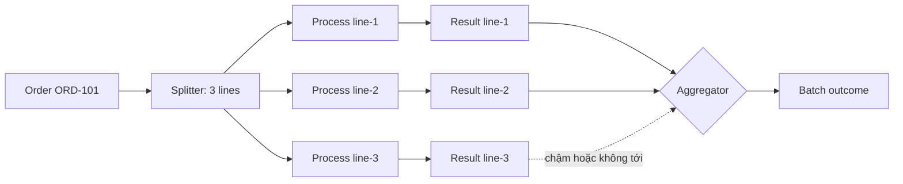
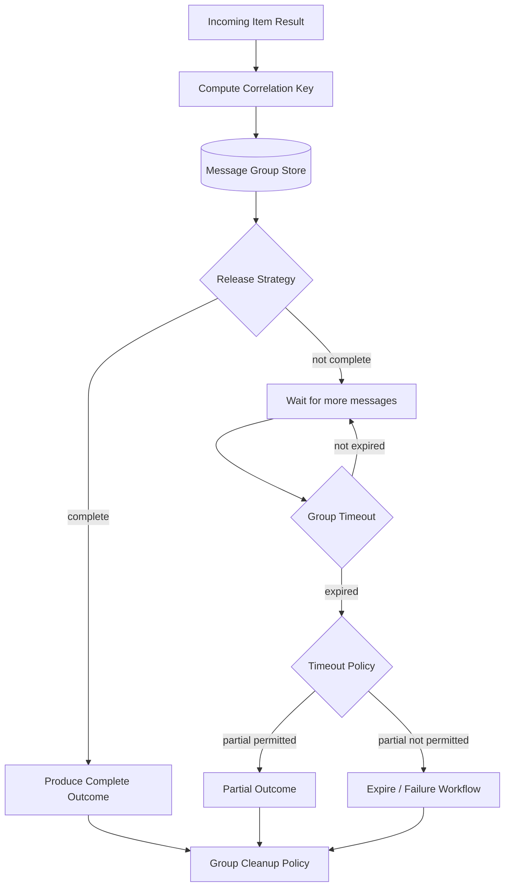
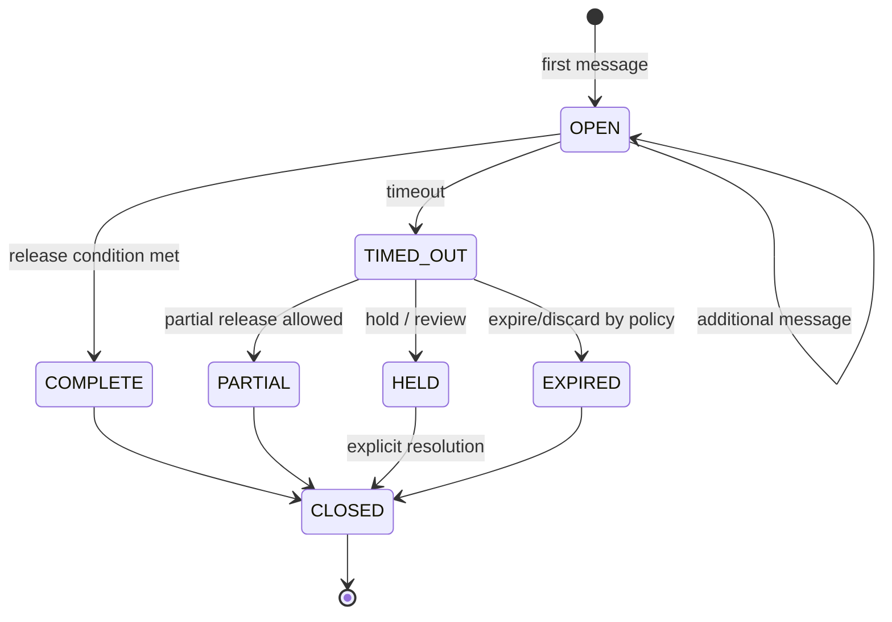
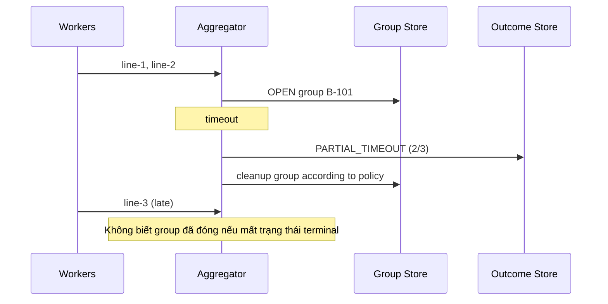
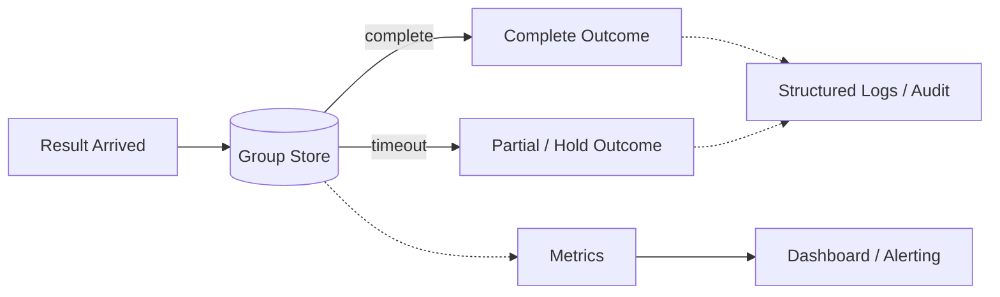
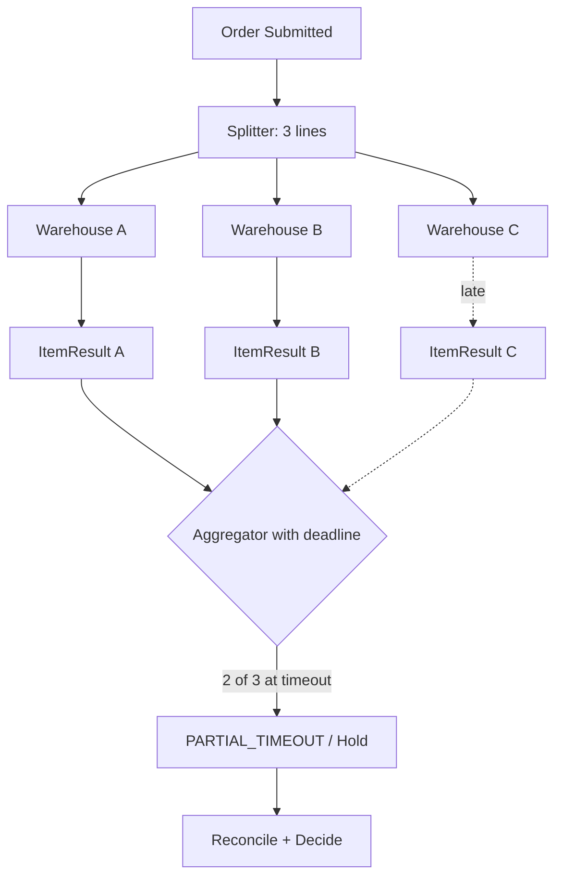

# Message group timeout

Trong Enterprise Integration Patterns (EIP), **Aggregator** tập hợp nhiều message liên quan thành một nhóm (*message group*), chờ tới khi đáp ứng điều kiện kết thúc rồi phát ra một kết quả tổng hợp. Ví dụ, một đơn hàng có ba dòng sản phẩm được Splitter tách thành ba message, xử lý riêng rồi Aggregator ghép thành báo cáo cuối cùng.

Vấn đề xuất hiện khi **một hoặc nhiều message không bao giờ đến**: worker có thể lỗi, một phần bị Filter loại, message thất lạc trên transport hoặc một nhánh xử lý quá lâu. Nếu Aggregator chỉ đợi “đủ ba phần” mà không có thời hạn, nhóm có thể bị giữ vô hạn trong bộ nhớ hoặc message store. Đó chính là bài toán **Message group timeout**.

Timeout không đơn thuần là đặt đồng hồ. Khi hết hạn, hệ thống phải quyết định: **phát kết quả một phần, bỏ nhóm, giữ chờ, báo lỗi, hay tiếp tục xử lý về sau?** Một thiết kế sai có thể trả kết quả “thành công” khi còn thiếu phần tử, mất dấu message đến muộn, giải phóng nhóm rồi vô tình tạo nhóm mới cùng khóa, hoặc retry một side effect đã hoàn thành.

Bài học thuộc chương **Aggregator** của module **SPRING_INTEGRATION_PATTERN**. Mục tiêu là thực hành Enterprise Integration Patterns bằng Spring Integration để xây dựng luồng thông điệp ít phụ thuộc, có khả năng mở rộng, với Router, Filter, Transformer, Splitter, Aggregator, Gateway, retry, error channel, correlation, kiểm thử và theo dõi các nhánh xử lý.

**Mục tiêu sau bài:** Hiểu được vòng đời message group, phân biệt release strategy và timeout, lựa chọn chính sách phát partial result, bảo vệ correlation/idempotency khi nhận message muộn, cấu hình Java DSL một cách có chủ đích và kiểm thử các tình huống thiếu, trùng, chậm hoặc lỗi.

## 1. Vì sao Aggregator cần timeout?

Giả sử một đơn `ORD-101` có ba dòng:

```text
Order ORD-101
  line-1 -> Reserve Inventory A
  line-2 -> Reserve Inventory B
  line-3 -> Reserve Inventory C
```

Splitter tạo ba message con. Mỗi nhánh được xử lý bởi worker độc lập; kết quả có thể về không theo thứ tự:



Khi ba kết quả đến đủ, Aggregator có thể giải phóng nhóm và tạo `BatchOutcome`. Nhưng nếu `line-3` bị lỗi và không phát result, nhóm sẽ không đạt điều kiện “đủ 3”.

**Message group timeout** đặt một giới hạn thời gian cho việc chờ nhóm theo cơ chế được cấu hình. Khi tới thời điểm hết hạn, hệ thống có thể quyết định phát kết quả một phần hoặc xử lý expiration theo chính sách.

Một timeout hữu ích khi:

- Số message kỳ vọng có thể thiếu vì nhánh downstream bị lỗi.
- Một batch phải có thời hạn trả lời/đối soát.
- Cần tránh giữ message group vô hạn và làm cạn tài nguyên.
- Các service độc lập có độ trễ không dự đoán hoàn toàn được.
- Business chấp nhận trạng thái `PARTIAL` hoặc `TIMED_OUT` thay vì chờ mãi.

**Timeout không chứng minh phần tử còn thiếu đã thất bại vĩnh viễn.** Có thể nó vẫn đang chạy hoặc chưa được dispatch. Hệ thống phải biểu diễn rõ trạng thái “chưa nhận kết quả trong hạn” thay vì tự quy đổi thành một lỗi nghiệp vụ chắc chắn.

## 2. Bốn khái niệm không nên đánh đồng

| Khái niệm | Câu hỏi được giải đáp | Ví dụ |
| --- | --- | --- |
| **Correlation strategy** | Message nào thuộc cùng một group? | Cùng `tenantId + batchId` |
| **Release strategy** | Khi nào nhóm đủ điều kiện phát kết quả bình thường? | Đã nhận kết quả cho 3 item khác nhau |
| **Group timeout** | Khi nào cần xử lý nhóm vì chờ quá lâu? | Quá thời gian đợi theo cấu hình |
| **Group expiration/cleanup** | Khi nào trạng thái group được loại khỏi store? | Sau release/timeout theo policy |

Các câu hỏi này liên quan nhưng khác nhau.

**Correlation** sai làm hai đơn bị ghép chung hoặc một đơn bị chia thành hai nhóm. **Release strategy** sai có thể coi ba message trùng của cùng item là “đủ ba”. **Timeout** sai có thể phát partial quá sớm. **Cleanup** sai có thể rò rỉ bộ nhớ hoặc làm mất khả năng phân biệt late arrival với group mới.



Ví dụ `receive(line-1)` chỉ tạo trạng thái group. `receive(line-2)` thêm phần tử. Khi `line-3` đến trước hạn, release strategy đánh giá đúng và phát `COMPLETE`; timeout khi đó không phải cơ chế cần dùng.

Trong **Spring Integration**, Aggregator là một *correlating message handler* có thể sử dụng `MessageGroupStore`, các strategy và scheduler. Cú pháp/tùy chọn có thể khác giữa các phiên bản; một ví dụ cấu hình cần được kiểm chứng với version framework ứng dụng đang sử dụng.

## 3. Vòng đời một message group

Một nhóm thường đi qua các trạng thái nghiệp vụ được mô hình hóa như sau:



Đây là **mô hình giải thích nghiệp vụ**, không phải enum trạng thái có sẵn của Spring Integration. Nội bộ framework còn có nhiều chi tiết như locking, group metadata, scheduler và hành vi giữ/xóa group.

Một triển khai cần trả lời:

1. Khi nào một group được tạo?
2. Mỗi message nào được coi là **unique member**?
3. Bao nhiêu phần tử cần có để release?
4. Nếu nhận thêm message nhưng vẫn chưa đủ, timeout có được lên lịch lại không?
5. Khi hết hạn, partial result có được phép ra ngoài không?
6. Nếu group đã release hoặc bị xóa, message muộn được phân loại thế nào?
7. Group state được lưu bộ nhớ hay bền vững?
8. Có **tombstone/terminal state** nào chống tạo lại group cùng ID không?

Đừng triển khai với giả định “khi timeout, Spring sẽ tự biết toàn bộ batch thật sự đã kết thúc”. Nó chỉ biết điều kiện và metadata mà ứng dụng/configuration cung cấp.

## 4. Cách hiểu thời gian: absolute deadline hay inactivity timeout?

Có hai chính sách thường dùng:

- **Absolute deadline:** nhóm phải có kết quả trước `createdAt + SLA`. Message mới đến không được kéo dài thời hạn.
- **Inactivity timeout:** nếu một thời gian không có hoạt động/membership mới theo cơ chế hẹn giờ, nhóm được xử lý như hết hạn. Message đến sau có thể làm thời điểm timeout thay đổi theo cấu hình.

```mermaid
gantt
    title Minh họa hai cách tính timeout
    dateFormat X
    axisFormat %s
    section Message arrivals
    line-1 arrives :milestone, 0, 0
    line-2 arrives :milestone, 3, 0
    section Absolute
    Deadline at t=5 :milestone, 5, 0
    section Inactivity
    Timeout after last activity at t=8 :milestone, 8, 0
```



Sơ đồ chỉ biểu diễn ý tưởng bằng trục thời gian tương đối, **không phải mô tả chính xác lịch scheduler của một phiên bản Spring Integration**.

Trong Spring Integration, `groupTimeout(...)`/biểu thức timeout của Aggregator tham gia việc lên lịch xử lý expiration theo trạng thái group. Hãy xác minh từ tài liệu phiên bản và **test tương tác giữa message arrival, rescheduling và TaskScheduler** trước khi gắn một SLA tuyệt đối. Nếu yêu cầu là deadline cố định theo thời điểm nghiệp vụ, hãy lưu deadline đó và thực thi chính sách tương ứng; không mặc định mỗi lần đặt `groupTimeout(5000)` đều tương đương “5 giây kể từ message đầu tiên” trong mọi topology.

### Timeout không phải processing timeout của một handler

Một nhánh inventory gọi API 10 giây và Aggregator đặt group timeout 5 giây. Aggregator có thể release partial trước khi nhánh API trả kết quả. **Nó không tự hủy request API đang chạy.**

Muốn chặn một tác vụ chạy quá lâu cần timeout/cancellation/retry tại **worker hoặc adapter**. Group timeout quản lý **thời gian chờ kết quả tổng hợp**, không thay thế timeout của từng lời gọi downstream.

## 5. Lựa chọn partial result hay chờ đủ

Khi một group timeout mà chưa đủ thành viên, chính sách nghiệp vụ quyết định có thể phát **partial result** hay không.

| Loại nghiệp vụ | Partial có thể chấp nhận? | Cách diễn giải |
| --- | --- | --- |
| Báo cáo phân tích gần thời gian thực | Có thể | Có dữ liệu tạm cho 80/100 phần tử |
| Tập hợp kết quả tìm kiếm từ nhiều nguồn | Có thể | Trả kết quả đã có, ghi rõ nguồn chưa phản hồi |
| Báo cáo nhập hàng có item lỗi | Có điều kiện | `PARTIAL` cùng danh sách item chưa xử lý |
| Thanh toán phải hoàn tất đủ bước | Thường không | Không thông báo giao dịch thành công khi thiếu kết quả |
| Kiểm tra chống gian lận bắt buộc | Không được tự bỏ qua | Hold/review/fail closed |
| Tổng hợp nhiều yêu cầu cấp quyền | Không được tự đoán | Không cấp quyền khi thông tin bắt buộc thiếu |

**Partial result phải là một kết quả có tên và trạng thái riêng.** Không đặt `success=true` chỉ vì Aggregator đã phát ra một message.

Ví dụ hợp đồng:

```json
{
  "batchId": "B-101",
  "expectedItems": 3,
  "receivedItems": 2,
  "status": "PARTIAL_TIMEOUT",
  "completedItemIds": ["item-1", "item-2"],
  "missingItemIds": ["item-3"],
  "deadline": "2026-11-21T05:00:05Z"
}
```

Đây là một **mô hình ứng dụng minh họa**. Spring Integration không tự suy ra `missingItemIds` từ hai message đã nhận, nếu ứng dụng chưa cung cấp tập item kỳ vọng. Nếu chỉ biết expected count là 3, có thể biết “thiếu một” nhưng chưa biết **thiếu item nào**.

### Partial result được release ở timeout cần khác release bình thường

Ở cùng một batch ID:

- Nhận đủ item trước hạn → `COMPLETE`.
- Thiếu item khi đến timeout → `PARTIAL_TIMEOUT` hoặc `INCOMPLETE`.
- Nhận đủ item nhưng một số item có kết quả xử lý lỗi → có thể là `COMPLETE_WITH_FAILURES` (đủ **responses**, không phải mọi nghiệp vụ thành công).

**Đủ số message không đồng nghĩa mọi item thành công.** Release strategy chỉ nói đủ điều kiện phát kết quả; output processor mới quyết định trạng thái nghiệp vụ từ các result.

## 6. Spring Integration hỗ trợ timeout trên Aggregator ra sao?

Một Aggregator Java DSL có thể cấu hình các ý tưởng:

- `correlationStrategy`: chọn khóa nhóm.
- `releaseStrategy`: kiểm tra điều kiện release bình thường.
- `groupTimeout`: hẹn thời điểm xử lý nhóm chưa hoàn tất.
- `sendPartialResultOnExpiry`: chọn có phát kết quả một phần khi expiration hay không.
- `expireGroupsUponCompletion`: chính sách hoàn tất/xóa group.
- `outputProcessor`: xây message/result từ nội dung group.
- `messageStore`: lựa chọn nơi lưu group, nếu không dùng mặc định.
- `discardChannel`: đường xử lý các message/group bị discard ở những tình huống áp dụng.

Tên API nêu trên là các khái niệm và phương thức thường gặp trong cấu hình Aggregator Spring Integration; hãy kiểm tra API chính xác theo version trong dự án. **Không đánh đồng expiration với error channel**: message group chưa đạt release condition là một tình huống chờ/timeout, không nhất thiết có exception.

### 6.1. Group timeout có phải cron job xóa database không?

Không. Group timeout là một phần **chính sách release/expiry của Aggregator**. Một số hệ thống còn dùng `MessageGroupStoreReaper` để dọn các nhóm cũ trong store theo lịch, nhưng reaper và group-timeout scheduler không phải hai tên cho cùng một thao tác.

- **Aggregator group timeout:** gắn với xử lý expiration/release của chính Aggregator khi nhóm chưa hoàn tất.
- **Store reaper:** cơ chế quét/expire nhóm tồn tại lâu theo chính sách store và scheduler.
- **Business SLA timer:** thời hạn cố định do ứng dụng định nghĩa, có thể cần lưu cùng transaction và phát event riêng.

Nếu kết hợp nhiều cơ chế, phải tránh để hai timer cạnh tranh trên cùng group và xử lý một expiration hai lần. Không tự cấu hình reaper trùng với group timeout rồi mặc định chúng phối hợp nguyên tử.

### 6.2. Chỉ đặt timeout là chưa đủ

Nếu cấu hình `groupTimeout(5000)` nhưng không quyết định `sendPartialResultOnExpiry`, ứng dụng có thể không nhận được kết quả partial như kỳ vọng. Nếu output processor không biết expected members, nó cũng không thể tạo danh sách thiếu chính xác.

Cần xác minh ít nhất: **timeout trigger, partial release flag, group cleanup, output processor, late-arrival policy và message-store durability**.

## 7. Mô hình dữ liệu cho ví dụ tổng hợp đơn hàng

Chúng ta thiết kế một batch có N item. Mỗi worker trả về một `ItemResult` với identity rõ ràng.

```java
import java.time.Instant;

record ItemResult(
    String tenantId,
    String batchId,
    String itemId,
    int expectedCount,
    String status,
    String detail,
    Instant finishedAt
) {}

record BatchOutcome(
    String tenantId,
    String batchId,
    int expectedCount,
    int receivedUniqueCount,
    String status,
    java.util.List<ItemResult> items,
    Instant aggregatedAt
) {}
```

Trong ví dụ:

- `tenantId + batchId` là correlation scope. Không ghép hai tenant chỉ vì cùng batch ID.
- `itemId` nhận diện một phần tử để kiểm tra trùng.
- `expectedCount` là số phần tử kỳ vọng đã được xác minh bởi nguồn có thẩm quyền.
- `status` của item có thể là `SUCCESS` hoặc `FAILED`; **result thất bại vẫn là một result đã nhận**, tùy release contract.
- `aggregatedAt` biểu thị lúc xây kết quả, **không phải** lúc tất cả worker đã kết thúc.

**Quan trọng:** `expectedCount` nên đến từ batch manifest hoặc logic Splitter đáng tin cậy. Không nên lấy số này từ header client tự khai. Trong luồng thật, cần validate consistency của expected count giữa mọi message cùng group và xử lý trường hợp không có item nào.

## 8. Processor tạo kết quả COMPLETE hay PARTIAL_TIMEOUT

Ta viết một processor đọc các message trong `MessageGroup`, phát hiện item trùng và tạo `BatchOutcome`.

```java
import java.time.Instant;
import java.util.ArrayList;
import java.util.Comparator;
import java.util.LinkedHashMap;
import java.util.List;
import java.util.Map;
import org.springframework.integration.store.MessageGroup;
import org.springframework.messaging.Message;

final class BatchOutcomeProcessor {

    static boolean isComplete(MessageGroup group) {
        List<ItemResult> results = payloads(group);
        if (results.isEmpty()) {
            return false;
        }

        int expected = expectedCount(results);
        long distinct = results.stream()
            .map(ItemResult::itemId)
            .distinct()
            .count();

        return distinct == expected;
    }

    BatchOutcome build(MessageGroup group) {
        List<ItemResult> results = payloads(group);
        if (results.isEmpty()) {
            throw new IllegalStateException("Empty group");
        }

        int expected = expectedCount(results);

        // Dedup trong output để một item không bị tính hai lần.
        Map<String, ItemResult> unique = new LinkedHashMap<>();
        for (ItemResult item : results) {
            unique.putIfAbsent(item.itemId(), item);
        }

        List<ItemResult> items = new ArrayList<>(unique.values());
        items.sort(Comparator.comparing(ItemResult::itemId));

        boolean full = items.size() == expected;
        boolean anyFailed = items.stream()
            .anyMatch(item -> !"SUCCESS".equals(item.status()));

        String outcome = !full
            ? "PARTIAL_TIMEOUT"
            : anyFailed ? "COMPLETE_WITH_FAILURES" : "COMPLETE";

        ItemResult first = results.get(0);
        return new BatchOutcome(
            first.tenantId(),
            first.batchId(),
            expected,
            items.size(),
            outcome,
            List.copyOf(items),
            Instant.now()
        );
    }

    private static List<ItemResult> payloads(MessageGroup group) {
        return group.getMessages().stream()
            .map(Message::getPayload)
            .map(value -> (ItemResult) value)
            .toList();
    }

    private static int expectedCount(List<ItemResult> items) {
        ItemResult first = items.get(0);
        int expected = first.expectedCount();

        if (expected <= 0
                || items.stream().anyMatch(item ->
                    !first.tenantId().equals(item.tenantId())
                    || !first.batchId().equals(item.batchId())
                    || item.expectedCount() != expected
                    || item.itemId() == null
                    || item.itemId().isBlank())) {
            throw new IllegalArgumentException(
                "Inconsistent batch result contract");
        }
        return expected;
    }
}
```

Đây là ví dụ **xây trạng thái output từ nhóm**, không phải một thuật toán chống trùng hoàn chỉnh:

- `putIfAbsent` chọn bản đầu tiên theo thứ tự duyệt. Với hai result khác nội dung nhưng trùng `itemId`, phải định nghĩa version/attempt nào được chấp nhận; không dựa vào thứ tự `Collection` của store.
- Kiểm tra `distinct == expected` là đủ với giả định mọi `itemId` đều thuộc batch manifest hợp lệ. Để chống message lạ, cần xác minh membership bằng manifest/danh sách item dự kiến.
- Nếu output processor được gọi do một cơ chế expiration khác ngoài timeout của nhóm, việc gắn trạng thái `PARTIAL_TIMEOUT` là một simplification. Trong hệ thống thật nên truyền **release reason** một cách tường minh hoặc ghi sự kiện timeout riêng để phân biệt `TIMEOUT`, `CANCELLED` và `MANUAL_RELEASE`.
- `isComplete` cần chống trường hợp nhận thêm một item lạ làm số distinct vượt expected; nên reject/quarantine message lạ trước Aggregator. Trong ví dụ đơn giản, `== expected` không cho release nếu vượt count.

Vấn đề quan trọng hơn: **dedup ở output processor không ngăn duplicate chiếm tài nguyên group store**. Đối với tải lớn, cần idempotency/duplicate handling khi tiếp nhận message, không đợi tới lúc release mới loại.

## 9. Java DSL: group timeout và partial release

Ví dụ này dùng Spring Integration Java DSL để nhận `ItemResult` từ các worker. Với nhóm chưa đủ khi timeout, cấu hình cho phép phát kết quả một phần.

```java
import org.springframework.context.annotation.Bean;
import org.springframework.context.annotation.Configuration;
import org.springframework.integration.channel.DirectChannel;
import org.springframework.integration.channel.QueueChannel;
import org.springframework.integration.config.EnableIntegration;
import org.springframework.integration.dsl.IntegrationFlow;
import org.springframework.messaging.MessageChannel;
import org.springframework.messaging.PollableChannel;

@Configuration
@EnableIntegration
class BatchAggregatorConfiguration {

    @Bean("orders.item.results")
    MessageChannel itemResultsInput() {
        return new DirectChannel();
    }

    @Bean("orders.batch.outcomes")
    PollableChannel batchOutcomes() {
        // Chỉ để test/quan sát trong JVM; không bền vững.
        return new QueueChannel();
    }

    @Bean
    BatchOutcomeProcessor batchOutcomeProcessor() {
        return new BatchOutcomeProcessor();
    }

    @Bean
    IntegrationFlow aggregateItemResults(
            BatchOutcomeProcessor processor) {

        return IntegrationFlow.from("orders.item.results")
            .aggregate(spec -> spec
                .correlationStrategy(message -> {
                    ItemResult item =
                        (ItemResult) message.getPayload();
                    return item.tenantId() + ":" + item.batchId();
                })
                .releaseStrategy(BatchOutcomeProcessor::isComplete)
                .outputProcessor(processor::build)
                .groupTimeout(5_000L)
                .sendPartialResultOnExpiry(true)
                .expireGroupsUponCompletion(true))
            .channel("orders.batch.outcomes")
            .get();
    }
}
```

Các thành phần chính:

1. `orders.item.results` nhận các message kết quả.
2. `correlationStrategy` gom chúng theo tenant và batch.
3. `releaseStrategy` kiểm tra **số item unique** đã đủ chưa.
4. `groupTimeout(5_000L)` thiết lập thời gian xử lý group theo cơ chế timeout của Aggregator.
5. `sendPartialResultOnExpiry(true)` cho phép phát kết quả chưa đủ khi group hết hạn.
6. `outputProcessor` tạo `BatchOutcome` từ các message hiện có.
7. `expireGroupsUponCompletion(true)` cấu hình dọn group khi hoàn tất theo cơ chế framework.
8. `orders.batch.outcomes` là queue tạm trong bộ nhớ để test đọc được message kết quả.

Ví dụ này giả định ứng dụng có Spring Integration DSL và các loại message ở mục trước. Cần **kiểm tra API trên phiên bản Spring Integration được sử dụng** và đăng ký scheduler phù hợp để expiration chạy như kỳ vọng.

### 9.1. Tại sao dùng correlation key có tenant?

Nếu hai tenant đều phát batch `B-101` và chỉ dùng `batchId`, Aggregator có thể nhận item từ cả hai vào một group, gây sai dữ liệu và rò rỉ thông tin. Correlation key phải phản ánh **phạm vi định danh duy nhất**.

Trong production, nên dùng **một key cấu trúc** được chuẩn hóa hoặc ID duy nhất do hệ thống tạo, thay vì nối chuỗi thiếu escaping. Ví dụ `tenantId="a:b"` và `batchId="c"` có thể va chạm với `tenantId="a"`, `batchId="b:c"` nếu dùng `tenant + ":" + batch`. Mã trên minh họa; cần validation/encoding hoặc giá trị key có kiểu riêng cho an toàn.

### 9.2. Ý nghĩa của `sendPartialResultOnExpiry(true)`

Trong ví dụ, output processor **phân loại theo số item unique nhận được**, nên khi group hết hạn thiếu kết quả, nó trả `PARTIAL_TIMEOUT`. Nhưng nếu group đã đạt release strategy, output là `COMPLETE` hoặc `COMPLETE_WITH_FAILURES`.

**Không bật partial release chỉ vì muốn “đỡ chờ”.** Nếu nghiệp vụ yêu cầu tất cả bước thành công trước khi ghi giao dịch, partial output nên được đưa sang nơi review hoặc không được coi là bản ghi hoàn tất.

### 9.3. Nếu không muốn phát partial?

Có thể chọn không phát partial khi group expiration, rồi dùng **discard/error/recovery workflow** thích hợp để ghi nhận nhóm chưa hoàn tất. Hãy xác minh hành vi discard và cleanup ở đúng version; đừng kỳ vọng `sendPartialResultOnExpiry(false)` tự tạo một `BatchOutcome(status="FAILED")`.

Nếu cần phát riêng một event `BatchTimedOut` có danh sách missing item IDs, nên thiết kế handler/timeout event có state/manifest đầy đủ thay vì dựa hoàn toàn vào hành vi mặc định.

## 10. Release strategy phải biết “đủ” theo nghĩa nào

Một cách release đơn giản là:

```text
group.size() == expectedCount
```

Cách này có thể sai khi:

- Một item gửi kết quả **hai lần** do retry.
- Một item bị Splitter bỏ hoặc Filter loại nhưng Aggregator vẫn kỳ vọng đủ N.
- Một worker phát nhiều kết quả trung gian cho cùng item.
- Mọi item đã trả response, nhưng một số response là `FAILED`.
- Expected count bị sai giữa các message hoặc bị client giả mạo.
- Một phần tử về muộn sau khi group đã hết hạn.

**Count message không nhất thiết bằng count item hoàn tất.** Tối thiểu, cần một khóa unique như `itemId`. Nếu expected members là một tập được biết trước, tốt hơn là so sánh tập item đã có kết quả với **manifest đã ký/được tin cậy**.

Ví dụ:

```text
Expected: {line-1, line-2, line-3}
Received: {line-1, line-2, line-2}

Raw message count = 3
Unique item count = 2
Missing = {line-3}
Outcome must NOT be COMPLETE
```

Khi có Filter, mỗi message bị loại có thể cần tạo một result `SKIPPED/REJECTED` để Aggregator không đợi vô hạn. **Filter discard không tự phát result tới Aggregator**; phải có một flow riêng chuyển rejection thành result nếu muốn nó được tính là đã giải quyết.

## 11. Message đến muộn sau khi nhóm timeout

Đây là một trong những rủi ro nghiêm trọng nhất.

Giả sử:

```text
t=0  line-1 arrives
t=1  line-2 arrives
t=5  group timeout -> PARTIAL_TIMEOUT(2/3)
t=7  line-3 arrives
```

Ở thời điểm `t=7`, nếu group đã bị xóa, **message line-3 có thể làm tạo group mới cùng correlation key**. Tùy cấu hình và policy store, kết quả có thể là thêm một partial output sau timeout khác, bỏ message hoặc xử lý theo cơ chế khác.



**Giải pháp thiết kế không chỉ là kéo timeout dài hơn.** Có thể:

1. Lưu **terminal group state** ở store riêng: `B-101 -> PARTIAL_TIMEOUT/CLOSED`.
2. Khi nhận một item, kiểm tra trạng thái terminal/dedup trước khi tạo group mới.
3. Chọn rõ chính sách late arrival: bỏ có audit, cập nhật kết quả trước, tạo revision mới hoặc đưa review.
4. Dùng **group generation/attempt ID** nếu cùng batch ID có thể được xử lý lại hợp lệ.
5. Giữ tombstone đủ lâu theo retention và redelivery window của transport.
6. Nếu muốn “late correction”, thiết kế bản ghi kết quả **versioned** và idempotent; không xuất một kết quả trông như batch mới mà không liên kết với bản đầu.

Không thể dùng riêng `expireGroupsUponCompletion(true)` rồi khẳng định late messages sẽ được phát hiện. Cleanup group state và **nhận diện một batch đã kết thúc** là hai trách nhiệm khác nhau.

### Cách xử lý late arrival cần theo nghiệp vụ

| Chính sách | Phù hợp với | Điều cần kiểm soát |
| --- | --- | --- |
| Ignore & audit | Báo cáo đã đóng và không cho sửa | Log/metric late arrivals, không mất dấu |
| Attach to existing outcome | Báo cáo cho phép cập nhật | Version/optimistic locking |
| Emit correction event | Analytics eventual consistency | Consumer hỗ trợ update/upsert |
| Reopen group có kiểm soát | Workflow cho phép tiếp tục | Concurrency/duplicate/state machine |
| Quarantine | Giao dịch nhạy cảm | SLA và quy trình xử lý thủ công |

**Không nên vô tình phát hai bản `COMPLETE` khác nhau cho cùng batch** chỉ vì message muộn tạo lại group.

## 12. Timeout và duplicate cùng xuất hiện trong retry

Trong hệ thống có broker, một message có thể đến lặp lại vì mất acknowledgment, consumer restart, manual replay hoặc retry.

```text
t=0  line-1 received
t=1  line-2 received
t=2  line-2 received again (duplicate)
t=5  timeout
t=7  line-3 finally received
```

Nếu release strategy dùng `group.size() == 3`, nhóm có thể release **quá sớm ở t=2**. Nếu processor chỉ dedup lúc tạo output, nó có thể ghi `PARTIAL` nhưng đã mất cơ hội chờ tới hạn đúng.

Cần kết hợp:

- **Message identity:** `(tenantId, batchId, itemId, resultVersion/attempt)`.
- **Ingress dedup:** tránh lưu cùng result nhiều lần nếu có thể.
- **Release theo unique item:** không dựa vào raw message count.
- **Output idempotency:** một batch outcome chỉ được ghi/áp dụng theo version hợp lệ.
- **Late-arrival policy:** không tạo lại một kết quả độc lập không kiểm soát.
- **Retry policy:** retry worker không tự gửi nhiều business result trái hợp đồng.

**At-least-once delivery** và idempotency là vấn đề độc lập với group timeout. Đặt timeout tốt không thay thế chống duplicate; chống duplicate tốt không thay thế xử lý message thiếu.

## 13. MessageGroupStore: bộ nhớ, lưu bền và khôi phục

Aggregator cần giữ state cho nhóm khi chờ message. Trong Spring Integration, `MessageGroupStore` trừu tượng hóa nơi chứa dữ liệu nhóm. Tùy cấu hình và phiên bản, có thể dùng store trong bộ nhớ hoặc backed by database/message store khác.

| Loại giải pháp | Ưu điểm | Giới hạn |
| --- | --- | --- |
| In-memory group store | Đơn giản, độ trễ thấp | Mất group khi restart; không tự chia sẻ qua nhiều instance |
| Persistent store | Khôi phục group khi process restart | Cần transaction, locking và kiểm thử migration |
| Distributed/shared store | Nhiều instance có thể truy cập state | Cạnh tranh lock, ownership, consistency và throughput |
| Event log + state reconstruction | Có thể tái dựng | Phức tạp; cần versioning và quy tắc replay rõ |

Cấu hình `groupTimeout` không tự biến in-memory store thành durable. Nếu hệ thống restart trước khi đủ message, nhóm cũ có thể mất dù worker còn gửi các result muộn.

### 13.1. Scheduler và multi-instance

Group timeout cần một cơ chế hẹn giờ. Với nhiều instance cùng truy cập một store:

- Có thể có nhiều node cùng lên lịch thao tác trên cùng group.
- Cần lock/concurrency semantics phù hợp của store và Aggregator.
- Việc đưa message vào group, release và ghi output có thể thuộc các transaction khác nhau.
- Nếu producer timeout khi phát output, nhóm có thể đã được đánh dấu complete dù output consumer chưa xử lý.
- Recovery sau restart cần xác định timer sẽ được lên lịch lại hoặc group expired được quét bằng cách nào.

**Không mặc định có exactly-once end-to-end** chỉ vì dùng persistent MessageGroupStore. Cần thiết kế output idempotency, transaction, outbox và đảm bảo ack phù hợp với transport.

### 13.2. Group expiration và reaper

Một `MessageGroupStoreReaper` có thể quét nhóm cũ theo chính sách thời gian; nó hữu ích trong một số hệ thống để xử lý group tồn lâu. Tuy nhiên, reaper cần được cấu hình đúng với Aggregator/store và không nên làm hai nơi cùng thực hiện expiration một cách không kiểm soát.

Khi dùng cả timeout trên Aggregator và reaper, phải xác định:

- Timer nào chịu trách nhiệm phát partial result?
- Timer nào chỉ dọn state?
- Trạng thái terminal được lưu ở đâu?
- Có thể xảy ra release/cleanup cạnh tranh không?
- Những group được giữ lại sau completion có bị expire sau này như mong muốn không?

**Không dùng reaper để xóa group còn đang hợp lệ chỉ vì tuổi của nhóm vượt một con số tùy ý.**

## 14. Error channel, retry và trạng thái timeout

Một group thiếu message không tự tạo exception, nên **timeout của group khác lỗi handler**.

| Tình huống | Phân loại | Cơ chế |
| --- | --- | --- |
| Chưa đủ item sau thời hạn | Group timeout | Partial release / expiration / hold policy |
| Một item handler ném exception | Processing error | Error channel/retry/dead-letter của endpoint |
| Aggregator output processor ném exception | Aggregation error | Error handling tại handler/scheduler/flow |
| Group store database timeout | Infrastructure error | Retry/recovery và trạng thái không chắc chắn |
| Kết quả tổng hợp gửi sang output bị từ chối | Dispatch failure | Retry/output idempotency/outbox |
| Một item bị Filter loại | Business rejection | Tạo `RejectedResult` nếu cần hoàn tất group |
| Downstream API báo timeout sau side effect | Outcome unknown | Đối soát/idempotency trước replay |

**Không xem `groupTimeout` là cơ chế retry item còn thiếu.** Nó không tự gửi lại yêu cầu tới worker. Nếu muốn retry item chậm/hỏng, phải có một coordinator hoặc workflow xác định **item nào thiếu**, đã gửi lần nào, còn được phép thử lại hay không, và tránh side effect trùng.

### Ví dụ chính sách lỗi

```text
Worker result failed temporarily
  -> bounded retry with backoff
  -> if success: emit ItemResult
  -> if terminal failure: emit ItemResult(status=FAILED)

Aggregator:
  if responses for all expected items:
      emit COMPLETE or COMPLETE_WITH_FAILURES
  else if timeout:
      emit PARTIAL_TIMEOUT or hold according to business policy
```

Cách này tách **“worker đã báo kết quả FAILED”** khỏi **“worker chưa báo gì”**. Sự phân biệt giúp tránh dùng timeout để biểu diễn mọi loại lỗi.

Error channel trong Spring Integration nhận `ErrorMessage` khi thành phần bắt exception và công bố nó theo cấu hình; một channel tên `errorChannel` không tự bảo đảm mọi exception đồng bộ hoặc bất đồng bộ đi đến đó. Với `DirectChannel`, exception có thể quay về sender; với poller, executor và inbound adapter, đường xử lý lỗi tùy context.

## 15. Khi kết hợp Splitter, Filter, Transformer và Router

### 15.1. Splitter phải làm rõ expected members

Một Splitter có thể thêm sequence/correlation metadata cho các phần tử được tách từ cùng request, tùy cấu hình. Một release strategy có thể dùng số phần đã tách, nhưng cần biết:

- Dòng dữ liệu gốc có bao nhiêu phần **hợp lệ**?
- Có item nào bị Filter bỏ trước khi gửi worker?
- Splitter có thật sự biết trước số phần ở stream vô hạn không?
- Expected count có thay đổi sau một Filter hoặc Router?
- Có nhánh nào phát hai kết quả cho cùng một item không?

Nếu Filter loại 2 trong 20 item, Aggregator mong đủ 20 result sẽ đợi vô hạn trừ khi nhánh discard tạo result hoặc expected count được điều chỉnh theo policy.

### 15.2. Transformer phải giữ correlation đúng scope

Transformer đổi payload nhưng có thể giữ các header cần thiết. Nếu nó tự tạo message rồi bỏ `correlationId` hoặc `sequenceSize`, Aggregator có thể không nhóm đúng, dẫn tới timeout giả.

Tuy nhiên, **giữ metadata lỗi thời** cũng nguy hiểm: sau một Splitter lồng nhau, sequence/correlation có thể thuộc nhóm cũ. Cần xác định rõ correlation scope và tránh dùng cùng một header cho hai lớp tập hợp khác nhau.

### 15.3. Router tạo các nhánh có thời hạn khác nhau

Một Router có thể phân chia item tới service A và B với SLA khác nhau. Nếu Aggregator gom chung, timeout phải phản ánh **mức độ chậm nhất được phép** hoặc chiến lược partial release.

Nếu nhánh B là bắt buộc để quyết định thanh toán, không được dùng timeout để bỏ B và vẫn báo complete. Nếu B chỉ bổ sung analytics, partial có thể được phép và có correction event về sau.

### 15.4. Publish-Subscribe/Recipient List không tự tạo result

Một event gửi tới ba subscriber không có nghĩa Aggregator sẽ nhận được **ba result message**. Phải thiết kế từng subscriber phát output theo một hợp đồng có correlation và idempotency. Nếu subscriber chỉ ghi log rồi kết thúc, Aggregator không có “ack nghiệp vụ” để đếm.

## 16. Thiết kế output contract khi group timeout

Một `BatchOutcome` trong production nên mang đủ thông tin để consumer hiểu điều gì đã xảy ra:

| Trường | Ý nghĩa |
| --- | --- |
| `batchId` và `tenantId` | Định danh/cách ly dữ liệu của group |
| `expectedCount` | Số item kỳ vọng từ manifest |
| `receivedUniqueCount` | Số result unique đã nhận |
| `completedItems` / `failedItems` | Kết quả được xác nhận |
| `missingItems` | Chưa có result trong hạn, không mặc định thất bại |
| `status` | COMPLETE, COMPLETE_WITH_FAILURES, PARTIAL_TIMEOUT, FAILED... |
| `outcomeVersion` | Phân biệt partial và correction sau đó |
| `deadlineAt` | Thời hạn nghiệp vụ |
| `releasedAt` | Lúc kết quả được phát |
| `releaseReason` | RELEASE_STRATEGY, TIMEOUT, MANUAL... |
| `correlationId` | Truy vết workflow gốc |
| `policyVersion` | Release/timeout rule đã dùng |

Ví dụ:

```json
{
  "tenantId": "tenant-a",
  "batchId": "B-101",
  "expectedCount": 3,
  "receivedUniqueCount": 2,
  "status": "PARTIAL_TIMEOUT",
  "outcomeVersion": 1,
  "releaseReason": "TIMEOUT",
  "missingItems": ["line-3"],
  "completedItems": ["line-1", "line-2"]
}
```

**Đây là hợp đồng ứng dụng**, không phải output mặc định của Aggregator. Mẫu mã Java ở trên chưa thể tính `missingItems` và `releaseReason` đầy đủ vì chưa có batch manifest hoặc signal explicit. Trong ứng dụng thật, hãy bổ sung dữ liệu/logic đó tại nơi có đủ thông tin.

Nếu không cần trả partial, vẫn nên có một **record deadline exceeded** hoặc trạng thái vận hành để nhóm không biến mất không dấu vết.

## 17. Observability: nhìn thấy nhóm đang chờ và nhóm hết hạn

Timeout cần được theo dõi như một tín hiệu nghiệp vụ chứ không chỉ là exception.



Các metric có ích:

```text
aggregator_groups_open{flow="order-items"}
aggregator_group_releases_total{flow="order-items",reason="complete"}
aggregator_group_releases_total{flow="order-items",reason="timeout"}
aggregator_group_timeouts_total{flow="order-items"}
aggregator_late_messages_total{flow="order-items"}
aggregator_duplicate_messages_total{flow="order-items"}
aggregator_group_age_seconds{flow="order-items"}
aggregator_output_failures_total{flow="order-items"}
```

Đây là **tên metric đề xuất**, không phải danh sách metric Spring Integration mặc định. Không đặt `batchId`, `orderId` hay `correlationId` vào tag metric vì cardinality cao; dùng chúng trong log/trace/audit có chính sách truy cập phù hợp.

Một log có cấu trúc:

```json
{
  "event": "aggregator_group_timed_out",
  "flow": "order-items",
  "tenantId": "tenant-a",
  "batchId": "B-101",
  "expectedCount": 3,
  "receivedUniqueCount": 2,
  "releaseReason": "TIMEOUT",
  "policyVersion": "aggregation-v2",
  "outcome": "PARTIAL_TIMEOUT"
}
```

Không log đầy đủ payload nhạy cảm hoặc thông tin cá nhân của các item chỉ để biết số lượng đã nhận.

### Alert phải gắn với tác động nghiệp vụ

Nếu cứ timeout một số group dù tỷ lệ nhỏ đã nằm trong SLA chấp nhận, mỗi timeout không cần paging. Ngược lại, **backlog group mở tăng nhanh**, tỷ lệ partial bất thường, group tuổi vượt SLA hoặc group store chiếm dung lượng lớn có thể là sự cố vận hành nghiêm trọng.

Nên quan sát:

- Tỷ lệ group complete trước hạn.
- Tỷ lệ partial timeout.
- Thời gian chờ group từ phần đầu tới release.
- Số item thiếu trung bình và tuổi của result muộn.
- Tồn đọng trong group store.
- Số outcome bị ghi trùng sau timeout/replay.
- Phân bố latency của các worker tạo item result.

## 18. Kiểm thử Message group timeout

Một unit test release strategy là cần thiết nhưng chưa đủ. Hành vi timeout còn liên quan scheduler, group store, cleanup và message đến muộn.

### 18.1. Ma trận kiểm thử

| Tình huống | Kỳ vọng |
| --- | --- |
| Nhận đủ 3 result trước hạn | Phát một `COMPLETE` |
| Nhận 2/3 result rồi timeout | Phát `PARTIAL_TIMEOUT` khi policy cho phép |
| Nhận 2/3 result khi partial bị cấm | Không phát `COMPLETE` giả; xác minh expiration/recovery |
| Nhận 3 message nhưng chỉ 2 item unique | Không release nhầm complete |
| Nhận một result `FAILED` cùng các result còn lại | `COMPLETE_WITH_FAILURES` nếu đủ responses |
| Message đến sau timeout | Theo late-arrival policy; không tạo complete mới tùy tiện |
| Input có hai tenant cùng batch ID | Hai group riêng biệt |
| Expected count không nhất quán | Reject/quarantine và audit cấu hình sai |
| Reaper và timeout cùng hoạt động | Không double release, không mất audit |
| Restart khi group còn mở | Recovery đúng theo persistent store/transport |
| Store database lỗi | Không tuyên bố outcome complete nếu state chưa được ghi |
| Output channel lỗi sau release | Outcome idempotency/outbox và recovery phù hợp |
| Filter loại một item | Có rejected result nếu nghiệp vụ cần đủ count |
| Splitter đổi số item | Release strategy dựa trên expected manifest đúng |
| Nhiều instance cùng xử lý một group | Concurrency/locking tránh double result |

### 18.2. Unit test logic tổng hợp

```java
import static org.junit.jupiter.api.Assertions.*;
import java.time.Instant;
import java.util.List;
import org.junit.jupiter.api.Test;

class BatchOutcomeLogicTest {

    private final BatchOutcomeProcessor processor =
        new BatchOutcomeProcessor();

    @Test
    void statusConventionIsExplicit() {
        ItemResult success = new ItemResult(
            "tenant-a", "B-101", "line-1", 3,
            "SUCCESS", "reserved", Instant.now());

        // Trong unit test thực, tạo MessageGroup bằng
        // SimpleMessageGroup và MessageBuilder theo API
        // của phiên bản Spring Integration đang dùng.
        assertEquals(3, success.expectedCount());
        assertEquals("line-1", success.itemId());
    }
}
```

Đoạn này chỉ là **khởi điểm cho test model**, chưa test được processor trên `MessageGroup`. Test thực cần tạo các Spring `Message<?>` và group phù hợp, rồi assert `isComplete` và `build` với ba trường hợp: đủ item, thiếu item và duplicate.

### 18.3. Integration test bằng MessageChannel và PollableChannel

Với cấu hình Java DSL ở mục 9, dùng test context inject hai channel:

```java
import static org.junit.jupiter.api.Assertions.*;
import java.time.Instant;
import org.junit.jupiter.api.Test;
import org.springframework.messaging.Message;
import org.springframework.messaging.MessageChannel;
import org.springframework.messaging.PollableChannel;
import org.springframework.messaging.support.MessageBuilder;

// Phác thảo trong Spring integration test fixture.
class AggregatorTimeoutIntegrationTest {
    MessageChannel input;        // inject "orders.item.results"
    PollableChannel output;       // inject "orders.batch.outcomes"

    @Test
    void incompleteBatchReleasesPartialAfterTimeout() {
        input.send(MessageBuilder.withPayload(
            new ItemResult("tenant-a", "B-101", "line-1",
                3, "SUCCESS", "done", Instant.now()))
            .build());

        input.send(MessageBuilder.withPayload(
            new ItemResult("tenant-a", "B-101", "line-2",
                3, "SUCCESS", "done", Instant.now()))
            .build());

        // Giới hạn thời gian lớn hơn groupTimeout trong config
        // để chờ scheduler hoàn tất, nhưng không chờ vô hạn.
        Message<?> result = output.receive(8_000L);
        assertNotNull(result);
        BatchOutcome batch = (BatchOutcome) result.getPayload();

        assertEquals("PARTIAL_TIMEOUT", batch.status());
        assertEquals(2, batch.receivedUniqueCount());
        assertEquals(3, batch.expectedCount());
    }
}
```

Đây là **phác thảo test**, chưa phải class Spring Boot test đầy đủ: cần inject hai channel từ context và quản lý scheduler/store sao cho không có group từ test khác ảnh hưởng. Với timeout 5 giây, test có thể chậm; có thể dùng timeout nhỏ hơn hoặc task scheduler/clock kiểm soát trong test khi framework và cấu hình cho phép.

**Tránh dùng `Thread.sleep` làm chứng minh duy nhất.** Nên chờ outcome bằng `PollableChannel.receive(timeout)` hoặc Awaitility có deadline hữu hạn, và test riêng việc **không phát output sớm** trước thời hạn kỳ vọng.

### 18.4. Test late arrival và exactly-once của outcome

Một test quan trọng khác:

1. Gửi hai result của group có expected count 3.
2. Chờ partial timeout được phát và ghi terminal state vào outcome store.
3. Gửi result thứ ba đến trễ.
4. Kiểm tra hệ thống thực hiện đúng chính sách: ignore/audit, correction hoặc quarantine.
5. Xác minh **không có outcome thứ hai không được phê duyệt** cho cùng group.
6. Nếu retry gửi lại cùng result, outcome store phải chống xử lý duplicate.

**Ví dụ Java DSL đơn giản chưa có terminal-state registry**, nên test late-arrival ở bước này sẽ bộc lộ giới hạn thiết kế. Đó là một kết quả test có giá trị, không phải lý do để mặc định framework “tự hiểu” group đã đóng.

## 19. Hiệu năng: timeout không được làm che lỗi capacity

Một hệ thống Aggregator nhận hàng triệu message có thể cần:

- Giới hạn số group mở.
- Message store đủ dung lượng và có eviction/cleanup phù hợp.
- Chọn correlation key có cardinality và skew được kiểm soát.
- Scheduler đủ capacity để xử lý nhiều group đến hạn.
- Timeout không quá thấp làm partial release hàng loạt vì tải cao.
- Backpressure với worker và output consumers.
- Giới hạn kích thước group và payload lưu trong store.
- Capacity planning cho reaper, store lock và transaction.
- Retention phù hợp cho terminal state/tombstone và audit.
- Theo dõi output publish failure để tránh mất kết quả sau release.

Khi message đến chậm do queue backlog, một timeout ngắn sẽ tạo nhiều `PARTIAL_TIMEOUT` dù worker vẫn hoạt động đúng. **Timeout phải phản ánh SLO nghiệp vụ và độ trễ thực tế của toàn flow**, không chỉ độ trễ trung bình của một service.

Ngoài ra, một group khổng lồ có thể làm output processor dùng nhiều bộ nhớ; nếu nhóm rất lớn, có thể cần kiến trúc streaming aggregation hoặc kết quả được lưu ngoài thay vì giữ toàn bộ message trong một group.

## 20. Bài tập: tổng hợp đặt hàng khi một kho mất kết nối

Một hệ thống cần giữ hàng cho ba dòng đơn, mỗi dòng được route tới một kho. Aggregator có deadline 10 giây và nhận được:

```text
t=1s  line-1: SUCCESS (warehouse A)
t=2s  line-2: SUCCESS (warehouse B)
t=10s deadline reached; no line-3 result
t=13s line-3: SUCCESS (warehouse C)
```

Khách hàng không được nhận thông báo “đã đặt hàng thành công” khi chỉ có hai trong ba dòng được giữ hàng. Nhưng hệ thống vẫn phải có kết quả/trạng thái để bộ phận vận hành biết item nào chờ.



Hãy trả lời:

1. Correlation key gồm những gì để không ghép sai tenant hoặc đơn?
2. Khi không có line-3 lúc deadline, group outcome phải là gì? Vì sao không được coi là `COMPLETE`?
3. Nếu line-3 đến sau timeout, hệ thống cập nhật outcome, phát correction hay giữ review? Ai sở hữu quyết định?
4. Nếu line-2 được gửi hai lần do retry, release strategy nào tránh đếm trùng?
5. Nếu Filter bỏ một line do SKU không hợp lệ, có cần phát `RejectedResult` để Aggregator biết?
6. Nếu worker C đã reserve thành công nhưng response bị mất, retry từ đầu có an toàn không? Idempotency key nào cần?
7. Khi restart ứng dụng lúc group còn mở, store nào và recovery logic nào cần có?
8. Nếu hai instance cùng xử lý group, khóa/ownership ở đâu?
9. Cần lưu những dữ liệu nào để biết timeout là do warehouse chậm hay do result không tới channel?
10. Những test nào kiểm chứng **một partial outcome có version** và không có double completion?
11. Nếu muốn giữ group tới hạn tuyệt đối từ lúc tạo đơn, phải tính deadline từ đâu?
12. Nếu khách cần response ngay nhưng worker chạy lâu, nên dùng Gateway request-reply chờ 10 giây hay trả `202 Accepted` và cung cấp status API? Giải thích theo hợp đồng.

**Tiêu chí đạt:** Có timeout policy rõ, không đánh tráo partial thành complete, xử lý late/duplicate/retry an toàn, lưu group/outcome theo mức bền vững yêu cầu và có quan sát từng phần tử.

## 21. Checklist khi triển khai Message group timeout

- [ ] Đã chọn **correlation key** đúng phạm vi tenant/batch/workflow.
- [ ] Đã định nghĩa **expected members** từ nguồn tin cậy.
- [ ] Release strategy đếm **unique result**, không chỉ message count.
- [ ] Đã phân biệt complete responses và successful business outcomes.
- [ ] Timeout nghĩa là SLA absolute hay inactivity theo chính sách.
- [ ] Đã cấu hình và test scheduler thực sự chạy expiration.
- [ ] Đã chọn có cho phép `sendPartialResultOnExpiry` hay không.
- [ ] Partial output có status/release reason rõ ràng, không báo complete giả.
- [ ] Khi không phát partial, có audit/hold/recovery thích hợp.
- [ ] Group cleanup được kiểm tra, không để state rò rỉ.
- [ ] Late arrival có policy rõ ràng và terminal state/tombstone nếu cần.
- [ ] Duplicate item được chặn trước hoặc tại Aggregator và output idempotent.
- [ ] Error channel/retry/dead-letter không bị nhầm với group timeout.
- [ ] Splitter/Filter/Transformer giữ correlation và expected count đúng.
- [ ] MessageGroupStore đáp ứng durability và concurrency yêu cầu.
- [ ] Multi-instance locking và scheduler/reaper không double release.
- [ ] Số group mở, tuổi group, timeout rate và backlog được giám sát.
- [ ] Đã test thiếu, trùng, đến muộn, crash, output failure và versioning.
- [ ] Không ghi payload/PII nhạy cảm không cần thiết vào logs hoặc group store.
- [ ] Hợp đồng API phân biệt accepted, partial, complete và failed.

## Ghi nhớ

**Message group timeout** là cơ chế để Aggregator **không chờ vô hạn** khi nhóm message chưa đủ điều kiện release. Trong Spring Integration, cần phối hợp **correlation strategy, release strategy, group timeout, partial-result policy, MessageGroupStore và group cleanup**; mỗi thành phần giải quyết một phần khác nhau của vòng đời.

**Timeout không đồng nghĩa lỗi nghiệp vụ của phần còn thiếu** và **partial release không đồng nghĩa batch thành công**. Hãy bảo vệ trường hợp message đến muộn, duplicate, retry và multi-instance; duy trì terminal outcome/idempotency khi cần; kiểm thử với scheduler và store thật; đồng thời quan sát số group đang mở, timeout và kết quả cuối. Khi đó Aggregator có thể tổng hợp linh hoạt mà vẫn giữ được tính đúng đắn và khả năng khôi phục của toàn bộ luồng.

