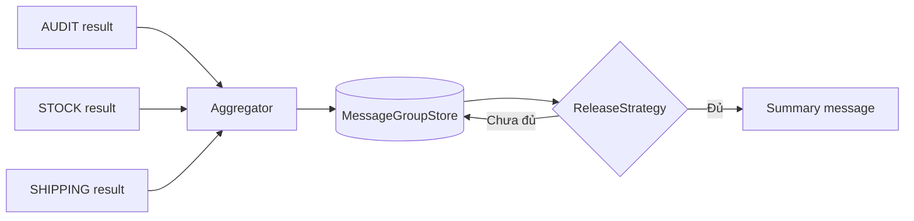
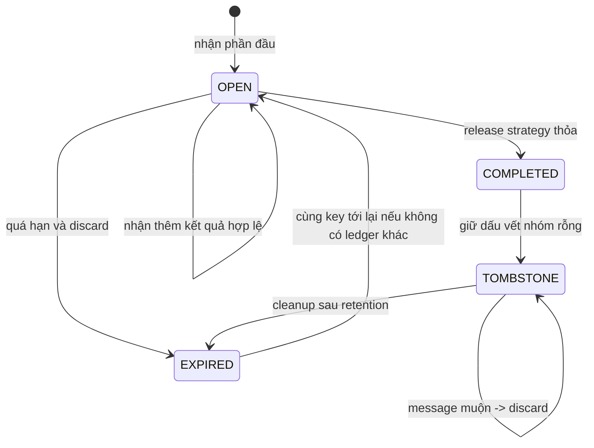
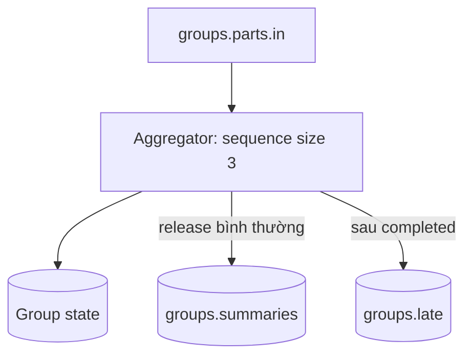
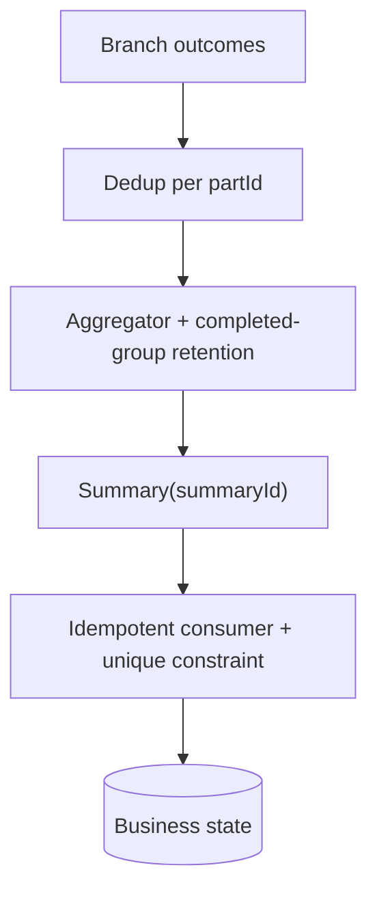

# Release một lần và ngăn release trùng trong Aggregator của Spring Integration

## Mục tiêu bài học

Giả sử hệ thống nhận một yêu cầu giao hàng rồi tạo ba việc độc lập: kiểm tra tồn kho, tính phí vận chuyển và kiểm tra hạn mức. Các nhánh có thể trả kết quả khác thời điểm hoặc gửi lại thông điệp vì retry. Bộ tổng hợp (**Aggregator**) cần đợi đủ kết quả liên quan và phát ra một bản tổng kết duy nhất.

Điểm khó không chỉ nằm ở công thức “nhận đủ ba message thì release”. Sau khi nhóm đã hoàn tất, message trùng hoặc đến muộn có thể xuất hiện. Nếu Aggregator **quên** nhóm đã hoàn tất quá sớm, cùng correlation key có thể tạo một nhóm mới và phát thêm kết quả. Nếu upstream gửi hai kết quả của cùng nhánh *trước* lúc hoàn tất, một release strategy chỉ **đếm số message** có thể coi nhóm là đủ dù vẫn thiếu nhánh khác.

**Release một lần và ngăn release trùng** vì thế là một bài toán gồm nhiều lớp: lựa chọn thời điểm phát kết quả, ghi nhận nhóm đã hoàn tất, chống message trùng trước release, và chống side effect trùng ở consumer nhận summary. Các lớp này liên quan nhưng không thay thế nhau.

Bài thuộc chương **Aggregator** của module **SPRING_INTEGRATION_PATTERN**, trong lộ trình học Enterprise Integration Patterns bằng Spring Integration: Router, Filter, Transformer, Splitter, Aggregator, Gateway, retry, error channel, correlation cùng kiểm thử và quan sát luồng thông điệp ít phụ thuộc, dễ mở rộng.

Học xong bài, bạn có thể:

1. Phân biệt **correlation**, **release strategy**, **message-group state**, **late arrival** và **business idempotency**.
2. Giải thích vì sao `expireGroupsUponCompletion(false)` giữ “dấu vết nhóm đã xong”, trong khi `true` có thể cho cùng key mở nhóm mới.
3. Xây Java DSL Aggregator nhận nhiều phần, release đúng một lần trong ngữ cảnh đã cấu hình và gửi message muộn sang `discardChannel`.
4. Viết JUnit kiểm tra không phát summary sớm, chỉ phát một summary sau khi đủ phần và loại message đến muộn.
5. Nhận diện lỗ hổng của `SimpleSequenceSizeReleaseStrategy` khi nhận bản sao cùng `sequenceNumber` trước release.
6. Thiết kế chống trùng theo `(workflowId, branchId)`, unique constraint và transactional outbox khi cần đảm bảo side effect không bị nhân đôi.
7. Xử lý timeout, partial result, cleanup empty group, restart, nhiều instance và concurrency một cách minh bạch.

## 1. Aggregator là gì và “release” nghĩa gì?

Aggregator là một endpoint **có trạng thái**. Nó nhận nhiều message, **phân nhóm theo correlation key**, lưu tạm các thành viên trong một `MessageGroupStore`, gọi `ReleaseStrategy` để quyết định nhóm đã sẵn sàng chưa, rồi dùng `MessageGroupProcessor` tạo message đầu ra khi được release.



Ví dụ một nhóm ba phần:

```text
workflowId = WF-42
correlationId = WF-42
expected branches = {AUDIT, STOCK, SHIPPING}

AUDIT    -> SUCCEEDED
STOCK    -> SUCCEEDED
SHIPPING -> SUCCEEDED

=> Aggregator phát 1 Summary(WF-42).
```

**Release** chỉ có nghĩa Aggregator đã quyết định **phát thông điệp tổng hợp** từ trạng thái hiện có. Nó không tự có nghĩa mọi thao tác nghiệp vụ bên ngoài đã được commit, consumer đã nhận summary một lần duy nhất hoặc tổng kết đã được lưu bền vững.

### Ba thành phần có trách nhiệm khác nhau

| Thành phần | Vai trò | Không tự bảo đảm |
| --- | --- | --- |
| `CorrelationStrategy` | Xác định các message thuộc cùng nhóm | Một message là hợp lệ hoặc không trùng |
| `ReleaseStrategy` | Xác định nhóm nào đã đủ điều kiện phát | Output đã được downstream commit exactly once |
| `MessageGroupProcessor` | Tạo payload/message kết quả từ nhóm được release | Việc lưu và gửi kết quả ở ngoài một transaction có thể retry an toàn |

Ngoài ra, **`MessageGroupStore`** chịu trách nhiệm lưu trạng thái các nhóm; **`LockRegistry`** hỗ trợ đồng bộ các thay đổi trong cùng nhóm. Đây là những phần quan trọng khi nhiều thread gửi message cùng lúc.

## 2. Bốn kiểu “trùng” không nên đánh đồng

Một thiết kế tốt phải xác định **trùng xảy ra ở đâu**.

| Kiểu trùng | Ví dụ | Biện pháp chính |
| --- | --- | --- |
| **Trùng trước khi release** | Nhận hai lần kết quả AUDIT, vẫn chưa có SHIPPING | Dedup theo business part key; release strategy dựa trên tập nhánh duy nhất |
| **Đến muộn sau release** | Nhận lại STOCK sau khi summary đã phát | Giữ dấu vết completed group và dùng `discardChannel` |
| **Release lại do mở nhóm mới** | Completed group bị xóa, cùng `correlationId` xuất hiện lại | Không expire quá sớm; correlation key đủ duy nhất; ledger bên ngoài |
| **Side effect summary bị thực hiện lại** | Consumer nhận cùng summary lần hai sau redelivery | Idempotent consumer, unique constraint, outbox/transaction |

Hai lớp chống trùng nổi bật:

- **Group-level:** ngăn Aggregator xem lại một nhóm đã hoàn tất là nhóm mới.
- **Business-level:** ngăn kết quả cuối cùng gây tác động nghiệp vụ lặp trong DB, HTTP, broker hoặc hệ thống downstream.

Chỉ làm một trong hai thì vẫn có thể gặp sự cố.

## 3. Vòng đời một nhóm và vị trí phát sinh duplicate



Trong sơ đồ:

- **OPEN:** nhóm đang tích lũy message.
- **COMPLETED:** release strategy đã phát thông điệp tổng hợp theo cơ chế của Aggregator.
- **TOMBSTONE:** cách gọi mang tính khái niệm cho *empty completed group* còn được giữ trong store nhằm nhận diện message tới sau.
- **EXPIRED:** metadata nhóm bị loại khỏi store; Aggregator không còn bằng chứng nội tại rằng correlation key đó từng hoàn tất.

Từ “tombstone” ở đây là **khái niệm giải thích**, không phải một message hoặc class cụ thể mà Spring Integration tự xuất bản ra ngoài.

### Điều gì xảy ra nếu nhóm đã hoàn tất mà có message cùng correlation?

Với cấu hình giữ nhóm đã hoàn tất, message đến muộn bị loại và có thể được chuyển tới `discardChannel`. Nếu xóa toàn bộ nhóm ngay khi hoàn tất, message mang cùng correlation có thể khởi tạo nhóm mới.

| Chính sách | Sau release bình thường | Message tới muộn |
| --- | --- | --- |
| `expireGroupsUponCompletion(false)` | Giữ empty completed group | Bị loại, có thể tới discard channel |
| `expireGroupsUponCompletion(true)` | Xóa group khỏi store | Có thể được coi như message đầu của nhóm mới |

**Mặc định của `expireGroupsUponCompletion` là `false`** đối với Aggregator thông thường. Việc viết rõ trong cấu hình giúp người đọc nhận ra ý định **không mở lại nhóm đã hoàn tất**.

> Giữ empty group chỉ có tác dụng khi **trạng thái ấy còn tồn tại** trong store và các message đi qua cơ chế Aggregator đang sử dụng cùng trạng thái phù hợp. Nó không đồng nghĩa exactly-once trên toàn hệ thống.

## 4. Ví dụ Java DSL: release một lần, late message bị loại

Ta tạo một flow nhỏ:

- `groups.parts.in`: channel nhận message thành viên.
- `Aggregator`: gom theo `correlationId` và release khi đủ số phần từ `sequenceSize`.
- `groups.summaries`: queue chứa summary cho test.
- `groups.late`: queue chứa message đến sau khi nhóm đã complete.

Mỗi input có ba header phục vụ Aggregator:

```text
correlationId = "WF-42"
sequenceNumber = 1, 2, 3
sequenceSize = 3
```

Đây là các header được Spring Integration sử dụng trong chiến lược mặc định. Trong flow Splitter thật, Splitter có thể tạo các header tương ứng; ở đây chúng ta **gắn tường minh** để test tập trung vào Aggregator.



### Cấu hình Spring Integration

```java
import org.springframework.context.annotation.Bean;
import org.springframework.context.annotation.Configuration;
import org.springframework.integration.channel.DirectChannel;
import org.springframework.integration.channel.QueueChannel;
import org.springframework.integration.config.EnableIntegration;
import org.springframework.integration.dsl.IntegrationFlow;
import org.springframework.messaging.MessageChannel;
import org.springframework.messaging.PollableChannel;

@Configuration
@EnableIntegration
public class OnceReleaseAggregatorConfig {

    @Bean("groups.parts.in")
    MessageChannel input() {
        return new DirectChannel();
    }

    @Bean("groups.summaries")
    PollableChannel summaries() {
        return new QueueChannel();
    }

    @Bean("groups.late")
    PollableChannel lateParts() {
        return new QueueChannel();
    }

    @Bean
    IntegrationFlow onceReleaseFlow() {
        return IntegrationFlow.from("groups.parts.in")
            .aggregate(spec -> spec
                // Giữ completed-group metadata để discard late arrivals.
                .expireGroupsUponCompletion(false)
                .discardChannel("groups.late"))
            .channel("groups.summaries")
            .get();
    }
}
```

Ở cấu hình này:

1. `DirectChannel` gọi Aggregator đồng bộ khi message được gửi đến.
2. Default correlation dựa trên header `correlationId`.
3. Default release dựa vào các sequence headers để xác định nhóm đã đủ.
4. Default output processor tạo một kết quả tổng hợp mang danh sách payload các phần.
5. `expireGroupsUponCompletion(false)` giữ completed-group metadata.
6. `discardChannel("groups.late")` giúp theo dõi message được nhận **sau khi group đã hoàn tất**, thay vì bỏ qua âm thầm.

Các `QueueChannel` là test sink. Trong production, gắn processor/consumer phù hợp cho summary và discard, đồng thời cân nhắc persistent store.

### Khi nào không cần custom `ReleaseStrategy`?

Nếu upstream là Splitter tạo **một kết quả cho mỗi phần**, `sequenceNumber` và `sequenceSize` chính xác, các message không trùng trước release và mục tiêu là gom **đầy đủ** các phần, mặc định là điểm khởi đầu hợp lý.

Nếu business yêu cầu “đủ ba nhánh **khác nhau**” hoặc input có thể có **duplicate theo business key**, chỉ đếm số message là không đủ. Chúng ta sẽ giải quyết ở các mục sau.

## 5. Kiểm thử release đúng một lần và discard message đến muộn

Bộ test này kiểm tra **hành vi qua channel** chứ không chỉ gọi một phương thức release strategy.

### JUnit 5 + AssertJ

```java
import static org.assertj.core.api.Assertions.assertThat;

import java.util.Collection;

import org.junit.jupiter.api.Test;
import org.springframework.beans.factory.annotation.Autowired;
import org.springframework.beans.factory.annotation.Qualifier;
import org.springframework.messaging.Message;
import org.springframework.messaging.MessageChannel;
import org.springframework.messaging.PollableChannel;
import org.springframework.messaging.support.MessageBuilder;
import org.springframework.test.context.junit.jupiter.SpringJUnitConfig;

@SpringJUnitConfig(OnceReleaseAggregatorConfig.class)
class OnceReleaseAggregatorTest {

    @Autowired
    @Qualifier("groups.parts.in")
    MessageChannel input;

    @Autowired
    @Qualifier("groups.summaries")
    PollableChannel summaries;

    @Autowired
    @Qualifier("groups.late")
    PollableChannel lateParts;

    private void send(
        String workflowId,
        int sequenceNumber,
        int sequenceSize,
        String payload
    ) {
        Message<String> message = MessageBuilder
            .withPayload(payload)
            .setHeader("correlationId", workflowId)
            .setHeader("sequenceNumber", sequenceNumber)
            .setHeader("sequenceSize", sequenceSize)
            .setHeader("traceId", "trace-" + workflowId)
            .build();

        assertThat(input.send(message)).isTrue();
    }

    @Test
    void releasesOnlyAfterWholeSequenceAndDiscardsLateArrival() {
        send("WF-101", 1, 3, "AUDIT");
        assertThat(summaries.receive(0)).isNull();

        send("WF-101", 2, 3, "STOCK");
        assertThat(summaries.receive(0)).isNull();

        send("WF-101", 3, 3, "SHIPPING");

        Message<?> released = summaries.receive(2_000);
        assertThat(released).isNotNull();

        assertThat(released.getPayload())
            .isInstanceOf(Collection.class);
        Collection<?> payloads =
            (Collection<?>) released.getPayload();
        assertThat(payloads)
            .containsExactlyInAnyOrder(
                "AUDIT", "STOCK", "SHIPPING");

        // Sau khi đủ phần và complete, chỉ có một summary.
        assertThat(summaries.receive(0)).isNull();

        // Message mới cùng correlation được coi là đến muộn.
        send("WF-101", 2, 3, "STOCK-REDELIVERED");

        Message<?> late = lateParts.receive(2_000);
        assertThat(late).isNotNull();
        assertThat(late.getPayload())
            .isEqualTo("STOCK-REDELIVERED");
        assertThat(summaries.receive(0)).isNull();
    }

    @Test
    void separateCorrelationKeysDoNotCompleteOneAnother() {
        send("WF-201", 1, 2, "A-1");
        send("WF-202", 1, 2, "B-1");

        assertThat(summaries.receive(0)).isNull();

        send("WF-202", 2, 2, "B-2");
        Message<?> first = summaries.receive(2_000);
        assertThat(first).isNotNull();
        assertThat((Collection<?>) first.getPayload())
            .containsExactlyInAnyOrder("B-1", "B-2");

        // WF-201 vẫn chưa đủ hai phần.
        assertThat(summaries.receive(0)).isNull();

        send("WF-201", 2, 2, "A-2");
        Message<?> second = summaries.receive(2_000);
        assertThat(second).isNotNull();
        assertThat((Collection<?>) second.getPayload())
            .containsExactlyInAnyOrder("A-1", "A-2");

        assertThat(summaries.receive(0)).isNull();
        assertThat(lateParts.receive(0)).isNull();
    }
}
```

Kiểm thử giả định context dùng riêng cho test, các queue không có consumer nền, mỗi nhóm dùng một correlation key riêng và đường `DirectChannel` thực thi đồng bộ. Trong môi trường dùng executor/broker, cần chờ/kiểm tra theo thời hạn và không suy rằng một lần `receive(0)` là bằng chứng vĩnh viễn không còn message.

**Phạm vi chứng minh:** luồng này phát một kết quả khi một sequence đủ và bỏ một message late trong cùng Spring context còn giữ state. Test **không chứng minh** exactly-once khi restart, khi store hỏng, khi downstream timeout hoặc khi duplicate đã xuất hiện *trước* khi release.

## 6. Lỗ hổng quan trọng: duplicate đến trước release

Giả sử nhóm trông đợi ba nhánh:

```text
sequenceSize=3

T1: AUDIT    seq=1  -> group có 1 message
T2: AUDIT    seq=1  -> bản sao mới, message ID khác
T3: STOCK    seq=2  -> group có thể đếm đủ 3 message
T4: SHIPPING seq=3  -> đến sau
```

Nếu release strategy chỉ kiểm tra **số message trong group đạt `sequenceSize`**, nó có thể phát summary tại T3 dù **thiếu SHIPPING**. Khi group đã hoàn tất, T4 lại bị coi là late arrival và bị loại!

Spring Integration hiện dùng **`SimpleSequenceSizeReleaseStrategy`** làm mặc định trong trường hợp phổ biến. Nó tối ưu theo kích thước và **không phải một bộ chống trùng nghiệp vụ hoàn chỉnh**. Một số chiến lược khác, như `SequenceSizeReleaseStrategy`, có kiểm tra số thứ tự trùng với trade-off về hiệu năng; nhưng **sequence number trùng** và **business part trùng** không nhất thiết đồng nghĩa.

### Duplicate theo `MessageHeaders.ID` khác duplicate theo nhánh

| Phân biệt | Ví dụ | Rủi ro |
| --- | --- | --- |
| Cùng **Message ID** được gửi lại | Re-deliver nguyên message object | Một store có thể không thêm lại đúng cùng ID |
| Hai Message ID khác nhau, cùng `sequenceNumber` | Producer dựng message mới khi retry | Có thể được đếm như hai thành viên riêng |
| Hai sequence khác nhau nhưng cùng business branch | Worker trả hai kết quả NOTIFY với metadata sai | Kích thước nhóm không phản ánh tập nhánh |
| Hai branch ID khác nhau, cùng giá trị payload | AUDIT và STOCK đều trả `"OK"` | Không được coi là trùng chỉ vì payload giống nhau |

Do đó, **không dùng số lượng message làm bằng chứng số nhánh duy nhất** khi upstream có thể retry/redelivery.

## 7. Thiết kế release theo tập branch duy nhất

Khi business contract nói một workflow chỉ được tổng hợp sau khi đủ kết quả cuối cùng của **AUDIT**, **STOCK** và **SHIPPING**, cần lưu tên nhánh trong payload.

```java
public record BranchOutcome(
    String workflowId,
    String branchId,
    String status,
    int attempt
) {}
```

Một message từ nhánh AUDIT có thể là:

```text
payload:
  workflowId = WF-42
  branchId   = AUDIT
  status     = SUCCEEDED
  attempt    = 1
headers:
  correlationId = WF-42
```

### Custom ReleaseStrategy theo tập nhánh

```java
import java.util.Set;
import java.util.stream.Collectors;

import org.springframework.integration.aggregator.ReleaseStrategy;
import org.springframework.integration.store.MessageGroup;

public final class RequiredBranchesRelease
        implements ReleaseStrategy {

    private static final Set<String> REQUIRED =
        Set.of("AUDIT", "STOCK", "SHIPPING");

    @Override
    public boolean canRelease(MessageGroup group) {
        Set<String> completed = group.getMessages().stream()
            .map(message -> (BranchOutcome) message.getPayload())
            .filter(part -> isTerminal(part.status()))
            .map(BranchOutcome::branchId)
            .collect(Collectors.toSet());

        return completed.containsAll(REQUIRED);
    }

    private static boolean isTerminal(String status) {
        return "SUCCEEDED".equals(status)
            || "FAILED".equals(status)
            || "SKIPPED".equals(status);
    }
}
```

Đây là **release policy minh họa**:

- Không release sau hai bản sao của AUDIT và một STOCK; vì chưa thấy SHIPPING.
- Chỉ xem các outcome có trạng thái terminal là đã **kết thúc**.
- Tùy nghiệp vụ, `FAILED` có thể là kết quả cuối hoặc mới là trạng thái chờ retry; nếu còn retry, **chưa nên phát terminal outcome**.
- `containsAll(REQUIRED)` là phép kiểm tra đủ **tập nhánh**, không chỉ đếm phần tử.

**Quan trọng:** policy này giúp quyết định **khi nào release**, nhưng **không tự loại duplicate ra khỏi `MessageGroup`**. Khi đủ ba nhánh, group vẫn có thể chứa bốn hoặc năm message. Bộ xử lý output phải chọn kết quả duy nhất cho từng branch, hoặc tốt hơn: ngăn duplicate đi vào Aggregator từ đầu.

### Ví dụ tạo summary đúng một kết quả cho mỗi branch

```java
import java.util.Map;
import java.util.function.Function;
import java.util.stream.Collectors;

import org.springframework.integration.store.MessageGroup;

record WorkflowSummary(
    String workflowId,
    Map<String, BranchOutcome> outcomesByBranch
) {}

final class SummaryProcessor {

    public WorkflowSummary summarize(MessageGroup group) {
        Map<String, BranchOutcome> unique =
            group.getMessages().stream()
                .map(message -> (BranchOutcome) message.getPayload())
                .collect(Collectors.toMap(
                    BranchOutcome::branchId,
                    Function.identity(),
                    (a, b) -> a.attempt() >= b.attempt() ? a : b
                ));

        String workflowId = unique.values().iterator().next()
            .workflowId();

        return new WorkflowSummary(workflowId, Map.copyOf(unique));
    }
}
```

Ở ví dụ này, khi có nhiều outcome cùng branch, chọn attempt lớn hơn. **Đây chỉ là một quy tắc minh họa**, không phải chính sách universally correct: ứng dụng thực tế còn phải đối chiếu trạng thái terminal, timestamp, version, fencing token và xử lý trường hợp **hai outcome khác nhau cùng attempt**. Không dùng “message đến cuối cùng” làm nguồn sự thật nếu reply có thể đảo thứ tự.

### Ghép vào Aggregator Java DSL

```java
@Bean
IntegrationFlow businessAwareAggregator() {
    var processor = new SummaryProcessor();

    return IntegrationFlow.from("business.parts.in")
        .aggregate(spec -> spec
            .releaseStrategy(new RequiredBranchesRelease())
            .outputProcessor(processor::summarize)
            .expireGroupsUponCompletion(false)
            .discardChannel("business.late"))
        .channel("business.summaries")
        .get();
}
```

Đây là **đoạn trích** để minh họa cách nối `ReleaseStrategy` và `MessageGroupProcessor`; các channel phải được định nghĩa riêng. Không đăng ký song song flow này với flow cơ bản vào cùng input chỉ để thử hai chính sách.

Với một workflow có số nhánh thay đổi theo selector, thay `REQUIRED` cố định bằng **tập expected branches được lưu từ lúc dispatch**, không suy dựa trên những nhánh tình cờ đã trả kết quả.

## 8. Dedup trước Aggregator: tránh group bị lấp bởi message trùng

Release strategy theo tập branch giúp ngăn **release sớm**, nhưng giữ duplicate trong group vẫn tốn memory và phức tạp hóa output. Có thể thêm một bước kiểm soát idempotency trước Aggregator.

### Định nghĩa khóa part

```text
workflowId + branchId [+ finalResultVersion]
```

Ví dụ:

```text
(WF-42, AUDIT)     -> chỉ một terminal outcome chính thức
(WF-42, STOCK)     -> chỉ một terminal outcome chính thức
(WF-42, SHIPPING)  -> chỉ một terminal outcome chính thức
```

Không dùng `MessageHeaders.ID` làm khóa chống trùng nghiệp vụ khi producer có thể dựng message mới cho mỗi retry.

### Ví dụ minh họa trong một JVM

```java
import java.util.Set;
import java.util.concurrent.ConcurrentHashMap;

public final class InMemoryPartDeduplicator {

    private final Set<String> seen =
        ConcurrentHashMap.newKeySet();

    public boolean isFirstTerminal(BranchOutcome outcome) {
        String key =
            outcome.workflowId() + "|" + outcome.branchId();

        return seen.add(key);
    }
}
```

Nếu bước trước Aggregator xác nhận `isFirstTerminal(outcome) == false` thì có thể đưa message sang duplicate-discard flow, thay vì đưa vào group.

**Giới hạn cực kỳ quan trọng:** đây **không phải giải pháp production**. Set tồn tại trong RAM, tăng mãi nếu không cleanup, không đồng bộ qua các instance và **đánh dấu “đã thấy” trước khi Aggregator xử lý thành công**. Nếu tiến trình crash sau `seen.add` nhưng trước khi cập nhật group, retry có thể bị chặn và workflow không bao giờ đủ kết quả.

Muốn dùng thật, cần cơ chế claim/commit/retry có trạng thái **bền vững** và xác định transaction boundary.

### Idempotent Receiver pattern

Spring Integration có cơ chế **Idempotent Receiver** kết hợp `MetadataStoreSelector` và `IdempotentReceiverInterceptor`. Có thể đặt nó trước Aggregator để đánh dấu hoặc lọc những message có cùng business key.

Tuy nhiên:

- Metadata store cần phù hợp với nhiều instance nếu hệ thống chạy phân tán.
- Phải quản lý retry khi processing downstream thất bại.
- Có cấu hình giữ hay loại duplicate message; không giả định advice luôn âm thầm xóa chúng.
- Cần quản lý retention, version/attempt và ảnh hưởng tới release strategy.

**Không nên bật dedup theo một key tùy ý mà không viết test chứng minh** một message thất bại ở downstream vẫn có thể được retry an toàn.

## 9. `expireGroupsUponCompletion` và dấu vết nhóm đã hoàn tất

Đây là cấu hình trọng tâm khi muốn ngăn một nhóm đã hoàn tất **mở lại do late arrival**.

```java
.aggregate(spec -> spec
    .expireGroupsUponCompletion(false)
    .discardChannel("groups.late"))
```

### Vì sao `false` hợp lý với one-shot aggregation?

Sau khi release bình thường, Aggregator giữ metadata **completed group** trong store. Khi một message mới có correlation key đó, nó được coi là late arrival; không được đưa vào nhóm để tạo thêm summary.

Bởi vậy, đối với workflow “một correlation key chỉ tổng kết một lần”, `false` là lựa chọn thường nên bắt đầu.

### Vậy tại sao có `true`?

Một số hệ thống **cố ý muốn tái sử dụng correlation key**, hoặc không muốn giữ completed-group metadata trong store. Khi cấu hình:

```java
.aggregate(spec -> spec
    .expireGroupsUponCompletion(true))
```

group được xóa khi hoàn tất. Một message mới dùng cùng correlation có thể tạo group mới và lại đạt release strategy. Điều này phù hợp **chỉ khi** việc mở chu kỳ mới được định nghĩa rõ, chẳng hạn correlation key thực chất bao gồm phiên bản/window hoặc khi ứng dụng có ledger chống trùng ở tầng khác.

### Bảng quyết định

| Yêu cầu | Gợi ý |
| --- | --- |
| Mỗi `workflowId` chỉ có một summary | Giữ completed group trong retention cần thiết; dùng unique business key |
| Muốn một correlation key cho nhiều lượt tổng hợp có chủ đích | Đưa `generation/windowId` vào correlation key |
| Lưu nhóm vĩnh viễn gây tốn storage | Có retention + external dedup/ledger tương ứng |
| Có late message sau timeout | Cần kiểm soát cả `expireGroupsUponTimeout`, không chỉ completion |
| Restart và vẫn phải nhận diện completed group | Dùng durable `MessageGroupStore` hoặc business ledger |

**Không sử dụng `expireGroupsUponCompletion(true)` chỉ vì muốn “dọn RAM”** mà chưa giải quyết điều gì xảy ra khi message trùng đến sau.

## 10. Empty group, retention và cleanup

Giữ completed groups giúp discard message đến muộn, nhưng chúng tiêu thụ storage. Nếu hệ thống có hàng triệu workflow, **không thể giữ vô hạn** tất cả empty groups trong RAM.

Spring Integration có:

- `MessageGroupStoreReaper`: hỗ trợ loại bỏ nhóm cũ theo lịch.
- `minimumTimeoutForEmptyGroups` (XML: `empty-group-min-timeout`): hỗ trợ kiểm soát thời gian lưu empty groups trước khi chúng được dọn.
- Các cơ chế expiry khác tùy phiên bản và kiểu store.

### Retention phải gắn với rủi ro retry

Nếu retry/redelivery có thể xảy ra trong vòng **72 giờ**, mà completed-group metadata bị xóa sau **10 phút**, sự bảo vệ ở cấp Aggregator chỉ còn hiệu lực trong 10 phút. Message cũ tới sau thời gian đó có thể mở nhóm mới.

Một thiết kế có thể dùng:

```text
Retention completed-group = max expected late arrival + safety margin
External business ledger  = thời hạn chống duplicate theo hợp đồng
```

Đây là **nguyên tắc lựa chọn**, không phải một TTL mặc định. Với nghiệp vụ tài chính, thời hạn lưu idempotency key có thể dài hơn nhiều so với metadata group tạm.

### Cẩn thận với group reaper

Reaper không chỉ dọn empty groups; nó còn có thể **force completion** các nhóm chưa đủ khi đến hạn, tùy cấu hình `sendPartialResultOnExpiry` và policy timeout. Nếu dùng cùng một `MessageGroupStore` cho các aggregator khác nhau, expiry callback có thể xung đột; nên tách store hoặc cấu hình scope rõ, theo khuyến nghị Spring Integration.

Khi group tombstone bị dọn, **chặn trùng bằng Aggregator không còn đủ**. Lúc đó, external idempotency ledger là lớp bảo vệ cần thiết nếu nghiệp vụ vẫn yêu cầu không phát/không commit trùng.

## 11. Timeout và partial release: nguồn release trùng dễ bị bỏ sót

Không phải nhóm nào cũng nhận đủ phần. Ví dụ ba nhánh:

```text
T0: AUDIT -> SUCCEEDED
T1: STOCK -> SUCCEEDED
T2: SHIPPING không reply
T3: timeout
T4: SHIPPING reply rất muộn
```

Khi cấu hình group timeout, Aggregator có thể force completion:

- `sendPartialResultOnExpiry(true)`: phát kết quả một phần khi expiry theo chính sách.
- `sendPartialResultOnExpiry(false)`: không phát partial; group có thể bị discard.
- `expireGroupsUponTimeout(true)`: mặc định thường **xóa** nhóm sau timeout thay vì giữ completed metadata.
- `expireGroupsUponTimeout(false)`: giữ metadata hoàn tất sau expiry theo cơ chế được cấu hình, để hạn chế late arrival mở lại group.

### Minh họa cấu hình timeout

```java
.aggregate(spec -> spec
    .groupTimeout(5_000L)
    .sendPartialResultOnExpiry(true)
    .expireGroupsUponCompletion(false)
    .expireGroupsUponTimeout(false)
    .discardChannel("groups.late"))
```

Đây là **đoạn cấu hình gợi ý để kiểm thử**, không phải flow đầy đủ; cần scheduler phù hợp và các channel tương ứng. Thời gian 5 giây chỉ dùng minh họa. Khi timeout, framework có thể kiểm tra lại release strategy trước khi quyết định expiry; các thuộc tính “completion” và “timeout” không tương đương.

### Tại sao cần điều kiện deadline rõ ràng?

`groupTimeout` kiểu duration thường liên quan đến khoảng thời gian kể từ lần **cuối nhận một message** trong group. Khi một phần được gửi liên tục, timeout có thể được lên lịch lại. Nếu yêu cầu SLA là “không bao giờ quá 10 giây tính từ lúc yêu cầu bắt đầu”, có thể cần deadline tuyệt đối hoặc `groupTimeoutExpression` dựa trên timestamp của nhóm và chính sách riêng.

### Partial result có phải final không?

Đây là **quyết định nghiệp vụ**, không phải mặc định của framework.

- **Final partial:** Summary ghi `TIMED_OUT` cho nhánh thiếu và không thay đổi sau đó.
- **Provisional partial:** Cho phép cập nhật summary khi message muộn đến, với version mới.
- **No partial:** Báo lỗi/quarantine và không phát summary nghiệp vụ.

Nếu muốn **release một lần duy nhất**, nên định nghĩa summary **terminal** và không để late message tạo một summary mới với cùng business key. Nếu muốn provisional result rồi cập nhật, đó là một hợp đồng **nhiều phiên bản**, phải có `summaryVersion` và consumer idempotent theo version.

## 12. Correlation key phải đủ duy nhất cho một vòng đời

Đôi khi hai workflow khác nhau cùng có `correlationId` do sử dụng sai khóa:

```text
WF-42, tenant=A -> correlationId = "42"
WF-42, tenant=B -> correlationId = "42"
```

Aggregator có thể gom lẫn kết quả hoặc coi workflow B là late của A. Vấn đề ở đây **không thể sửa chỉ bằng `expireGroupsUponCompletion`**.

### Thiết kế key rõ ràng

```text
correlationId = tenantId + ":" + workflowId + ":" + generation
```

Trong đó:

- `tenantId` phải được xác thực, không tin header do client tự khai.
- `workflowId` xác định một yêu cầu nghiệp vụ.
- `generation` phân biệt các vòng có chủ đích nếu workflow được phép mở lại.

### Các field không thay thế nhau

| Field | Mục đích |
| --- | --- |
| `MessageHeaders.ID` | ID kỹ thuật của từng message |
| `traceId` | Nối log/trace qua dịch vụ |
| `workflowId` | Định danh nghiệp vụ và idempotency |
| `branchId` | Phân biệt các phần cần hoàn thành |
| `correlationId` | Xác định group trong Aggregator |
| `sequenceNumber` | Vị trí part trong sequence |
| `sequenceSize` | Số phần kỳ vọng, nếu đã biết |
| `generation` | Phân biệt vòng xử lý theo hợp đồng |
| `summaryId` | ID ổn định của output/side effect cuối |

Đừng dùng `traceId` ngẫu nhiên của từng retry làm correlation key nếu cần gom các lượt retry cùng một workflow; cũng đừng dùng `workflowId` chung cho nhiều generation khi chúng phải độc lập.

## 13. Release một lần không có nghĩa exactly-once delivery

Một câu hỏi quan trọng: nếu Aggregator đã phát summary **một lần trong ứng dụng**, consumer có chắc chỉ nhận và chỉ thực thi nghiệp vụ **một lần**?

**Không.** Trong hệ thống có broker, mạng, DB và retry, có những cửa sổ lỗi:

```text
T1 Aggregator quyết định release.
T2 Gửi Summary đến outbound adapter / broker.
T3 Broker đã nhận, nhưng producer mất ACK.
T4 Producer retry gửi Summary.
T5 Consumer nhận Summary hai lần.
```

Hoặc:

```text
T1 Consumer nhận Summary.
T2 Consumer ghi DB thành công.
T3 Consumer crash trước khi ACK broker.
T4 Broker redeliver Summary.
T5 Consumer có thể ghi DB lần hai.
```

`expireGroupsUponCompletion(false)` không sửa được hai tình huống trên: chúng diễn ra **sau khi summary rời Aggregator** hoặc ngoài phạm vi message-group state.

### Ba lớp bảo vệ



1. **Per-part dedup:** mỗi branch chỉ đóng góp một terminal outcome chính thức.
2. **Completed-group retention:** không mở lại cùng group khi kết quả đến muộn.
3. **Idempotent consumer:** một `summaryId` chỉ tạo side effect một lần, kể cả message bị gửi lại.

Đó là cách tiếp cận thực tế gần với hiệu quả **effectively once** ở nghiệp vụ, nhưng vẫn phải phát biểu các giả định về storage, transaction và hệ thống bên ngoài.

## 14. Unique constraint và transactional outbox

Ở tầng DB, sử dụng một định danh kết quả cuối ổn định:

```text
summaryId = "WF-42:final"
```

Một bảng minh họa trên PostgreSQL:

```sql
CREATE TABLE processed_summary (
    summary_id VARCHAR(150) PRIMARY KEY,
    processed_at TIMESTAMPTZ NOT NULL DEFAULT now()
);
```

Khi xử lý một summary:

```sql
INSERT INTO processed_summary(summary_id)
VALUES (:summary_id)
ON CONFLICT (summary_id) DO NOTHING;
```

**Không đủ chỉ thực hiện câu INSERT này rồi mặc định đã an toàn:** cần **đưa việc kiểm tra insert thành công và side effect trên DB vào cùng transaction**.

Pseudo-flow:

```text
BEGIN TRANSACTION

  INSERT summaryId ... ON CONFLICT DO NOTHING

  Nếu insert không thêm dòng nào:
      -> xem là duplicate, không áp dụng side effect lần hai
  Ngược lại:
      -> cập nhật bảng nghiệp vụ
      -> ghi bản ghi outbox nếu cần publish tiếp

COMMIT
```

Nếu consumer cần gọi API thanh toán từ xa, DB transaction của hệ thống hiện tại không thể tự bao trùm side effect ở bên ngoài. Cần idempotency key được hỗ trợ tại dịch vụ đích, retry/backoff và quy trình đối soát.

### Vì sao dùng transactional outbox?

Khi summary đã làm thay đổi DB và phải phát event mới, không nên:

```text
COMMIT DB -> publish event
```

mà không có phương án phục hồi nếu crash ở giữa hai bước. Có thể ghi **business change + outbox record cùng transaction**, sau đó một worker publish outbox và đánh dấu đã gửi. Worker vẫn có thể gửi lặp khi mất ACK; consumer downstream vẫn cần idempotency.

**Outbox không biến Aggregator thành exactly-once engine**. Nó giảm khoảng trống giữa cập nhật DB và thông điệp phát ra, trong khi mỗi tầng vẫn cần cơ chế chống trùng tương ứng.

## 15. Concurrency: nhiều thread gửi cùng group

Khi nhiều nhánh xử lý song song, các outcome có thể tới Aggregator cùng lúc. Spring Integration dùng `LockRegistry` để đồng bộ thao tác trên group theo correlation key.

- Mặc định: `DefaultLockRegistry` trong bộ nhớ tiến trình.
- Khi nhiều instance cùng dùng shared `MessageGroupStore`, cần **shared/distributed lock registry** thích hợp.
- Lock giúp tránh race trong **cập nhật group state**; không chứng minh downstream side effect exactly once.

### Ví dụ sự kiện đua

```text
Thread A: gửi STOCK seq=2
Thread B: gửi SHIPPING seq=3

Cả hai đều nhìn thấy group gần hoàn tất.
Aggregator phải đồng bộ add/release trên cùng correlation.
```

Đặt default in-memory lock trên **hai instance riêng** không đồng bộ được chúng. Nếu dùng cùng persistent group store trên hai instance, thiết kế cần một distributed lock phù hợp cùng các semantics giao dịch của store.

### Deadlock khi có hai aggregator nối tiếp

Khi một aggregator giữ group lock trong lúc gửi output đồng bộ vào aggregator khác, có nguy cơ deadlock nếu nhiều thread và shared lock registry tương tác không đúng. Tài liệu Spring Integration có tùy chọn `releaseLockBeforeSend` trong những phiên bản hỗ trợ, và có thể dùng QueueChannel/ExecutorChannel để tách bước gửi.

Tuy nhiên, chọn cấu hình nào phải cân bằng deadlock, thứ tự, transaction và việc chuyển giao trạng thái; không bật một tùy chọn concurrency như “sửa mọi vấn đề” mà không test.

## 16. MessageGroupStore: RAM và lưu bền qua restart

`MessageGroupStore` ảnh hưởng trực tiếp tới khả năng ghi nhớ completed group.

| Store | Điều có thể kỳ vọng | Cảnh báo |
| --- | --- | --- |
| In-memory store (mặc định trong ví dụ) | Dễ test, phù hợp luồng đơn giản | Restart làm mất trạng thái chưa được persist |
| Persistent store (ví dụ JDBC) | Giữ group/metadata qua vòng đời tiến trình theo cấu hình | Cần transaction, schema, serialization, cleanup, migration |
| Store dùng chung giữa nhiều instance | Các node có thể truy cập state chung | Cần lock phân tán và thiết kế expiry rõ |
| Business ledger chuyên biệt | Lưu khóa đã xử lý và quyết định nghiệp vụ | Phải gắn với transaction/side effect đúng cách |

### Khi nào cần durable group state?

Nếu một workflow có thể kéo dài vài giờ, restart mà mất phần đã nhận sẽ khiến nhóm không release hoặc bị release nhầm khi redelivery. Persistent store giúp lưu state nhưng không thay thế kiểm soát duplicate.

Một trích đoạn DSL minh họa:

```java
@Bean
IntegrationFlow persistentAggregator(
    org.springframework.integration.store.MessageGroupStore groupStore
) {
    return IntegrationFlow.from("durable.parts.in")
        .aggregate(spec -> spec
            .messageStore(groupStore)
            .expireGroupsUponCompletion(false)
            .discardChannel("durable.parts.late"))
        .channel("durable.summaries")
        .get();
}
```

Đây là **cấu hình chưa đầy đủ**: phải khai báo bean store có độ bền phù hợp, các channel, lock registry nếu chạy nhiều instance, cùng transaction và chính sách reaper. Trong Spring Integration, không nên vô tình dùng **cùng một instance store** cho nhiều aggregator có expiry callbacks không tương thích.

### Restart có khiến summary gửi lại không?

Có thể, tùy thời điểm crash giữa group completion, store update, output send, transaction commit và ACK. Do đó ngay cả khi store bền, consumer vẫn cần **unique business summaryId**.

Không thể chứng minh exactly-once chỉ bằng một test “gửi ba phần, nhận đúng một summary” khi hệ thống thật có restart hoặc broker redelivery.

## 17. Khi dùng Filter, Splitter và Recipient List

Aggregator thường đứng sau một bước fan-out.

### Splitter → Filter → Aggregator

```text
Splitter tạo 3 phần: seqSize=3
  Part 1 -> accepted
  Part 2 -> bị Filter loại
  Part 3 -> accepted

Aggregator chỉ nhận 2 kết quả.
```

Nếu release strategy dựa trên đủ `sequenceSize=3`, nó không bao giờ nhận đủ phần. Cách xử lý là:

- Lọc trước Splitter để sequenceSize phản ánh số phần sau lọc.
- Hoặc nhánh Filter discard tạo `PartOutcome(status=SKIPPED)` có correlation/sequence phù hợp.
- Hoặc custom release strategy dựa trên tập kết quả terminal và timeout.

### Recipient List và tập nhánh động

Một message có thể chọn hai trong ba recipient tùy selector. Aggregator không nên **cứng hóa expectedBranches=3** nếu thực tế chỉ hai nhánh được chọn.

Mô hình phù hợp:

```text
Dispatch event WF-42
expectedRecipients = {AUDIT, STOCK}

AUDIT result -> terminal
STOCK result -> terminal
=> release summary
```

Tập expected recipients phải được **xác định tại thời điểm dispatch và lưu theo workflow**. Nếu Router thay mapping khi flow đang chạy, không tự suy từ mapping hiện tại rằng workflow cũ cần chờ bao nhiêu nhánh.

### Scatter-Gather

Scatter-Gather kết hợp phát message tới nhiều supplier rồi gom reply. Những lỗi giống Aggregator thường gặp:

- Supplier không reply, group timeout.
- Supplier reply trùng, summary không chính xác.
- Message đến muộn sau partial release.
- Retry cả request gây thực thi lặp ở supplier.

Vì vậy cần cùng một hợp đồng về expected branches, terminal outcome, correlation và idempotency khi dùng Scatter-Gather.

## 18. Quan sát release và duplicate theo từng nhóm

Một hệ thống sản xuất không thể chỉ đếm `message_received_total`. Nên quan sát:

| Metric minh họa | Ý nghĩa |
| --- | --- |
| `aggregator_part_received_total` | Có bao nhiêu phần đi vào Aggregator? |
| `aggregator_part_duplicate_total{reason}` | Bao nhiêu phần trùng trước release? |
| `aggregator_group_open` | Có bao nhiêu nhóm chưa hoàn tất? |
| `aggregator_group_released_total{type}` | Bao nhiêu summary full/partial được phát? |
| `aggregator_group_late_total` | Có bao nhiêu message đến sau group completed? |
| `aggregator_group_timeout_total` | Bao nhiêu nhóm bị force-complete khi hết hạn? |
| `aggregator_group_wait_duration` | Thời gian từ phần đầu tới release |
| `aggregator_completed_group_retained` | Bao nhiêu empty completed groups đang được giữ? |
| `aggregator_expired_group_total` | Bao nhiêu group metadata đã bị xóa? |
| `summary_consumer_duplicate_total` | Bao nhiêu summary bị downstream nhận lại? |
| `aggregator_store_error_total` | Có lỗi đọc/ghi group state không? |

Các tên metric này là **gợi ý do ứng dụng định nghĩa**, không phải toàn bộ metric mặc định được Spring Integration xuất với đúng tên đó. Có thể kết hợp Micrometer/observability, structured logging và MessageGroupStore/ledger để kiểm tra trạng thái.

### Log có ích

```text
traceId=trace-42 workflowId=WF-42
event=group_released releaseType=FULL
expected=3 distinctBranches=3 summaryId=WF-42:final

traceId=trace-42 workflowId=WF-42 branch=STOCK
event=late_part_discarded reason=COMPLETED_GROUP

traceId=trace-42 workflowId=WF-42
event=summary_duplicate_suppressed
summaryId=WF-42:final
```

Không log toàn payload hoặc dữ liệu thanh toán, thông tin cá nhân hay token. Tránh dùng `workflowId` làm metric tag nếu tạo cardinality quá cao; dùng cho log, trace hoặc truy vấn business ledger.

## 19. Bảng chẩn đoán lỗi

| Triệu chứng | Nguyên nhân cần kiểm tra | Hướng xử lý |
| --- | --- | --- |
| Một group phát hai summary cùng correlation | Completed group bị expire, timeout mở nhóm mới hoặc output bị retry | Giữ group đủ lâu, unique summaryId và idempotent consumer |
| Phát summary khi còn thiếu nhánh | Duplicate trước release khiến count đạt seqSize | Dedup per branch và custom release theo unique branches |
| Message đến muộn không vào discard | Chưa cấu hình discardChannel hoặc completed group đã bị dọn | Kiểm tra store, retention và kênh discard |
| Nhóm không bao giờ release | Thiếu phần, Filter loại, seqSize sai hoặc branch không reply | Terminal outcomes, timeout/release policy rõ |
| Cùng workflow A/B bị gom lẫn | Correlation key thiếu tenant/generation | Dùng khóa được xác thực và đủ duy nhất |
| Release đúng một lần nhưng DB bị cập nhật hai lần | Broker redelivery hoặc consumer retry summary | Unique constraint + transaction + idempotency |
| Restart làm mất nhóm đã complete | Store chỉ trong RAM | Persistent MessageGroupStore hoặc business ledger |
| Nhiều instance tạo state race | Shared store nhưng lock chỉ local | Distributed LockRegistry và kiểm thử concurrency |
| Partial summary rồi late reply tạo summary mới | `expireGroupsUponTimeout(true)` và nhóm bị xóa | Chọn timeout completion policy, giữ tombstone hoặc ledger |
| Empty completed groups tăng không dừng | Không cleanup completed-group metadata | Retention/reaper theo cửa sổ late-arrival |
| Group reaper can thiệp nhầm nhóm | Share sai store/expiry callbacks | Tách scope store/aggregator và cấu hình expiry |
| Test một nhóm pass nhưng production sai | Chưa test duplicate, restart, retry, timeout | Tích hợp tests và fault injection ở các tầng |
| Summary processor có output lặp branch | Group chứa nhiều outcome cùng branch | Dedup/merge theo policy nhất quán trước khi xuất summary |

## 20. Bài tập thực hành

### Bài 1 — Release một lần bình thường

Chạy `OnceReleaseAggregatorConfig`. Gửi ba message có cùng correlation, sequenceNumber từ 1 đến 3, sequenceSize=3. Assert không có output sau hai message đầu, nhận đúng một summary sau message thứ ba.

### Bài 2 — Message tới muộn

Sau khi hoàn tất một nhóm, gửi thêm message mang cùng correlation nhưng payload mới. Xác minh không có summary thứ hai và message xuất hiện ở `groups.late`.

### Bài 3 — Bật expire sau completion

Đổi `expireGroupsUponCompletion(true)` trong một test context **riêng**. Gửi một sequence đầy đủ, rồi gửi lại một sequence khác cùng correlation key. Quan sát vì sao có thể tạo summary lần hai; giải thích vì sao đây là hành vi đúng về kỹ thuật nhưng có thể sai yêu cầu nghiệp vụ.

### Bài 4 — Duplicate trước release

Gửi `AUDIT(seq=1)` hai lần bằng hai message ID khác nhau, rồi `STOCK(seq=2)`, trong khi `SHIPPING(seq=3)` chưa có. Kiểm tra hành vi default release strategy và nêu rủi ro. Thay bằng `RequiredBranchesRelease` và chứng minh chưa release tới khi có SHIPPING.

### Bài 5 — Business dedup

Tạo `BranchOutcome(workflowId, branchId, status, attempt)`. Cho AUDIT gửi hai bản sao, STOCK và SHIPPING mỗi nhánh một bản. Thiết kế processor ra summary chứa **đúng ba branch** và nêu chính sách khi hai outcome cùng attempt khác status.

### Bài 6 — Group timeout

Thiếu một nhánh, đặt `groupTimeout` và `sendPartialResultOnExpiry(true)`. Kiểm tra partial summary; cho nhánh thiếu tới muộn và xác nhận chính sách `expireGroupsUponTimeout` đang dùng.

### Bài 7 — Restarts và durable store

Thay in-memory store bằng persistent `MessageGroupStore`. Gửi một phần, restart context, gửi các phần còn lại. Kiểm tra group có hoàn tất đúng. Sau đó restart sau release và gửi duplicate; đối chiếu với business ledger.

### Bài 8 — Nhiều instance

Mô phỏng hai instance gửi message cùng correlation vào shared store. Cấu hình lock registry thích hợp và đo xem có release trùng hoặc group-state race khi nhiều thread cùng hoàn tất.

### Bài 9 — Consumer nhận summary trùng

Giả lập broker redeliver cùng `summaryId` hai lần. Dùng unique constraint PostgreSQL và transaction, kiểm tra bảng nghiệp vụ chỉ bị áp dụng một lần; không nhầm việc insert idempotency marker với transaction đã commit.

### Bài 10 — Filter sau Splitter

Chia batch thành bốn phần, Filter loại một phần. Thiết kế `SKIPPED` outcome để Aggregator vẫn nhận đủ bốn kết quả terminal; kiểm tra không chờ vô hạn và không release lần hai sau late arrival.

## 21. Checklist triển khai

1. Một `correlationId` biểu diễn **một vòng đời group** hay có thể được tái sử dụng?
2. `sequenceSize` có đúng với số kết quả cần nhận và có thể bằng 0 trong streaming không?
3. `ReleaseStrategy` dựa trên count hay **tập branch duy nhất**?
4. Có duplicate message trước release không? Dedup key được xác định theo nghiệp vụ?
5. Có cấu hình `expireGroupsUponCompletion(false)` để giữ completed-group metadata?
6. `discardChannel` có consumer và metric cho late messages không?
7. Có retention và reaper, đồng thời biết nhóm đã hết retention sẽ xử lý thế nào?
8. Khi timeout/partial release, `expireGroupsUponTimeout` được đặt theo hợp đồng chưa?
9. Có phân biệt `FAILED` terminal với trạng thái đang retry?
10. Với expected branches động, tập cần chờ đã được lưu lúc dispatch?
11. Nếu restart, `MessageGroupStore` và business ledger có bền vững?
12. Nếu nhiều instance, lock registry có đồng bộ qua các instance không?
13. Downstream nhận summary có idempotency key ổn định và unique constraint?
14. Side effect DB và idempotency marker có chung transaction? Nếu publish tiếp, có outbox?
15. Gateway có timeout/error reply khi group không bao giờ hoàn tất?
16. Có test success, late arrival, duplicate trước release, partial timeout, restart, concurrency và replay?
17. Metric/log có giúp phân biệt release trùng, duplicate part và duplicate consumer?
18. Có giới hạn memory/store retention, tốc độ expiry, backlog và dữ liệu nhạy cảm?

### Ghi nhớ

**Release một lần là thuộc tính của một nhóm trong một phạm vi trạng thái cụ thể; nó không tự đồng nghĩa exactly-once trên toàn hệ thống.** Với Spring Integration, giữ completed group bằng `expireGroupsUponCompletion(false)` và cấu hình `discardChannel` giúp ngăn message **đến muộn** mở lại nhóm trong thời gian metadata còn tồn tại.

Tuy nhiên, message **trùng trước release** có thể làm sai số lượng phần kỳ vọng, đặc biệt khi mặc định release chỉ dựa trên sequence size. Khi cần tính đúng theo nghiệp vụ, hãy xác định **part key duy nhất**, release theo tập nhánh đã kết thúc, và tạo summary không nhân đôi phần tử. Sau Aggregator, một `summaryId` bền vững cùng **idempotent consumer / unique constraint / transactional outbox** mới bảo vệ side effect trước retry và redelivery.

Mục tiêu của một Aggregator tin cậy không chỉ là “đủ message thì phát”: nó phải biết **nhóm nào là nhóm cuối, khi nào được phép hoàn tất, trạng thái hoàn tất được nhớ trong bao lâu và vì sao một message trùng không gây tác động nghiệp vụ lần hai**.

### Tài liệu tham khảo

- [Spring Integration Reference — Aggregator](https://docs.spring.io/spring-integration/reference/aggregator.html)
- [Spring Integration API — AggregatorSpec](https://docs.spring.io/spring-integration/api/org/springframework/integration/dsl/AggregatorSpec.html)
- [Spring Integration API — CorrelationHandlerSpec](https://docs.spring.io/spring-integration/api/org/springframework/integration/dsl/CorrelationHandlerSpec.html)
- [Spring Integration Reference — Idempotent Receiver](https://docs.spring.io/spring-integration/reference/handler-advice/idempotent-receiver.html)
- [Spring Integration Reference — Message Store](https://docs.spring.io/spring-integration/reference/message-store.html)
