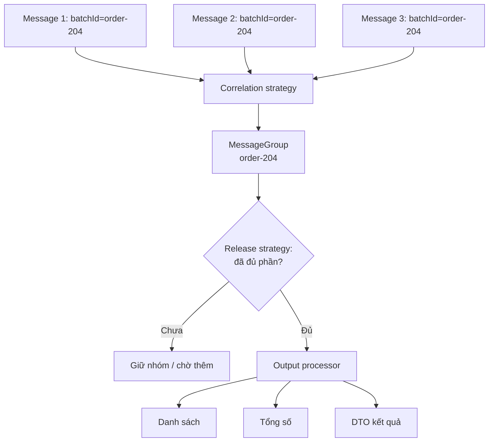
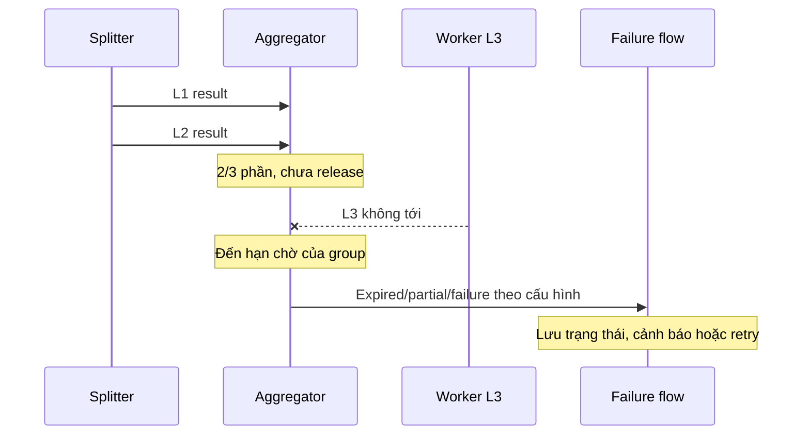
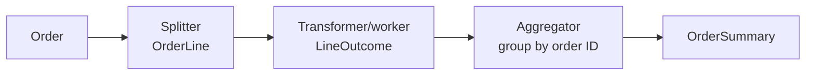
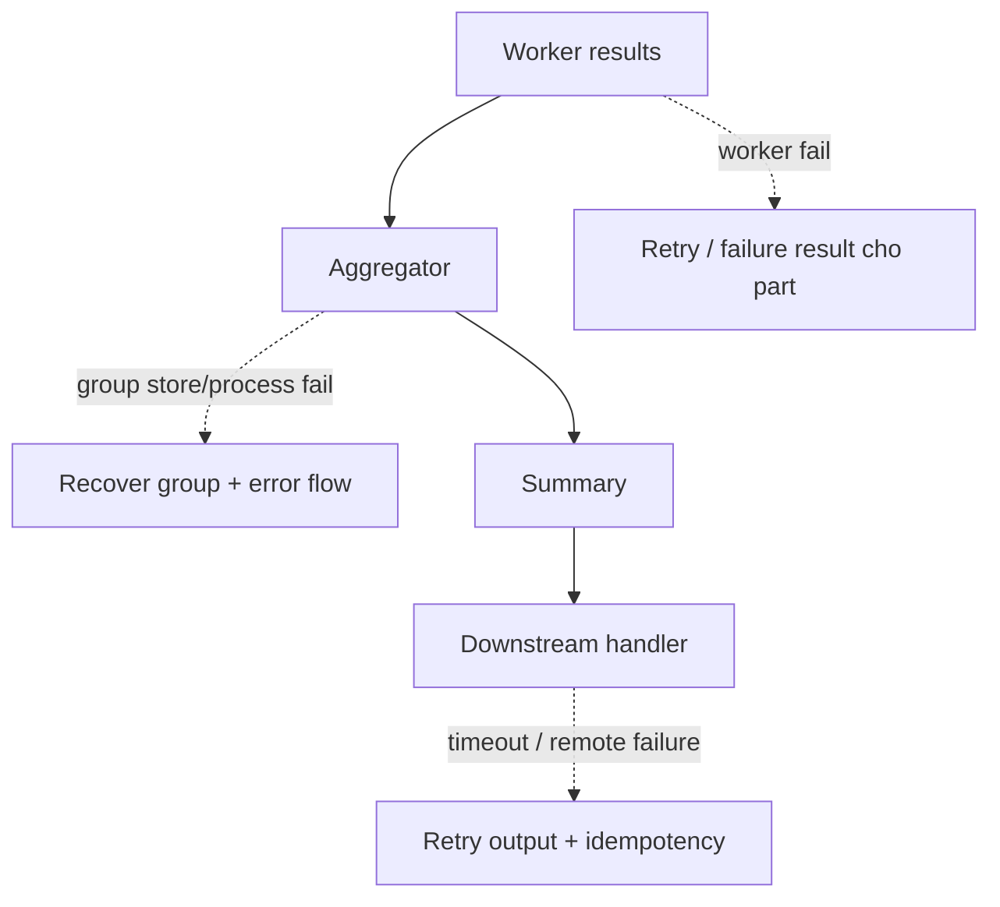
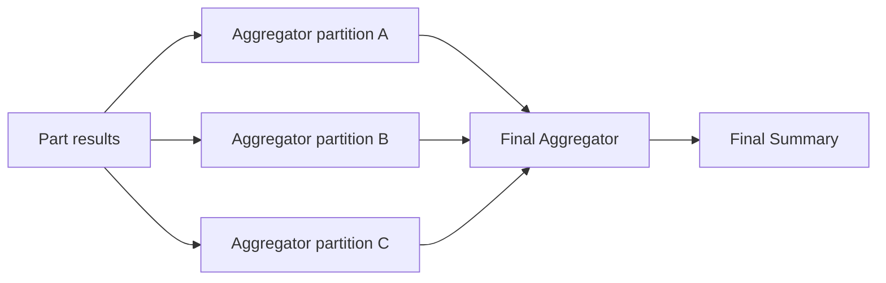

# Aggregate payload theo danh sách, tổng hoặc kết quả

## 1. Bài toán: ba message con, một kết quả tổng hợp

Một đơn hàng có ba dòng được **Splitter** tách thành ba message con. Mỗi dòng được kiểm tra tồn kho và tính giá độc lập rồi gửi về một **Aggregator**:

```text
Batch: order-204
  Line L1: 100.00  SUCCESS
  Line L2:  35.50  SUCCESS
  Line L3:  10.00  FAILED
```

Cùng ba message đầu vào, nghiệp vụ có thể yêu cầu ba dạng output khác nhau:

1. **Danh sách:** giữ lại cả ba `LineOutcome` để một bước downstream tự đối chiếu chi tiết.
2. **Tổng:** tính tổng giá trị các dòng thành công, ở ví dụ này là `135.50`.
3. **Kết quả nghiệp vụ:** tạo một `OrderSummary` gồm tổng, danh sách kết quả, các line thất bại và trạng thái chung.

Cả ba đều dùng **Aggregator**, nhưng khác ở **cách xử lý một MessageGroup thành một output payload**. Đồng thời, Aggregator chỉ được phát ra output khi nhóm thỏa **release strategy**. Nếu thiếu dòng L3 hoặc L2 được gửi hai lần, output có thể sai nếu không thiết kế cẩn thận.

Bài **“Aggregate payload theo danh sách, tổng hoặc kết quả”** thuộc chương **Aggregator** của module **SPRING_INTEGRATION_PATTERN**. Module này hướng dẫn triển khai Enterprise Integration Patterns bằng Spring Integration để xây dựng luồng thông điệp ít phụ thuộc và dễ mở rộng; thực hành Router, Filter, Transformer, Splitter, Aggregator, Gateway, retry, error channel và correlation, đồng thời kiểm thử, quan sát các nhánh xử lý.

Sau bài học, bạn có thể:

- Phân biệt rõ **correlation strategy**, **release strategy** và **output/message-group processor**.
- Dùng Java DSL để gom message thành **Collection/List payload**, **BigDecimal tổng** hoặc **DTO kết quả nghiệp vụ**.
- Thiết kế khóa nhóm, số phần tử dự kiến và thứ tự độc lập với thứ tự message đến.
- Giải thích dữ liệu thiếu, duplicate, đến muộn, timeout và nhóm đã release.
- Chọn MessageGroupStore, chính sách giữ/xóa nhóm và cách phục hồi phù hợp.
- Viết unit test và integration test kiểm tra fan-in, không chỉ happy path.
- Tránh đánh đồng “đủ ba message” với “đủ ba kết quả hợp lệ” hoặc “đúng một lần”.

## 2. Aggregator gồm ba quyết định khác nhau



Một Aggregator hoàn chỉnh trả lời ba câu hỏi, theo thứ tự:

| Thành phần | Câu hỏi | Ví dụ |
| --- | --- | --- |
| **Correlation strategy** | Message này thuộc nhóm nào? | Lấy `batchId=order-204` |
| **Release strategy** | Khi nào nhóm được phép phát kết quả? | Khi có đủ ba dòng được mong đợi |
| **Output processor / MessageGroupProcessor** | Khi release, nhóm được đổi thành payload gì? | List, BigDecimal, OrderSummary |

Ngoài ra còn có **MessageGroupStore**: nơi lưu những message đang đợi nhau. Một Aggregator có thể cần lưu state giữa nhiều lần nhận message; đây không phải một Transformer stateless.

**Lỗi tư duy phổ biến:** đưa logic tính tổng vào release strategy. Release strategy chỉ nên quyết định **đã đủ điều kiện phát kết quả chưa**; việc tính giá trị thuộc output processor.

### Một message đã gửi tới Aggregator có nghĩa gì?

- Message đi vào Aggregator có thể được lưu lại và chưa có output.
- Khi điều kiện release được thỏa, Aggregator gọi processor để tạo một kết quả.
- Kết quả được gửi tới channel phía sau.
- Việc Aggregator đã phát `OrderSummary` **không chứng minh** một HTTP API hoặc database downstream đã xử lý thành công.

Vì thế phải phân biệt: **message được nhận**, **message được lưu trong group**, **group được release**, **output được dispatch**, **business side effect downstream đã commit**.

## 3. MessageGroup và những metadata quan trọng

Trong Spring Integration, Aggregator thường nhóm các `Message<?>` theo **correlation key**. Nếu message đến từ Splitter có bật sequence headers phù hợp, chúng thường mang:

| Header | Ý nghĩa | Rủi ro nếu sai |
| --- | --- | --- |
| `correlationId` | Mã nhóm liên kết các message con | Hai đơn bị ghép nhầm |
| `sequenceNumber` | Vị trí message trong chuỗi | Khó xác định phần trùng/thiếu |
| `sequenceSize` | Tổng số phần được dự kiến | Aggregator chờ mãi hoặc release sớm |
| `requestId` | Truy vết toàn request | Không nhất thiết giống correlationId |
| `tenantId` | Phạm vi bảo mật và dữ liệu | Ghép dữ liệu khác tenant |
| `eventId` / `lineId` | ID nghiệp vụ ổn định cho dedup | Duplicate được tính như phần mới |

**Không mặc định mọi message đều có sequence headers.** Khi messages được tạo bởi nhiều service độc lập, cần định nghĩa một schema đầu vào rõ ràng, ví dụ `batchId`, `lineId`, `expectedCount`, thay vì mong Aggregator tự đoán nhóm có bao nhiêu phần.

Một correlation key tốt phải **ổn định**, không phụ thuộc vào Message ID do framework có thể sinh lại khi message được transform hoặc redeliver.

### Phạm vi correlation cần bao gồm tenant khi cần

Nếu hai tenant cùng có `orderId=204`, dùng riêng `orderId` có thể làm trộn hai đơn:

```text
Không an toàn: correlationKey = "204"
An toàn hơn: correlationKey = "tenant-A:order-204"
```

Trong production, nên dùng một typed key hoặc encoding chắc chắn và xác thực tenant tại ingress. Không tin giá trị `tenantId` do client tự khai trong header để quyết định quyền truy cập.

## 4. Đầu ra kiểu danh sách

### Khi nào chọn List?

Dùng **danh sách payload** khi:

- Downstream cần **tất cả thông tin chi tiết** của từng message.
- Quy tắc tính tổng còn nằm ở một stage riêng, hoặc cần nhiều phép tính khác nhau.
- Muốn lưu kết quả từng công việc để audit/reconciliation.
- Cần hiển thị trạng thái từng line, kể cả line thất bại.
- Một tác vụ nghiệp vụ sẽ xử lý toàn bộ danh sách sau khi đủ phần.

Ví dụ:

```json
[
  {"lineId": "L1", "amount": 100.00, "success": true},
  {"lineId": "L2", "amount": 35.50, "success": true},
  {"lineId": "L3", "amount": 10.00, "success": false}
]
```

Ở mức Java DSL, output processor mặc định của một Aggregator thông dụng có thể tạo **collection payload** từ các message thuộc group, khi không cài custom processor.

```java
@Bean
IntegrationFlow aggregateAsList() {
    return IntegrationFlow.from("aggregate.list.in")
        .aggregate(spec -> spec
            .correlationStrategy(
                message -> batchKey(message))
            .releaseStrategy(group -> group.size() == 3))
        .channel("aggregate.list.out")
        .get();
}
```

Đoạn này là **một phần của cấu hình đầy đủ ở mục 8**, dùng helper `batchKey(...)` và channel được khai báo ở đó.

**Quan trọng:** không được giả định thứ tự phần tử đầu ra luôn đúng thứ tự L1, L2, L3. Các message có thể đến khác thứ tự; nếu output phụ thuộc thứ tự, hãy **sắp xếp theo sequenceNumber/lineId** trong một custom output processor và kiểm thử ordering.

### Danh sách payload khác danh sách Message

Trong Aggregator, bạn có thể muốn:

- `List<LineOutcome>`: chỉ cần dữ liệu nghiệp vụ.
- `List<Message<LineOutcome>>`: cần cả header của mỗi phần, ví dụ correlation/trace.
- `OrderSummary`: cần kết quả có kiểu với các trường rõ nghĩa.

Các dạng này không tương đương. Output mặc định thường tập hợp **payload**, không có nghĩa nó giữ nguyên toàn bộ header riêng của từng message dưới dạng một danh sách message. Khi cần metadata trên từng phần, hãy viết processor tạo DTO chứa cả dữ kiện cần thiết hoặc giữ message theo hợp đồng.

**Không lấy `requestId` của một message bất kỳ làm đại diện cho toàn nhóm nếu các phần có thể đến từ nhiều request/attempt khác nhau.** Hãy xác định metadata ở cấp group rõ ràng.

## 5. Đầu ra kiểu tổng

### Khi nào chỉ cần tổng?

Dùng **aggregate theo tổng** khi downstream chỉ quan tâm một giá trị đã quy đổi:

- Tổng tiền của các dòng hợp lệ.
- Tổng số lượng hàng.
- Tổng điểm thưởng của các giao dịch trong một nhóm.
- Tổng thời gian hoặc số metric trong một cửa sổ.

Ví dụ ba dòng, trong đó L3 thất bại và không được tính:

\[
\text{successfulTotal} = 100.00 + 35.50 = 135.50
\]

Một custom output processor có thể giảm (*reduce*) danh sách payload:

```java
@Bean
IntegrationFlow aggregateAsSum() {
    return IntegrationFlow.from("aggregate.sum.in")
        .aggregate(spec -> spec
            .correlationStrategy(
                message -> batchKey(message))
            .releaseStrategy(group -> group.size() == 3)
            .outputProcessor(group -> group.getMessages()
                .stream()
                .map(message -> (LineOutcome) message.getPayload())
                .filter(LineOutcome::success)
                .map(LineOutcome::amount)
                .reduce(BigDecimal.ZERO, BigDecimal::add)))
        .channel("aggregate.sum.out")
        .get();
}
```

**Chú ý:** ví dụ này cộng **chỉ các dòng thành công**, không phải tất cả input. Đổi điều kiện filter sẽ đổi ý nghĩa nghiệp vụ của tổng; phải đặt tên kết quả rõ như `successfulTotal`, không đặt tên chung `total` nếu điều đó gây hiểu nhầm.

### BigDecimal thay vì double

Với tiền tệ, dùng:

```java
BigDecimal total = amounts.stream()
    .reduce(BigDecimal.ZERO, BigDecimal::add);
```

Tránh:

```java
double total = values.stream()
    .mapToDouble(BigDecimal::doubleValue)
    .sum();
```

Việc đổi qua `double` có thể gây sai số nhị phân. Kết quả `BigDecimal` cũng cần quy định **đơn vị, currency và precision**. Chẳng hạn nếu một group có cả USD và VND, **không được cộng trực tiếp** chỉ vì cả hai đều dùng `BigDecimal`.

### Nếu cần nhiều phép tính?

Một `BigDecimal` output chỉ giữ tổng và làm mất thông tin số phần thành công, danh sách phần lỗi hoặc phiên bản tính toán. Nếu downstream cần cả những thông tin đó, nên trả **DTO kết quả nghiệp vụ** thay vì gọi Aggregator hai lần hoặc cố mã hóa thêm dữ liệu trong một header tùy ý.

## 6. Đầu ra kiểu kết quả nghiệp vụ

### Vì sao dùng DTO thay cho List/BigDecimal?

Một `OrderSummary` có thể trả lời nhiều câu hỏi trong một output:

```text
OrderSummary(
  batchId         = "order-204",
  successfulTotal = 135.50,
  receivedCount   = 3,
  successCount    = 2,
  failedLineIds   = ["L3"],
  lines           = [L1, L2, L3],
  status          = PARTIAL_FAILURE
)
```

Các trường:

- `batchId`: correlation/business group ID.
- `successfulTotal`: tổng được định nghĩa rõ.
- `receivedCount`: bao nhiêu phần đã được Aggregator nhìn thấy khi release.
- `successCount`: số phần có trạng thái thành công.
- `failedLineIds`: các phần đã trả lỗi nghiệp vụ.
- `lines`: chi tiết đã được sắp xếp ổn định.
- `status`: trạng thái cấp nhóm, ví dụ `SUCCESS` hoặc `PARTIAL_FAILURE`.

Đây là **domain summary**, không đồng nghĩa nhóm đã được lưu database hay một thanh toán đã hoàn tất. Định nghĩa `SUCCESS/PARTIAL_FAILURE` cần xuất phát từ contract của từng line; không suy từ `group.size()`.

### Bảng chọn output

| Nhu cầu | Output gợi ý | Ưu điểm | Giới hạn |
| --- | --- | --- | --- |
| Kiểm tra từng phần | `List<LineOutcome>` | Giữ chi tiết, linh hoạt | Downstream phải tự tính và xác minh |
| Tính một chỉ số duy nhất | `BigDecimal` / `long` | Đơn giản, nhẹ | Mất chi tiết, provenance, trạng thái phần |
| Đưa ra quyết định nghiệp vụ | `OrderSummary` | Contract rõ, mang nhiều metric và status | Phải thiết kế schema/version |
| Gom kết quả từ nhiều service | `CompositeResult` | Có thể lưu success/failure theo nguồn | Cần expected set/timeout/dedup |
| Audit hoặc điều tra | DTO chứa group ID + phần + metadata cần thiết | Có thể truy vết và tái hiện | Cần kiểm soát dữ liệu nhạy cảm |

Câu hỏi đầu tiên không phải “mình gọi `aggregate()` thế nào?”, mà là **“đâu là kết quả mà downstream thực sự có quyền tin dùng?”**

## 7. Ví dụ xuyên suốt: mô hình dữ liệu và nguyên tắc

Chúng ta viết ba flow minh họa dùng **cùng một kiểu input**, nhưng nhận vào **ba channel khác nhau** để so sánh ba dạng output. Không đưa cùng một message vào ba flow trong sản phẩm thật nếu mục đích chỉ là chọn một định dạng đầu ra.

Mô hình:

```java
import java.math.BigDecimal;
import java.util.List;

record LineOutcome(
        String batchId,
        String lineId,
        BigDecimal amount,
        boolean success) {}

enum BatchStatus {
    SUCCESS,
    PARTIAL_FAILURE
}

record OrderSummary(
        String batchId,
        BigDecimal successfulTotal,
        int receivedCount,
        int successCount,
        List<String> failedLineIds,
        List<LineOutcome> lines,
        BatchStatus status) {}
```

Định nghĩa nghiệp vụ:

- Mỗi nhóm ví dụ có **đúng ba line riêng biệt**: L1, L2, L3.
- Mỗi line mang cùng `batchId` và một `lineId` riêng.
- `amount` phải khác null và không âm.
- `successfulTotal` chỉ cộng amount của line `success=true`.
- Nếu có bất kỳ line thất bại, `BatchStatus=PARTIAL_FAILURE`.
- Output có `lines` **sắp xếp theo `lineId`** để test và consumer không lệ thuộc thứ tự đến.
- Mọi `LineOutcome` của nhóm phải thuộc cùng batch.
- Các mã `batchId` phải được định nghĩa theo phạm vi tenant trong production, không chỉ phụ thuộc tên order được client gửi.

**Quan trọng:** điều kiện `group.size() == 3` trong demo chỉ chứng minh **đã nhận ba message vào group**, không chứng minh ba `lineId` là duy nhất. Với duplicate hoặc số lượng thay đổi, cần release strategy mạnh hơn — trình bày ở mục 11–13.

## 8. Java DSL đầy đủ: ba kiểu aggregate

Cấu hình sau đăng ký ba input `DirectChannel` và ba output `QueueChannel`. Mỗi flow sử dụng correlation strategy và release strategy tương tự để người học quan sát sự khác nhau ở **output processor**.

```java
import java.math.BigDecimal;
import java.util.Comparator;
import java.util.HashSet;
import java.util.List;
import java.util.Set;

import org.springframework.context.annotation.Bean;
import org.springframework.context.annotation.Configuration;
import org.springframework.integration.channel.DirectChannel;
import org.springframework.integration.channel.QueueChannel;
import org.springframework.integration.config.EnableIntegration;
import org.springframework.integration.dsl.IntegrationFlow;
import org.springframework.integration.store.MessageGroup;
import org.springframework.messaging.Message;

@Configuration
@EnableIntegration
public class AggregationByShapeConfig {

    @Bean("aggregate.list.in")
    DirectChannel listInput() {
        return new DirectChannel();
    }

    @Bean("aggregate.sum.in")
    DirectChannel sumInput() {
        return new DirectChannel();
    }

    @Bean("aggregate.result.in")
    DirectChannel resultInput() {
        return new DirectChannel();
    }

    @Bean("aggregate.list.out")
    QueueChannel listOutput() {
        return new QueueChannel();
    }

    @Bean("aggregate.sum.out")
    QueueChannel sumOutput() {
        return new QueueChannel();
    }

    @Bean("aggregate.result.out")
    QueueChannel resultOutput() {
        return new QueueChannel();
    }

    // Correlation theo payload trong demo; không tin batchId từ
    // client nếu chưa có bước xác thực / chuẩn hóa.
    static String batchKey(Message<?> message) {
        if (!(message.getPayload() instanceof LineOutcome line)
                || line.batchId() == null
                || line.batchId().isBlank()) {
            throw new IllegalArgumentException(
                "LineOutcome with batchId is required");
        }
        return line.batchId();
    }

    @Bean
    IntegrationFlow aggregateAsList() {
        return IntegrationFlow.from("aggregate.list.in")
            .aggregate(spec -> spec
                .correlationStrategy(
                    AggregationByShapeConfig::batchKey)
                .releaseStrategy(group -> group.size() == 3))
            .channel("aggregate.list.out")
            .get();
    }

    @Bean
    IntegrationFlow aggregateAsSum() {
        return IntegrationFlow.from("aggregate.sum.in")
            .aggregate(spec -> spec
                .correlationStrategy(
                    AggregationByShapeConfig::batchKey)
                .releaseStrategy(group -> group.size() == 3)
                .outputProcessor(group -> group.getMessages()
                    .stream()
                    .map(m -> (LineOutcome) m.getPayload())
                    .filter(LineOutcome::success)
                    .map(LineOutcome::amount)
                    .reduce(BigDecimal.ZERO, BigDecimal::add)))
            .channel("aggregate.sum.out")
            .get();
    }

    @Bean
    IntegrationFlow aggregateAsResult() {
        return IntegrationFlow.from("aggregate.result.in")
            .aggregate(spec -> spec
                .correlationStrategy(
                    AggregationByShapeConfig::batchKey)
                .releaseStrategy(group -> group.size() == 3)
                .outputProcessor(
                    AggregationByShapeConfig::toSummary))
            .channel("aggregate.result.out")
            .get();
    }

    static OrderSummary toSummary(MessageGroup group) {
        List<LineOutcome> lines = group.getMessages()
            .stream()
            .map(m -> (LineOutcome) m.getPayload())
            .sorted(Comparator.comparing(LineOutcome::lineId))
            .toList();

        if (lines.size() != 3) {
            throw new IllegalStateException(
                "Demo expects exactly three lines");
        }

        String batchId = String.valueOf(group.getGroupId());
        Set<String> distinctLineIds = new HashSet<>();

        for (LineOutcome line : lines) {
            if (line.lineId() == null || line.lineId().isBlank()
                    || !batchId.equals(line.batchId())
                    || line.amount() == null
                    || line.amount().signum() < 0
                    || !distinctLineIds.add(line.lineId())) {
                throw new IllegalArgumentException(
                    "Invalid/duplicate line in group");
            }
        }

        BigDecimal successfulTotal = lines.stream()
            .filter(LineOutcome::success)
            .map(LineOutcome::amount)
            .reduce(BigDecimal.ZERO, BigDecimal::add);

        List<String> failed = lines.stream()
            .filter(line -> !line.success())
            .map(LineOutcome::lineId)
            .toList();

        int successCount = lines.size() - failed.size();

        return new OrderSummary(
            batchId,
            successfulTotal,
            lines.size(),
            successCount,
            failed,
            lines,
            failed.isEmpty()
                ? BatchStatus.SUCCESS
                : BatchStatus.PARTIAL_FAILURE);
    }
}
```

### Cách đọc ba flow

**List flow:** không khai báo custom `outputProcessor`, nên Aggregator mặc định thu thập các payload theo cấu hình này. Output kiểu collection thích hợp để kiểm tra chi tiết.

**Sum flow:** cung cấp custom `outputProcessor` dùng `BigDecimal::add` và chỉ cộng các dòng success. Output là một giá trị số.

**Result flow:** custom processor trả một `OrderSummary`, sắp xếp theo `lineId`, kiểm tra trùng và mã nhóm, rồi tính tổng/trạng thái. Output có thể dùng ngay trong lớp nghiệp vụ phía sau.

Cả ba flow đều đang dùng **group size cố định 3**. Đây là một lựa chọn đơn giản để học semantics, **không** phải khuyến nghị production cho mọi hệ thống. Lưu ý tên class/helper và các API cần được đối chiếu với phiên bản Spring Integration trong dự án.

### Vì sao có ba channel input khác nhau?

Nếu ba flow cùng subscribe vào một `DirectChannel`, chúng **không mặc nhiên** đều nhận cùng message. `DirectChannel` là kênh point-to-point theo dispatcher, không phải broadcast. Trong bài này, ba channel độc lập giúp kiểm thử ba kiểu aggregate mà không tạo các subscriber cạnh tranh hoặc vô tình phát song song nhiều output khi chỉ cần một.

Nếu mục đích thật sự là gửi cùng sự kiện đến nhiều consumer, nên cân nhắc `PublishSubscribeChannel` hoặc Recipient List và đánh giá rủi ro fan-out riêng.

## 9. Kiểm thử Aggregator theo từng kiểu output

Dùng JUnit 5, Spring Test và AssertJ. Mỗi test tạo một batch ID khác nhau để tránh nhóm còn lưu từ test khác trong cùng ApplicationContext.

### 9.1. Fixture chung

```java
import static org.assertj.core.api.Assertions.assertThat;

import java.math.BigDecimal;

import org.springframework.beans.factory.annotation.Autowired;
import org.springframework.beans.factory.annotation.Qualifier;
import org.springframework.integration.channel.QueueChannel;
import org.springframework.messaging.Message;
import org.springframework.messaging.MessageChannel;
import org.springframework.messaging.support.MessageBuilder;
import org.springframework.test.context.junit.jupiter.SpringJUnitConfig;
import org.junit.jupiter.api.Test;

@SpringJUnitConfig(AggregationByShapeConfig.class)
class AggregationByShapeTest {

    @Autowired @Qualifier("aggregate.list.in")
    MessageChannel listIn;

    @Autowired @Qualifier("aggregate.sum.in")
    MessageChannel sumIn;

    @Autowired @Qualifier("aggregate.result.in")
    MessageChannel resultIn;

    @Autowired @Qualifier("aggregate.list.out")
    QueueChannel listOut;

    @Autowired @Qualifier("aggregate.sum.out")
    QueueChannel sumOut;

    @Autowired @Qualifier("aggregate.result.out")
    QueueChannel resultOut;

    private void send(
            MessageChannel input,
            String batch,
            String line,
            String amount,
            boolean success) {
        LineOutcome outcome = new LineOutcome(
            batch, line, new BigDecimal(amount), success);

        assertThat(input.send(
            MessageBuilder.withPayload(outcome)
                .setHeader("requestId", "req-" + batch)
                .build())).isTrue();
    }

    @Test
    void listOutputWaitsThenContainsThreePayloads() {
        send(listIn, "batch-list", "L2", "35.50", true);
        send(listIn, "batch-list", "L1", "100.00", true);

        assertThat(listOut.receive(0)).isNull();

        send(listIn, "batch-list", "L3", "10.00", false);

        Message<?> output = listOut.receive(1_000);
        assertThat(output).isNotNull();

        assertThat((java.util.Collection<?>) output.getPayload())
            .containsExactlyInAnyOrder(
                new LineOutcome("batch-list", "L1",
                    new BigDecimal("100.00"), true),
                new LineOutcome("batch-list", "L2",
                    new BigDecimal("35.50"), true),
                new LineOutcome("batch-list", "L3",
                    new BigDecimal("10.00"), false));

        assertThat(listOut.receive(0)).isNull();
    }

    @Test
    void sumOutputAddsOnlySuccessfulAmounts() {
        send(sumIn, "batch-sum", "L1", "100.00", true);
        send(sumIn, "batch-sum", "L2", "35.50", true);

        assertThat(sumOut.receive(0)).isNull();

        send(sumIn, "batch-sum", "L3", "10.00", false);

        Message<?> output = sumOut.receive(1_000);
        assertThat(output).isNotNull();
        assertThat((BigDecimal) output.getPayload())
            .isEqualByComparingTo(new BigDecimal("135.50"));
    }

    @Test
    void domainResultReportsPartialFailureAndStableOrder() {
        send(resultIn, "batch-result", "L3", "10.00", false);
        send(resultIn, "batch-result", "L1", "100.00", true);
        send(resultIn, "batch-result", "L2", "35.50", true);

        Message<?> output = resultOut.receive(1_000);
        assertThat(output).isNotNull();

        OrderSummary summary = (OrderSummary) output.getPayload();

        assertThat(summary.batchId()).isEqualTo("batch-result");
        assertThat(summary.successfulTotal())
            .isEqualByComparingTo(new BigDecimal("135.50"));
        assertThat(summary.receivedCount()).isEqualTo(3);
        assertThat(summary.successCount()).isEqualTo(2);
        assertThat(summary.status())
            .isEqualTo(BatchStatus.PARTIAL_FAILURE);
        assertThat(summary.failedLineIds())
            .containsExactly("L3");
        assertThat(summary.lines().stream()
            .map(LineOutcome::lineId).toList())
            .containsExactly("L1", "L2", "L3");
    }
}
```

Ba phép thử kiểm tra các hợp đồng khác nhau:

- **List:** đợi đủ ba phần; không giả định thứ tự arrival là thứ tự nghiệp vụ.
- **Sum:** chỉ cộng các phần có success; dùng BigDecimal.
- **Result:** trả đủ tổng, số phần, các ID lỗi và thứ tự ổn định.

Đây là kiểm thử Spring Integration trong **cùng một application context**, không phải kiểm thử broker hoặc persistent MessageGroupStore. Nếu thay `DirectChannel` bằng executor/poller, cần đợi có giới hạn và kiểm tra kết quả bất đồng bộ; không dùng `Thread.sleep()` để giả định output đã xuất hiện.

## 10. Đừng nhầm group size với tập kết quả hợp lệ

Tình huống:

```text
batch-204:
  message 1: lineId=L1, success=true
  message 2: lineId=L1, success=true  ← duplicate delivery
  message 3: lineId=L2, success=true
  message 4: lineId=L3, success=true  ← đến sau
```

Nếu release strategy chỉ dùng `group.size() == 3`, group có thể release ngay ở message thứ ba, dù lúc đó mới có **hai line ID duy nhất**. Kết quả danh sách và tổng sẽ sai; message L3 đến sau có thể gặp trạng thái nhóm đã hoàn tất.

Nếu message trùng giữ nguyên **Message ID**, một số store có thể phát hiện và không lưu lại cùng cách như message hoàn toàn mới; nhưng **at-least-once redelivery có thể tạo Message ID khác**. Đừng dựa vào Message ID để suy ra duplicate nghiệp vụ.

### Cách giải quyết

- Gắn `lineId` hoặc `businessPartId` ổn định cho mỗi phần.
- Dùng deduplication với khóa `(batchId, lineId, processingVersion)`.
- Nếu các phần được phát bởi Splitter, hiểu và bảo toàn `sequenceNumber`/`sequenceSize`.
- Chỉ release khi thỏa **tập phần bắt buộc**, không đơn thuần khi group đạt size.
- Có chính sách riêng cho **duplicate đã hoàn tất** và **duplicate đang xử lý**.
- Test message đến sai thứ tự, message lặp trước và sau release.

Một hướng robust hơn với ba line ID biết trước:

```java
// Ý tưởng cho ReleaseStrategy, giả sử đầu vào đã được
// validation và group có đúng expected set:
// không dùng riêng group.size() làm điều kiện hoàn tất.
boolean complete(MessageGroup group) {
    Set<String> actualIds = group.getMessages().stream()
        .map(m -> (LineOutcome) m.getPayload())
        .map(LineOutcome::lineId)
        .collect(java.util.stream.Collectors.toSet());

    return actualIds.containsAll(
        Set.of("L1", "L2", "L3"));
}
```

**Hạn chế của snippet:** nếu một nhóm có những line ID ngoài tập mong đợi, điều kiện `containsAll` vẫn đúng. Production cần thêm validation **không có phần ngoài expected set**, kiểm tra tenant, định danh nhóm và chính sách version; đồng thời bảo đảm duplicate không gây nổ bộ nhớ.

Một expected set động phải được lấy từ **một nguồn có thẩm quyền** (snapshot của Splitter, plan đã lưu hoặc metadata đáng tin) và không bị thay đổi âm thầm giữa lúc nhóm đang chờ.

## 11. SequenceSizeReleaseStrategy và custom ReleaseStrategy

Spring Integration hỗ trợ **ReleaseStrategy** cho Aggregator. Trong các flow sử dụng Splitter, message con thường có `correlationId`, `sequenceNumber` và `sequenceSize` để Aggregator xác định khi nào nhóm đủ các phần dự kiến.

Một cấu hình ngắn có thể dựa trên header sequence phù hợp, thay vì hard-code 3:

```java
@Bean
IntegrationFlow aggregateSplitResults() {
    return IntegrationFlow.from("split.results.in")
        .aggregate()
        .channel("split.results.out")
        .get();
}
```

Cách này dựa trên **default correlation/release/output processing** của Aggregator theo phiên bản framework và dữ liệu do Splitter tạo. **Phải bảo đảm sequence headers thực sự được bảo toàn**; nếu chúng bị Transformer hoặc adapter bỏ, Aggregator có thể không ghép/không release như mong đợi.

### Khi nên dùng release strategy tự viết?

- Nhóm có số phần biến đổi theo một kế hoạch nghiệp vụ đã được lưu.
- Cần cả kết quả của các nguồn **bắt buộc**, còn các nguồn tùy chọn có deadline riêng.
- Một phần có thể báo `SKIPPED` hoặc `FAILED` nhưng vẫn được tính là “đã có phản hồi”.
- Cần kiểm tra đầy đủ các business IDs, không chỉ message count.
- Có sự kiện kết thúc công việc (*completion marker*) độc lập với số phần.
- Cần release khi tất cả phần bắt buộc hoặc khi một điều kiện nghiệp vụ đã đạt.

Nếu rule release còn phụ thuộc vào gọi HTTP/DB chậm, nên cân nhắc ghi dữ liệu đó vào group context trước thay vì để `ReleaseStrategy` làm I/O nặng ở mọi lần nhận message.

### Cẩn thận với `group.size() >= expectedCount`

Điều kiện `>=` giảm nguy cơ group không bao giờ release nếu nhận quá số lượng dự kiến, nhưng **không khắc phục duplicate**. Nếu group gồm hai bản sao L1 và một L2, nó vẫn có thể đạt expectedCount=3 khi L3 chưa tới.

## 12. “Tổng” phải có quy tắc nghiệp vụ được định nghĩa

Phép cộng là đơn giản, nhưng ý nghĩa của kết quả không đơn giản:

| Câu hỏi | Ví dụ | Phải quy định |
| --- | --- | --- |
| Cộng những dòng nào? | Một dòng FAILED | Tổng dòng success, tổng tất cả hay tổng đã xác nhận? |
| Tiền tệ có giống nhau? | USD + VND | Có cần conversion theo rate đã chốt không? |
| Số có thể âm? | Refund hoặc adjustment | Có chấp nhận và theo quy tắc nào? |
| Độ chính xác? | Thuế/phí lẻ | BigDecimal scale, rounding, effective rate |
| Có phần trùng? | L1 redelivery | Dedup trước khi reduce |
| Có phần thiếu? | L3 timeout | Trả partial total, fail, hay đợi? |
| Có phiên bản dữ liệu? | Giá L2 thay đổi | Kết quả dùng giá nào và theo version nào? |
| Có cần giải thích tổng? | Audit tài chính | Lưu line IDs, amounts và calculation version |

Ví dụ `successfulTotal=135.50` ở bài này không nhất thiết bằng **tổng phải thu của đơn**. Nó chỉ là tổng của các `LineOutcome` trả success trong nhóm đã được nhận. Khi có dòng FAILED, downstream không được mặc định dùng giá trị đó như một tổng thanh toán cuối cùng nếu nghiệp vụ yêu cầu toàn bộ dòng thành công.

### Tính associative và parallel reduction

Phép cộng số học chính xác của `BigDecimal` có thể nhóm lại nếu không trộn phép làm tròn giữa các bước. Nhưng với currency conversion có rounding theo từng line, kết quả “convert rồi cộng” có thể khác “cộng rồi convert”. Phải xác định rõ nơi làm tròn, không suy từ tên Aggregator rằng hai cách đều tương đương.

## 13. Xử lý kết quả success/failure/timeout

Đầu vào của Aggregator không nhất thiết chỉ là dữ liệu thành công. Khi ba service trả lời, chúng có thể trả:

```text
Shipping: SUCCESS(amount=15)
Tax:      SUCCESS(amount=5)
Discount: FAILED(reason=UPSTREAM_UNAVAILABLE)
```

Nếu yêu cầu là “tạo kết quả tổng hợp dù một service thất bại”, thông thường service lỗi nên phát một **result envelope có trạng thái thất bại** đến group thay vì không phát reply mà không có chính sách.

Ví dụ kiểu:

```java
enum TaskResultStatus {
    SUCCESS,
    FAILED,
    SKIPPED
}

record TaskOutcome(
    String requestId,
    String sourceId,
    TaskResultStatus status,
    BigDecimal amount,
    String errorCode) {}
```

Khi Aggregator nhận đủ ba response envelopes, nó có thể release ra một DTO như `CompositeResult` có cả kết quả thành công và thất bại.

Ngược lại, nếu một service **không trả reply**, group có thể chờ vô hạn khi chỉ dùng điều kiện size. Cần xử lý timeout/durable state, không “mặc định” rằng service thất bại sẽ tự có một message FAILED.

### Ba chính sách khả dĩ

| Chính sách | Hành vi | Khi phù hợp |
| --- | --- | --- |
| **All-or-nothing** | Nếu một phần fail, trả kết quả lỗi nhóm; không commit side effect cuối | Workflow bắt buộc mọi bước thành công |
| **Partial result** | Trả DTO có success/failure và phân biệt incomplete | Hiển thị dashboard hoặc quy trình cho phép xử lý một phần |
| **Timeout with recovery** | Khi hết hạn, giữ trạng thái nhóm, phát lỗi/partial theo hợp đồng, cho phép sửa/replay | Remote services không ổn định, không thể chờ vô hạn |

Một Aggregator không tự triển khai toàn bộ các chính sách đó. Cần cấu hình release, group timeout/expiration và output processor phù hợp, cùng các flow recovery.

## 14. Timeout và nhóm không bao giờ đủ phần

Một ví dụ:



Nếu chỉ viết `releaseStrategy(group -> group.size() == 3)` và không có quy tắc xử lý nhóm thiếu, group có thể bị giữ trong `MessageGroupStore` quá lâu, tăng bộ nhớ/disk và làm hệ thống suy giảm.

Spring Integration hỗ trợ những tùy chọn về **group timeout, expiration, partial-result release, discard channel** và cơ chế dọn nhóm tùy endpoint/phiên bản. Các tùy chọn có semantics riêng; không được giả định rằng đặt một timeout ở Gateway đồng nghĩa MessageGroupStore sẽ tự xóa nhóm.

### Nhóm đủ phần nhưng output bị lỗi thì sao?

Một `MessageGroupProcessor` có thể ném exception khi map payload sai kiểu, phát hiện duplicate hoặc thiếu dữ liệu bắt buộc. Khi đó cần hiểu exception xảy ra ở **thời điểm release**, không phải lúc nhận message đầu tiên.

Cần quyết định:

- Có giữ lại group để sửa và replay không?
- Group đã bị khóa/đánh dấu complete chưa?
- Có thể tạo output khác sau khi sửa data không?
- Nếu output đã phát ra nhưng downstream fail, có retry riêng mà không tính lại group không?

Hành vi cụ thể phụ thuộc MessageGroupStore, transaction và endpoint configuration. Không dùng `try/catch → return BigDecimal.ZERO` để che lỗi nếu số 0 bị hiểu là tổng hợp lệ.

## 15. MessageGroupStore và độ bền của aggregation

Aggregator là thành phần **stateful**. Có thể nhận L1 lúc 09:00, L2 lúc 09:01 và L3 lúc 09:03. State của nhóm phải tồn tại giữa ba lần đó.

| Store | Khả năng | Giới hạn |
| --- | --- | --- |
| In-memory MessageGroupStore | Đơn giản, tốc độ cao, dễ demo | Mất state khi process restart; không bảo đảm chia sẻ giữa instance |
| JDBC/persistent MessageGroupStore | Có thể giữ group qua restart theo cấu hình | Cần schema, transaction, cleanup và concurrency |
| Distributed store phù hợp | Cho nhiều instance phối hợp theo key | Cần kiểm tra locking, network, group consistency |
| External event/workflow state | Chủ động quản lý từng phần và completion trong DB | Phức tạp hơn, nhưng linh hoạt cho SLA/audit |

Nếu nhiều instance cùng nhận các message của một `batchId` nhưng mỗi instance dùng store in-memory riêng, mỗi nơi có thể chỉ thấy một phần và **không bao giờ release**. Cần:

1. Giữ các message cùng group trên cùng một consumer/partition, **hoặc**
2. Dùng group store/locking được thiết kế cho multi-instance, **hoặc**
3. Đưa các phần về một Aggregator service có quyền sở hữu group rõ ràng.

**Store bền vững không đồng nghĩa exactly-once.** Broker có thể redeliver sau commit, và MessageGroupStore cần idempotency/transaction phù hợp để không tạo output trùng hoặc đếm lại phần đã xử lý.

### Sau khi release, group đi đâu?

Có các chính sách giữ/xóa/đánh dấu nhóm đã hoàn tất. Nếu nhóm bị xóa hoàn toàn, một message đến muộn có thể tạo **nhóm mới cùng correlation key**; nếu giữ trạng thái hoàn tất, nó có thể bị từ chối hoặc đưa discard flow theo cấu hình.

Một thiết kế cần xác định:

- Có được phép nhận **late arrival** sau complete không?
- Có cho phép group release nhiều lần không, ví dụ sliding window/partial result?
- Nhóm hoàn tất được giữ bao lâu để nhận diện duplicate?
- Ai dọn group và ghi nhận hết hạn?
- Replay cùng request có dùng group ID cũ hay tạo một revision có kiểm soát?

Không mặc định rằng “release rồi là xong” nếu upstream có at-least-once delivery.

## 16. Late arrival và duplicate sau khi đã có output

Giả sử ba kết quả đã release, nhưng L3 được phát lại vì consumer mất ack:

```text
09:00  L1 received
09:01  L2 received
09:02  L3 received -> OrderSummary released
09:03  duplicate L3 arrives
```

Nếu group lifecycle và duplicate detection không rõ, hệ thống có thể:

- Bỏ duplicate đúng cách.
- Nhận thêm phần không mong đợi.
- Tạo nhóm mới với cùng batch ID.
- Phát một bản tổng hợp thứ hai.

Vì thế cần **idempotency ở cả hai cấp**:

1. **Cấp phần:** key như `(tenantId, batchId, lineId, resultVersion)` để một phần không được đếm hai lần.
2. **Cấp output:** key như `(tenantId, batchId, summaryRevision)` để downstream không ghi trùng `OrderSummary` khi Aggregator hoặc broker phát lại.

Nếu output gửi tới payment/inventory API, phải có idempotency theo hợp đồng của API đó. Aggregate đã release một lần trong memory **không đảm bảo** side effect downstream chỉ được thực hiện một lần.

## 17. Aggregator với Splitter, Router và Recipient List

### Splitter → Transformer → Aggregator

Đây là topology rất phổ biến:



Khi Splitter tạo message con, thường có metadata về `correlationId` và sequence. Các Transformer ở giữa phải **giữ các header cần thiết**; tự tạo một Message hoàn toàn mới mà làm mất correlation có thể khiến Aggregator tạo nhóm sai hoặc không release.

### Recipient List → nhiều service → Aggregator

Nếu một yêu cầu đi tới Shipping, Tax, Discount, aggregator cần biết **tập service được chọn**. Một Recipient List có thể chỉ chọn hai trong ba nguồn tùy điều kiện. Nếu Aggregator luôn chờ đủ ba, nhóm sẽ kẹt.

Giải pháp là lưu một expected recipient set ở lúc fan-out (ví dụ Shipping + Tax), hoặc phát kết quả `SKIPPED` có ý nghĩa nghiệp vụ cho nguồn không được chọn. Không tự suy expectedCount từ tổng số adapter đã deploy.

### Router trước Aggregator

Nếu Router chia dữ liệu ra các nhánh với contract khác nhau, cần đảm bảo mọi nhánh sẽ trả message tương thích vào Aggregator. Một nhánh Filter bỏ message mà không trả signal có thể làm nhóm mất một phần mong đợi.

Đặc biệt, **Filter** ở giữa Splitter và Aggregator có thể khiến release strategy mặc định theo sequence size không đạt điều kiện; phải thiết kế lại completion policy/partial-result hoặc phát marker.

## 18. Correlation và những lỗi ghép nhóm thường gặp

| Lỗi | Kết quả | Cách phòng tránh |
| --- | --- | --- |
| Dùng `MessageHeaders.ID` làm group key | Mỗi phần thành một nhóm mới | Dùng business correlation ID ổn định |
| Cùng ID ở nhiều tenant | Ghép lẫn dữ liệu | Key bao gồm tenant được xác thực |
| Sequence headers bị mất | Group không release như mong đợi | Test header qua Transformer/adapter |
| Cùng line gửi hai lần | Group size đạt trước khi đủ line | Dedup theo business part ID |
| ExpectedCount được client tùy ý đặt | Có thể release sớm hoặc giữ mãi | Lấy expected set từ nguồn có thẩm quyền |
| L1 của revision cũ trộn L2 revision mới | Tổng không nhất quán | Correlation gồm processing revision/version |
| Một group có nhiều loại currency | Tổng sai nghĩa | Validate currency/đổi theo rate phiên bản cố định |
| Một worker gửi kết quả đến nhầm group | Đầu ra bị sai | Validate batch/tenant/source ở Aggregator |
| Dùng amount từ trạng thái hiện tại khi replay | Tổng khác với lúc đơn được xử lý | Lưu snapshot/version của facts đã dùng |

### Có phải correlation key luôn là header?

Không. `CorrelationStrategy` có thể tính khóa từ payload, header hoặc context đáng tin cậy theo cấu hình. Trong demo mục 8, `batchKey(...)` đọc từ `LineOutcome.batchId`. Với Splitter chuẩn, nhiều flow dùng header correlation đã được framework tạo.

Điều cần giữ không phải một vị trí cụ thể của key, mà là **một contract ổn định xuyên các bước** và không bị input không tin cậy sửa đổi.

## 19. Quan sát Aggregator theo từng nhóm

Một Aggregator có thể không phát output trong nhiều giây hoặc phút; không có lỗi rõ nhưng đang tích lũy hàng chờ. Vì vậy observability phải bao gồm **trạng thái các nhóm đang chờ**.

Gợi ý metrics:

| Metric ứng dụng | Ý nghĩa |
| --- | --- |
| `aggregator.messages.received.total` | Tổng message vào |
| `aggregator.groups.open` | Số nhóm chưa release |
| `aggregator.group.size.distribution` | Số phần trong mỗi nhóm |
| `aggregator.groups.released.total` | Số nhóm phát output |
| `aggregator.groups.expired.total` | Số nhóm hết hạn |
| `aggregator.output.failed.total` | Lỗi xử lý/dispatch output |
| `aggregator.duplicates.total` | Số phần lặp được phát hiện |
| `aggregator.group.wait.duration` | Thời gian từ phần đầu đến release |
| `aggregator.late.arrivals.total` | Message đến sau khi group hoàn tất |
| `aggregator.partial.results.total` | Số output không đủ toàn bộ phần thành công |

Đây là **tên metric do ứng dụng có thể thiết kế**, không khẳng định Spring Integration phát sẵn toàn bộ những tên đó. Không đặt `orderId`/`batchId` tự do làm metric label, vì cardinality có thể tăng vô hạn.

Log có cấu trúc gợi ý:

```text
event=aggregation_group_released
batchId=order-204
tenantScope=tenant-A
expectedParts=3
receivedParts=3
uniqueBusinessParts=3
aggregationShape=ORDER_SUMMARY
successfulTotal=135.50
failedPartCount=1
releaseReason=ALL_EXPECTED_RESULTS
processingRevision=1
```

Khi log số tiền hoặc dữ kiện nhạy cảm, phải áp dụng chính sách riêng tư/audit của ứng dụng. Một số môi trường chỉ cho phép log số lượng hoặc hash/anonymized summary.

### Đừng nhầm “aggregator released” với “downstream committed”

Khi `OrderSummary` đã được gửi vào `QueueChannel`, output có thể chưa được consumer xử lý. Nếu downstream ghi database rồi mất ack, output có thể phát lại. Vì vậy monitoring cần có trạng thái/ack của **consumer sau Aggregator** nếu nghiệp vụ yêu cầu xác nhận end-to-end.

## 20. Lỗi và retry: nên retry phần nào?

Phân biệt ba lớp lỗi:

1. **Lỗi ở worker tạo kết quả phần:** L3 tính toán thất bại hoặc gọi service timeout. Retry **worker L3** với idempotency phù hợp; có thể gửi `LineOutcome(success=false)` nếu chính sách chấp nhận kết quả lỗi.
2. **Lỗi bên trong Aggregator:** correlation sai, payload invalid, MessageGroupStore lỗi, output processor ném exception. Retry/recover cần giữ group và hiểu rõ transaction/lifecycle của store.
3. **Lỗi ở downstream sau Aggregator:** gửi `OrderSummary` đến payment/DB thất bại. Retry **output delivery**, tránh tính lại group nếu không cần thiết.



**Không nên** áp dụng một retry blanket quanh toàn pipeline Splitter → workers → Aggregator → outbound nếu các worker hoặc outbound adapter có side effect. Điều đó có thể nhân đôi partial results hoặc nghiệp vụ đã commit.

### Error channel

Với channel đồng bộ, exception khi Aggregator xử lý có thể lan về caller. Với polling consumer/executor/broker, lỗi có thể nằm ở worker thread và được đưa vào error flow theo cấu hình.

Đừng giả định mọi exception tự động đi qua một global `errorChannel` hoặc rằng message lỗi luôn còn trong store. Cần test behavior thực khi MessageGroupProcessor throw, group đã release và transaction bị rollback.

## 21. Tính toán tổng theo stream, window hoặc incremental state

Phép aggregate theo danh sách và tổng có một khác biệt đáng kể về bộ nhớ.

**Collect-all then calculate:** giữ đủ các payload rồi tạo output. Dễ debug và kiểm toán từng phần, nhưng cần bộ nhớ theo số lượng phần trong nhóm.

**Incremental aggregation:** cập nhật tổng/counter mỗi khi phần đến. Tiết kiệm bộ nhớ nếu giữ state nhỏ, nhưng cần idempotency và một state model chống trùng để không cộng hai lần cùng phần. Một bộ đếm tổng đơn giản không thể sửa đúng khi một phần đến muộn hoặc bị phát lại nếu không biết phần đó đã được tính chưa.

Ví dụ minh họa:

```text
State(group):
  seenPartKeys = {L1, L2}
  total = 135.50
  successCount = 2
  expectedPartKeys = {L1, L2, L3}
```

Khi nhận L2 lần nữa, kiểm tra `seenPartKeys` phải diễn ra **nguyên tử** với cập nhật tổng. Nếu không, hai worker song song có thể cùng tăng `total`. Nếu số phần ít, lưu full message group với MessageGroupStore và dùng custom output processor thường dễ kiểm tra hơn.

**Chú ý:** thuật toán incremental trên không phải mặc định của Spring Integration Aggregator trong DSL demo. Nó là một phương án thiết kế riêng khi throughput, payload size hoặc memory usage có yêu cầu đặc biệt.

## 22. Hiệu năng, backpressure và giới hạn nhóm

Một Aggregator thường có nguy cơ giữ state tăng dần khi mất các kết quả cuối. Cần thiết kế ít nhất:

- **Số nhóm đang mở tối đa** hoặc quota theo tenant.
- **Số message tối đa trong một nhóm** và validation chống event spam.
- **Timeout group** và chính sách expired/partial result.
- **Retention/cleanup** cho nhóm hoàn tất.
- **Backpressure** với input channel, broker hoặc worker.
- **Concurrency**: hai message cùng group có thể đến đồng thời.
- **Message store throughput** và lock contention.
- **Giới hạn payload** nếu đang collect full List.
- **Retry storm protection** khi nhiều worker cùng timeout.
- **Thời gian sống của group** vượt qua deployment/restart nếu SLA yêu cầu.

Nếu mỗi request có 100.000 phần và mỗi phần mang payload 100 KB, collect-all trong memory có thể không hợp lý. Có thể chuyển sang snapshot trong external store, batch/stream processing hoặc thiết kế aggregate từng cấp. Nhưng cần đánh giá lại semantics release, late arrival và idempotency.

### Aggregator phân tầng

Một bài toán có 1 triệu phần có thể gom theo khu vực/partition rồi gom kết quả cấp cao hơn:



Khi aggregate phân tầng, correlation key cấp dưới và cấp trên khác nhau; cần rõ **partition revision, expected partitions, retry/idempotency** và xử lý trường hợp một partition phát lại summary.

## 23. Kiểm thử các tình huống khó

Để một Aggregator đáng tin cậy, happy path ba message đúng thứ tự là chưa đủ. Dưới đây là ma trận kiểm thử cần có:

| Trường hợp | Kỳ vọng |
| --- | --- |
| L1, L2, L3 đến theo thứ tự | Output đúng |
| L3 đến trước L1 | Vẫn output đúng, List/DTO có thứ tự theo contract |
| Chỉ nhận L1, L2 | Chưa release nếu bắt buộc 3 phần |
| L1 lặp hai lần, thiếu L3 | **Không** coi duplicate là phần mới hợp lệ |
| Cùng `lineId` nhưng batch khác | Thuộc hai group khác nhau |
| Cùng batch ID ở tenant khác | Không được trộn |
| Một phần có amount null hoặc currency sai | Báo lỗi được phân loại, không cho ra tổng giả |
| Một phần FAILED | Summary thể hiện partial failure; tổng tính đúng policy |
| Group đủ phần, output processor throw | Có error/recovery path phù hợp |
| L3 đến sau timeout | Theo late-arrival policy, không âm thầm tạo output mới |
| Output đã phát rồi consumer redeliver | Idempotency ở output consumer |
| Restart trước khi group đủ phần | Nếu yêu cầu durable, state phải được khôi phục |
| Hai worker gửi cùng lúc | Group store/locking/dedup nhất quán |
| Filter bỏ một phần | Release/timeout không treo vô thời hạn |
| SequenceSize không đúng | Validation/recovery thay vì giữ sai group |
| Một source gửi `SKIPPED` | Expected set/release tính đúng semantics skip |

### Kiểm thử nghiệp vụ của processor không cần Spring

Hàm `toSummary(MessageGroup group)` được tách khỏi DSL để có thể unit test bằng một fake/test group hoặc một implementation MessageGroup phù hợp. Ngoài happy path, nên kiểm tra:

- `lineId` trùng → exception.
- `batchId` không khớp group ID → exception.
- `amount=null` hoặc âm → exception.
- L1/L2/L3 đến hoán vị bất kỳ → cùng kết quả tổng và thứ tự output.
- Có dòng FAILED → `PARTIAL_FAILURE` và danh sách lỗi đúng.
- Dữ liệu không khớp version/currency → bị reject theo contract được bổ sung.

**Đừng đặt tất cả kiểm tra hợp lệ chỉ trong output processor.** Nếu group đã bị release sớm do duplicate, processor phát hiện lỗi là cần thiết nhưng không tự giải quyết việc phần còn thiếu đến muộn. Cần phối hợp validation/dedup/release từ trước.

## 24. Troubleshooting: triệu chứng và nguyên nhân

| Triệu chứng | Nguyên nhân khả dĩ | Hướng kiểm tra |
| --- | --- | --- |
| Không thấy output dù có nhiều message | Sai correlation key hoặc chưa đủ sequenceSize | Log group ID, expected count, size và release reason |
| Hai batch bị ghép chung | Key thiếu tenant/version hoặc bị ghi đè | Kiểm tra hợp đồng correlation |
| Output list thiếu/nhân đôi phần | Duplicate, filter drop, store/lifecycle | Dedupe theo business part ID và kiểm tra stored group |
| Tổng tiền bị sai | Cộng duplicate, trộn currency, dùng double | BigDecimal, currency validation, idempotency |
| Kết quả ra sớm | Release theo số phần đếm cả duplicate | Release theo expected unique part set |
| Group không dọn | Chưa cấu hình expiration/reaper/cleanup | Theo dõi open group, timeout, store retention |
| Message đến muộn tạo summary thứ hai | Nhóm đã bị xóa hoàn toàn | Thiết kế completed-group/tombstone, late-arrival policy |
| Chỉ lỗi sau restart | Store in-memory | Dùng persistent group state và test restart |
| Một số instance không bao giờ đủ group | State phân tán không chia sẻ | Co-locate/partition theo group hoặc shared store đúng |
| Aggregator exception nhưng không vào errorChannel | Lỗi xảy ra đồng bộ hoặc error flow thiếu cấu hình | Xem thread/poller/executor/adapter cụ thể |
| Gateway timeout khi chờ summary | Một phần thiếu hoặc release policy sai | Đặt group timeout và deadline end-to-end riêng |
| Output bị xử lý hai lần | Retry/consumer redelivery sau release | Idempotency output theo batch/revision |
| Memory tăng sau mỗi batch | Group không expire hoặc payload quá lớn | Store metrics, cleanup và thiết kế incremental |

## 25. Bài tập thực hành

### Bài 1 — Danh sách payload

Dùng flow `aggregateAsList()` ở mục 8. Gửi ba `LineOutcome` theo thứ tự L3, L1, L2, có batch ID giống nhau. Kiểm tra output là một collection gồm đúng ba payload. Viết assertion không phụ thuộc arrival order. Thử bỏ L2 và chứng minh chưa release.

### Bài 2 — Tính tổng BigDecimal

Dùng flow `aggregateAsSum()`. Hai dòng success lần lượt có giá 19.95 và 35.50; một dòng failed có giá 10.00. Expected total là 55.45. Bổ sung testcase tiền âm, currency khác nhau và duplicate để thấy phép reduce đơn thuần chưa đủ.

### Bài 3 — Output DTO

Mở rộng `OrderSummary` thêm trường `processingRevision` và `currencyCode`. Viết output processor và unit tests cho ba phần success, một phần failed, và group chứa nhiều loại tiền. Yêu cầu phải reject currency conflict, không tự âm thầm cộng USD + VND.

### Bài 4 — Đủ số lượng nhưng chưa đủ line IDs

Gửi L1, L1, L2 cho một batch có expected set L1, L2, L3. Đầu tiên quan sát hành vi demo `group.size()==3`. Sau đó viết dedup gate và release strategy theo expected set. Kết quả mong muốn: không release trước khi nhận L3.

### Bài 5 — Splitter và sequence headers

Tạo một `Order` có bốn dòng, Splitter chia thành bốn message, Transformer chuyển thành `LineOutcome`. Kiểm tra `correlationId`, `sequenceNumber` và `sequenceSize` có được giữ qua Transformer. Dùng Aggregator để ghép thành danh sách và thử cố tình bỏ một sequence header để quan sát failure.

### Bài 6 — Partial result với timeout

Ba service Shipping, Tax, Discount trả kết quả, nhưng Discount im lặng trong 10 giây. Thiết kế `groupTimeout` và một chính sách trả partial result hoặc failure tùy yêu cầu. Nêu rõ khi Discount trả lời muộn, ứng dụng phải làm gì; không được âm thầm tạo kết quả thứ hai nếu chưa có revision.

### Bài 7 — Multi-instance và persistent store

Chạy hai worker xử lý cùng group ID. So sánh MessageGroupStore in-memory ở từng instance với một thiết kế store/partition thống nhất. Mô phỏng restart sau L1 và L2; yêu cầu L3 đến sau khi restart vẫn có thể hoàn tất nhóm nếu nghiệp vụ cần durability.

### Bài 8 — Retry và exactly-once illusion

Aggregator đã phát `OrderSummary`, downstream ghi database thành công nhưng process chết trước ack. Broker phát lại output. Thiết kế idempotency theo `(tenantId, batchId, summaryRevision)` và chứng minh side effect không nhân đôi.

### Bài 9 — Aggregator phân tầng

Gom 1000 line thành 10 partition, mỗi partition phát một partial sum. Thiết kế correlation key ở hai cấp, expectedCount cấp cuối, dedup các partition result và cách xử lý một partition không trả. Giải thích vì sao cộng partial sum cũng phải dùng BigDecimal và bảo toàn currency.

### Bài 10 — Observability

Định nghĩa dashboard/alert cho số group đang mở, tuổi group lớn nhất, số group expired, số duplicate, số partial summary và lỗi MessageGroupStore. Thêm một runbook giúp phân biệt: worker không phát message, correlation sai, release strategy sai và group store không bền vững.

**Tiêu chí hoàn thành:** người học phải chỉ ra **output type cần thiết**, **group nào mỗi message thuộc về**, **khi nào được release**, **một phần được đếm thế nào khi bị gửi lại**, **xử lý missing/late arrivals ra sao**, và **cách bảo đảm kết quả có thể được dùng an toàn ở downstream**.

## 26. Checklist khi triển khai production

- [ ] Correlation key ổn định, bao gồm tenant/revision khi cần.
- [ ] Input message có business part ID để dedup.
- [ ] Expected count/set đến từ nguồn đáng tin.
- [ ] Release strategy không nhầm duplicate với phần mới.
- [ ] Output shape (List, BigDecimal, DTO) có contract rõ.
- [ ] Tổng số có định nghĩa success/failure/currency/precision.
- [ ] Output processor không phụ thuộc thứ tự message đến nếu contract không yêu cầu.
- [ ] Group không đủ phần có timeout/expiration/recovery.
- [ ] Late arrival sau release có chính sách cụ thể.
- [ ] MessageGroupStore bền vững hoặc in-memory theo đúng SLA.
- [ ] Multi-instance có thiết kế partition/group locking nhất quán.
- [ ] Có retention/cleanup cho group đã complete/expired.
- [ ] Error flow phân biệt worker error, aggregator error và downstream error.
- [ ] Retry không tạo side effect trùng; consumer output idempotent.
- [ ] Splitter/Transformer giữ correlation và sequence headers theo hợp đồng.
- [ ] Aggregator không ghép message khác tenant/phiên bản dữ liệu.
- [ ] Có metric nhóm đang mở, tuổi nhóm, expired, duplicate và output failure.
- [ ] Có test success, partial, duplicate, missing, late, concurrency và restart.
- [ ] Không log payload chứa PII/token hoặc dùng group ID làm metric label cardinality cao.
- [ ] Có kế hoạch thay đổi schema/expected-set và replay khi deploy phiên bản mới.

## 27. Tổng kết

Trong Spring Integration, Aggregator là một thành phần stateful để **gom nhiều message tương quan thành một kết quả**, nhưng cách tạo kết quả là một quyết định nghiệp vụ riêng:

- **Danh sách:** giữ các payload để downstream kiểm tra hoặc xử lý chi tiết.
- **Tổng:** giảm các payload thành một giá trị như `BigDecimal` theo quy tắc tính toán đã được phê duyệt.
- **Kết quả nghiệp vụ:** tạo DTO như `OrderSummary`, chứa tổng, danh sách phần, trạng thái success/failure và metadata cần thiết.

**Correlation strategy chọn nhóm**, **ReleaseStrategy quyết định khi nào nhóm đủ điều kiện**, và **MessageGroupProcessor quyết định output**. Thiếu một trong ba hợp đồng này, Aggregator có thể phát sai, chờ vô hạn hoặc trộn dữ liệu.

Trong production, chất lượng còn phụ thuộc duplicate detection, expected set, timeout, MessageGroupStore, group lifecycle và idempotency của downstream. **Một output đã được release không tự đồng nghĩa nghiệp vụ cuối đã được commit đúng một lần.**

## Tài liệu tham khảo

- [Spring Integration Reference — Aggregator](https://docs.spring.io/spring-integration/reference/aggregator.html)
- [Spring Integration Reference — Correlation and Release Strategies](https://docs.spring.io/spring-integration/reference/aggregator.html)
- [Spring Integration Reference — Message Group Store](https://docs.spring.io/spring-integration/reference/message-store.html)
- [Spring Integration Reference — Splitter](https://docs.spring.io/spring-integration/reference/splitter.html)
- [Spring Integration Reference — Java DSL](https://docs.spring.io/spring-integration/reference/dsl.html)
- [Spring Integration Reference — Error Handling](https://docs.spring.io/spring-integration/reference/error-handling.html)
- [Enterprise Integration Patterns — Aggregator](https://www.enterpriseintegrationpatterns.com/patterns/messaging/Aggregator.html)
- [Enterprise Integration Patterns — Correlation Identifier](https://www.enterpriseintegrationpatterns.com/patterns/messaging/CorrelationIdentifier.html)
- [Enterprise Integration Patterns — Message Sequence](https://www.enterpriseintegrationpatterns.com/patterns/messaging/MessageSequence.html)

Các ví dụ sử dụng Java 17+, Spring Integration Java DSL và JUnit 5 nhằm trình bày ba kiểu output của Aggregator. Khi sử dụng trong dự án thật, cần đối chiếu API của phiên bản framework, cấu hình MessageGroupStore, semantics group expiration/release và transaction/ack của transport đang dùng. Bài thuộc STEP 4 NEW; việc chạy biên dịch và vòng Content QA chuyên môn được thực hiện ở giai đoạn riêng.
