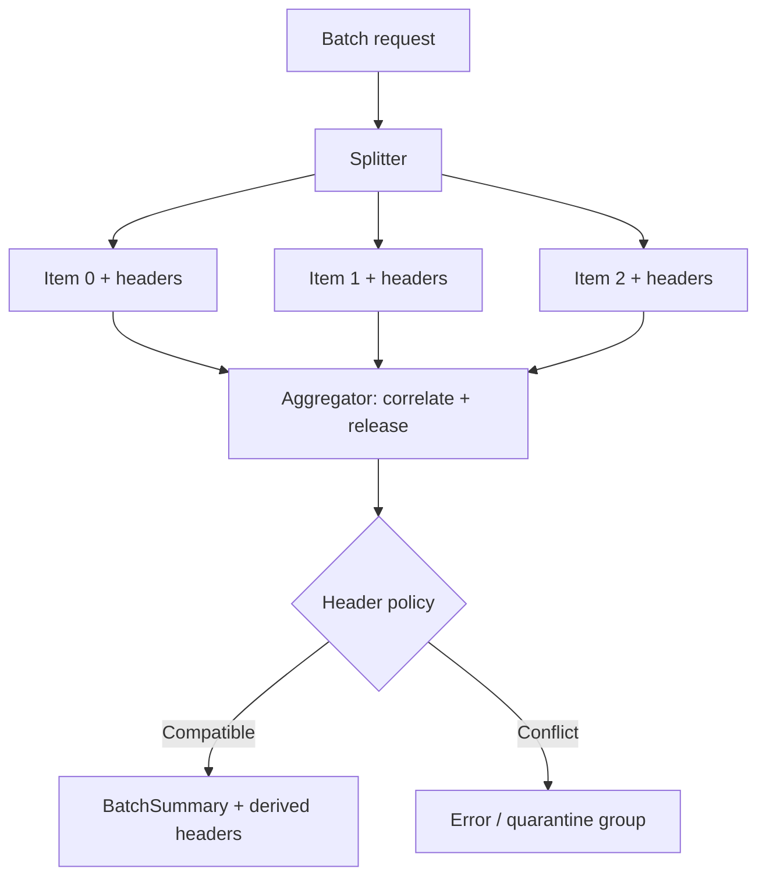
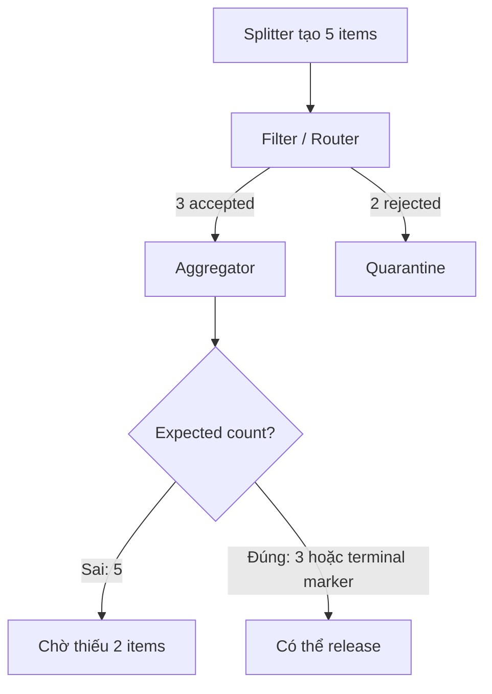

# Aggregate headers và quy tắc xung đột

## 1. Bài toán: khi payload gom được nhưng headers không thống nhất

Một đơn hàng có ba dòng được Splitter tách thành ba message. Các nhánh kiểm tra và tính thành tiền cho từng dòng, sau đó Aggregator cộng số tiền và trả về kết quả của đơn. Nếu chỉ nhìn payload, phép cộng 30.000 + 50.000 + 20.000 = 100.000 trông đơn giản. Nhưng message còn mang `tenantId`, `currency`, `eventId`, `traceId`, `policyVersion`, `sequenceNumber` và `correlationId`. Giá trị nào sẽ được giữ khi chúng khác nhau?

| Item | Thành tiền | `tenantId` | `currency` | `eventId` | `policyVersion` |
| --- | ---: | --- | --- | --- | --- |
| 0 | 30.000 | `tenant-hcm` | `VND` | `evt-0` | `price-v3` |
| 1 | 50.000 | `tenant-hcm` | `VND` | `evt-1` | `price-v3` |
| 2 | 20.000 | `tenant-hcm` | `USD` | `evt-2` | `price-v4` |

Nếu Aggregator lấy `currency` và `policyVersion` từ item đầu, output có thể trông hợp lệ nhưng **không còn diễn giải được về nghiệp vụ**: không được cộng VND và USD như cùng một loại tiền, cũng không mặc định gộp kết quả tính theo các phiên bản chính sách khác nhau. Ngược lại, việc `eventId` khác nhau là **bình thường**, bởi mỗi child là một sự kiện riêng.

Trong chương **Aggregator** của module **SPRING_INTEGRATION_PATTERN**, chúng ta triển khai Enterprise Integration Patterns bằng Spring Integration để xây dựng luồng thông điệp ít phụ thuộc và dễ mở rộng. Phần kiến thức này gắn trực tiếp với Splitter, Router, Filter, Transformer, Gateway, retry, error channel, correlation, kiểm thử và theo dõi các nhánh xử lý.

**Aggregate headers** là quyết định có chủ đích về những metadata sẽ được giữ, tính mới, hợp nhất hoặc loại khỏi message kết quả. **Quy tắc xung đột** quyết định chuyện gì xảy ra khi nhiều message trong cùng group mang giá trị không đồng nhất.



**Nguyên tắc:** Không copy toàn bộ headers của một child sang message tổng hợp rồi coi mọi metadata ấy là của cả nhóm.

## 2. Hiểu đúng các lớp metadata

Một `Message<T>` của Spring Messaging chứa payload và `MessageHeaders`. Mỗi message sau Splitter có thể mang dữ liệu về batch, thứ tự và context:

```text
Message A:
  payload: LineCompleted(batchId=B-105, sourceIndex=0, lineTotalVnd=30000)
  headers:
    aggregationKey: tenant-hcm|B-105
    tenantId: tenant-hcm
    currency: VND
    policyVersion: price-v3
    eventId: evt-0
    traceId: trace-105
    sequenceNumber: 1
    sequenceSize: 3

Message B:
  payload: LineCompleted(batchId=B-105, sourceIndex=1, lineTotalVnd=50000)
  headers:
    aggregationKey: tenant-hcm|B-105
    tenantId: tenant-hcm
    currency: VND
    policyVersion: price-v3
    eventId: evt-1
    traceId: trace-105
    sequenceNumber: 2
    sequenceSize: 3
```

`aggregationKey` là header **do ứng dụng tạo** để minh họa nhóm an toàn theo tenant. Nó **không phải** một header framework có tên chuẩn `correlationId`. Với flow thực tế, Spring Integration Splitter có thể sinh `CORRELATION_ID` và sequence headers; chiến lược grouping phải tương thích với topology và đảm bảo không trộn dữ liệu khác tenant.

### 2.1. Phân loại header theo phạm vi ý nghĩa

| Nhóm | Ví dụ | Quy tắc cho output |
| --- | --- | --- |
| Group identity | `aggregationKey`, `batchId` | Các item phải thuộc một nhóm hợp lệ |
| Group context bắt buộc | `tenantId`, `currency`, `policyVersion` | Phải tồn tại và đồng nhất; nếu không phải fail |
| Identity của child | `eventId`, `sourceIndex` | Không chọn một child đại diện cho toàn group |
| Sequence/coordination | `sequenceNumber`, `sequenceSize` | Không sao chép sang summary như một child |
| Tracing | `traceId`, `spanId` | Dùng tracing policy, không chọn tùy tiện một span |
| Reply/transport | `replyChannel`, `errorChannel`, delivery tag | Không copy nếu không có hợp đồng cụ thể |
| Framework-managed | `MessageHeaders.ID`, `TIMESTAMP` | Để framework quản lý ID/thời điểm của message mới |
| Aggregatable | `warningCodes`, `receivedAt` | Union/min/max theo quy tắc rõ ràng |
| Derived output | `aggregateEventId`, `aggregateItemCount` | Tính mới từ identity nhóm và kết quả |

Thứ tự các message tới Aggregator có thể khác thứ tự gốc vì executor, broker, poller hoặc một nhánh xử lý chậm. Do đó, nếu một quy tắc nói “chọn giá trị đầu tiên”, phải định nghĩa **đầu tiên theo tiêu chí nào**: `sourceIndex` nhỏ nhất, event timestamp hay thứ tự đến? Chọn ngẫu nhiên message nhận đầu tiên làm sai tính quyết định của aggregate.

### 2.2. Correlation, sequence và business ID khác nhau

- `correlationId` / group key trả lời: **những message nào được gom với nhau?**
- `sequenceNumber` trả lời: **đây là phần tử thứ mấy trong một chuỗi do endpoint tạo?**
- `sequenceSize` trả lời: **chuỗi đó có bao nhiêu phần tử (nếu biết)?**
- `batchId` trả lời: **batch nào trong nghiệp vụ?**
- `eventId` trả lời: **sự kiện cụ thể nào đang được xử lý hoặc phát lại?**
- `aggregateEventId` trả lời: **sự kiện kết quả của việc gom là gì?**

Không dùng `MessageHeaders.ID` làm khóa idempotency nghiệp vụ vì khi tạo envelope mới hoặc replay, ID của message có thể thay đổi. Một batch có thể có nhiều child với `eventId` khác nhau nhưng cùng `batchId`.

## 3. Những chính sách merge headers

| Chính sách | Nguyên tắc | Ví dụ phù hợp | Cạm bẫy |
| --- | --- | --- | --- |
| **Required-equal** | Tất cả item có header và cùng giá trị | Tenant, currency, policy version | Thiếu cũng phải báo lỗi |
| **Optional-equal** | Chỉ giữ khi tất cả hiện diện và bằng nhau | Thuộc tính chú giải tùy chọn | “Thiếu” khác “xung đột” |
| **Drop on conflict** | Xung đột thì bỏ khỏi output | Metadata không bắt buộc | Downstream phải chịu được header vắng |
| **Take first/last** | Chọn theo thứ tự xác định | Thời điểm hoặc cờ được định nghĩa rõ | Arrival order không đáng tin |
| **Union** | Hợp nhất các tập thành một tập không trùng | Warning code | Có thể quá lớn hoặc chứa PII |
| **Min / max** | Thời điểm sớm nhất/muộn nhất | First seen, last seen | Cần thống nhất kiểu/timezone |
| **Sum / count** | Cộng/đếm các giá trị | Aggregate count, item count | Duplicate làm đếm sai |
| **Derive new** | Tạo giá trị riêng cho summary | Aggregate event ID | Phải version hóa khi replay |
| **Reject group** | Không phát kết quả nếu conflict nghiêm trọng | Tenant/currency mismatch | Cần error/recovery policy |

### 3.1. Missing không giống conflict

```text
A: tenantId = tenant-hcm
B: tenantId = tenant-hn    -> CONFLICT

A: tenantId = tenant-hcm
B: tenantId = <absent>     -> MISSING_REQUIRED_HEADER
```

Với header bảo mật như `tenantId`, không được tự chọn default tenant. Với header tùy chọn, có thể bỏ header nếu bất kỳ item nào thiếu; nhưng phải mô tả quy tắc thay vì trông đợi framework tự suy đoán.

### 3.2. Vì sao có những xung đột không thể tự hòa giải?

- **Tenant mismatch:** có thể trộn dữ liệu giữa khách hàng, là lỗi bảo mật/contract.
- **Currency mismatch:** không được cộng hai loại tiền mà không có bước conversion có tỷ giá và version.
- **Policy version mismatch:** có thể là các kết quả tính toán theo hai bộ quy tắc khác nhau.
- **Payload schema mismatch:** một item theo phiên bản schema cũ, item khác theo phiên bản mới; phải migrate có chủ đích.
- **Trace/span mismatch:** không biến span của child thành span của toàn group chỉ bằng sao chép.

Cách an toàn là **fail closed** cho context bắt buộc và có luồng sửa dữ liệu/replay được kiểm soát. Lỗi dữ liệu không tự hết chỉ vì retry vô hạn.

## 4. Phân biệt vai trò của những strategy trong Aggregator

| Thành phần | Câu hỏi | Ví dụ |
| --- | --- | --- |
| Correlation strategy | Nhóm message theo khóa nào? | `aggregationKey` |
| MessageGroupStore | Giữ các item đã tới ở đâu? | In-memory hoặc persistent store |
| Release strategy | Khi nào nhóm sẵn sàng phát kết quả? | Đã có đủ 3 source indices |
| Output/group processor | Payload nào được tạo? | `BatchSummary(totalVnd)` |
| Header merge policy | Header nào cần kiểm tra và ghi vào output? | Require equal / derive / drop |
| Group expiration | Nhóm thiếu item quá hạn thì sao? | Quarantine / partial / retry |
| Downstream consumer | Có xử lý kết quả trùng an toàn không? | Idempotency theo aggregate event ID |

Spring Integration hỗ trợ xử lý header trong Aggregator và các cách tùy biến tùy kiểu processor/phiên bản. **Không nên dựa vào một giả định chung về header propagation mặc định** cho những giá trị nhạy cảm. Bài này dùng một **custom output processor** tạo message mới với header contract tường minh, sau đó yêu cầu integration test kiểm tra headers thực tế sau khi qua framework.

### 4.1. Metadata điều phối không nên bị tái sử dụng mù quáng

Đầu ra của Aggregator là **summary**, không phải “child số 1”. Một phản mẫu:

```java
// PHẢN MẪU: sao chép mọi header của một child.
// return MessageBuilder.withPayload(summary)
//         .copyHeaders(first.getHeaders())
//         .build();
```

Hành vi này có thể đưa `sequenceNumber=1`, `eventId=evt-0`, `spanId` của child và thậm chí `replyChannel` vào summary. Với Gateway request-reply thực tế, nếu cần trả lời caller, hãy cấu hình **đường reply có chủ đích** và kiểm thử nó; không dùng ngẫu nhiên một child header để thay thế giao thức reply.

## 5. Ví dụ Java: tạo message tổng hợp bất biến với header policy rõ ràng

Ta xây một flow nhận đúng ba kết quả dòng hàng trong cùng batch. Phần cố định “ba dòng” giúp tập trung vào merge headers. Phần sau sẽ nêu cách xử lý số lượng động, duplicate, timeout và group store.

### 5.1. Định nghĩa payload

```java
record LineCompleted(
        String batchId,
        int sourceIndex,
        long lineTotalVnd) {
    LineCompleted {
        if (batchId == null || batchId.isBlank()
                || sourceIndex < 0 || sourceIndex >= 3
                || lineTotalVnd < 0) {
            throw new IllegalArgumentException("Invalid line result");
        }
    }
}

record BatchSummary(
        String batchId,
        int completedLines,
        long totalVnd) {}
```

Header đầu vào bắt buộc: `tenantId`, `currency`, `policyVersion` và `aggregationKey`. Mỗi child có thể có `eventId`, `traceId` và sequence headers khác nhau.

### 5.2. Custom header merger và output processor

```java
import java.util.ArrayList;
import java.util.Collection;
import java.util.Comparator;
import java.util.HashSet;
import java.util.List;
import java.util.Set;
import org.springframework.messaging.Message;
import org.springframework.messaging.support.MessageBuilder;
import org.springframework.stereotype.Component;

@Component
final class BatchSummaryMerger {

    Message<BatchSummary> merge(Collection<Message<?>> messages) {
        if (messages == null || messages.size() != 3) {
            throw new IllegalArgumentException("Expected 3 messages");
        }

        List<Message<?>> ordered = new ArrayList<>(messages);
        // Kiểm tra payload trước khi cast/sort.
        for (Message<?> message : ordered) {
            if (!(message.getPayload() instanceof LineCompleted)) {
                throw new IllegalArgumentException("Invalid payload type");
            }
        }
        ordered.sort(Comparator.comparingInt(message ->
                ((LineCompleted) message.getPayload()).sourceIndex()));

        Message<?> first = ordered.get(0);
        String tenantId = required(first, "tenantId");
        String currency = required(first, "currency");
        String policyVersion = required(first, "policyVersion");
        String aggregationKey = required(first, "aggregationKey");
        String batchId = ((LineCompleted) first.getPayload()).batchId();

        Set<Integer> seenIndices = new HashSet<>();
        long totalVnd = 0;

        for (Message<?> message : ordered) {
            LineCompleted line = (LineCompleted) message.getPayload();

            if (!batchId.equals(line.batchId())
                    || !tenantId.equals(required(message, "tenantId"))
                    || !currency.equals(required(message, "currency"))
                    || !policyVersion.equals(required(message, "policyVersion"))
                    || !aggregationKey.equals(required(message, "aggregationKey"))) {
                throw new IllegalArgumentException(
                        "CONFLICTING_AGGREGATE_HEADERS");
            }
            if (!seenIndices.add(line.sourceIndex())) {
                throw new IllegalArgumentException(
                        "DUPLICATE_SOURCE_INDEX");
            }

            totalVnd = Math.addExact(totalVnd, line.lineTotalVnd());
        }

        if (!seenIndices.equals(Set.of(0, 1, 2))) {
            throw new IllegalArgumentException("MISSING_SOURCE_INDEX");
        }
        if (!"VND".equals(currency)) {
            throw new IllegalArgumentException("UNEXPECTED_CURRENCY");
        }

        var summary = new BatchSummary(batchId, 3, totalVnd);
        // Khác child eventId, dùng để idempotency ở consumer.
        String aggregateEventId =
                tenantId + ":" + batchId + ":summary:v1";

        return MessageBuilder.withPayload(summary)
                .setHeader("tenantId", tenantId)
                .setHeader("currency", currency)
                .setHeader("policyVersion", policyVersion)
                .setHeader("aggregationKey", aggregationKey)
                .setHeader("aggregateEventId", aggregateEventId)
                .setHeader("aggregateItemCount", 3)
                .build();
    }

    private static String required(Message<?> message, String name) {
        Object value = message.getHeaders().get(name);
        if (!(value instanceof String text) || text.isBlank()) {
            throw new IllegalArgumentException(
                    "MISSING_REQUIRED_HEADER: " + name);
        }
        return text;
    }
}
```

**Các điểm then chốt:**

1. Kiểm tra tất cả message cùng `tenantId`, `currency`, `policyVersion`, `aggregationKey` và `batchId`.
2. Dùng `sourceIndex` để xác minh các vị trí `0,1,2` đều có và không trùng.
3. Dùng `Math.addExact` thay vì cộng `long` âm thầm overflow.
4. Tạo `aggregateEventId` ổn định và **mới**, không chọn một `eventId` child.
5. Không tự copy `replyChannel`, `errorChannel`, `sequenceNumber`, `sequenceSize`, `spanId` hoặc `MessageHeaders.ID`.
6. Để mặc định tạo ID/timestamp mới cho output.
7. Không copy `traceId` khi chưa có chính sách tracing thống nhất; trong hệ thống thật có thể dùng parent trace context hoặc span links.

**Giới hạn:** `BatchSummaryMerger` chỉ kiểm soát một phép gộp đồng bộ. Nó không tự tạo persistence, retry, transaction chung hoặc exactly-once. Một batch bị sửa rồi replay cần kế hoạch version hóa `aggregateEventId` để không dùng ID cũ che một output mới có chủ đích.

### 5.3. Những header gộp được ngoài các trường bắt buộc

Nếu mỗi child có `warningCodes` kiểu `List<String>` hoặc `Set<String>`, có thể xây union bất biến, lọc mã hợp lệ và sắp xếp deterministic. Nếu muốn `firstReceivedAt`/`lastReceivedAt`, dùng min/max trên `Instant` đã chuẩn hóa. Không đưa raw payload, PII hoặc credential vào tập metadata tổng hợp. Trước khi thêm một header, hỏi downstream có thật sự cần nó hay không.

## 6. Cấu hình Aggregator trong Spring Integration Java DSL

```java
import org.springframework.context.annotation.Bean;
import org.springframework.context.annotation.Configuration;
import org.springframework.integration.channel.DirectChannel;
import org.springframework.integration.config.EnableIntegration;
import org.springframework.integration.dsl.IntegrationFlow;
import org.springframework.messaging.MessageChannel;

@Configuration
@EnableIntegration
class BatchAggregationFlow {

    @Bean("batch.line.completed")
    MessageChannel completedLines() {
        return new DirectChannel();
    }

    @Bean("batch.summary")
    MessageChannel summaries() {
        return new DirectChannel();
    }

    @Bean
    IntegrationFlow aggregateLines(BatchSummaryMerger merger) {
        return IntegrationFlow.from("batch.line.completed")
                .aggregate(spec -> spec
                        .correlationStrategy(message ->
                                message.getHeaders().get("aggregationKey"))
                        .releaseStrategy(group -> group.size() >= 3)
                        .outputProcessor(group ->
                                merger.merge(group.getMessages())))
                .channel("batch.summary")
                .get();
    }
}
```

Trong ví dụ, `correlationStrategy` lấy group key, `releaseStrategy` đợi ba arrivals, `outputProcessor` gọi merger tường minh. Đích downstream nhận `BatchSummary` qua `batch.summary`.

**Lưu ý về demo:** `group.size() >= 3` **không đủ an toàn khi có duplicate delivery**: ba arrivals có thể là hai item thật và một item lặp. Merger sẽ báo lỗi thay vì cho ra summary sai, nhưng production cần dedupe trước khi đếm, release theo tập identity hoặc dùng completion marker đáng tin, cùng chính sách timeout/recovery. API cụ thể của Aggregator DSL cần đối chiếu phiên bản Spring Integration đang sử dụng ở vòng Content QA sau này.

Một số cách cấu hình Aggregator còn có cơ chế tự xử lý/copy framework headers. Vì vậy hãy kiểm tra **Message cuối cùng trên output channel** trong integration test; không kết luận output chỉ chứa những trường được viết trong custom `MessageBuilder` nếu một endpoint ở tầng sau có thể thêm metadata.

### 6.1. Tạo message item cho ví dụ

```java
import org.springframework.messaging.MessageChannel;
import org.springframework.messaging.support.MessageBuilder;

void sendLineResult(
        MessageChannel input,
        int sourceIndex,
        long total,
        String childEventId) {

    input.send(MessageBuilder.withPayload(
                    new LineCompleted("B-105", sourceIndex, total))
            .setHeader("aggregationKey", "tenant-hcm|B-105")
            .setHeader("tenantId", "tenant-hcm")
            .setHeader("currency", "VND")
            .setHeader("policyVersion", "price-v3")
            .setHeader("eventId", childEventId)
            .setHeader("traceId", "trace-105")
            .build());
}

// Dùng bean "batch.line.completed":
// sendLineResult(input, 0, 30000L, "evt-0");
// sendLineResult(input, 1, 50000L, "evt-1");
// sendLineResult(input, 2, 20000L, "evt-2");
```

Sau khi nhận đủ, kết quả dự kiến:

```text
payload:
  BatchSummary(batchId="B-105", completedLines=3, totalVnd=100000)

business headers:
  tenantId: tenant-hcm
  currency: VND
  policyVersion: price-v3
  aggregationKey: tenant-hcm|B-105
  aggregateEventId: tenant-hcm:B-105:summary:v1
  aggregateItemCount: 3

Không lấy eventId/sequenceNumber/spanId từ một child.
```

`aggregationKey` dạng string nối với dấu `|` chỉ để minh họa: production cần một group ID đáng tin, mã hóa không nhập nhằng, phân quyền theo tenant, không để caller tùy ý quyết định group của message khác.

## 7. Xử lý xung đột theo từng loại header

### 7.1. Xung đột tenant: fail closed

```text
message 0: aggregationKey=group-1, tenantId=tenant-a
message 1: aggregationKey=group-1, tenantId=tenant-b
```

Không được lấy `tenantId` đầu tiên rồi gom payload của cả hai. Phải reject/quarantine và kiểm tra lỗi correlation hoặc dữ liệu ở ingress. Đây là lỗi contract có thể dẫn tới cross-tenant disclosure.

### 7.2. Xung đột currency: không tự chuyển đổi

`100 VND + 10 USD` không phải `110 VND`. Nếu nghiệp vụ hỗ trợ chuyển đổi, phải có một bước conversion với tỷ giá, timestamp, source và revision chính thức trước khi tổng hợp; kết quả phải phản ánh currency đích và conversion rule.

### 7.3. Xung đột policyVersion

Một item được tính theo `price-v3`, item khác theo `price-v4` có thể không thể so sánh hoặc cộng. Hoặc reject toàn group, hoặc migrate/compute lại **có chủ đích** theo một snapshot chung. Không dùng “first wins” cho version vì như vậy che mất nguyên nhân khác biệt.

### 7.4. Child eventId khác nhau là hợp lệ

Mỗi child có thể có một ID ổn định riêng. Summary cần event ID độc lập, và nếu cần audit thì giữ danh sách source IDs **có giới hạn**, hoặc lưu quan hệ trong storage thay vì nhét danh sách rất lớn vào message header.

### 7.5. Trace context và spans

Các nhánh xử lý đồng thời có thể cùng root trace nhưng khác span, hoặc đại diện cho các trace có liên kết. Nếu muốn tracing chính xác tại fan-in, tạo span cho bước aggregate và link tới các span đầu vào khi SDK hỗ trợ; không sao chép `spanId` của một child và gọi đó là span của group. Dùng `batchId` và aggregate key để liên hệ nghiệp vụ trong log.

### 7.6. Reply headers và Gateway

`replyChannel` hoặc `errorChannel` có thể mang ý nghĩa của một lần gọi Gateway/request-reply. Nếu cần trả kết quả về caller, phải thiết kế channel phản hồi rõ ràng. Không giả định headers của một message con sẽ trả lời đúng Gateway khi các child có reply channel khác nhau. Đặc biệt không serialize các object channel phụ thuộc một JVM qua broker tùy tiện.
## 8. Release strategy, group đầy đủ và message đến trùng

Một Aggregator thực sự phải phân biệt **số lần nhận message** và **số phần tử nghiệp vụ độc nhất**.

```text
Expected source indices: {0, 1, 2}
Arrivals:                {0, 1, 1}
Number of arrivals:      3
Distinct source indices: 2
Missing:                 item 2
```

Release thuần theo `group.size()==3` có thể kích hoạt sai. Merger trong phần trước sẽ từ chối duplicate để không tổng hợp sai, nhưng kết quả là một group lỗi cần phục hồi. Trong production, thường cần:

1. Xác định khóa item ổn định, ví dụ `(batchId, sourceIndex, producerVersion)`.
2. Dedupe tại ingress hoặc kho lưu group, dựa trên identity nghiệp vụ.
3. Tính điều kiện release bằng **số identity độc nhất đã nhận** hoặc một completion marker được tin cậy.
4. Có timeout/expiration và chính sách item đến muộn.
5. Định nghĩa group có được mở lại sau khi đã release hay không.

`MessageHeaders.ID` không phải luôn là khóa dedupe hợp lệ: cùng event nghiệp vụ được redeliver có thể có ID message mới. Cũng không dùng chỉ `eventId` của batch để dedupe mọi child nếu nhiều child cần xử lý độc lập.

### 8.1. Nếu một Filter loại mất một phần tử

Một Splitter ban đầu có thể đánh dấu `sequenceSize=5`. Sau đó Filter chỉ cho ba item hợp lệ đi tới Aggregator. Nếu Aggregator vẫn đợi năm item mà không có terminal marker, group có thể chờ mãi.



Đây là lý do `sequenceSize` do Splitter sinh không phải lúc nào cũng bằng số kết quả thực sự tới một nhánh fan-in. Có thể:

- Cho cả accepted và rejected trả về **status outcome** để gom đủ tất cả vị trí.
- Dùng một bước điều phối cung cấp **acceptedCount** đã được xác nhận.
- Phát một **completion marker** có phiên bản, tổng số kết quả và định danh batch.
- Thiết kế aggregation dựa trên timeout và partial result nếu nghiệp vụ chấp nhận.

Không nên bỏ bớt item rồi giữ nguyên kỳ vọng cũ mà không có quy tắc release/recovery.

### 8.2. Nhóm thiếu, lỗi và hết hạn là ba trạng thái khác nhau

| Tình trạng | Dấu hiệu | Xử lý |
| --- | --- | --- |
| **INCOMPLETE** | Chưa đủ item, còn trong deadline | Tiếp tục chờ |
| **COMPLETE_VALID** | Đủ item, headers hợp lệ | Publish summary |
| **COMPLETE_CONFLICT** | Đủ item nhưng tenant/currency sai | Reject/quarantine; không phát summary thành công |
| **EXPIRED** | Đã quá deadline nhưng thiếu item | Recovery / partial nếu được phê duyệt |
| **LATE_ARRIVAL** | Item tới sau khi group đóng | Reject, tạo phiên bản kết quả mới hoặc chính sách tái mở rõ ràng |
| **DUPLICATE** | Item cùng identity gửi lại | Suppress/đối soát, không cộng hai lần |

Header merge policy **không thay thế** release và group expiration strategy. Một nhóm đủ item nhưng xung đột currency không được coi là thành công chỉ vì thỏa release condition.

## 9. MessageStore, concurrency và vòng đời group

Trong một flow đơn giản, Aggregator có thể giữ state trong memory. Nhưng khi node restart, nếu không có persistent store hoặc cơ chế redelivery, các nhóm đang chờ có thể mất. Nếu nhiều node xử lý cùng group, các message có thể cập nhật concurrent và tạo race.

### 9.1. Những rủi ro khi chạy phân tán

- Node A nhận item 0, node B nhận item 1 nhưng không dùng chung group store.
- Hai consumer cùng ghi một group và cùng quyết định release.
- Group đã release, output gửi thành công, nhưng ACK/commit tại nguồn thất bại; một child được giao lại.
- Group hết hạn khi item cuối vẫn đang ở hàng đợi.
- Sau deployment, một node dùng `policyVersion` cũ và node kia dùng policy mới.
- MessageStore giữ object không serializable hoặc header chứa đối tượng phụ thuộc JVM.

Chọn `MessageGroupStore` bền vững phù hợp (ví dụ JDBC hoặc các lựa chọn Spring Integration hỗ trợ), chiến lược locking/partition theo group, và kiểm tra transaction boundary. **Có persistent store không tự tạo exactly-once**; downstream vẫn cần idempotent consumer theo `aggregateEventId`.

### 9.2. Group ID không nên bị trộn giữa tenant

```text
tenant-a / batchId=B-105
tenant-b / batchId=B-105
```

Nếu correlation strategy chỉ dùng `batchId=B-105`, hai tenant có thể bị gom vào cùng một group. Merger phát hiện tenant mismatch là **lớp phòng vệ cuối**, nhưng nên tránh group sai ngay từ correlation.

Một identity nhóm có thể là một khóa composite bất biến hoặc chuỗi được encode không nhập nhằng từ `tenantId` và `batchId`. Một dấu phân cách tùy ý không đủ an toàn nếu các giá trị nguồn có thể chứa dấu đó. Tốt hơn, upstream phát một ID nhóm đáng tin với scope tenant và được xác thực.

### 9.3. Policy version và khả năng replay

Nếu phát lại batch sau khi business rule đổi, cùng input có thể cho tổng khác. Hãy chốt `policyVersion` tại đầu workflow và yêu cầu các item cùng version. Nếu replay có chủ đích theo policy mới, tạo **phiên bản của kết quả aggregate** mới thay vì sử dụng một `aggregateEventId` cũ để che output đã thay đổi.

## 10. Error channel, retry và quarantine khi xung đột

Giả sử `BatchSummaryMerger` ném `CONFLICTING_AGGREGATE_HEADERS` khi Aggregator release. Message group có thể đã được lưu trong MessageStore. Lỗi có làm group bị loại, giữ lại hay được phát vào error channel hay không còn phụ thuộc cấu hình framework, transaction và error handling; **không được mặc định nó tự trở thành DLQ**.

Một flow production nên có quy trình:

1. Phân loại lỗi metadata bất biến (thiếu tenant, currency xung đột) và lỗi hạ tầng tạm thời (store timeout, broker unavailable).
2. Với xung đột dữ liệu, lưu tham chiếu tới group, danh sách mã lỗi, số item và source IDs trong kho quarantine có phân quyền.
3. Không retry vô hạn cùng một group chứa headers sai.
4. Với lỗi hạ tầng, retry có giới hạn/backoff và bảo vệ duplicate release.
5. Khi sửa dữ liệu, replay **có version** và giữ idempotency key chính xác.
6. Theo dõi trạng thái phát output để một summary không bị publish trùng mà downstream không phát hiện.

Với `DirectChannel`, exception có thể truyền ngược về sender đồng bộ. Với executor, poller hay broker, lỗi có thể đi qua error handler và `errorChannel` tùy cấu hình. `ErrorMessage` có thể hữu ích để quan sát; error channel **không tự cung cấp persistence, retry hoặc dead-letter storage**.

### 10.1. Bảng quyết định xử lý

| Lỗi | Có retry ngay? | Cách phục hồi |
| --- | --- | --- |
| Thiếu `tenantId` | Không | Sửa contract/nguồn rồi replay |
| Group có hai currency | Không | Conversion có chủ đích hoặc reject |
| Group có hai policy version | Không | Tính lại cùng snapshot hoặc xử lý migration |
| Duplicate item | Không cần xử lý hai lần | Dedupe theo identity item |
| Group thiếu message | Không retry output merger | Chờ, timeout hoặc phát lệnh phục hồi item |
| MessageStore timeout | Có thể | Retry có backoff và quan sát |
| Downstream consumer timeout | Có thể | Consumer idempotent theo `aggregateEventId` |
| Overflow khi cộng `long` | Không với cùng dữ liệu | Sửa dữ liệu/model số tiền |
| Reply channel không còn hợp lệ | Tùy loại | Sửa topology, không copy mù child reply |

## 11. Unit test quy tắc header merge

Unit test không cần chạy Spring context. Nó cần chứng minh: cùng group, thứ tự đảo ngược vẫn cho cùng kết quả; header bắt buộc phải đồng nhất; header riêng của từng child không bị chọn làm output; duplicate sourceIndex bị từ chối; tổng tiền không overflow âm thầm.

### 11.1. Factory tạo các message con

```java
import org.springframework.messaging.Message;
import org.springframework.messaging.support.MessageBuilder;

final class BatchTestMessages {

    static Message<?> item(
            int index, long value,
            String tenantId, String currency) {

        return MessageBuilder.withPayload(
                        new LineCompleted("B-105", index, value))
                .setHeader("aggregationKey", "tenant-hcm|B-105")
                .setHeader("tenantId", tenantId)
                .setHeader("currency", currency)
                .setHeader("policyVersion", "price-v3")
                .setHeader("eventId", "evt-" + index)
                .setHeader("traceId", "trace-" + index)
                .setHeader("sequenceNumber", index + 1)
                .setHeader("sequenceSize", 3)
                .build();
    }

    private BatchTestMessages() {}
}
```

Ta cố ý truyền các `eventId` và `traceId` khác nhau. Trong ví dụ, summary được phép có `aggregateEventId` riêng, không giữ child-specific trace/span metadata từ một phần tử bất kỳ.

### 11.2. Test merge thành công

```java
import java.util.List;
import org.junit.jupiter.api.Test;
import org.springframework.messaging.Message;

import static org.junit.jupiter.api.Assertions.*;

class BatchSummaryMergerTest {
    private final BatchSummaryMerger merger = new BatchSummaryMerger();

    @Test
    void mergesDeterministicallyWithoutCopyingChildHeaders() {
        Message<?> p0 = BatchTestMessages.item(
                0, 30_000L, "tenant-hcm", "VND");
        Message<?> p1 = BatchTestMessages.item(
                1, 50_000L, "tenant-hcm", "VND");
        Message<?> p2 = BatchTestMessages.item(
                2, 20_000L, "tenant-hcm", "VND");

        Message<BatchSummary> summary =
                merger.merge(List.of(p2, p0, p1));

        assertEquals("B-105", summary.getPayload().batchId());
        assertEquals(3, summary.getPayload().completedLines());
        assertEquals(100_000L, summary.getPayload().totalVnd());
        assertEquals("tenant-hcm",
                summary.getHeaders().get("tenantId"));
        assertEquals("price-v3",
                summary.getHeaders().get("policyVersion"));
        assertEquals("tenant-hcm:B-105:summary:v1",
                summary.getHeaders().get("aggregateEventId"));

        assertFalse(summary.getHeaders().containsKey("eventId"));
        assertFalse(summary.getHeaders().containsKey("sequenceNumber"));
        assertFalse(summary.getHeaders().containsKey("sequenceSize"));
        assertFalse(summary.getHeaders().containsKey("traceId"));
    }

    @Test
    void rejectsCrossTenantOrMixedCurrencyGroup() {
        var p0 = BatchTestMessages.item(
                0, 30_000L, "tenant-hcm", "VND");
        var p1 = BatchTestMessages.item(
                1, 50_000L, "tenant-hn", "VND");
        var p2 = BatchTestMessages.item(
                2, 20_000L, "tenant-hcm", "VND");

        assertThrows(IllegalArgumentException.class, () ->
                merger.merge(List.of(p0, p1, p2)));

        var usd = BatchTestMessages.item(
                1, 50_000L, "tenant-hcm", "USD");
        assertThrows(IllegalArgumentException.class, () ->
                merger.merge(List.of(p0, usd, p2)));
    }

    @Test
    void rejectsDuplicateSourceIndices() {
        var p0 = BatchTestMessages.item(
                0, 30_000L, "tenant-hcm", "VND");
        var retry = BatchTestMessages.item(
                0, 30_000L, "tenant-hcm", "VND");
        var p2 = BatchTestMessages.item(
                2, 20_000L, "tenant-hcm", "VND");

        assertThrows(IllegalArgumentException.class, () ->
                merger.merge(List.of(p0, retry, p2)));
    }
}
```

### 11.3. Các ca missing / overflow cần bổ sung

- Bỏ hẳn `tenantId` ở một child, mong đợi `MISSING_REQUIRED_HEADER`; không tự chọn giá trị từ item khác.
- Cho `policyVersion` khác nhau, mong đợi xung đột.
- Đổi `batchId` payload nhưng giữ group key, mong đợi xung đột.
- Cho `lineTotalVnd` đủ lớn để `Math.addExact` ném `ArithmeticException`.
- Kiểm tra kết quả với mọi hoán vị arrival order.
- Nếu merge `warningCodes` dạng list, hãy test defensive copy và thứ tự deterministic.

Unit test chỉ kiểm tra Java policy. **Nó không chứng minh** Aggregator đã release đúng, MessageStore không mất message hoặc headers cuối cùng sau framework giống như lúc gọi `MessageBuilder`.

## 12. Integration test: quan sát message thực sự sau Aggregator

Một integration test có thể đăng ký output handler trên `batch.summary`, gửi ba message có cùng group key vào `batch.line.completed`, rồi kiểm tra payload và metadata cuối cùng. Ví dụ dùng một Spring context đơn giản:

```java
import java.util.concurrent.CopyOnWriteArrayList;
import org.junit.jupiter.api.Test;
import org.springframework.context.annotation.AnnotationConfigApplicationContext;
import org.springframework.integration.channel.DirectChannel;
import org.springframework.messaging.Message;
import org.springframework.messaging.MessageChannel;

import static org.junit.jupiter.api.Assertions.*;

class BatchAggregationWiringTest {

    @Test
    void publishesOneSummaryForThreeDistinctItems() {
        try (var context = new AnnotationConfigApplicationContext(
                BatchAggregationFlow.class,
                BatchSummaryMerger.class)) {

            var received = new CopyOnWriteArrayList<Message<?>>();
            DirectChannel output = context.getBean(
                    "batch.summary", DirectChannel.class);
            output.subscribe(received::add);

            MessageChannel input = context.getBean(
                    "batch.line.completed", MessageChannel.class);
            input.send(BatchTestMessages.item(
                    2, 20_000L, "tenant-hcm", "VND"));
            input.send(BatchTestMessages.item(
                    0, 30_000L, "tenant-hcm", "VND"));
            input.send(BatchTestMessages.item(
                    1, 50_000L, "tenant-hcm", "VND"));

            assertEquals(1, received.size());
            Message<?> actual = received.get(0);

            assertEquals(100_000L,
                    ((BatchSummary) actual.getPayload()).totalVnd());
            assertEquals("tenant-hcm",
                    actual.getHeaders().get("tenantId"));
            assertEquals("price-v3",
                    actual.getHeaders().get("policyVersion"));

            // Quan sát ở output channel: không chỉ test merger.
            assertNull(actual.getHeaders().get("eventId"));
            // Nếu endpoint/framework bổ sung headers điều phối,
            // phải kiểm tra và điều chỉnh đúng version được dùng.
        }
    }
}
```

Ví dụ minh họa group có 3 item và kênh đồng bộ. Khi chạy test suite, cần cách ly group ID/store giữa các test; nếu dùng MessageStore persistent, group của ca trước có thể ảnh hưởng ca sau. Với executor/poller/broker, chờ kết quả có timeout và assert đúng trạng thái, không verify ngay sau `send()`.

### 12.1. Ma trận integration test quan trọng

| Tình huống | Kỳ vọng |
| --- | --- |
| Ba item đúng, đến đảo thứ tự | Một summary đúng total, header contract |
| Hai tenant cùng group key sai | Không publish summary thành công |
| Mixed currency | Không cộng như một loại tiền |
| Một item thiếu `policyVersion` | Lỗi contract được quan sát |
| Duplicate `sourceIndex` | Không release/tính trùng |
| Thiếu item đến timeout | Recovery/expiration có dấu vết |
| Filter làm mất một child | Release không chờ sai `sequenceSize` vô hạn |
| Child `eventId` khác nhau | Summary có aggregate ID mới |
| Child trace/span khác nhau | Không sao chép tùy tiện trace context |
| Reply header khác nhau | Không trả nhầm caller |
| GroupStore restart | Khôi phục được nếu thiết kế yêu cầu |
| Hai worker nhận cùng group | Không double release trái chính sách |
| Downstream nhận summary lặp | Consumer idempotent theo aggregate event ID |
| Tổng tiền overflow | Lỗi được báo, không phát tổng sai |

## 13. Vận hành và quan sát conflict

Nên đo ba nhóm lỗi độc lập: **thiếu item**, **đủ item nhưng header xung đột**, **đã phát summary nhưng downstream lỗi**. Mỗi nhóm có cách khắc phục khác nhau.

| Metric | Ý nghĩa |
| --- | --- |
| `aggregator.group.created` | Số group mở |
| `aggregator.group.released` | Summary phát thành công |
| `aggregator.group.expired` | Group quá hạn |
| `aggregator.header.conflict` | Conflict theo tên header có giới hạn |
| `aggregator.header.missing` | Thiếu header required |
| `aggregator.duplicate.item` | Duplicate bị phát hiện |
| `aggregator.release.latency` | Thời gian chờ đủ nhóm |
| `aggregator.store.error` | Lỗi lưu state |
| `aggregator.late.arrival` | Message đến sau khi group đóng |
| `aggregator.downstream.retry` | Lỗi và retry sau aggregate |

Trong logs, có thể ghi `batchId`, `traceId`, tên header và mã lỗi, không log toàn bộ map headers có thể chứa token hoặc PII. Không dùng `eventId`/`batchId` làm labels metric cardinality cao; dùng tên header hoặc loại lỗi trong tập hữu hạn.

Một dashboard có tỷ lệ group expired tăng sau khi deploy Filter sẽ gợi ý item bị loại hoặc `sequenceSize` không khớp; còn tỷ lệ currency conflict tăng gợi ý bug của nguồn tính tiền/policy version. Không giải quyết hai tình huống bằng cách chỉ tăng timeout.

## 14. Những lỗi thiết kế thường gặp

1. **Copy mọi headers của child đầu** sang output summary.
2. **Chọn tenant theo arrival order** mà không kiểm tra các item còn lại.
3. **Cộng currency khác nhau** rồi đặt header theo loại tiền đầu tiên.
4. **Dùng child `eventId`** làm aggregate event ID.
5. **Sao chép `sequenceNumber`/`sequenceSize` cũ** tới summary khiến downstream hiểu nhầm.
6. **Nhầm correlation key với business ID** và không scope theo tenant.
7. **Không phân biệt missing header và conflicting header**.
8. **Áp dụng first/last tùy thứ tự arrival** thay vì thứ tự nghiệp vụ có định nghĩa.
9. **Dùng `group.size()` như count item độc nhất** khi có redelivery.
10. **Không có expiration/recovery** cho group thiếu kết quả.
11. **Retry vô hạn group có policyVersion conflict**.
12. **Không test headers thực tế ở output channel**.
13. **Copy `replyChannel`/`errorChannel` qua boundary** không có hợp đồng rõ.
14. **Không kiểm tra mutable header objects** có thể bị subscriber khác sửa.
15. **Không version hóa output khi replay batch đã sửa**.
16. **Coi MessageStore/merger là bảo đảm exactly-once**, bỏ qua consumer idempotency.

## 15. Bài tập thực hành và tự đánh giá

**Bài tập:** Một batch thanh toán có bốn giao dịch con. Mỗi message chứa `paymentBatchId`, `sourceIndex`, `amountMinorUnits`, cùng headers `tenantId`, `currency`, `policyVersion`, `traceId`, `eventId` và `correlationId`.

1. Lập bảng hợp đồng header gồm required-equal, optional-equal, derived, drop, union, min/max.
2. Tạo correlation key không trộn hai tenant có batch ID giống nhau.
3. Viết `HeaderPolicy` phát hiện thiếu/xung đột currency, tenant và policy version.
4. Tạo aggregate event ID ổn định, khác child event IDs.
5. Dùng `sourceIndex` để kiểm tra item độc nhất và đảm bảo thứ tự deterministic.
6. Gộp `warningCodes` bằng set bất biến, giới hạn số phần tử và loại dữ liệu nhạy cảm.
7. Mô phỏng bốn deliveries gồm một duplicate và thiếu item cuối; giải thích vì sao count thuần release sai.
8. Thiết kế timeout, expired group và late-arrival policy.
9. Dùng `Math.addExact` hoặc `BigDecimal` phù hợp và chỉ cộng các khoản cùng currency.
10. Cấu hình Java DSL Aggregator và output processor trả message với metadata được chọn rõ.
11. Viết unit test xung đột, missing, đảo arrival order, duplicate, overflow.
12. Viết integration test quan sát header cuối trên output channel và error handling.
13. Mô phỏng replay sau downstream timeout, kiểm tra idempotency key của summary.
14. Đề xuất log/metric phát hiện xung đột, group expiration, long-wait và double delivery.

**Tự đánh giá:** Vì sao `tenantId` và `eventId` cần hai quy tắc khác nhau? Tại sao `sequenceSize` từ Splitter có thể không phản ánh số item tới Aggregator sau Filter? Có thể dùng `MessageHeaders.ID` để chống trùng không? Một group đã nhận bốn messages có chắc là bốn source indices khác nhau không? Khi `currency` conflict, retry ngay có giúp ích không?

**Aggregate headers và quy tắc xung đột** biến việc gom message thành phép tổng hợp **có hợp đồng dữ liệu**. Với Spring Integration, correlation, release, header policy, group persistence và recovery là các trách nhiệm bổ sung nhưng không thay thế nhau. Kiểm tra header bắt buộc, tạo metadata mới cho summary và kiểm thử ở đầu ra thực sẽ giúp Aggregator đáng tin cậy hơn khi có fan-out, retry, kết quả đến lệch thứ tự và duplicate delivery.
