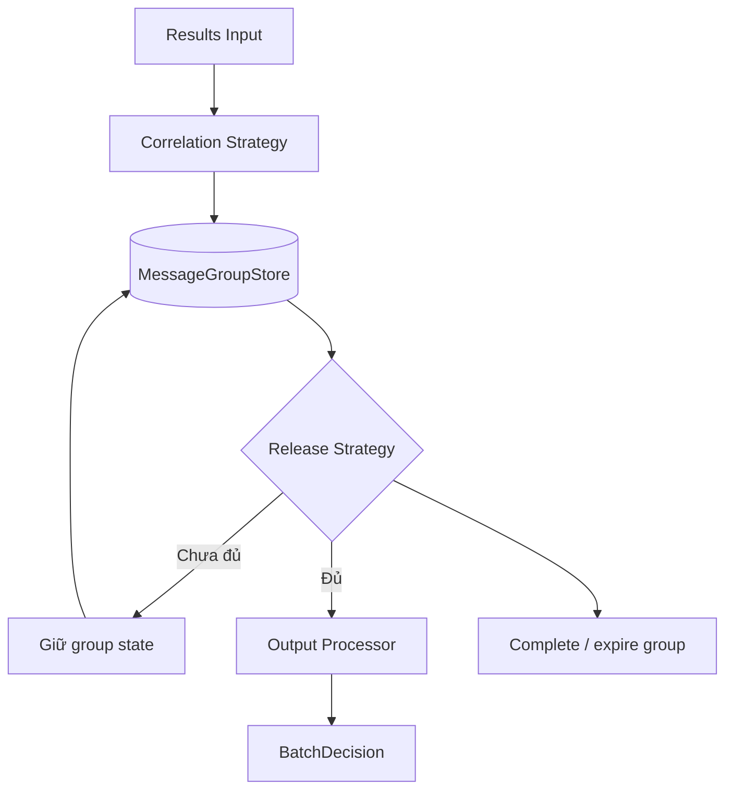
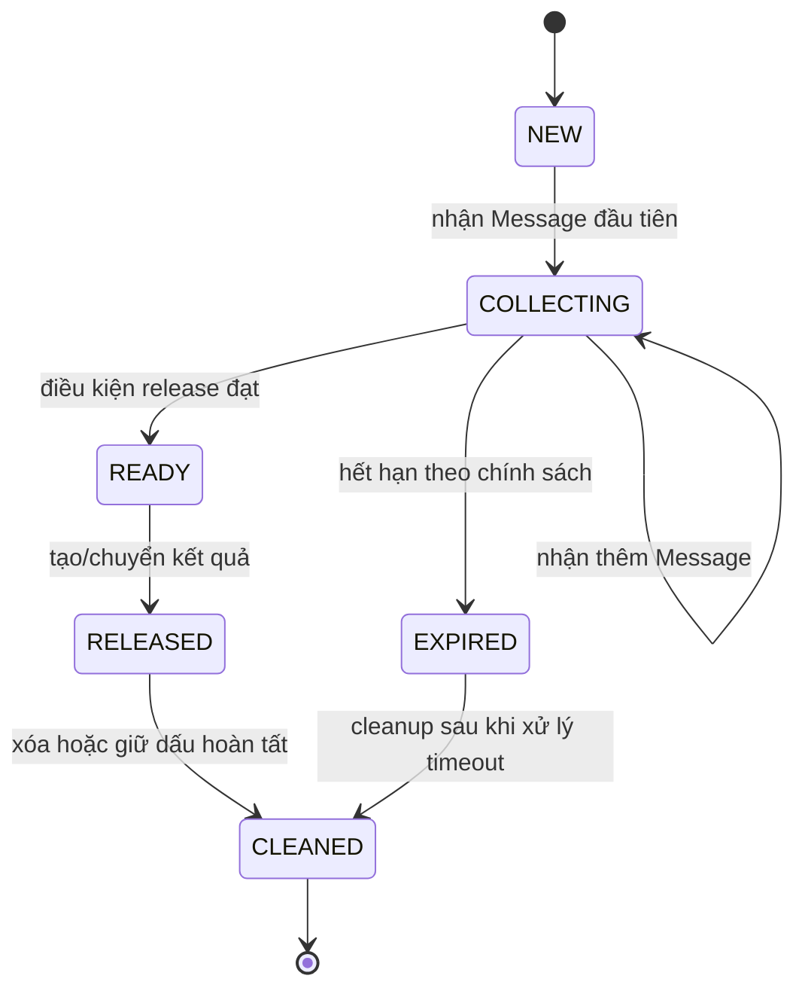
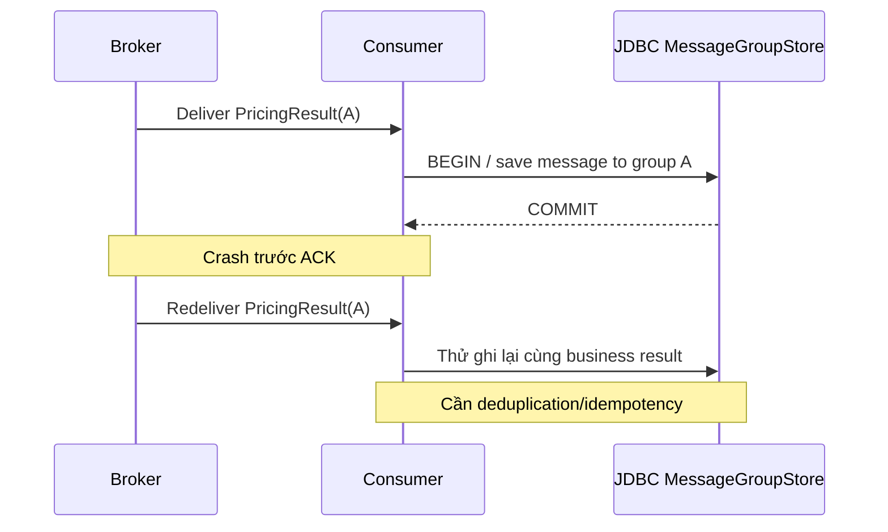
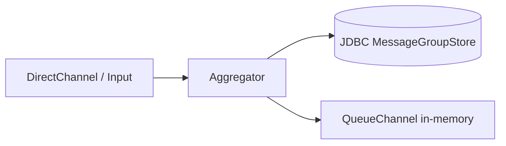
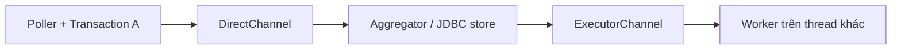
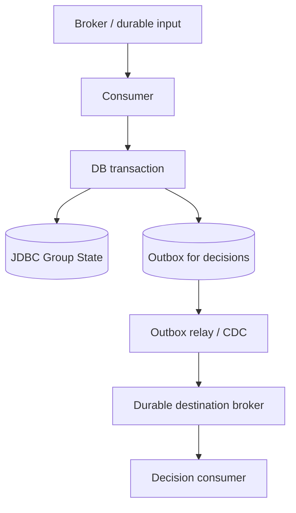
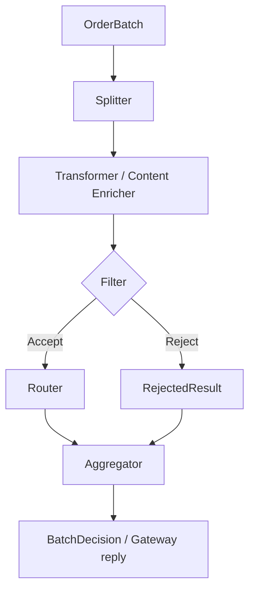

# Transaction và persistence của group state trong Aggregator

Khi một đơn hàng được tách thành ba yêu cầu kiểm tra **tồn kho**, **giá** và **giao hàng**, các kết quả có thể quay về Aggregator vào những thời điểm khác nhau. Nhóm kết quả có thể chưa đủ trong vài mili giây, vài phút hoặc lâu hơn nếu một dịch vụ tạm ngừng. Trong khoảng thời gian chờ đó, Aggregator cần giữ các Message đã nhận, biết chúng thuộc nhóm nào và quyết định khi nào có thể tạo kết quả tổng.

Vấn đề nảy sinh khi ứng dụng **restart**, một transaction **rollback**, broker **phát lại Message**, hoặc hai instance ứng dụng **cùng nhận Message của một group**. Nếu group state chỉ nằm trong RAM, trạng thái chưa hoàn tất có thể mất. Nếu đã ghi nhóm vào database nhưng xác nhận Message đầu vào hoặc gửi kết quả đầu ra không đúng thời điểm, hệ thống vẫn có nguy cơ mất kết quả, xử lý trùng hoặc phát hai kết quả tổng hợp.

Chủ đề **Transaction và persistence của group state** trong chương **Aggregator** của module `SPRING_INTEGRATION_PATTERN` tập trung vào những ranh giới đó. Module hướng đến triển khai Enterprise Integration Patterns (Router, Filter, Transformer, Splitter, Aggregator, Gateway, retry, error channel, correlation) bằng Spring Integration để xây dựng flow thông điệp ít phụ thuộc, dễ mở rộng và có thể kiểm thử, giám sát. Bài này giúp phân biệt rõ **lưu trạng thái group**, **transaction khi thêm/release Message**, **độ bền của nguồn và đầu ra** và **phục hồi khi sự cố xảy ra**.

## 1. Aggregator đang lưu trạng thái gì?

Aggregator không đơn giản nhận một Message và trả ngay một Message. Nó là một endpoint **stateful**: nhận các Message có quan hệ, giữ chúng trong một *message group*, kiểm tra điều kiện hoàn tất (*release condition*) và tạo đầu ra tổng hợp.

Ví dụ ba kết quả của cùng `attemptKey=A-01`:

```text
t1: CheckResult(INVENTORY, OK)   -> group A có 1 kết quả
t2: CheckResult(PRICING, OK)     -> group A có 2 kết quả
t3: CheckResult(SHIPPING, OK)    -> group A có 3 kết quả
                                  -> release -> BatchDecision(A-01, OK)
```

Một nhóm đang chờ có thể cần lưu:

| Thành phần | Vai trò | Tác động nếu mất |
| --- | --- | --- |
| **Group ID / correlation key** | Xác định các Message thuộc cùng nhóm | Message bị gom nhầm hoặc tạo nhóm mới |
| **Các Message đã nhận** | Dữ liệu để tính kết quả | Mất phần kết quả trước đó |
| **Sequence / result type / business key** | Phân biệt phần tử trong nhóm | Không biết còn thiếu phần nào |
| **Trạng thái hoàn tất hoặc đóng nhóm** | Xử lý late arrival, phát lại | Có thể release lần hai |
| **Thời điểm tạo/cập nhật nhóm** | Hỗ trợ timeout/expiration | Nhóm kẹt không được xử lý đúng hạn |
| **Thông tin lỗi/tiến độ bổ sung của ứng dụng** | Chẩn đoán, retry, khôi phục | Khó xác định nguyên nhân thiếu kết quả |

Không phải mọi MessageGroupStore đều lưu **tất cả các cột trên theo đúng tên**. Bảng này diễn tả **trạng thái logic cần thiết**, còn cấu trúc vật lý và metadata thực tế phụ thuộc `MessageGroupStore`, loại store và cấu hình.



**Điểm cốt lõi:** group state là **trạng thái trung gian của một quy trình nhiều Message**. Lưu nó bền vững là điều kiện quan trọng cho phục hồi nhưng **chưa đủ** để bảo đảm toàn bộ luồng xử lý chính xác một lần.

## 2. Correlation, release và persistence là ba trách nhiệm khác nhau

Trước khi bàn transaction, phải phân biệt:

1. **Correlation strategy** chọn nhóm cho từng Message, ví dụ dựa trên `attemptKey`.
2. **Release strategy** quyết định nhóm nào đã đủ điều kiện tạo kết quả, ví dụ đủ ba loại kiểm tra.
3. **MessageGroupStore** giữ Message và metadata nhóm trong thời gian chờ, có thể ở RAM hoặc lưu bền vững.

```text
correlationStrategy(message) = message.headers["attemptKey"]

releaseStrategy(group) = group đã đủ
    INVENTORY, PRICING và SHIPPING

groupStore = nơi giữ các Message cho đến khi release/expire
```

Nếu chỉ thay store từ in-memory sang JDBC nhưng correlation key vẫn sai, hệ thống **lưu bền vững một nhóm sai**. Nếu release strategy chỉ đếm đủ ba Message, một bản gửi trùng `INVENTORY` vẫn có thể chiếm chỗ của `SHIPPING`. Persistence không sửa các quy tắc nghiệp vụ đó.

### Những khái niệm dễ bị đánh đồng

| Khái niệm | Nó bảo đảm điều gì? | Nó không tự bảo đảm điều gì? |
| --- | --- | --- |
| Correlation key chính xác | Phân đúng Message vào nhóm | Có đủ Message để release |
| Release strategy chính xác | Quyết định lúc tạo kết quả theo hợp đồng | Kết quả đã được giao bền vững |
| Persistent MessageGroupStore | Trạng thái được ghi vào store ngoài RAM | Broker input đã ack nguyên tử |
| Database transaction | Các thao tác DB trong cùng phạm vi có thể commit/rollback nguyên tử | Thao tác HTTP/email/broker khác cùng atomic |
| Lock theo group | Tránh cập nhật đồng thời không an toàn nếu triển khai đúng | Chống bản phát lại sau restart |
| Idempotency | Giảm tác động của delivery trùng | Trả lời khi nào nhóm đủ |

Mỗi bảo đảm cần một **ranh giới hệ thống và điều kiện áp dụng** rõ ràng, không phải một tùy chọn bật lên là giải quyết hết.

## 3. Vòng đời một message group

Một group có thể trải qua các trạng thái logic sau:



Đây là **state machine khái niệm** để phân tích thiết kế; không phải danh sách trạng thái enum cố định của Spring Integration.

Đối với từng nhóm cần xác định:

- Khi Message đầu tiên đến, nhóm được tạo và lưu lúc nào?
- Các Message sau có thể đến từ nhiều thread/instance không?
- Sau khi release, Message trong group còn được giữ bao lâu?
- Nếu output processor tạo kết quả nhưng gửi output thất bại, nhóm có được retry?
- Một Message muộn hoặc bị redeliver cùng key sẽ được xử lý thế nào?
- Nhóm thiếu Message có timeout hoặc chính sách dọn dẹp nào?

Một nhóm được **mark complete** hoặc **expire** không đồng nghĩa mọi side effect của consumer downstream đã được thực hiện xong.

## 4. In-memory store và persistent store khác nhau thế nào?

Spring Integration cung cấp trừu tượng `MessageGroupStore` để Aggregator duy trì nhóm Message.

| Tiêu chí | Store trong bộ nhớ | Persistent store, ví dụ JDBC |
| --- | --- | --- |
| Độ trễ | Thường thấp, không cần I/O DB | Có chi phí truy vấn/transaction |
| Sống qua restart JVM | Không, nếu chỉ nằm trong tiến trình | Có thể, nếu ghi/commit và DB còn dữ liệu |
| Chia sẻ giữa instance | Không tự chia sẻ | Có thể chia sẻ khi store và locking được cấu hình phù hợp |
| Dung lượng | Phụ thuộc heap JVM | Phụ thuộc database và chính sách cleanup |
| Serializability | Có thể giữ object trong RAM | Cần định dạng ghi/đọc tương thích |
| Transaction DB | Không tự tạo transaction DB | Có thể tham gia transaction tương thích |
| Vận hành | Đơn giản hơn | Cần schema, kết nối, migration, backup, lock |
| Mất nhóm vì expiration sai | Vẫn có | Vẫn có |

Ví dụ **in-memory** có thể sử dụng `SimpleMessageStore`; còn triển khai JDBC thường sử dụng `JdbcMessageStore` từ module Spring Integration JDBC, với schema tương ứng. Một store bền vững không giúp ích nếu ứng dụng chưa commit trạng thái hoặc các header/payload không thể được serialize.

**Chọn in-memory nếu** mất nhóm chờ khi restart là chấp nhận được, flow có thể tạo lại trạng thái từ nguồn và không yêu cầu khôi phục chính xác. **Chọn persistent store nếu** nhóm chờ có ý nghĩa nghiệp vụ quan trọng, thời gian chờ có thể dài, hoặc cần restart mà không mất tiến độ; đồng thời phải thiết kế transaction và xử lý lỗi tương ứng.

## 5. Transaction boundary: câu hỏi quan trọng hơn “có DB không?”

Một Message có thể đi qua nhiều thao tác:

```text
1. Consumer nhận Message từ queue/broker
2. Aggregator thêm Message vào group store
3. Aggregator kiểm tra release strategy
4. Nếu đủ, tạo kết quả tổng
5. Gửi kết quả sang output channel/broker
6. Xác nhận (ack) Message đầu vào
```

**Transaction** chỉ có hiệu lực đối với những tài nguyên và thao tác được bao phủ bởi transaction đó. Nếu việc ghi group state dùng JDBC nhưng xác nhận đầu vào dùng Kafka hoặc gửi kết quả qua HTTP, một JDBC transaction cục bộ **không tự rollback được** những thao tác bên ngoài database.

### 5.1. Ba loại ranh giới thường gặp

| Ranh giới | Ví dụ | Điểm cần nhớ |
| --- | --- | --- |
| Transaction DB | `DataSourceTransactionManager` quản lý JDBC store | Atomic cho thao tác tham gia cùng database transaction |
| Transaction messaging | Broker/adapter hỗ trợ giao dịch hoặc ack | Cơ chế riêng theo transport; không tự cùng transaction DB |
| Transaction nghiệp vụ | Thay đổi trạng thái đơn hàng hoặc phát lệnh phụ | Có thể liên quan database/HTTP/worker khác |

Không nên viết “Aggregator transactional” mà không trả lời:

1. Ai **bắt đầu** transaction?
2. Transaction manager nào quản lý?
3. Những thao tác nào dùng **cùng connection/resource**?
4. Kết thúc transaction khi nào?
5. Những thao tác nào nằm **ngoài** transaction?

### 5.2. Transaction chỉ bao được những phần cùng phạm vi

Ví dụ, một poller có transaction bằng `DataSourceTransactionManager` có thể tạo phạm vi cho việc đọc queue backed by JDBC và cập nhật `JdbcMessageStore` **nếu** cả hai thực sự dùng cùng database/connection được transaction manager quản lý và xử lý trên cùng thread. Còn lời gọi tới HTTP hoặc một broker khác vẫn không có tính nguyên tử với commit JDBC chỉ vì nó xảy ra trong cùng phương thức Java.

Khi flow cắt qua `ExecutorChannel`, thread được giao việc có thể không còn transaction context của thread ban đầu. Cần xác định ranh giới transaction mới ở điểm xử lý bất đồng bộ, không giả định transaction tự động truyền qua thread.

## 6. Các điểm crash và rủi ro mất/trùng Message

Giả sử consumer nhận `PricingResult` của group A từ broker. Ba trạng thái quan trọng là **đã đọc**, **đã ghi group store**, **đã ack broker**:

| Điểm lỗi | Group store | Broker input | Rủi ro |
| --- | --- | --- | --- |
| Dừng trước khi ghi | Chưa có Message | Chưa ack | Broker có thể redeliver; thường phục hồi được nếu nguồn bền vững |
| Ghi nhưng chưa commit, rồi crash | Transaction DB rollback | Chưa ack | Có thể redeliver và ghi lại |
| Commit group store, chưa ack | Đã lưu Message | Broker có thể redeliver | **Trùng Message** nếu không dedupe |
| Ack đầu vào trước khi group store commit, rồi crash | Chưa lưu bền vững | Broker đã coi là xử lý | **Mất Message** khỏi nhóm |
| Release đã commit, gửi output chưa thành công | Group có thể đã hoàn tất | Tùy ack đầu vào | **Mất kết quả tổng** nếu không có output bền vững/retry |
| Gửi output thành công, chưa ghi trạng thái hoàn tất | Output đã đi | Group có thể được release lại | **Phát kết quả trùng** |

Đây là **ma trận failure window về mặt kiến trúc**. Cơ chế ack, transaction, thời điểm persistence và recovery thực tế khác nhau giữa JDBC, AMQP, Kafka, queue trong bộ nhớ và các adapter.

Một nguyên tắc thực dụng: **giữa hai hệ thống lưu trữ độc lập, hãy giả định có thể xảy ra at-least-once delivery và xử lý trùng**, trừ khi có chứng cứ và giao thức transaction chung thật sự.



Lưu group bền vững giải quyết việc **nhớ đã nhận gì**, nhưng không thể thay thế việc **nhận diện cùng một kết quả nghiệp vụ đã nhận trước đó**.

## 7. Cấu hình Aggregator với MessageGroupStore

Ví dụ Java 17+ dưới đây cho thấy cách một Aggregator dùng store được inject. Phiên bản mặc định của ví dụ là **in-memory** để có thể giải thích và kiểm thử hoạt động trong một application context. Sau đó ta sẽ thay bean store bằng JDBC để có persistence.

### 7.1. Domain model và flow

```java
package example.integration;

import java.util.List;

import org.springframework.context.annotation.Bean;
import org.springframework.context.annotation.Configuration;
import org.springframework.integration.channel.DirectChannel;
import org.springframework.integration.channel.QueueChannel;
import org.springframework.integration.config.EnableIntegration;
import org.springframework.integration.dsl.IntegrationFlow;
import org.springframework.integration.store.MessageGroupStore;
import org.springframework.integration.store.SimpleMessageStore;
import org.springframework.messaging.MessageChannel;
import org.springframework.messaging.PollableChannel;

@Configuration
@EnableIntegration
public class GroupStateAggregationConfiguration {

    public enum CheckType {
        INVENTORY, PRICING
    }

    public record CheckResult(CheckType type, boolean passed) {
    }

    public record GroupDecision(
            String attemptKey,
            int resultCount,
            boolean approved) {
    }

    @Bean
    public MessageChannel checkResultsInput() {
        return new DirectChannel();
    }

    @Bean
    public PollableChannel decisionsOutput() {
        return new QueueChannel(20);
    }

    @Bean
    public MessageGroupStore groupStore() {
        // Ví dụ khởi đầu: giữ state trong RAM, không durable.
        return new SimpleMessageStore();
    }

    @Bean
    public IntegrationFlow aggregateChecks(MessageGroupStore groupStore) {
        return IntegrationFlow.from("checkResultsInput")
                .aggregate(spec -> spec
                        .correlationStrategy(message -> {
                            Object value = message.getHeaders()
                                    .get("attemptKey");
                            if (!(value instanceof String key)
                                    || key.isBlank()) {
                                throw new IllegalArgumentException(
                                        "attemptKey is required");
                            }
                            return key;
                        })
                        .releaseStrategy(group -> group.size() == 2)
                        .outputProcessor(group -> {
                            List<CheckResult> results =
                                    group.getMessages().stream()
                                            .map(m -> (CheckResult) m.getPayload())
                                            .toList();

                            long uniqueTypes = results.stream()
                                    .map(CheckResult::type)
                                    .distinct()
                                    .count();
                            if (uniqueTypes != 2) {
                                throw new IllegalStateException(
                                        "Expected INVENTORY and PRICING");
                            }

                            boolean approved = results.stream()
                                    .allMatch(CheckResult::passed);
                            return new GroupDecision(
                                    String.valueOf(group.getGroupId()),
                                    results.size(), approved);
                        })
                        .messageStore(groupStore)
                        .expireGroupsUponCompletion(true))
                .channel("decisionsOutput")
                .get();
    }
}
```

Giải thích các thành phần:

- `attemptKey` trong header chọn **message group**. Một đơn hàng được xử lý lại nên dùng attempt key khác để không trộn kết quả.
- `releaseStrategy(group -> group.size() == 2)` là điều kiện giản lược của **demo**, chỉ an toàn nếu không có duplicate và mỗi nhóm có đúng hai kết quả hợp lệ.
- `outputProcessor` tạo `GroupDecision` từ hai kết quả và cố ý phát hiện cùng loại kết quả đến hai lần.
- `.messageStore(groupStore)` gắn store rõ ràng vào Aggregator. Đây là điểm thay đổi khi muốn dùng persistent store.
- `.expireGroupsUponCompletion(true)` dọn nhóm sau hoàn tất theo chính sách demo; nó **không có nghĩa** kết quả đầu ra đã được một consumer ở xa xác nhận.

**Ranh giới của ví dụ:** `SimpleMessageStore` dùng RAM; `DirectChannel` đồng bộ và `QueueChannel` trong bộ nhớ cũng không durable. Vì vậy đoạn này chứng minh cơ chế group state, **không chứng minh restart recovery, atomic input ACK hay exactly-once**.

### 7.2. Vì sao output processor không nên giả định thứ tự?

`group.getMessages()` biểu diễn tập các Message của nhóm. Nếu nghiệp vụ cần giữ thứ tự dòng, hãy sort bằng sequence number hoặc business line number phù hợp. Trong ví dụ, phép `allMatch()` không phụ thuộc thứ tự, nên Message `INVENTORY` và `PRICING` đến theo thứ tự nào cũng cho cùng kết quả.

### 7.3. Vì sao kiểm tra kiểu kết quả chưa đủ?

Kiểm tra `uniqueTypes==2` chỉ **phát hiện** trường hợp có hai kết quả trùng loại ở lúc release; nó chưa loại trùng trước khi nhóm đạt size 2. Trong production, phải bổ sung deduplication theo `(attemptKey, CheckType)` hoặc một release strategy theo tập kết quả bắt buộc để không phát quyết định sai.

## 8. Thay in-memory store bằng JDBC cho group state bền vững

Spring Integration JDBC cung cấp triển khai lưu Message/MessageGroup bằng database, thường dùng `JdbcMessageStore`. Về mặt cấu trúc, Aggregator vẫn nhận `MessageGroupStore`; chỉ bean cung cấp implementation đổi đi.

Ví dụ **cấu hình thay thế** (không đăng ký đồng thời với bean `groupStore()` in-memory ở mục 7):

```java
package example.integration;

import javax.sql.DataSource;

import org.springframework.context.annotation.Bean;
import org.springframework.context.annotation.Configuration;
import org.springframework.integration.jdbc.store.JdbcMessageStore;
import org.springframework.integration.store.MessageGroupStore;

@Configuration
public class DurableGroupStoreConfiguration {

    @Bean
    public MessageGroupStore groupStore(DataSource dataSource) {
        return new JdbcMessageStore(dataSource);
    }
}
```

Khi tích hợp, cần bảo đảm không có **hai bean trùng tên** `groupStore` cùng được khởi tạo. Có thể tách thành profile in-memory/JDBC hoặc chọn một cấu hình theo môi trường. Lớp JDBC cần module Spring Integration JDBC và schema cho Message Store tương thích phiên bản thư viện; đoạn trên **chưa tự tạo database, bảng hay transaction manager**.

### 8.1. Cần chuẩn bị gì cho JDBC MessageGroupStore?

1. **DataSource** trỏ tới database ổn định và có connection pool thích hợp.
2. **Schema/message-store tables** đúng với phiên bản Spring Integration, được quản lý bằng migration; không tự đoán tên bảng/cột theo ví dụ.
3. **Transaction manager** quản lý chính datasource khi flow cần transaction.
4. **Serialization/conversion** phù hợp cho payload và headers cần lưu.
5. **Group cleanup và retention** cho nhóm đã hoàn tất/hết hạn.
6. **Locking/concurrency policy** nếu nhiều luồng/instance cùng đụng group.
7. **Backup/restore** và chiến lược replay khi store bị hỏng hoặc migration thất bại.

Một `JdbcMessageStore` **không tự lưu nội dung bất kỳ** theo cách có thể đọc lại trên mọi phiên bản ứng dụng. Các payload custom, header chứa đối tượng Java và thay đổi class/schema cần có chiến lược serialization, compatibility và migration phù hợp.

### 8.2. Không đem các header Java nội bộ qua biên giới tùy ý

Các header như `replyChannel`, `errorChannel` có thể tham chiếu đối tượng channel trong JVM, không phải một địa chỉ có ý nghĩa sau khi tiến trình restart hoặc sau khi chuyển sang node khác. Khi cần giao tiếp qua broker, hãy dùng **địa chỉ reply/correlation có thể serialize** và hợp đồng transport rõ ràng.

Đối với persistent group state, nên ưu tiên envelope chứa `eventId`, `attemptKey`, `resultType`, `schemaVersion`, sequence metadata cần thiết và dữ liệu nghiệp vụ có kiểu/format tương thích.

### 8.3. JDBC không đồng nghĩa mọi channel đều durable

Sơ đồ sau là một kiến trúc **chỉ có group state bền vững**:



Nếu ứng dụng dừng sau khi release kết quả nhưng trước khi consumer lấy Message từ queue trong RAM, output có thể mất. Vì thế, ngoài store, phải xem xét **cả đầu vào, trạng thái group và đầu ra**.

## 9. Đặt transaction ở đâu trong flow?

Ví dụ luồng thực tế:

```text
Durable inbound queue/broker
    ↓
Transactional consumer / poller
    ↓
Aggregator + JDBC MessageGroupStore
    ↓
Durable output / outbox / downstream
```

Trong Spring Integration, điểm kích hoạt transaction thường nằm ở **consumer/poller hoặc service invocation** chứ không đơn thuần nằm ở tên bean `JdbcMessageStore`. Một poller có advice quản lý transaction có thể bao phạm vi xử lý được gọi đồng bộ trong cùng thread và tài nguyên tương thích.

### 9.1. Pseudocode về ranh giới transaction

```text
BEGIN transaction JDBC
  nhận Message từ nguồn tham gia transaction (nếu có)
  tính correlation key
  lưu Message vào JDBC MessageGroupStore
  nếu đủ nhóm:
      tạo GroupDecision
      lưu bản ghi outbound/outbox trong cùng DB transaction (nếu thiết kế)
      cập nhật/đóng group theo chính sách
COMMIT JDBC

sau commit:
  publisher riêng chuyển outbox tới broker và retry khi cần
```

Đây là **pseudocode thiết kế**, không phải API Spring Integration có sẵn dưới dạng một phương thức. Việc đưa outbox vào cùng transaction chỉ khả thi nếu các thao tác tương ứng thực sự dùng chung transaction manager/database và được kết nối đúng trong flow.

### 9.2. Async boundary cắt ngang transaction



Transaction context của `TransactionSynchronizationManager` thường gắn với thread hiện hành; khi Message được bàn giao qua executor, phần xử lý ở worker **không đương nhiên** nằm trong transaction A.

Hãy bố trí transaction mới ở điểm tiêu thụ bất đồng bộ hoặc dùng cơ chế message transaction phù hợp. Đừng kiểm tra chỉ bằng việc thấy annotation `@Transactional` xuất hiện ở một class mà suy ra toàn bộ sơ đồ cùng rollback.

### 9.3. `@Transactional` cũng có giới hạn

Với Spring proxy transaction, tự gọi một phương thức `@Transactional` từ phương thức khác **trong cùng object** có thể không đi qua proxy, nên không bắt đầu transaction như mong đợi. Khi xử lý qua message endpoint, cần kiểm tra transaction advice/proxy thực sự được áp dụng tại điểm gọi phù hợp.

Không lấy việc đặt `@Transactional` lên một phương thức tùy ý làm bằng chứng rằng việc ack broker và phát output cùng atomic với JDBC group state.

## 10. Transaction của lưu group và transaction của release

Hai giai đoạn đáng phân tích riêng:

### 10.1. Khi group chưa đủ

```text
Group A đang có INVENTORY
Nhận PRICING
  -> lưu PRICING
  -> releaseStrategy = false
  -> commit group state
```

Với persistent store và transaction DB đúng, sau restart group vẫn có thể giữ hai Message đã commit. Nếu transaction bị rollback, lần thêm PRICING không được xem là đã lưu; consumer phải có cơ chế nhận lại Message hoặc xử lý lỗi.

### 10.2. Khi Message cuối làm group hoàn tất

```text
Group A đang có INVENTORY, PRICING
Nhận SHIPPING
  -> lưu SHIPPING
  -> releaseStrategy = true
  -> outputProcessor tạo BatchDecision
  -> ghi nhận group complete / cleanup
  -> chuyển BatchDecision
```

Đây là giai đoạn nhạy cảm nhất: **kết quả đã tạo** nhưng **chưa chắc đã được giao bền vững**.

Nếu output được gửi đến một queue trong bộ nhớ sau khi group bị xóa, ứng dụng crash có thể làm mất quyết định. Nếu output đã đến broker nhưng transaction DB rollback hoặc trạng thái completion chưa được commit, có thể release lại khi Message được redeliver.

**Đừng coi “release thành công” là một cam kết nguyên tử giữa nhiều hệ thống.** Phải chỉ rõ cách phối hợp giữa group store và output.

## 11. Durable output và Transactional Outbox

Một giải pháp thường dùng khi group state và kết quả tổng đều cần bền vững là **ghi một bản ghi outbox cùng transaction DB với thay đổi group state**, sau đó có một relay chuyển outbox ra broker.



Ưu điểm:

- Nếu DB transaction rollback, group state và outbox record cùng không commit.
- Nếu DB transaction commit nhưng relay chết, outbox record còn để phát lại.
- Giảm khoảng trống giữa **đóng group** và **lưu ý định phát output**.

Nhưng outbox vẫn có một failure window:

```text
Relay gửi BatchDecision thành công tới broker
Relay crash trước khi ghi nhận outbox đã phát
Relay khởi động lại và gửi BatchDecision thêm lần nữa
```

Vì vậy consumer của `BatchDecision` cần idempotency theo một **decision ID / group completion ID ổn định**, không chỉ tin rằng outbox bảo đảm exactly-once.

### 11.1. Để triển khai outbox cần những gì?

1. Bản ghi kết quả có **ID ổn định** phát sinh một lần.
2. Việc ghi outbox và thay đổi group state cùng nằm trong DB transaction.
3. Relay theo dõi và retry các bản ghi chưa được xác nhận.
4. Đích nhận dedupe hoặc xử lý idempotent theo ID.
5. Hệ thống có công cụ quan sát pending outbox, retry, dead-letter và lag.

Outbox được trình bày như **một mô hình kiến trúc bổ sung**; không có lời hứa rằng `.aggregate(...).messageStore(...)` tự sinh bản ghi outbox hay tự có relay.

## 12. Concurrent access và lock theo correlation key

Giả sử hai consumer nhận kết quả thuộc **cùng group A**:

```text
Thread 1: nhận PRICING(A)
Thread 2: nhận SHIPPING(A)
```

Nếu cả hai cùng đọc một group đang có một Message, sau đó cùng sửa group, hệ thống phải tránh:

- Mất update của một Message.
- Cả hai cùng nhìn thấy điều kiện release và tạo **hai kết quả tổng**.
- Một thread xóa group trong khi thread kia vẫn đang ghi.
- Nhóm bị cập nhật một phần khi một transaction rollback.

Spring Integration có cơ chế đồng bộ và lock phục vụ Aggregator/store; nhưng mức độ an toàn **phụ thuộc vào triển khai, khóa, transaction và topology triển khai**.

### 12.1. Trong một JVM

Một lock đồng bộ trong tiến trình có thể bảo vệ cạnh tranh giữa các thread của cùng application context. Tuy nhiên, nó không bảo vệ những instance chạy ở JVM khác.

### 12.2. Nhiều instance cùng dùng JDBC store

Nếu A và B cùng cập nhật một database, cần một **cơ chế lock mà cả hai instance cùng nhìn thấy**, ví dụ distributed lock dựa trên JDBC hoặc cách điều phối tương đương theo thiết kế. Spring Integration có hệ thống `LockRegistry` và các triển khai JDBC cho tình huống phù hợp, nhưng cách cấu hình cụ thể phải được đối chiếu với phiên bản đang dùng.

Không nên đặt một `ReentrantLock` trong mỗi replica rồi tuyên bố hai replica sẽ loại trừ nhau. Chúng không chia sẻ object lock.

### 12.3. Partition theo group key

Trong hệ thống dùng broker, có thể gán `partitionKey = attemptKey` để các Message của một group ưu tiên đi qua cùng partition/consumer theo bảo đảm transport. Cách này giúp giảm cạnh tranh và có thể giữ thứ tự trong phạm vi khóa, nhưng:

- Không tự thay transaction DB.
- Không tự xử lý bản gửi trùng.
- Không bảo đảm lock đúng nếu có luồng khác cũng truy cập store.
- Không tự bảo đảm output được phát đúng một lần.

Nhiều biện pháp thường phải kết hợp: **partitioning + transactional store + locking + idempotency**.

## 13. Duplicate, late arrival và trạng thái hoàn tất

Một failure window thường gặp:

```text
Group A đã nhận INVENTORY, PRICING
Consumer PRICING đã commit vào group store
Consumer crash trước khi ACK
Broker redeliver PRICING
```

Nếu chỉ dùng release strategy `group.size() == 3`, bản PRICING thứ hai có thể khiến nhóm đạt size 3 dù còn thiếu SHIPPING. **Persistent state không loại trùng giúp bạn**.

### 13.1. Khóa idempotency theo kết quả nghiệp vụ

Ví dụ:

```text
groupKey   = tenant-7:ORD-101:attempt-01
resultType = PRICING
version    = 1

dedupeKey = groupKey + ":" + resultType + ":" + version
```

Nếu một loại kết quả có thể có nhiều bản cập nhật hợp lệ, cần phân biệt **retransmission cùng version** với **phiên bản mới**. Nếu nhóm chờ kết quả mới nhất, phải có quy tắc chọn version và release, không chỉ đếm Message.

### 13.2. Message đến sau khi group hoàn tất

Với `.expireGroupsUponCompletion(true)`, group state có thể được dọn ngay khi hoàn tất theo hợp đồng endpoint. Khi Message trễ có **cùng correlation key** đến sau đó, không nên giả định nó sẽ bị chặn vĩnh viễn; tùy store/chính sách, nó có thể tạo nhóm mới.

Một thiết kế cần chọn:

| Chính sách | Ý nghĩa |
| --- | --- |
| Giữ dấu completed group trong một khoảng | Nhận diện late arrival |
| Lưu completion ID trong bảng dedupe | Không xử lý lại kết quả đã phát |
| Đưa late arrival vào nhánh audit | Điều tra kết quả đến quá muộn |
| Mở group version/attempt mới | Chỉ khi đó là sự kiện nghiệp vụ mới hợp lệ |

**Xóa group state và lưu dấu đã hoàn tất là hai việc khác nhau.** Cleanup để tiết kiệm dung lượng không được làm mất khả năng kiểm soát các Message đến muộn nếu nghiệp vụ yêu cầu dedupe lâu dài.

## 14. Group timeout, expiration và partial result

Một group thiếu kết quả có thể tồn tại mãi nếu không có timeout:

```text
Group A:
  INVENTORY = OK
  PRICING = OK
  SHIPPING = không đến
```

Hệ thống cần có chính sách:

- Đợi thêm vì kết quả có thể đến muộn.
- Retry hoặc truy vấn lại dịch vụ thiếu kết quả.
- Sau một deadline, phát `INCOMPLETE` kèm danh sách phần còn thiếu.
- Trả lỗi cho Gateway hoặc yêu cầu kiểm tra thủ công.
- Dọn nhóm sau khi đã ghi nhận trạng thái hết hạn bền vững.

### 14.1. Timeout không có nghĩa release thành công

| Tình huống | Quyết định phù hợp |
| --- | --- |
| Nhóm đủ 3 kết quả đúng | Tạo tổng hợp thành công |
| Nhóm thiếu 1 kết quả nhưng hết hạn | Error/partial result theo hợp đồng |
| Nhóm timeout vì consumer dừng tạm thời | Retry/recovery và cảnh báo backlog |
| Nhóm thiếu do Filter loại một Message | Xử lý rejected result hoặc điều chỉnh expected count |
| Group state bị mất sau restart | Phục hồi/replay; không suy ra “đã xử lý xong” |

Spring Integration cung cấp cơ chế group timeout/expiration/reaper với các lựa chọn cấu hình khác nhau. Đối với persistent store, phải kiểm tra **ai kích hoạt timeout sau restart**, vì chỉ lưu dữ liệu chờ chưa chắc một scheduled task trong JVM cũ vẫn còn chạy.

### 14.2. Partial release có tác động transaction

Nếu phát kết quả `INCOMPLETE` rồi một Message còn thiếu đến sau, cần quy định:

1. Có phát **kết quả cập nhật** hay không?
2. Kết quả cũ có được downstream ghi nhận là cuối cùng không?
3. Dùng **version hoặc completion ID** nào để ngăn nhầm kết quả?
4. Group có còn lưu trạng thái sau partial release không?

Không chọn partial result chỉ vì muốn “tránh timeout”. Nó làm thay đổi hợp đồng nghiệp vụ và có thể khiến downstream phải xử lý cập nhật/bù trừ.

## 15. Splitter, Filter, Transformer, Router và Gateway ảnh hưởng group state thế nào?



### 15.1. Splitter và correlation

Splitter thường gắn metadata correlation/sequence cho Message con. Nếu một lượt batch tạo nhiều Message, các Message phải giữ cùng **group key của lượt** và giữ identity của từng phần tử. Khi cần phục hồi sau restart, correlation key phải được lưu/serialize nhất quán.

### 15.2. Filter và nhóm thiếu kết quả

Nếu Splitter tạo `sequenceSize=3` nhưng Filter loại một Message mà không tạo kết quả thay thế, Aggregator có thể chờ ba kết quả mãi. Với persistent store, tình huống này biến thành **group kẹt bền vững** thay vì một lỗi tự biến mất.

Một cách thiết kế là để nhánh reject tạo `CheckResult(REJECTED)` có cùng group key và đi tới Aggregator, hoặc dùng release strategy/timeout phù hợp.

### 15.3. Transformer và header propagation

Nếu Transformer tạo Message mới nhưng bỏ `correlationId` hoặc `attemptKey`, Aggregator có thể tạo sai nhóm hoặc ném lỗi. Cần test header propagation qua mọi biên giới, nhất là HTTP/AMQP/Kafka adapter nơi header Java nội bộ có thể không được chuyển nguyên xi.

### 15.4. Router và fan-out làm thay đổi số kết quả

Nếu một Message con được gửi tới nhiều recipient để kiểm tra, số kết quả quay về có thể **lớn hơn sequenceSize ban đầu từ Splitter**. Release strategy cần dựa trên tập kết quả kỳ vọng của các nhánh, không chỉ số item đầu vào.

### 15.5. Gateway và đường reply

Gateway request-reply cần một kết quả hoặc lỗi theo timeout đã định. Persistent group có thể giữ Message chờ qua restart, nhưng một `replyChannel` nội bộ gắn với request của JVM **không tự sống qua restart**. Nếu yêu cầu cần phản hồi sau thời gian dài, thường nên trả trạng thái `ACCEPTED` và cung cấp cách theo dõi bằng `requestId`, hoặc dùng reply destination bền vững ngoài tiến trình.

## 16. Kiểm thử JUnit 5 trong một application context

Đầu tiên, kiểm tra cơ chế group ở mức integration flow. Test này dùng **SimpleMessageStore in-memory** nên chỉ chứng minh việc nhóm được giữ và release đúng trong một JVM, không chứng minh persistence qua restart.

```java
package example.integration;

import static org.junit.jupiter.api.Assertions.*;

import org.junit.jupiter.api.Test;
import org.springframework.context.annotation.AnnotationConfigApplicationContext;
import org.springframework.messaging.Message;
import org.springframework.messaging.MessageChannel;
import org.springframework.messaging.PollableChannel;
import org.springframework.messaging.support.MessageBuilder;

import example.integration.GroupStateAggregationConfiguration.CheckResult;
import example.integration.GroupStateAggregationConfiguration.CheckType;
import example.integration.GroupStateAggregationConfiguration.GroupDecision;

class GroupStateAggregatorTest {

    private void send(
            MessageChannel channel,
            String attempt,
            CheckType type,
            boolean passed) {
        assertTrue(channel.send(MessageBuilder
                .withPayload(new CheckResult(type, passed))
                .setHeader("attemptKey", attempt)
                .setHeader("eventId", "evt-" + attempt)
                .build()));
    }

    @Test
    void groupsInterleavedResultsAndReleasesOnlyCompleteGroups() {
        try (var context = new AnnotationConfigApplicationContext(
                GroupStateAggregationConfiguration.class)) {

            MessageChannel input =
                    context.getBean("checkResultsInput", MessageChannel.class);
            PollableChannel output =
                    context.getBean("decisionsOutput", PollableChannel.class);

            send(input, "A-01", CheckType.INVENTORY, true);
            send(input, "B-01", CheckType.INVENTORY, true);
            assertNull(output.receive(0));

            send(input, "A-01", CheckType.PRICING, true);
            Message<?> first = output.receive(0);
            assertNotNull(first);
            assertEquals(
                    new GroupDecision("A-01", 2, true),
                    first.getPayload());

            // B còn thiếu PRICING; A hoàn tất không release B.
            assertNull(output.receive(0));

            send(input, "B-01", CheckType.PRICING, false);
            Message<?> second = output.receive(0);
            assertNotNull(second);
            assertEquals(
                    new GroupDecision("B-01", 2, false),
                    second.getPayload());
            assertNull(output.receive(0));
        }
    }
}
```

Vì flow đầu vào đồng bộ và output queue trong bộ nhớ chưa có consumer khác, `receive(0)` có thể dùng để quan sát ngay sau `send()`. Trong flow có executor, poller hoặc broker, phải đợi bằng timeout hữu hạn và kiểm tra error flow, thay vì kết luận không có kết quả chỉ vì chưa thấy nó lập tức.

### 16.1. Test này không chứng minh điều gì?

- Không có database hoặc transaction manager.
- Không có restart JVM giữa lúc group còn chờ.
- Không có đồng thời cập nhật cùng group từ hai instance.
- Không có duplicate input/redelivery.
- Không có output broker hay outbox.

Những điều trên là **một bộ test riêng**, không thể suy ra từ việc hai nhóm A/B đã release đúng trong cùng Spring context.

## 17. Test phục hồi group state với JDBC và restart

Muốn chứng minh persistence thực sự, cần một integration test dùng **database thật hoặc môi trường DB tương đương**, có schema JDBC Message Store được khởi tạo, sau đó đóng/mở **application context** nhưng **giữ nguyên database**.

### 17.1. Kịch bản nên chạy

```text
Context #1: dùng JDBC MessageGroupStore tại database D
  gửi INVENTORY cho group A
  kiểm tra chưa có GroupDecision
  commit xử lý và đóng Context #1

Context #2: dùng cùng database D, store/region tương thích
  gửi PRICING cho group A
  kiểm tra GroupDecision(A) được release đúng một lần
  kiểm tra group state sau completion theo chính sách cleanup
```

Đây là **kịch bản kiểm thử**, không phải kết quả đã được chạy. Nếu thay database mới khi khởi tạo Context #2, test sẽ không chứng minh restart recovery.

### 17.2. Các điều kiện cần cố định

- Cùng schema, datasource và namespace/region của store.
- Tương thích serializer và class của payload/header ở hai context.
- Đảm bảo transaction đầu tiên **đã commit** trước khi đóng Context #1.
- Có chiến lược khóa nếu hai context chạy đồng thời.
- Dọn dữ liệu test bằng khóa riêng, tránh group từ lần chạy trước.
- Không nhầm state còn trong `static` field/JVM với persistence thực.

### 17.3. Failure-injection test cho transaction

| Test | Thao tác | Điều cần quan sát |
| --- | --- | --- |
| **Rollback before commit** | Ném lỗi sau khi thêm Message nhưng trước commit | Message không tồn tại ở group store nếu transaction bao phủ đúng |
| **Crash after DB commit, before ACK** | Dừng consumer trước broker ACK | Broker redeliver; dedupe không đếm lần thứ hai |
| **Crash after release, before output** | Ngắt sau DB completion nhưng trước external send | Outbox/durable output còn khả năng phát |
| **Duplicate on one result type** | Gửi INVENTORY hai lần | Nhóm không được release sai khi còn thiếu PRICING |
| **Concurrent same key** | Hai instance cùng gửi Message của A | Không mất cập nhật, không release hai lần |
| **Late arrival** | Gửi thêm Message sau release | Theo đúng chính sách đóng group |
| **Serialization upgrade** | Đổi version payload rồi đọc lại group cũ | Có migration/compatibility hoặc lỗi có thể xử lý |
| **Timeout after restart** | Lưu group cũ rồi restart và quá hạn | Expiration/reaper hoạt động theo chính sách |

Để test transactional rollback, cần thực sự kích hoạt transaction và khiến code ném lỗi **trong cùng transaction**; chỉ ném lỗi ngoài transaction rồi kiểm tra DB không chứng minh rollback.

## 18. Giám sát trạng thái group và transaction

Khi Aggregator bị kẹt, không đủ để thấy “Consumer vẫn chạy”. Cần quan sát **tiến độ từng group**, tình trạng store và các điểm có thể phát lại.

| Metric gợi ý | Ý nghĩa | Dấu hiệu bất thường |
| --- | --- | --- |
| `aggregator.groups.pending` | Số group chưa release | Tăng không ngừng |
| `aggregator.group.age` | Tuổi group đang chờ | Vượt deadline nghiệp vụ |
| `aggregator.messages.stored` | Số Message trong store | Tăng dù input ổn định |
| `aggregator.groups.released` | Số nhóm hoàn tất | Giảm trong khi input tăng |
| `aggregator.groups.expired` | Số nhóm hết hạn | Tăng bất thường |
| `aggregator.store.write.failures` | Lỗi lưu state | DB outage, schema/serialization lỗi |
| `aggregator.transaction.rollbacks` | Số transaction rollback | Xung đột, lỗi mapping hoặc constraint |
| `aggregator.lock.wait` | Thời gian chờ lock group | Contention giữa worker/instance |
| `aggregator.duplicate.results` | Số kết quả trùng loại | Broker redelivery hoặc producer retry |
| `outbox.pending.decisions` | Kết quả đã ghi nhưng chưa phát | Relay/broker chậm |
| `aggregator.late.arrivals` | Message đến sau completion | Retry muộn hoặc timeout sai |

Đây là **metric đề xuất để instrument**, không phải tên mặc định được bảo đảm có sẵn trong Micrometer/Spring Boot Actuator. `attemptKey`, `eventId`, `orderId` có cardinality lớn nên nên đặt trong log/tracing, không dùng bừa làm metric tags.

Ví dụ structured log:

```json
{
  "stage": "aggregation",
  "attemptKey": "tenant-7:ORD-101:attempt-01",
  "eventId": "evt-101",
  "resultType": "PRICING",
  "groupMemberCount": 2,
  "expectedTypes": ["INVENTORY", "PRICING", "SHIPPING"],
  "groupStatus": "COLLECTING",
  "store": "jdbc-message-store",
  "transactionOutcome": "COMMITTED"
}
```

Đây là **schema log do ứng dụng tự định nghĩa**; framework không tự tạo đúng các field JSON này. Giá trị `transactionOutcome=COMMITTED` chỉ được ghi **sau khi transaction thực sự commit thành công**; không log “commit” dựa vào việc phương thức handler đã chạy xong.

## 19. Các lỗi thiết kế thường gặp

| Triệu chứng | Nguyên nhân | Cách khắc phục |
| --- | --- | --- |
| Restart làm mất nhóm đang chờ | Chỉ dùng `SimpleMessageStore` in-memory | Dùng persistent store nếu cần phục hồi |
| Dùng JDBC nhưng output vẫn mất sau restart | Output nằm trong queue RAM, group đã cleanup | Durable output hoặc outbox |
| Message bị tính hai lần | DB commit trước broker ACK, Message redeliver | Dedupe theo attempt/result type/version |
| Group release khi thiếu kết quả | Release theo count, duplicate chiếm chỗ | Release theo tập kết quả và dedupe |
| Hai instance tạo hai quyết định | Lock theo JVM thay vì phối hợp đa instance | Distributed lock/partition/transaction đúng |
| Transaction rollback nhưng side effect vẫn xảy ra | Gọi HTTP/email ngoài transaction DB | Outbox, idempotency, compensation |
| `.expireGroupsUponCompletion(true)` không chặn replay | Cleanup group không lưu lịch sử dedupe | Completion registry/late-arrival policy |
| Persistent group không đọc lại được sau deploy | Payload/header serialization không tương thích | Schema evolution, migration và compatibility test |
| Group tồn tại vô hạn | Thiếu timeout/reaper/cleanup | Thiết kế expiry và xử lý missing results |
| Gateway timeout dù group vẫn đang chờ | Reply channel chỉ tồn tại trong JVM/request cũ | Async status API/durable reply destination |
| Filter loại một Message con | `sequenceSize` vẫn trông đợi phần tử bị loại | Rejected result hoặc release strategy phù hợp |
| Thêm `@Transactional` mà không thấy rollback | Transaction chưa được kích hoạt, self-invocation hoặc async boundary | Kiểm tra proxy/poller/thread và tài nguyên |
| DB quá tải | Quá nhiều group chờ, index/schema/cleanup yếu | Giới hạn inflight, tối ưu store và retention |

## 20. Checklist triển khai Aggregator có transaction và persistence

- **Định nghĩa group rõ ràng:** correlation key là một lượt xử lý/batch/attempt, không quá rộng.
- **Chọn release strategy đúng:** số lượng, tập result type, version và chính sách duplicate.
- **Chọn store theo yêu cầu khôi phục:** in-memory hay persistent, đừng nhầm RAM với durable.
- **Kiểm tra schema/serialization:** payload, headers, region, migrations, khả năng đọc sau upgrade.
- **Vẽ transaction boundary:** input ACK, group store commit, group completion, output dispatch và consumer downstream.
- **Không giả định atomic across systems:** JDBC transaction không bao được HTTP/broker độc lập.
- **Thiết kế durable output:** cân nhắc outbox và idempotent consumer khi có yêu cầu không mất quyết định.
- **Kiểm soát late arrivals:** lưu completion/dedup đủ lâu theo nghiệp vụ.
- **Có locking cho nhiều instance:** không dựa vào lock trong từng JVM.
- **Giữ metadata qua EIP:** Splitter/Filter/Transformer/Router không làm mất correlation và identity.
- **Quy định group timeout:** không để nhóm thiếu phần tử tồn tại vô hạn.
- **Kiểm thử restart thật:** cùng DB qua hai application context, chỉ khẳng định persistence khi dữ liệu còn sau khi đóng context.
- **Tiêm lỗi có chủ đích:** crash sau commit, trước ACK, trước output, khi trùng Message.
- **Giám sát DB và group state:** pending groups, age, rollback, lock wait, duplicate, outbox backlog.

## 21. Bài tập thiết kế: ba nhánh kiểm tra với một nhánh chậm

Giả sử `OrderValidationRequested(attemptKey=A-01)` được chia thành ba lệnh:

```text
INVENTORY(A-01) -> OK, đến lúc 10:00:00
PRICING(A-01)   -> OK, đến lúc 10:00:01
SHIPPING(A-01)  -> OK, đến lúc 10:00:20
```

Tại 10:00:05, ứng dụng Aggregator restart. Broker có thể phát lại `PRICING(A-01)` vì chưa nhận ACK; database đã commit kết quả PRICING trước khi restart.

Hãy xác định:

1. Store nào giúp giữ INVENTORY và PRICING qua restart?
2. Vì sao cần dedupe kết quả PRICING được redeliver?
3. Nếu timeout group là 10 giây, lúc 10:00:20 phải làm gì với SHIPPING đến muộn?
4. Khi quyết định tổng hợp đã được tính, làm thế nào tránh mất kết quả trước khi gửi broker?
5. Nếu hai replica cùng xử lý Message của A-01, cơ chế nào giúp tránh release hai lần?

Một hướng giải thích hợp lý là: **JDBC MessageGroupStore** giữ trạng thái đã commit; **dedupe theo attempt/resultType/version** chặn bản trùng; **group timeout/late-arrival policy** quyết định kết quả khi SHIPPING đến sau deadline; **transactional outbox** giữ ý định phát kết quả cùng DB transaction nếu hạ tầng cho phép; và **lock/partitioning phù hợp** phối hợp hai replica. Đây là nhiều cơ chế bổ trợ, không phải tác dụng của một cờ cấu hình duy nhất.

---

**Persistence giữ lại tiến độ của nhóm, transaction xác định thao tác nào có thể commit/rollback cùng nhau, còn idempotency và điều phối output bảo vệ luồng trước phát lại hoặc crash giữa các hệ thống.** Khi ba phạm vi này được thiết kế và kiểm thử riêng biệt, Aggregator của Spring Integration mới có thể gom Message một cách đáng tin cậy qua restart, lỗi mạng và tải đồng thời thay vì chỉ hoạt động đúng trong một lần chạy không có sự cố.
