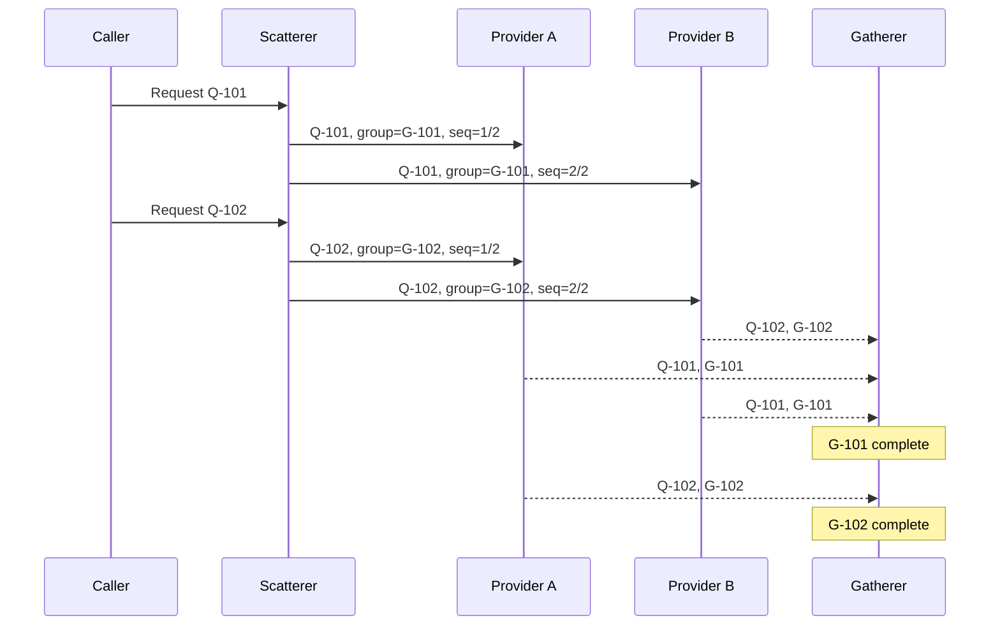
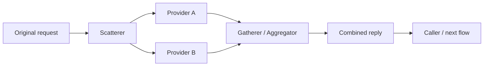
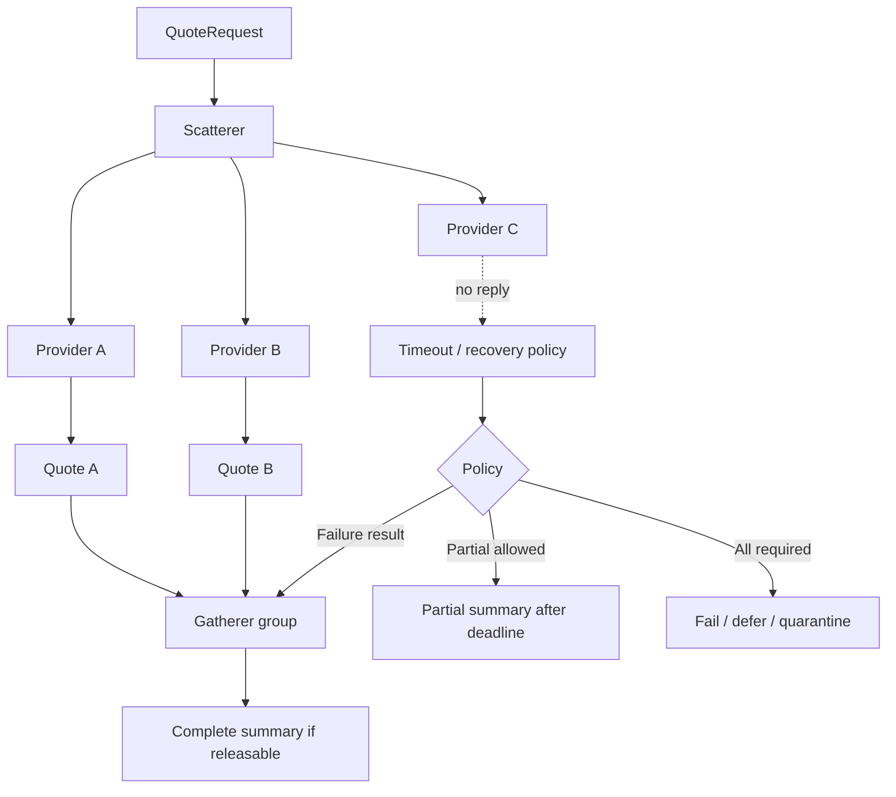
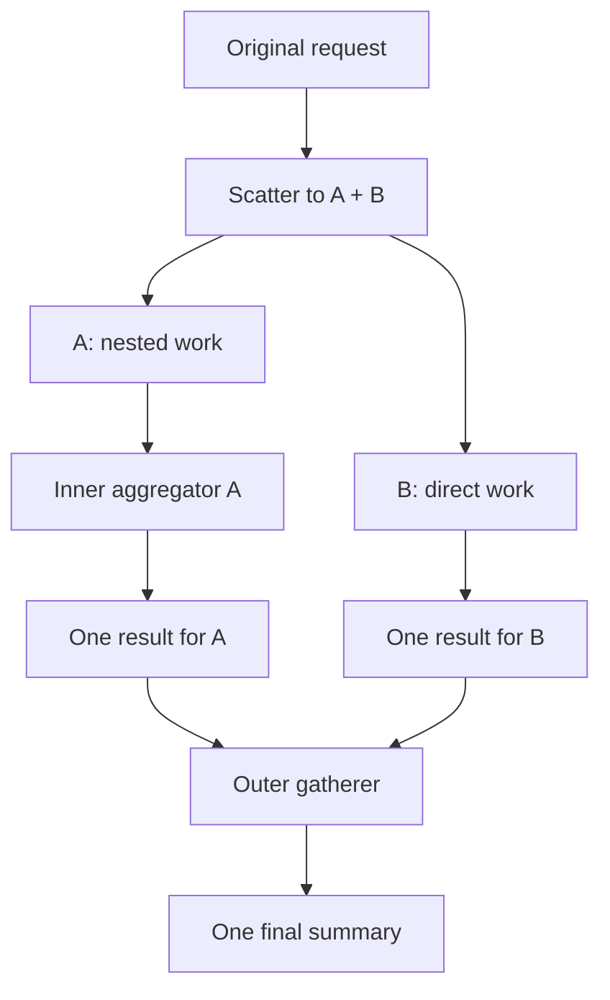
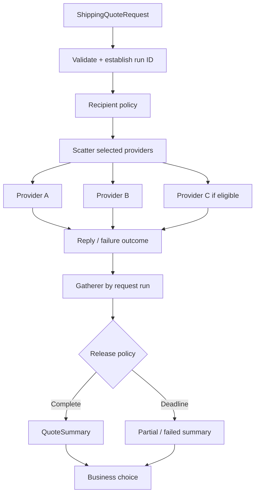

# Correlation giữa request và response

Trong mẫu **Scatter–Gather** của Enterprise Integration Patterns (EIP), một request được **phân phối tới nhiều bên xử lý** (*scatter*) và các response được **tập hợp thành một kết quả** (*gather*). Điểm khó không nằm ở việc gửi một message đến hai hay ba handler, mà nằm ở câu hỏi: **response nào thuộc request nào?** Nếu hai request chạy đồng thời, một đối tác trả lời chậm, một đối tác retry hoặc một response đến sau timeout, hệ thống vẫn phải gom đúng kết quả, không trộn các lượt xử lý và không coi thiếu phản hồi là thành công.

Trong **Spring Integration**, Scatter–Gather có thể được triển khai bằng cơ chế phát tới các recipient (chẳng hạn Recipient List Router hoặc Publish–Subscribe) kết hợp với Aggregator. **Correlation metadata** liên kết các message trong một lượt fan-out; **sequence metadata** hỗ trợ xác định số phản hồi kỳ vọng; đường **request–reply** đưa kết quả đã tổng hợp trở lại nơi chờ. Các trách nhiệm ấy liên quan nhưng **không thể thay thế cho nhau**.

Bài thuộc chương **Scatter gather** của module `SPRING_INTEGRATION_PATTERN`. Phạm vi module là học triển khai EIP bằng Spring Integration để xây dựng các luồng thông điệp ít phụ thuộc, dễ mở rộng; phối hợp Router, Filter, Transformer, Splitter, Aggregator, Gateway, retry, error channel và correlation, đồng thời kiểm thử, theo dõi từng nhánh.

**Mục tiêu học tập**

- Phân biệt `requestId` nghiệp vụ, `MessageHeaders.id`, `correlationId`, `sequenceNumber`, `sequenceSize` và `replyChannel`.
- Giải thích cách Scatterer tạo hoặc truyền metadata để Gatherer ghép **nhiều response vào đúng một lượt request**.
- Dự đoán hành vi khi response **đảo thứ tự, thiếu, trùng, lỗi hoặc đến muộn**.
- Xây dựng flow Scatter–Gather có hai recipient trong cùng JVM, trả kết quả có kiểu và kiểm thử correlation trên nhiều request.
- Thiết kế request–reply qua Gateway, executor hoặc broker sao cho không đánh rơi correlation và không tạo hai kết quả nghiệp vụ ngoài ý muốn.
- Chọn timeout, partial-result policy, idempotency, group store và metrics phù hợp với mức độ quan trọng của dữ liệu.

## 1. Bài toán: request A không được nhận response của request B

Giả sử một ứng dụng báo giá gửi cùng một yêu cầu tới hai nhà cung cấp độc lập:

```text
Request Q-101: báo giá SKU-10, số lượng 2
  ├── Provider A  -> 250.000 VND
  └── Provider B  -> 240.000 VND

Request Q-102: báo giá SKU-22, số lượng 1
  ├── Provider A  -> 130.000 VND
  └── Provider B  -> 135.000 VND
```

Ở môi trường bất đồng bộ, phản hồi có thể đến theo thứ tự:

```text
T1: Provider B trả cho Q-102
T2: Provider A trả cho Q-101
T3: Provider B trả cho Q-101
T4: Provider A trả cho Q-102
```

Nếu Gatherer chỉ đếm “đã có hai response” mà **không nhóm theo request**, kết quả có thể chứa một báo giá của Q-101 và một báo giá của Q-102. Đó là lỗi logic nghiêm trọng, đặc biệt khi response mang giá tiền, dữ liệu khách hàng hoặc quyền truy cập.



`G-101`, `G-102` ở sơ đồ là **ký hiệu minh họa cho group key**, không phải tên header hoặc giá trị mặc định do Spring tự cấp. Điều cần bảo toàn là **mỗi lượt fan-out có một identity đủ phân biệt** trong phạm vi bộ gom.

### Correlation cần trả lời hai câu hỏi riêng

1. **Response thuộc lượt scatter nào?** Đây là vấn đề của **correlation strategy/group key** tại Gatherer.
2. **Kết quả gom xong phải về caller nào?** Đây là vấn đề của **request–reply/reply-channel context**, có thể liên quan đến Gateway và channel nội bộ mà Scatter–Gather quản lý.

Dùng chung một ID cho cả hai mục đích có thể là một lựa chọn của ứng dụng, nhưng **không đồng nghĩa hai cơ chế là một**.

## 2. Những ID/header phải phân biệt

Một request đi qua Scatter–Gather có thể mang nhiều ID. Chúng phục vụ các mục đích khác nhau:

| Trường | Vai trò | Có nên dùng làm khóa nhóm? |
| --- | --- | --- |
| `requestId` trong payload | ID nghiệp vụ do ứng dụng định nghĩa cho một request. | Có thể dùng trong **custom correlation strategy** nếu phù hợp phạm vi và vòng đời. |
| `MessageHeaders.id` | ID của một Spring message cụ thể. | Có thể được dùng làm cơ sở cho group của **một lượt scatter**; không mặc định bền vững qua replay. |
| `correlationId` | Nhận diện nhóm các response cần gom. | **Thường là khóa mặc định/được kỳ vọng** bởi Gatherer/Aggregator phù hợp. |
| `sequenceNumber` | Vị trí trong một tập message đã được đánh sequence. | **Không** phải group key. |
| `sequenceSize` | Kích thước nhóm dự kiến khi biết. | Dùng hỗ trợ release, **không** nhận diện nhóm. |
| `replyChannel` | Đường để gửi reply tới endpoint/caller đang chờ. | Không phải group key và không được thay tùy tiện. |
| `errorChannel` | Metadata hỗ trợ xử lý lỗi trong các cơ chế Spring Integration tương ứng. | Không dùng để nhóm phản hồi thông thường. |
| `traceId`/trace context | Quan sát request xuyên các endpoint. | Không dùng làm chứng cứ quyền hoặc khóa nhóm duy nhất. |
| `tenantId`, `runId` | Phạm vi tenant và lượt thực thi nghiệp vụ. | Có thể cần trong **group identity** để tránh trộn dữ liệu. |

`requestId`, `tenantId` và `runId` là trường **do ứng dụng quy định**; không phải tất cả đều là Spring message headers có sẵn. Cũng không nên đồng nhất `traceId` với `correlationId`: một trace có thể chứa nhiều request con và nhiều nhóm scatter độc lập.

### Hai lớp danh tính

Xét một message gốc:

```text
payload:
  requestId = Q-101
  sku       = SKU-10
  quantity  = 2

headers:
  id        = <spring-message-id>
  traceId   = trace-101
```

Sau scatter, các message con có thể mang metadata dạng:

```text
Branch request A:
  requestId     = Q-101                 (nghiệp vụ)
  correlationId = <scatter-group-key>   (gom phản hồi)
  sequenceNumber = 1
  sequenceSize   = 2

Branch request B:
  requestId     = Q-101
  correlationId = <cùng-scatter-group-key>
  sequenceNumber = 2
  sequenceSize   = 2
```

Đây là **mô hình khái niệm**. Khi dùng các endpoint và cơ chế sequence của Spring Integration, framework có thể tạo/copy headers phục vụ nhóm. **Không tự giả định** giá trị cụ thể của `correlationId` luôn bằng `requestId` hay một `MessageHeaders.id` nhất định; hãy kiểm tra topology/phiên bản và viết test.

## 3. Scatterer, Gatherer và đường trả lời

Trong một Scatter–Gather flow thường có hai nửa:



**Scatterer** xác định những recipient cần nhận request và phát các message tương ứng. Nếu có nhiều recipient, metadata sequence/correlation phải cho Gatherer biết **bao nhiêu phản hồi được kỳ vọng** theo kế hoạch đã chọn.

**Gatherer** sử dụng correlation strategy để nhóm các response, release strategy để quyết định **nhóm nào đã đủ**, và group processor để tạo payload kết quả. Khi group được release, kết quả cần theo đúng **reply contract** của request ban đầu.

### Scatter–Gather khác Publish–Subscribe một chiều

Một `PublishSubscribeChannel` có thể gửi cùng message tới nhiều subscriber, nhưng nếu các subscriber chỉ log hoặc trả `null`, **không có response để gather**. Scatter–Gather đòi hỏi mỗi nhánh tham gia phải có đường **trả kết quả** hoặc có chính sách rõ ràng cho trường hợp không trả.

Ví dụ:

```text
Broadcast event -> audit (no reply)
                -> metrics (no reply)
```

Đây là **broadcasting**, không phải một Scatter–Gather có hai kết quả.

Ngược lại:

```text
QuoteRequest -> provider A -> QuoteResult A
             -> provider B -> QuoteResult B
                         -> gather -> QuoteSummary
```

Đây là mẫu Scatter–Gather khi các kết quả được nhóm đúng theo request.

### Không coi `replyChannel` là `correlationId`

`replyChannel` được hệ thống request–reply dùng để xác định **đích nhận kết quả**, còn `correlationId` được Aggregator dùng để xác định **những response phải ở chung một group**. Trong một flow Scatter–Gather, framework có thể bố trí **đường reply nội bộ** cho các nhánh trước khi đưa kết quả cuối về caller.

Nếu một worker tự dựng `Message` mới rồi bỏ các header phục vụ reply hoặc correlation, Gatherer có thể **không nhận được response**, hoặc nhận mà **không nhóm được**. Việc tự ghi đè `replyChannel` sang một channel nghiệp vụ cũng có thể khiến phản hồi đi sai đường.

## 4. Đúng nhóm chưa đủ: còn cần biết nhóm đã hoàn tất chưa

Giả sử một lượt scatter gửi tới ba đối tác:

```text
correlationId = G-201
expected responses = 3

Received:
  Provider A -> response 1
  Provider C -> response 3

Missing:
  Provider B -> ?
```

Các response nhận được đều có cùng correlation key, nhưng **group vẫn thiếu một kết quả**. Correlation strategy không quyết định khi nào có thể trả kết quả. Đó là trách nhiệm của **release strategy**.

| Điều kiện | Ý nghĩa |
| --- | --- |
| `correlationId` giống nhau | Response có thể thuộc cùng một group. |
| `sequenceNumber` khác nhau, hợp lệ | Có thể đại diện cho các recipient/nhánh khác nhau. |
| `sequenceSize=3` | Scatterer kỳ vọng nhóm có ba phần theo mô hình sequence được chọn. |
| Group nhận đủ ba phần hợp lệ | Có thể release nếu release strategy và contract cho phép. |
| Group nhận hai phần rồi timeout | Có thể trả partial, từ chối hoặc tiếp tục chờ theo policy. |
| Group nhận ba bản nhưng một bản là duplicate | **Không** nên mặc định đã đủ ba recipient riêng biệt. |

**Đừng dùng `group.size()==sequenceSize` như một bằng chứng phổ quát của tính đầy đủ.** Retry/redelivery có thể tạo duplicate, Filter có thể loại response, hoặc một recipient có thể trả nhiều message. Cần hiểu **cardinality thực tế** và kiểm tra identity của từng response khi nghiệp vụ yêu cầu.

### Số lượng recipient có thể động

Nếu Recipient List Router chọn recipient theo vùng địa lý, mức ưu tiên hoặc loại đơn hàng, request A có thể có **2** recipient, request B có **3**. Không nên hard-code `sequenceSize=3` cho mọi message.

Kế hoạch recipients cần được xác định theo policy tin cậy, và response count phải phản ánh **số kết quả mà Gatherer thật sự cần để hoàn tất**. Với một recipient bị bỏ bởi Filter, một handler không trả reply, hoặc một nhánh tạo nhiều kết quả, phải định nghĩa lại release strategy hoặc trả một result thay thế.

## 5. Thiết kế response có kiểu và có nguồn

Một lỗi phổ biến là tất cả recipient đều trả một số tiền `long`, rồi Aggregator tạo danh sách `[250000, 240000]`. Nếu hai response đến đảo thứ tự, ứng dụng không còn biết **giá nào của nhà cung cấp nào**. Giải pháp là để từng response mang cả **business request identity** và **recipient identity**.

Ví dụ Java 17+:

```java
import java.util.List;

record QuoteRequest(
        String requestId,
        String sku,
        int quantity
) {}

record ProviderQuote(
        String requestId,
        String providerId,
        long amountMinorUnits,
        String currencyCode,
        boolean available
) {}

record QuoteSummary(
        String requestId,
        List<ProviderQuote> quotes
) {
    QuoteSummary {
        quotes = List.copyOf(quotes);
    }
}
```

Đây là **hợp đồng dữ liệu của ứng dụng**, không phải kiểu message mà Spring Integration mặc định tạo. `requestId` cho phép kiểm tra rằng các response trong một group thực sự thuộc cùng yêu cầu nghiệp vụ; `providerId` giúp phát hiện trùng một recipient, sắp xếp ổn định và giải thích kết quả.

### Không dùng sequence làm identity của provider

Trong một lượt scatter, Provider A có thể là `sequenceNumber=1`, Provider B là `2`. Nhưng nếu danh sách recipient hoặc thứ tự router thay đổi, `1` có thể đại diện cho đối tác khác.

Vì vậy:

- `sequenceNumber` là **metadata định tuyến/gom nhóm của một lượt dispatch**.
- `providerId` là **danh tính nghiệp vụ của nguồn báo giá**.
- `requestId` là **danh tính yêu cầu trong hợp đồng**.
- `correlationId` là **danh tính group của Aggregator**.

Một response có `providerId=A` nhưng `sequenceNumber=2` có thể vẫn hợp lệ nếu thứ tự recipient đã thay đổi; ngược lại hai response cùng `providerId=A` có thể là **duplicate**, dù sequence metadata khác nhau. Hợp đồng ứng dụng phải nêu rõ cách xử lý.

## 6. Dùng `MessageGroupProcessor` để kiểm tra response trước khi tạo summary

Dưới đây là processor minh họa dành cho **group hoàn chỉnh gồm đúng hai nhà cung cấp `A` và `B`**. Nó không chỉ đếm số message: nó kiểm tra kiểu payload, `requestId` nhất quán và không có `providerId` trùng.

```java
import java.util.ArrayList;
import java.util.HashSet;
import java.util.List;
import java.util.Set;

import org.springframework.integration.aggregator.MessageGroupProcessor;
import org.springframework.integration.store.MessageGroup;
import org.springframework.messaging.Message;

final class QuoteGroupProcessor implements MessageGroupProcessor {

    private static final Set<String> REQUIRED_PROVIDERS = Set.of("A", "B");

    @Override
    public Object processMessageGroup(MessageGroup group) {
        List<ProviderQuote> quotes = new ArrayList<>();
        Set<String> seenProviders = new HashSet<>();
        String requestId = null;

        for (Message<?> message : group.getMessages()) {
            if (!(message.getPayload() instanceof ProviderQuote quote)) {
                throw new IllegalArgumentException("UNEXPECTED_QUOTE_PAYLOAD");
            }
            if (quote.requestId() == null || quote.requestId().isBlank()) {
                throw new IllegalArgumentException("MISSING_REQUEST_ID");
            }
            if (!REQUIRED_PROVIDERS.contains(quote.providerId())
                    || !seenProviders.add(quote.providerId())) {
                throw new IllegalArgumentException("DUPLICATE_OR_UNKNOWN_PROVIDER");
            }
            if (requestId == null) {
                requestId = quote.requestId();
            } else if (!requestId.equals(quote.requestId())) {
                throw new IllegalArgumentException("MIXED_REQUEST_GROUP");
            }
            if (quote.available() && quote.amountMinorUnits() <= 0) {
                throw new IllegalArgumentException("INVALID_QUOTE_AMOUNT");
            }
        }

        if (!seenProviders.equals(REQUIRED_PROVIDERS)) {
            throw new IllegalStateException("INCOMPLETE_QUOTE_GROUP");
        }

        quotes.sort(java.util.Comparator.comparing(ProviderQuote::providerId));
        return new QuoteSummary(requestId, quotes);
    }
}
```

**Đọc đúng trách nhiệm của processor:**

1. Nó **không tạo correlation key**; group đã được Aggregator cung cấp.
2. Nó **không quyết định thời điểm release**; release strategy phải gọi processor ở trạng thái thích hợp.
3. Nó kiểm tra hợp đồng **hai provider khác nhau, cùng request**, không cho hai bản trả lời của A giả thành A+B.
4. Nó sắp xếp theo `providerId` vì thứ tự arrival không ổn định.
5. Nó trả một **payload `QuoteSummary`**, không gọi nhà cung cấp hay ghi DB.
6. Nếu cấu hình cho phép partial release, processor này **cố ý từ chối** nhóm chưa đủ. Cần processor/DTO khác cho partial policy, không chỉ bắt exception rồi trả danh sách thiếu.

### Vì sao nên giữ processor thuần?

Nếu `processMessageGroup()` vừa chọn giá rẻ nhất vừa gọi API đặt hàng, một retry của Aggregator hoặc một late response có thể gây **mua hàng hai lần**. Nên tách:

```text
Correlation + release
      |
      v
Pure QuoteGroupProcessor
      |
      v
QuoteSummary
      |
      v
Business decision + idempotent side effect
```

Kết quả tổng hợp có thể được replay và kiểm thử độc lập. Các side effect quan trọng cần idempotency key bền vững và cơ chế xác nhận ở đúng handler.

## 7. Java DSL: một Scatter–Gather flow trong cùng JVM

Đoạn cấu hình sau minh họa **hai recipient đồng bộ**, mỗi recipient trả một `ProviderQuote`, sau đó Gatherer tạo `QuoteSummary`. Java DSL có API cụ thể phụ thuộc phiên bản Spring Integration; khi triển khai thật phải biên dịch và kiểm thử với dependency của dự án.

```java
import org.springframework.context.annotation.Bean;
import org.springframework.context.annotation.Configuration;
import org.springframework.integration.aggregator.SimpleSequenceSizeReleaseStrategy;
import org.springframework.integration.channel.DirectChannel;
import org.springframework.integration.channel.QueueChannel;
import org.springframework.integration.config.EnableIntegration;
import org.springframework.integration.dsl.IntegrationFlow;

@Configuration
@EnableIntegration
class QuoteScatterGatherConfig {

    @Bean
    DirectChannel quoteRequests() {
        return new DirectChannel();
    }

    @Bean
    DirectChannel providerARequests() {
        return new DirectChannel();
    }

    @Bean
    DirectChannel providerBRequests() {
        return new DirectChannel();
    }

    @Bean
    QueueChannel quoteSummaries() {
        return new QueueChannel();
    }

    @Bean
    QuoteGroupProcessor quoteGroupProcessor() {
        return new QuoteGroupProcessor();
    }

    @Bean
    IntegrationFlow quoteScatterGather(QuoteGroupProcessor processor) {
        return IntegrationFlow.from("quoteRequests")
                .scatterGather(
                        scatterer -> scatterer
                                .recipient("providerARequests")
                                .recipient("providerBRequests"),
                        gatherer -> gatherer
                                .releaseStrategy(
                                        new SimpleSequenceSizeReleaseStrategy())
                                .outputProcessor(processor))
                .channel("quoteSummaries")
                .get();
    }

    @Bean
    IntegrationFlow providerA() {
        return IntegrationFlow.from("providerARequests")
                .handle(QuoteRequest.class, (request, headers) ->
                        new ProviderQuote(
                                request.requestId(), "A",
                                250_000, "VND", true))
                .get();
    }

    @Bean
    IntegrationFlow providerB() {
        return IntegrationFlow.from("providerBRequests")
                .handle(QuoteRequest.class, (request, headers) ->
                        new ProviderQuote(
                                request.requestId(), "B",
                                240_000, "VND", true))
                .get();
    }
}
```

**Các giới hạn của ví dụ:**

- `providerARequests` và `providerBRequests` chỉ là channel/handler **trong JVM**, không gọi HTTP thật.
- Hai handler trả **một kết quả** theo kiểu request–reply; một handler chỉ log/`return null` sẽ không tạo response để Gatherer gom.
- Scatterer dùng Recipient List Router với hai recipient; việc gắn sequence/correlation phải được xác minh trên **phiên bản Spring Integration** mà dự án sử dụng.
- `SimpleSequenceSizeReleaseStrategy` minh họa điều kiện **đủ số lượng**; nó **không phải** cơ chế chống duplicate tuyệt đối. Processor kiểm tra provider identity để phát hiện lỗi trước khi xuất summary.
- `quoteSummaries` là `QueueChannel` để test lấy kết quả, **không tự lưu bền vững** hoặc gửi trả một HTTP caller.
- Hai handler hiện trả giá cố định cho minh họa. Trong production, giá phải đi kèm currency, version, thời điểm hiệu lực và quy tắc xác thực/kiểm tra thích hợp.

**Điểm quyết định:** Scatter–Gather phải được cấu hình sao cho **reply từ từng recipient thực sự đến Gatherer**. Nếu thay một handler bằng outbound adapter một chiều, cần có response flow tương ứng; không tự coi “đã gửi request đến provider” như “đã nhận báo giá”.

## 8. Kiểm thử happy path bằng Spring Test

Với cấu hình ở mục 7, bài test xác nhận một request sinh ra **một summary chứa đúng hai provider**. `@DirtiesContext` tránh ảnh hưởng từ những group/queue của test khác.

```java
import static org.junit.jupiter.api.Assertions.assertEquals;
import static org.junit.jupiter.api.Assertions.assertNotNull;
import static org.junit.jupiter.api.Assertions.assertNull;
import static org.junit.jupiter.api.Assertions.assertTrue;

import org.junit.jupiter.api.Test;
import org.springframework.beans.factory.annotation.Autowired;
import org.springframework.beans.factory.annotation.Qualifier;
import org.springframework.integration.channel.QueueChannel;
import org.springframework.messaging.Message;
import org.springframework.messaging.MessageChannel;
import org.springframework.messaging.support.MessageBuilder;
import org.springframework.test.annotation.DirtiesContext;
import org.springframework.test.context.junit.jupiter.SpringJUnitConfig;

@SpringJUnitConfig(QuoteScatterGatherConfig.class)
@DirtiesContext(classMode = DirtiesContext.ClassMode.AFTER_EACH_TEST_METHOD)
class QuoteScatterGatherFlowTest {

    @Autowired @Qualifier("quoteRequests")
    MessageChannel input;

    @Autowired @Qualifier("quoteSummaries")
    QueueChannel output;

    @Test
    void gathersOnlyResponsesForTheCurrentRequest() {
        var first = new QuoteRequest("Q-101", "SKU-10", 2);

        assertTrue(input.send(MessageBuilder.withPayload(first)
                .setHeader("traceId", "trace-101")
                .build()));

        Message<?> result = output.receive(1_000);
        assertNotNull(result);

        QuoteSummary summary = (QuoteSummary) result.getPayload();
        assertEquals("Q-101", summary.requestId());
        assertEquals(2, summary.quotes().size());
        assertEquals("A", summary.quotes().get(0).providerId());
        assertEquals("B", summary.quotes().get(1).providerId());
        assertTrue(summary.quotes().stream().allMatch(quote ->
                "Q-101".equals(quote.requestId())));
        assertNull(output.receive(0));
    }

    @Test
    void consecutiveRequestsKeepDifferentSummaries() {
        input.send(MessageBuilder.withPayload(
                new QuoteRequest("Q-201", "SKU-A", 1)).build());
        input.send(MessageBuilder.withPayload(
                new QuoteRequest("Q-202", "SKU-B", 1)).build());

        QuoteSummary a = (QuoteSummary) output.receive(1_000).getPayload();
        QuoteSummary b = (QuoteSummary) output.receive(1_000).getPayload();

        assertEquals("Q-201", a.requestId());
        assertEquals("Q-202", b.requestId());
        assertEquals(2, a.quotes().size());
        assertEquals(2, b.quotes().size());
        assertNull(output.receive(0));
    }
}
```

Test **không kết luận rằng correlation trong môi trường nhiều thread đã được chứng minh đầy đủ**: hai recipient ở cấu hình mẫu xử lý đồng bộ. Với executor, nhiều request đồng thời và một provider trả chậm, cần thêm test **interleaving** và xác minh từng group vẫn có đúng hai provider cùng `requestId`.

### Cần kiểm thử ở cấp headers

Ngoài payload cuối, có thể thêm interceptor/test handler ở ranh giới Scatterer và Gatherer để kiểm tra:

- Hai branch request cùng một lượt scatter có **correlation key liên quan**, đồng thời phân biệt với lượt request khác.
- Các branch có sequence metadata tương thích với release policy.
- Response từ handler vẫn mang metadata cần thiết để Gatherer gom và trả lời.
- Reply cuối quay về đúng `replyChannel` hoặc output của Scatter–Gather; không bị gửi vào input channel của một request khác.

Không nên ràng buộc test vào một ID sinh ngẫu nhiên cụ thể; kiểm tra **quan hệ giữa các ID**, ví dụ *A và B cùng group, request thứ hai không dùng nhầm group của request thứ nhất*.

## 9. Khi response đến không theo thứ tự

Sự không đồng bộ thay đổi **thứ tự đến** nhưng không làm thay đổi câu hỏi phải trả lời. Ví dụ:

```text
Q-301 -> A slow, B fast
  09:00:00.010  B reply
  09:00:00.400  A reply
```

Gatherer không được dựa vào callback thứ nhất là Provider A. Output phải chứa `providerId` rõ ràng. Nếu downstream cần ưu tiên provider rẻ hơn, cần so sánh các quote theo cùng **currency và contract**, không chọn phần tử đầu tiên trong `group.getMessages()`.

### Vì sao `sequenceNumber` không phải thứ tự hoàn thành?

Sequence number thể hiện **vị trí trong tập recipient/message đã được đánh sequence**, không phải timestamp hay thứ tự kết thúc. Trong một ứng dụng dùng `Executor`, Provider B có thể xử lý xong trước Provider A. Nếu ứng dụng cần kết quả sắp theo thứ tự người nhận, hãy dùng `providerId` hoặc sequence metadata được kiểm tra, không dựa vào arrival order.

### Số lượng kết quả không tương đương số lần xử lý

Một handler retry có thể được gọi ba lần nhưng chỉ nên có **một response nghiệp vụ hợp lệ** cho một `(requestRunId, providerId)` theo contract. Một kết quả lỗi có kiểu như `ProviderUnavailable` cũng có thể được coi là **một response đã hoàn thành** nếu release policy cần nhận kết quả từ mọi nhánh.

## 10. Một recipient không phản hồi: correlation đúng vẫn có thể treo group

Giả sử scatter gửi tới A, B, C; A và B đã trả reply, C timeout. Group có correlation hợp lệ nhưng thiếu kết quả:



Có ba hướng chính:

1. **Failure-as-response:** biến lỗi xác định từ C thành `ProviderOutcome(status=UNAVAILABLE, providerId=C, ...)`, giữ group key/sequence. Gatherer nhận đủ **ba outcomes** và trả kết quả có tình trạng rõ ràng.
2. **Partial result:** release khi tới deadline, chỉ chứa những provider đã phản hồi; output phải ghi `expected=3`, `received=2`, `complete=false`, không giả làm summary đầy đủ.
3. **All-or-nothing:** nếu cả ba provider bắt buộc, dừng kết quả nghiệp vụ và phát lỗi/quarantine/defer có chính sách. Không trả `APPROVED` chỉ vì hai provider đầu đã thành công.

`SimpleSequenceSizeReleaseStrategy` tự nó không diễn đạt chính sách partial hoặc lỗi nghiệp vụ. Cần release/expiry strategy và processor/DTO tương ứng.

### Không ngầm dùng timeout như một response

Timeout là tín hiệu rằng **chưa nhận được kết quả trong hạn**, không phải chứng cứ Provider C đã xử lý thất bại hay giá bằng 0. Một response tới muộn có thể là kết quả hợp lệ nhưng **đã quá cửa sổ chấp nhận** của lượt gather hiện tại. Cần quy định xử lý late reply ngay từ đầu.

## 11. Ba loại timeout trong một hệ thống request–reply

Một flow Scatter–Gather có thể có nhiều đồng hồ:

| Timeout | Nơi áp dụng | Nó giới hạn điều gì? |
| --- | --- | --- |
| **Provider/client timeout** | HTTP, JDBC, message gateway hoặc adapter ở nhánh. | Thời gian chờ từng dependency trả lời. |
| **Gather/group expiry timeout** | Aggregator/MessageGroupStore/recovery. | Thời gian một nhóm được phép tích lũy response. |
| **Caller/Gateway reply timeout** | Request–reply Gateway/caller. | Thời gian người gọi chờ **kết quả tổng hợp**. |

Một deadline minh họa:

```text
Caller budget: 1.500 ms
  validate + scatter dispatch: 100 ms
  max provider attempt:        700 ms
  gather + mapping:            200 ms
  reply/network reserve:       500 ms
```

Các con số này chỉ phục vụ thiết kế, không phải thông số mặc định của Spring. Nếu một provider được retry ba lần với timeout 700 ms mỗi lần, tổng thời gian có thể vượt ngân sách caller. Nên truyền một **deadline hoặc time budget có nghĩa** theo flow và giới hạn backoff/retry ở từng nhánh.

**Group expiry không tự đồng nghĩa Gateway sẽ trả `PartialQuoteSummary`**. Ngược lại, Gateway đã timeout không có nghĩa các worker hoặc group tự động bị hủy. Trạng thái group và late results cần recovery policy.

## 12. Late response và group đã được release

Giả sử `Q-401` cần A và B. A phản hồi trước, B timeout; nhóm được release partial và xóa. Sau đó B trả về:

```text
10:00:00 Q-401 scattered
10:00:01 A replied
10:00:02 Partial summary issued
10:00:05 B replied late
```

Nếu không có **late-arrival policy**, response B có thể:

- Bị bỏ nhưng không được theo dõi.
- Tạo một group mới có cùng correlation key.
- Kích hoạt một summary thứ hai và gây side effect trùng.
- Đến một reply destination không còn người chờ.
- Gây tăng backlog vô hạn nếu không có expiry.

### Thiết kế điều kiện sau release

- **Nhóm hoàn tất phải có danh tính bền vững** nếu cần tránh phát summary lần hai.
- Cần quyết định có **chấp nhận correction/update** sau partial summary hay không.
- Nếu không chấp nhận, late response được **ghi audit + discard/quarantine** với mã `LATE_RESPONSE`.
- Nếu chấp nhận cập nhật, dùng **summary version** hoặc event bù trừ thay vì im lặng ghi đè kết quả đã phát.
- Nếu request có thể được chạy lại, dùng `runId` riêng để tránh response cũ của lần trước rơi vào group lượt sau.

Không chọn `expireGroupsUponCompletion` hoặc tùy chọn cleanup chỉ vì muốn giảm bộ nhớ mà bỏ qua hậu quả khi message đến muộn.

## 13. Retry và duplicate: một response hợp lệ có thể xuất hiện hai lần

Một provider có thể nhận lại request vì mạng bị lỗi hoặc broker redelivery; consumer có thể gửi response hai lần nếu ACK bị mất. Hai response cùng `requestId=Q-501` và `providerId=A` không nhất thiết biểu thị hai báo giá độc lập.

```text
Q-501 expected recipients: A + B

Received:
  A, attempt=1 -> 250000
  A, attempt=1 -> 250000 (duplicate)
  B, attempt=1 -> not yet received
```

Nếu Gatherer chỉ thấy **group size=2**, nó có thể được release quá sớm. Processor minh họa ở mục 6 sẽ phát hiện **`DUPLICATE_OR_UNKNOWN_PROVIDER`**, nhưng điều này **không tự phục hồi group** đã được release sai hoặc giải quyết message trùng trước đó.

Chiến lược bền hơn:

1. Dùng khóa response như `(requestRunId, providerId)` hoặc `(requestRunId, recipientId, responseType)` theo contract.
2. **Deduplicate trước khi đưa vào group** hoặc dùng store/release policy hiểu recipient identity.
3. Giữ `requestId` nghiệp vụ và `runId` nếu cùng request có thể chạy lại hợp lệ.
4. Đặt idempotency ở **provider invocation** nếu lookup có side effect, không chỉ ở Aggregator.
5. Tách `attemptId` (một lần thử) khỏi **request run** và business request identity.
6. Không mặc định `MessageHeaders.id` của một message sau replay vẫn giữ nguyên.

### Retry toàn bộ Scatter–Gather hay chỉ một recipient?

Retry **toàn bộ request** có thể gọi lại cả Provider A dù chỉ Provider B thất bại. Nếu A chỉ báo giá read-only, có thể chấp nhận theo hạn mức; nếu A tạo reservation hoặc đơn đặt hàng, retry toàn bộ có thể gây side effect trùng. Nên retry **theo recipient** khi phù hợp, có deadline và idempotency key ở đúng ranh giới.

## 14. Correlation khi đi qua Transformer, Router, Filter và Splitter

**Transformer:** Một nhánh đổi `QuoteRequest` thành `ProviderQuote`. Nếu trả payload mới theo cơ chế Spring Integration thông thường, metadata điều phối có thể được truyền phù hợp. Nếu tự tạo `MessageBuilder.withPayload(...).build()` và quên headers quan trọng, correlation/reply path có thể bị mất. Test propagation trên đúng endpoint và adapter.

**Router:** Scatterer có thể dùng Recipient List Router để chọn nhiều đích. Một Router nghiệp vụ trước đó có thể chọn tập provider theo vùng. **Đừng nhầm routing key** (ví dụ `VN_SOUTH`) với **group identity**; hai request cùng vùng vẫn là hai nhóm khác nhau.

**Filter:** Một recipient bị Filter loại và không phát result làm thiếu response. Nếu nhóm vẫn chờ ba kết quả, group có thể không bao giờ hoàn tất. Cho nhánh discard tạo một `ProviderSkipped` có correlation hoặc dùng partial timeout policy.

**Splitter:** Một Provider xử lý một request rồi tự Splitter thành nhiều subrequest. Nếu có hai tầng fan-out, `sequenceSize` của tầng trong **không thể dùng thay** số recipient của tầng ngoài. Cần tách correlation theo tầng, gom kết quả inner trước, rồi trả **một** response đại diện cho provider về outer Gatherer, hoặc tự định nghĩa group key/cardinality nhiều tầng.

**Aggregator:** Gatherer là điểm chịu trách nhiệm gom những kết quả tương quan; một group thường được nhận diện theo `correlationId`. Nhưng một ứng dụng có thể cần custom correlation strategy để nhóm theo business run, tenant hoặc provider batch. Khi tùy chỉnh, phải bảo đảm **group ID không va chạm và không đến từ nguồn chưa xác thực**.



Mỗi tầng cần biết rõ **đơn vị kết quả dự kiến**. Nếu tầng ngoài kỳ vọng 2 provider replies, tầng trong của A không được gửi trực tiếp 5 subresults vào outer group mà vẫn giữ `sequenceSize=2`.

## 15. Correlation qua Kafka, AMQP và các process khác

Trong cùng JVM, các Spring message headers có thể được truyền qua endpoint tương thích. Khi scatter tới các service khác qua Kafka, AMQP hoặc HTTP, **Spring `MessageHeaders` không mặc nhiên được giữ nguyên qua mọi adapter**.

```text
Spring Scatterer
   |
   | Message<QuoteRequest> + group metadata + reply context
   v
Outbound adapter / serializer / header mapper
   |
   v
Broker / remote provider
   |
   v
Response message with application contract
   |
   v
Inbound adapter / deserialize / recreate Spring message
   |
   v
Gatherer + correlation strategy
```

Cần thỏa thuận **correlation envelope** bền vững, ví dụ:

```json
{
  "requestId": "Q-601",
  "requestRunId": "Q-601/run-1",
  "recipientId": "provider-A",
  "expectedRecipientCount": 2,
  "responseId": "resp-A-601-1",
  "status": "QUOTE_AVAILABLE",
  "quote": {
    "amountMinorUnits": 250000,
    "currencyCode": "VND"
  }
}
```

Đây là **schema do ứng dụng tự định nghĩa**, không phải JSON bắt buộc của Spring Integration. Gateway hoặc aggregator ở phía nhận có thể ánh xạ lại `requestRunId` vào correlation strategy và sử dụng `recipientId` để deduplicate.

### Vì sao không serialize `replyChannel` như một tên bean bất kỳ?

Một `replyChannel` trong JVM có thể là tham chiếu đến Spring `MessageChannel` hoặc thông tin điều phối nội bộ. Service khác JVM không thể mặc định dùng lại tham chiếu đó để trả reply. Qua broker, cần thiết kế **reply destination có thể truy cập được**, message correlation ID và response consumer/adapter phù hợp.

Trong Spring Integration, có cơ chế header mapping và hỗ trợ các pattern request–reply của adapter; nhưng phải cấu hình/test trên transport cụ thể. Không đơn giản copy một object `MessageChannel` sang JSON rồi coi nó là địa chỉ dùng được ở service khác.

### Phải lưu kết quả group qua restart khi cần durability

Nếu ứng dụng crash sau khi nhận A nhưng trước khi nhận B, in-memory group store có thể mất A. Một persistent `MessageGroupStore` kết hợp transaction/recovery đúng có thể giúp phục hồi, nhưng **không tự bảo đảm exactly once** cho broker, producer, response handling và downstream side effect. Nếu cần khả năng phục hồi, phải thiết kế group state, ACK/commit, expiry, idempotency và thử nghiệm restart thật.

## 16. Bảo mật: cùng `correlationId` không đồng nghĩa cùng chủ thể

Correlation là một cơ chế **gom message**, không phải authentication. Nếu ứng dụng tin `correlationId` do client bên ngoài tự gửi, một client có thể cố khiến response của mình rơi vào group khác.

Các biện pháp quan trọng:

- Xác thực nguồn request và response tại các ingress/adapter.
- Ràng buộc `requestRunId` với **tenant identity, quyền và operation** đã được xác minh.
- Kiểm tra `requestId`/`providerId` trong payload response có tương ứng với group và recipient được phép không.
- Không cho một provider mạo danh provider khác chỉ bằng cách tự gắn `providerId=A`.
- Giới hạn số group, số message mỗi group, độ lớn payload và thời gian sống để chống memory/storage exhaustion.
- Không ghi PII, secrets hoặc dữ liệu thanh toán thô vào headers dễ bị log/propagate.
- Với một group được chia sẻ giữa nhiều tenant, khóa chỉ bằng `requestId` có thể va chạm; cần tenant-scoped group identity hoặc một ID toàn cục thật sự duy nhất và được xác minh.

**Nguyên tắc:** Chuyển được message tới đúng Gatherer **không đồng nghĩa** message đó được phép tham gia group hoặc được phép tạo side effect sau tổng hợp.

## 17. Lỗi của recipient khác với lỗi của Gatherer

Một luồng có thể thất bại ở nhiều thời điểm:

| Giai đoạn | Ví dụ | Hành vi cần thiết kế |
| --- | --- | --- |
| Scatter | Recipient channel không có consumer, topology sai. | Fail fast, error policy, không tạo trạng thái “đã đủ”. |
| Provider | Timeout, 503, invalid response. | Bounded retry; failure-as-response hoặc fail/defer. |
| Response transport | Header mapping mất correlation, publish failed. | Recovery/ack/retry với idempotency; kiểm tra envelope. |
| Gather correlation | Không tìm được group key, group ID không hợp lệ. | Reject/quarantine, không trộn vào group mặc định chung. |
| Gather release | Group chờ thiếu reply. | Expiry/partial/fail policy, cảnh báo group age. |
| Group processor | Duplicate provider, mixed request, currency sai. | Validation, error handling, không xuất summary sai. |
| Reply/output | Gateway đã timeout, output channel/broker lỗi. | Late reply recovery, idempotent result publishing. |

Nếu nhánh chạy đồng bộ, exception có thể lan ngược thread gửi. Với executor/poller/async adapter, exception có thể được chuyển thành `ErrorMessage` theo error handler và `errorChannel` được cấu hình. **Không mặc định** mọi lỗi từ provider sẽ tự biến thành một reply lỗi tương quan gửi cho Gatherer.

Ví dụ, muốn Aggregator nhận đủ một outcome từ B khi B thất bại, recovery flow phải **tạo một result có `requestRunId`, `recipientId` và correlation/sequence phù hợp**. Đưa exception thẳng vào một global error channel rồi không phát result cho Gatherer vẫn làm group thiếu phần tử.

## 18. Quan sát correlation và vòng đời request

Một sự cố Scatter–Gather khó điều tra khi chỉ có log “request sent” và “response received”. Cần nối được **cùng một request** qua tất cả nhánh và quan sát **tiến trình group**.

Các trường log có thể gồm:

```text
requestId=Q-701 runId=Q-701/run-1
groupKey=<scatter-group> recipient=A
outcome=REPLIED elapsedMs=125 traceId=trace-701

requestId=Q-701 runId=Q-701/run-1
groupKey=<scatter-group> expected=2 received=2
groupOutcome=COMPLETE summaryPublished=true
```

Đây là **định dạng ứng dụng minh họa**, không phải log Spring Integration tự sinh. Khi dùng tracing qua executor/reactive bridge, phải truyền context đúng công nghệ; không giả định MDC hoặc `ThreadLocal` tự đến worker thread.

| Metric minh họa | Ý nghĩa |
| --- | --- |
| `scatter_requests_total` | Số request gốc được gửi đi. |
| `scatter_recipients_total{recipient}` | Số lần dispatch tới từng recipient. |
| `gather_response_received_total{recipient,outcome}` | Số response nhận được và kết quả tương ứng. |
| `gather_group_open` | Số group đang chờ. |
| `gather_group_completed_total` | Số group đã release thành công. |
| `gather_group_expired_total` | Số group quá hạn. |
| `gather_group_age_seconds` | Tuổi group còn mở. |
| `gather_duplicate_response_total{recipient}` | Số response trùng theo contract. |
| `gather_late_response_total` | Số response đến sau release. |
| `scatter_gather_request_duration_seconds` | Độ trễ từ request vào đến summary ra. |

Tên metric là **gợi ý instrument**, không cam kết framework tự cung cấp đúng những tên này. Dùng nhãn hữu hạn như `recipient`, `outcome`, `flow`, `errorType`; không dùng `requestId`, `traceId`, `customerId` hoặc group key làm metric label vì high cardinality.

### Phân biệt các mốc hoàn thành

- **Scatter dispatched:** các branch request đã được giao ở ranh giới channel.
- **Provider replied:** một nhánh có response.
- **Group released:** Gatherer quyết định đủ điều kiện tạo output.
- **Summary published:** kết quả tổng hợp đã đi tiếp tới output channel.
- **Business action confirmed:** downstream đã ghi/hoàn tất side effect được xác nhận.

Một mốc trước **không tự chứng minh** mốc sau. Đặc biệt `send()` trả `true` không đủ để khẳng định hai remote providers đã hoàn tất và kết quả đã được lưu bền vững.

## 19. Ma trận kiểm thử correlation trước production

| Tình huống | Điều cần xác minh |
| --- | --- |
| Một request, hai provider trả đầy đủ | Có đúng một summary, hai provider khác nhau, cùng request ID. |
| Hai request xen kẽ response A/B | Không trộn group; mỗi summary chỉ chứa request của chính nó. |
| Response B đến trước A | Summary vẫn đúng; không phụ thuộc arrival order. |
| Provider B không trả reply | Group timeout/expiry/partial/failure policy hoạt động. |
| Response chỉ có `requestId` nhưng thiếu `correlationId` | Không bị nhóm nhầm; có error/quarantine policy. |
| Provider trả response sai request ID | Processor phát hiện mixed request và không công bố summary sai. |
| Cùng provider trả hai lần | Duplicate không làm release sớm hoặc phát side effect trùng. |
| Một provider có exception nhưng không tạo failure result | Đường lỗi rõ; không nhầm exception với reply bình thường. |
| Filter loại một branch | Có skipped/failure response hoặc điều chỉnh expected count hợp lý. |
| Recipient list thay đổi theo chính sách | Sequence size/release phản ánh số kết quả được kỳ vọng thật. |
| Provider dùng Splitter nội bộ | Inner correlation không phá group của outer Scatter–Gather. |
| Một response tới sau partial release | Late-message policy không tạo summary bất hợp lệ. |
| Gateway caller hết hạn chờ | Late reply không gửi nhầm cho request khác. |
| Broker redelivery sau crash | Group state và business ID phục hồi/deduplicate đúng. |
| Hai JVM cùng gom group | Store/affinity/lock phù hợp, không chia nhóm dở giữa process. |
| Multi-tenant | Không trộn response từ tenant khác vì khóa group va chạm. |
| Tải cao | Giới hạn memory/store, queue và thời gian sống của nhóm. |

Test không chỉ dựa vào `group.size()` hoặc số lần xử lý được gọi. Với Scatter–Gather, tính đúng đắn phải được xác minh bằng **mối quan hệ giữa request, recipient, group key và response**.

## 20. Bài tập tình huống: báo giá ba nhà vận chuyển

**Bối cảnh:** Một đơn hàng cần báo giá từ ba đơn vị vận chuyển A, B và C. Một số vùng chỉ có hai nhà vận chuyển khả dụng. Hệ thống phải trả một đề xuất trong tối đa 1,2 giây; có provider thường timeout, response có thể đến muộn, message qua broker có thể redeliver. Người dùng có thể gửi nhiều đơn đồng thời, và hệ thống phải tránh trộn đơn hoặc tenant.



### Nhiệm vụ thực hành

1. **Định nghĩa identity:** `requestId`, `requestRunId`, `tenantId`, `recipientId` và `responseId`. Phân biệt retry cùng run với request mới.
2. **Chọn recipients:** vùng nội địa có thể yêu cầu A/B; vùng đặc biệt dùng A/B/C. Dự kiến số response theo **tập recipients đã chọn**, không phải số lượng provider toàn hệ thống.
3. **Chọn release:** Nếu A trả, B timeout và C báo lỗi, có trả partial không? Nếu trả, thể hiện `complete=false`, `expected=3`, `responded=2` cùng lỗi của C.
4. **Thiết kế failure-as-response:** B timeout được biểu diễn khi nào thành `ProviderUnavailable` và khi nào tiếp tục chờ/retry?
5. **Correlation:** Làm sao chứng minh hai request Q-900/Q-901 có các group khác nhau dù cùng SKU và tenant?
6. **Idempotency:** Nếu A trả hai response giống nhau do broker redelivery, không được xem như đã nhận đủ A+B.
7. **Late reply:** Nếu C trả lúc 1,5 giây sau khi đã công bố summary, sẽ lưu, bỏ hay phát một bản correction? Ai quyết định?
8. **Khả năng phục hồi:** Nếu JVM restart ở thời điểm nhận hai trong ba response, chọn group store và message envelope nào để không làm mất nhóm?
9. **Request–reply:** Nếu Gateway có timeout 1,2 giây, còn worker tiếp tục sau timeout, trả status/asynchronous notification thế nào?
10. **Bảo mật:** `tenantId` và quyền của provider được xác minh từ đâu, tránh response giả mạo group ID của tenant khác.
11. **Kiểm thử:** các kịch bản nhận đảo thứ tự, response trùng, sai request, timeout, no-reply, late reply, multi-instance, broker redelivery và thay đổi recipient list.
12. **Quan sát:** đo riêng số request đã scatter, group đang chờ, nhóm complete/partial/expired và tỷ lệ lỗi từng provider.

### Câu hỏi tự đánh giá

**Câu 1:** Hai response có cùng `requestId` nhưng khác `correlationId` có chắc thuộc cùng group của Scatter–Gather không? **Không.** Gatherer nhóm theo correlation strategy; phải xác minh mapping và ngữ nghĩa của từng run.

**Câu 2:** `sequenceSize=3`, group nhận ba response nhưng đều từ Provider A. Có thể công bố một báo giá tổng hợp A/B/C hợp lệ không? **Không.** Cần kiểm tra recipient identity/deduplication; count đơn thuần không đủ.

**Câu 3:** Provider B timeout, `errorChannel` đã nhận một `ErrorMessage`. Gatherer có tự nhận một response `ProviderUnavailable` không? **Không.** Recovery flow phải tạo failure result tương quan nếu contract yêu cầu.

**Câu 4:** Gateway hết timeout có nghĩa request A/B/C đã được hủy và group bị xóa không? **Không được giả định.** Caller timeout, group expiry và worker cancellation là các cơ chế khác nhau.

**Câu 5:** Chuyển Scatter–Gather từ cùng JVM sang broker chỉ cần giữ tên `replyChannel` dưới dạng string là đủ không? **Không.** Cần reply destination/adapter, correlation envelope, header mapping và cơ chế recovery đúng transport.

## Tổng kết

- Trong **Scatter–Gather**, correlation giải quyết **response nào thuộc lượt request nào**, còn request–reply context xác định **kết quả tổng hợp phải về đâu**. `correlationId` không đồng nghĩa `replyChannel`, `traceId`, `requestId` hoặc Spring message ID.
- Scatterer chọn các recipient; Gatherer dùng **correlation strategy**, **MessageGroupStore**, **release strategy** và **group processor**. Đúng group chưa có nghĩa group đã đủ response.
- **`sequenceNumber`/`sequenceSize`** hỗ trợ theo dõi tập request/response nhưng **không** thay identity của recipient, không tự chống duplicate và không áp dụng máy móc khi số recipient thay đổi hoặc một nhánh trả nhiều result.
- Một response **thiếu, lỗi, trùng hoặc đến muộn** đòi hỏi timeout, failure-as-response/partial/fail policy, deduplication và late-arrival handling rõ ràng; không mặc định exception sẽ được gom như reply.
- Khi có **Gateway, Transformer, Filter, Splitter lồng nhau, executor hoặc broker**, cần bảo toàn hay tái tạo group identity và đường reply theo contract; ID bền vững và idempotency là trách nhiệm độc lập.
- Kiểm thử **nhiều request đồng thời và response xen kẽ**, kiểm tra quan hệ request–recipient–group, giám sát group còn mở/expiry/late reply và không suy luận nghiệp vụ đã hoàn tất chỉ từ `send()` hoặc group release.
