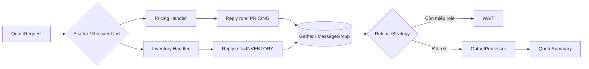
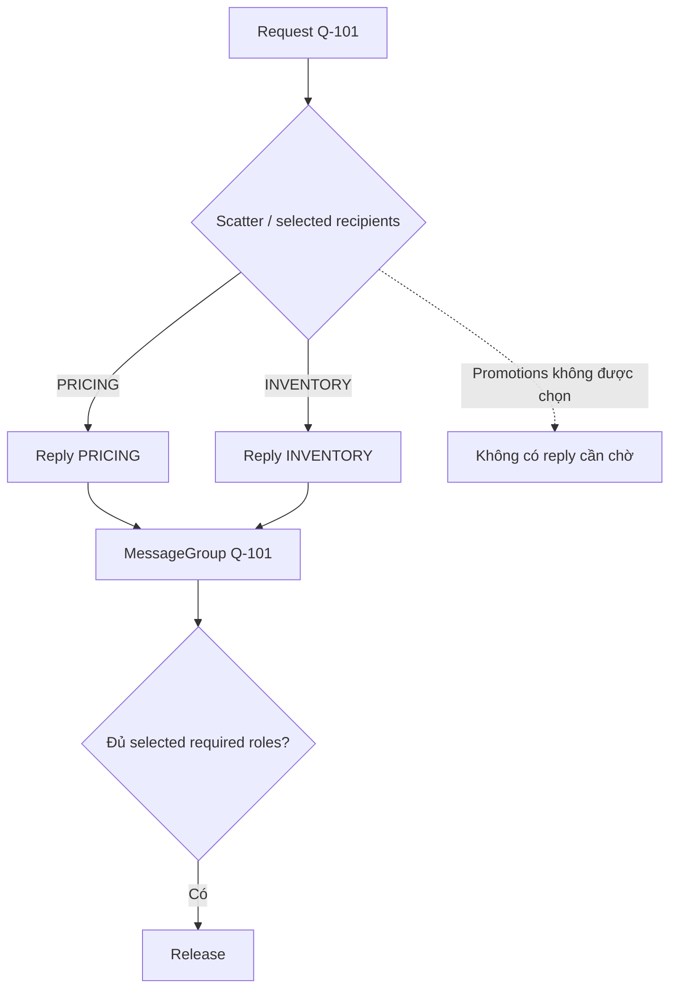
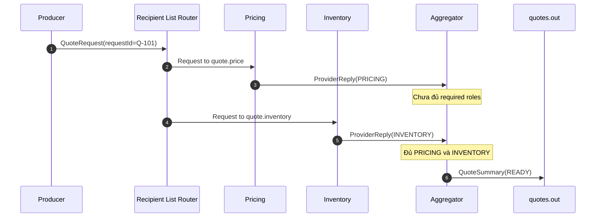
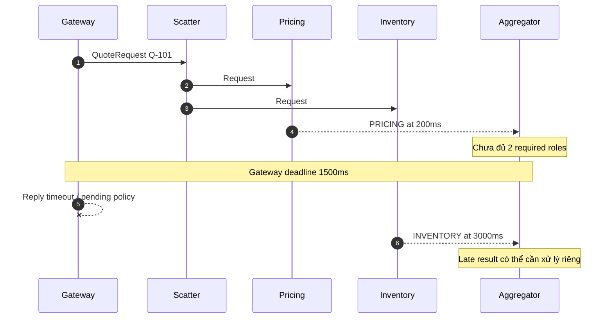
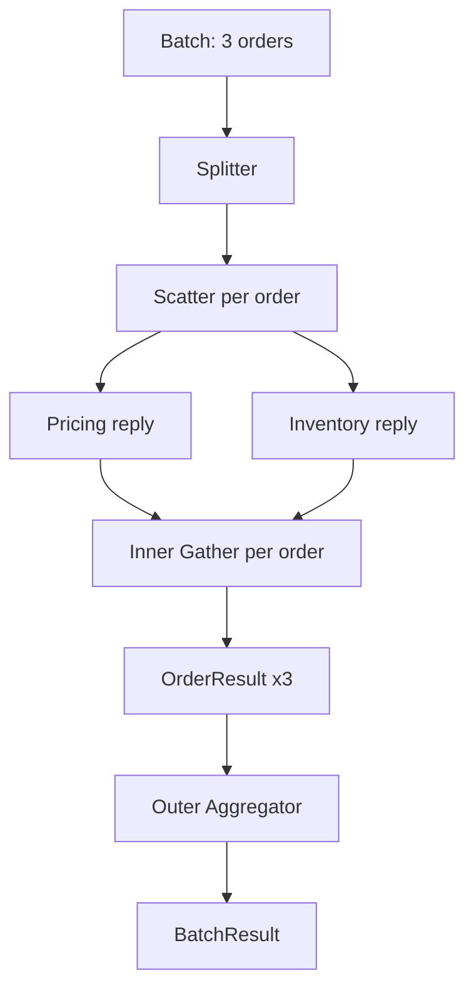

# Release strategy cho gathered replies

Một dịch vụ tiếp nhận yêu cầu báo giá cho đơn hàng. Từ **một request**, hệ thống phát đồng thời hai yêu cầu độc lập: **Pricing** tính giá và **Inventory** xác minh tồn kho. Sau đó, hệ thống phải **gather các reply** để tạo một kết quả duy nhất. Nhưng nếu Pricing trả lời hai lần do retry, Inventory phản hồi chậm, hoặc một nhánh trả lỗi thay vì kết quả, lúc nào được phép kết luận là “đã gather xong”?

Đó là trách nhiệm của **Release Strategy** trong mẫu **Scatter–Gather**. Scatter phát request tới nhiều recipient; Gather sử dụng một **Aggregator** để nhận các kết quả cùng nhóm. Release strategy xác định **khi nào tập reply đạt điều kiện hoàn tất**, chứ không chỉ xem đã có một message ở output hay chưa.

Bài **“Release strategy cho gathered replies”** thuộc chương **Scatter gather** của module `SPRING_INTEGRATION_PATTERN`. Trong phạm vi học **Enterprise Integration Patterns** với Spring Integration, chúng ta sẽ phân biệt release strategy với correlation và output processing, xây ví dụ Java DSL/JUnit 5, kiểm soát reply thiếu/trùng/đến muộn, timeout, error channel và retry, đồng thời kết hợp Router, Filter, Transformer, Splitter, Aggregator và Gateway để tạo luồng ít phụ thuộc, có khả năng mở rộng và quan sát từng nhánh.

> **Điểm cốt lõi:** Release strategy trả lời **“đã có đủ những reply bắt buộc hay chưa?”**. Một phép `group.size() == N` có thể phù hợp với các reply được bảo đảm đúng một lần, nhưng dễ sai khi có **duplicate, nhánh tùy chọn, fan-out theo điều kiện hoặc message không quay về Aggregator**. Phải thiết kế điều kiện theo **hợp đồng của những reply thực sự cần thiết**.

## 1. Scatter–Gather có hai nửa trách nhiệm

Ví dụ cho một request:

```json
{
  "requestId": "Q-101",
  "sku": "BOOK-02",
  "quantity": 3
}
```

Pricing trả:

```json
{
  "requestId": "Q-101",
  "role": "PRICING",
  "status": "SUCCESS",
  "detail": "unitPrice=120000"
}
```

Inventory trả:

```json
{
  "requestId": "Q-101",
  "role": "INVENTORY",
  "status": "SUCCESS",
  "detail": "available=18"
}
```

Đây là các schema minh họa. Khi có cả hai reply, Gather tạo một `QuoteSummary` hoặc `QuoteReceipt` để downstream tiếp tục.



### 1.1. Nửa Scatter: gửi tới đúng recipient

Scatter phải xác định **recipient nào thực sự được chọn**. Có thể dùng **Recipient List Router** để chọn nhiều channel theo quy tắc, hoặc **Publish–Subscribe** để broadcast cho subscriber đã đăng ký. Cả hai đều có thể góp phần thực hiện Scatter–Gather, nhưng việc fan-out không tự tạo ra một tập reply hoàn chỉnh.

### 1.2. Nửa Gather: nhóm, chờ và tạo kết quả

Gather cần đủ các thành phần:

1. **Correlation strategy:** reply nào thuộc cùng một request?
2. **Message group store:** giữ reply đã tới trong khi chờ các reply còn lại.
3. **Release strategy:** điều kiện nào cho phép nhóm phát output?
4. **Group processor:** kết quả tổng hợp được tạo từ những reply đó là gì?
5. **Timeout/expiry policy:** nếu reply bắt buộc không bao giờ đến thì sao?
6. **Late-reply policy:** sau khi đã hoàn tất hoặc hết hạn, reply trễ được xử lý thế nào?

**Release strategy không thay thế toàn bộ Gather.** Nó thường chỉ đưa ra một **quyết định boolean về trạng thái nhóm**; group processor mới thực hiện việc dựng dữ liệu kết quả.

## 2. Phân biệt những khái niệm thường bị gộp

| Khái niệm | Câu hỏi nó trả lời | Ví dụ |
| --- | --- | --- |
| **Recipient selection** | Scatter request tới những ai? | Pricing + Inventory; Promotions là tùy chọn. |
| **Correlation key** | Reply thuộc request nào? | `requestId=Q-101`. |
| **Expected replies/roles** | Cần chờ những reply nào? | `{PRICING, INVENTORY}`. |
| **`ReleaseStrategy`** | Nhóm hiện đã đủ điều kiện chưa? | Đã nhận đủ cả hai role bắt buộc. |
| **`MessageGroupProcessor`** | Phát output gì khi đủ? | `QuoteSummary(price, stock)`. |
| **Group timeout/expiry** | Đến hạn mà chưa đủ thì làm gì? | Partial, pending, fail hoặc quarantine. |
| **Gateway reply timeout** | Caller sẵn sàng chờ bao lâu? | HTTP caller chờ tối đa 1,5 giây. |
| **Idempotency** | Xử lý lặp có tạo thêm side effect? | Không trừ tồn kho hai lần. |

**Không đồng nhất “Scatter đã gửi xong” với “Gather đã xong”**. Hai bước có thể cách nhau hàng mili-giây hoặc nhiều phút. Nếu một recipient chỉ nhận được request mà chưa trả reply, số message được gửi đi không bằng số reply nhận về.

## 3. Có thể release theo những điều kiện nào?

| Chiến lược | Điều kiện logic | Khi nào phù hợp | Rủi ro |
| --- | --- | --- | --- |
| **Đủ số lượng** | `numberOfReplies == N`. | Tập recipient cố định, reply đúng một lần. | Duplicate có thể làm đủ số giả. |
| **Đủ role bắt buộc** | `receivedRoles ⊇ requiredRoles`. | Pricing/Inventory là các nguồn khác nhau. | Cần xác thực role và chống trùng. |
| **Đủ các recipient đã chọn** | `receivedRecipientIds ⊇ selectedRecipientIds`. | Recipient list động theo message. | Phải chốt danh sách recipient cho từng request. |
| **Quorum** | Đạt K nguồn độc lập, hợp lệ trong N nguồn. | Đọc từ nhiều replica có quy tắc đồng thuận. | Hai reply từ một nguồn không tạo quorum. |
| **Kết quả đầu tiên hợp lệ** | Có reply đáp ứng điều kiện chấp nhận. | Nhiều nguồn thay thế nhau. | Reply muộn còn chạy; cần late-result policy. |
| **Completion marker/watermark** | Đã nhận marker và đầy đủ phần trước marker. | Streaming không biết trước N. | Marker có thể đến trước một message trễ. |
| **Deadline/partial release** | Hết hạn theo một policy cho phép. | SLA giới hạn và partial result hợp lệ. | Không được đánh dấu thành công toàn phần. |

### 3.1. Structural completion khác business success

Giả sử hai reply đã tới:

```text
Pricing:   SUCCESS, unitPrice=120000
Inventory: OUT_OF_STOCK
```

Gather có thể **hoàn tất về cấu trúc** (đủ Pricing và Inventory), nhưng kết quả nghiệp vụ là **không đủ hàng**, không phải Quote thành công.

Một cách thiết kế rõ ràng:

- **Release strategy:** kiểm tra *đã có outcome cuối cùng của mọi role bắt buộc*.
- **Group processor:** phân loại `READY`, `REJECTED` hoặc `PARTIAL_FAILURE` từ nội dung các outcome.

Nếu mọi role phải trả **SUCCESS** mới release, một reply `OUT_OF_STOCK` có thể làm group **chờ vô hạn** dù hệ thống đã biết đủ để trả lời “không thể đáp ứng”. Thay vào đó, cho phép **terminal failure outcome** cũng đóng góp vào tính đầy đủ, trừ khi workflow yêu cầu retry trong deadline trước khi kết luận.

### 3.2. Đúng một reply cho mỗi role không tự được bảo đảm

Một handler có thể:

- xử lý và trả reply thành công;
- retry khiến cùng reply được gửi lại;
- không trả reply khi Filter loại message;
- timeout rồi hoàn thành sau deadline;
- trả nhiều message qua Splitter hoặc fan-out mới.

Vì thế mỗi reply nên có **identity, source/role, trạng thái terminal và correlation**. Không đếm mù `group.size()` khi giao tiếp qua broker hoặc nhiều nhánh bất đồng bộ.

## 4. Vì sao `sequenceSize` không phải lúc nào cũng là số reply cần chờ?

Spring Integration có các sequence headers, thường gặp trong Splitter và Publish–Subscribe/Recipient List ở một số cấu hình:

```text
correlationId = group key
sequenceNumber = vị trí trong sequence
sequenceSize = số phần dự kiến khi biết trước
```

Nhưng chúng không tự giải quyết mọi Scatter–Gather:

1. Một **Splitter** tạo 4 phần, rồi mỗi phần fan-out cho Pricing và Inventory, có thể tạo **8 outcome** chứ không phải 4.
2. Một **Recipient List** chọn 2 trong 3 recipient theo từng request; chờ cố định 3 reply sẽ bị kẹt.
3. **PublishSubscribeChannel** có thể có tập subscriber thay đổi theo lifecycle hoặc runtime.
4. Một Filter loại message mà không trả reply; sequence size ban đầu không tự giảm.
5. Broker có thể **redeliver** một reply; số message nhận được tăng nhưng số role hoàn tất không tăng.



**Kết luận:** Nếu release phụ thuộc **tập recipient thực sự đã được chọn**, cần lưu hoặc tái dựng tập đó một cách đáng tin **cho từng request**. Một `sequenceSize` được sinh ở một tầng khác không thể mặc định đại diện cho toàn bộ reply của Scatter.

### 4.1. `applySequence` hỗ trợ, không thay business contract

Trong những cấu hình Scatter–Gather dựa trên `PublishSubscribeChannel`, việc bật cơ chế sequence phù hợp có thể giúp Gather mặc định biết số reply kỳ vọng. Với Recipient List, sequencing cũng phụ thuộc cách router/channel được cấu hình. Tuy nhiên:

- Phải kiểm tra **phiên bản và topology** đang dùng có tạo/giữ header như mong đợi không.
- `applySequence` không bảo đảm **mọi recipient thực sự trả một reply**.
- Reply qua HTTP/AMQP/Kafka có thể đổi hoặc bỏ header do mapper/serialization.
- Nhiều tầng split/fan-out có thể tạo **sequence context mới**.

Không thay release strategy theo hợp đồng nghiệp vụ bằng một giả định “framework chắc đã tự biết đủ”.

## 5. Cấu trúc một message group an toàn

Để dễ hiểu, ví dụ dưới đây dùng **business request ID** ở payload, thay vì phụ thuộc vào message header có thể thay đổi qua adapter.

```java
// QuoteRequest.java
public record QuoteRequest(String requestId, String sku, int quantity) {}

// ProviderReply.java
public record ProviderReply(
    String requestId,
    String role,
    String status,
    String detail
) {}

// QuoteSummary.java
import java.util.Map;

public record QuoteSummary(
    String requestId,
    String overallStatus,
    Map<String, String> resultByRole
) {}
```

Tập role bắt buộc của ví dụ:

```text
requiredRoles = {"PRICING", "INVENTORY"}
```

**Giả định để tập trung vào release:** Các reply được tạo từ **hai handler tin cậy trong ứng dụng**, cùng dùng `requestId` của request gốc; chúng không phải dữ liệu gửi trực tiếp từ client chưa xác thực. Trong production cần validate version, nguồn, quyền và identity của reply trước khi đưa vào Aggregator.

### 5.1. Vì sao đặt role vào payload?

`role` có thể nằm trong một header đã được kiểm soát, nhưng trong ví dụ chọn payload giúp **processor đọc cùng một hợp đồng dù custom handler hoặc adapter thay header kỹ thuật**. Đây không phải quy tắc bắt buộc: điều quan trọng là **trường role ổn định, được xác thực, và được giữ qua ranh giới transport**.

### 5.2. Correlation key cần ổn định và đúng phạm vi

`requestId=Q-101` có thể do ingress/gateway tạo, là khóa để group reply. Nhưng **không chỉ dựa vào ID do client tự đặt** nếu hệ thống nhiều tenant; cần gắn thêm identity tenant/security boundary hoặc dùng một ID nội bộ không thể giả mạo.

Nếu retry cùng một yêu cầu tạo `requestId` mới, Gather có thể lập **group mới**. Nếu giữ requestId cũ, cần completed-group/late-reply policy để không phát output hai lần.

## 6. Custom release strategy theo role bắt buộc

Đây là một `ReleaseStrategy` chỉ release khi đã nhận **cả PRICING lẫn INVENTORY**, bất kể thứ tự và bất kể một role được gửi lặp. Nó không cần tin vào `sequenceSize`:

```java
// RequiredRolesReleaseStrategy.java
import java.util.HashSet;
import java.util.Set;
import org.springframework.integration.aggregator.ReleaseStrategy;
import org.springframework.integration.store.MessageGroup;
import org.springframework.messaging.Message;

public final class RequiredRolesReleaseStrategy
        implements ReleaseStrategy {

    private static final Set<String> REQUIRED =
        Set.of("PRICING", "INVENTORY");

    @Override
    public boolean canRelease(MessageGroup group) {
        if (group.getMessages().isEmpty()) {
            return false;
        }

        Set<String> received = new HashSet<>();
        String requestId = null;

        for (Message<?> message : group.getMessages()) {
            if (!(message.getPayload() instanceof ProviderReply reply)) {
                return false;
            }
            if (reply.requestId() == null || reply.requestId().isBlank()
                    || reply.role() == null
                    || !REQUIRED.contains(reply.role())
                    || reply.status() == null) {
                return false;
            }
            if (requestId == null) {
                requestId = reply.requestId();
            } else if (!requestId.equals(reply.requestId())) {
                return false; // Group không nhất quán.
            }
            received.add(reply.role());
        }
        return received.containsAll(REQUIRED);
    }
}
```

**Cách đánh giá:**

- Một reply `PRICING`: `false`.
- Hai reply `PRICING` cùng request: vẫn `false`.
- Reply `PRICING` và `INVENTORY` hợp lệ: `true`.
- Reply khác request ID hoặc không hợp lệ: **không release**.

**Giới hạn của ví dụ:** Strategy này xác định **đã có outcome của từng role**, chưa phân loại `SUCCESS/FAILED` thành kết quả nghiệp vụ. Trong production, reply sai schema/role phải được **reject/quarantine ở ingress**, không chỉ trả `false` mãi khiến group bị giữ đến expiry. Trước khi release cần kiểm tra cả deadline, nguồn, version khi hợp đồng yêu cầu.

### 6.1. Vì sao không dùng `group.size() >= 2`?

| Những reply đã tới | `group.size() >= 2` | Strategy theo role |
| --- | --- | --- |
| Pricing | Chưa đủ | Chưa đủ |
| Pricing, Pricing (duplicate) | **Đủ giả** | Chưa đủ |
| Pricing, Inventory | Đủ | Đủ |
| Inventory, Inventory | **Đủ giả** | Chưa đủ |

Không nhất thiết framework tự deduplicate hai message có payload giống nhau: broker redelivery có thể tạo message với **ID kỹ thuật khác**. Hãy xác định identity ổn định của reply và kiểm thử chính đường vào.

### 6.2. Output processor phải biết duplicate và conflict

Release theo tập role có thể xảy ra khi `group.size() > 2`. Nếu processor chỉ lấy mọi payload vào list thì có thể tạo hai giá cho một role.

```java
// QuoteGroupProcessor.java
import java.util.HashMap;
import java.util.Map;
import org.springframework.integration.store.MessageGroup;
import org.springframework.messaging.Message;

public final class QuoteGroupProcessor {

    private QuoteGroupProcessor() {}

    public static QuoteSummary build(MessageGroup group) {
        Map<String, ProviderReply> byRole = new HashMap<>();
        String requestId = null;

        for (Message<?> message : group.getMessages()) {
            ProviderReply reply =
                (ProviderReply) message.getPayload();
            if (requestId == null) {
                requestId = reply.requestId();
            }
            ProviderReply previous =
                byRole.putIfAbsent(reply.role(), reply);
            if (previous != null && !previous.equals(reply)) {
                throw new IllegalStateException(
                    "Conflicting replies for role " + reply.role());
            }
        }

        if (!byRole.keySet().containsAll(
                java.util.Set.of("PRICING", "INVENTORY"))) {
            throw new IllegalStateException(
                "Required replies are missing");
        }

        boolean allSuccessful = byRole.values().stream()
            .allMatch(r -> "SUCCESS".equals(r.status()));
        Map<String, String> detailByRole = Map.of(
            "PRICING", byRole.get("PRICING").detail(),
            "INVENTORY", byRole.get("INVENTORY").detail());

        return new QuoteSummary(
            requestId,
            allSuccessful ? "READY" : "REJECTED",
            detailByRole);
    }
}
```

Processor chỉ trả `READY` nếu **hai role đã hoàn thành và đều SUCCESS**. Nếu Inventory trả `OUT_OF_STOCK`, group vẫn release để tạo kết quả `REJECTED`. Trong thực tế cần bổ sung schema validation, kiểm tra `detail` không null, các status hợp lệ và xử lý lỗi tạm thời khác lỗi terminal.

**Không xem processor dedup là đủ để chống side effect trùng.** Nếu handler đã ghi DB/gửi API hai lần trước khi reply tới Gather, cần idempotency ở handler/consumer chứ không chỉ ở output processor.

## 7. Ví dụ Java DSL: Scatter tới hai handler, Gather bằng Aggregator

Để thấy rõ từng ranh giới, ví dụ này triển khai Scatter–Gather bằng các `IntegrationFlow` nối với nhau: **Recipient List Router** cho fan-out, hai handler tạo reply, và **Aggregator** cho gather. Spring Integration cũng có DSL/handler Scatter–Gather chuyên dụng; topology tách flow dưới đây giúp kiểm tra release strategy mà không cần phụ thuộc vào chữ ký overload của `scatterGather(...)` giữa các phiên bản.

### 7.1. Cấu hình scatter và hai reply producer

```java
// QuoteWorkflowConfiguration.java
import org.springframework.context.annotation.Bean;
import org.springframework.context.annotation.Configuration;
import org.springframework.integration.channel.QueueChannel;
import org.springframework.integration.config.EnableIntegration;
import org.springframework.integration.dsl.IntegrationFlow;

@Configuration
@EnableIntegration
public class QuoteWorkflowConfiguration {

    @Bean("quotes.out")
    QueueChannel quotesOut() {
        return new QueueChannel(16);
    }

    @Bean
    IntegrationFlow quoteScatter() {
        return IntegrationFlow.from("quotes.in")
            .routeToRecipients(spec -> spec
                .recipient("quote.price")
                .recipient("quote.inventory"))
            .get();
    }

    @Bean
    IntegrationFlow priceRecipient() {
        return IntegrationFlow.from("quote.price")
            .handle(QuoteRequest.class, (request, headers) ->
                new ProviderReply(
                    request.requestId(), "PRICING",
                    "SUCCESS", "unitPrice=120000"))
            .channel("quotes.gather.in")
            .get();
    }

    @Bean
    IntegrationFlow inventoryRecipient() {
        return IntegrationFlow.from("quote.inventory")
            .handle(QuoteRequest.class, (request, headers) ->
                new ProviderReply(
                    request.requestId(), "INVENTORY",
                    "SUCCESS", "available=18"))
            .channel("quotes.gather.in")
            .get();
    }

    @Bean
    IntegrationFlow quoteGather() {
        return IntegrationFlow.from("quotes.gather.in")
            .aggregate(spec -> spec
                .correlationStrategy(message ->
                    ((ProviderReply) message.getPayload()).requestId())
                .releaseStrategy(new RequiredRolesReleaseStrategy())
                .outputProcessor(QuoteGroupProcessor::build))
            .channel("quotes.out")
            .get();
    }
}
```

**Dòng chảy:**

1. `quotes.in` nhận `QuoteRequest`.
2. `routeToRecipients` gửi cùng request logic tới hai channel `quote.price` và `quote.inventory`.
3. Mỗi handler tạo **một ProviderReply có role xác định** rồi chuyển vào `quotes.gather.in`.
4. Gather nhóm các reply theo `requestId`.
5. `RequiredRolesReleaseStrategy` chờ đủ hai role; `QuoteGroupProcessor` tạo `QuoteSummary`.
6. `quotes.out` nhận kết quả tổng hợp.

Đây là một **topology ứng dụng minh họa**. Tập recipient cố định, handler đồng bộ, và reply đi theo một channel nội bộ. Không có broker, HTTP API, transaction, timer hoặc persistent group store; do đó không dùng ví dụ để cam kết khả năng chịu crash hoặc đúng một lần trong production.

### 7.2. Sơ đồ thực thi



**Thứ tự Pricing rồi Inventory chỉ là minh họa**. Trong flow dùng executor/broker, các reply có thể tới **INVENTORY trước**, hoặc chậm nhiều giây; release strategy dựa trên tập role chứ không phụ thuộc thứ tự.

### 7.3. Những phần cần bổ sung trong production

- Tra cứu giá/tồn kho thật kèm **client connect/read timeout**.
- Ràng buộc số request đồng thời, pool/queue và circuit breaker.
- Correlation ID được cấp từ ingress tin cậy, có tenant/security boundary.
- Retry/advice tại endpoint phù hợp, idempotency và phân biệt lỗi terminal/tạm thời.
- Group expiry và late-result policy.
- Durable broker/group store khi cần chịu crash/restart.
- Monitoring cho từng recipient và từng group.

## 8. JUnit 5: cùng request chỉ phát một kết quả tổng hợp

Test chạy flow đồng bộ ở mục 7:

```java
import static org.junit.jupiter.api.Assertions.*;

import org.junit.jupiter.api.Test;
import org.springframework.beans.factory.annotation.Autowired;
import org.springframework.context.ApplicationContext;
import org.springframework.integration.channel.QueueChannel;
import org.springframework.messaging.Message;
import org.springframework.messaging.MessageChannel;
import org.springframework.messaging.support.MessageBuilder;
import org.springframework.test.context.junit.jupiter.SpringJUnitConfig;

@SpringJUnitConfig(QuoteWorkflowConfiguration.class)
class QuoteWorkflowTest {

    @Autowired ApplicationContext context;

    @Test
    void emitsOneSummaryWhenRequiredRepliesHaveArrived() {
        QuoteRequest request =
            new QuoteRequest("Q-101", "BOOK-02", 3);
        MessageChannel input =
            context.getBean("quotes.in", MessageChannel.class);

        assertTrue(input.send(
            MessageBuilder.withPayload(request).build()));

        QueueChannel output =
            context.getBean("quotes.out", QueueChannel.class);
        Message<?> message = output.receive(0);

        assertNotNull(message);
        assertInstanceOf(QuoteSummary.class, message.getPayload());
        QuoteSummary summary = (QuoteSummary) message.getPayload();
        assertEquals("Q-101", summary.requestId());
        assertEquals("READY", summary.overallStatus());
        assertEquals("unitPrice=120000",
            summary.resultByRole().get("PRICING"));
        assertEquals("available=18",
            summary.resultByRole().get("INVENTORY"));
        assertNull(output.receive(0));
    }
}
```

**Test chứng minh** cả hai handler tạo reply, Gather nhận đủ role và phát **một summary**. **Test chưa chứng minh** release không xảy ra sau reply đầu tiên vì flow đồng bộ có thể xử lý cả hai recipient trong cùng lần `send(...)`. Để kiểm tra trạng thái **chưa đủ/đủ**, nên gửi các reply riêng lẻ tới một Gather-only flow.

### 8.1. Kiểm thử release ở mức từng reply

Ta có thể tạo một cấu hình riêng dùng đúng release strategy và processor, không đưa request qua scatter:

```java
// GatherOnlyConfiguration.java
import org.springframework.context.annotation.Bean;
import org.springframework.context.annotation.Configuration;
import org.springframework.integration.channel.QueueChannel;
import org.springframework.integration.config.EnableIntegration;
import org.springframework.integration.dsl.IntegrationFlow;

@Configuration
@EnableIntegration
class GatherOnlyConfiguration {

    @Bean("gather.result")
    QueueChannel result() {
        return new QueueChannel(8);
    }

    @Bean
    IntegrationFlow gatherReplies() {
        return IntegrationFlow.from("gather.reply.in")
            .aggregate(spec -> spec
                .correlationStrategy(message ->
                    ((ProviderReply) message.getPayload()).requestId())
                .releaseStrategy(new RequiredRolesReleaseStrategy())
                .outputProcessor(QuoteGroupProcessor::build))
            .channel("gather.result")
            .get();
    }
}
```

JUnit test:

```java
import static org.junit.jupiter.api.Assertions.*;

import org.junit.jupiter.api.Test;
import org.springframework.beans.factory.annotation.Autowired;
import org.springframework.context.ApplicationContext;
import org.springframework.integration.channel.QueueChannel;
import org.springframework.messaging.MessageChannel;
import org.springframework.messaging.support.MessageBuilder;
import org.springframework.test.context.junit.jupiter.SpringJUnitConfig;

@SpringJUnitConfig(GatherOnlyConfiguration.class)
class GatherReleaseStrategyTest {

    @Autowired ApplicationContext context;

    private void reply(String role, String detail) {
        MessageChannel input =
            context.getBean("gather.reply.in", MessageChannel.class);
        assertTrue(input.send(MessageBuilder
            .withPayload(new ProviderReply(
                "Q-201", role, "SUCCESS", detail))
            .build()));
    }

    @Test
    void waitsForDifferentRequiredRolesNotTwoMessages() {
        QueueChannel output =
            context.getBean("gather.result", QueueChannel.class);

        reply("PRICING", "unitPrice=100000");
        assertNull(output.receive(0));

        // Duplicate cùng role: chưa đủ.
        reply("PRICING", "unitPrice=100000");
        assertNull(output.receive(0));

        reply("INVENTORY", "available=4");
        var result = output.receive(0);
        assertNotNull(result);

        QuoteSummary summary = (QuoteSummary) result.getPayload();
        assertEquals("Q-201", summary.requestId());
        assertEquals("READY", summary.overallStatus());
        assertEquals(2, summary.resultByRole().size());
        assertNull(output.receive(0));
    }
}
```

**Test này phân biệt đúng** `group.size()` với **tập role duy nhất**. Duplicate Pricing có thể làm số message tăng nhưng không làm group release; khi Inventory tới, group đủ điều kiện và processor bỏ bản duplicate có nội dung giống nhau.

Trong các test bổ sung, tạo request/group ID khác nhau hoặc cô lập Spring context. Nếu dùng async, thay `receive(0)` bằng cơ chế chờ theo điều kiện có timeout. Cũng cần test duplicate có **detail mâu thuẫn** và error handling khi processor ném exception.

## 9. Thiếu reply: Release Strategy cần biết khi nào không nên đợi nữa

Một Gather có thể chờ vô hạn nếu reply bắt buộc không quay về.

| Nguyên nhân | Biểu hiện | Hướng xử lý |
| --- | --- | --- |
| Pricing service không phản hồi | Chỉ có Inventory. | Client timeout, retry có hạn, group expiry. |
| Filter trước Pricing loại request | Không có Pricing reply. | Trả outcome `NOT_ELIGIBLE` hoặc điều chỉnh expected recipients trước scatter. |
| Router chuyển vào unmatched channel | Một recipient không xử lý. | Default/error route rõ, không bỏ reply âm thầm. |
| Handler ném exception | Không tạo terminal reply. | Error handling chuyển thành failed outcome có correlation nếu phù hợp. |
| Queue/broker chậm | Reply sẽ tới trễ. | Giám sát lag, timeout/late-result policy. |
| Correlation ID mất | Reply vào group khác hoặc lỗi. | Bảo toàn/khôi phục correlation tại boundary. |
| Recipient chỉ gửi fire-and-forget | Không có nghĩa vụ trả reply. | Không đưa recipient đó vào **required reply set**. |

### 9.1. Tạo terminal failure outcome thay vì “biến mất”

Giả sử Pricing phát hiện SKU không hợp lệ và trả:

```json
{
  "requestId": "Q-101",
  "role": "PRICING",
  "status": "INVALID_SKU",
  "detail": "Unsupported SKU"
}
```

Đây vẫn là **một reply terminal hợp lệ**. Gather có thể hoàn tất khi Inventory cũng trả outcome, còn `QuoteGroupProcessor` tạo `REJECTED`. Ngược lại, nếu Pricing ném exception và không có reply, group phải dùng **expiry/error workflow**, không tự biết có một lỗi ở nơi khác.

### 9.2. Không bắt mọi exception thành một failed reply

Không phải mọi lỗi đều an toàn để trả `FAILED` rồi đóng nhóm:

- Timeout HTTP có thể xảy ra **sau khi hệ thống ngoài đã thực hiện side effect**.
- Database connection error có thể là lỗi tạm thời đáng retry trong deadline.
- Sai schema/version cần quarantine và sửa hợp đồng.
- Một notification phụ có thể không thuộc tập required replies.

Error adapter/handler cần **phân loại lỗi**, giữ correlation/role được xác thực và quyết định có retry, trả outcome terminal hay escalated failure. Không nên tự sửa `sequenceSize` để “giảm yêu cầu” khi một nhánh lỗi.

## 10. Group timeout, partial result và Gateway deadline

Giả sử caller chỉ chờ **1.500 ms**, Pricing trả ở 200 ms, Inventory mất 3 giây:



**Ba loại thời điểm cần phân biệt:**

1. **Release condition:** nhóm đạt quy tắc cần những reply nào.
2. **Group timeout/expiry:** nhóm thiếu reply quá hạn, cần partial/fail/discard theo cấu hình.
3. **Gateway reply timeout:** caller đã ngừng chờ reply theo deadline; handler hoặc group có thể vẫn còn đang chạy.

Không suy rằng Gateway timeout sẽ hủy request tại Pricing/Inventory hoặc xóa group. Cần thiết kế timeout ở **client HTTP/DB**, queue, broker và group lifecycle theo SLA tổng.

### 10.1. Partial result khi nào an toàn?

Một summary chưa có Inventory có thể ở trạng thái:

```json
{
  "requestId": "Q-101",
  "overallStatus": "PENDING",
  "receivedRoles": ["PRICING"],
  "missingRoles": ["INVENTORY"],
  "final": false
}
```

Đây là schema **ứng dụng tự định nghĩa**, không phải output mặc định của `sendPartialResultOnExpiry(true)`. Để tạo đúng trạng thái PENDING, group processor/Transformer phải biết **requiredRoles** và phân biệt partial với full release. Đừng dùng partial output mà vẫn gắn nhãn `READY`.

Nếu tồn kho là thông tin bắt buộc trước khi giữ chỗ, một partial reply **không được phép gọi fulfillment**. Nó có thể được trả cho caller như trạng thái đang chờ, cùng API tra cứu kết quả sau.

### 10.2. Ví dụ timeout policy ở Aggregator

Một biến thể flow có thể cấu hình expiry:

```java
// Minh họa một lựa chọn, không khai báo song song
// hai Aggregator cùng đọc một input channel.
@Bean
IntegrationFlow gatherWithExpiry() {
    return IntegrationFlow.from("gather.deadline.in")
        .aggregate(spec -> spec
            .correlationStrategy(m ->
                ((ProviderReply) m.getPayload()).requestId())
            .releaseStrategy(new RequiredRolesReleaseStrategy())
            .groupTimeout(1_000)
            .sendPartialResultOnExpiry(true)
            .outputProcessor(QuotePartialAwareProcessor::build))
        .channel("gather.deadline.out")
        .get();
}

// QuotePartialAwareProcessor là một component ứng dụng cần
// triển khai: phân biệt thiếu role/partial, tạo trạng thái phù hợp.
```

**Đọc đúng mục đích:** snippet này mô tả việc yêu cầu framework xử lý nhóm khi quá hạn và **có thể gửi kết quả từ group chưa đủ**. Nó không có nghĩa mọi API/phiên bản đánh giá timeout y như business deadline tuyệt đối, hoặc framework tự tạo reply hoàn chỉnh. Khi dùng thật cần bean channel đầu ra, processor có implementation, cấu hình scheduler/expiry và test timeout dưới tải.

### 10.3. Không biến expiry thành cách thay thế reply

Nếu handler cần 3 giây nhưng timeout chỉ 1 giây, liên tục expire rồi retry sẽ có thể:

- tạo nhiều group chờ cùng request;
- lặp call tới dependency;
- tích tụ late reply trong broker/error channel;
- báo **PENDING** nhưng downstream đã thực hiện side effect.

Giải pháp phải phối hợp **deadline end-to-end, backpressure, retry budget, cancellation có giới hạn và idempotency**, không chỉ tăng hoặc giảm `groupTimeout`.

## 11. Late replies và completed-group policy

Khi đã release full/partial hoặc expire, một reply đến sau có thể:

- bị bỏ qua có chủ đích;
- bị chuyển vào quarantine để đối soát;
- cập nhật trạng thái `PENDING → COMPLETE` nếu nghiệp vụ cho phép;
- hoặc trở thành **group mới ngoài ý muốn** nếu completed-group state không được giữ và correlation ID bị tái sử dụng.

### 11.1. Ví dụ dòng thời gian

```text
T1: Q-101 nhận PRICING
T2: group expiry → trả PENDING cho caller
T3: Inventory xử lý xong → reply đến muộn
T4: consumer cần biết Q-101 đã có kết quả partial
```

**Chọn policy trước khi chạy production:**

| Chính sách | Khi phù hợp | Yêu cầu thêm |
| --- | --- | --- |
| **Ignore after deadline** | Reply muộn không còn giá trị. | Có metrics/audit nếu cần, không cập nhật sai. |
| **Quarantine & reconcile** | Reply vẫn có giá trị điều tra. | DLQ/retention, quyền đọc, quy trình vận hành. |
| **Progressive result** | Caller có thể query trạng thái sau. | Persist state, version/update events, idempotency. |
| **Re-open/re-aggregate** | Hợp đồng cho phép sửa output đã phát. | Group generation/epoch, versioning, không phát duplicate final. |

**Không mặc định** Spring Integration tự nhận biết mọi reply đến trễ là “cũ” nếu application không có completed-group marker hoặc policy phù hợp.

### 11.2. Một request ID có nhiều generation

Nếu người dùng thực sự yêu cầu tính báo giá lại, có thể tạo một **generation/version mới**:

```text
(requestId=Q-101, generation=1)
(requestId=Q-101, generation=2)
```

Đây là **hai group logic khác nhau**. Nếu chỉ correlation theo `requestId`, reply trễ từ generation 1 có thể trộn với generation 2. Khi có retry tạo lại một phiên bản mới, phải định nghĩa rõ **replay cùng request** hay **business request mới**, sử dụng group key phù hợp.

## 12. Nested Splitter/Scatter và release strategy hai cấp

Giả sử một batch có ba đơn, mỗi đơn cần Pricing và Inventory:



Có **hai tập điều kiện hoàn tất khác nhau**:

| Cấp | Correlation | Release khi |
| --- | --- | --- |
| **Inner Gather** | `orderId`/`requestId` của từng đơn | Đủ **Pricing và Inventory outcome** cho đơn đó. |
| **Outer Aggregator** | `batchId` | Đủ **ba OrderResult**, hoặc deadline/partial theo hợp đồng. |

`sequenceSize=3` do Splitter tạo **không tự đếm được sáu gathered replies** ở cấp trong. Nếu Inner Gather trả một `OrderResult` cho mỗi đơn thì Outer Aggregator mới có thể dùng expected count 3.

### 12.1. Correlation/sequence qua nhiều tầng

Header `correlationId` hoặc `sequenceNumber` có thể được áp dụng mới bởi một tầng splitter/fan-out. Đừng giả định **một bộ header phẳng** lưu được đầy đủ cả `batchId`, `orderId`, role và generation. Nên định nghĩa:

- `batchId` và `orderId` theo hợp đồng nghiệp vụ.
- `requestId/generation` cho từng scatter–gather.
- `role/recipientId` cho từng reply.
- `partId/lineIndex` nếu đầu vào đã qua Splitter.
- `eventId`/idempotency key khi giao tiếp qua broker.

Khi adapter thay header, phải restore metadata từ một định dạng tin cậy. Không cho external client tự chọn group/correlation của tenant khác.

## 13. Gateway request–reply: gathered replies có nghĩa là một reply cho caller?

Một Java Gateway có thể cung cấp facade:

```java
import org.springframework.integration.annotation.MessagingGateway;

@MessagingGateway(defaultRequestChannel = "quotes.in")
interface QuoteGateway {
    QuoteSummary quote(QuoteRequest request);
}
```

**Không ghép Gateway này vào ví dụ mục 7 rồi kỳ vọng tự hoạt động**: flow đó đưa `QuoteSummary` vào `QueueChannel quotes.out` để test, chứ chưa tạo một **reply path** cho Gateway. Để có request–reply, cần thiết kế đường trả về, timeout và correlation đúng cho DSL/handler thực tế.

Với Spring Integration, có thể dùng **Scatter–Gather handler/DSL chuyên dụng** hỗ trợ mô hình request–reply, hoặc xây flow tách kênh như trên với một gateway reply handler tương ứng. Mô hình nào cũng phải giải quyết:

- Điều kiện nào cho phép phát `QuoteSummary`?
- Có reply cho cả **terminal failure** không?
- Nếu caller timeout trước khi group release thì làm gì?
- Reply lặp/đến muộn có làm caller nhận hai kết quả không?
- Khi caller retry, giữ lại hay tạo correlation key mới?

Một `Gateway replyTimeout` **không biến một reply chậm thành failed outcome trong Aggregator**. Nếu caller cần biết kết quả cuối sau timeout, thiết kế status store/query API hoặc event callback.

## 14. Retry, error channel và idempotency trong Gather

Scatter–Gather thường có **nhiều ranh giới lỗi**:

| Điểm lỗi | Ví dụ | Phản ứng |
| --- | --- | --- |
| Scatter không dispatch được | Channel không có subscriber, executor full. | Retry/abort theo routing/dispatch policy; không khẳng định đã chờ reply của nhánh chưa gửi. |
| Recipient nhận nhưng không trả reply | Handler timeout/drop. | Deadline, terminal failure outcome hoặc group expiry. |
| Recipient trả lỗi nghiệp vụ | `OUT_OF_STOCK`. | Gather nhận outcome terminal và processor trả `REJECTED`. |
| Reply không mang correlation | Mất header/ID ở adapter. | Reject/quarantine; không gom sai nhóm. |
| Duplicate reply | Broker redelivery hoặc retry. | Dedup theo role/part identity; idempotency trước side effect. |
| Reply mâu thuẫn | Hai giá khác nhau cùng role. | Conflict policy, không âm thầm chọn bản ngẫu nhiên. |
| Output processor ném exception | Result không thể tổng hợp. | Error flow và recovery; không báo caller thành công. |
| Output channel không nhận | Queue đầy hoặc destination hỏng. | Backpressure/transaction/retry boundary rõ. |
| Group store lỗi | Mất kết nối database, lock, crash. | Recovery và consistency của MessageGroupStore. |

### 14.1. Error channel không tự tạo reply cho role bị lỗi

Trong flow đồng bộ, exception có thể lan ngược sender. Trong async/poller/adapter, một exception có thể đi thành `ErrorMessage` khi cấu hình phù hợp. Nhưng **`ErrorMessage` không tự là `ProviderReply(role="PRICING", status="FAILED")`**.

Nếu muốn group **hoàn tất kể cả khi một nhánh thất bại**, cần một error handler chuyển lỗi được phân loại thành **terminal outcome mang requestId/role hợp lệ**. Đừng chuyển tất cả exception thành `FAILED` nếu vẫn còn retry cần thực hiện; nếu làm quá sớm, Gather có thể release trước khi attempt cuối hoàn thành.

### 14.2. Không retry toàn bộ Scatter một cách mù quáng

Giả sử Pricing đã thành công nhưng Inventory timeout. Nếu retry **toàn bộ Scatter**, Pricing có thể được gọi lại, tạo duplicated side effect hoặc reply thứ hai.

Thường nên:

1. Retry **nhánh Inventory** trong ngân sách còn lại.
2. Giữ request ID/role/attempt metadata đáng tin.
3. Đảm bảo handler có side effect được **idempotent**.
4. Phân loại “không biết kết quả” khi timeout sau side effect.
5. Không giữ message group mở vô hạn sau khi đã xác nhận thất bại terminal.

**Release strategy phải đánh giá các reply đã được xác thực**, không thay thế cơ chế quản lý attempts và transaction của từng nhánh.

### 14.3. Duplicate và idempotency khác nhau

- **Deduplicate replies:** không đếm cùng role/part hai lần trong Gather.
- **Idempotent recipient:** không ghi database hoặc gửi yêu cầu thanh toán hai lần khi request bị retry.
- **Idempotent finalization:** không phát `QuoteSummary` final hoặc cập nhật order final hai lần.

Một hệ thống có thể dedup reply nhưng vẫn lặp side effect trước đó. Cần kiểm soát cả ba.

## 15. Persisted group state và nhiều instance

Với topology chỉ trong JVM, `MessageGroupStore` có thể nằm trong memory. Nếu tiến trình chết sau khi nhận Pricing nhưng trước khi nhận Inventory, group đang mở có thể mất.

```text
Q-101:
    PRICING reply đã tới → lưu group in-memory
    [process crash]
    INVENTORY reply tới sau restart
    → thiếu trạng thái PRICING nếu không được phục hồi/replay
```

Nếu nghiệp vụ yêu cầu khôi phục:

- Chọn **persistent MessageGroupStore** tương thích với mức bảo đảm mong muốn.
- Xác định transaction giữa broker acknowledgment và lưu part vào group store.
- Thiết kế lock/concurrency khi nhiều instance cùng cập nhật một group.
- Kiểm thử crash **trước/sau khi lưu part, release, publish output, ack**.
- Lưu completed-group state/tombstone nếu cần nhận diện late/replay.
- Đặt quota, retention và cleanup cho nhóm kẹt.

**Broker durable không tự làm group state durable**. Ngược lại, group store bền vững không đảm bảo rằng một reply chưa được broker nhận sẽ xuất hiện. Phải đánh giá các ranh giới riêng và không hứa **exactly-once end-to-end** chỉ nhờ cấu hình Aggregator.

### 15.1. Nhiều instance và race condition

Hai reply cho cùng `requestId` có thể được xử lý bởi hai pod. Hệ thống cần kiểm chứng:

1. Không mất một reply do concurrent update.
2. Không có **hai pod cùng release một group**.
3. Nếu một pod chết khi release output, pod khác có thể recover an toàn.
4. Duplicate/late reply không mở lại group trái hợp đồng.
5. `requestId`/generation đủ phân biệt hai đợt yêu cầu.

Không thay `MessageGroupStore` bằng một `HashMap` không đồng bộ và kỳ vọng nó hoạt động qua nhiều JVM.

## 16. Security: chỉ nhận gathered replies từ nguồn được phép

Trong hệ thống thực, những reply mà release strategy đánh giá có thể đi qua HTTP hoặc broker. Nếu consumer không đáng tin gửi:

```text
requestId = Q-101
role = INVENTORY
status = SUCCESS
detail = available=9999
```

thì một group đang chờ Inventory có thể **release sai** dù dữ liệu bị giả mạo.

Biện pháp:

- Xác thực/ủy quyền producer của từng reply channel hoặc topic/queue.
- Xác minh **role được gắn từ endpoint tin cậy**, không chấp nhận client tự xưng.
- Validate request ID, tenant, generation, schema version và payload.
- Không lấy correlation ID thô từ khách hàng ngoài để gom reply của tenant khác.
- Allowlist role/destination, không dynamic route đến bean nội bộ tùy ý.
- Đặt giới hạn số message mỗi group, thời gian chờ, kích thước payload và quota group store.
- Kiểm soát quyền truy cập vào lỗi, DLQ, logs, retained replies.
- Không đưa token, cookie, số tài khoản hoặc dữ liệu cá nhân không cần thiết vào headers/metrics.

**ReleaseStrategy có thể trả true theo phép tính mà vẫn sai nghiệp vụ/bảo mật** nếu các reply không được xác thực ở ingress. Validation và authorization phải đi trước aggregation.

## 17. Observability: nhìn được mỗi required reply

Chỉ đo `scatter_requests_total` không chứng minh Gather đã hoàn tất. Cần có đo lường:

| Chỉ số đề xuất | Ý nghĩa |
| --- | --- |
| `scatter_requests_total` | Số request bắt đầu scatter. |
| `scatter_selected_recipients` | Số recipient thực sự được chọn. |
| `recipient_dispatch_failures_total` | Nhánh không dispatch được. |
| `recipient_reply_latency` | Phân bố latency từng recipient. |
| `gather_open_groups` | Số group đang chờ. |
| `gather_group_age_seconds` | Thời gian group còn mở. |
| `gather_received_replies_total` | Số reply thô nhận được. |
| `gather_unique_roles` | Số role duy nhất trong group theo policy. |
| `gather_release_total` theo reason | FULL, QUORUM, FIRST_ACCEPTABLE, PARTIAL. |
| `gather_missing_required_total` | Nhóm quá hạn còn thiếu role bắt buộc. |
| `gather_duplicate_replies_total` | Các reply trùng được phát hiện. |
| `gather_conflicting_replies_total` | Hai reply cùng identity có nội dung mâu thuẫn. |
| `gather_expired_groups_total` | Nhóm không release trước expiry. |
| `gather_late_replies_total` | Reply đến sau khi group final/expire. |
| `gateway_reply_timeouts_total` | Caller đã hết thời gian chờ. |

Các tên metric là **gợi ý thiết kế**, không tự xuất hiện đầy đủ từ `.aggregate()`. Nên dùng nhãn hữu hạn như `role=PRICING`, `outcome=TIMEOUT`. Không dùng `requestId`/`correlationId` của từng message làm metric label vì cardinality cao.

### 17.1. Log giải thích vì sao group đang WAIT

```text
event=gather_waiting
flow=quote
group_ref=opaque-group-id
required_roles=PRICING,INVENTORY
received_roles=PRICING
missing_roles=INVENTORY
state=WAITING
```

```text
event=gather_released
flow=quote
group_ref=opaque-group-id
received_roles=PRICING,INVENTORY
release_reason=ALL_REQUIRED_ROLES
overall_status=READY
```

Đây là format do ứng dụng tự định nghĩa. Log chỉ những metadata cần thiết, tránh dump toàn bộ reply có giá, PII hoặc token. Trên hệ thống nhạy cảm, ngay cả `requestId` cũng nên là ID mờ với kiểm soát quyền đọc.

### 17.2. Cách chẩn đoán một group kẹt

1. Đúng **requestId/tenant/generation** chưa?
2. Đã dispatch tới **những recipient nào**?
3. Các reply có được gửi về đúng **gather input** không?
4. Có một nhánh bị **Filter drop/Router unmatched** không?
5. Có reply ở error channel/DLQ thay vì một terminal outcome không?
6. Có duplicate từ một role và vẫn thiếu role khác không?
7. Có mismatch sequenceSize/expectedRoles do fan-out theo điều kiện không?
8. Group timeout/expiry và scheduler có được cấu hình/đang chạy không?
9. Output processor hoặc output channel có fail **sau khi canRelease=true** không?
10. Group store có state/lock bị lỗi sau restart không?

Tăng group timeout không sửa được **sai correlation** hoặc **một recipient không hề có reply path**.

## 18. Những sai lầm thường gặp

### Sai lầm 1 — “Có hai message thì đủ hai recipient”

**Sai.** Có thể đó là hai reply từ Pricing. Đếm **role/recipient identity duy nhất**.

### Sai lầm 2 — “`sequenceSize` của Splitter là số gathered replies”

**Không mặc nhiên.** Mỗi part có thể fan-out thêm, hoặc Recipient List có điều kiện. Phải xác định reply set thực tế.

### Sai lầm 3 — “Release nghĩa là tất cả nghiệp vụ thành công”

**Sai.** Đủ reply `SUCCESS/FAILED` vẫn là structural completion; processor phải diễn giải business outcome.

### Sai lầm 4 — “Filter loại message thì Gather tự giảm expected count”

**Sai.** Cần terminal rejected outcome hoặc chính sách thay đổi expected recipient set trước Scatter.

### Sai lầm 5 — “ErrorMessage tự là reply tương ứng role bị lỗi”

**Sai.** Chỉ error handler có thiết kế correlation/role mới có thể biến lỗi thành outcome mà Gather dùng được.

### Sai lầm 6 — “Gateway timeout thì mọi nhánh tự dừng”

**Sai.** Client/handler và group có thể tiếp tục chạy. Cần deadline, late-result policy, cancellation khi hỗ trợ và idempotency.

### Sai lầm 7 — “Nhận role cuối cùng là chắc chắn đã có đủ reply”

**Sai.** Thứ tự đến không bảo đảm; cần xét **tập role đã nhận**.

### Sai lầm 8 — “Aggregator tự chống duplicate ở mọi transport”

**Không nên giả định.** Broker redelivery/retry có thể đưa nhiều message khác ID kỹ thuật nhưng cùng role/part.

### Sai lầm 9 — “Dùng persistent broker là MessageGroup tự bền vững”

**Sai.** Cần thiết kế MessageGroupStore/transaction/recovery riêng.

### Sai lầm 10 — “Có partial result là được gọi READY”

**Sai.** Phân biệt `PENDING`, `PARTIAL_FAILURE`, `REJECTED` và `READY` theo hợp đồng. Không bỏ qua reply bắt buộc chỉ để giảm latency.

## 19. Bài tập thực hành

**Bài 1 — Đọc timeline.** Group `Q-1` nhận Pricing, Pricing lần hai, rồi Inventory. Hãy ghi kết quả `canRelease` sau mỗi bước với count-based strategy và role-based strategy. Giải thích vì sao hai chiến lược khác nhau.

**Bài 2 — Negative JUnit.** Mở rộng `GatherReleaseStrategyTest`, tạo một request mới, chỉ gửi Inventory rồi kiểm tra chưa có output. Gửi Pricing sau, xác minh đúng một summary.

**Bài 3 — Terminal failure.** Pricing trả `INVALID_SKU` còn Inventory `SUCCESS`. Viết test chứng minh group release và `overallStatus=REJECTED`, không đợi vô hạn.

**Bài 4 — Duplicate conflict.** Hai Pricing reply có cùng requestId nhưng detail khác nhau. Khi Inventory đến, `QuoteGroupProcessor` phải phát hiện conflict; thiết kế error/quarantine path và không tạo `READY`.

**Bài 5 — Recipient tùy chọn.** Thêm Promotions chỉ được chọn cho khách có quyền nhận ưu đãi. Chốt requiredRoles theo request hoặc tách optional result, tránh chờ Promotions ở các request không gửi nhánh đó.

**Bài 6 — Partial deadline.** Pricing có reply, Inventory timeout. Thiết kế `QuoteSummary(PENDING)`/`missingRoles` và luồng tra cứu kết quả sau, không trả thành công giả.

**Bài 7 — Late reply.** Inventory về sau group expiry. So sánh discard, quarantine và update trạng thái PENDING→READY; cần những trường idempotency/version nào?

**Bài 8 — Nested scatter–gather.** Một batch ba order, mỗi order hai role. Vẽ hai Aggregator và xác định correlation, release của từng tầng.

**Bài 9 — Retry budget.** SLA 1.500 ms, Pricing 250 ms, Inventory timeout 500 ms. Thiết kế tối đa hai attempt Inventory có backoff, guard trên deadline, không retry lại Pricing vô lý.

**Bài 10 — Crash/restart.** Dùng persistent MessageGroupStore trong bài lab, nhận Pricing rồi restart instance; sau restart Inventory đến, kiểm tra group recover và chỉ release một lần dù duplicate được broker redeliver.

**Bài 11 — Security.** Thử gửi reply `role=INVENTORY` từ một nguồn không có quyền hoặc dùng `requestId` của tenant khác. Nêu cách chặn ở ingress trước khi ReleaseStrategy đánh giá.

**Bài 12 — Dashboard.** Đề xuất metrics cho required role missing, duplicate reply, group age, expiry, Gateway timeout và output failure; giải thích cách điều tra group đang WAIT.

## 20. Checklist triển khai Release Strategy cho gathered replies

| Câu hỏi | Cách xác minh |
| --- | --- |
| Mỗi request chọn recipient nào? | Có tập **selected/required recipients** rõ, không suy từ topology tĩnh khi có điều kiện. |
| Mỗi recipient có reply contract không? | Có terminal success/failure outcome hoặc chính sách timeout riêng. |
| Correlation theo gì? | `requestId`/generation/tenant đủ ổn định, được xác thực. |
| ReleaseStrategy theo điều kiện nào? | Role set, expected recipient IDs, quorum hoặc policy có test. |
| Có dựa vào `group.size()` thô? | Chỉ khi bảo đảm không có duplicate và count đúng semantics. |
| Sequence headers có đúng ranh giới không? | Kiểm tra `applySequence`, Splitter/fan-out và header mapping thực tế. |
| Có xử lý duplicate/conflict? | Có stable reply ID/role, dedup và conflict policy. |
| Có phân biệt structural completion với business success? | Processor trả `READY/REJECTED/PENDING` theo nội dung reply. |
| Có Filter/Router làm mất reply? | Có terminal rejected outcome hoặc cập nhật expected set theo thiết kế. |
| Có deadline và expiry không? | Có group timeout, Gateway timeout, client timeout, retry budget rõ. |
| Partial result có an toàn không? | Không tự gọi READY khi thiếu role bắt buộc. |
| Reply đến muộn được xử lý ra sao? | Có ignore/quarantine/progressive update và completed-group state. |
| Có Gateway request–reply? | Có reply path và status/query contract, không mặc định queue test trả reply. |
| Có nested split/fan-out? | Correlation và release riêng từng tầng. |
| Retry có nhân call/side effect không? | Retry theo nhánh, idempotency ở recipient và finalization. |
| Group store đủ khả năng phục hồi không? | Persistence/locking/recovery theo yêu cầu, test crash. |
| Có nhiều instance không? | Không release hai lần, không làm mất reply trong race. |
| Có bảo vệ tính toàn vẹn reply không? | Auth, source role, schema, quota, tenant isolation. |
| Có quan sát được group chưa hoàn tất không? | Expected vs received roles, age, duplicate, timeout, failure metrics. |
| Có test failure injection không? | Test thiếu role, duplicate, conflict, late reply, restart và output failure. |

## Kết luận

**Release strategy cho gathered replies** là phần quyết định xem **Scatter–Gather đã thu được đủ thông tin để tạo một kết quả đáng tin hay chưa**. Với Spring Integration, Gather thường dùng Aggregator: **correlation strategy** gom đúng các reply cùng request, **`ReleaseStrategy`** quyết định khi nào được release, **`MessageGroupProcessor`** tổng hợp kết quả và **group timeout/expiry** xử lý các trường hợp không thể nhận đủ.

Thay vì luôn đếm `group.size()` hay tin vào `sequenceSize` ở một tầng bất kỳ, hãy định nghĩa **những recipient/role thực sự bắt buộc**, kiểm tra **reply duy nhất và hợp lệ**, phân biệt **hoàn tất cấu trúc với thành công nghiệp vụ**, rồi thiết kế expiry, partial result và late reply có chủ đích. Khi phối hợp với Router, Filter, Transformer, Splitter, Gateway, retry, error channel, correlation, idempotency và observability, Scatter–Gather sẽ **không hoàn tất quá sớm, không chờ vô hạn và không tạo kết quả sai khi một nhánh chậm hoặc thất bại**.
