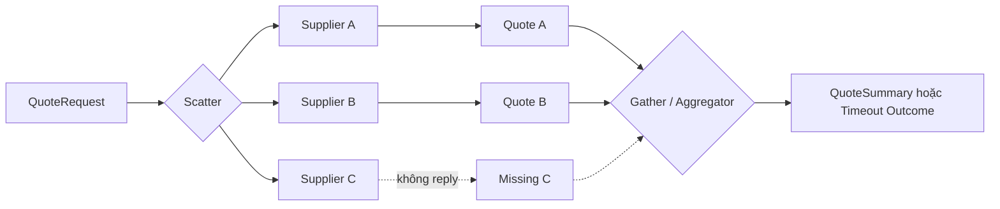
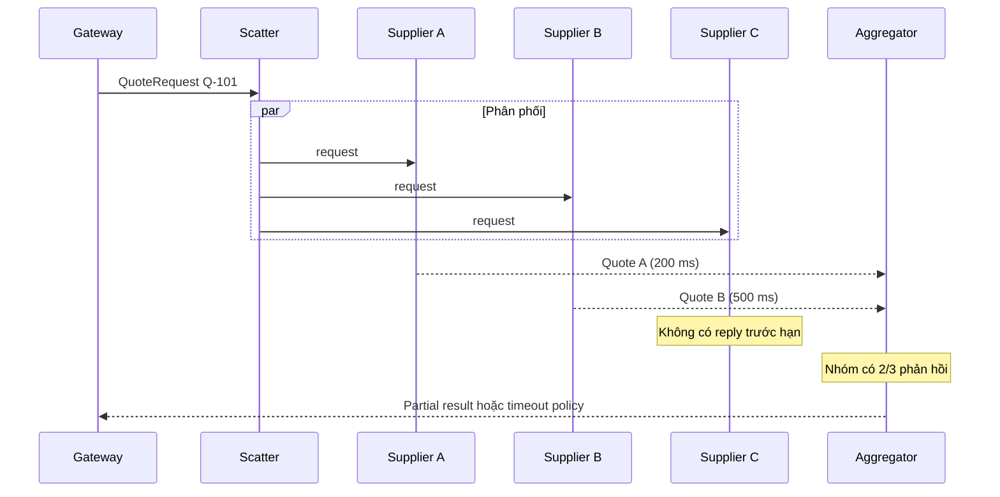
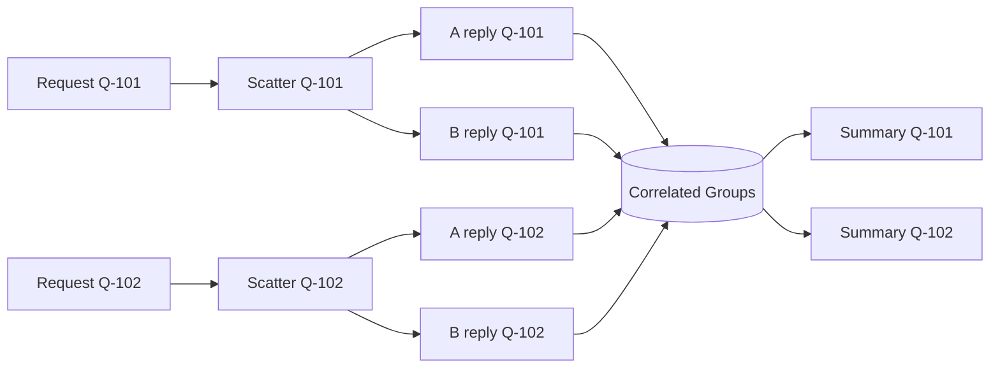
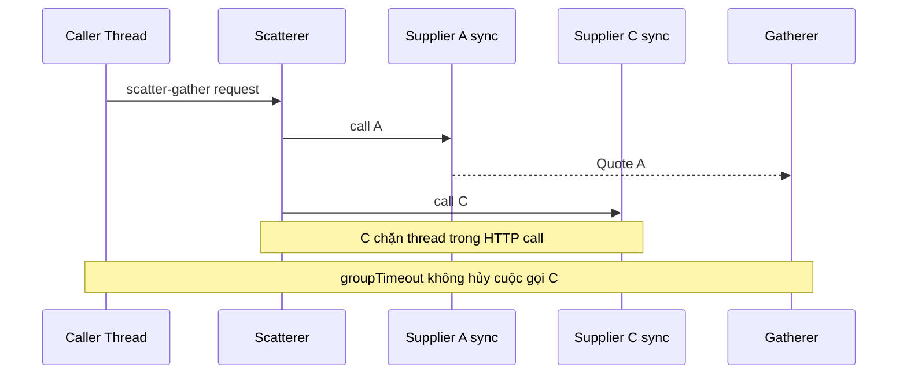
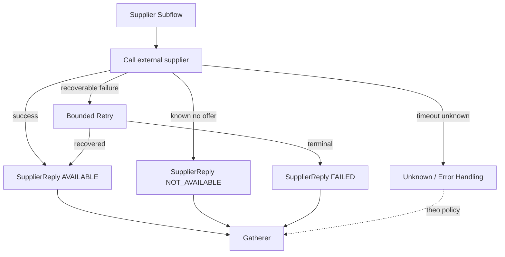
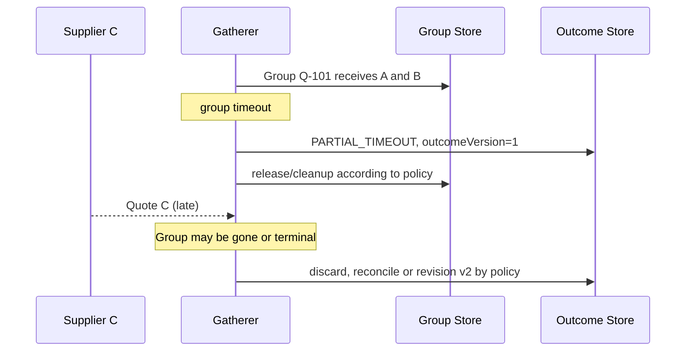
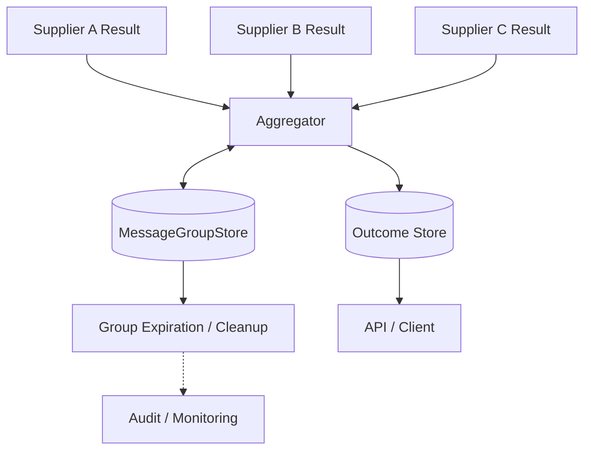
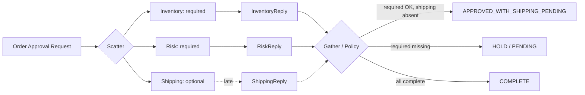

# Timeout khi một nhánh không trả lời

Trong Enterprise Integration Patterns (EIP), **Scatter-Gather** gửi một yêu cầu đến nhiều nhánh xử lý (**scatter**) rồi thu thập các phản hồi thành một kết quả (**gather**). Mẫu này đặc biệt hữu ích khi cần hỏi nhiều nhà cung cấp báo giá, đối chiếu một yêu cầu với các nguồn dữ liệu độc lập, hoặc chạy nhiều phép kiểm tra rồi tổng hợp kết luận.

Nhưng một tình huống rất thường gặp là: **hai nhánh trả lời, nhánh thứ ba không trả lời**. Hệ thống nên đợi bao lâu? Có thể dùng hai kết quả đang có để quyết định không? Có được trả thành công khi kết quả thiếu là một kiểm tra bắt buộc? Nếu nhánh thứ ba trả lời sau khi đã phát kết quả một phần, phản hồi đó đi đâu?

Đó là trọng tâm bài **“Timeout khi một nhánh không trả lời”** thuộc chương **Scatter gather** của module **SPRING_INTEGRATION_PATTERN**. Trong bối cảnh học triển khai Enterprise Integration Patterns bằng Spring Integration, ta sẽ kết hợp Scatter-Gather với Gateway, Router, Filter, Transformer, Splitter, Aggregator, retry, error channel, correlation và kiểm thử để xây dựng những luồng thông điệp ít phụ thuộc, dễ mở rộng và có thể quan sát được.

**Mục tiêu:** phân biệt timeout của từng nhánh với timeout chờ kết quả tổng hợp; hiểu riêng `gatherTimeout` và `groupTimeout` trong Spring Integration; thiết kế chính sách đủ/thiếu phản hồi, partial result, late reply và idempotency; đồng thời kiểm thử các tình huống một nhánh im lặng, tất cả nhánh im lặng và một nhánh trả lời lỗi.

## 1. Scatter-Gather hoạt động ra sao?

Giả sử hệ thống cần hỏi ba nhà cung cấp A, B, C để tìm giá tốt nhất cho cùng một mặt hàng. Producer gửi một `QuoteRequest`. Scatter phát yêu cầu tới ba nhánh; mỗi nhánh trả về một `SupplierQuote`. Gather tổng hợp các phản hồi và chọn phương án theo chính sách.



Thông thường, có hai biến thể scatter:

- **Auction / Publish-Subscribe:** gửi yêu cầu tới các subscriber của một `PublishSubscribeChannel`. Mỗi subscriber được yêu cầu đưa phản hồi về tập hợp chung.
- **Distribution / Recipient List Router:** chọn một tập recipient phù hợp với message rồi gửi tới các đích đã chọn.

Cả hai đều cần **gatherer** biết những phản hồi nào thuộc cùng yêu cầu và khi nào đủ điều kiện release. Trong Spring Integration, `ScatterGatherHandler` kết hợp một scatterer (PublishSubscribeChannel hoặc RecipientListRouter) với một `AggregatingMessageHandler`.

**Một lần send tới ba nhánh không có nghĩa sẽ nhận ba reply.** Một nhánh có thể xử lý một chiều rồi kết thúc, lỗi trước khi phát reply, trả về chậm, bị Filter loại, hoặc không giữ đúng reply/correlation metadata.

### Phân biệt việc gửi và việc trả lời

| Mốc | Điều chứng minh được | Điều chưa chứng minh được |
| --- | --- | --- |
| Scatter đã chọn ba recipient | Có ba nhánh dự kiến tham gia | Cả ba đã nhận message |
| Dispatch được chấp nhận | Channel/transport tiếp nhận theo semantics của nó | Các handler đã hoàn tất |
| Một supplier trả reply | Có một phản hồi gửi về gatherer | Hai supplier khác đã hoàn thành |
| Gatherer release | Nhóm đã đạt release/expiry policy | Mọi nhánh đều thành công về nghiệp vụ |
| Caller nhận kết quả | Đã có response của Scatter-Gather/Gateway | Kết quả có đầy đủ các nguồn nếu response là partial |

Định nghĩa thành công ở **từng mốc** là nền tảng để không biến một timeout thành lỗi khó tìm.

## 2. Tình huống một nhánh không trả lời

Giả sử A trả sau 200 ms, B trả sau 500 ms, C vẫn đang treo:



Nhánh C không reply có thể do nhiều nguyên nhân:

1. **Không được dispatch:** route config sai hoặc channel không có subscriber.
2. **Đã được dispatch nhưng chưa bắt đầu:** queue tồn đọng hoặc executor hết thread.
3. **Đang xử lý:** API chậm, khóa database hoặc downstream nghẽn.
4. **Đã hoàn thành nhưng reply không về:** mất header `replyChannel`, lỗi adapter hoặc broker.
5. **Đã ném exception:** không có error handling để tạo kết quả thay thế.
6. **Bị Filter discard:** nhánh bị loại nhưng không tạo reply nghiệp vụ.
7. **Reply về muộn:** gatherer đã phát kết quả và giải phóng nhóm.

Do đó, **“không có reply trong hạn” không đồng nghĩa “nhánh chắc chắn chưa thực hiện side effect”**. Khi tính tiền, giữ hàng hoặc gửi thông báo, timeout thường là **trạng thái chưa rõ** cần đối soát và idempotency.

## 3. Có nhiều lớp timeout, không chỉ một

Trong một flow Scatter-Gather, ít nhất cần xem xét năm giới hạn thời gian:

| Timeout | Nằm ở đâu? | Nó giới hạn điều gì? |
| --- | --- | --- |
| **Branch call timeout** | HTTP client, database adapter hoặc worker | Thời gian một tác vụ ở nhánh chờ nguồn ngoài |
| **Dispatch/send timeout** | Channel/adapter | Thời gian gửi/chấp nhận message ở nơi có giới hạn capacity |
| **Aggregator `groupTimeout`** | Gatherer / MessageGroupStore | Khi nhóm chưa đạt release strategy thì xử lý expiration |
| **Scatter-Gather `gatherTimeout`** | `ScatterGatherHandler` | Thời gian handler đợi **một kết quả từ gatherer** |
| **Gateway/client deadline** | Messaging Gateway, REST controller, gRPC caller | Thời gian caller chấp nhận chờ reply |

Đây là những đồng hồ **khác nhiệm vụ**, có thể chạy từ các mốc khác nhau. Đừng đặt cùng một con số rồi cho rằng tất cả sẽ kết thúc chính xác cùng lúc.

### Ví dụ cấu hình có chủ đích

Giả sử yêu cầu báo giá cho phép trả kết quả một phần:

```text
Supplier HTTP timeout : 1.2 s
Aggregator groupTimeout: 1.5 s (sau khi nhóm được tạo/cập nhật)
Scatter-Gather gatherTimeout: 3.0 s
Gateway replyTimeout   : 4.0 s
```

Những giá trị trên là **ví dụ để diễn giải**, không phải khuyến nghị chung. Cần tính thêm thời gian scatter, queue, scheduler, network, lưu group, serialize và phản hồi. `groupTimeout` thường được lên lịch lại theo hoạt động group khi dùng giá trị khoảng thời gian; nó **không phải** mặc định một deadline tuyệt đối tính từ lúc request bắt đầu.

**Điều quan trọng:** đặt `groupTimeout` nhỏ hơn `gatherTimeout` là một hướng sắp xếp hợp lý nếu muốn partial release đến trước khi người đợi bỏ cuộc; nhưng **không bảo đảm** điều đó luôn xảy ra. Nếu reply đầu tiên chỉ đến sát hạn, group timeout có thể còn chưa được kích hoạt, hoặc scheduler bị trễ. Cần thiết kế/kiểm thử ở mức end-to-end.

## 4. `gatherTimeout` không giống `groupTimeout`

Đây là khác biệt quan trọng nhất của bài.

### 4.1. `gatherTimeout`: thời gian Scatter-Gather đợi phản hồi của gatherer

`ScatterGatherHandler` là một endpoint request-reply. Sau khi scatter request, nó cần kết quả tổng hợp để trả cho upstream. `gatherTimeout` giới hạn thời gian đợi đó trong cơ chế xử lý tương ứng.

Theo tài liệu Spring Integration hiện hành, **gather timeout mặc định là khoảng 30 giây**, còn `requiresReply` mặc định là `true`. Nếu hết thời gian chờ mà không có reply từ gatherer, cơ chế có thể trả `null` bên trong và dẫn tới `ReplyRequiredException` khi yêu cầu reply bắt buộc. **Mặc định và hình thức xử lý có thể khác giữa các phiên bản**, nên hãy đọc tài liệu phiên bản ứng dụng đang dùng.

Điểm then chốt: `gatherTimeout` **không tự buộc Aggregator phát một partial result**. Nó có thể chỉ khiến yêu cầu phía trên không còn chờ nữa.

### 4.2. `groupTimeout`: thời điểm xử lý một group chưa đủ reply

Gatherer thường là Aggregator. Khi chưa đạt release strategy, `groupTimeout` có thể lên lịch **forced completion/expiration** cho message group. Tùy cấu hình:

- `sendPartialResultOnExpiry(true)` cho phép phát kết quả từ các reply đã nhận khi nhóm hết hạn.
- Nếu không cho partial, expiration có thể loại/đóng nhóm theo chính sách.
- Khi expiration chạy, release strategy có thể được kiểm tra lại theo cơ chế framework.
- Group state và cleanup tùy message store/cấu hình.

**Nếu group chưa có một reply nào, có thể chưa có group để lên lịch timeout.** Khi tất cả supplier đều im lặng, đặt `groupTimeout` **không đủ** để bảo đảm sẽ phát một `QuoteSummary(empty)`. `gatherTimeout` hoặc deadline coordinator ở tầng workflow phải có phương án rõ ràng cho tình huống **0/3 reply**.

### 4.3. `sendTimeout` là một cơ chế khác nữa

Một `sendTimeout` của endpoint/channel có thể tác động khi gửi reply vào output channel **bị chặn bởi capacity**. Nó không đo thời gian supplier gọi HTTP. Việc nâng send timeout không giải quyết supplier im lặng.

### Minh họa ba trường hợp

| Trường hợp | Gatherer có group? | `groupTimeout` có thể phát partial? | `gatherTimeout` làm gì? |
| --- | --- | --- | --- |
| 3/3 reply trước hạn | Có | Không cần | Nhận complete reply |
| 2/3 reply, nhánh C im lặng | Có | Có, **nếu bật partial và scheduler/expiration hoạt động** | Nhận partial nếu đến kịp; nếu không thì hết hạn chờ |
| 0/3 reply | Có thể **không** | Không có dữ liệu/group để phát partial trong trường hợp thông thường | Giới hạn việc chờ; xử lý no-reply theo contract |

Nên có **test riêng cho cả trường hợp 2/3 và 0/3**, vì nhiều flow chỉ xử lý được trường hợp thứ nhất.

## 5. Hai chính sách kết quả: all-required và partial-allowed

Không có một timeout policy phù hợp cho mọi nghiệp vụ.

| Mục tiêu | Nhánh không trả lời có chấp nhận được không? | Kết quả |
| --- | --- | --- |
| Tìm báo giá rẻ từ ba supplier | Có thể, nếu nhận đủ số báo giá tối thiểu | `PARTIAL_QUOTES` và danh sách missing |
| Ghép kết quả tìm kiếm nhiều nguồn | Có thể, nếu UI chấp nhận dữ liệu không đầy đủ | Partial + metadata completeness |
| Tổng hợp analytics | Có thể, nếu chấp nhận eventual correction | Partial + outcome version |
| Chống gian lận bắt buộc | **Không** | `PENDING_REVIEW`/fail closed |
| Phê duyệt giao dịch cần cả hai người ký | **Không** | Không chấp thuận khi thiếu chữ ký |
| Giữ hàng đủ mọi line item | Thường không | Chưa thể báo đơn hoàn tất |
| Tập hợp thông báo tùy chọn | Có thể tùy SLA | Kết quả theo từng nhánh |

### 5.1. All-required

Nếu **mọi** nhánh bắt buộc phải trả lời, một nhánh không phản hồi có nghĩa request **chưa thỏa điều kiện hoàn tất**. Có thể cho client biết `TIMED_OUT`, `PENDING` hoặc `FAILED` tùy khả năng xác định kết quả, nhưng không được coi đây là success.

Ví dụ giao dịch thanh toán cần ba bước kiểm tra: compliance, risk và balance. Thiếu compliance response thì không được fallback sang “bỏ compliance để cho kịp SLA”.

### 5.2. Partial-allowed

Nếu dùng được 2/3 phản hồi, phải ghi rõ:

- **Minimum quorum:** ít nhất bao nhiêu reply thì quyết định mới hợp lệ?
- **Mandatory recipients:** nhánh nào bắt buộc phải hiện diện dù tổng số reply đã đủ?
- **Type of missing:** reply chưa tới, lỗi, bị lọc, hay result không đủ dữ liệu?
- **Partial outcome contract:** caller thấy trạng thái partial, không nhận payload giống hệt full success.
- **Late corrections:** có thể cập nhật kết quả về sau không?

Một hệ thống báo giá có thể chọn phương án tốt nhất từ 2 phản hồi nếu A và B đủ năng lực, nhưng không được xem báo giá không có C là “đã so sánh toàn bộ thị trường”.

## 6. Phân biệt nhánh lỗi có phản hồi và nhánh im lặng

Nhiều thiết kế chỉ xem nhánh trả về thành công là reply. Điều này tạo ra hiện tượng: supplier B trả lỗi rõ ràng nhưng gatherer vẫn đợi B tới timeout vì không hề nhận được một **result message**.

Một hợp đồng nhánh tốt có thể trả về kết quả **có trạng thái**:

```java
enum SupplierStatus {
    AVAILABLE,
    NOT_AVAILABLE,
    FAILED
}

record SupplierReply(
    String requestId,
    String supplierId,
    SupplierStatus status,
    java.math.BigDecimal totalPrice,
    String currency,
    String errorCode
) {}
```

**Một reply `FAILED` vẫn có thể là một reply đã nhận.** Nếu policy chỉ cần đủ phản hồi trạng thái từ ba supplier, gatherer có thể hoàn tất mà không phải chờ timeout. Nhưng việc đủ **responses** không có nghĩa đủ **offers hợp lệ**.

| Supplier | Kết quả | Được tính là đã trả lời? | Được dùng để chọn giá? |
| --- | --- | --- | --- |
| A | `AVAILABLE(105000)` | Có | Có |
| B | `FAILED(TEMPORARY_ERROR)` | Có | Không |
| C | Không reply | Không | Không |

Chính sách tổng hợp có thể là `PARTIAL_QUOTES` với một offer và một lỗi, hoặc từ chối nếu tối thiểu phải có hai offers hợp lệ. Cần quy định trước.

**Đừng tạo một reply `FAILED` giả trong khi provider có thể đã thực hiện side effect.** Với truy vấn báo giá read-only, phản hồi lỗi có thể phù hợp. Với capture thanh toán timeout, trạng thái đúng hơn có thể là `UNKNOWN` cần đối soát.

## 7. Correlation: các reply phải thuộc đúng một lần scatter

Khi nhiều caller gửi request đồng thời, mọi supplier đều trả về một luồng message. Gatherer cần biết reply nào thuộc cùng một request.



Spring Integration sử dụng metadata như `correlationId`, `sequenceNumber` và `sequenceSize` trong các mô hình phân phối/tập hợp tương ứng. Với Scatter-Gather, cấu hình `applySequence` trên scatterer giúp thiết lập metadata hỗ trợ default correlation/release khi phù hợp. Từ Spring Integration 6.0, Java DSL/XML cho Scatter-Gather hỗ trợ bật `applySequence` thuận tiện theo tài liệu; ví dụ vẫn có thể khai báo tường minh để dễ hiểu.

Tuy nhiên:

- `correlationId` kỹ thuật không tự thay thế một `businessRequestId` cần cho audit và idempotency.
- Nếu recipient được chọn **có điều kiện**, `sequenceSize` hoặc expected count phải phản ánh **số recipient thực sự được scatter**.
- Nếu dùng adapter qua Kafka/HTTP/JMS hoặc tự tạo `Message<?>`, phải kiểm tra **reply/correlation metadata** còn nguyên sau transport.
- Không dùng `orderId` làm correlation duy nhất nếu cùng một đơn có thể chạy **hai lần scatter hợp lệ** cùng lúc. Cần thêm `requestAttemptId`/workflow generation.
- Không tin correlation ID hoặc reply channel do client tự gửi tới nội bộ mà chưa xác thực.

### Sequence không tự chống duplicate

Nếu A gửi cùng reply hai lần, một release strategy dựa trên raw `group.size() == 3` có thể tưởng A, A, B là đủ 3. Với nhiều request/nhánh phức tạp, cần khóa `(scatterRequestId, supplierId, resultVersion)` hoặc một định danh recipient chính xác và **đếm unique supplier replies**.

## 8. Vì sao nhánh không reply trong Spring Integration?

### 8.1. Nhánh cuối kết thúc một chiều

Nếu một recipient flow dùng handler trả `null` hoặc một outbound adapter không tạo reply, gatherer không thể tự biết nó đã xử lý thành công.

```text
scatter -> audit service: record and return null
       -> quote service: return QuoteReply
gather expects 2 replies
```

Ở thiết kế này, audit là **side-effect notification**, không phải một supplier trả kết quả. Nếu muốn Aggregator đợi audit, nhánh audit phải phát **ack/result message có hợp đồng rõ ràng** và chỉ phát sau mốc hoàn tất nghiệp vụ cần thiết.

### 8.2. Nhánh bị Filter discard

Một Filter có thể bỏ message theo điều kiện. Nếu scatterer đã tính nhánh đó là recipient nhưng Filter bỏ và không phát reply, gatherer có thể chờ đến timeout.

Có hai cách giải quyết tùy nghiệp vụ:

- **Chọn recipient trước scatter:** Recipient List Router chỉ scatter tới các nhánh thực sự cần xử lý và expected count phản ánh số ấy.
- **Biểu diễn skip thành result:** nhánh Filter discard phát `SKIPPED` hoặc `NOT_APPLICABLE` nếu gatherer cần biết nhánh đã giải quyết.

Discard channel không tự biến một message bị loại thành reply; phải có flow tạo result tương thích.

### 8.3. Nhánh ném exception

Trong xử lý đồng bộ, exception từ một subflow có thể lan thẳng về Scatter-Gather và caller, làm các reply khác không còn được sử dụng theo kỳ vọng. Với executor/broker, lỗi xảy ra trên thread khác; nếu không có error handling phù hợp, gatherer có thể không nhận gì.

Tài liệu Spring Integration mô tả việc cấu hình error channel cho subflow bất đồng bộ và, khi phù hợp, chuyển `MessagingException` thành một **compensation/error reply** có giữ metadata cần thiết. **Nuốt exception rồi không phát reply** không phải là một chiến lược tổng hợp đầy đủ.

### 8.4. Nhánh không còn reply routing metadata

Một Transformer trả `Message<?>` mới, một adapter serialize headers không đủ hoặc một bridge tự thay `replyChannel` có thể khiến supplier đã hoàn tất mà gatherer không nhận được reply.

Đặc biệt trong Scatter-Gather, **`gatherResultChannel`, `replyChannel`, `errorChannel` và correlation-related headers** có vai trò theo cơ chế framework. Không nên tự tạo envelope mới rồi chỉ copy business payload nếu flow còn cần trả kết quả về gatherer. Khi qua ranh giới không hỗ trợ object channel, cần thiết kế **reply channel/consumer và correlation mapping rõ ràng**, không serialize đối tượng channel tùy tiện.

## 9. Đừng mong timeout điều khiển được nhánh synchronous đang treo

Giả sử scatterer dispatch trên `DirectChannel` và supplier C thực hiện một HTTP call **đồng bộ** bị treo vô thời hạn. Thread thực hiện scatter có thể bị chặn ngay trong C trước khi đi đến bước chờ kết quả gatherer.



**Group timeout của Aggregator không tự hủy hoặc ngắt một HTTP call đang treo.** Khi dùng subflow đồng bộ, có thể còn không tới điểm Scatter-Gather bắt đầu đợi gather reply theo cơ chế thực thi.

Các biện pháp thực tế:

- Đặt **connection/read/response timeout** ở HTTP client hoặc adapter nguồn.
- Dùng **executor/async handoff** cho các nhánh độc lập nếu muốn một nhánh chậm không giữ thread scatter.
- Giới hạn pool/queue/bulkhead để tránh hàng nghìn công việc bị treo.
- Có deadline tổng và chính sách khi worker tiếp tục chạy sau khi caller hết hạn.
- Đảm bảo error handling không làm mất reply/correlation metadata.

**Async không có nghĩa “đã timeout thì công việc tự dừng”.** Nếu một task nằm trên executor và caller bỏ chờ, task có thể vẫn chạy đến khi hoàn thành hoặc được cơ chế cancellation hỗ trợ; cần định nghĩa điều gì xảy ra với late result.

## 10. Java: hợp đồng báo giá cho Scatter-Gather

Ta xây ví dụ ba nhà cung cấp A, B, C. Một nhánh có thể chậm, nhưng kết quả tổng hợp chỉ được ghi “hoàn tất đầy đủ” khi đủ ba supplier reply hợp lệ về mặt identity.

### 10.1. Request và reply

```java
import java.math.BigDecimal;
import java.time.Instant;
import java.util.List;

record QuoteRequest(
    String requestId,
    String sku,
    int quantity
) {}

enum QuoteStatus {
    AVAILABLE,
    NOT_AVAILABLE,
    FAILED
}

record SupplierQuote(
    String requestId,
    String supplierId,
    QuoteStatus status,
    BigDecimal totalPrice,
    String currency,
    String errorCode,
    Instant respondedAt
) {}

record QuoteSummary(
    String requestId,
    int expectedSuppliers,
    int receivedSuppliers,
    String status,
    List<SupplierQuote> replies,
    List<String> missingSupplierIds,
    Instant summarizedAt
) {}
```

`requestId` là định danh một lần scatter theo hợp đồng ứng dụng. `supplierId` là identity của nhánh. `status` là kết quả xử lý từng supplier, **không phải** trạng thái gatherer. `missingSupplierIds` cho biết ai chưa phản hồi; danh sách này chỉ chính xác khi ứng dụng biết **expected recipient set**.

### 10.2. Service interface

```java
interface SupplierServices {
    SupplierQuote requestA(QuoteRequest request);
    SupplierQuote requestB(QuoteRequest request);
    SupplierQuote requestC(QuoteRequest request);
}
```

Những phương thức trả một `SupplierQuote` **không phải `null`** khi hoàn tất. Nếu supplier báo không có hàng, nó có thể trả `NOT_AVAILABLE`. Nếu lỗi có thể được chuyển thành kết quả nghiệp vụ an toàn, nó có thể trả `FAILED` với mã lỗi; nếu ném exception, flow cần error handling tương ứng.

Đây là ví dụ request-reply. Không dùng `void` handler rồi đợi gatherer tự đoán rằng nhánh đã trả lời.

## 11. Processor tổng hợp: unique replies và partial status

Một `MessageGroupProcessor` đọc các supplier reply của cùng request và tạo `QuoteSummary`.

```java
import java.time.Instant;
import java.util.ArrayList;
import java.util.HashMap;
import java.util.HashSet;
import java.util.List;
import java.util.Map;
import java.util.Set;
import org.springframework.integration.store.MessageGroup;
import org.springframework.messaging.Message;

final class QuoteGroupProcessor {

    private static final Set<String> EXPECTED =
        Set.of("A", "B", "C");

    boolean complete(MessageGroup group) {
        return replyMap(group).keySet().containsAll(EXPECTED);
    }

    QuoteSummary summarize(MessageGroup group) {
        Map<String, SupplierQuote> bySupplier = replyMap(group);
        List<String> missing = EXPECTED.stream()
            .filter(id -> !bySupplier.containsKey(id))
            .sorted()
            .toList();

        List<SupplierQuote> ordered = bySupplier.values().stream()
            .sorted(java.util.Comparator.comparing(
                SupplierQuote::supplierId))
            .toList();

        boolean hasOffer = ordered.stream()
            .anyMatch(q -> q.status() == QuoteStatus.AVAILABLE);

        String status;
        if (!missing.isEmpty()) {
            status = "PARTIAL_TIMEOUT";
        } else if (!hasOffer) {
            status = "COMPLETE_NO_OFFER";
        } else {
            status = "COMPLETE";
        }

        String requestId = ordered.get(0).requestId();
        return new QuoteSummary(
            requestId,
            EXPECTED.size(),
            ordered.size(),
            status,
            ordered,
            missing,
            Instant.now()
        );
    }

    private Map<String, SupplierQuote> replyMap(MessageGroup group) {
        Map<String, SupplierQuote> unique = new HashMap<>();
        String requestId = null;

        for (Message<?> message : group.getMessages()) {
            SupplierQuote reply =
                (SupplierQuote) message.getPayload();

            if (reply.requestId() == null
                    || reply.requestId().isBlank()
                    || !EXPECTED.contains(reply.supplierId())) {
                throw new IllegalArgumentException(
                    "Invalid supplier reply identity");
            }

            if (requestId == null) {
                requestId = reply.requestId();
            } else if (!requestId.equals(reply.requestId())) {
                throw new IllegalArgumentException(
                    "Mixed request IDs in group");
            }

            SupplierQuote old =
                unique.putIfAbsent(reply.supplierId(), reply);

            if (old != null && !old.equals(reply)) {
                // Không chọn bản bất kỳ khi có hai kết quả mâu thuẫn.
                throw new IllegalStateException(
                    "Conflicting duplicate supplier reply");
            }
        }

        return unique;
    }
}
```

**Đây là ví dụ về một tập recipient cố định A/B/C**, có các giới hạn cần nhớ:

- Trong code, nếu group rỗng và processor bị gọi, `ordered.get(0)` sẽ thất bại. Đó là **chủ đích không tạo summary giả từ 0 reply**. Trường hợp 0/3 phải được xử lý bởi `gatherTimeout`/orchestrator.
- `PARTIAL_TIMEOUT` chỉ hợp lý khi processor được gọi do expiration. Nếu hệ thống cho phép release sớm theo minimum quorum, cần **release reason riêng**, không chỉ suy ra partial từ count.
- `complete` chấp nhận cả reply `FAILED`/`NOT_AVAILABLE` để phân biệt **đủ response** với có **báo giá hợp lệ**. Chính sách chọn offer tốt nhất chưa được hiện thực.
- Trùng kết quả với cùng supplier được nhận diện, nhưng **không giải quyết hoàn toàn dedup ở group store**. Nên chặn trùng từ ingress/adapter khi lưu lượng lớn.
- `requestId` kiểm tra trong payload giúp phát hiện nhóm pha trộn; correlation key của framework cũng cần được bảo vệ.
- Nếu dynamic recipient set thay đổi theo request, `EXPECTED` phải được thay bằng **manifest đã chốt theo request**, không dùng tập A/B/C cố định.

### Partial không phải lời hứa có giá sử dụng được

Ví dụ A và B đều trả `NOT_AVAILABLE`, C im lặng. Output `PARTIAL_TIMEOUT` có thể có **0 offers hợp lệ**. Caller phải kiểm tra cả `status` và nội dung `replies`, không hiển thị “đã tìm được giá tốt nhất” vì processor đã emit một message.

## 12. Spring Integration Java DSL: scatter bất đồng bộ, gather có timeout

Dưới đây là **phác thảo một cấu hình Java DSL tương ứng với các phiên bản hỗ trợ API `scatterGather`**. Ví dụ giữ ba supplier là các recipient cố định, mỗi nhánh chuyển sang executor để một HTTP call chậm không giữ thread scatter. Production cần thêm timeout HTTP thực, cấu hình error handling và kiểm thử theo đúng phiên bản dependency.

### 12.1. Gateway và executor

```java
import org.springframework.context.annotation.Bean;
import org.springframework.context.annotation.Configuration;
import org.springframework.integration.annotation.Gateway;
import org.springframework.integration.annotation.IntegrationComponentScan;
import org.springframework.integration.annotation.MessagingGateway;
import org.springframework.integration.channel.DirectChannel;
import org.springframework.integration.config.EnableIntegration;
import org.springframework.messaging.MessageChannel;
import org.springframework.core.task.TaskExecutor;
import org.springframework.scheduling.concurrent.ThreadPoolTaskExecutor;

@MessagingGateway
interface QuoteGateway {

    @Gateway(requestChannel = "quotes.requests", replyTimeout = 4_000)
    QuoteSummary request(QuoteRequest request);
}

@Configuration
@EnableIntegration
@IntegrationComponentScan
class QuoteChannelConfiguration {

    @Bean("quotes.requests")
    MessageChannel quoteRequests() {
        return new DirectChannel();
    }

    @Bean("quoteScatterExecutor")
    TaskExecutor quoteScatterExecutor() {
        ThreadPoolTaskExecutor executor = new ThreadPoolTaskExecutor();
        executor.setCorePoolSize(4);
        executor.setMaxPoolSize(8);
        executor.setQueueCapacity(64);
        executor.setThreadNamePrefix("quote-scatter-");
        executor.initialize();
        return executor;
    }

    @Bean
    QuoteGroupProcessor quoteGroupProcessor() {
        return new QuoteGroupProcessor();
    }
}
```

Thread pool là **ví dụ**, không phải giới hạn tối ưu. Trong hệ thống thật cần xác định concurrency, queue capacity, rejection policy, per-supplier deadline và shutdown behavior. Task bị chặn trên HTTP client vẫn có thể giữ thread dù gatherer đã timeout.

### 12.2. Scatter-Gather flow

```java
import org.springframework.context.annotation.Bean;
import org.springframework.context.annotation.Configuration;
import org.springframework.core.task.TaskExecutor;
import org.springframework.integration.dsl.IntegrationFlow;

@Configuration
class QuoteScatterGatherFlow {

    @Bean
    IntegrationFlow gatherSupplierQuotes(
            SupplierServices suppliers,
            QuoteGroupProcessor processor,
            TaskExecutor quoteScatterExecutor) {

        return IntegrationFlow.from("quotes.requests")
            .scatterGather(
                scatter -> scatter
                    .applySequence(true)
                    .recipientFlow(f -> f
                        .channel(c -> c.executor(quoteScatterExecutor))
                        .transform(QuoteRequest.class,
                            suppliers::requestA))
                    .recipientFlow(f -> f
                        .channel(c -> c.executor(quoteScatterExecutor))
                        .transform(QuoteRequest.class,
                            suppliers::requestB))
                    .recipientFlow(f -> f
                        .channel(c -> c.executor(quoteScatterExecutor))
                        .transform(QuoteRequest.class,
                            suppliers::requestC)),
                gather -> gather
                    .releaseStrategy(processor::complete)
                    .outputProcessor(processor::summarize)
                    .groupTimeout(1_500L)
                    .sendPartialResultOnExpiry(true)
                    .expireGroupsUponCompletion(true),
                options -> options.gatherTimeout(3_000L))
            .get();
    }
}
```

Cách đọc luồng:

1. Gateway gửi `QuoteRequest` vào `quotes.requests`.
2. Scatterer có ba recipient flow. Mỗi nhánh handoff tới executor rồi gọi supplier tương ứng.
3. Mỗi nhánh trả `SupplierQuote`; cấu hình request-reply của Scatter-Gather cần đưa reply tới gatherer với correlation/reply headers phù hợp.
4. Gatherer nhóm các reply và gọi `processor.complete`. Khi đủ A/B/C, release bình thường.
5. Nếu mới có A/B và `groupTimeout` hết hạn, `sendPartialResultOnExpiry(true)` cho phép processor tạo `QuoteSummary(status="PARTIAL_TIMEOUT")` từ reply hiện có.
6. `gatherTimeout(3_000L)` giới hạn thời gian Scatter-Gather chờ reply của gatherer. Nếu không có kết quả kịp, nó không tự phát `QuoteSummary` giả.
7. Gateway có `replyTimeout=4_000` cho hợp đồng request-reply ở mức caller. Thời gian end-to-end có thể phụ thuộc scheduling và topology.

**Vì sao cần kiểm tra phiên bản?** Scatter-Gather DSL, spec options và hành vi bất đồng bộ có thể phát triển giữa các bản Spring Integration. Ví dụ trên là cấu hình học tập để kiểm thử trong project thật, không phải tuyên bố đã chạy Gradle trên module. Với Spring Integration 6.5.3 trở lên, tài liệu còn mô tả lựa chọn `async=true` ở `ScatterGatherHandler` thay đổi cách chờ gather result qua reactive reply; việc bật chế độ đó phải được xem xét và test riêng.

### 12.3. Timeout này chưa hủy supplier C

Nếu `suppliers.requestC` bị chặn lâu, worker C vẫn có thể chạy sau khi Gateway đã trả partial. **Không tự động chạy thêm một lần requestC chỉ vì partial**. Với các API có side effect, việc retry hoặc failover cần idempotency/đối soát.

### 12.4. Điều kiện 0/3 reply

Nếu tất cả supplier đều im lặng, group có thể chưa được tạo. Khi đó:

- `groupTimeout` không thể tự phát partial từ group rỗng trong trường hợp thông thường.
- Scatter-Gather hết `gatherTimeout`; khi `requiresReply=true`, đường exception/no-reply phải được xử lý.
- Tầng API nên chuyển tình huống này thành kết quả lỗi/`PENDING` theo hợp đồng, không giả vờ là `QuoteSummary(status="PARTIAL_TIMEOUT", received=0)` nếu chưa có coordinator tạo result ấy.
- Với workflow bền vững, có thể cần **deadline registry** độc lập với Aggregator để ghi nhận cả yêu cầu không nhận được bất kỳ reply nào.

## 13. ReleaseStrategy không nên chỉ đếm raw message

Nếu C không reply nhưng A gửi hai kết quả giống nhau do redelivery, một group có thể có các message A, A, B. Kiểm tra `group.size() == 3` sẽ cho kết quả **đủ số lượng** nhưng **không đủ ba supplier**.

```text
Expected suppliers: {A, B, C}
Received messages: A, A, B
Raw count: 3
Unique supplier count: 2
Missing: {C}
```

Giải pháp:

- Có identity của supplier trên reply do server/adapter đáng tin cậy cấp.
- Release theo **tập supplier** hoặc reply state theo từng recipient.
- Reject/quarantine reply từ supplier không có trong manifest.
- Xử lý duplicate cùng supplier theo idempotency/version rule.
- Lưu một terminal outcome để late reply không tạo một kết quả thứ hai không được phép.

Với **Recipient List động**, số recipient có thể khác giữa các request. `applySequence` hỗ trợ metadata phân phối theo số recipient được chọn, nhưng nếu nghiệp vụ cần biết **danh tính cụ thể của từng nhánh bắt buộc**, nên lưu manifest hoặc decision record thay vì chỉ dựa vào `sequenceSize`.

## 14. Xử lý lỗi trong từng nhánh mà không làm sập toàn bộ scatter

Một subflow lỗi khác với một subflow **không bao giờ trả lời**. Cách xử lý có thể là:



### 14.1. Nhánh đồng bộ

Nếu A và B đang chạy đồng bộ trong thread scatter và B ném exception, exception có thể lan lên handler, khiến request scatter-gather thất bại thay vì cho phép A/C tiếp tục bình thường. Cần dùng advice hoặc biến lỗi thành **reply có trạng thái** theo một contract được kiểm soát.

### 14.2. Nhánh bất đồng bộ

Với ExecutorChannel hoặc adapter bất đồng bộ, exception xảy ra ở thread khác. Cần cấu hình error channel/header phù hợp để `MessagePublishingErrorHandler` và các thành phần liên quan xử lý lỗi; nếu cần gatherer nhận một result `FAILED`, error flow phải **tạo reply** mang correlation và reply routing hợp lệ.

Không nên lấy một `Throwable` tùy ý rồi coi đó là báo giá. Đưa lỗi vào một `SupplierReply(status=FAILED, supplierId=...)` sau khi đã kiểm tra identity/context và thông tin an toàn.

### 14.3. Ví dụ chuyển exception thành typed reply theo hợp đồng

```java
final class SafeSupplierAdapter {
    private final SupplierServices suppliers;

    SafeSupplierAdapter(SupplierServices suppliers) {
        this.suppliers = suppliers;
    }

    SupplierQuote requestA(QuoteRequest request) {
        try {
            return suppliers.requestA(request);
        } catch (SupplierUnavailableException ex) {
            return new SupplierQuote(
                request.requestId(), "A",
                QuoteStatus.FAILED, null, null,
                "SUPPLIER_TEMPORARILY_UNAVAILABLE",
                java.time.Instant.now());
        }
    }
}

class SupplierUnavailableException extends RuntimeException {
    SupplierUnavailableException(String message) {
        super(message);
    }
}
```

Đây là ví dụ **narrow catch** với lỗi đã biết. Không nên bắt mọi `Exception` rồi trả `FAILED`, vì như vậy có thể che mất lỗi lập trình, thiếu quyền hoặc trường hợp bên ngoài có side effect không xác định. Với lỗi không thể biểu diễn thành typed reply an toàn, hãy đi đường error/review phù hợp.

## 15. Phản hồi đến muộn sau partial release

Giả sử ở t=1,5 giây, gatherer đã phát `QuoteSummary(PARTIAL_TIMEOUT)` từ A và B. Đến t=2,3 giây, C mới gửi báo giá.



Nếu message group đã bị xóa, một reply muộn có thể bị xử lý như phần tử của một **nhóm mới cùng correlation key**, tùy store và cấu hình discard/expiry. Một `QuoteSummary` thứ hai không có version có thể khiến UI hiện hai kết quả hoặc ghi đè sai.

Cần định nghĩa một trong các chính sách:

| Chính sách | Khi thích hợp | Điều cần bảo vệ |
| --- | --- | --- |
| **Ignore and audit** | Kết quả đã chốt, không chấp nhận thay đổi | Đếm late reply, giữ log/trace |
| **Issue correction** | Có thể cập nhật giá/trạng thái | `outcomeVersion`, idempotent upsert |
| **Hold late reply** | Quy trình cần manual review | Queue/store, retention, owner và SLA |
| **Re-open explicitly** | Business workflow hỗ trợ cập nhật nhóm | Concurrency, generation ID, locks |
| **Cancel downstream** | Provider hỗ trợ cancellation an toàn | Không giả định cancellation chắc thành công |

Để xử lý đúng, thường cần một **terminal outcome/tombstone** riêng theo `scatterRequestId`, lưu đủ lâu theo retry/redelivery window. `expireGroupsUponCompletion` và cleanup group store không tự bảo đảm nhận diện mọi late reply.

## 16. Timeout có thể tạo vấn đề retry và side effect trùng

Một request gửi tới ba nhánh đôi khi không chỉ “đọc dữ liệu”. Ví dụ: gọi ba dịch vụ dự trữ, đặt vé hoặc đánh giá tín dụng có phí.

Nếu A đã thực hiện side effect nhưng reply bị mất, gatherer nhìn A là “missing”. Sau timeout, không thể kết luận A chưa làm gì. Retry A hoặc chuyển sang nhánh khác có thể gây trùng giao dịch.

**Phân biệt ba trạng thái:**

- `KNOWN_FAILED`: có bằng chứng nhánh không thực hiện side effect.
- `UNKNOWN`: timeout/ack mất; nhánh có thể đã thực hiện.
- `CONFIRMED_SUCCESS`: đã nhận xác nhận theo hợp đồng.

Với `UNKNOWN`:

1. Lưu request ID, supplier ID, idempotency key và attempt.
2. Đối soát theo API/status callback hoặc dữ liệu được provider xác nhận.
3. Retry bằng **idempotency key ổn định** nếu provider hỗ trợ.
4. Đừng phát lệnh tương đương sang hệ thống khác nếu chưa có quyền/quy tắc reroute rõ.
5. Nếu không thể đối soát, giữ trạng thái `PENDING_REVIEW` thay vì gán `FAILED` hoặc `SUCCESS`.

**Group timeout là deadline chờ kết quả, không phải phép chứng minh trạng thái giao dịch ngoài hệ thống.**

## 17. Request-reply Gateway và API trả trạng thái gì?

Một Gateway đồng bộ cần quy định điều gì xảy ra nếu không có kết quả tổng hợp trong hạn:

| Tình huống | Phản hồi API hợp lý theo hợp đồng |
| --- | --- |
| 3/3 reply, có offer | `COMPLETE` + danh sách offers/offer được chọn |
| 2/3 reply, partial được phép | `PARTIAL_QUOTES` + missing supplier |
| 2/3 reply, all-required | `PENDING`/`TIMED_OUT`, không báo complete |
| 0/3 reply | No-reply timeout/exception được map thành lỗi/`PENDING` |
| Một nhánh `FAILED` có reply | `COMPLETE_WITH_FAILURES` hoặc partial theo business policy |
| Caller hủy chờ | Kết quả downstream có thể vẫn chạy | Dùng status API/outcome store nếu cần |

Nếu các supplier mất nhiều giây đến vài phút, **API bất đồng bộ** có thể phù hợp hơn:

```text
POST /quotes
  -> 202 Accepted + requestId

GET /quotes/{requestId}
  -> PENDING | PARTIAL | COMPLETE | FAILED
```

Đây chỉ là **phác thảo contract API**. Trả `202 Accepted` có nghĩa server nhận yêu cầu theo hợp đồng, **không phải** tất cả nhà cung cấp đã trả lời. Muốn truy vấn status sau restart, cần lưu trạng thái request/outcome bền vững.

### Deadline đầu cuối khác thời gian tồn tại nhóm

Nếu HTTP caller chỉ chịu chờ 3 giây, có thể cần ghi trạng thái `PENDING` trước khi trả về thay vì đợi gatherer tự làm xong. Một deadline ở HTTP không nhất thiết xóa message group hoặc cancel các supplier. Cần một coordinator/state store rõ ràng nếu muốn hỗ trợ cập nhật muộn.

## 18. Quản lý MessageGroupStore và khả năng khôi phục

Gatherer thường sử dụng `MessageGroupStore` để lưu các reply cho tới khi release hoặc timeout. Store mặc định trong bộ nhớ đơn giản nhưng không bảo đảm recovery sau restart.



Cần xác định:

- Nhóm mở còn tồn tại khi instance restart không?
- Timer `groupTimeout` được lên lịch/khôi phục thế nào khi restart?
- Nhiều instance có cùng xử lý một group và double release không?
- Kết quả đã được phát nhưng caller chưa nhận có được ghi bền không?
- Nếu output queue/broker lỗi sau release, có cơ chế retry/outbox và idempotency không?
- Nếu group bị dọn, terminal state nằm ở đâu để nhận diện late reply?
- Store cần retention/bảo mật thế nào khi các reply có dữ liệu nhạy cảm?

**Persistent MessageGroupStore không tự tạo exactly-once end-to-end.** Concurrency control, ack, transaction, output idempotency và quyền truy cập phải được kiểm tra độc lập.

### `MessageGroupStoreReaper` không giống `groupTimeout`

`groupTimeout` là cơ chế xử lý expiration theo group trong Aggregator. Reaper là thành phần có thể quét những nhóm tồn lâu trong store theo lịch. Dùng đồng thời hai cơ chế đòi hỏi xác định timer nào có quyền expire và không phát double output.

Không dùng reaper đơn giản để “chữa” nhánh chậm nếu chưa rõ chính sách partial, late arrival và dọn trạng thái.

## 19. Observability: biết nhánh nào không trả lời

Chỉ ghi một dòng `scatter-gather timed out` không đủ. Cần theo dõi **từng supplier**:

| Trường | Tác dụng |
| --- | --- |
| `requestId` / `correlationId` | Liên kết toàn bộ scatter và reply |
| `supplierId` | Xác định nhánh |
| `dispatchAttempt` | Phân biệt thử gửi lại |
| `dispatchedAt` / `startedAt` | Tìm chậm ở queue hay handler |
| `replyAt` | Đo latency phản hồi |
| `branchOutcome` | AVAILABLE, NOT_AVAILABLE, FAILED, UNKNOWN |
| `groupExpected` / `groupReceived` | Biết completeness |
| `releaseReason` | FULL, TIMEOUT, MANUAL... |
| `policyVersion` | Tập recipient và release rules |
| `outcomeVersion` | Phân biệt correction khi late reply |
| `errorCode` | Phân loại lỗi mà không cần log payload nhạy cảm |

Một log tổng hợp:

```json
{
  "event": "scatter_gather_released",
  "requestId": "Q-101",
  "expectedSuppliers": ["A", "B", "C"],
  "receivedSuppliers": ["A", "B"],
  "missingSuppliers": ["C"],
  "releaseReason": "TIMEOUT",
  "outcome": "PARTIAL_TIMEOUT",
  "policyVersion": "quote-routing-v2"
}
```

Ví dụ trên là **structured log đề xuất**, không phải output Spring Integration tự sinh. Không ghi dữ liệu khách hàng, token, số thẻ hoặc body phản hồi nhạy cảm vào log chỉ vì timeout.

### Metric đề xuất

```text
scatter_requests_total{flow="quote"}
scatter_branch_dispatch_total{supplier="A"}
scatter_branch_replies_total{supplier="A",status="available"}
scatter_branch_timeouts_total{supplier="C"}
scatter_group_releases_total{reason="partial_timeout"}
scatter_no_reply_total{flow="quote"}
scatter_late_replies_total{supplier="C"}
scatter_gather_duration_seconds{flow="quote"}
scatter_open_groups{flow="quote"}
```

Đây là metric ví dụ do ứng dụng tự instrument. Không dùng `requestId` hay `customerId` làm metric tag vì cardinality cao; giữ trong log/audit/trace có kiểm soát.

### Cảnh báo nên phân biệt lỗi thật và partial hợp lệ

Nếu supplier C có SLA 99,9% nhưng bắt đầu không trả lời 20% request, cần cảnh báo theo **tỷ lệ missing**, latency và backlog. Nếu business vốn cho phép 2/3 kết quả trong 1,5 giây, một partial riêng lẻ không nhất thiết là sự cố cấp pager.

## 20. Kiểm thử timeout khi thiếu một nhánh

### 20.1. Ma trận kiểm thử

| Trường hợp | Kỳ vọng |
| --- | --- |
| A/B/C trả trước hạn | Một `COMPLETE`, missing rỗng |
| A/B trả, C im lặng | `PARTIAL_TIMEOUT` khi policy cho phép |
| A/B trả, partial bị cấm | Không trả complete giả; xử lý timeout/no reply |
| Không supplier nào trả | `gatherTimeout`/deadline policy xử lý 0/3 |
| C trả `FAILED` có cấu trúc | C được tính là đã reply; summary phản ánh lỗi |
| C ném exception đồng bộ | Kiểm tra exception propagation và nhánh khác |
| C lỗi bất đồng bộ | Error channel/recovery reply đúng correlation |
| C reply sau partial | Late policy, không phát complete thứ hai tùy tiện |
| A trả hai lần | Đếm unique A, không release nhầm đủ 3 |
| C reply sai `requestId` | Reject/quarantine; không trộn hai group |
| Một header reply bị mất | Có timeout/metric; test header mapping |
| Gateway hết hạn trước groupTimeout | Không dự đoán partial đã tới caller |
| Pool executor đầy | Dispatch reject/backpressure được xử lý |
| Đổi recipient list | Expected count/manifest đúng với request |
| Restart khi có 2/3 replies | Khôi phục theo store/policy được chọn |
| Output publish thất bại sau release | Idempotent output/recovery |
| Filter loại một branch | Gửi SKIPPED reply hoặc điều chỉnh recipients rõ ràng |

### 20.2. Unit test processor

Dùng JUnit 5 với `SimpleMessageGroup` và `MessageBuilder` theo API của Spring Integration đang sử dụng để tạo nhóm có hai hoặc ba `SupplierQuote`. Các assertion cần chứng minh:

```java
// Phác thảo assertions với MessageGroup do test fixture tạo:
QuoteGroupProcessor processor = new QuoteGroupProcessor();

assertFalse(processor.complete(groupWithAAndB));
QuoteSummary partial = processor.summarize(groupWithAAndB);

assertEquals("PARTIAL_TIMEOUT", partial.status());
assertEquals(2, partial.receivedSuppliers());
assertEquals(java.util.List.of("C"),
    partial.missingSupplierIds());

assertTrue(processor.complete(groupWithAAndBAndC));
QuoteSummary complete = processor.summarize(groupWithAAndBAndC);

assertEquals("COMPLETE", complete.status());
assertTrue(complete.missingSupplierIds().isEmpty());
```

Đây là **phác thảo phần assertion**, chưa khai báo `MessageGroup` fixture nên không phải test class độc lập có thể chạy ngay. Test thêm duplicate A, supplier không thuộc manifest và reply có request ID khác để kiểm tra invariants.

### 20.3. Integration test giữ C im lặng có kiểm soát

Trong Spring Test có thể mock ba supplier:

- A trả ngay.
- B trả sau một khoảng ngắn.
- C chờ trên một `CountDownLatch` cho tới khi test thả.

Gọi Gateway trong một task test; xác minh:

1. A và B thực sự đã được gọi.
2. Sau `groupTimeout`, Gateway nhận `QuoteSummary(PARTIAL_TIMEOUT)` nếu output tới trước `gatherTimeout`.
3. `missingSupplierIds` chứa C.
4. Thả latch cho C **sau khi partial** rồi quan sát late-reply policy.
5. Không để thread C mắc kẹt sau khi test kết thúc (dùng `try/finally` để thả latch).
6. Không dùng `Thread.sleep` làm cách duy nhất để kiểm soát lịch; dùng latch/barrier và deadline hữu hạn.
7. Với flow không cho partial, assert outcome là timeout/error chứ không phải complete.

**Cần một test riêng cho 0/3**, vì nó không đi qua cùng con đường partial expiration như nhóm A/B đã tồn tại. Đừng chỉ test supplier C chậm rồi kết luận toàn bộ timeout policy đúng.

### 20.4. Test asynchronous errors và request cancellation

Bổ sung kịch bản:

- C ném exception trên executor: verify error flow có nhận failed message và giữ correlation.
- C timeout HTTP: verify connection/response timeout cắt lời gọi theo cấu hình, không lặp vô hạn.
- Caller hết reply timeout: verify supplier tasks có thể tiếp tục và late replies được quản lý.
- Restart instance giữa 2/3 replies: verify persistence/recovery nếu business yêu cầu.
- Nhiều concurrent request cùng SKU: verify không trộn correlation.
- Duplicate result redelivery: verify không tạo hai summary.

**Một test PASS với ba supplier đồng bộ và nhanh không chứng minh được hành vi timeout khi có queue, executor, broker hoặc crash.**

## 21. Các lỗi thiết kế thường gặp

**“Có `gatherTimeout` là Aggregator tự phát partial.”** Không. Nó chủ yếu giới hạn việc chờ một reply từ gatherer. Muốn partial từ group đang mở cần group expiration/release policy tương ứng.

**“Có `groupTimeout` là cả 0/3 reply cũng được xử lý.”** Group chưa tồn tại khi không reply, nên cần đường no-reply riêng.

**“Timeout của Gatherer cắt đứt HTTP call đang chạy.”** Không. Timeout/cancellation của nhánh phải được thiết kế riêng.

**“`sendPartialResultOnExpiry(true)` nghĩa là thành công.”** Partial có thể thiếu nhánh bắt buộc hoặc không có offer nào hợp lệ.

**“Bị Filter loại tức là đã trả lời.”** Không. Cần result `SKIPPED`/`NOT_APPLICABLE` nếu gatherer phải biết.

**“Một subflow ném exception thì gatherer đương nhiên đếm một reply.”** Không. Error channel và compensation reply phải được cấu hình.

**“`group.size()==3` là đủ 3 supplier.”** Duplicate có thể làm đủ raw message count nhưng thiếu supplier C.

**“Mọi reply thuộc cùng `orderId`.”** Một order có thể có nhiều lần scatter; cần correlation request/generation cụ thể.

**“Copy mọi headers để giữ reply routing.”** Header không tin cậy có thể mang routing hint, reply/error channel hoặc thông tin nhạy cảm. Cần phân biệt trust boundary với các bước nội bộ.

**“Message muộn sau timeout chắc chắn bị bỏ.”** Tùy cleanup/store, nó có thể tạo group mới; cần terminal outcome policy.

**“Có persistent group store là exactly-once.”** Vẫn cần ack, idempotency, locking và recovery của output.

**“Khi một supplier không trả lời, cứ retry cả Scatter-Gather.”** Điều đó có thể gọi lại cả A/B dù họ đã hoàn tất. Nên retry theo nhánh khi hợp đồng cho phép, với idempotency và trạng thái riêng.

## 22. Bài tập: tổng hợp kiểm tra đơn hàng từ ba hệ thống

Một yêu cầu phê duyệt đơn được scatter tới ba dịch vụ:

1. **Inventory**: xác minh còn hàng.
2. **Risk**: kiểm tra gian lận.
3. **Shipping**: ước tính thời gian giao.

Chính sách:

- Inventory và Risk **bắt buộc** phải trả kết quả hợp lệ.
- Shipping **có thể thiếu**; khi thiếu được phép trả `APPROVED_WITH_SHIPPING_PENDING` nếu hai nhánh bắt buộc đạt.
- SLA phản hồi API là 3 giây.
- Inventory thường trả 200 ms, Risk 600 ms, Shipping có lúc mất 10 giây.
- Nhánh Shipping có thể phản hồi sau khi API đã trả kết quả.
- Kafka có thể redeliver một reply; mọi request có `requestId` riêng.



Hãy trả lời:

1. Có nên dùng release strategy “2 trong 3 reply là đủ” không? Vì sao nó có thể sai nếu thiếu Risk nhưng Shipping đã trả?
2. Làm sao lưu **expected/mandatory recipient manifest** cùng request?
3. Nếu Inventory trả `FAILED`, đó là một reply hay một timeout?
4. Đặt branch timeout, groupTimeout, gatherTimeout và Gateway replyTimeout thế nào để phù hợp SLA? Vì sao không được khẳng định chính xác chỉ bằng các con số?
5. Nếu không nhánh nào trả lời, thành phần nào tạo trạng thái `PENDING`?
6. Nếu Shipping phản hồi sau khi `APPROVED_WITH_SHIPPING_PENDING` đã được phát, có gửi correction event hay update version?
7. Nếu Risk đã đánh giá xong nhưng reply mất, có được coi risk check chưa chạy không?
8. Nếu Gateway caller đã timeout, thread supplier có còn chạy không?
9. Error channel sẽ xử lý thế nào khi Shipping ném exception trên executor?
10. Test nào chứng minh kết quả không được `APPROVED` khi Risk im lặng, dù đủ hai reply khác?
11. Nếu Broker redeliver InventoryReply, làm sao ngăn release sớm hoặc double outcome?
12. Những metric nào giúp xác định Shipping chậm vì HTTP source hay vì executor backlog?

**Tiêu chí hoàn thành:** Có chính sách mandatory/optional rõ ràng, timeout ở từng cấp, 0-reply path, partial status không giả thành full success, correlation/dedup/late-reply handling, cùng integration tests ở ranh giới async và error.

## 23. Checklist trước khi đưa Scatter-Gather vào production

- [ ] Đã phân biệt **branch timeout**, `groupTimeout`, `gatherTimeout`, `sendTimeout` và Gateway/client deadline.
- [ ] Biết chính xác expected recipients và mandatory recipients theo từng request.
- [ ] Release strategy không chỉ đếm raw message khi có duplicate hoặc optional branch.
- [ ] Đã quyết định partial release và điều kiện minimum quorum.
- [ ] Partial outcome mang status, received/missing và release reason phù hợp.
- [ ] **0/3 replies** có phương án riêng, không dựa hoàn toàn vào groupTimeout.
- [ ] Supplier I/O có connect/read/response timeout; thread pool có giới hạn.
- [ ] Synchronous subflow có thể block scatter đã được đánh giá.
- [ ] Async subflow có error channel/recovery phù hợp và giữ reply/correlation headers.
- [ ] Filter/discard branch cần ack phải phát result hoặc không được tính là recipient.
- [ ] Message đến muộn có terminal state/correction policy.
- [ ] Duplicate reply theo supplier ID và request ID được kiểm soát.
- [ ] Retry/failover không gây side effect trùng hoặc bypass bước bắt buộc.
- [ ] MessageGroupStore và outcome store đáp ứng durability, privacy, concurrency.
- [ ] Scheduler/group expiration/reaper được cấu hình và kiểm thử.
- [ ] Trace/log/metrics ghi được branch latency, missing, partial và no-reply.
- [ ] API contract phân biệt `ACCEPTED`, `PARTIAL`, `PENDING`, `FAILED` và `COMPLETE`.
- [ ] Có test một nhánh im lặng, tất cả nhánh im lặng và một nhánh lỗi.
- [ ] Có test timeout khi executor bị nghẽn và khi output dispatch thất bại.
- [ ] Đã kiểm tra đúng API và hành vi theo phiên bản Spring Integration thực tế.

## Đọc thêm

- [Spring Integration Reference — Scatter-Gather](https://docs.spring.io/spring-integration/reference/scatter-gather.html): mô hình ScatterGatherHandler, auction/distribution, gather timeout, required reply và error handling.
- [Spring Integration Reference — Aggregator](https://docs.spring.io/spring-integration/reference/aggregator.html): group timeout, partial result, MessageGroupStore và khác biệt với store reaper.

Các đường dẫn là tài liệu tham khảo công khai. Hãy dùng **tài liệu khớp với phiên bản framework** của dự án khi chuyển các cấu hình ví dụ sang code production.

## Ghi nhớ

**Timeout khi một nhánh không trả lời** là một **chính sách tổng hợp và vận hành**, không chỉ là một tham số thời gian. Trong Spring Integration, `gatherTimeout` giới hạn việc Scatter-Gather chờ kết quả từ gatherer; `groupTimeout` điều khiển xử lý một message group chưa đủ và có thể phát partial khi `sendPartialResultOnExpiry(true)`. Chúng không thay thế timeout/cancellation tại supplier và không tự bảo đảm có outcome khi **không một nhánh nào trả lời**.

Hãy xác định **những nhánh nào bắt buộc**, **thế nào là đủ reply**, **partial có hợp lệ không**, và **message đến muộn/retry sẽ đi đâu**. Dùng correlation ID, supplier identity, expected recipient manifest, idempotency, error channel, MessageGroupStore và kiểm thử async để tránh tính trùng, chờ vô hạn hoặc trả thành công giả. Một luồng Scatter-Gather tốt không cần mọi supplier luôn nhanh; nó cần **xử lý sự chậm trễ một cách rõ ràng, có thể kiểm chứng và không đánh đổi tính đúng đắn của nghiệp vụ**.

