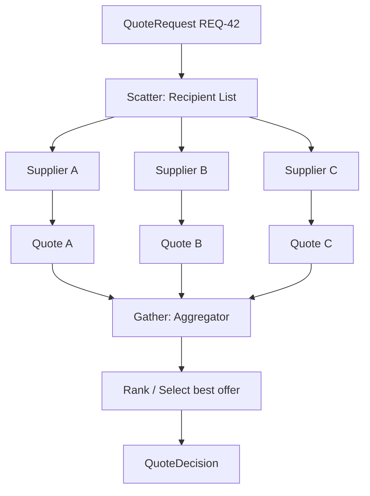
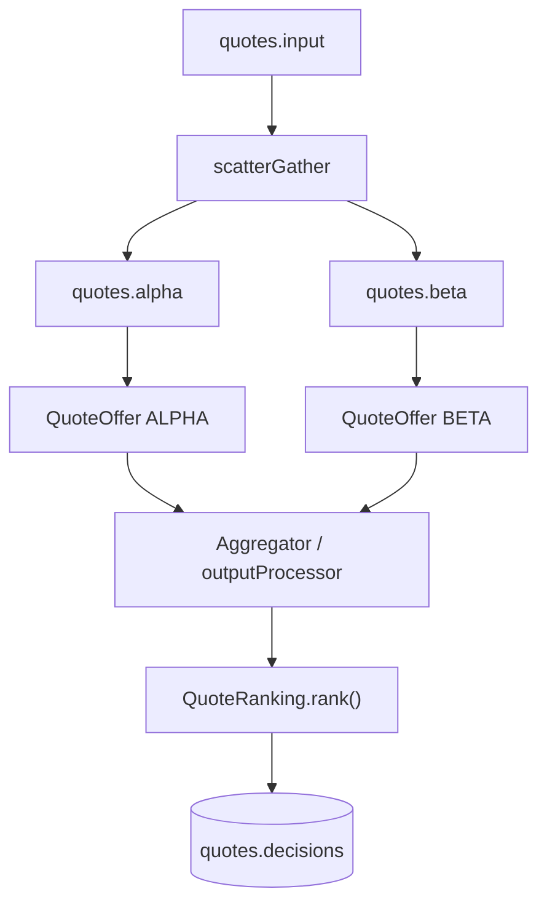
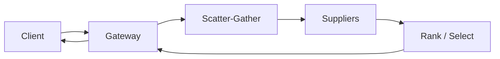

# Ưu tiên hoặc xếp hạng kết quả trong Scatter-Gather của Spring Integration

## Mục tiêu bài học

Một sàn thương mại điện tử cần tính phương án giao hàng cho đơn mới. Thay vì chỉ hỏi một nhà vận chuyển, hệ thống gửi cùng yêu cầu tới ba đối tác, chờ phản hồi rồi chọn phương án phù hợp nhất:

- Đối tác A giao trong 2 ngày, phí 95.000 VND.
- Đối tác B giao trong 3 ngày, phí 88.000 VND.
- Đối tác C có phí 72.000 VND nhưng giao trong 6 ngày, vượt cam kết tối đa 3 ngày.

Nếu ưu tiên của nghiệp vụ là **đáp ứng SLA trước, sau đó chọn giá thấp nhất**, B mới là kết quả thắng; C không được chọn mặc dù rẻ nhất. Nếu A và B có cùng giá, cần một **quy tắc phá hòa** rõ ràng để kết quả không phụ thuộc vào thứ tự hai reply tới Aggregator.

Trong Spring Integration, **Scatter-Gather** kết hợp việc phát một yêu cầu đến nhiều nơi (**scatter**) và thu các phản hồi thành một nhóm (**gather**). Việc **ưu tiên, xếp hạng hoặc chọn “best result”** là chính sách ứng dụng chạy trên **tập kết quả đã được gather**, không phải là tác dụng mặc định của việc gửi tới nhiều recipient.

Bài thuộc chương **Scatter gather** của module **SPRING_INTEGRATION_PATTERN**. Module hướng tới thực hành Enterprise Integration Patterns bằng Spring Integration để xây các luồng thông điệp ít phụ thuộc, dễ mở rộng; kết hợp Router, Filter, Transformer, Splitter, Aggregator, Gateway, retry, error channel, correlation, kiểm thử và theo dõi các nhánh.

Sau bài học, bạn có thể:

1. Phân biệt **scatter strategy**, **correlation**, **release strategy**, **ranking policy** và **output processor**.
2. Thiết kế quy tắc ưu tiên có **điều kiện bắt buộc**, tiêu chí xếp hạng và **tie-break xác định**.
3. Viết Scatter-Gather Java DSL gửi request đến nhiều supplier và cấu hình `AggregatorSpec.outputProcessor(...)` tạo kết quả thắng cuộc.
4. Kiểm thử lựa chọn giá thấp nhất, hòa điểm, quote không đạt SLA và không có kết quả hợp lệ.
5. Giải thích tại sao **reply đến trước** chưa chắc là **reply tốt nhất** và vì sao timeout có thể dẫn đến kết luận chỉ dựa trên một phần kết quả.
6. Chọn giữa **top-1**, **top-k**, **multi-criteria scoring**, **priority classes** và fallback.
7. Xử lý duplicate reply, message đến muộn, reply thiếu, retry, idempotency, bảo mật dữ liệu và quan sát chất lượng quyết định.

---

## 1. Scatter-Gather giải quyết bài toán gì?

Với một yêu cầu `QuoteRequest(requestId=REQ-42)`:



Các bước có nhiệm vụ riêng:

| Bước | Câu hỏi nó trả lời | Ví dụ |
| --- | --- | --- |
| **Scatter** | Yêu cầu sẽ được gửi tới **những supplier nào**? | Gửi tới A, B và C |
| **Correlation** | Các reply nào thuộc **cùng một request**? | Cùng correlation của REQ-42 |
| **Release strategy** | **Khi nào** có đủ thông tin để quyết định? | Đã nhận đủ 3 reply, hoặc tới deadline |
| **Output processor** | **Lấy kết quả nào** từ tập reply đã thu? | Lọc SLA, xếp hạng, chọn B |
| **Result handler** | Kết quả thắng cuộc được dùng làm gì? | Trả Gateway hoặc lưu đề xuất |

Một lỗi kiến trúc thường gặp là cố gộp các bước này thành “Router chọn nhà cung cấp tốt nhất”. Router chỉ chọn nơi gửi message; khi chưa thu reply, nó chưa có đầy đủ bằng chứng để xếp hạng các phương án trả về.

### Hai kiểu Scatter-Gather phổ biến

Spring Integration hỗ trợ hai cách scatter:

- **Auction:** phát cùng yêu cầu qua `PublishSubscribeChannel` tới những subscriber tham gia. Hữu ích khi tất cả supplier đều được hỏi.
- **Distribution:** dùng `RecipientListRouter` để chọn tập recipient, có thể có selector theo điều kiện request. Hữu ích khi chỉ một số supplier hỗ trợ vùng giao hàng hay loại dịch vụ.

Ở cả hai kiểu, gatherer thường là một `AggregatingMessageHandler`. Có thể cấu hình ranking bằng một `MessageGroupProcessor` và điều kiện hoàn thành bằng `ReleaseStrategy`.

### Khác với Recipient List thuần

`RecipientListRouter` có thể gửi một message tới nhiều channel nhưng **không tự chờ và xếp hạng reply**. Scatter-Gather gắn thêm đường thu reply và bước Aggregator để caller nhận **một kết quả tổng hợp**.

## 2. “Ưu tiên” có thể có nhiều nghĩa

Cần định nghĩa từ “ưu tiên” trước khi viết comparator.

| Mục tiêu | Chính sách phù hợp | Ví dụ |
| --- | --- | --- |
| **Best-value** | Loại quote vi phạm điều kiện, rồi chọn giá thấp nhất | Giao trong ≤ 3 ngày, rẻ nhất thắng |
| **Fastest** | Ưu tiên `deliveryDays` nhỏ nhất, sau đó giá | Hàng cần giao gấp |
| **Reliability-first** | Ưu tiên mức độ tin cậy cao, sau đó SLA/giá | Giao hàng giá trị cao |
| **Priority tier** | Chia GOLD/SILVER/BRONZE rồi xếp trong mỗi tier | Đối tác đã ký hợp đồng ưu tiên |
| **Weighted score** | Chuẩn hóa các tiêu chí, nhân trọng số | Cân bằng giá, tốc độ, tỷ lệ thành công |
| **Top-k** | Trả k quote tốt nhất theo thứ tự xác định | Cho khách chọn trong 3 phương án |
| **First acceptable** | Chọn phản hồi hợp lệ đầu tiên theo deadline | Ưu tiên latency, chấp nhận bỏ qua quote đến sau |

**Không có công thức ranking mặc định cho mọi bài toán.** Một hệ thống vận chuyển có thể ưu tiên SLA; một hệ thống thanh toán có thể ưu tiên khả năng chấp nhận giao dịch và bảo mật trước phí.

### Phân biệt priority của message với ranking kết quả

`PriorityChannel` của Spring Integration ưu tiên **thứ tự lấy message khỏi queue** theo một header priority. Nó **không tự xếp hạng** các quote trả về trong Scatter-Gather.

- **Message priority:** message nào được consumer xử lý trước.
- **Result ranking:** quote nào được chọn sau khi gather các reply.
- **Recipient order:** nơi nhận nào được Router gọi trước hoặc đăng ký trước.

Ba khái niệm này độc lập; tuyệt đối không coi thứ tự reply đến là thứ tự ưu tiên nghiệp vụ nếu chưa thiết kế rõ như vậy.

## 3. Xây một chính sách xếp hạng có thể kiểm tra

Trong ví dụ của bài, ta dùng policy minh họa:

1. Chỉ xét quote có `available=true`.
2. `totalPrice` phải tồn tại và dương.
3. `deliveryDays` phải từ 1 đến 3 ngày.
4. `reliabilityScore` phải nằm trong khoảng 0–100.
5. Trong tập hợp lệ, **giá thấp nhất thắng**.
6. Hòa giá: **giao nhanh hơn thắng**.
7. Hòa giá và tốc độ: **reliabilityScore cao hơn thắng**.
8. Hòa toàn bộ tiêu chí trên: **supplierId theo thứ tự chữ cái tăng dần**.

Đây là **lexicographic ranking** — so từng tiêu chí theo thứ tự ưu tiên, không cộng các giá trị khác đơn vị vào một con số tùy tiện.

### Bộ dữ liệu minh họa

| Supplier | Giá (VND) | Ngày giao | Reliability | Available | Đạt điều kiện? |
| --- | ---: | ---: | ---: | --- | --- |
| A | 95.000 | 2 | 96 | true | Có |
| B | 88.000 | 3 | 93 | true | Có |
| C | 72.000 | 6 | 98 | true | **Không — trễ SLA** |

Thứ tự hợp lệ: **B → A**. Quote C bị loại khỏi ranking dù giá thấp hơn.

### Phải lọc điều kiện bắt buộc trước khi sort

```text
Replies
  -> Validate schema + eligibility
  -> Reject ineligible quotes
  -> Sort eligible quotes deterministically
  -> Take first (top-1) / first k (top-k)
  -> Return decision + explanation
```

Nếu chỉ chạy `min(totalPrice)` trên mọi reply, ta có thể chọn một phương án **không thể đáp ứng cam kết**.

### Comparator phải là một quy tắc xác định

Một comparator tốt phải tránh kết quả phụ thuộc:

- Thứ tự message tới Aggregator.
- Thứ tự duyệt của `HashSet`, `HashMap` hoặc message store.
- Thời gian hoàn thành của thread.
- Ngẫu nhiên không có seed hoặc version.
- Một số đo mutable thay đổi giữa các lượt so sánh.

Khi các tiêu chí chính hoàn toàn hòa, `supplierId` được dùng làm tie-break cuối. Nó không hàm ý supplier A “tốt hơn” supplier B; chỉ đảm bảo **cùng dữ liệu cho cùng một kết quả**.

## 4. Data contract cho ranking

Các record Java minh họa:

```java
import java.math.BigDecimal;
import java.util.List;

public record QuoteRequest(
    String requestId,
    String scenario
) {}

public record QuoteOffer(
    String requestId,
    String supplierId,
    BigDecimal totalPrice,
    int deliveryDays,
    int reliabilityScore,
    boolean available
) {}

public record QuoteDecision(
    String requestId,
    String status,
    QuoteOffer winner,
    List<QuoteOffer> rankedEligible,
    List<QuoteOffer> excluded
) {}
```

`QuoteRequest.scenario` chỉ phục vụ các tình huống **kiểm thử supplier giả lập**, không phải trường bắt buộc của hệ thống vận chuyển thật.

- `requestId` định danh một lần hỏi giá và gắn với correlation/idempotency.
- `supplierId` là mã ổn định, dùng để phát hiện duplicate reply và tie-break.
- `totalPrice` dùng `BigDecimal` thay vì `double` cho tiền tệ.
- `deliveryDays` và `reliabilityScore` thể hiện những chỉ số có hợp đồng và nguồn tin rõ.
- `available` phân biệt “có thể cung cấp dịch vụ” với “đã trả một quote hợp lệ”.
- `rankedEligible` là danh sách **đã sắp xếp**, không chỉ là tập không có thứ tự.
- `excluded` giúp giải thích vì sao có quote không tham gia ranking.
- `winner` có thể là `null` khi `status="NO_ELIGIBLE_QUOTE"`.

Trong hệ thống sản xuất cần thêm currency, timestamp hết hạn, vùng giao hàng, service level và thông tin phiên bản chính sách. Nếu các supplier trả tiền khác đơn vị, **phải quy đổi theo quy tắc được phê duyệt trước khi so giá**.

## 5. Comparator thuần: quyết định ranking không phụ thuộc Spring

Để test business logic nhanh và chính xác, đặt ranking trong một class có thể kiểm thử mà không cần Spring context.

```java
import java.math.BigDecimal;
import java.util.Comparator;
import java.util.HashSet;
import java.util.List;
import java.util.Set;

public final class QuoteRanking {

    private static final Comparator<QuoteOffer> BEST_FIRST =
        Comparator.comparing(QuoteOffer::totalPrice)
            .thenComparingInt(QuoteOffer::deliveryDays)
            .thenComparing(
                Comparator.comparingInt(
                    QuoteOffer::reliabilityScore).reversed())
            .thenComparing(QuoteOffer::supplierId);

    public static boolean eligible(QuoteOffer offer) {
        return offer.available()
            && offer.totalPrice() != null
            && offer.totalPrice().compareTo(BigDecimal.ZERO) > 0
            && offer.deliveryDays() >= 1
            && offer.deliveryDays() <= 3
            && offer.reliabilityScore() >= 0
            && offer.reliabilityScore() <= 100
            && offer.requestId() != null
            && !offer.requestId().isBlank()
            && offer.supplierId() != null
            && !offer.supplierId().isBlank();
    }

    public static QuoteDecision rank(List<QuoteOffer> all) {
        if (all.isEmpty()) {
            throw new IllegalArgumentException("NO_REPLIES");
        }

        String requestId = all.get(0).requestId();
        if (requestId == null || requestId.isBlank()) {
            throw new IllegalArgumentException("MISSING_REQUEST_ID");
        }

        Set<String> supplierIds = new HashSet<>();
        for (QuoteOffer offer : all) {
            if (!requestId.equals(offer.requestId())) {
                throw new IllegalArgumentException(
                    "MIXED_REQUEST_IDS");
            }
            if (offer.supplierId() == null ||
                    !supplierIds.add(offer.supplierId())) {
                throw new IllegalArgumentException(
                    "DUPLICATE_OR_MISSING_SUPPLIER");
            }
        }

        List<QuoteOffer> eligible = all.stream()
            .filter(QuoteRanking::eligible)
            .sorted(BEST_FIRST)
            .toList();

        List<QuoteOffer> excluded = all.stream()
            .filter(offer -> !QuoteRanking.eligible(offer))
            .sorted(Comparator.comparing(QuoteOffer::supplierId))
            .toList();

        if (eligible.isEmpty()) {
            return new QuoteDecision(
                requestId, "NO_ELIGIBLE_QUOTE",
                null, eligible, excluded);
        }

        return new QuoteDecision(
            requestId, "SELECTED",
            eligible.get(0), eligible, excluded);
    }

    private QuoteRanking() { }
}
```

Đoạn code là một **mẫu độc lập**: trong ví dụ cấu hình đầy đủ bên dưới, các record và helper sẽ được khai báo thành **nested types** để dễ copy thành một file; logic không đổi.

### Ba điểm đáng chú ý

**1. Không dùng phép trừ để so giá BigDecimal.** Dùng `compareTo` gián tiếp qua `Comparator.comparing`, tránh chuyển sang `double` và làm mất độ chính xác.

**2. Không sort dữ liệu chưa được kiểm tra.** `BEST_FIRST` giả định `totalPrice` và `supplierId` có giá trị hợp lệ; hàm `eligible` loại quote sai trước khi sort. Danh sách `excluded` vẫn cần xác thực `supplierId` khác null để sort an toàn.

**3. Dedupe và validation có chính sách riêng.** Ví dụ trên **từ chối** các reply trùng supplier ID. Trong ứng dụng thật có thể dùng terminal result theo version/attempt mới nhất, nhưng phải quy định rõ cách chọn khi hai reply cùng supplier bất đồng.

### Vì sao lưu cả danh sách đã xếp hạng?

Nếu downstream chỉ cần người thắng, `winner` là đủ. Tuy nhiên, lưu `rankedEligible` giúp:

- Hiển thị **top-k** lựa chọn cho khách.
- Chọn phương án #2 nếu #1 hết hạn hoặc không còn khả dụng.
- Giải thích vì sao một supplier không thắng.
- So sánh ranking theo các phiên bản policy.
- Kiểm thử ổn định thứ tự.

Hãy cân nhắc giới hạn số lượng và thời gian lưu danh sách nếu quote chứa dữ liệu nhạy cảm hoặc số supplier rất lớn.

## 6. Java DSL: Scatter-Gather và custom output processor

Chúng ta xây một mô hình có hai supplier giả lập:

- `ALPHA`: mặc định phí 95.000 VND, giao trong 2 ngày.
- `BETA`: mặc định phí 88.000 VND, giao trong 3 ngày.
- Những scenario khác nhau trong request cho phép test **hòa**, **vi phạm SLA** hoặc **không có quote hợp lệ**.

Các supplier là `IntegrationFlow` trả `QuoteOffer`, **không** thực hiện giao hàng thật hay gọi mạng. Điểm học là cách Scatter-Gather thu reply và gọi ranking.



### Cấu hình hoàn chỉnh (Java 17+ / Spring Integration 6.x)

Để đoạn ví dụ tự chứa, ta định nghĩa DTO và logic ranking ngay trong class cấu hình. Trong dự án thật nên tách `QuoteRanking` thành bean/service riêng với unit tests.

```java
import java.math.BigDecimal;
import java.util.Comparator;
import java.util.HashSet;
import java.util.List;
import java.util.Set;

import org.springframework.context.annotation.Bean;
import org.springframework.context.annotation.Configuration;
import org.springframework.integration.channel.DirectChannel;
import org.springframework.integration.channel.QueueChannel;
import org.springframework.integration.config.EnableIntegration;
import org.springframework.integration.dsl.IntegrationFlow;
import org.springframework.integration.store.MessageGroup;
import org.springframework.messaging.MessageChannel;
import org.springframework.messaging.PollableChannel;

@Configuration
@EnableIntegration
public class RankedScatterGatherConfig {

    public record QuoteRequest(
        String requestId, String scenario
    ) {}

    public record QuoteOffer(
        String requestId,
        String supplierId,
        BigDecimal totalPrice,
        int deliveryDays,
        int reliabilityScore,
        boolean available
    ) {}

    public record QuoteDecision(
        String requestId,
        String status,
        QuoteOffer winner,
        List<QuoteOffer> rankedEligible,
        List<QuoteOffer> excluded
    ) {}

    @Bean("quotes.input")
    MessageChannel input() {
        return new DirectChannel();
    }

    @Bean("quotes.alpha")
    MessageChannel alpha() {
        return new DirectChannel();
    }

    @Bean("quotes.beta")
    MessageChannel beta() {
        return new DirectChannel();
    }

    @Bean("quotes.decisions")
    PollableChannel decisions() {
        return new QueueChannel();
    }

    @Bean
    IntegrationFlow scatterAndRank() {
        return IntegrationFlow.from("quotes.input")
            .scatterGather(
                scatter -> scatter
                    .recipient("quotes.alpha")
                    .recipient("quotes.beta"),
                gather -> gather
                    .outputProcessor(QuoteRanking::summarize)
                    .expireGroupsUponCompletion(false),
                spec -> spec
                    .gatherTimeout(2_000L)
                    .requiresReply(true))
            .channel("quotes.decisions")
            .get();
    }

    @Bean
    IntegrationFlow alphaSupplier() {
        return IntegrationFlow.from("quotes.alpha")
            .handle(QuoteRequest.class, (request, headers) ->
                quoteFromAlpha(request))
            .get();
    }

    @Bean
    IntegrationFlow betaSupplier() {
        return IntegrationFlow.from("quotes.beta")
            .handle(QuoteRequest.class, (request, headers) ->
                quoteFromBeta(request))
            .get();
    }

    private static QuoteOffer quoteFromAlpha(QuoteRequest request) {
        if ("TIE".equals(request.scenario())) {
            return new QuoteOffer(
                request.requestId(), "ALPHA",
                BigDecimal.valueOf(90_000), 2, 95, true);
        }
        if ("SLA".equals(request.scenario())) {
            return new QuoteOffer(
                request.requestId(), "ALPHA",
                BigDecimal.valueOf(110_000), 1, 95, true);
        }
        if ("NONE".equals(request.scenario())) {
            return new QuoteOffer(
                request.requestId(), "ALPHA",
                BigDecimal.valueOf(110_000), 5, 95, true);
        }
        return new QuoteOffer(
            request.requestId(), "ALPHA",
            BigDecimal.valueOf(95_000), 2, 96, true);
    }

    private static QuoteOffer quoteFromBeta(QuoteRequest request) {
        if ("TIE".equals(request.scenario())) {
            return new QuoteOffer(
                request.requestId(), "BETA",
                BigDecimal.valueOf(90_000), 2, 95, true);
        }
        if ("SLA".equals(request.scenario())) {
            return new QuoteOffer(
                request.requestId(), "BETA",
                BigDecimal.valueOf(85_000), 5, 97, true);
        }
        if ("NONE".equals(request.scenario())) {
            return new QuoteOffer(
                request.requestId(), "BETA",
                BigDecimal.valueOf(75_000), 5, 98, true);
        }
        return new QuoteOffer(
            request.requestId(), "BETA",
            BigDecimal.valueOf(88_000), 3, 93, true);
    }

    public static final class QuoteRanking {

        private static final Comparator<QuoteOffer> BEST_FIRST =
            Comparator.comparing(QuoteOffer::totalPrice)
                .thenComparingInt(QuoteOffer::deliveryDays)
                .thenComparing(Comparator.comparingInt(
                    QuoteOffer::reliabilityScore).reversed())
                .thenComparing(QuoteOffer::supplierId);

        public static boolean eligible(QuoteOffer offer) {
            return offer.available()
                && offer.totalPrice() != null
                && offer.totalPrice().signum() > 0
                && offer.deliveryDays() >= 1
                && offer.deliveryDays() <= 3
                && offer.reliabilityScore() >= 0
                && offer.reliabilityScore() <= 100
                && offer.requestId() != null
                && !offer.requestId().isBlank()
                && offer.supplierId() != null
                && !offer.supplierId().isBlank();
        }

        public static QuoteDecision rank(List<QuoteOffer> all) {
            if (all.isEmpty()) {
                throw new IllegalArgumentException("NO_REPLIES");
            }

            String requestId = all.get(0).requestId();
            if (requestId == null || requestId.isBlank()) {
                throw new IllegalArgumentException(
                    "MISSING_REQUEST_ID");
            }

            Set<String> suppliers = new HashSet<>();
            for (QuoteOffer offer : all) {
                if (!requestId.equals(offer.requestId())) {
                    throw new IllegalArgumentException(
                        "MIXED_REQUEST_IDS");
                }
                if (offer.supplierId() == null
                        || !suppliers.add(offer.supplierId())) {
                    throw new IllegalArgumentException(
                        "DUPLICATE_OR_MISSING_SUPPLIER");
                }
            }

            List<QuoteOffer> eligible = all.stream()
                .filter(QuoteRanking::eligible)
                .sorted(BEST_FIRST)
                .toList();

            List<QuoteOffer> excluded = all.stream()
                .filter(q -> !QuoteRanking.eligible(q))
                .sorted(Comparator.comparing(QuoteOffer::supplierId))
                .toList();

            return new QuoteDecision(
                requestId,
                eligible.isEmpty()
                    ? "NO_ELIGIBLE_QUOTE" : "SELECTED",
                eligible.isEmpty() ? null : eligible.get(0),
                eligible,
                excluded);
        }

        public static QuoteDecision summarize(MessageGroup group) {
            List<QuoteOffer> replies = group.getMessages()
                .stream()
                .map(message ->
                    (QuoteOffer) message.getPayload())
                .toList();
            return rank(replies);
        }

        private QuoteRanking() { }
    }
}
```

### Tại sao code dùng `scatterGather(...)`?

Java DSL cung cấp `scatterGather(scatterer, gatherer, endpoint)` để gắn một `RecipientListRouterSpec` và một `AggregatorSpec` tại cùng một vị trí trong flow.

- `scatter.recipient(...)` xác định tập supplier.
- `gather.outputProcessor(QuoteRanking::summarize)` xếp hạng **sau khi** nhóm reply được release.
- `expireGroupsUponCompletion(false)` giữ dấu vết group completed để hạn chế xử lý reply đến muộn trong thời gian group state còn tồn tại.
- `gatherTimeout(2_000)` giới hạn thời gian chờ kết quả tổng hợp trong ví dụ.
- `requiresReply(true)` yêu cầu endpoint phải trả kết quả; thiếu reply đến timeout có thể dẫn đến exception.
- `quotes.decisions` là một `QueueChannel` để test đọc quyết định cuối.

Từ Spring Integration **6.0**, XML và Java DSL Scatter-Gather bật `applySequence` thuận tiện cho scatterer theo mặc định. Nếu tự lắp `ScatterGatherHandler` bằng các handler Java độc lập, bạn cần kiểm tra/bật sequence đúng cách hoặc cung cấp custom correlation/release strategy. Không mặc định một constructor thủ công được framework tự sửa cấu hình recipient list.

### Reply của supplier đi đâu?

Với supplier `IntegrationFlow.from("quotes.alpha").handle(...)`, handler trả `QuoteOffer`. Vì flow không đặt output channel cố định sau handler, reply có thể đi theo `replyChannel` mà Scatter-Gather thiết lập cho các request con để đến gatherer.

**Không tự gắn output của supplier sang `quotes.decisions`**, bởi đó là **đích kết quả sau khi ranking**, không phải channel thu reply của Aggregator.

Nếu supplier trả một `Message<QuoteOffer>` thủ công, phải giữ metadata điều khiển/correlation đúng cách; nếu qua broker/executor, cần kiểm tra mapping các header đặc biệt của Scatter-Gather và reply destination.

## 7. Kiểm thử tích hợp: giá, tie-break, SLA và không có lựa chọn

Bộ test dưới đây chứng minh rằng **ranking dựa trên dữ liệu**, không dựa vào tên bean hoặc thứ tự reply.

```java
import static org.assertj.core.api.Assertions.assertThat;

import org.junit.jupiter.api.Test;
import org.springframework.beans.factory.annotation.Autowired;
import org.springframework.beans.factory.annotation.Qualifier;
import org.springframework.messaging.Message;
import org.springframework.messaging.MessageChannel;
import org.springframework.messaging.PollableChannel;
import org.springframework.messaging.support.MessageBuilder;
import org.springframework.test.context.junit.jupiter.SpringJUnitConfig;

@SpringJUnitConfig(RankedScatterGatherConfig.class)
class RankedScatterGatherFlowTest {

    @Autowired
    @Qualifier("quotes.input")
    MessageChannel input;

    @Autowired
    @Qualifier("quotes.decisions")
    PollableChannel decisions;

    private RankedScatterGatherConfig.QuoteDecision submit(
        String requestId,
        String scenario
    ) {
        var request =
            new RankedScatterGatherConfig.QuoteRequest(
                requestId, scenario);

        assertThat(input.send(
            MessageBuilder.withPayload(request)
                .setHeader("traceId", "trace-" + requestId)
                .build()
        )).isTrue();

        Message<?> result = decisions.receive(2_000);
        assertThat(result).isNotNull();
        assertThat(decisions.receive(0)).isNull();

        return (RankedScatterGatherConfig.QuoteDecision)
            result.getPayload();
    }

    @Test
    void picksCheapestEligibleSupplier() {
        var result = submit("REQ-101", "NORMAL");

        assertThat(result.status()).isEqualTo("SELECTED");
        assertThat(result.winner().supplierId())
            .isEqualTo("BETA");

        assertThat(result.rankedEligible())
            .extracting(
                RankedScatterGatherConfig.QuoteOffer::supplierId)
            .containsExactly("BETA", "ALPHA");

        assertThat(result.excluded()).isEmpty();
    }

    @Test
    void breaksFullTieByStableSupplierId() {
        var result = submit("REQ-102", "TIE");

        assertThat(result.winner().supplierId())
            .isEqualTo("ALPHA");
        assertThat(result.rankedEligible())
            .extracting(
                RankedScatterGatherConfig.QuoteOffer::supplierId)
            .containsExactly("ALPHA", "BETA");
    }

    @Test
    void rejectsCheaperOfferThatViolatesSla() {
        var result = submit("REQ-103", "SLA");

        assertThat(result.winner().supplierId())
            .isEqualTo("ALPHA");
        assertThat(result.excluded())
            .extracting(
                RankedScatterGatherConfig.QuoteOffer::supplierId)
            .containsExactly("BETA");
    }

    @Test
    void returnsNoEligibleQuoteWhenAllViolateSla() {
        var result = submit("REQ-104", "NONE");

        assertThat(result.status())
            .isEqualTo("NO_ELIGIBLE_QUOTE");
        assertThat(result.winner()).isNull();
        assertThat(result.rankedEligible()).isEmpty();
        assertThat(result.excluded()).hasSize(2);
    }
}
```

Ví dụ giả định các supplier hoạt động **đồng bộ** trên `DirectChannel` và trả reply ngay. `QueueChannel` cuối không có consumer nền và các request dùng `requestId` riêng; test không chạy song song trên cùng queue.

Kiểm thử này chưa xác nhận giao tiếp HTTP thật, SLA thực tế hay recovery khi crash. Nó xác minh **đường đi Scatter-Gather và business ranking** với các supplier giả lập.

### Unit test riêng cho thứ tự reply

Comparator không được thay đổi quyết định nếu các reply đến theo thứ tự khác nhau. Có thể kiểm thử helper thuần:

```java
import static org.assertj.core.api.Assertions.assertThat;

import java.math.BigDecimal;
import java.util.List;

import org.junit.jupiter.api.Test;

class QuoteRankingPolicyTest {

    private RankedScatterGatherConfig.QuoteOffer offer(
        String supplier,
        long price,
        int days,
        int reliability
    ) {
        return new RankedScatterGatherConfig.QuoteOffer(
            "REQ-U", supplier,
            BigDecimal.valueOf(price),
            days, reliability, true);
    }

    @Test
    void ignoresArrivalOrder() {
        var alpha = offer("ALPHA", 95_000, 2, 96);
        var beta = offer("BETA", 88_000, 3, 93);

        var first = RankedScatterGatherConfig
            .QuoteRanking.rank(List.of(alpha, beta));

        var reversed = RankedScatterGatherConfig
            .QuoteRanking.rank(List.of(beta, alpha));

        assertThat(first.winner().supplierId())
            .isEqualTo("BETA");
        assertThat(reversed.winner())
            .isEqualTo(first.winner());
    }

    @Test
    void rejectsTwoRepliesFromSameSupplier() {
        var alpha1 = offer("ALPHA", 95_000, 2, 96);
        var alpha2 = offer("ALPHA", 90_000, 2, 96);

        org.assertj.core.api.Assertions.assertThatThrownBy(
            () -> RankedScatterGatherConfig.QuoteRanking.rank(
                List.of(alpha1, alpha2)))
            .isInstanceOf(IllegalArgumentException.class)
            .hasMessage("DUPLICATE_OR_MISSING_SUPPLIER");
    }
}
```

Các unit test khẳng định ranking là **hàm theo nội dung tập dữ liệu**, không phụ thuộc vào thứ tự đến.

## 8. Vì sao “first response wins” không đồng nghĩa “best response wins”?

Giả sử:

```text
T=10 ms:  ALPHA trả giá 120.000
T=80 ms:  BETA trả giá  88.000
T=300 ms: GAMMA trả giá  75.000
```

Nếu chọn ngay reply đầu tiên, kết quả là ALPHA. Nếu chờ tất cả và mọi quote hợp lệ, kết quả có thể là GAMMA.

Hai hợp đồng khác nhau:

| Hợp đồng | Khi nào quyết định? | Điều đánh đổi |
| --- | --- | --- |
| **First valid** | Ngay khi nhận reply hợp lệ đầu tiên | Độ trễ tốt, nhưng không chắc tối ưu giá |
| **All replies** | Khi nhận đủ supplier được chọn | Chất lượng so sánh tốt hơn, có thể phải chờ supplier chậm |
| **K of N** | Khi đủ tối thiểu K reply | Cân bằng latency, nhưng phần chưa nhận có thể tốt hơn |
| **Deadline** | Đến hạn thì xếp hạng các reply đã có | Kiểm soát SLA, nhưng quyết định có thể dựa trên mẫu thiếu |
| **Quorum + deadline** | Đủ quorum hoặc tới deadline theo policy | Cần quy định rõ khi nào kết quả là final/provisional |

**Không được gọi một quyết định partial là “rẻ nhất trên thị trường”**. Nó chỉ là “rẻ nhất trong các quote đủ điều kiện đã nhận trước deadline”.

### Release strategy khác output processor

Một `ReleaseStrategy` được dùng để xác định **khi nào group đủ điều kiện phát**. Ví dụ mặc định dựa vào `sequenceSize` (tổng số reply kỳ vọng). `MessageGroupProcessor` quyết định **chọn quote nào** từ các reply đã có.

Nếu muốn trả kết quả sớm, phải thay đổi **release/completion policy**. Chỉ sửa comparator không làm Aggregator release sớm hơn.

## 9. Correlation, sequence và reply path

Scatter-Gather tạo/đưa metadata để các supplier reply về đúng một nhóm. Các header thường liên quan:

| Header | Vai trò |
| --- | --- |
| `correlationId` | Đưa các reply của cùng scatter request vào một group |
| `sequenceNumber` | Chỉ số phần được phát trong đợt scatter |
| `sequenceSize` | Số supplier/recipient kỳ vọng trả kết quả theo policy |
| `replyChannel` | Đích mà supplier gửi reply |
| `errorChannel` | Đích xử lý lỗi trong những cơ chế endpoint hỗ trợ |
| `gatherResultChannel` | Metadata nội bộ để Scatter-Gather nhận kết quả gather |
| `traceId` | Truy vết luồng xử lý qua các dịch vụ |
| `requestId` | Khóa nghiệp vụ ổn định để audit, retry và idempotency |

Với Java DSL Scatter-Gather 6.x, `applySequence=true` được tự cấu hình trong trường hợp dùng RecipientListRouterSpec thông dụng. Nếu tự lắp các bean thuần hoặc thay routing mechanism, **hãy kiểm tra lại việc gắn sequence và correlation**.

### Header đi qua supplier

Khi handler trả payload qua Spring Integration endpoint thông thường, framework có thể giữ các header cần cho reply. Nếu supplier tự dựng `Message<?>` mới, chuyển qua broker hoặc dùng một adapter với header mapper, cần bảo đảm các metadata thiết yếu vẫn đi tới gatherer.

Đặc biệt ở các luồng bất đồng bộ, nếu mất những header nội bộ kết nối reply với scatter request, Aggregator có thể không nhận đủ nhóm và caller chờ timeout. Không đơn giản sao chép object `replyChannel` ra ngoài tiến trình như một header serializable.

### Một group phải ứng với một request duy nhất

Nếu hai request khác nhau vô tình dùng cùng `correlationId`, Aggregator có thể gom nhầm kết quả. Tại ranh giới bên ngoài, đừng dùng `traceId` hoặc một header client tự khai làm khóa nhóm mà không xác thực nguồn.

Dùng `requestId` ổn định và/hoặc correlation được framework tạo cho từng đợt scatter; với multi-tenant, có thể cần thêm tenant/generation vào business key.

## 10. Duplicate reply trước release là một lỗi xếp hạng nguy hiểm

Giả sử hai supplier được chọn, `sequenceSize=2`:

```text
T1: ALPHA -> Quote A v1
T2: ALPHA -> Quote A v2  (retry tạo message ID mới)
T3: BETA  -> Quote B     (chưa tới trước T2)
```

Một release strategy chỉ kiểm tra **số message** có thể thấy hai reply từ ALPHA và release quá sớm. Output processor có thể nhận hai quote cùng `supplierId` và thiếu BETA.

Trong `QuoteRanking.rank(...)`, chúng ta **ném exception** nếu thấy duplicate supplier, vì đó là dữ liệu không đủ tin cậy để công bố quyết định. Nhưng cách này chỉ **phát hiện vấn đề khi processing**, không tự khôi phục những reply còn thiếu.

### Cách thiết kế đúng hơn cho production

1. Dùng khóa kết quả độc nhất `(requestId, supplierId)`.
2. Dedup trước khi đưa vào gather, hoặc dùng store có unique constraint phù hợp.
3. Nếu supplier được phép cập nhật offer, gắn `offerVersion`/`attempt` và quy tắc lấy phiên bản hợp lệ.
4. Dùng release strategy dựa trên **tập supplier thực sự được chọn**, không chỉ số message.
5. Giữ completed group hoặc external ledger để chặn late reply mở group mới.
6. Output processor chọn đúng một terminal quote cho mỗi supplier và ghi audit lý do.

Một ví dụ custom release strategy **minh họa**:

```java
import java.util.Set;
import java.util.stream.Collectors;

import org.springframework.integration.aggregator.ReleaseStrategy;
import org.springframework.integration.store.MessageGroup;

public final class DistinctSupplierRelease
        implements ReleaseStrategy {

    private static final Set<String> EXPECTED =
        Set.of("ALPHA", "BETA");

    @Override
    public boolean canRelease(MessageGroup group) {
        Set<String> observed = group.getMessages().stream()
            .map(m -> (QuoteOffer) m.getPayload())
            .map(QuoteOffer::supplierId)
            .collect(Collectors.toSet());

        return observed.containsAll(EXPECTED);
    }
}
```

`QuoteOffer` ở snippet này là DTO đã mô tả trong bài. `EXPECTED` cố định chỉ để minh họa. Trong một hệ thống dùng selector động, cần lưu tập supplier **đã được chọn lúc scatter**, không lấy từ mapping hiện tại khi gather vì policy có thể thay đổi giữa hai thời điểm.

## 11. Xử lý reply lỗi và quote không hợp lệ

Có ít nhất ba kiểu tình huống:

1. **Supplier trả reply hợp lệ về mặt schema nhưng không đáp ứng điều kiện**: `available=false`, giao quá hạn. Đây là một reply terminal và có thể được đưa vào `excluded`.
2. **Supplier trả lỗi nghiệp vụ**: ví dụ nhà vận chuyển không nhận hàng nguy hiểm. Có thể biểu diễn bằng `QuoteOffer(available=false)` hoặc một `SupplierOutcome` có mã lỗi, tùy contract.
3. **Supplier không reply hoặc ném exception**: đây là failure của giao tiếp/handler; Aggregator có thể thiếu phần và phải có timeout/error policy.

Một **điều kiện loại quote** không nên tự động làm cả Scatter-Gather thất bại: nếu ALPHA không đáp ứng SLA nhưng BETA đáp ứng, ta vẫn chọn BETA.

Ngược lại, **lỗi kỹ thuật khi không nhận reply** không tự được coi là một quote có giá vô hạn. Cần ghi riêng để biết việc xếp hạng chỉ dựa trên những supplier đã phản hồi.

### DTO outcome mở rộng

```java
public record SupplierOutcome(
    String requestId,
    String supplierId,
    String status,     // OFFERED, DECLINED, FAILED, TIMED_OUT
    QuoteOffer offer,
    String errorCode
) {}
```

Một thiết kế production có thể gather các `SupplierOutcome`, vì mỗi supplier luôn phát **một kết quả terminal** — thành công hoặc thất bại. Ranking chỉ chạy trên phần `status=OFFERED` có `offer` hợp lệ.

Nếu handler ném exception mà không có error flow chuyển thành `SupplierOutcome(FAILED)`, Aggregator có thể chờ lâu hơn hoặc không thể release theo số recipient ban đầu.

### Không chặn mọi exception bằng “giá 0”

Không tạo quote `totalPrice=0` làm fallback cho lỗi; vì comparator chọn giá thấp nhất, giá 0 có thể **trở thành người thắng**. Nên gắn trạng thái `UNAVAILABLE` hoặc kết quả lỗi rõ ràng và lọc khỏi ranking.

## 12. Timeout và partial ranking

Scatter-Gather có một số mốc timeout khác nhau.

| Cấu hình | Phạm vi | Không đồng nghĩa |
| --- | --- | --- |
| `sendTimeout` | Chờ gửi message tới output channel có giới hạn | Thời gian đợi supplier xử lý |
| `gatherTimeout` | Thời gian Scatter-Gather chờ gatherer trả kết quả | Chính sách tự động chọn best quote khi thiếu reply |
| `groupTimeout` của Aggregator | Khi/bao lâu một group được force-complete theo policy | Deadline tuyệt đối của request trong mọi trường hợp |
| `sendPartialResultOnExpiry` | Có gửi phần kết quả đang có khi group expiry không | Reply đầy đủ từ tất cả supplier |
| Gateway timeout | Thời gian caller chờ reply | Việc các supplier thật đã dừng xử lý |

Ví dụ DSL thể hiện ý tưởng:

```java
.scatterGather(
    scatter -> scatter
        .recipient("quotes.alpha")
        .recipient("quotes.beta"),
    gather -> gather
        .groupTimeout(1_500L)
        .sendPartialResultOnExpiry(true)
        .outputProcessor(QuoteRanking::summarize),
    spec -> spec
        .gatherTimeout(2_000L)
        .requiresReply(true))
```

Đây là **đoạn cấu hình thay thế** cho ví dụ chính, cần kiểm thử trên phiên bản/framework thực tế với scheduler, delay và luồng reply. Không đăng ký đồng thời hai endpoint vào cùng input channel chỉ để so sánh.

**Lưu ý:** `QuoteRanking.summarize` ở ví dụ chính chưa có thông tin về **tập supplier được chọn và deadline**, nên nếu force-complete group với một reply, nó vẫn có thể trả `status=SELECTED`. Đó là **không đủ chính xác** cho production.

### Mô hình quyết định partial đúng hơn

```text
requestId = REQ-42
expectedSuppliers = {ALPHA, BETA, GAMMA}
receivedSuppliers = {ALPHA, BETA}
deadlineReached = true

decisionStatus = PARTIAL
winner = best eligible among {ALPHA, BETA}
missingSuppliers = {GAMMA}
```

Một `QuoteDecision` production nên có `complete` hoặc `coverageStatus`, `expectedSuppliers`, `receivedSuppliers`, `missingSuppliers`, `decisionTime` và `policyVersion`.

Không được mô tả kết quả trên là “best overall” vì GAMMA có thể trả một quote tốt hơn sau deadline.

### Khi reply đến muộn

Sau khi phát một quyết định **terminal**, reply tới muộn nên được ghi nhận nhưng không tự ý thay người thắng trừ khi hợp đồng hỗ trợ **re-ranking với version mới**. Nếu cho phép cập nhật:

```text
Decision v1 (deadline): winner = BETA, status = PROVISIONAL
Decision v2 (late reply): winner = GAMMA, status = REVISED
```

Khi đó phải có `decisionVersion` và consumer idempotent theo version. Nếu khách hàng đã xác nhận BETA, việc thay người thắng âm thầm có thể tạo lỗi nghiệp vụ nghiêm trọng.

## 13. Ranking theo trọng số: khi nào nên dùng?

Lexicographic ranking ưu tiên tuyệt đối từng tiêu chí theo thứ tự. Đôi khi kinh doanh muốn cân bằng:

- Giá: 50%.
- Tốc độ: 30%.
- Tỷ lệ giao thành công: 20%.

Một công thức tổng quát:

\[
\mathrm{score} = 0.50 \times P + 0.30 \times S + 0.20 \times R
\]

Trong đó **P, S, R phải là các điểm chuẩn hóa cùng thang**, ví dụ 0–100, và chiều “cao hơn tốt hơn” phải thống nhất.

Nếu trực tiếp cộng `price(VND) + deliveryDays + reliabilityPercent` thì giá trị phí có thể chi phối hoàn toàn do khác đơn vị. Phải **normalize** và giới hạn range trước.

### Ví dụ bảng điểm giả định

| Supplier | Price points | Speed points | Reliability points | Score |
| --- | ---: | ---: | ---: | ---: |
| ALPHA | 70 | 95 | 90 | 81,5 |
| BETA | 90 | 70 | 88 | 83,6 |
| GAMMA | 95 | 40 | 93 | 78,1 |

Ví dụ:

```text
BETA = 0.50*90 + 0.30*70 + 0.20*88
     = 45 + 21 + 17.6 = 83.6
```

**Đây là bộ điểm giả định đã chuẩn hóa**, không phải dữ liệu vận chuyển có thật.

### Hard constraints phải được kiểm tra trước score

Một quote giao sau 12 ngày có thể có giá thấp và điểm giá rất cao, nhưng vẫn phải **bị loại** nếu SLA chỉ cho phép tối đa 3 ngày. Do đó quy trình tốt thường là:

```text
Mandatory eligibility -> weighted score -> deterministic tie-break
```

Nếu cần xử lý score gần nhau, phải xác định:

- Dùng `BigDecimal` hay `double` và quy tắc rounding/epsilon?
- “Hòa” nghĩa là bằng tuyệt đối, hay chênh ít hơn ngưỡng?
- Tie-break ưu tiên chính sách hợp đồng hay supplier ID?
- Trọng số có **phiên bản** và ngày hiệu lực không?
- Có nguy cơ supplier tối ưu dữ liệu đầu vào để gian lận điểm?

Trong hệ thống có tác động tài chính, dùng một bộ score có giải thích, audit và kiểm thử regression.

## 14. Ưu tiên theo hạng và luật lexicographic

Một lựa chọn khác là đánh hạng supplier:

```text
PREFERRED -> STANDARD -> FALLBACK
```

Nhưng phải hỏi: **“preferred” là điều kiện bắt buộc hay chỉ là tiêu chí thứ hai?**

Hai policy:

**Policy A — ưu tiên hợp đồng tuyệt đối:**

1. Loại quote không đạt SLA.
2. Chọn PREFERRED nếu có.
3. Trong cùng hạng, chọn rẻ nhất.

**Policy B — ưu tiên giá nhưng dùng hạng để phá hòa:**

1. Loại quote không đạt SLA.
2. Chọn rẻ nhất.
3. Khi giá bằng nhau, ưu tiên PREFERRED.

Cùng bộ quote có thể cho hai người thắng khác nhau. Viết unit test bằng bảng quyết định trước khi áp dụng vào Aggregator.

```java
// Minh họa comparator khi hạng là ưu tiên số 1.
// tierOrder phải là giá trị đã validate: 0, 1, 2.
Comparator<QuoteWithTier> tierFirst =
    Comparator.comparingInt(QuoteWithTier::tierOrder)
        .thenComparing(QuoteWithTier::totalPrice)
        .thenComparing(QuoteWithTier::supplierId);
```

`QuoteWithTier` là DTO minh họa của ứng dụng, không phải class Spring Integration. Comparator phải dùng sau bước lọc điều kiện bắt buộc.

## 15. Top-k thay vì chỉ top-1

Khi khách được quyền chọn dịch vụ, có thể trả **nhiều phương án có thứ hạng**.

Với danh sách đã xếp hạng:

```java
List<QuoteOffer> topThree =
    decision.rankedEligible().stream()
        .limit(3)
        .toList();
```

Nếu chỉ có hai quote hợp lệ, top-3 trả hai phần tử, không tự sinh quote thứ ba. Thứ tự của `rankedEligible` đã được xác định bởi comparator, không nên dựa vào thứ tự của `MessageGroup.getMessages()`.

### Vì sao có thể cần đa dạng hóa top-k?

Ba báo giá tốt nhất có thể đến từ cùng một tập đoàn hoặc cùng một tuyến hạ tầng. Nếu một sự cố ảnh hưởng cả nhóm, danh sách top-k không thực sự mang tính dự phòng.

Khi business cần đa dạng hóa, hãy thêm quy tắc:

- Mỗi nhóm nhà cung cấp không quá một phương án trong top-k.
- Có ít nhất một lựa chọn “giao nhanh”.
- Có ít nhất một lựa chọn “giá thấp”.
- Tất cả vẫn phải đạt tiêu chí bắt buộc.

Đó là một bài toán **constrained selection** sau ranking, không chỉ là `limit(k)`. Phải kiểm thử khi không có đủ các nhóm khác nhau.

## 16. Gateway và tính nhất quán khi khách chọn người thắng

Một Gateway có thể gọi Scatter-Gather và trả `QuoteDecision` cho caller:



Tuy nhiên, **quote được chọn** chưa chắc đã là **booking thành công**. Có khoảng thời gian giữa:

1. Nhận quote.
2. Chọn winner.
3. Khách xác nhận.
4. Gọi supplier tạo vận đơn.

Quote có thể hết hạn hoặc supplier đổi khả năng đáp ứng. Vì vậy nên tách:

- **Query:** hỏi và xếp hạng quote.
- **Command:** xác nhận/đặt dịch vụ với supplier đã chọn.

Nếu bước 4 thất bại, có thể đề xuất lựa chọn thứ hai theo policy và trạng thái mới, nhưng **không tự tạo hai booking đồng thời**. Command cần idempotency key như `orderId + bookingAttemptId`.

### Đừng dùng output ranking để ra lệnh trực tiếp không kiểm soát

Trong ví dụ, `QuoteDecision` được đưa vào `QueueChannel` cuối, chưa tạo side effect. Nếu nối ngay vào handler đặt dịch vụ, cần:

- Xác minh quote còn hiệu lực.
- Bảo đảm client/đơn hàng thực sự cho phép đặt.
- Xử lý retry và timeout không tạo hai đơn giao hàng.
- Lưu audit người thắng, policy version và lý do.
- Có fallback được phê duyệt nếu quote thắng không thể đặt.

## 17. Idempotency, replay và tính quyết định

Một yêu cầu có thể được gửi lại do caller timeout, mạng lỗi hoặc broker redelivery. Khi đó:

```text
REQ-42 lần 1 -> ALPHA, BETA -> winner BETA
REQ-42 lần 2 -> ALPHA, BETA -> winner ALPHA (giá vừa thay đổi)
```

Điều này có thể **đúng** nếu giá được phép cập nhật theo thời gian, nhưng sẽ gây nhầm lẫn nếu contract đòi một quyết định ổn định cho cùng request.

Có hai mô hình:

| Mô hình | Quy tắc |
| --- | --- |
| **Fresh quote per request** | Mỗi lần hỏi dùng request ID mới; re-ranking có thể cho người thắng khác |
| **Idempotent quote session** | Cùng request ID quay lại trả quyết định đã lưu cho tới lúc hết hạn, hoặc có version rõ |

Nếu dùng mô hình thứ hai, có thể lưu `QuoteDecision` và `expiresAt` theo `requestId` để replay an toàn. Không chỉ dựa vào group-state trong RAM: restart có thể mất thông tin.

### Ba lớp duplicate khác nhau

1. **Duplicate request:** scatter request bị gửi lại; có thể gọi supplier lần hai.
2. **Duplicate supplier reply:** một supplier trả cùng kết quả nhiều lần; có thể làm group release sai.
3. **Duplicate business command:** winner được dùng để tạo booking nhiều lần; cần idempotency ở dịch vụ đặt hàng.

Mỗi lớp có biện pháp tương ứng; một comparator xác định **không tự giải quyết** duplicate ở các tầng khác.

## 18. Concurrency, store và ordering

Mỗi supplier có thể chạy ở thread khác hoặc instance khác. Reply đến gatherer không theo thứ tự cố định.

- `MessageGroupStore` lưu group replies.
- `LockRegistry` giúp đồng bộ các cập nhật group khi xử lý đồng thời.
- `ReleaseStrategy` quyết định nhóm đã đủ điều kiện.
- `MessageGroupProcessor` chạy khi release và tạo decision.
- `expireGroupsUponCompletion` ảnh hưởng late arrival.
- Group timeout/expiry ảnh hưởng missing replies.

Nếu deploy nhiều instance cùng dùng persistent group store, cần cơ chế lock/transaction phù hợp. Default in-memory store/lock không đồng bộ state giữa các tiến trình. Với trường hợp ranking quyết định nhiều tiền, cân nhắc lưu decision và policy version bền vững.

### Không rank trên collection mutable còn được Aggregator quản lý

Theo hành vi của MessageGroupStore, collection message của group có thể được dọn sau release. Trong output processor, nên **tạo danh sách riêng** bằng `.toList()` hoặc `new ArrayList<>(...)` trước khi đưa ra ngoài. Ví dụ `QuoteRanking.summarize` thực hiện copy payloads thành một danh sách riêng trước khi sort.

### Thứ tự phát != thứ tự đến != thứ tự xếp hạng

```text
Dispatch order: ALPHA, BETA
Reply order:    BETA, ALPHA
Ranking order:  BETA, ALPHA (do giá thấp hơn)
```

Lần sau:

```text
Dispatch order: ALPHA, BETA
Reply order:    ALPHA, BETA
Ranking order:  BETA, ALPHA (vẫn giống trước)
```

Hai lượt có reply order khác nhưng cùng dữ liệu thì policy xác định phải cho cùng ranking.

## 19. Security và độ tin cậy của số liệu ranking

Các supplier có thể đến từ đối tác bên ngoài. Một reply không đáng tin có thể chứa:

- Giá âm hoặc giá bằng 0 để cố được chọn.
- Currency giả.
- `requestId`/`supplierId` không khớp yêu cầu.
- `deliveryDays=-1` hay độ tin cậy lớn hơn 100.
- Metadata header chỉ định channel nội bộ.
- Dữ liệu cũ đã hết hạn.
- Thông tin người nhận/địa chỉ nhạy cảm.

**Không đưa toàn bộ reply vào comparator trước khi validate.**

Quy trình đề xuất:

1. Xác thực nguồn reply từ adapter/transport hoặc chữ ký/hợp đồng.
2. Gắn `supplierId` từ cấu hình đáng tin, không chỉ tin payload tự khai.
3. Kiểm tra schema và giá trị có giới hạn hợp lệ.
4. Chuẩn hóa currency, đơn vị đo, timezone và thời điểm hiệu lực.
5. Lọc điều kiện SLA/policy.
6. Xếp hạng trên dữ liệu đã xác thực.
7. Giới hạn dữ liệu/log trả cho người dùng, không lộ API key hay các tiêu chí bí mật.
8. Ghi audit policy version, expected suppliers, missing replies và lý do loại.

Hãy thận trọng khi dùng điểm `reliabilityScore`: không cho supplier tự tuyên bố điểm độ tin cậy cao mà không có nguồn độc lập và kiểm soát.

## 20. Observability: biết vì sao một phương án thắng

Một hệ thống tốt phải giải thích được **vì sao BETA thắng**, không chỉ trả tên BETA.

### Metric minh họa

| Metric | Câu hỏi |
| --- | --- |
| `scatter_request_total` | Có bao nhiêu request được phát? |
| `scatter_supplier_selected_total{supplier}` | Có bao nhiêu request được gửi tới supplier này? |
| `gather_reply_received_total{supplier,status}` | Reply của các supplier đầy đủ chưa? |
| `gather_group_wait_duration` | Chờ bao lâu để group release? |
| `ranking_eligible_total` | Bao nhiêu quote đủ điều kiện? |
| `ranking_rejected_total{reason}` | Lý do loại quote phổ biến? |
| `ranking_winner_total{supplier}` | Những supplier nào thường được chọn? |
| `ranking_tie_total` | Có bao nhiêu lần cần tie-break? |
| `ranking_partial_decision_total` | Bao nhiêu quyết định dựa trên dữ liệu thiếu? |
| `ranking_policy_version{version}` | Đang dùng policy nào? |
| `gather_timeout_total` | Có bao nhiêu yêu cầu bị hết hạn chờ reply? |
| `gather_duplicate_reply_total` | Có bao nhiêu reply trùng? |

Các tên metric này là **đề xuất do ứng dụng đặt**, không phải bộ metric mặc định với tên cố định của Spring Integration. Đừng dùng `requestId` làm metric label vì cardinality lớn; dùng nó trong log/trace hoặc bản ghi decision có kiểm soát.

### Ví dụ structured log

```text
traceId=trace-42 requestId=REQ-42
event=quote_ranking_completed
policyVersion=v3 expected=3 received=3 eligible=2
winner=BETA reason=CHEAPEST_WITHIN_SLA

traceId=trace-43 requestId=REQ-43
event=quote_ranking_partial
policyVersion=v3 expected=3 received=2 missing=GAMMA
winner=ALPHA reason=BEST_AVAILABLE_BEFORE_DEADLINE
```

**Log không được ghi** toàn bộ địa chỉ giao hàng, số điện thoại, token hoặc payload nhạy cảm. Nếu cần giải thích chi tiết, lưu vào kho audit có chính sách truy cập và retention phù hợp.

## 21. Bảng chẩn đoán sự cố

| Triệu chứng | Nguyên nhân có thể | Hướng xử lý |
| --- | --- | --- |
| Supplier rẻ nhất không thắng | Không đạt SLA/available, currency chưa chuẩn hóa hoặc policy ưu tiên khác | Kiểm tra eligibility + comparator + policy version |
| Winner đổi khi chạy lại cùng tập quote | Comparator thiếu tie-break, dựa vào thứ tự reply hoặc map | Thêm tie-break ổn định, test đảo thứ tự |
| Gather không release | Reply thiếu, correlation/sequence mất hoặc supplier không trả reply | Kiểm tra reply path, timeout, sequence |
| Result chỉ chứa một supplier | Release sớm vì duplicate/sequence sai | Dedup theo supplier và release theo expected set |
| Result có hai quote cùng supplier | Retry hoặc supplier trả nhiều phiên bản | Dedupe/version policy trước ranking |
| Gateway timeout | Không có reply hoặc group không complete | `gatherTimeout`, error handling, outcome terminal |
| Có reply lỗi nhưng vẫn chọn nó | Dùng giá mặc định 0 hoặc thiếu eligibility | Mô hình `SupplierOutcome` và lọc trước rank |
| Partial result bị báo là tối ưu tuyệt đối | Không lưu expected/received supplier set | Thêm coverage/partial status |
| Quote hết hạn nhưng vẫn được chọn | Không validate `expiresAt` tại bước quyết định/booking | Kiểm tra hiệu lực và refresh quote |
| Một request tạo hai booking | Retry sau ranking, thiếu idempotency command | Business idempotency key và transaction |
| Header reply mất khi qua broker | Mapping header không giữ metadata gather | Thiết kế adapter reply, correlation và registry |
| Nhiều node trả quyết định khác nhau | Dùng policy version khác hoặc state store không chung | Policy snapshot/version + durable store |
| Metric chỉ đo giá trung bình | Thiếu SLA/reliability/missing replies | Quan sát độ phủ và lý do ranking |

## 22. Bài tập thực hành

### Bài 1 — Chọn báo giá rẻ nhất trong SLA

Dùng `RankedScatterGatherConfig`. Gửi `QuoteRequest("REQ-1", "NORMAL")`, xác nhận BETA thắng vì giá 88.000 VND và giao 3 ngày, vẫn đáp ứng điều kiện.

### Bài 2 — Tie-break xác định

Gửi scenario `TIE`. Hai supplier cùng giá, cùng thời gian giao và reliability. Kiểm tra ALPHA thắng theo `supplierId`, bất kể đổi thứ tự xử lý supplier trong thử nghiệm.

### Bài 3 — Loại quote vi phạm SLA

Gửi scenario `SLA`. BETA rẻ hơn nhưng giao 5 ngày, nên ALPHA thắng. Kiểm tra BETA nằm trong `excluded` và không có thứ hạng trong `rankedEligible`.

### Bài 4 — Không có quote hợp lệ

Gửi scenario `NONE`. Cả hai giao quá hạn. Kiểm tra `NO_ELIGIBLE_QUOTE`, `winner=null` và danh sách đã xếp hạng rỗng. Thiết kế response mà Gateway sẽ trả cho caller.

### Bài 5 — Top-k

Thêm supplier GAMMA và trả top-2. Kiểm tra thứ tự rõ ràng, trường hợp chỉ có một quote hợp lệ và trường hợp nhiều supplier cùng score.

### Bài 6 — Weighted score

Thay comparator lexicographic bằng ba điểm chuẩn hóa và trọng số 50/30/20. Viết test kiểm tra kết quả, rounding và hard SLA. Ghi version của bộ trọng số.

### Bài 7 — Supplier không reply

Cho một supplier phản hồi chậm quá `gatherTimeout`. So sánh hành vi khi không có partial release với khi có `groupTimeout` + `sendPartialResultOnExpiry`. Ghi lại `expectedSuppliers` và `missingSuppliers`.

### Bài 8 — Duplicate reply

Gửi hai reply của ALPHA với message IDs khác nhau và bỏ BETA. Kiểm tra rủi ro default count-based release. Sửa bằng unique supplier key và custom `ReleaseStrategy`.

### Bài 9 — Replay và hiệu lực quote

Gửi cùng requestId sau khi quote đã thay đổi. Thiết kế chính sách Fresh Quote Session và Idempotent Quote Session, mô tả khi nào winner được phép thay.

### Bài 10 — Booking sau ranking

Tạo bước command xác nhận người thắng. Giả lập timeout khi booking, rồi retry. Dùng idempotency key để không tạo hai vận đơn và quyết định khi nào được chuyển sang supplier dự phòng.

## 23. Checklist triển khai

1. Kết quả “best” được định nghĩa bằng **giá, tốc độ, SLA, reliability, hạng supplier hay điểm tổng hợp**?
2. Những điều kiện nào **bắt buộc** phải qua trước khi rank?
3. Comparator có tie-break hoàn chỉnh, cho cùng input cùng kết quả?
4. Currency, đơn vị, thời hạn hiệu lực và dữ liệu supplier đã được xác thực/chuẩn hóa?
5. Tập recipient được scatter là cố định hay thay đổi theo request?
6. Mỗi supplier có trả đúng một **terminal reply** hoặc error outcome?
7. Correlation/sequence/reply header có đi qua mọi adapter và async boundary?
8. Release strategy dựa trên số message hay **số supplier duy nhất cần chờ**?
9. Có duplicate reply trước/sau release và chính sách dedup/version?
10. `gatherTimeout`, `groupTimeout`, partial policy và Gateway timeout có tương thích?
11. Nếu thiếu reply, decision có ghi **PARTIAL** thay vì tuyên bố “tốt nhất tuyệt đối”?
12. Nếu khách đã chọn supplier, late reply có được phép thay đổi quyết định?
13. Có phiên bản ranking policy, snapshot input và audit giải thích winner?
14. Có test ranking thuần và integration test toàn Scatter-Gather?
15. Nếu output tạo side effect, command có idempotency key và cơ chế retry riêng?
16. Có giám sát reply latency, coverage, loại quote, tie-break và group timeout?
17. Dữ liệu nhạy cảm và điểm do đối tác cung cấp có được kiểm soát ở ranh giới tin cậy?

### Ghi nhớ

**Scatter-Gather là mẫu “hỏi nhiều nơi, gom phản hồi”, còn ưu tiên/xếp hạng là một chính sách ứng dụng chạy sau khi có đủ dữ liệu theo release strategy.** Trong Spring Integration, `RecipientListRouter` hoặc `PublishSubscribeChannel` đảm nhiệm scatter; Aggregator quản lý correlation, group và thời điểm release; `MessageGroupProcessor` có thể tạo `QuoteDecision` sau khi **lọc điều kiện bắt buộc, sort ổn định và chọn top-1/top-k**.

Đừng nhầm **supplier trả lời nhanh nhất** với **supplier phù hợp nhất**. Một hệ thống đáng tin cậy phải công bố rõ khi nào kết quả là **final**, khi nào chỉ là **partial**, cách xử lý reply trùng/đến muộn, phiên bản quy tắc ranking và trách nhiệm idempotency ở bước thực thi nghiệp vụ sau khi chọn người thắng.

### Tài liệu tham khảo

- [Spring Integration Reference — Scatter-Gather](https://docs.spring.io/spring-integration/reference/scatter-gather.html)
- [Spring Integration Reference — Aggregator](https://docs.spring.io/spring-integration/reference/aggregator.html)
- [Spring Integration API — BaseIntegrationFlowDefinition](https://docs.spring.io/spring-integration/api/org/springframework/integration/dsl/BaseIntegrationFlowDefinition.html)
- [Spring Integration API — AggregatorSpec](https://docs.spring.io/spring-integration/api/org/springframework/integration/dsl/AggregatorSpec.html)
- [Spring Integration API — ScatterGatherSpec](https://docs.spring.io/spring-integration/api/org/springframework/integration/dsl/ScatterGatherSpec.html)
