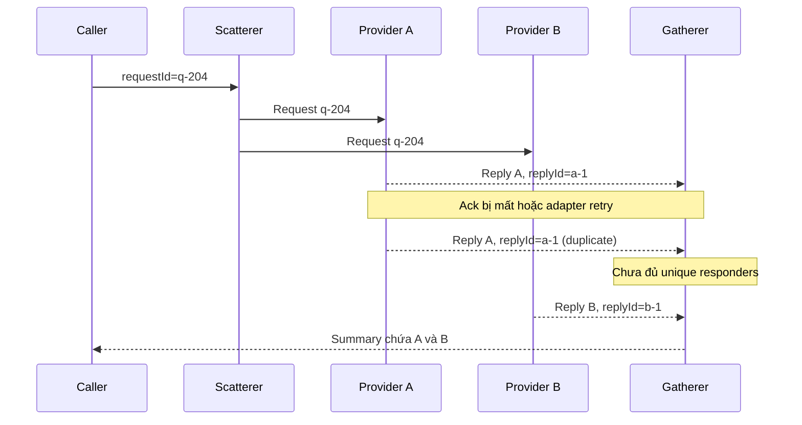
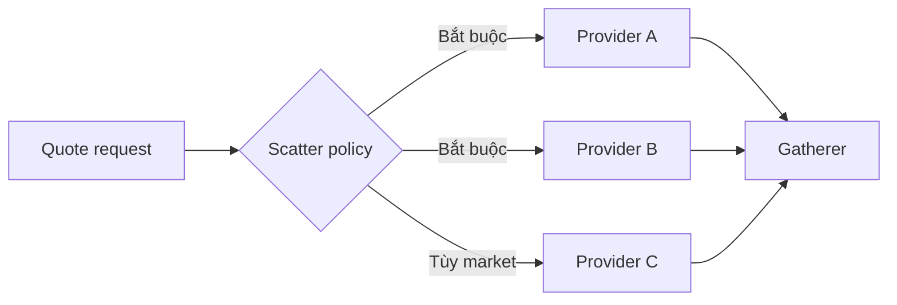
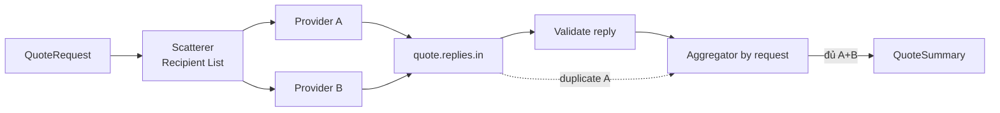
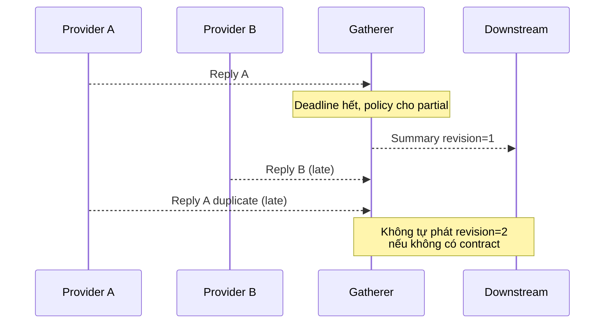
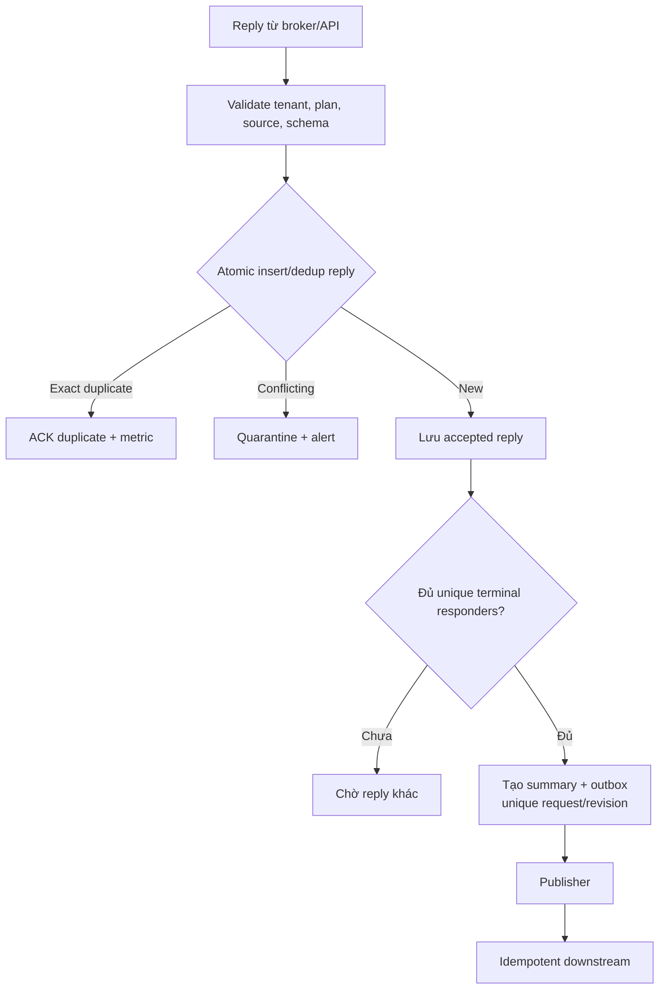
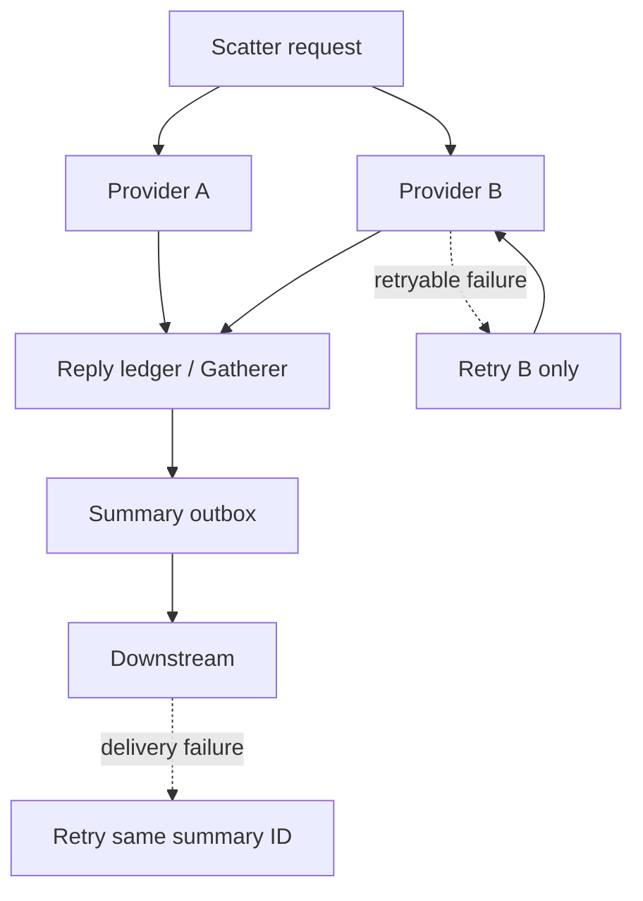

# Xử lý duplicate reply

## 1. Vấn đề: hai reply không có nghĩa là hai nguồn đã trả lời

Một dịch vụ định giá nhận yêu cầu `QuoteRequest` và hỏi đồng thời hai nhà cung cấp: A và B. Phía tổng hợp cần nhận **một kết quả hợp lệ từ mỗi nhà cung cấp**, so sánh giá rồi trả `QuoteSummary`:

```text
Request: tenant-A / quote-204
Expected responders = {A, B}

09:00:01  A → reply A-1, price=100.00
09:00:02  A → reply A-1, price=100.00   (redelivery)
09:00:03  B → reply B-1, price= 95.00

Kết quả đúng: chờ B, sau đó chọn giá 95.00 từ B.
```

Nếu dùng release strategy `group.size() == 2`, nhóm có thể được phát ngay sau **hai bản A**, trước khi nhận B. Kết quả đó sai dù cả hai message đều hợp lệ về schema.

Đây là bài toán **duplicate reply** trong **Scatter-Gather**:

- **Scatter:** gửi một yêu cầu đến nhiều recipient.
- **Gather:** gom reply tương ứng với một yêu cầu thành kết quả cuối.
- **Duplicate reply:** cùng một phản hồi logic có thể xuất hiện nhiều lần do retry, redelivery, producer gửi lặp hoặc luồng được cấu hình trùng.

Bài **“Xử lý duplicate reply”** thuộc chương **Scatter gather** của module **SPRING_INTEGRATION_PATTERN**. Module tập trung triển khai Enterprise Integration Patterns với Spring Integration để tạo các luồng message ít phụ thuộc và dễ mở rộng; thực hành Router, Filter, Transformer, Splitter, Aggregator, Gateway, retry, error channel và correlation cùng kiểm thử và theo dõi các nhánh xử lý.

Sau bài này, bạn có thể:

1. Phân biệt duplicate reply với hai reply hợp lệ từ hai nguồn khác nhau.
2. Thiết kế khóa **request**, **responder**, **logical reply** và **processing attempt**.
3. Viết release strategy dựa trên **tập responder dự kiến**, không đếm message thô.
4. Chọn quy tắc với duplicate giống nhau, duplicate mâu thuẫn và reply đến muộn.
5. Dùng Java DSL để mô phỏng Scatter-Gather và viết JUnit kiểm chứng.
6. Đặt idempotency, MessageGroupStore, transaction, timeout và error flow ở đúng ranh giới.
7. Hiểu giới hạn của in-memory aggregation và cách mở rộng sang broker/multi-instance.

## 2. Vì sao duplicate reply xuất hiện?



Một số nguyên nhân phổ biến:

| Nguyên nhân | Diễn biến | Kết quả |
| --- | --- | --- |
| Broker phát lại | Consumer xử lý xong nhưng crash trước khi ack | Cùng logical reply được giao thêm lần nữa |
| Producer retry sau timeout | Producer không biết lần publish đầu đã thành công chưa | Hai bản message tương đương |
| HTTP callback lặp | Remote service gọi callback hai lần | Hai response cùng request/responder |
| Scatter gửi hai lần | Retry toàn request khi một recipient chậm | Một provider có thể trả nhiều lần |
| Cấu hình nhầm topology | Cùng recipient được đăng ký hai lần, hai flow gửi chung destination | Hai đường sinh reply cho một nhiệm vụ |
| Có nhiều phiên bản worker | Worker cũ và mới cùng xử lý một request | Reply có thể khác nhau về payload hoặc version |
| Replay DLQ | Operator phát lại dữ liệu lịch sử | Một reply đến khi nhóm đã release |
| Partial retry | Chỉ provider B được gọi lại | B có nhiều attempt nhưng vẫn chỉ là **một responder** |

**Không phải hai payload giống nhau đều là duplicate.** Hai provider có thể cùng báo giá 100.00 nhưng đều là reply hợp lệ, vì `responderId` khác nhau.

Ngược lại, cùng một provider có thể tạo hai reply giá khác nhau. Đó là **reply mâu thuẫn**, không nên mặc định lấy reply cuối hoặc cộng cả hai.

## 3. Bốn định danh phải tách biệt

Một message fan-in nên mang những ID với ý nghĩa khác nhau:

| Định danh | Ví dụ | Dùng cho |
| --- | --- | --- |
| `requestId` | `q-204` | Liên kết những reply của một yêu cầu |
| `responderId` | `A` hoặc `B` | Biết **ai** đã trả lời |
| `replyId` | `A-q-204-v1` | Nhận diện **một kết quả logic** bị giao lại |
| `attemptId` / `deliveryAttempt` | `attempt-3` | Quan sát từng lần thử gửi/xử lý |

Nên có thêm `tenantId` đã được xác thực, `requestRevision` hoặc `scatterPlanId` nếu cùng business request có thể được đánh giá lại.

**Correlation key** của nhóm thường là cặp:

```text
(tenantId, requestId)
```

**Dedup key** có thể là:

```text
(tenantId, requestId, responderId, replyId)
```

Còn câu hỏi **“đã nhận đủ chưa?”** dựa trên **các responder bắt buộc đã có kết quả hợp lệ**, không phải số lượng `replyId` hoặc số `MessageHeaders.ID`.

### Vì sao không dùng Message ID của Spring Integration?

`MessageHeaders.ID` có thể khác nhau khi adapter xây một `Message` mới, message được transform hoặc broker redeliver. Một logical reply `A-q-204-v1` có thể được biểu diễn bởi hai message framework khác nhau.

Dùng message ID làm dedup key sẽ **không phát hiện được** duplicate nghiệp vụ trong nhiều tình huống.

### Vì sao không dùng giá trị tiền làm khóa?

`A` và `B` có thể cùng trả 100.00 nhưng phải được tính là **hai nguồn đã trả lời**. Ngược lại, một `A` đã gửi 100.00 rồi 101.00 có thể là **hai phiên bản trả lời mâu thuẫn**. So sánh payload đơn thuần không đủ để biết message nào hợp lệ.

## 4. Scatter-Gather cần một tập responder dự kiến

Một scatterer không nhất thiết luôn gửi cùng số lượng request:



Với request thứ nhất, có thể mong đợi `{A,B}`; với request thứ hai, `{A,B,C}`. Gatherer phải dùng **tập responder được chọn cho chính request đó**.

Một kế hoạch scatter (*scatter plan*) nên ghi:

```json
{
  "tenantId": "tenant-A",
  "requestId": "q-204",
  "scatterPlanVersion": "quotes-v3",
  "requiredResponders": ["A", "B"],
  "optionalResponders": [],
  "deadline": "2026-11-21T09:00:10Z"
}
```

*Dữ liệu là ví dụ minh họa, không phải schema mà Spring Integration tự sinh.*

**Không lấy expected responders từ tổng số handler đang triển khai** nếu Router/Recipient List chọn động theo điều kiện. Một Filter có thể bỏ nhánh, một provider có thể không áp dụng, hoặc policy thay đổi sau lúc scatter.

Nếu message bị replay sau khi policy đã cập nhật, cần dùng **kế hoạch đã chốt** hoặc chủ động tạo revision mới. Việc đánh giá lại silently có thể làm nhóm chờ một responder vốn không có trong yêu cầu cũ.

## 5. Sai lầm: release bằng số message trong group

Giả sử Gatherer nhận các message theo thứ tự:

```text
A1, A1, B1
```

Với hai responder bắt buộc, một ReleaseStrategy đơn giản:

```java
// Không phù hợp nếu duplicate reply có thể xuất hiện:
group -> group.size() == 2
```

có thể release ngay sau hai bản A.

Tương tự:

```java
// Đạt đủ count cũng không bảo đảm đủ responder:
group -> group.size() >= expectedCount
```

cũng sai khi một provider tạo nhiều message. So sánh:

| Group đã nhận | Size | Unique responders | Có được release theo yêu cầu A+B? |
| --- | ---: | --- | --- |
| A | 1 | {A} | Không |
| A, A | 2 | {A} | Không |
| A, A, B | 3 | {A, B} | Có, nếu hai reply hợp lệ và nhất quán |
| A, B | 2 | {A, B} | Có |
| A, C | 2 | {A, C} | Không; C không nằm trong plan |
| A, B, B | 3 | {A, B} | Có về completeness, nhưng B duplicate cần xử lý |
| A, B với A lỗi chưa terminal | 2 | {A, B} | Tùy hợp đồng: không coi attempt thất bại là terminal reply |

**Công thức đúng hơn:**

\[
\text{complete} \iff R_{\mathrm{required}}\subseteq R_{\mathrm{accepted,terminal}}
\]

Điều kiện trên nói “mọi responder bắt buộc đã có terminal reply được chấp nhận”. Nhưng nó **chưa đủ** nếu có reply mâu thuẫn hoặc người gửi không được phép. Phải validate identity, policy, scope và consistency trước khi phát output.

## 6. Bốn loại duplicate và phản ứng tương ứng

| Loại | Ví dụ | Cách xử lý |
| --- | --- | --- |
| **Exact duplicate** | Cùng `replyId`, cùng responder, cùng nội dung chuẩn hóa | Nhận biết là redelivery; không đếm thêm, ghi metric |
| **Same-responder duplicate** | Hai `replyId` từ A cho cùng một request/revision | Áp policy: first terminal wins, phiên bản mới có chủ đích hoặc conflict |
| **Conflicting duplicate** | Cùng replyId nhưng amount hoặc status khác | Báo lỗi toàn vẹn; quarantine/audit, không chọn tùy tiện |
| **Late duplicate** | A lặp lại sau khi summary đã phát | Không tạo summary mới; kiểm soát group lifecycle và output idempotency |

Nếu một source gửi `FAILED` do lỗi tạm thời rồi retry thành `SUCCESS`, cần phân biệt **attempt failure** và **terminal business result**. Không cho một error event tạm thời vô tình chiếm slot responder khiến Gatherer release trước khi có kết quả đúng.

### “First wins” có luôn phù hợp?

Không. Nếu giá của provider A có thể thay đổi trong cùng request và business contract quy định lấy **quote version mới nhất**, policy phải gắn version/effective time, deadline và thứ tự có thẩm quyền. “Last message arrives wins” là một chính sách nguy hiểm: mạng có thể đảo thứ tự, message cũ đến sau và ghi đè giá mới.

Trong bài này, ví dụ quy định **mỗi provider có một terminal quote bất biến cho mỗi request**. Redelivery của cùng terminal quote là duplicate; nếu cùng responder đưa ra terminal quote khác nhau mà không có revision mới, coi là conflict.

## 7. Mô hình dữ liệu ví dụ

Ta mô phỏng một scatterer gọi hai provider A và B. Các record sau thể hiện request, reply và kết quả cuối. Mọi giá được giả định cùng đơn vị **USD**, chỉ nhằm tập trung vào bài toán duplicate.

```java
import java.math.BigDecimal;
import java.util.List;

record QuoteRequest(
        String tenantId,
        String requestId,
        String productCode) {}

record QuoteReply(
        String tenantId,
        String requestId,
        String responderId,
        String replyId,
        BigDecimal quotedPrice) {}

record QuoteSummary(
        String tenantId,
        String requestId,
        List<QuoteReply> uniqueReplies,
        String selectedResponder,
        BigDecimal selectedPrice) {}
```

Quy ước:

- `requestId` gắn với một yêu cầu logic; không sinh ID mới ở mỗi lần redelivery.
- `tenantId` đến từ ingress xác thực.
- `responderId` dùng tên logical provider A/B, không dùng tên pod hoặc endpoint URL.
- `replyId` không đổi khi cùng reply được giao lại; provider thay nội dung cần revision được quy định.
- `quotedPrice` dương và cùng currency theo contract.
- `QuoteSummary.uniqueReplies` chứa **mỗi responder đúng một lần** và có thứ tự ổn định theo `responderId`.
- Nếu hai provider cùng giá, chọn responder theo một quy tắc tie-breaker xác định.

Bài tập nâng cao có thể thêm `quoteVersion`, `status`, `validUntil`, `currencyCode` và chữ ký/source provenance; hãy xác định semantics của chúng trước khi thay đổi dedup.

## 8. Logic dùng chung: kiểm tra, release và tạo summary

Để DSL dễ đọc, tách logic của Gatherer vào một class thuần `ReplyRules`.

```java
import java.math.BigDecimal;
import java.util.Comparator;
import java.util.HashMap;
import java.util.HashSet;
import java.util.List;
import java.util.Map;
import java.util.Set;

import org.springframework.integration.store.MessageGroup;
import org.springframework.messaging.Message;

final class ReplyRules {

    private static final Set<String> EXPECTED =
        Set.of("A", "B");

    private ReplyRules() {}

    static boolean valid(QuoteReply reply) {
        return reply != null
            && notBlank(reply.tenantId())
            && notBlank(reply.requestId())
            && notBlank(reply.responderId())
            && notBlank(reply.replyId())
            && EXPECTED.contains(reply.responderId())
            && reply.quotedPrice() != null
            && reply.quotedPrice().signum() > 0
            && reply.quotedPrice().scale() <= 2;
    }

    private static boolean notBlank(String value) {
        return value != null && !value.isBlank();
    }

    // Length-prefix tránh va chạm do dấu phân cách nằm trong ID.
    static String groupKey(QuoteReply reply) {
        String tenant = reply.tenantId();
        String request = reply.requestId();
        return tenant.length() + "#" + tenant
             + request.length() + "#" + request;
    }

    static boolean allRequiredSeen(MessageGroup group) {
        Set<String> responders = new HashSet<>();

        for (Message<?> message : group.getMessages()) {
            QuoteReply reply =
                (QuoteReply) message.getPayload();
            responders.add(reply.responderId());
        }

        // Chỉ xét những response đã qua validation.
        // Duplicate cùng provider không giúp đạt completeness.
        return responders.equals(EXPECTED);
    }

    static QuoteSummary toSummary(MessageGroup group) {
        Map<String, QuoteReply> unique = new HashMap<>();

        for (Message<?> message : group.getMessages()) {
            QuoteReply reply =
                (QuoteReply) message.getPayload();

            if (!valid(reply)
                    || !groupKey(reply).equals(
                        String.valueOf(group.getGroupId()))) {
                throw new IllegalArgumentException(
                    "Invalid reply or correlation mismatch");
            }

            QuoteReply existing =
                unique.putIfAbsent(reply.responderId(), reply);

            if (existing != null && !existing.equals(reply)) {
                // Demo: cùng responder không được có
                // hai terminal quotes khác nhau.
                throw new IllegalStateException(
                    "Conflicting reply from "
                        + reply.responderId());
            }
        }

        if (!unique.keySet().equals(EXPECTED)) {
            throw new IllegalStateException(
                "Not all expected responders replied");
        }

        List<QuoteReply> replies = unique.values().stream()
            .sorted(Comparator.comparing(QuoteReply::responderId))
            .toList();

        QuoteReply winner = replies.stream()
            .min(Comparator
                .comparing(QuoteReply::quotedPrice)
                .thenComparing(QuoteReply::responderId))
            .orElseThrow();

        return new QuoteSummary(
            replies.get(0).tenantId(),
            replies.get(0).requestId(),
            List.copyOf(replies),
            winner.responderId(),
            winner.quotedPrice());
    }
}
```

### Vai trò của từng method

- `valid(...)` kiểm tra schema tối thiểu và allowlist responder.
- `groupKey(...)` tạo correlation key gồm tenant + request, dùng encoding có độ dài để tránh va chạm khi ID chứa dấu phân cách.
- `allRequiredSeen(...)` chỉ quan tâm **tập responder duy nhất**; hai message của A vẫn chỉ tương ứng với một responder.
- `toSummary(...)` áp một contract mạnh hơn: duplicate phải **giống hoàn toàn**, mọi reply cùng group, không có provider ngoài plan, chọn giá thấp nhất sau khi đã loại trùng.

**Cẩn thận:** record `QuoteReply` dùng equality của Java. Với `BigDecimal`, `100.0` và `100.00` là bằng nhau khi so theo giá trị nhưng `BigDecimal.equals` có thể trả `false` vì scale khác nhau. Ví dụ chỉ chấp nhận scale tối đa 2, chứ chưa normalize về scale cố định. Trong production, hãy chuẩn hóa amount/currency/schema trước khi tạo fingerprint hoặc so sánh business equivalence; không dùng raw JSON byte-to-byte nếu thứ tự trường, whitespace hoặc header không ảnh hưởng ý nghĩa.

### Vì sao không xóa duplicate ngay trong ReleaseStrategy?

ReleaseStrategy có trách nhiệm **quyết định group đã đủ chưa**, không nên tự sửa MessageGroupStore hoặc gọi API ngoài. Nếu cần loại duplicate trước khi lưu group, hãy đặt **validation/dedup gate** ở đầu vào và thiết kế tính nguyên tử với group admission. Việc dùng `Set` ở đây chỉ là cách quan sát completeness, **không làm các message trùng biến mất khỏi store**.

## 9. Java DSL: mô phỏng Scatter và Gather riêng để quan sát duplicate

Spring Integration có hỗ trợ Scatter-Gather qua các endpoint/DSL thích hợp. Để kiểm chứng duplicate reply ở mức message, ví dụ này **tách rõ scatterer và gatherer**:

1. Scatterer dùng Recipient List gửi request đến A và B.
2. Hai provider giả lập tạo `QuoteReply`.
3. Mọi reply đi vào `quote.replies.in`.
4. Gatherer dùng correlation/release/processor của mục 8.
5. Kết quả được gửi vào `quote.summary.out`.



### Cấu hình đầy đủ cho minh họa

```java
import java.math.BigDecimal;

import org.springframework.context.annotation.Bean;
import org.springframework.context.annotation.Configuration;
import org.springframework.integration.channel.DirectChannel;
import org.springframework.integration.channel.QueueChannel;
import org.springframework.integration.config.EnableIntegration;
import org.springframework.integration.dsl.IntegrationFlow;

@Configuration
@EnableIntegration
public class DuplicateReplyScatterGatherConfig {

    @Bean("quote.requests.in")
    DirectChannel quoteRequests() {
        return new DirectChannel();
    }

    @Bean("quote.providerA.in")
    DirectChannel providerAInput() {
        return new DirectChannel();
    }

    @Bean("quote.providerB.in")
    DirectChannel providerBInput() {
        return new DirectChannel();
    }

    @Bean("quote.replies.in")
    DirectChannel repliesInput() {
        return new DirectChannel();
    }

    @Bean("quote.summary.out")
    QueueChannel summaryOutput() {
        return new QueueChannel();
    }

    @Bean
    IntegrationFlow scatterRequests() {
        return IntegrationFlow.from("quote.requests.in")
            .routeToRecipients(spec -> spec
                .recipient("quote.providerA.in")
                .recipient("quote.providerB.in"))
            .get();
    }

    @Bean
    IntegrationFlow providerA() {
        return IntegrationFlow.from("quote.providerA.in")
            .transform(QuoteRequest.class, request ->
                new QuoteReply(
                    request.tenantId(),
                    request.requestId(),
                    "A",
                    request.requestId() + "-A-r1",
                    new BigDecimal("100.00")))
            .channel("quote.replies.in")
            .get();
    }

    @Bean
    IntegrationFlow providerB() {
        return IntegrationFlow.from("quote.providerB.in")
            .transform(QuoteRequest.class, request ->
                new QuoteReply(
                    request.tenantId(),
                    request.requestId(),
                    "B",
                    request.requestId() + "-B-r1",
                    new BigDecimal("95.00")))
            .channel("quote.replies.in")
            .get();
    }

    @Bean
    IntegrationFlow gatherReplies() {
        return IntegrationFlow.from("quote.replies.in")
            .filter(QuoteReply.class,
                ReplyRules::valid,
                spec -> spec.throwExceptionOnRejection(true))
            .aggregate(spec -> spec
                .correlationStrategy(message ->
                    ReplyRules.groupKey(
                        (QuoteReply) message.getPayload()))
                .releaseStrategy(ReplyRules::allRequiredSeen)
                .outputProcessor(ReplyRules::toSummary))
            .channel("quote.summary.out")
            .get();
    }
}
```

**Điều quan trọng về cấu hình:**

- Đây là một **mô phỏng hai thành phần** Scatter và Gather, không phải ví dụ đầy đủ về lifecycle request–reply của một `ScatterGatherHandler` tích hợp.
- Hai provider tạo giá cố định, không có HTTP/broker thực; trong production, mỗi provider sẽ là một integration flow/adapter có timeout và result contract riêng.
- `DirectChannel` được dùng để dễ kiểm thử đồng bộ; một provider lỗi có thể khiến scatterer chưa gửi tiếp đến recipient sau.
- `quote.summary.out` là `QueueChannel` phục vụ test; việc nhận summary trong queue không đồng nghĩa đã cập nhật hệ thống downstream.
- Với các API và DSL đã dùng, phải đối chiếu overload của phiên bản Spring Integration thực tế trước khi triển khai production.
- `ReplyRules.EXPECTED={A,B}` là **tập cố định của bài học**. Nếu Scatter policy chọn động, phải dùng expected set **theo request** thay vì một constant toàn ứng dụng.

### Nếu muốn dùng Scatter-Gather DSL dạng tích hợp

Spring Integration cũng có thành phần kết hợp scatterer/gatherer và cấu hình reply flow, correlation, timeout, gatherer aggregation. Khi sử dụng hình thức tích hợp, cùng những nguyên tắc vẫn áp dụng: **định danh request và responder**, **release theo unique expected replies**, **xử lý conflict** và **group lifecycle**. Không nên mặc định cấu hình mặc định của gatherer có thể loại duplicate nghiệp vụ bằng `MessageHeaders.ID`.

Với bài này, việc tách hai flow còn giúp **tiêm duplicate reply trực tiếp vào gatherer** để kiểm thử độc lập với logic gọi provider.

## 10. Integration test: không release khi A trả lời hai lần

JUnit 5 + AssertJ:

```java
import static org.assertj.core.api.Assertions.assertThat;
import static org.assertj.core.api.Assertions.assertThatThrownBy;

import java.math.BigDecimal;

import org.junit.jupiter.api.Test;
import org.springframework.beans.factory.annotation.Autowired;
import org.springframework.beans.factory.annotation.Qualifier;
import org.springframework.integration.channel.QueueChannel;
import org.springframework.messaging.Message;
import org.springframework.messaging.MessageChannel;
import org.springframework.messaging.support.MessageBuilder;
import org.springframework.test.context.junit.jupiter.SpringJUnitConfig;

@SpringJUnitConfig(DuplicateReplyScatterGatherConfig.class)
class DuplicateReplyScatterGatherTest {

    @Autowired
    @Qualifier("quote.requests.in")
    MessageChannel requests;

    @Autowired
    @Qualifier("quote.replies.in")
    MessageChannel replies;

    @Autowired
    @Qualifier("quote.summary.out")
    QueueChannel summaries;

    private void send(
            String tenant,
            String requestId,
            String responder,
            String replyId,
            String price) {

        assertThat(replies.send(MessageBuilder.withPayload(
            new QuoteReply(tenant, requestId, responder,
                replyId, new BigDecimal(price)))
            .build())).isTrue();
    }

    @Test
    void duplicateAIsNotCountedAsB() {
        send("tenant-A", "q-dup", "A", "a-1", "100.00");
        send("tenant-A", "q-dup", "A", "a-1", "100.00");

        // Hai message, nhưng mới có một responder duy nhất.
        assertThat(summaries.receive(0)).isNull();

        send("tenant-A", "q-dup", "B", "b-1", "95.00");

        Message<?> message = summaries.receive(1_000);
        assertThat(message).isNotNull();

        QuoteSummary summary = (QuoteSummary) message.getPayload();
        assertThat(summary.requestId()).isEqualTo("q-dup");
        assertThat(summary.selectedResponder()).isEqualTo("B");
        assertThat(summary.selectedPrice())
            .isEqualByComparingTo(new BigDecimal("95.00"));
        assertThat(summary.uniqueReplies())
            .extracting(QuoteReply::responderId)
            .containsExactly("A", "B");

        assertThat(summaries.receive(0)).isNull();
    }

    @Test
    void twoDifferentProvidersWithEqualPricesAreNotDuplicates() {
        send("tenant-A", "q-equal", "A", "a-2", "100.00");
        send("tenant-A", "q-equal", "B", "b-2", "100.00");

        QuoteSummary summary =
            (QuoteSummary) summaries.receive(1_000).getPayload();

        assertThat(summary.uniqueReplies()).hasSize(2);
        // Quy tắc tie-breaker của demo chọn responder ID nhỏ hơn.
        assertThat(summary.selectedResponder()).isEqualTo("A");
    }

    @Test
    void unknownResponderIsRejectedBeforeAggregation() {
        assertThatThrownBy(() -> send(
            "tenant-A", "q-unknown",
            "UNKNOWN", "x-1", "50.00"))
            .isInstanceOf(RuntimeException.class);

        assertThat(summaries.receive(0)).isNull();
    }

    @Test
    void scatterAndGatherProduceOneSummary() {
        QuoteRequest request =
            new QuoteRequest("tenant-A", "q-normal", "SKU-1");

        assertThat(requests.send(
            MessageBuilder.withPayload(request).build()))
            .isTrue();

        Message<?> message = summaries.receive(1_000);
        assertThat(message).isNotNull();

        QuoteSummary summary = (QuoteSummary) message.getPayload();
        assertThat(summary.selectedResponder()).isEqualTo("B");
        assertThat(summary.uniqueReplies()).hasSize(2);
    }
}
```

**Test này chứng minh điều gì?** Gatherer không dùng số message thô để quyết định release; một duplicate từ A không thay thế được B. Hai provider trả cùng giá vẫn là hai responder hợp lệ.

**Test chưa chứng minh điều gì?** Nó chưa chứng minh durability khi restart, không bảo đảm end-to-end exactly-once, chưa kiểm tra group expiration hay lỗi broker/DB và chưa chạy qua transport thật. Các kiểm thử đó cần thêm MessageGroupStore/adapter và cơ chế transaction phù hợp.

## 11. Kiểm thử reply mâu thuẫn

Một reply mâu thuẫn không nên bị coi là một bản sao an toàn:

```text
A, replyId=a-1, amount=100.00
A, replyId=a-1, amount=120.00
B, replyId=b-1, amount=95.00
```

Trong policy demo, `ReplyRules.toSummary()` phát hiện rằng A có hai payload không bằng nhau và ném exception khi group được release. Có thể bổ sung test:

```java
@Test
void conflictingReplyMustNotProduceSummary() {
    send("tenant-A", "q-conflict", "A", "a-conf", "100.00");
    send("tenant-A", "q-conflict", "A", "a-conf", "120.00");

    assertThatThrownBy(() -> send(
        "tenant-A", "q-conflict", "B", "b-conf", "95.00"))
        .isInstanceOf(RuntimeException.class);

    assertThat(summaries.receive(0)).isNull();
}
```

Đặt test này **bên trong** class `DuplicateReplyScatterGatherTest` ở mục 10, sử dụng lại helper `send(...)` và channels đã khai báo.

Nhưng để production an toàn, **không nên đợi đến lúc tất cả nguồn trả lời mới phát hiện conflict**. Một dedup/consistency gate **trước khi message được ghi vào MessageGroupStore** hoặc một reply ledger giao dịch có thể phát hiện sớm:

1. Kiểm tra `replyId` đã tồn tại với cùng request/responder chưa.
2. Nếu cùng fingerprint chuẩn hóa → đánh dấu `DUPLICATE_IGNORED`.
3. Nếu khác fingerprint → `CONFLICT_QUARANTINED` và cảnh báo.
4. Nếu mới → ghi nhận reply, cho phép Gatherer xử lý.
5. Tất cả thao tác phải tính đến concurrency và khoảng crash giữa việc ghi ledger với việc nhận message vào group.

Trong ví dụ, exception của output processor có thể ảnh hưởng trạng thái group, retry và error handling theo cấu hình. Không tự động giải phóng hay xóa group lỗi nếu không có recovery policy.

## 12. Các mức dedup: message, reply, responder và summary

Một hệ thống có thể cần **bốn lớp bảo vệ**:

| Lớp | Khóa gợi ý | Ý nghĩa |
| --- | --- | --- |
| Transport/message delivery | Broker offset/delivery ID, theo transport | Nhận diện một lần giao/lặp ở tầng hạ tầng |
| Logical reply | `tenantId + requestId + responderId + replyId` | Phát hiện cùng kết quả được giao lại |
| Responder slot | `tenantId + requestId + responderId` | Một nguồn chỉ chiếm một slot trong gather plan |
| Summary/business output | `tenantId + requestId + summaryRevision` | Tránh downstream xử lý cùng kết quả hai lần |

**Transport dedup không thay thế logical dedup.** Broker producer có thể tạo message khác ID cho cùng kết quả nghiệp vụ.

**Responder slot cũng không đơn giản là Set đã thấy.** Nếu nguồn A đang xử lý rồi crash, hệ thống có thể chưa có terminal reply hợp lệ. Đánh dấu `A=COMPLETED` khi mới thấy request gửi tới A sẽ khiến Gatherer tưởng đủ.

### Mô hình trạng thái theo responder

| Trạng thái | Ý nghĩa | Có được tính là terminal reply? |
| --- | --- | --- |
| `NOT_REQUESTED` | Không thuộc scatter plan | Không |
| `PENDING` | Đã gửi request, chưa có reply | Không |
| `RETRYING` | Một attempt thất bại, đang chờ thử lại | Không |
| `SUCCESS` | Có terminal result hợp lệ | Có |
| `FAILED_FINAL` | Đã quyết định không retry và có failure envelope | Tùy hợp đồng; có thể tính là terminal |
| `CONFLICT` | Nhận nhiều kết quả trái nhau, cần điều tra | Không coi là success |
| `EXPIRED` | Hết deadline, chưa có kết quả | Cần policy timeout/partial |

Các trạng thái này là **mô hình ứng dụng đề xuất**, không phải status tự sinh của `Aggregator`. Nếu chọn cho phép `FAILED_FINAL` đếm là terminal, output phải biểu diễn failure đó, không giả vờ provider đã cung cấp giá.

## 13. Chọn thời điểm release trong Scatter-Gather

Có ba chính sách thường gặp:

**All required responders.** Đợi A và B đều có terminal reply hợp lệ. Phù hợp khi phải so sánh đầy đủ các nhà cung cấp bắt buộc.

**First successful or quorum.** Phát kết quả khi có đủ K source thành công. Ví dụ chọn quote đầu tiên chấp nhận được. Lúc này expected set khác nguyên tắc all-required, và output có thể cần trạng thái `QUORUM_REACHED` cùng tập source chưa trả lời.

**Deadline/partial result.** Khi hết thời gian, có thể trả những reply đã có hoặc một failure/HOLD, theo hợp đồng.

| Tình huống | All-required | Quorum 1/2 | Deadline partial |
| --- | --- | --- | --- |
| A thành công, B chưa trả | Chờ | Có thể release theo policy | Chờ tới deadline |
| A trả lặp hai lần, B chưa trả | Chờ | Chỉ tính một source | Chờ |
| A lỗi terminal, B thành công | Tùy xem failure có được tính là terminal | B có thể đủ quorum | Trả partial hoặc error |
| A và B trả thành công | Release | Có thể đã release trước | Release |
| B đến sau release | Xử lý late reply | Xử lý late reply | Có thể tạo revision mới nếu được phép |

**Không dùng duplicate để “đạt quorum”.** Quorum là số **nguồn độc lập có kết quả chấp nhận được**, không phải số message.

## 14. Timeout và reply đến muộn

Giả sử nhóm đã release một summary sau khi đạt quorum, hoặc đã timeout và trả partial result:



Khi một group đã hoàn tất, các cấu hình MessageGroupStore và Aggregator có thể **giữ dấu hoàn tất**, **xóa group** hoặc có chính sách dọn nhóm. Hành vi đối với reply đến sau sẽ phụ thuộc vào những thiết lập như expiration/group lifecycle, và các endpoint liên quan.

Nếu một group bị xóa hoàn toàn và cùng correlation key xuất hiện lại, có nguy cơ **một group mới được tạo với cùng request ID**. Một hệ thống cần tránh phát summary thứ hai phải có **completed-request ledger/tombstone** đủ bền vững.

### Ba lựa chọn với late reply

1. **Ignore + record:** bỏ reply trễ, ghi metric và provenance. Phù hợp khi summary đã chốt.
2. **Quarantine:** lưu để điều tra nếu reply trễ có thể là lỗi topology hoặc vi phạm SLA.
3. **Revision có chủ đích:** phát `summaryRevision=2` và thông báo downstream rằng đây là một bản cập nhật, không phải kết quả lần đầu.

Không chọn “last write wins” chỉ vì reply trễ được nhận sau. Nguồn reply, quote version và thời điểm hiệu lực phải có hợp đồng.

## 15. MessageGroupStore và deduplication

Gatherer/Aggregator là một thành phần **stateful**. Message A có thể đến trước B vài giây hoặc lâu hơn. State được lưu trong MessageGroupStore; với mặc định trong-memory, group không bền vững qua process restart.

| Mô hình lưu | Điều được hỗ trợ | Rủi ro/đánh đổi |
| --- | --- | --- |
| In-memory group store | Dễ thử nghiệm, độ trễ thấp | Mất state khi restart, multi-instance bị phân mảnh |
| Persistent/JDBC group store | Có thể giữ nhóm qua restart | Transaction, locking, schema, cleanup |
| Partition/co-located consumers | Tất cả reply cùng request đi tới một instance | Phải kiểm soát partition key và reassignment |
| Reply ledger + workflow state | Dedup, conflict, status và output revision rõ | Thiết kế dữ liệu/transaction phức tạp hơn |
| External broker/outbox | Delivery/retry bền vững | Không tự dedup ở tầng business |

**Shared store không tự bảo đảm exactly-once.** Hai worker có thể đồng thời xử lý reply A và B; phải biết điều kiện claim, lock, compare-and-set và transaction khi cập nhật trạng thái nhóm.

### Một state model bền vững

Ví dụ các bảng khái niệm:

```text
scatter_request(
    tenant_id, request_id, plan_version, deadline,
    expected_responders, state, summary_revision,
    UNIQUE(tenant_id, request_id)
)

accepted_reply(
    tenant_id, request_id, responder_id,
    reply_id, canonical_fingerprint,
    payload_reference, accepted_at,
    UNIQUE(tenant_id, request_id, responder_id, reply_id)
)

published_summary(
    tenant_id, request_id, summary_revision,
    result_reference, published_at,
    UNIQUE(tenant_id, request_id, summary_revision)
)
```

Các bảng này là **thiết kế minh họa ở tầng ứng dụng**, không phải schema của Spring Integration. Nếu chỉ dùng unique theo `replyId`, hai terminal reply khác nhau của cùng provider vẫn được chấp nhận như hai hàng mới. Cần thêm **responder-slot policy** hoặc conflict detection theo `(tenant,request,responder)`.

### Khoảng crash cần tính đến

**Crash window A:** ghi `seen=reply A` thành công, process chết trước khi đưa reply vào group. Sau restart, duplicate A bị chặn nhưng Gatherer chưa từng có dữ liệu A → nhóm không đủ.

**Crash window B:** group đã có A, process chết trước khi ack broker. Broker phát lại A → group nhận hai message nếu không có dedup bền vững.

**Crash window C:** summary đã được gửi downstream, process chết trước khi lưu trạng thái phát thành công. Retry có thể gửi summary lần nữa.

Không thể loại cả ba khoảng lỗi chỉ bằng một `ConcurrentHashMap`. Với dữ liệu quan trọng, cần một trong các cách thiết kế đồng bộ transaction/ledger/outbox, có recovery và consumer idempotency.

## 16. Đồng bộ ledger với việc tạo summary

Một thiết kế đáng tin cậy thường dựa trên **reply ledger giao dịch**:



Nếu `accepted_reply`, group completion và outbox summary cùng nằm trong **một database**, có thể đặt transaction/lock/unique constraint để ngăn hai worker cùng tạo summary. Khi không thể bao phủ bằng một transaction, phải có recovery protocol và khả năng replay có kiểm soát.

Cần xác định:

- Atomic claim khi hai bản reply tới đồng thời.
- Cách so sánh fingerprint chuẩn hóa để phát hiện conflict.
- Khi nào đánh dấu responder slot là terminal.
- Khi nào group chuyển `COMPLETED` và không cho summary revision 1 được phát lần nữa.
- Khi nào ACK transport; ACK trước commit có thể làm mất dữ liệu.
- Nếu publish summary thành công nhưng mất ACK, downstream nhận lại phải idempotent.
- Retention của reply/summary ledger đủ lâu cho broker redelivery và DLQ replay.

Transactional outbox giúp gắn quyết định phát output với transaction lưu state. **Nó không tự tạo exactly-once end-to-end**; publisher và consumer vẫn có thể gặp duplicate và phải xử lý theo key nghiệp vụ.

## 17. Vấn đề concurrent reply

Không chỉ broker mới tạo trùng. Hai instance có thể xử lý hai bản reply A cùng lúc:

```text
Thread-1: SELECT reply A -> chưa có
Thread-2: SELECT reply A -> chưa có
Thread-1: INSERT A
Thread-2: INSERT A
```

Nếu code thực hiện “check rồi write” không nguyên tử, cả hai có thể bắt đầu processing. Cần unique constraint/CAS/transaction phù hợp; nếu process đang bị xử lý bởi worker khác, trả trạng thái in-progress hoặc retry sau theo policy, không tự coi là completed.

Một trường hợp khác: A và B đều đến gần đồng thời. Hai worker có thể cùng nhận thấy tập responder vừa đủ và **đồng thời phát summary**. Vì thế unique key ở cấp output như `(tenantId, requestId, summaryRevision)` cũng quan trọng, cùng cơ chế lock/state transition chỉ cho một worker tạo output.

**Lưu ý:** `synchronized` trong một bean chỉ giúp giữa các thread của **một JVM**, không bảo vệ nhiều pod hoặc process.

### Vì sao không chỉ dùng Redis Set?

Redis có thể cung cấp thao tác thêm key nguyên tử cho nhiều instance, nhưng:

- Marker Redis có thể được lưu trước khi reply thật được đưa vào group.
- Redis và database business có thể không chung transaction.
- TTL có thể hết trong khi DLQ còn được replay.
- Một key `seen` chưa chứng minh reply đã trở thành terminal/result hợp lệ.

Redis phù hợp khi phạm vi consistency, durability và failure recovery được thiết kế rõ; không phải “thuốc chữa” tự động cho duplicate reply.

## 18. Error reply, partial failure và duplicate

Một provider có thể trả **failure envelope** thay cho báo giá:

```java
enum ReplyStatus {
    SUCCESS,
    FAILED_FINAL,
    RETRYING
}

record ProviderOutcome(
    String tenantId,
    String requestId,
    String responderId,
    String replyId,
    ReplyStatus status,
    BigDecimal quotedPrice,
    String errorCode) {}
```

Nếu `RETRYING` là trạng thái của một attempt chưa hoàn tất, không được coi là terminal response để release. Nếu `FAILED_FINAL` được nghiệp vụ cho phép đếm là terminal, summary phải phân biệt:

- A đã đưa báo giá thành công.
- B đã kết luận thất bại cuối cùng.
- Kết quả nhóm là `PARTIAL_FAILURE` hoặc `NO_VALID_QUOTE`, tùy luật.

Đừng chuyển `FAILED_FINAL` thành `price=0`. Trong bài toán chọn giá thấp nhất, điều đó sẽ khiến hệ thống chọn provider thất bại làm winner.

### Duplicate của failure reply

Nếu B gửi `FAILED_FINAL` hai lần, đó vẫn là một terminal result từ B. Nếu B vừa gửi `FAILED_FINAL` vừa gửi `SUCCESS` cho cùng request không có revision, đây là **conflict** cần policy. Không được đếm thành hai responder hoặc tùy tiện lấy message đến sau.

## 19. Correlation, sequence và reply headers

Scatter-Gather thường kết hợp với các EIP khác:

| Metadata | Mục đích | Cạm bẫy |
| --- | --- | --- |
| `correlationId` | Ghép reply thuộc cùng scatter request | Không ổn định qua adapter/Transformer |
| `sequenceNumber`/`sequenceSize` | Biết vị trí/tổng số phần trong một sequence | Duplicate vẫn có thể có sequence khác hoặc bị tái tạo |
| `requestId` | Business request ID xuyên retry | Sinh mới ở mỗi attempt |
| `responderId` | Biết provider nào đã trả lời | Trust header do client tự gửi |
| `replyId` | Nhận diện một kết quả logic | Dùng framework Message ID thay vì ID nghiệp vụ |
| `planVersion` | Biết tập nguồn dự kiến | Replay lại policy mới làm thay đổi expected set |
| `replyChannel` | Điểm trả response theo ngữ cảnh request/reply | Mất khi tạo Message mới/qua transport |
| `errorChannel` | Đường xử lý lỗi theo endpoint/adapter | Giả định mọi exception đều tự động đi tới đây |

Nếu dùng Splitter, sequence headers có thể hữu ích. Nhưng duplicate reply trong Scatter-Gather vẫn cần **identity theo responder**. Không thể dùng `sequenceSize=2` như bằng chứng rằng hai message là A và B.

Trong Spring Integration, một số Scatter-Gather implementation có cơ chế correlation/reply headers nội bộ. Khi chuyển sang broker/HTTP, phải kiểm tra header mapping và bảo toàn business IDs; đừng gắn kết quả nghiệp vụ vào một header tạm mà adapter có thể bỏ.

## 20. Retry đúng phạm vi

Có ba vị trí lỗi và retry khác nhau:

1. **Request scatter thất bại:** chưa gửi được tới provider B. Cần retry việc gửi B, không mặc định gửi lại cả A nếu A đã nhận.
2. **Provider xử lý thất bại:** provider B cần retry theo `(requestId, responderId)`, và khi hoàn tất chỉ phát một terminal reply logic theo hợp đồng.
3. **Gatherer/output thất bại:** reply có thể đã được lưu nhưng Summary chưa gửi được downstream. Retry output bằng summary ID ổn định, không tính lại toàn bộ giá từ dữ liệu hiện hành.



**Retry toàn Scatter-Gather** sau khi một nhánh thành công có thể khiến A xử lý lại và phát thêm reply. Đó có thể là thiết kế chấp nhận được nếu A idempotent và Gatherer chống trùng đúng, nhưng không nên coi việc fan-out lại là vô hại.

Một request timeout phía caller không tự hủy những provider đang chạy. Reply có thể đến sau khi caller đã bỏ cuộc; cần lifecycle/late-result policy rõ ràng để không làm rò group hoặc tạo summary bất ngờ.

## 21. Group expiration và completed-request ledger

Khi request có deadline, có thể cần:

- Group timeout/expiration.
- Partial-result release policy.
- Discard channel hoặc failure flow cho những message đến quá hạn.
- Retention sau completion để phát hiện duplicate.
- Group reaper/cleanup để tránh phình store.
- Ledger giữ `requestId` đã hoàn tất đủ lâu cho cửa sổ redelivery/replay.

Không đồng nhất **Gateway reply timeout** với **MessageGroupStore expiration**. Gateway có thể hết thời gian chờ trong khi group vẫn tồn tại. Ngược lại group có thể hết hạn và được dọn trong khi một remote provider vẫn đang chạy.

### TTL của dedup state phải tính từ đâu?

Cần xem:

- Broker retention và thời gian có thể redeliver.
- Retry budget tối đa của sender/consumer.
- Khả năng operator replay DLQ sau nhiều ngày.
- Thời gian một request còn có ý nghĩa nghiệp vụ.
- Yêu cầu compliance và quyền riêng tư với dữ liệu lưu.

Nếu được replay sau 30 ngày mà ledger giữ 1 giờ, một duplicate sau 2 ngày có thể bị coi là request mới. Một TTL ngắn có thể phù hợp để giảm noise trong telemetry, nhưng không đủ cho tác vụ tài chính bắt buộc idempotent.

## 22. Multi-instance: cùng request phải được nhìn như một group

Trong một cụm có nhiều Gatherer instance:

```text
Instance-1 nhận A.
Instance-2 nhận B.
Mỗi instance có MemoryMessageStore riêng.
=> Không instance nào thấy đủ {A,B}.
```

Ba cách giải quyết:

1. **Partition/co-locate:** broker chia reply theo khóa `tenantId+requestId` để cùng group tới cùng instance.
2. **Shared/persistent group store:** các instance nhìn chung group có locking/transaction phù hợp.
3. **Workflow ledger riêng:** ghi accepted reply theo unique key rồi một công đoạn tạo summary theo trạng thái giao dịch.

Nếu cần migration/rebalance partition, phải kiểm tra trạng thái group tồn đọng và cách khôi phục. Partitioning giúp locality, nhưng không tự giải quyết duplicate sau broker redelivery hoặc output retry.

### Đặt group ID theo business request

Đừng dùng ngẫu nhiên một UUID mới tại mỗi lần service A hoặc B trả reply để tạo group key. Điều đó khiến mỗi reply thành nhóm mới.

Trong demo, `ReplyRules.groupKey(...)` dựa trên tenant + request, nên mọi reply hợp lệ của cùng request được gộp vào một group, bất kể MessageHeaders.ID.

## 23. Tính đúng của output quan trọng hơn “đã có output”

Một lỗi nguy hiểm: group release sớm bằng A+A và downstream nhận summary. Sau đó B đến và ứng dụng phát summary mới; người dùng hoặc hệ thống khác có thể đã áp dụng giá ban đầu.

Vì thế cần test ở **hai cấp**:

- **Gather correctness:** đúng tập unique responder, conflict, deadline, deterministic selection.
- **Business effect correctness:** cùng summary ID dù giao lại nhiều lần chỉ gây một side effect ở consumer.

Nếu summary là kết quả tư vấn, có thể chỉ cần log/revision. Nếu summary dẫn đến **đặt lệnh thanh toán hoặc đặt chỗ**, phải có idempotency key/transaction và quy tắc bù trừ phù hợp; Aggregator không tự tạo transaction nguyên tử xuyên nhiều hệ thống.

### Thứ tự reply không quyết định tính hợp lệ

Giả sử B đến trước A. Summary vẫn phải giống nhau với các terminal quotes giống nhau, trừ khi business contract có quy tắc khác. Hàm `ReplyRules.toSummary(...)` sắp thứ tự output theo responder và dùng tie-breaker xác định, nên kết quả không phụ thuộc arrival order trong nhóm hợp lệ.

## 24. Observability: thấy đúng duplicate ở cấp nào

Một log `"received reply"` không giúp biết đó là reply mới, reply cũ hay duplicate. Structured event nên có:

```text
event=scatter_gather_reply_received
tenantScope=tenant-A
requestId=q-204
responderId=A
replyId=A-q-204-v1
planVersion=quotes-v3
replyDecision=DUPLICATE_IDENTICAL
groupState=WAITING_FOR_B
attemptNumber=2
```

Các giá trị là **schema minh họa**, không phải log Spring Integration tự sinh. Không đưa token, PII hoặc payload báo giá nhạy cảm vào log trừ khi chính sách bảo vệ dữ liệu cho phép.

Metric gợi ý:

| Metric ứng dụng | Câu hỏi |
| --- | --- |
| `scatter.request.total` | Bao nhiêu request được fan-out? |
| `gather.reply.received.total{responder}` | Mỗi nguồn trả bao nhiêu reply? |
| `gather.reply.duplicate.total{kind}` | Duplicate giống nhau, mâu thuẫn, late có bao nhiêu? |
| `gather.group.open` | Có bao nhiêu request đang chờ? |
| `gather.group.unique_responders` | Bao nhiêu nguồn hợp lệ đã trả lời? |
| `gather.group.completed.total{policy}` | Bao nhiêu nhóm release? |
| `gather.group.timeout.total` | Bao nhiêu nhóm quá deadline? |
| `gather.summary.published.total` | Bao nhiêu summary được phát? |
| `gather.summary.delivery.retry.total` | Output có bị retry nhiều không? |
| `gather.reply.conflict.total{responder}` | Nguồn nào phát kết quả mâu thuẫn? |

Các tên là gợi ý thiết kế cho ứng dụng. Không đặt `requestId`/`replyId` làm metric label vì cardinality có thể tăng không giới hạn.

### Cần phân biệt các bước

**REPLY_RECEIVED**, **REPLY_ACCEPTED**, **DUPLICATE_IGNORED**, **GROUP_COMPLETED**, **SUMMARY_CREATED**, **SUMMARY_DISPATCHED**, **DOWNSTREAM_PROCESSED** là những sự kiện khác nhau.

Một message được accepted vào group nhưng group chưa release **không phải lỗi**. Một summary đã dispatch cũng không chứng minh downstream commit nếu đó là kênh bất đồng bộ.

## 25. Ma trận troubleshooting

| Triệu chứng | Nguyên nhân có thể | Hướng kiểm tra |
| --- | --- | --- |
| Summary phát khi B chưa trả lời | Release bằng `group.size()`, có A duplicate | So unique responder set với expected set |
| Hai provider cùng giá bị coi là duplicate | Dedup theo amount/payload | Dùng request+responder+logical reply ID |
| Same provider trả hai giá mà vẫn chọn một tùy ý | Không có conflict policy | So canonical fingerprint và version/attempt |
| Không có summary dù A+B đã trả | Sai correlation key, một reply thiếu tenant hoặc flow khác instance | Kiểm tra group ID và header mapping |
| Nhóm cứ tăng sau nhiều retry | Duplicate không được lọc trước store | Atomic dedup/retention, giới hạn group size |
| Có summary trùng sau restart | Store in-memory hoặc output publish lặp | Persistent ledger, outbox, output idempotency |
| Reply B đến muộn làm ra summary khác | Completed group bị xóa, cùng key tạo nhóm mới | Tombstone/late-result policy |
| Summary chọn giá từ provider không được phép | Không validate responder ID | Trusted allowlist và source authentication |
| Summary trộn hai tenant | Key thiếu tenant hoặc bị giả mạo | Correlation key có tenant được xác thực |
| Cùng request khi retry được gửi lại cả A và B | Retry toàn scatterer | Per-recipient delivery state và provider idempotency |
| Một provider gửi FAILED rồi SUCCESS làm release sai | Đếm attempt như terminal | Chỉ đếm terminal outcome theo policy |
| Timeout nhưng group vẫn tồn tại | Gateway timeout không dọn MessageGroupStore | Group expiration/reaper riêng |
| Hai worker tạo summary cùng lúc | Completion check không atomic | Lock/unique summary key/transaction |
| Error không đến global errorChannel | Exception xảy ra đồng bộ hoặc chưa cấu hình error handler | Xem thread/endpoint/adapter và error flow thực |

## 26. Kiểm thử cần có ngoài happy path

| Kịch bản | Kỳ vọng |
| --- | --- |
| A rồi B | Release đúng một summary |
| B rồi A | Cùng summary với dữ liệu tương đương |
| A, A, B | Không release sau A+A; sau B chỉ một summary |
| A, B cùng giá | Hai nguồn hợp lệ, tie-breaker xác định |
| A trả một message từ hai transport | Được nhận diện duplicate theo logical ID |
| A với hai terminal quotes khác nhau | Conflict; không chọn tùy ý |
| Unknown responder X | Không tính vào expected set; reject/quarantine |
| Tenant-A/A và Tenant-B/B dùng cùng requestId | Không ghép chéo tenant |
| A đến trước, B không tới | Chờ hoặc timeout/partial theo policy |
| B đến sau timeout | Late-reply handling đúng hợp đồng |
| A duplicate sau completion | Không tạo summary revision 1 lần nữa |
| Hai worker đồng thời nhận A duplicate | Atomic dedup không double count |
| Crash sau khi lưu reply nhưng trước ack | Redelivery không làm mất/lặp logical result |
| Crash sau publish summary nhưng trước ack | Consumer output idempotent |
| Scatter plan thay đổi khi replay | Dùng plan đã pin hoặc tạo revision mới có audit |
| Provider trả retry failure rồi terminal success | Không tính failure attempt là terminal |
| Source identity giả mạo | Bị reject tại trust boundary |

### Test bổ sung cho logic thuần

Nếu muốn kiểm thử `ReplyRules` không cần Spring context, tạo một `MessageGroup` test chứa các `Message<QuoteReply>` rồi gọi trực tiếp `allRequiredSeen(...)` và `toSummary(...)`. Kiểm tra:

- Sau A+A, `allRequiredSeen` trả false.
- Sau A+A+B, trả true.
- `toSummary` trả đúng hai unique replies.
- Conflicting duplicate gây exception.
- Cả hai nguồn cùng giá vẫn chọn A theo tie-breaker.
- Payload thiếu tenant, request hoặc quote amount bị loại.

**Không chỉ viết test count=2 rồi coi như đã xử lý duplicate**. Hãy kiểm tra distinct business identity và hậu quả ở downstream.

## 27. Bảo mật và tính tin cậy

Đừng để một message reply tự khai `responderId="A"` là đủ chứng minh nó đến từ A. Trong hệ thống thật cần:

- Xác thực service identity qua transport và mapping sang logical responder ID.
- Xác minh tenant/request authorization trước khi đưa reply vào group.
- Không cho provider tự thay đổi expected responder set của scatter plan.
- Không dùng SpEL hoặc tên channel tùy ý do provider gửi để định tuyến reply.
- Giới hạn số reply/group, kích thước payload và tần suất duplicate để tránh DoS.
- Chống replay trái phép khi replyId cũ được gửi lại sau retention, theo business contract.
- Quản lý retention, mã hóa và ACL của reply ledger, DLQ và summary.
- Kiểm tra schema version, amount/currency, signature hoặc provenance nếu domain yêu cầu.
- Không dựa vào timestamp client tự khai làm bằng chứng “reply mới nhất”.
- Cảnh báo khi conflict rate tăng; đó có thể là lỗi triển khai hoặc vấn đề an ninh.

Một dedup đúng về thuật toán nhưng không kiểm tra trust boundary vẫn có thể bị lợi dụng để **chiếm slot của provider hợp lệ**, khiến Gatherer release sai.

## 28. Bài thực hành

### Bài 1 — Sửa ReleaseStrategy sai

Cho flow sử dụng `group.size() == 2`. Gửi A, A, B. Quan sát vấn đề, rồi đổi sang kiểm tra tập responder `{A,B}`. Assert sau A+A chưa có summary; sau B có một summary.

### Bài 2 — Phân biệt reply ID và delivery attempt

Tạo hai Message có `MessageHeaders.ID` khác nhau nhưng cùng `tenantId, requestId, responderId, replyId`. Kiểm tra chúng được xem là một logical reply. Sau đó tạo reply từ B có quotedPrice bằng A; xác nhận đây **không phải** duplicate.

### Bài 3 — Conflicting duplicate

Gửi A cùng replyId nhưng hai giá khác nhau. Viết test báo conflict và đưa message vào một failure/quarantine flow. Thử trường hợp giá `100.0` và `100.00`; định nghĩa canonicalization để tránh false conflict nếu nghiệp vụ coi hai giá trị tương đương.

### Bài 4 — Dynamic scatter plan

Với một số request chỉ gọi A, B; với request khác gọi A, B, C. Lưu expected set cùng plan version. Viết release strategy theo plan từng request và test rằng một reply C “thừa” không làm nhóm A+B release sớm.

### Bài 5 — Timeout và partial reply

B không trả lời trước deadline. Thiết kế policy:
- All-or-nothing: trả failure/timeout.
- Best available quote: có thể trả A với trạng thái PARTIAL và provenance.
- Manual review: giữ request chờ can thiệp.

Giải thích cách xử lý B đến sau, cũng như khi A được broker phát lại sau khi đã release.

### Bài 6 — Durable reply ledger

Thiết kế schema và transaction nhận reply, unique key để chống trùng, kiểm tra conflict, tạo summary và outbox. Mô phỏng crash giữa insert reply và ACK broker, cũng như giữa publish summary và ACK. Chứng minh replay không làm lặp side effect.

### Bài 7 — Multi-instance

Hai instance nhận A/B của cùng request. Giải thích vì sao in-memory store riêng làm nhóm không đủ. Đề xuất partition key theo tenant/request hoặc shared MessageGroupStore có locking; thử concurrent duplicate A.

### Bài 8 — Error reply

Một provider trả `RETRYING`, rồi `FAILED_FINAL`. Một provider khác trả SUCCESS. Thiết kế kết quả nhóm và quy tắc tính terminal reply. Không được dùng `price=0` làm placeholder cho lỗi.

### Bài 9 — Mối liên hệ Gateway và Aggregator

Một Gateway gọi Scatter-Gather và chờ kết quả 2 giây. B trả sau 3 giây. Phân biệt timeout Gateway với expiration nhóm; thiết kế đường nhận late reply và chính sách caller retry.

### Bài 10 — Dashboard

Tạo metric và alert: duplicate rate, conflicting reply count, open groups, age of oldest group, groups timed out, late replies, summaries published và downstream idempotency hits. Đề xuất runbook khi duplicate tăng đột biến sau deploy một provider mới.

**Tiêu chí hoàn thành:** người học phải giải thích được **reply nào cùng một logical result**, **responder nào đã trả**, **khi nào nhóm thật sự đủ**, **xử lý conflict/late/timeout thế nào** và **vì sao summary downstream vẫn cần idempotency**.

## 29. Checklist trước production

- [ ] Có business request ID ổn định qua retry và redelivery.
- [ ] Có logical responder ID được xác minh, không lấy trực tiếp từ header không đáng tin.
- [ ] Có reply ID/attempt ID với semantics rõ ràng.
- [ ] Expected responders được snapshot theo scatter plan/version.
- [ ] Release strategy dựa vào **unique terminal responders**, không chỉ `group.size()`.
- [ ] Có quy tắc với exact duplicate, same-source conflict, unknown source và late reply.
- [ ] Có validation nội dung, schema/version, amount/currency và quyền tenant.
- [ ] Có atomic dedup hoặc transaction khi nhiều instance xử lý cùng reply.
- [ ] Có group timeout/expiration/cleanup và completed-request retention.
- [ ] Có policy partial/quorum/all-required được xác định ở mức nghiệp vụ.
- [ ] MessageGroupStore phù hợp với restart, concurrency và throughput.
- [ ] Có idempotent output consumer hoặc unique summary key.
- [ ] Retry đặt đúng scope: scatter delivery, provider worker hoặc summary output.
- [ ] Error flow phân biệt temporary failure với permanent conflict.
- [ ] Có trace/correlation giữ qua Transformer, Router, Gateway và adapter.
- [ ] Có test duplicate trước release, duplicate sau release và crash windows.
- [ ] Có metric nhóm đang mở, duplicate, conflict, timeout và latency.
- [ ] Không lưu/log secret, PII hoặc payload nhạy cảm không cần thiết.
- [ ] Có runbook xử lý group kẹt, DLQ replay, provider gửi hai kết quả khác nhau.
- [ ] Có kế hoạch schema evolution và migration của scatter plan.

## 30. Tổng kết

**Duplicate reply là vấn đề về danh tính và trạng thái, không phải chỉ về số lượng message.** Trong Scatter-Gather, hai reply của A không thể thay thế một reply của B. Vì thế:

- **Correlation** nhóm các reply thuộc cùng request và tenant.
- **Responder identity** cho biết nguồn nào đã trả.
- **Logical reply identity** phát hiện redelivery của cùng kết quả.
- **Release strategy** chỉ cho phép phát khi tập responder bắt buộc đã hoàn thành theo policy.
- **Output processor** loại trùng an toàn, xử lý conflict và tạo summary có kiểu.
- **Group lifecycle, reply ledger và idempotency** bảo vệ trước late arrival, crash, concurrent processing và việc phát output lại.

Ví dụ Java DSL ở bài này diễn tả Scatter-Gather bằng các flow riêng để dễ kiểm thử duplicate. Trong production, có thể dùng Scatter-Gather DSL tích hợp hoặc topology có broker, nhưng những quy tắc định danh, xác nhận và phục hồi **vẫn là các hợp đồng nghiệp vụ cần được thiết kế và kiểm thử**.

**Đừng để `group.size()` trả lời câu hỏi mà chỉ một tập responder duy nhất mới trả lời được.**

## Tài liệu tham khảo

- [Spring Integration Reference — Scatter-Gather](https://docs.spring.io/spring-integration/reference/scatter-gather.html)
- [Spring Integration Reference — Aggregator](https://docs.spring.io/spring-integration/reference/aggregator.html)
- [Spring Integration Reference — Router](https://docs.spring.io/spring-integration/reference/router.html)
- [Spring Integration Reference — Message Group Store](https://docs.spring.io/spring-integration/reference/message-store.html)
- [Spring Integration Reference — Error Handling](https://docs.spring.io/spring-integration/reference/error-handling.html)
- [Spring Integration Reference — Java DSL](https://docs.spring.io/spring-integration/reference/dsl.html)
- [Spring Integration Reference — Idempotent Receiver](https://docs.spring.io/spring-integration/reference/handler-advice/idempotent-receiver.html)
- [Enterprise Integration Patterns — Scatter-Gather](https://www.enterpriseintegrationpatterns.com/patterns/messaging/BroadcastAggregate.html)
- [Enterprise Integration Patterns — Aggregator](https://www.enterpriseintegrationpatterns.com/patterns/messaging/Aggregator.html)
- [Enterprise Integration Patterns — Idempotent Receiver](https://www.enterpriseintegrationpatterns.com/patterns/messaging/IdempotentReceiver.html)
- [Enterprise Integration Patterns — Correlation Identifier](https://www.enterpriseintegrationpatterns.com/patterns/messaging/CorrelationIdentifier.html)

Các ví dụ dùng Java 17+ (records), Spring Integration Java DSL và JUnit 5 để minh họa. Khi áp dụng vào codebase thực tế, phải đối chiếu API/overload của phiên bản đang chạy, semantics của channel/adapter, MessageGroupStore, transaction, concurrency và bảo đảm giao tin. Bài thuộc STEP 4 NEW: phần chạy biên dịch và vòng Content QA chuyên môn được thực hiện ở bước riêng.
