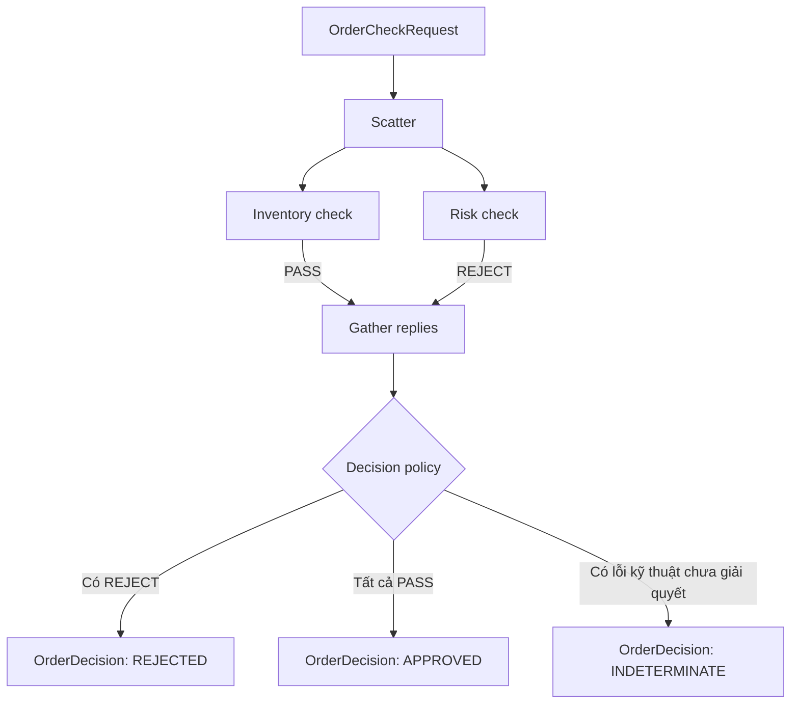
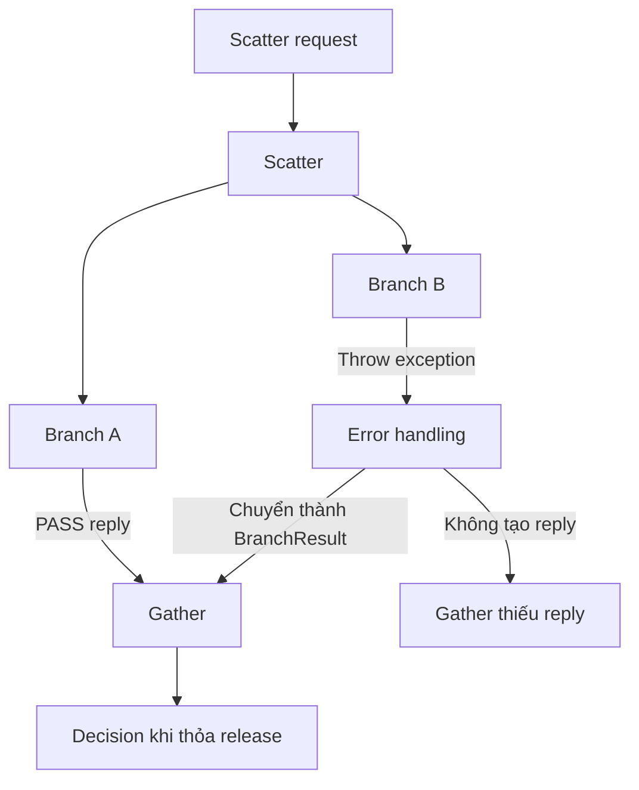
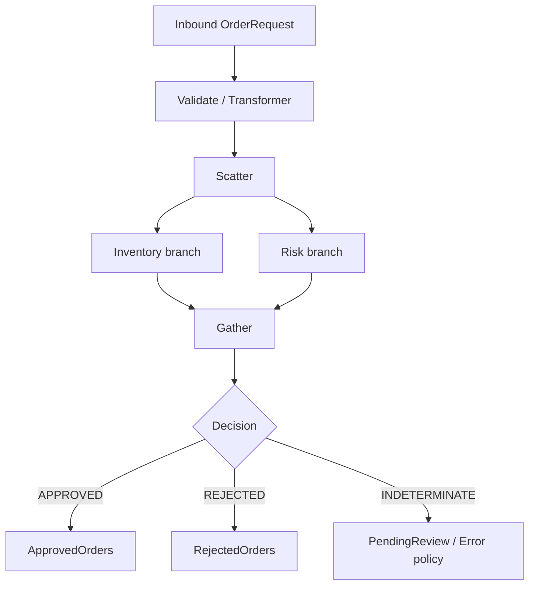

# Nhánh trả lỗi và nhánh trả thành công trong Scatter–Gather

Trong một hệ thống xử lý đơn hàng, trước khi chấp nhận đơn có thể cần thực hiện đồng thời hai kiểm tra: **tồn kho** và **rủi ro giao dịch**. Một đơn có thể đủ tồn kho nhưng không vượt qua kiểm tra rủi ro; một kiểm tra có thể thành công trong khi dịch vụ còn lại timeout. Nếu ứng dụng chỉ biết chờ hai kết quả thành công, nó sẽ không phân biệt được **một quyết định từ chối hợp lệ** với **một nhánh lỗi kỹ thuật không gửi được reply**.

**Scatter–Gather** là mẫu Enterprise Integration Patterns (EIP) gồm hai nửa: **Scatter** phân phối yêu cầu tới nhiều nhánh xử lý; **Gather** thu thập các phản hồi có liên quan để tạo một kết quả chung. Khi có cả nhánh trả thành công và nhánh trả lỗi, bài toán không chỉ là chọn channel, mà là **thiết kế hợp đồng reply, correlation, release strategy, timeout và chính sách quyết định cuối**.

Bài này thuộc chương **Scatter gather** của module `SPRING_INTEGRATION_PATTERN`. Module hướng tới học và thực hành Router, Filter, Transformer, Splitter, Aggregator, Gateway, retry, error channel và correlation bằng Spring Integration, đồng thời kiểm thử và theo dõi các nhánh xử lý. Nội dung tập trung vào **trường hợp các nhánh có kết quả khác nhau**, gồm thành công, từ chối nghiệp vụ, lỗi kỹ thuật và không trả phản hồi.

## 1. Một yêu cầu, nhiều nhánh, nhiều khả năng trả lời

Giả sử yêu cầu:

```json
{
  "requestId": "req-1001",
  "orderId": "ORD-1001",
  "inventoryAvailable": true,
  "riskAllowed": false
}
```

Hai nhánh xử lý được giao:

| Nhánh | Câu hỏi nghiệp vụ | Phản hồi có thể xảy ra |
| --- | --- | --- |
| `inventoryChecks` | Có đủ hàng không? | `PASS`, `REJECT`, lỗi truy vấn kho, timeout |
| `riskChecks` | Giao dịch có được phép không? | `PASS`, `REJECT`, lỗi dịch vụ rủi ro, timeout |

Trong ví dụ, tồn kho trả `PASS`, rủi ro trả `REJECT`. Đây là **hai phản hồi hợp lệ** từ góc nhìn giao thức: cả hai nhánh đều đã trả lời. Tuy nhiên, quyết định nghiệp vụ cuối phải là `REJECTED`.



**Không có quy tắc mặc định rằng Gather nhận `REJECT` thì tự động ném exception.** Gather chỉ hiểu các Message phản hồi và metadata nhóm; cách chuyển những kết quả đó thành quyết định nghiệp vụ do ứng dụng định nghĩa.

## 2. Phân biệt bốn tình huống thường bị gọi chung là “lỗi”

Một thiết kế tốt cần có ngôn ngữ rõ ràng:

| Tình huống | Có reply thông thường không? | Ví dụ | Cách hiểu |
| --- | --- | --- | --- |
| **Nhánh thành công** | Có | `PASS` | Đã kiểm tra và chấp thuận |
| **Nhánh từ chối nghiệp vụ** | Có | `REJECT/OUT_OF_STOCK` | Đã kiểm tra và ra quyết định không chấp thuận |
| **Nhánh trả kết quả lỗi kỹ thuật có cấu trúc** | Có, nếu ứng dụng chuyển lỗi thành payload | `TECHNICAL_FAILURE/LOOKUP_TIMEOUT` | Không thể xác định kết quả nghiệp vụ |
| **Nhánh ném exception hoặc không trả reply** | Không có reply bình thường | HTTP timeout, handler ném exception | Gather có thể thiếu phần tử; cần error/timeout policy |

Hai dòng cuối không tương đương. **Một Message chứa `TECHNICAL_FAILURE` vẫn là một reply đã đến** nếu flow chủ động tạo nó. Ngược lại, một exception không được chuyển thành kết quả có thể làm tuyến xử lý dừng hoặc làm Gather không nhận đủ số reply mong đợi.

### 2.1. `REJECT` không nhất thiết là exception

Hết hàng là tình trạng nghiệp vụ bình thường: tồn kho thực sự đã trả lời rằng không thể đáp ứng. Nếu nhánh ném exception cho mọi trường hợp hết hàng, hệ thống có thể retry vô ích và khiến Gather hiểu nhầm một quyết định từ chối thành sự cố kỹ thuật.

### 2.2. `TECHNICAL_FAILURE` không có nghĩa là `REJECT`

Dịch vụ rủi ro không phản hồi **không chứng minh** đơn hàng rủi ro cao. Tùy hợp đồng, quyết định cuối có thể là `INDETERMINATE`, `PENDING_REVIEW` hoặc lỗi trả cho caller. Không nên âm thầm gán `REJECT` hay `PASS` trừ khi có chính sách nghiệp vụ cho phép.

### 2.3. Exception không tự biến thành reply

Một `@ServiceActivator` ném exception không mặc nhiên gửi một `BranchResult` có trạng thái `TECHNICAL_FAILURE` về Gather. Sự lan truyền exception và `ErrorMessage` phụ thuộc ranh giới đồng bộ/bất đồng bộ, error channel, handler và adapter. Nếu Gather cần nhận **một kết quả cho mọi nhánh**, việc chuyển lỗi thành kết quả phải được thiết kế có chủ đích.

## 3. Scatter, Gather và những hợp đồng bắt buộc

Một Scatter–Gather có ít nhất ba hợp đồng:

1. **Scatter contract:** những nhánh nào phải được gọi, bao nhiêu reply được kỳ vọng và có nhánh nào là tùy chọn?
2. **Branch reply contract:** mỗi nhánh phải trả kiểu dữ liệu gì, kể cả khi từ chối hoặc không thể kiểm tra?
3. **Gather contract:** trường hợp nào đủ điều kiện release, và phải tạo quyết định cuối như thế nào?

Ví dụ với hai nhánh bắt buộc:

```text
expectedBranches = {INVENTORY, RISK}

received:
  INVENTORY -> PASS
  RISK      -> REJECT

release = đã có kết quả của cả INVENTORY và RISK
decision = REJECTED
```

Đó là **hai nhánh đã trả lời đầy đủ**, dù không phải hai nhánh đều thành công về nghiệp vụ.

### 3.1. Scatter không luôn chạy thật sự song song

Scatter phân phối Message tới nhiều recipient; **việc các recipient xử lý song song phụ thuộc channel và executor**. Với các `DirectChannel` đồng bộ, hai nhánh có thể được gọi nối tiếp trên thread gửi. Nếu cần latency gần mức của nhánh chậm nhất thay vì tổng thời gian hai nhánh, phải thiết kế xử lý bất đồng bộ có giới hạn tài nguyên, kèm correlation và timeout.

### 3.2. Gather không phải Publish–Subscribe

Publish–Subscribe đưa Message tới các subscriber, còn Gather phải **thu được reply**, phân biệt reply của từng request và quyết định thời điểm hoàn tất. Một fan-out fire-and-forget không tự trở thành Scatter–Gather nếu downstream không có đường trả kết quả về điểm gom.

## 4. Thiết kế payload phản hồi rõ trạng thái

Để Gather xử lý cả `PASS` và `REJECT` một cách nhất quán, ta dùng một **kiểu reply thống nhất**. Mỗi nhánh có `branch`, trạng thái và mã lý do:

```json
{
  "requestId": "req-1001",
  "orderId": "ORD-1001",
  "branch": "RISK",
  "status": "REJECT",
  "reasonCode": "RISK_POLICY_DENIED"
}
```

Ta định nghĩa:

| Thuộc tính | Mục đích |
| --- | --- |
| `requestId` | Định danh một lần kiểm tra, khác nhau giữa những lần gửi lại độc lập |
| `orderId` | Khóa nghiệp vụ để liên hệ với đơn hàng |
| `branch` | Chỉ ra nhánh tạo kết quả: `INVENTORY` hoặc `RISK` |
| `status` | `PASS`, `REJECT` hoặc `TECHNICAL_FAILURE` |
| `reasonCode` | Mã chuẩn hóa, không phụ thuộc exception message nội bộ |

Một kiểu reply thống nhất giúp Aggregator không phải đoán trạng thái dựa trên class exception, nội dung chuỗi hay tên output channel.

### 4.1. Mã lý do phải ổn định

Ví dụ:

```text
PASS:
  OK

REJECT:
  OUT_OF_STOCK
  RISK_POLICY_DENIED

TECHNICAL_FAILURE:
  INVENTORY_UNAVAILABLE
  RISK_TIMEOUT
```

Không nên gửi stack trace, URL nội bộ, access token hoặc raw exception ra reply nghiệp vụ. Mã lý do là hợp đồng với consumer; log có correlation ID mới chứa chi tiết kỹ thuật phù hợp để chẩn đoán.

## 5. Quy tắc tổng hợp nhánh trả thành công và nhánh trả lỗi

Với hai nhánh bắt buộc, một ma trận quyết định đơn giản:

| Inventory | Risk | Kết quả cuối | Lý do |
| --- | --- | --- | --- |
| `PASS` | `PASS` | `APPROVED` | Cả hai kiểm tra đều đạt |
| `PASS` | `REJECT` | `REJECTED` | Nhánh rủi ro từ chối |
| `REJECT` | `PASS` | `REJECTED` | Không đủ hàng |
| `REJECT` | `REJECT` | `REJECTED` | Cả hai đều từ chối |
| `PASS` | `TECHNICAL_FAILURE` | `INDETERMINATE` | Chưa biết kết quả rủi ro |
| `TECHNICAL_FAILURE` | `PASS` | `INDETERMINATE` | Chưa biết tình trạng kho |
| `REJECT` | `TECHNICAL_FAILURE` | `INDETERMINATE` trong policy ví dụ | Ưu tiên báo thiếu thông tin kỹ thuật |
| `TECHNICAL_FAILURE` | `TECHNICAL_FAILURE` | `INDETERMINATE` | Không đủ dữ liệu quyết định |

Ở đây chính sách quy định **`TECHNICAL_FAILURE` ưu tiên cao hơn `REJECT`**, để tránh đánh dấu một yêu cầu là từ chối cuối cùng khi một nhánh chưa trả lời đáng tin cậy. Đây **chỉ là chính sách của ví dụ**. Một ứng dụng có thể chọn `REJECT` là kết quả cuối nếu chỉ cần một nhánh từ chối là đủ; cần giải thích và kiểm thử chính sách đó rõ ràng.

Một số câu hỏi trước khi code:

- Có chấp nhận ra quyết định khi **chưa đủ tất cả reply** không?
- `REJECT` có cho phép **short-circuit** không, hay vẫn cần kết quả còn lại để audit?
- Nếu lỗi kỹ thuật được chuyển thành `TECHNICAL_FAILURE`, có cần retry trước khi trả kết quả đó không?
- `INDETERMINATE` là kết quả cuối hay trạng thái tạm thời sẽ được bổ sung sau?
- Caller cần **một reply đồng bộ** hay chấp nhận quy trình bất đồng bộ với request ID?

**Đừng nhầm release condition với decision policy**: release nói *khi nào đủ dữ liệu để đánh giá*, còn policy nói *đánh giá như thế nào*.

## 6. Java model cho hai nhánh và quyết định cuối

Ví dụ Java 17+ sử dụng records và enums:

```java
package example.integration;

import java.util.List;

public final class ScatterGatherModel {

    private ScatterGatherModel() {
    }

    public enum Branch {
        INVENTORY, RISK
    }

    public enum OutcomeStatus {
        PASS, REJECT, TECHNICAL_FAILURE
    }

    public enum DecisionStatus {
        APPROVED, REJECTED, INDETERMINATE
    }

    public record CheckRequest(
            String requestId,
            String orderId,
            boolean inventoryAvailable,
            boolean riskAllowed) {
    }

    public record BranchResult(
            String requestId,
            String orderId,
            Branch branch,
            OutcomeStatus status,
            String reasonCode) {
    }

    public record GatherDecision(
            String requestId,
            String orderId,
            DecisionStatus status,
            List<BranchResult> branchResults) {
    }
}
```

Một `BranchResult` phải cho biết **nó thuộc request nào và đến từ nhánh nào**. Không nên chỉ trả một boolean chung vì Gather có thể không phân biệt được kết quả của `INVENTORY` và `RISK`, đặc biệt khi retry hoặc thêm nhánh mới.

Trong bản chạy thật cần thêm validation cho `requestId`, `branch`, `reasonCode` và các giá trị `null`; việc kiểm tra được trình bày trong phần tổng hợp để làm rõ cấu trúc bài học.

## 7. Spring Integration Java DSL: hai nhánh luôn trả payload kết quả

Trong ví dụ chính, cả hai nhánh trả một `BranchResult` cho mọi kết quả **nghiệp vụ hợp lệ**. Không có lỗi mạng và cũng không cố tình ném exception. Tình huống này phù hợp để chứng minh rằng một nhánh `REJECT` vẫn có thể được Gather thu thập như bình thường.

### 7.1. Configuration với Scatter–Gather

```java
package example.integration;

import java.util.Comparator;
import java.util.List;
import java.util.Set;
import java.util.stream.Collectors;

import org.springframework.context.annotation.Bean;
import org.springframework.context.annotation.Configuration;
import org.springframework.integration.annotation.ServiceActivator;
import org.springframework.integration.channel.DirectChannel;
import org.springframework.integration.channel.QueueChannel;
import org.springframework.integration.config.EnableIntegration;
import org.springframework.integration.dsl.IntegrationFlow;
import org.springframework.integration.store.MessageGroup;
import org.springframework.messaging.MessageChannel;
import org.springframework.messaging.PollableChannel;

import example.integration.ScatterGatherModel.*;

@Configuration
@EnableIntegration
public class MixedOutcomeScatterGatherConfiguration {

    @Bean
    public MessageChannel checkRequests() {
        return new DirectChannel();
    }

    @Bean
    public MessageChannel inventoryChecks() {
        return new DirectChannel();
    }

    @Bean
    public MessageChannel riskChecks() {
        return new DirectChannel();
    }

    @Bean
    public PollableChannel checkDecisions() {
        return new QueueChannel(20);
    }

    @Bean
    public IntegrationFlow checksScatterGatherFlow() {
        return IntegrationFlow.from("checkRequests")
                .scatterGather(
                        scatter -> scatter
                                .recipient("inventoryChecks")
                                .recipient("riskChecks"),
                        gather -> gather
                                .releaseStrategy(group -> group.size() == 2)
                                .outputProcessor(
                                        MixedOutcomeScatterGatherConfiguration
                                                ::toDecision))
                .channel("checkDecisions")
                .get();
    }

    @ServiceActivator(inputChannel = "inventoryChecks")
    public BranchResult inventory(CheckRequest request) {
        return new BranchResult(
                request.requestId(),
                request.orderId(),
                Branch.INVENTORY,
                request.inventoryAvailable()
                        ? OutcomeStatus.PASS
                        : OutcomeStatus.REJECT,
                request.inventoryAvailable() ? "OK" : "OUT_OF_STOCK");
    }

    @ServiceActivator(inputChannel = "riskChecks")
    public BranchResult risk(CheckRequest request) {
        return new BranchResult(
                request.requestId(),
                request.orderId(),
                Branch.RISK,
                request.riskAllowed()
                        ? OutcomeStatus.PASS
                        : OutcomeStatus.REJECT,
                request.riskAllowed() ? "OK" : "RISK_POLICY_DENIED");
    }

    private static GatherDecision toDecision(MessageGroup group) {
        List<BranchResult> results = group.getMessages().stream()
                .map(message -> (BranchResult) message.getPayload())
                .sorted(Comparator.comparing(
                        result -> result.branch().ordinal()))
                .toList();

        if (results.size() != 2) {
            throw new IllegalStateException("Expected two branch results");
        }

        Set<Branch> branches = results.stream()
                .map(BranchResult::branch)
                .collect(Collectors.toSet());
        if (!branches.equals(Set.of(Branch.INVENTORY, Branch.RISK))) {
            throw new IllegalStateException(
                    "Missing or duplicate branch response");
        }

        String requestId = results.get(0).requestId();
        String orderId = results.get(0).orderId();
        boolean differentRequest = results.stream()
                .anyMatch(result ->
                        !requestId.equals(result.requestId())
                        || !orderId.equals(result.orderId()));
        if (differentRequest) {
            throw new IllegalStateException(
                    "Replies from different requests were mixed");
        }

        DecisionStatus decision;
        if (results.stream().anyMatch(result ->
                result.status() == OutcomeStatus.TECHNICAL_FAILURE)) {
            decision = DecisionStatus.INDETERMINATE;
        } else if (results.stream().anyMatch(result ->
                result.status() == OutcomeStatus.REJECT)) {
            decision = DecisionStatus.REJECTED;
        } else {
            decision = DecisionStatus.APPROVED;
        }

        return new GatherDecision(
                requestId, orderId, decision, List.copyOf(results));
    }
}
```

**Phạm vi ví dụ:** cấu hình sử dụng hai `DirectChannel` và một output `QueueChannel` trong cùng JVM; các nhánh trả dữ liệu ngay lập tức. Đây là cấu hình minh họa ý nghĩa của `scatterGather`, không phải một hệ thống production có timeout, retry, lưu state bền vững và service mạng.

Khi tích hợp, đối chiếu overload Java DSL `scatterGather(...)`, `recipient(...)` và cấu hình Aggregator với **phiên bản Spring Integration thực tế** của dự án. Bài này không chạy build, nên không tuyên bố đoạn code đã được biên dịch và kiểm thử trong repository.

### 7.2. Điểm khác biệt giữa hai nhánh và một Router thông thường

Nếu dùng Router thông thường để chọn **chỉ một** trong `inventoryChecks` và `riskChecks`, ta sẽ không thu được hai kết quả cho Gather. Scatter ở ví dụ gửi một yêu cầu tới **cả hai recipient**, và Gather chờ hai reply.

### 7.3. Vì sao `REJECT` không làm Gather mất Message?

Method `risk(...)` **trả `BranchResult`** ngay cả khi `riskAllowed=false`. Reply được gửi về cơ chế gather của flow. Nếu method thay `return` bằng `throw` cho trường hợp bị từ chối nghiệp vụ, ta đã đổi hợp đồng: từ một reply hợp lệ sang một lỗi thực thi, và Gather có thể thiếu kết quả.

### 7.4. Vì sao kiểm tra tập branch thay vì chỉ count?

`group.size() == 2` không chứng minh đã nhận đủ `INVENTORY` và `RISK`. Hai reply trùng nhánh `INVENTORY` có thể khiến group đủ hai Message nhưng thiếu rủi ro. Check trong `toDecision` phát hiện sai cấu trúc trước khi trả quyết định. Production nên còn có dedupe hoặc release strategy xét **tập nhánh bắt buộc**, không chỉ đếm.

### 7.5. Trường hợp Gather phải giữ thứ tự

Các reply có thể tới không theo thứ tự scatter. Ví dụ sắp xếp `branchResults` theo `Branch.ordinal()` để output ổn định cho test và serialization. Việc này **không làm nhánh chạy tuần tự**; nó chỉ quy định thứ tự trình bày kết quả.

## 8. JUnit 5: kiểm thử nhánh thành công và nhánh từ chối

Integration test nên xác minh **cùng lúc**: các nhánh được gọi, Gather nhận đủ reply, quyết định cuối đúng, và hai lượt request không bị ghép nhầm.

### 8.1. Cả hai nhánh PASS

```java
package example.integration;

import static org.junit.jupiter.api.Assertions.*;

import org.junit.jupiter.api.Test;
import org.springframework.context.annotation.AnnotationConfigApplicationContext;
import org.springframework.messaging.Message;
import org.springframework.messaging.MessageChannel;
import org.springframework.messaging.PollableChannel;
import org.springframework.messaging.support.MessageBuilder;

import example.integration.ScatterGatherModel.*;

class MixedOutcomeScatterGatherTest {

    @Test
    void allSuccessfulBranchesProduceApprovedDecision() {
        try (var context = new AnnotationConfigApplicationContext(
                MixedOutcomeScatterGatherConfiguration.class)) {
            MessageChannel input =
                    context.getBean("checkRequests", MessageChannel.class);
            PollableChannel output =
                    context.getBean("checkDecisions", PollableChannel.class);

            CheckRequest request = new CheckRequest(
                    "req-1001", "ORD-1001", true, true);

            assertTrue(input.send(MessageBuilder.withPayload(request)
                    .setHeader("eventId", "evt-1001")
                    .build()));

            Message<?> reply = output.receive(0);
            assertNotNull(reply);
            GatherDecision decision =
                    (GatherDecision) reply.getPayload();

            assertEquals("req-1001", decision.requestId());
            assertEquals(DecisionStatus.APPROVED, decision.status());
            assertEquals(2, decision.branchResults().size());
            assertTrue(decision.branchResults().stream()
                    .allMatch(result ->
                            result.status() == OutcomeStatus.PASS));
            assertNull(output.receive(0));
        }
    }

    @Test
    void successPlusBusinessRejectionProducesRejectedDecision() {
        try (var context = new AnnotationConfigApplicationContext(
                MixedOutcomeScatterGatherConfiguration.class)) {
            MessageChannel input =
                    context.getBean("checkRequests", MessageChannel.class);
            PollableChannel output =
                    context.getBean("checkDecisions", PollableChannel.class);

            CheckRequest request = new CheckRequest(
                    "req-1002", "ORD-1002", true, false);
            assertTrue(input.send(MessageBuilder.withPayload(request)
                    .build()));

            Message<?> reply = output.receive(0);
            assertNotNull(reply);
            GatherDecision decision =
                    (GatherDecision) reply.getPayload();

            assertEquals(DecisionStatus.REJECTED, decision.status());
            assertEquals(2, decision.branchResults().size());
            assertTrue(decision.branchResults().stream()
                    .anyMatch(result ->
                            result.branch() == Branch.INVENTORY
                            && result.status() == OutcomeStatus.PASS));
            assertTrue(decision.branchResults().stream()
                    .anyMatch(result ->
                            result.branch() == Branch.RISK
                            && result.status() == OutcomeStatus.REJECT
                            && "RISK_POLICY_DENIED".equals(
                                    result.reasonCode())));
            assertNull(output.receive(0));
        }
    }
}
```

Test thứ hai đặc biệt quan trọng: một nhánh `PASS`, một nhánh `REJECT`, nhưng **Gather vẫn nhận đủ hai reply và đưa ra `REJECTED`**, không treo hoặc chờ error channel.

Trong cấu hình đồng bộ với `DirectChannel`, `QueueChannel` chưa có consumer cạnh tranh, `receive(0)` có thể đọc ngay sau `send()`. Khi thay bằng executor, poller hoặc broker, dùng chờ có timeout hữu hạn và correlation theo request ID.

### 8.2. Hai request khác nhau không được trộn

Một test khác nên gửi:

```text
req-A: INVENTORY=PASS, RISK=REJECT
req-B: INVENTORY=PASS, RISK=PASS
```

Kỳ vọng đúng là một `REJECTED` cho `req-A`, một `APPROVED` cho `req-B`, mỗi quyết định có đúng hai `BranchResult` mang **cùng request ID**. Nếu xử lý bất đồng bộ, reply có thể tới ngược thứ tự gửi. Test nên lập map theo `requestId` thay vì cố định result thứ nhất luôn thuộc req-A.

## 9. Khi một nhánh ném exception thì điều gì xảy ra?

Xét handler kiểm tra tồn kho:

```java
@ServiceActivator(inputChannel = "inventoryChecks")
public BranchResult inventory(CheckRequest request) {
    // Đoạn mô phỏng sự cố: không có BranchResult được trả về.
    throw new IllegalStateException("Inventory dependency unavailable");
}
```

Đây là **đoạn thay thế để phân tích lỗi**, không được đăng ký đồng thời với handler `inventory(...)` ở mục 7 cho cùng input channel.

Với đường `DirectChannel` đồng bộ, exception có thể lan ngược về scatter/gateway/caller. Tùy cách framework gửi tới nhiều recipient và cấu hình lỗi, hoạt động scatter có thể dừng trước khi các nhánh còn lại được gọi hoặc trước khi Gather hoàn tất. Không được giả định mọi nhánh đều đã chạy.

Với nhánh bất đồng bộ, `send()` ban đầu có thể thành công vì Message đã được xếp hàng, nhưng handler lỗi sau đó trên thread khác. Nếu không có cơ chế tạo reply thất bại hoặc error flow tương ứng, Gather **không nhận đủ reply** và có thể phải đợi timeout.

### 9.1. Exception là sự kiện trên đường xử lý, không tự là Message kết quả



Nếu chủ đích là **mỗi nhánh phải trả một kết quả có cấu trúc**, nhánh lỗi nên được chuyển thành `TECHNICAL_FAILURE` theo một chính sách cụ thể. Điều đó không có nghĩa toàn bộ lỗi phải bị nuốt: có lỗi nghiêm trọng khiến flow nên thất bại ngay, không được trả một kết quả giả.

### 9.2. `errorChannel` khác kênh phản hồi của Gather

`errorChannel` thường nhận `ErrorMessage` khi một endpoint/adapter được cấu hình để công bố exception theo cơ chế messaging. Nó không phải mặc nhiên một trong các **reply bình thường** mà Aggregator đang chờ.

| Đường đi | Payload | Ai xử lý? |
| --- | --- | --- |
| Reply thành công | `BranchResult(PASS)` | Gather |
| Reply từ chối nghiệp vụ | `BranchResult(REJECT)` | Gather |
| Reply lỗi có cấu trúc | `BranchResult(TECHNICAL_FAILURE)` | Gather theo chính sách |
| ErrorMessage khi handler throw | Exception cùng context | Error flow được cấu hình |
| Không có reply | Không có payload để gom | Timeout/expiration/failure policy |

Nếu muốn chuyển một `ErrorMessage` thành reply cho Gather, cần giữ đúng **request/branch correlation và reply destination**, đồng thời bảo đảm không tạo thêm reply trùng cho nhánh đã trả thành công. Không nên đơn giản chuyển mọi ErrorMessage lên channel Gather chung mà không xác minh nó thuộc nhóm nào.

## 10. Chuyển lỗi kỹ thuật đã được phân loại thành kết quả nhánh

Một phương án là **tách client truy vấn khỏi branch adapter**. Adapter gọi client, retry theo chính sách, rồi trả `BranchResult` thay vì để một lỗi đã được xử lý làm mất reply.

Ví dụ Java rút gọn:

```java
// Ví dụ logic của nhánh, không đăng ký cùng endpoint inventory ở mục 7.
public BranchResult checkInventorySafely(
        CheckRequest request, InventoryClient client) {

    try {
        boolean available = client.isAvailable(request.orderId());
        return new BranchResult(
                request.requestId(), request.orderId(),
                Branch.INVENTORY,
                available ? OutcomeStatus.PASS : OutcomeStatus.REJECT,
                available ? "OK" : "OUT_OF_STOCK");
    } catch (InventoryTimeoutException timeout) {
        // Giả định retry có giới hạn đã kết thúc hoặc không được phép.
        return new BranchResult(
                request.requestId(), request.orderId(),
                Branch.INVENTORY,
                OutcomeStatus.TECHNICAL_FAILURE,
                "INVENTORY_UNAVAILABLE");
    }
}
```

`InventoryClient` và `InventoryTimeoutException` là **kiểu domain minh họa**, chưa có định nghĩa trong cấu hình chính. Đoạn code giải thích nguyên tắc phân loại lỗi, không phải source độc lập có thể biên dịch ngay.

### 10.1. Không bắt mọi exception rồi mặc định `PASS`

Không nên viết:

```java
try {
    return inventoryClient.check(orderId);
} catch (Exception ignored) {
    return true; // SAI: lỗi hạ tầng bị biến thành chấp thuận
}
```

Một fallback `PASS` như vậy biến tình trạng không biết thành quyết định cho phép. Nếu có yêu cầu **fail-open** ở một hệ thống không quan trọng, cần văn bản hóa chính sách và giám sát riêng; không thể coi đó là mặc định an toàn cho thanh toán hoặc kiểm soát rủi ro.

### 10.2. Phân biệt lỗi tạm thời và lỗi không thể phục hồi

| Lỗi | Hướng xử lý |
| --- | --- |
| Hết hàng | `REJECT`, không retry để mong lượng hàng tự thay đổi |
| Rủi ro không đạt | `REJECT`, giữ reason code |
| HTTP timeout tạm thời | Retry hữu hạn với backoff nếu an toàn |
| Dịch vụ phụ thuộc dừng dài | `TECHNICAL_FAILURE` hoặc toàn flow thất bại theo SLA |
| Payload thiếu trường bắt buộc | Validation error, không tự diễn giải thành `PASS` |
| Lỗi code/null pointer bất ngờ | Quan sát error flow; không che giấu thành quyết định bình thường |

Với nhánh tạo side effect, retry có thể khiến hành động xảy ra nhiều lần. Cần idempotency riêng cho từng nhánh trước khi lựa chọn retry.

## 11. Release strategy khi có nhánh lỗi và nhánh thành công

Một câu hỏi thường gặp: **Có nên chờ mọi nhánh ngay cả khi một nhánh đã `REJECT`?**

Không có một đáp án cho mọi trường hợp. Hãy tách **điều kiện release** và **quy tắc decision**:

| Phương án | Điều kiện release | Phù hợp khi | Rủi ro |
| --- | --- | --- | --- |
| **All replies** | Đủ mọi nhánh bắt buộc | Cần audit hoặc một kết quả tổng đầy đủ | Một nhánh không reply làm chờ lâu |
| **First decisive result** | Một nhánh đã đủ kết luận | Một `REJECT` là kết quả cuối hợp lệ | Reply đến muộn, side effect của nhánh khác |
| **Quorum** | Đủ một ngưỡng số lượng/kết quả | Bỏ phiếu hoặc redundancy có quy tắc | Cần hiểu ý nghĩa phiếu lỗi |
| **Deadline partial** | Hết thời gian chờ, trả kết quả một phần | Có SLA chặt và hỗ trợ partial | Không thể đánh đồng thiếu reply với `PASS` |

Ví dụ trong mục 7 chọn **all replies** với hai nhánh bắt buộc. Nó đơn giản và giúp nhìn rõ trường hợp `PASS + REJECT`.

### 11.1. Vì sao không dùng `size==2` trong mọi trường hợp?

Nếu cùng một nhánh trả hai Message do retry hoặc cấu hình sai, Group có thể có hai Message nhưng chưa đủ hai nhánh cần thiết. Một release strategy vững hơn cần xác minh tập reply:

```java
// Logic minh họa: chỉ release khi đủ cả hai branch.
Set<Branch> expected = Set.of(Branch.INVENTORY, Branch.RISK);
Set<Branch> received = group.getMessages().stream()
        .map(message -> (BranchResult) message.getPayload())
        .map(BranchResult::branch)
        .collect(Collectors.toSet());
boolean ready = received.containsAll(expected);
```

Đây là đoạn minh họa logic, cần import đúng kiểu theo ví dụ ở mục 6. Dù đã kiểm tra tập branch, vẫn phải xử lý **duplicate trước/đúng lúc lưu group**, để tránh memory growth hoặc release nhiều lần.

### 11.2. Short-circuit cần chính sách riêng

Giả sử tồn kho trả `REJECT` và doanh nghiệp quyết định không cần đánh giá rủi ro. Nếu muốn dừng sớm:

- Có cho phép nhánh rủi ro đang chạy kết thúc tự nhiên không?
- Nếu một nhánh đã tạo side effect, có cần hoàn tác không?
- Reply muộn có bị bỏ hoặc ghi audit không?
- Gateway có thể nhận hai reply cho một request không?
- Correlation và store quản lý nhóm đã đóng thế nào?

Không được hiểu `releaseStrategy` trả `true` là **tự động hủy mọi nhánh đang chạy**. Scatter có thể đã phân phối công việc trước khi Gather quyết định phát kết quả.

## 12. Khi một nhánh không trả reply: timeout và partial result

Ví dụ:

```text
t0       scatter request R
t0+20ms  inventory -> PASS
t0+...   risk -> không có reply
```

Nếu Gather chờ đủ hai reply mà risk không bao giờ trả, request có thể bị kẹt cho tới khi hết timeout. Các timeout liên quan có thể gồm:

- Timeout gửi request tới nhánh.
- Timeout của HTTP/DB client trong nhánh.
- Timeout chờ reply của Gather.
- Timeout của Gateway hoặc API caller.
- Group timeout/expiration nếu dùng Aggregator lưu trạng thái.

Các timeout này **không đồng nghĩa**. Một Gateway timeout sớm hơn Gather có thể khiến Gather tạo kết quả sau khi caller đã ngừng đợi; khi đó phải xử lý reply muộn rõ ràng.

### 12.1. Định nghĩa deadline tổng

Một ví dụ SLA:

```text
Gateway/request deadline:       3.0 s
Inventory client timeout:       1.0 s
Risk client timeout:            1.5 s
Gather decision deadline:       2.5 s
```

Các số trên **chỉ minh họa**, không phải giá trị mặc định của Spring Integration. Cấu hình cần bảo đảm thời gian chờ của các tầng phù hợp nhau, có ngân sách cho truyền thông, xử lý lỗi và trả reply cho client.

### 12.2. Partial result có thể hợp lệ nhưng phải chỉ ra sự thiếu

Nếu deadline đã đến và chỉ có `INVENTORY=PASS`, một payload có thể là:

```json
{
  "requestId": "req-1001",
  "decision": "INDETERMINATE",
  "receivedBranches": ["INVENTORY"],
  "missingBranches": ["RISK"],
  "timedOut": true
}
```

Đây là **hợp đồng phản hồi của ứng dụng**, không phải JSON mặc định của Scatter–Gather. Một kết quả partial **không phải** “hai nhánh đều PASS”. Nếu cần `APPROVED`, phải có căn cứ đầy đủ theo policy.

### 12.3. Group expiration và kết quả đến muộn

Nếu Gather/Aggregator đã đóng một nhóm sau deadline, reply đến muộn phải có chính sách:

1. Bỏ qua nhưng ghi log/audit.
2. Lưu lại để điều tra.
3. Cập nhật một trạng thái nghiệp vụ có version nếu được phép.
4. Phát sự kiện điều chỉnh trạng thái theo hợp đồng bất đồng bộ.

Không nên để reply muộn tự tạo **quyết định thứ hai** cho cùng request nếu consumer chỉ mong một kết quả cuối.

## 13. Correlation: reply của request nào?

Khi có hai request A và B đồng thời:

```text
A: inventory(A) -> PASS
B: risk(B)      -> REJECT
A: risk(A)      -> PASS
B: inventory(B) -> PASS
```

Nếu chỉ gom **hai reply gần nhau nhất**, ta sẽ trộn kết quả của A và B. Gather phải giữ **correlation group** chính xác theo một lần scatter.

| ID | Ý nghĩa | Có nên dùng làm group key? |
| --- | --- | --- |
| `requestId` | Định danh một lần kiểm tra | Phù hợp nếu duy nhất và ổn định qua mọi reply |
| `orderId` | Định danh đơn hàng | Chưa đủ nếu một đơn có nhiều request |
| `eventId` | Định danh sự kiện | Phù hợp theo đúng phạm vi event/attempt |
| Message ID riêng của reply | Định danh từng Message | Không, mỗi reply thường khác nhau |
| `correlationId` từ framework | Metadata nhóm | Dùng theo hợp đồng channel/adapter |

Scatter–Gather của Spring Integration có cơ chế request-reply/correlation trong flow; tuy nhiên, **không nên giả định adapter qua HTTP, Kafka hoặc AMQP chuyển nguyên mọi header nội bộ**. Nếu reply đi qua hệ thống bên ngoài, cần hợp đồng correlation ID và reply destination có thể serialize.

### 13.1. Không chỉ test payload

Một test đồng thời nên kiểm tra:

- Mỗi `GatherDecision` chứa `requestId` đúng.
- Hai `BranchResult` bên trong mang cùng `requestId` và `orderId`.
- Không có reply của request khác lọt vào nhóm.
- Mỗi nhánh bắt buộc xuất hiện đúng một lần.
- Reply trùng và reply muộn không làm release sai.

## 14. Error channel, retry và idempotency của các nhánh

### 14.1. ErrorMessage đi đâu?

Khi một nhánh bất đồng bộ gặp exception, error handling có thể đưa `ErrorMessage` tới một error channel được cấu hình. Một error flow có thể:

- Ghi log và metric.
- Retry hoặc dead-letter.
- Ánh xạ lỗi đã biết thành một `BranchResult(TECHNICAL_FAILURE)`.
- Báo lỗi tổng về một dịch vụ điều phối/Gateway.

Nhưng **không phải cứ có error channel là Gather tự nhận đủ reply**. Cần một đường nối lỗi với request/branch cụ thể, không được tùy tiện gửi `ErrorMessage` dạng khác schema vào channel gather.

### 14.2. Retry phải kiểm soát số lần

Ví dụ:

```text
risk check:
  attempt 1 -> HTTP timeout
  attempt 2 -> HTTP timeout
  attempt 3 -> success
```

Nếu mọi timeout trung gian đều được gửi thành `TECHNICAL_FAILURE` về Gather, một nhánh có thể **trả nhiều reply** hoặc Gather release quá sớm trước khi retry hoàn tất. Chỉ nên phát **một kết quả cuối của nhánh** theo chính sách đã chọn, sau khi hoàn tất retry hoặc quyết định thất bại.

### 14.3. Khóa idempotency theo request và branch

Ví dụ:

```text
requestId = req-1001
branch = INVENTORY

idempotencyKey = req-1001:INVENTORY
```

Nếu nhánh được phép có nhiều lần kiểm tra hợp lệ, có thể bổ sung version hoặc branch-attempt; không được làm nhầm retry của cùng một việc thành công việc mới.

Idempotency ở nhánh **không thay thế** deduplication ở Gather. Một Message reply có thể được broker redeliver ngay cả khi nhánh chỉ thực hiện nghiệp vụ một lần.

## 15. Chuyển tiếp qua Transformer, Filter, Router, Gateway và Aggregator

Một Scatter–Gather thường nằm trong flow có nhiều EIP:



### 15.1. Filter có thể làm mất reply

Nếu nhánh `riskChecks` có Filter và Message không đạt predicate bị bỏ **không có nhánh tạo kết quả**, Gather có thể thiếu reply. Nếu Filter từ chối là một kết quả nghiệp vụ, hãy chuyển nó thành `BranchResult(REJECT, ...)` hoặc đưa nó đến luồng trả kết quả tương đương.

### 15.2. Transformer phải giữ correlation

Nếu một Transformer tạo Message mới nhưng làm mất reply/correlation metadata cần thiết, Gather có thể không nhận biết phản hồi thuộc nhóm nào. Với reply qua transport ngoài, cần map sang những trường correlation có thể serialize thay vì phụ thuộc đối tượng Java trong header.

### 15.3. Router thay đổi số recipient

Một Recipient List Router động có thể chọn một hay nhiều nhánh dựa trên nội dung. Khi tập recipient thay đổi, **số reply kỳ vọng cũng có thể thay đổi**. Không cố định `releaseStrategy(size==2)` nếu có request chỉ gửi tới một nhánh; phải phản ánh số nhánh thực sự được chọn và các reply bắt buộc.

### 15.4. Gateway chờ một quyết định tổng

Gateway thường muốn một reply cuối cùng. Nếu Gather chưa đủ kết quả, phải có deadline/error policy để tránh Gateway chờ vô hạn. Nếu xử lý kéo dài hơn vòng đời HTTP request, có thể trả `ACCEPTED` với `requestId`, rồi cho client truy vấn trạng thái hoặc nhận sự kiện hoàn tất.

## 16. Xử lý nhiều instance và group state bền vững

Ví dụ mục 7 chạy cùng một JVM, các nhánh đồng bộ và không cần giữ Message chờ lâu. Với xử lý phân tán, Gather có thể phải lưu nhóm khi một nhánh trả lời chậm; lúc đó lựa chọn `MessageGroupStore` quan trọng.

| Yêu cầu | Hướng xử lý |
| --- | --- |
| Chờ ngắn trong cùng JVM | Có thể dùng in-memory theo SLA |
| Group chờ lâu, cần sống qua restart | Persistent `MessageGroupStore` tương thích |
| Nhiều instance cùng nhận reply của một request | Cùng store/coordination và locking phù hợp |
| Broker có thể redeliver reply | Dedupe theo request/branch/result version |
| Tạo decision và phát output bền vững | Transaction/outbox, idempotent consumer |
| Reply đến sau khi group đóng | Completion registry và late-arrival policy |

Một persistent store **không tự làm atomic** việc nhận từ broker, cập nhật group và gửi decision tới broker khác. Nếu kết quả cuối không được phép mất, cần thiết kế transaction boundaries và durable output riêng.

### 16.1. Crash giữa hai reply

```text
t1 Inventory(A) -> PASS, đã ghi group state
t2 Application restart
t3 Risk(A) -> REJECT
```

Nếu store chỉ là RAM, reply `INVENTORY` có thể mất. Nếu store bền vững và commit đúng, Gather có thể nhận lại dữ liệu đang chờ sau restart, **với điều kiện** correlation, serialization, locking và deadline được thiết kế phù hợp.

## 17. Kiểm thử lỗi kỹ thuật, timeout và xử lý trùng

Ngoài hai test thành công/REJECT, cần một bộ negative test:

| Test | Cách tạo tình huống | Khẳng định cần có |
| --- | --- | --- |
| `PASS + PASS` | Cả hai client trả hợp lệ | `APPROVED`, đủ hai branch |
| `PASS + REJECT` | Risk từ chối | `REJECTED`, vẫn đủ hai reply |
| `REJECT + PASS` | Kho hết hàng | `REJECTED`, reason đúng nhánh |
| `PASS + TECHNICAL_FAILURE` | Nhánh trả lỗi có cấu trúc | `INDETERMINATE` theo policy |
| Nhánh throw đồng bộ | Handler cố ý ném exception | Lỗi lan theo hợp đồng; không giả có Gather reply |
| Nhánh async timeout | Không trả reply | Timeout/partial/error policy kích hoạt |
| Một reply trùng | Gửi lại cùng branch result | Không đủ nhóm giả hoặc release hai lần |
| Reply sai request | Gửi correlation khác | Không gom lẫn hai request |
| Reply đến muộn | Kết quả tới sau deadline | Theo late-arrival policy; không phát hai final decision |
| Một nhánh bị Filter drop | Filter không gửi reply | Phát hiện thiếu nhánh, không chấp thuận sai |
| Router chọn subset | Chỉ có một nhánh hợp lệ | Gather tính đúng số nhánh kỳ vọng |
| Ứng dụng restart | Dừng giữa hai reply | State còn nếu dùng persistent store theo hợp đồng |

### 17.1. Test policy tách khỏi hạ tầng

Nên tách quyết định từ `List<BranchResult>` ra một hàm thuần, rồi unit test toàn bộ ma trận ở mục 5. Khi test chính sách độc lập, không cần dựng Spring Context cho mọi tổ hợp.

Pseudo-JUnit:

```java
// Sử dụng hàm thuần summarize(...) tách ra từ toDecision(...).
assertEquals(
        DecisionStatus.INDETERMINATE,
        summarize(List.of(
                result(Branch.INVENTORY, OutcomeStatus.PASS),
                result(Branch.RISK, OutcomeStatus.TECHNICAL_FAILURE))));
```

Đây là **mẫu ý tưởng unit test**, không phải đoạn Java chạy độc lập; `summarize` và `result` cần được định nghĩa khi refactor policy ra thành phần riêng. Integration test vẫn cần để khẳng định scatter/gather/correlation vận hành đúng.

### 17.2. Test nhánh throw cần quan sát đúng tầng

Trong flow đồng bộ, có thể dùng `assertThrows(...)` quanh `input.send(...)`. Nhưng trong flow bất đồng bộ, nên gắn một error consumer/spy và chờ `ErrorMessage` với timeout; `send()` có thể trả thành công trước khi lỗi xảy ra.

Không viết một assertion cứng rằng **mọi exception luôn phát sinh ở thread gọi `send()`** hoặc rằng chúng luôn vào error channel mặc định.

## 18. Observability: nhánh nào làm quyết định cuối?

Một log vận hành nên cho biết:

- `requestId`, `orderId`, loại yêu cầu.
- Danh sách nhánh dự kiến và nhánh đã trả reply.
- Kết quả từng nhánh cùng `reasonCode`.
- Có retry, timeout, duplicate hoặc late arrival không?
- Gather release theo điều kiện nào và quyết định cuối là gì?

Ví dụ log có cấu trúc:

```json
{
  "stage": "order-scatter-gather",
  "requestId": "req-1002",
  "orderId": "ORD-1002",
  "expectedBranches": ["INVENTORY", "RISK"],
  "receivedBranches": ["INVENTORY", "RISK"],
  "branchOutcomes": {
    "INVENTORY": "PASS",
    "RISK": "REJECT"
  },
  "decision": "REJECTED",
  "reasonCodes": ["RISK_POLICY_DENIED"],
  "timedOut": false
}
```

Đây là **schema do ứng dụng định nghĩa**, không phải log mặc định Spring Integration tự tạo. Không ghi payload nhạy cảm, exception stack trace hoặc dữ liệu khách hàng không cần thiết vào log chung.

| Metric gợi ý | Mục đích |
| --- | --- |
| `scatter_gather.requests` | Số yêu cầu bắt đầu |
| `scatter_gather.branch.pass` | Số nhánh trả PASS |
| `scatter_gather.branch.reject` | Số nhánh trả REJECT |
| `scatter_gather.branch.technical_failure` | Số nhánh trả lỗi có cấu trúc |
| `scatter_gather.branch.no_reply` | Số nhánh không trả reply theo deadline |
| `scatter_gather.gather.completed` | Số group đã release |
| `scatter_gather.gather.timeout` | Số group quá hạn |
| `scatter_gather.gather.pending` | Group đang chờ |
| `scatter_gather.branch.duplicate` | Reply trùng theo request/branch |
| `scatter_gather.duration` | Thời gian từ scatter đến decision |

Tên metric chỉ là **đề xuất instrument**, không phải danh mục sẵn có được bảo đảm bởi Micrometer/Actuator. Tránh dùng `requestId` hoặc `orderId` làm tag metric có cardinality cao; dùng chúng trong log và trace có kiểm soát.

## 19. Những lỗi thiết kế thường gặp

| Triệu chứng | Nguyên nhân | Hướng xử lý |
| --- | --- | --- |
| Một nhánh REJECT làm cả flow ném lỗi | Dùng exception cho từ chối nghiệp vụ | Trả `BranchResult(REJECT)` nếu muốn Gather xét |
| Gather không đủ kết quả | Nhánh ném exception hoặc không reply | Error flow, timeout và kết quả lỗi có cấu trúc |
| `PASS + REJECT` thành APPROVED | Decision policy chỉ đếm số reply | Kiểm tra trạng thái từng nhánh |
| HTTP timeout bị hiểu thành REJECT | Bắt lỗi rồi trả kết quả nghiệp vụ sai | Phân biệt TECHNICAL_FAILURE và REJECT |
| Hai reply của cùng nhánh đủ count | Release theo `size` không dedupe | Xác minh tập branch và idempotency |
| Nhóm A lấy reply của B | Thiếu correlation hoặc mapping header sai | Giữ request ID và test interleaving |
| Handler trả `void` | Không có payload reply cho Gather | Trả kết quả rõ hoặc thiết kế one-way riêng |
| Filter loại Message ở nhánh | Discard không trở lại Gather | Nhánh reject cần reply hoặc timeout policy |
| Caller đã timeout, Gather mới release | Deadline Gateway ngắn hơn xử lý nội bộ | Đồng bộ SLA, xử lý late reply |
| Scatter tưởng chạy song song nhưng chậm | `DirectChannel` đồng bộ nối tiếp | Cấu hình executor/broker khi cần parallelism |
| Retry tạo hai reply | Phát lỗi trung gian hoặc duplicate delivery | Chỉ phát kết quả cuối của nhánh, dedupe |
| Decision mất sau restart | Output chỉ trong bộ nhớ hoặc group state không durable | Store/output bền vững, outbox khi cần |
| ErrorMessage gửi thẳng vào Gather sai schema | Nhầm error channel với reply channel | Ánh xạ có kiểm soát và giữ correlation |

## 20. Checklist thiết kế nhánh trả lỗi và nhánh trả thành công

- **Định nghĩa rõ ba trạng thái:** `PASS`, `REJECT`, `TECHNICAL_FAILURE`; không lẫn lỗi kỹ thuật với từ chối nghiệp vụ.
- **Một nhánh một kết quả cuối:** khi hợp đồng yêu cầu, mỗi branch phải trả một reply có `branch`, `requestId` và `reasonCode`.
- **Scatter chọn đúng recipient:** xác định danh sách nhánh bắt buộc và nhánh tùy chọn.
- **Release strategy đúng hợp đồng:** không chỉ đếm Message nếu có duplicate hoặc recipient động.
- **Decision policy độc lập:** xác định `PASS + REJECT`, `REJECT + FAILURE` và tất cả trường hợp khác.
- **Có timeout thật:** không chờ vô hạn khi một nhánh không gửi reply.
- **Error channel không bị nhầm là reply:** muốn chuyển exception thành kết quả cần mapping và correlation rõ ràng.
- **Kiểm soát retry và idempotency:** tránh phát nhiều reply từ một nhánh.
- **Giữ correlation:** test nhiều request xen kẽ, adapter và reply muộn.
- **Không mặc định scatter song song:** kiểm tra channel/executor thực tế và giới hạn tải.
- **Thiết kế Gateway response:** trả một kết quả cuối hoặc lỗi/timeout theo SLA.
- **Có chính sách partial và late arrival:** không coi thiếu dữ liệu là được chấp thuận.
- **Kiểm thử hai tầng:** unit test decision matrix, integration test Scatter–Gather flow và error paths.
- **Quan sát từng nhánh:** metrics, logging, tracing về reply, lỗi, timeout, duplicate và quyết định cuối.

## 21. Bài tập vận dụng

Một ứng dụng xét duyệt thanh toán gửi một yêu cầu tới ba nhánh: `INVENTORY`, `FRAUD`, `CREDIT`. Trong một lượt:

```text
INVENTORY -> PASS sau 100 ms
FRAUD     -> REJECT sau 250 ms
CREDIT    -> không phản hồi trong 2 s
```

Hãy trả lời:

1. Nếu chính sách bắt buộc mọi nhánh phải có kết quả, Gather có thể trả `APPROVED` hay `REJECTED` ngay ở 250 ms không?
2. Nếu `FRAUD=REJECT` là đủ để từ chối dứt khoát, hệ thống có thể release sớm bằng chính sách nào? Nó đã hủy `CREDIT` chưa?
3. Nếu vẫn chờ đến 2 s, kết quả nên biểu diễn thế nào khi thiếu `CREDIT`?
4. Nếu `CREDIT` trả `PASS` ở 3 s, sau deadline, làm gì để tránh quyết định cuối thứ hai?
5. Nên dùng khóa correlation nào khi một giao dịch được retry trong một attempt mới?

Theo hợp đồng **all replies** trong bài, thiếu CREDIT không đủ căn cứ để ra quyết định cuối loại `APPROVED`, và cần timeout/partial policy. Nếu nghiệp vụ cho phép một **REJECT quyết định**, có thể thiết kế short-circuit, nhưng không mặc định hủy nhánh khác đã khởi chạy. Reply đến muộn phải được xử lý theo chính sách nhóm đã đóng. Một correlation key nên định danh **lượt yêu cầu/attempt**, không chỉ mã đơn hoặc mã giao dịch chung qua nhiều lần xét duyệt.

---

**Điểm then chốt của Scatter–Gather là phân biệt “một nhánh đã trả lời” với “một nhánh đã chấp thuận”, và phân biệt “một reply mang trạng thái lỗi” với “một exception khiến reply không tồn tại”.** Khi các nhánh có hợp đồng kết quả rõ ràng, Gather dùng correlation/release strategy đúng và hệ thống có timeout, retry, deduplication cùng khả năng quan sát, luồng Spring Integration có thể tạo quyết định đáng tin cậy ngay cả khi các nhánh trả thành công, từ chối hoặc gặp lỗi kỹ thuật khác nhau.
