# So sánh Scatter-Gather với Recipient List trong Spring Integration

> **Chương:** Scatter gather  
> **Bài học:** So sánh scatter-gather với recipient list  
> **Phạm vi:** Enterprise Integration Patterns (EIP) trong Spring Integration: định tuyến, fan-out, xử lý nhiều nhánh, thu thập reply, correlation, release strategy, timeout, retry, error channel và kiểm thử.

## 1. Bài toán: gửi cho nhiều nơi có giống thu thập kết quả từ nhiều nơi?

Một hệ thống nhận yêu cầu báo giá cho đơn hàng. Mỗi yêu cầu cần hỏi hai nhà cung cấp, lấy giá và thời hạn giao hàng rồi chọn phương án đáp ứng điều kiện kinh doanh.

Một nhu cầu khác là khi đơn được tạo, hệ thống phát sự kiện tới audit, notification và metrics. Các bên cùng nhận event, nhưng publisher **không cần chờ** một kết quả tổng hợp.

Hai bài toán đều có đặc điểm **một message phát tới nhiều người nhận**. Tuy nhiên, mục tiêu hoàn tất khác nhau:

- Trong bài toán audit/notification/metrics, quan trọng là **phân phối message** đến tập recipient đúng chính sách.
- Trong bài toán báo giá, quan trọng là **phân phối yêu cầu rồi thu hồi và tổng hợp các reply** trước khi trả kết quả.

Đó là khác biệt chính giữa **Recipient List** và **Scatter-Gather**.

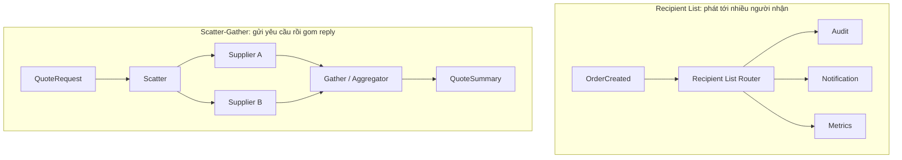

**Điểm cần nhớ ngay:** hai pattern **không loại trừ nhau**. Recipient List Router có thể là **thành phần scatter** trong Scatter-Gather. Điểm phân biệt là có hay không **gather phase và completion contract** để tạo một reply tổng hợp.

### Mục tiêu học tập

Sau bài này, bạn có thể:

1. Phân biệt Recipient List, Scatter-Gather và Publish-Subscribe Channel.
2. Chọn pattern cho event broadcast một chiều hoặc request-reply nhiều nhánh.
3. Giải thích cách Scatter-Gather kết hợp scatterer, reply channel, correlation và gatherer.
4. Thiết kế release strategy phù hợp với tập recipients được chọn thực tế.
5. Cấu hình ví dụ Java DSL và viết JUnit test cho fan-out và gom kết quả.
6. Phân tích latency, timeout, exception, retry, partial result và idempotency.
7. Giữ metadata đúng qua Transformer, Router, Filter, Gateway và adapter.
8. Tránh các phản mẫu như chờ đủ số recipient cố định dù router chỉ chọn một phần.

## 2. Recipient List là pattern gì?

**Recipient List** nhận một message, xác định một danh sách đích và gửi message đến các đích đó. Danh sách có thể cố định hoặc phụ thuộc vào payload, headers, policy và các điều kiện khác.

```text
Incoming Message
       |
       v
Recipient List Router
       |
       +-- Recipient A
       +-- Recipient B
       +-- Recipient C
```

Trong Spring Integration, một cách thực hiện thường gặp là `RecipientListRouter` hoặc Java DSL `routeToRecipients(...)`.

Ví dụ ứng dụng:

- Một sự kiện đơn hàng được gửi tới Audit và Metrics.
- Nếu khách đã đăng ký nhận thông báo, event cũng được gửi tới Notification.
- Nếu đơn có giá trị cao, thêm Fraud Audit.
- Publisher không nhất thiết nhận một response tổng hợp từ các recipient.

### Recipient List quyết định điều gì?

Nó trả lời câu hỏi: **“Message này phải gửi đến những destination nào?”**.

Ví dụ:

```text
OrderCreated ORD-101
  → Audit
  → Metrics
  → Notification (nếu opt-in)

OrderCreated ORD-102
  → Audit
  → Metrics
  → Fraud Audit (nếu high value)
```

Không có yêu cầu mặc định rằng tất cả recipient phải tạo reply và kết quả của họ được ghép lại.

Nếu một recipient chỉ ghi audit rồi trả `void`, điều đó hoàn toàn phù hợp với Recipient List một chiều. Nhưng cùng hành vi này có thể khiến một Scatter-Gather đang chờ reply không thể hoàn tất.

### Recipient List không tự tạo aggregated result

Recipient List có thể gửi tới ba kênh, và ba handler có thể xử lý thành công. Nhưng pattern không tự định nghĩa:

- Một reply/result chung cho caller.
- Chờ bao nhiêu reply trước khi hoàn tất.
- Cách kết hợp nhiều reply thành một payload.
- Chính sách partial response khi một recipient thất bại.
- Nơi lưu trạng thái các reply đang chờ.

Muốn có các đặc tính đó, phải xây thêm bước gather/aggregation — tức Scatter-Gather hoặc một flow phối hợp tương đương.

## 3. Scatter-Gather là pattern gì?

**Scatter-Gather** là một chu trình gồm hai giai đoạn:

1. **Scatter:** gửi request đến nhiều handler/recipient.
2. **Gather:** thu các reply có liên quan, chờ điều kiện hoàn tất rồi tạo một kết quả tổng hợp.

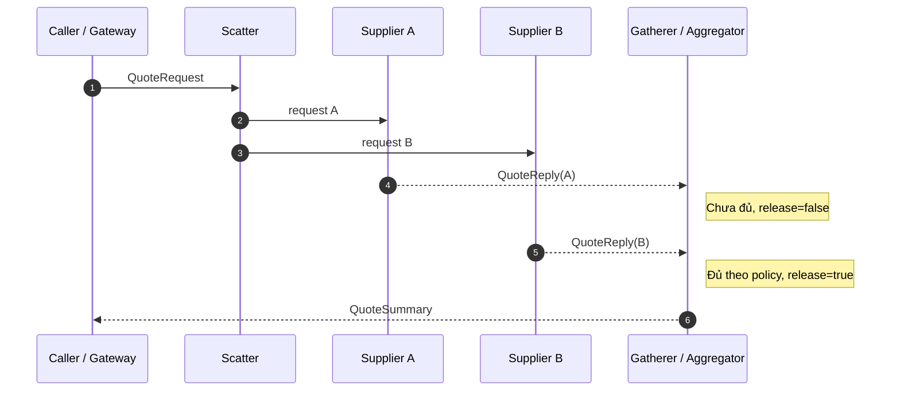

Trong Spring Integration, Scatter-Gather là một EIP có thành phần `ScatterGatherHandler`, phối hợp **scatterer** (ví dụ `RecipientListRouter` hoặc `PublishSubscribeChannel`) với **gatherer** (thường là một Aggregator).

Điểm cốt lõi: nó là **một yêu cầu nhiều đóng góp rồi một kết quả**, không chỉ là việc sao chép message.

### Các trách nhiệm chính

| Thành phần | Trách nhiệm | Cần có để Scatter-Gather đúng? |
| --- | --- | --- |
| Scatterer | Xác định và phát tới các nhánh | Có |
| Recipient/worker | Xử lý request và tạo reply | Có, trừ khi chính sách có thể xử lý thiếu reply |
| Reply correlation | Gắn các reply với đúng request gốc | Có |
| Gatherer/Aggregator | Nhận reply, nhóm và theo dõi state | Có |
| ReleaseStrategy | Quyết định khi nào đủ reply | Có |
| Output processor | Tạo payload tổng hợp | Có |
| Timeout/recovery | Xử lý nhánh chậm/mất reply | Cần cho vận hành an toàn |

Khi không có một chính sách gather rõ ràng, việc gắn nhãn “Scatter-Gather” cho một Recipient List một chiều là thiếu chính xác.

## 4. Bảng so sánh nhanh

| Tiêu chí | Recipient List | Scatter-Gather |
| --- | --- | --- |
| Mục tiêu | Chuyển một message đến một tập recipient | Gửi request đến nhiều recipient rồi thu result |
| Bước fan-out | Có | Có |
| Cần reply từ recipient | Không mặc định | Có theo hợp đồng gather |
| Có Aggregator | Không bắt buộc | Thường là thành phần trung tâm của gather |
| Có ReleaseStrategy | Không phải trách nhiệm của Recipient List | Cần để xác định đủ kết quả |
| Output thông thường | Nhiều đường xử lý độc lập | Một kết quả tổng hợp |
| Caller chờ kết quả tổng hợp | Không mặc định | Thường có ở request-reply |
| Correlation của các reply | Không cần cho fan-out one-way đơn thuần | Cần để tách các cuộc scatter đồng thời |
| Nếu một nhánh không trả reply | Có thể hợp lệ | Có thể gây timeout hoặc partial/failure |
| Nhánh được chọn động | Có | Có; gather phải biết tập đóng góp kỳ vọng |
| Ví dụ | Audit, Metrics, Notification | Hỏi nhiều nhà cung cấp báo giá rồi chọn |
| Chi phí trạng thái | Thường nhẹ hơn | Phải quản lý các nhóm reply và thời hạn |

**Tóm lại:** Recipient List định nghĩa **nơi gửi**. Scatter-Gather định nghĩa **nơi gửi + cách thu kết quả + khi nào hoàn tất**.

## 5. Recipient List so với Publish-Subscribe Channel

Đây là ba khái niệm dễ bị nhầm:

- **Recipient List:** router có thể cấu hình danh sách destination và điều kiện chọn từng recipient.
- **Publish-Subscribe Channel:** một channel broadcast message tới những subscriber đã đăng ký theo cơ chế dispatch của channel.
- **Scatter-Gather:** phối hợp scatter bằng Recipient List **hoặc** Publish-Subscribe với gather, tạo kết quả tổng hợp.

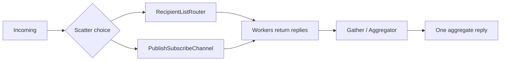

### Chọn Recipient List khi nào?

Khi người nhận có thể thay đổi tùy message:

```text
Recipient A: mọi order
Recipient B: chỉ order đã xác minh
Recipient C: chỉ order giá trị cao
```

Recipient List giúp thể hiện rõ **tập đích theo điều kiện**. Tập recipient thực tế cần được biết tại thời điểm dispatch khi thiết kế gather.

### Chọn Publish-Subscribe khi nào?

Khi một event phải được broadcast tới các subscriber được đăng ký trên channel, không cần một danh sách recipient chọn theo message theo cách của Recipient List.

Trong Scatter-Gather, Publish-Subscribe có thể làm scatterer. Nhưng cần chú ý số lượng subscriber, yêu cầu reply và sequencing/correlation: **“có ba subscriber” không tự động chứng minh gather sẽ nhận đúng ba reply**.

### Đừng đánh đồng broadcast với xử lý đồng thời

Recipient List hay Publish-Subscribe không mặc định chạy song song. Với `DirectChannel` hoặc dispatcher đồng bộ, các handler có thể chạy trên thread gửi; với executor hoặc broker, chúng có thể thực hiện bất đồng bộ.

Latency và timeout phụ thuộc **topology thực tế**, không phụ thuộc riêng tên pattern.

## 6. Ví dụ use case: Audit event khác lấy báo giá

### Use case A: OrderCreated fan-out một chiều

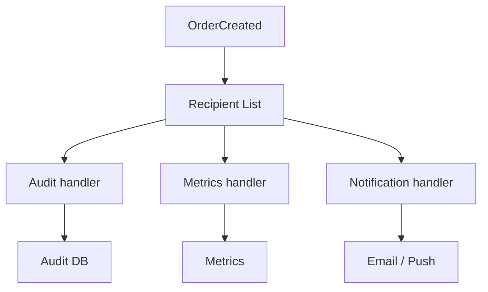

Tại đây:

- Audit có thể lưu event.
- Metrics cập nhật chỉ số.
- Notification gửi thông báo nếu chính sách cho phép.
- Không cần đợi cả ba trả `OrderResult`.
- Mỗi recipient có thể có retry/idempotency policy riêng.

**Phù hợp:** Recipient List hoặc Publish-Subscribe.

### Use case B: So sánh báo giá từ nhiều supplier

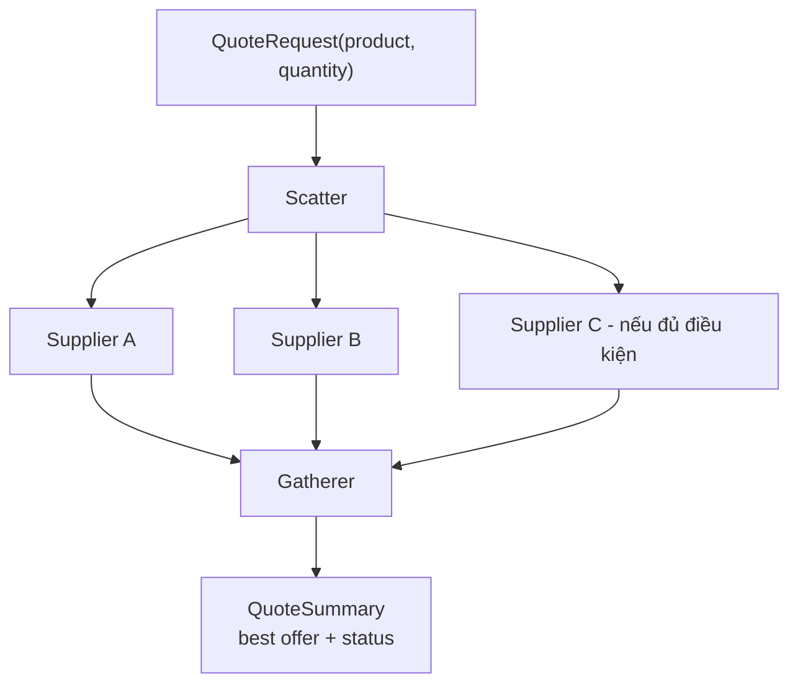

Tại đây:

- Mỗi supplier trả một `QuoteReply`.
- Gatherer nhóm reply theo cùng request.
- Release strategy quyết định đã thu đủ hay chấp nhận kết quả một phần.
- Output processor chọn giá phù hợp, kiểm tra currency, hạn giao và lỗi.
- Caller nhận một `QuoteSummary`.

**Phù hợp:** Scatter-Gather, với Recipient List làm scatterer nếu số supplier được chọn động.

## 7. Java DSL: Recipient List one-way

Trước hết, cài đặt tình huống đơn giản. Một message `OrderEvent` được gửi tới hai kênh độc lập để audit và metrics. Hai kênh là `QueueChannel` để test khả năng fan-out, chưa có handler tạo side effect.

### 7.1. Kiểu dữ liệu

```java
package example.integration;

public record OrderEvent(
    String eventId,
    String orderId,
    long amountMinorUnits
) {}
```

### 7.2. Cấu hình Recipient List Router

```java
package example.integration;

import org.springframework.context.annotation.Bean;
import org.springframework.context.annotation.Configuration;
import org.springframework.integration.channel.DirectChannel;
import org.springframework.integration.channel.QueueChannel;
import org.springframework.integration.config.EnableIntegration;
import org.springframework.integration.dsl.IntegrationFlow;
import org.springframework.messaging.MessageChannel;

@Configuration
@EnableIntegration
public class RecipientListDemoConfig {

    @Bean
    public MessageChannel eventsInput() {
        return new DirectChannel();
    }

    @Bean
    public QueueChannel auditEvents() {
        return new QueueChannel();
    }

    @Bean
    public QueueChannel metricsEvents() {
        return new QueueChannel();
    }

    @Bean
    public IntegrationFlow recipientListFlow() {
        return IntegrationFlow.from("eventsInput")
            .routeToRecipients(router -> router
                .recipient("auditEvents")
                .recipient("metricsEvents"))
            .get();
    }
}
```

Giải thích:

- `eventsInput` nhận một event.
- `routeToRecipients(...)` cấu hình Recipient List trong Java DSL.
- `auditEvents` và `metricsEvents` đều nhận bản tin theo chính sách recipient.
- **Không có gatherer** và **không có `QuoteSummary`** trong flow.
- `QueueChannel` chỉ minh họa phân phối nội bộ trong JVM, không đảm bảo lưu bền vững qua restart.

Đây là ví dụ Recipient List, không phải Scatter-Gather, dù có hai recipient.

### 7.3. Khi danh sách recipient có điều kiện

Một cấu hình Recipient List có thể chọn thêm người nhận khi message có đặc điểm nhất định, ví dụ `amountMinorUnits` vượt ngưỡng. Có thể dùng recipient selector trong API router phù hợp phiên bản Spring Integration.

Ý tưởng:

```text
auditEvents:
  luôn nhận

metricsEvents:
  luôn nhận

highValueReviewEvents:
  chỉ nhận khi amountMinorUnits >= configuredThreshold
```

Điểm đáng chú ý là **mỗi message có thể có số recipient thực tế khác nhau**. Nếu phát triển sang Scatter-Gather, gatherer phải biết số nhánh đã được chọn và số reply hợp lệ dự kiến; không được hard-code “có ba recipient” chỉ vì cấu hình có ba lựa chọn.

## 8. JUnit 5: chứng minh Recipient List chỉ fan-out

Kiểm thử một lần gửi đầu vào và hai queue cùng nhận event:

```java
package example.integration;

import static org.junit.jupiter.api.Assertions.*;

import org.junit.jupiter.api.Test;
import org.springframework.beans.factory.annotation.Autowired;
import org.springframework.beans.factory.annotation.Qualifier;
import org.springframework.integration.channel.QueueChannel;
import org.springframework.messaging.Message;
import org.springframework.messaging.MessageChannel;
import org.springframework.messaging.support.MessageBuilder;
import org.springframework.test.context.junit.jupiter.SpringJUnitConfig;

@SpringJUnitConfig(RecipientListDemoConfig.class)
class RecipientListDemoTest {

    @Autowired
    @Qualifier("eventsInput")
    private MessageChannel eventsInput;

    @Autowired
    @Qualifier("auditEvents")
    private QueueChannel auditEvents;

    @Autowired
    @Qualifier("metricsEvents")
    private QueueChannel metricsEvents;

    @Test
    void deliversOneEventToBothRecipients() {
        OrderEvent event =
            new OrderEvent("EV-101", "ORD-2048", 750_000L);

        Message<OrderEvent> message = MessageBuilder
            .withPayload(event)
            .setHeader(
                "businessCorrelationId", "order:ORD-2048")
            .build();

        assertTrue(eventsInput.send(message));

        Message<?> audit = auditEvents.receive(1_000);
        Message<?> metrics = metricsEvents.receive(1_000);

        assertNotNull(audit);
        assertNotNull(metrics);

        assertEquals(event, audit.getPayload());
        assertEquals(event, metrics.getPayload());

        assertEquals("order:ORD-2048",
            audit.getHeaders().get("businessCorrelationId"));
        assertEquals("order:ORD-2048",
            metrics.getHeaders().get("businessCorrelationId"));

        assertNull(auditEvents.receive(0));
        assertNull(metricsEvents.receive(0));
    }
}
```

Test chứng minh **một message đi đến hai recipient**. Nó không có assertion về tập reply, completion count, timeout của gatherer hay kết quả tổng hợp bởi vì flow **không triển khai** các khái niệm đó.

Nếu sau này thêm một thứ ba recipient chỉ cho đơn giá trị cao, nên kiểm thử cả event được chọn 2 recipient và event được chọn 3 recipient.

## 9. Thiết kế Scatter-Gather: request và reply phải có hợp đồng

Giả sử `QuoteRequest` cần hỏi hai nhà cung cấp. Một recipient phản hồi:

```text
QuoteReply:
  supplierCode = "A"
  priceMinorUnits = 120000
  deliveryDays = 2
  accepted = true
```

Recipient khác trả:

```text
QuoteReply:
  supplierCode = "B"
  priceMinorUnits = 115000
  deliveryDays = 4
  accepted = true
```

Gatherer phải biết:

1. Hai reply đó cùng thuộc một `QuoteRequest` nào?
2. Có kỳ vọng chính xác hai reply không?
3. Nếu một supplier trả `REJECTED`, có được xem là một đóng góp hoàn tất không?
4. Nếu supplier B timeout, trả kết quả một phần hay thất bại?
5. Nếu supplier A trả hai reply vì retry, có được tính hai lần không?
6. Nếu có ba recipient nhưng chỉ hai được chọn cho request hiện tại, expected count bằng mấy?

### Message contract đề xuất

| Dữ liệu | Ví dụ | Vai trò |
| --- | --- | --- |
| `requestId` | `Q-101` | Định danh cuộc hỏi giá nghiệp vụ |
| `businessCorrelationId` | `quote:Q-101` | Truy vết toàn flow |
| `supplierCode` | `A` | Xác định nguồn đóng góp |
| `correlationId` | ID nhóm reply của scatter request | Gatherer dùng nhóm |
| `sequenceNumber` | 1 hoặc 2 | Vị trí đóng góp nếu dùng sequence |
| `sequenceSize` | 2 nếu thực sự có hai reply mong đợi | Completion expectation |
| `replyChannel` | Reply destination do framework quản lý | Đưa kết quả tra cứu đúng đường |
| `errorChannel` | Đường lỗi tùy cấu hình | Quan sát exception của nhánh |

**Không xem `requestId`, `correlationId` và `replyChannel` là một thứ.** Business ID phục vụ đối soát, group ID phục vụ aggregation, reply destination phục vụ giao tiếp request-reply.

## 10. Scatterer có thể là Recipient List hoặc Publish-Subscribe

Có hai cách tổ chức scatter thường gặp trong Spring Integration:

### 10.1. Recipient-list scatter

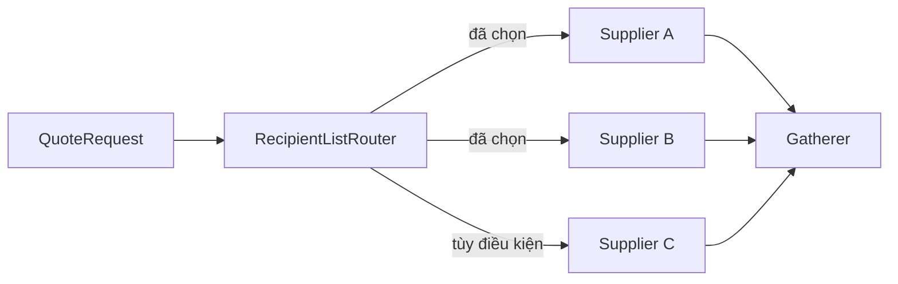

Ưu điểm:

- Có thể chọn đúng tập supplier dựa trên loại sản phẩm, khu vực, năng lực hoặc policy.
- Dễ quản lý điều kiện cho từng recipient.
- Không buộc mọi supplier đều nhận mọi request.

Yêu cầu:

- Expected count phải phản ánh **tập recipient được chọn thực tế**, không phải tổng số supplier trong registry.
- Không có nhánh nào bị tính là “đã hoàn tất” chỉ vì scatterer gửi request thành công.
- Cần quy tắc xử lý recipient không tạo reply.

### 10.2. Publish-subscribe scatter

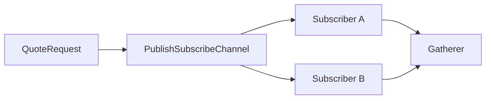

Ưu điểm:

- Phù hợp các subscriber đã được đăng ký rõ trong ứng dụng.
- Có thể dùng executor để dispatch bất đồng bộ.
- Cấu trúc channel đơn giản cho fixed audience.

Giới hạn:

- Nếu số subscriber thay đổi hoặc một subscriber không tạo reply, gatherer phải biết cách xử lý.
- Subscriber phát một kết quả thông báo một chiều không phải contribution hợp lệ nếu gatherer chờ business reply.
- Publish-Subscribe trong JVM không tự tạo durable fan-out hoặc exactly-once.

**Không được khẳng định:** mọi Broadcast event đều tự biến thành Scatter-Gather chỉ vì sau đó có một Aggregator ở đâu đó. Cần có correlation, reply routing và release contract rõ ràng.

## 11. Ví dụ miền nghiệp vụ: báo giá từ hai supplier

Ta thiết kế ba kiểu dữ liệu bất biến. Mỗi supplier trả một `QuoteReply` cho request tương ứng.

```java
package example.integration;

import java.util.List;

public record QuoteRequest(
    String requestId,
    String sku,
    int quantity
) {}

public record QuoteReply(
    String requestId,
    String supplier,
    long unitPriceMinorUnits,
    int deliveryDays,
    boolean available
) {}

public record QuoteSummary(
    String requestId,
    String selectedSupplier,
    Long selectedUnitPriceMinorUnits,
    int repliesReceived,
    boolean complete,
    List<QuoteReply> allReplies
) {}
```

Các quyết định nghiệp vụ:

- `QuoteRequest.quantity` phải dương và SKU không rỗng.
- `QuoteReply.requestId` phải khớp request ban đầu.
- Mỗi supplier được tính tối đa một contribution.
- Giá chỉ có thể so sánh khi currency/đơn vị giống nhau; ví dụ giả định đơn vị tiền được chuẩn hóa.
- `available=false` vẫn là một **reply hợp lệ** về mặt gather, mặc dù nó không phải báo giá có thể chọn.
- Kết quả cuối nêu rõ đã đủ reply hay chỉ partial.

### Hai supplier đơn giản

```java
package example.integration;

public final class SupplierAService {

    public QuoteReply quote(QuoteRequest request) {
        return new QuoteReply(
            request.requestId(),
            "A",
            120_000L,
            2,
            true);
    }
}

public final class SupplierBService {

    public QuoteReply quote(QuoteRequest request) {
        return new QuoteReply(
            request.requestId(),
            "B",
            115_000L,
            4,
            true);
    }
}
```

Đây là hai service demo trả dữ liệu cố định, giúp tập trung vào correlation/gather. Production cần timeout, retry policy, chuẩn hóa currency, validation và phân biệt kết quả không có hàng với exception hạ tầng.

## 12. Java DSL: hình dung Scatter-Gather trong Spring Integration

Ở Spring Integration, `scatterGather(...)` trong Java DSL là điểm tổ chức scatterer và gatherer. Ví dụ bên dưới trình bày **cấu trúc DSL minh họa**: các overload/spec cụ thể cần được đối chiếu với phiên bản Spring Integration của project ở bước QA chuyên môn.

```java
// Minh họa cách tổ chức, không phải một file cấu hình độc lập.
// supplierA và supplierB là bean được inject.

IntegrationFlow flow = IntegrationFlow.from("quoteRequests")
    .scatterGather(
        scatterer -> scatterer
            .recipientFlow(f -> f.handle(supplierA, "quote"))
            .recipientFlow(f -> f.handle(supplierB, "quote")),
        gatherer -> gatherer
            .releaseStrategy(group -> group.size() == 2)
            .outputProcessor(group -> summarizeQuotes(group)))
    .channel("quoteSummaries")
    .get();
```

### Từng cấu phần có ý nghĩa gì?

- `IntegrationFlow.from("quoteRequests")`: nhận một yêu cầu báo giá.
- Scatterer: dispatch request tới hai flow xử lý.
- Hai supplier: tạo `QuoteReply` bằng Service Activator.
- Gatherer: gom reply theo correlation group.
- `releaseStrategy(...)`: minh họa đợi hai đóng góp.
- `outputProcessor(...)`: tạo một `QuoteSummary`.
- `quoteSummaries`: output của cuộc hỏi giá tổng hợp, không phải output riêng của supplier A hay B.

**Điều chỉnh quan trọng cho production:** rule `group.size()==2` chỉ an toàn khi **chính xác hai recipient được chọn, mỗi recipient trả đúng một reply** và có chống trùng. Nếu recipient được chọn động, supplier trả nhiều reply hoặc có duplicate, phải xây completion rule mạnh hơn.

### Ví dụ output processor

```java
import java.util.Comparator;
import java.util.List;
import java.util.Optional;

import org.springframework.integration.store.MessageGroup;

public QuoteSummary summarizeQuotes(MessageGroup group) {
    List<QuoteReply> replies = group.getMessages().stream()
        .map(m -> (QuoteReply) m.getPayload())
        .toList();

    Optional<QuoteReply> best = replies.stream()
        .filter(QuoteReply::available)
        .min(Comparator
            .comparingLong(QuoteReply::unitPriceMinorUnits)
            .thenComparingInt(QuoteReply::deliveryDays));

    String requestId = replies.get(0).requestId();

    return new QuoteSummary(
        requestId,
        best.map(QuoteReply::supplier).orElse(null),
        best.map(QuoteReply::unitPriceMinorUnits).orElse(null),
        replies.size(),
        replies.size() == 2,
        List.copyOf(replies));
}
```

Đây cũng là phần logic minh họa với giả định input group không rỗng, cùng request ID, cùng currency và không có reply trùng supplier. Ở production, hãy kiểm tra những bất biến đó trước khi cho phép release, tránh để output processor phải xử lý dữ liệu nhóm không hợp lệ.

### Vì sao phải dùng kiểu kết quả cuối rõ ràng?

`QuoteSummary.complete` khác với việc có một báo giá tốt nhất:

- `complete=true`: nhóm đã nhận đủ contribution theo policy.
- `selectedSupplier=null`: không có supplier nào báo có hàng.
- `allReplies`: giữ bằng chứng để audit, nhưng có thể giới hạn/ẩn trường nhạy cảm tùy SLA.
- Với partial release, `complete=false` cần được thể hiện, không giả thành full success.

## 13. Recipient được chọn động: sai lệch expected count

Đây là lỗi phổ biến nhất khi so sánh hai pattern.

Giả sử Recipient List được cấu hình ba supplier A, B, C. Nhưng request `Q-101` chỉ chọn A và B vì C không hỗ trợ khu vực giao hàng.

```text
Configured recipients: [A, B, C]
Selected recipients:   [A, B]
Actual requests sent:  2
Expected valid replies: 2
```

Nếu Gatherer cố chờ `sequenceSize=3` vì cấu hình có ba supplier, nhóm có thể timeout dù cả hai recipient thực tế đều đã trả kết quả.

### Quy tắc đúng

Expected reply count phải phản ánh **số đóng góp được kỳ vọng từ lần scatter hiện tại**, không chỉ số recipient được khai báo trong cấu hình.

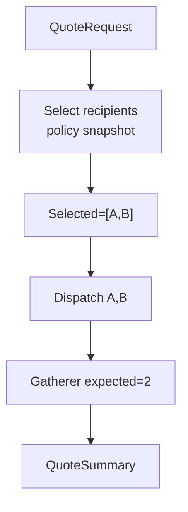

Cần ghi nhận tập recipient được chọn khi quyết định có thể được replay hoặc khi policy thay đổi runtime. Nếu retry mà dùng policy mới rồi tăng số recipient, contract hoàn tất sẽ thay đổi giữa chừng.

### Khi mỗi recipient có số reply khác nhau

Một supplier có thể trả nhiều mức giá, ví dụ tiêu chuẩn và giao nhanh. Lúc đó “một supplier = một reply” không còn đúng. Cân nhắc:

1. Chuẩn hóa mỗi supplier trả một `SupplierQuoteSet` chứa tất cả tùy chọn của họ.
2. Nếu muốn từng offer là một contribution, ghi rõ `(supplierId, offerType)` và expected set tương ứng.
3. Dùng nested Aggregator: gom offers thành một supplier result, rồi gom supplier results.

Không chỉ tăng `sequenceSize` một cách tùy tiện mà không có định danh logical contribution.

## 14. Correlation: nhiều cuộc scatter đồng thời không được lẫn reply

Trong production, có thể có hàng nghìn `QuoteRequest` cùng hoạt động. Reply từ A/B có thể đến xen kẽ.

```text
Q-101 -> A reply
Q-102 -> B reply
Q-101 -> B reply -> release Q-101
Q-102 -> A reply -> release Q-102
```

Nếu tất cả reply được gửi vào cùng gatherer mà thiếu correlation, hai request có thể bị trộn.

Các metadata liên quan:

| Metadata | Vai trò | Khuyến nghị |
| --- | --- | --- |
| `requestId` | ID yêu cầu báo giá nghiệp vụ | Luôn giữ ổn định |
| `businessCorrelationId` | Tìm log và trace xuyên các service | Khác với group ID nếu cần |
| `correlationId` | Khóa message group của Aggregator | Do hạ tầng/flow xác định nhất quán |
| `sequenceNumber` | Vị trí contribution khi có sequence | Giữ qua từng handler |
| `sequenceSize` | Tổng contribution kỳ vọng | Khớp tập recipient được chọn |
| `replyChannel` | Đường reply của request-reply exchange | Không ghi đè tùy tiện |
| `MessageHeaders.id` | ID từng message | Không phải group key chung |

**Đừng mặc định `requestId == correlationId`.** Một yêu cầu nghiệp vụ có thể được scatter lại dưới một workflow run mới; nếu dùng cùng group ID mà không xét retry và lifecycle, reply cũ có thể lẫn reply mới.

### Business correlation khác technical group

Ví dụ:

```text
QuoteRequest Q-101
  businessCorrelationId = quote:Q-101

Scatter run #1
  correlationId = group-701

Retry có chủ đích, scatter run #2
  correlationId = group-702

Cả hai cùng businessCorrelationId,
nhưng không nhất thiết được gom vào cùng MessageGroup.
```

Để truy vết quyết định, lưu `scatterRunId`, `selectedRecipients` và `policyVersion` khi cần, thay vì ghi đè một header kỹ thuật bằng mã nghiệp vụ tùy ý.

## 15. Reply channel: khác biệt quan trọng so với Recipient List một chiều

Khi dùng Recipient List chỉ để audit, các handler có thể trả `void`. Không có ai ở upstream yêu cầu thu một tập reply.

Trong Scatter-Gather, mỗi nhánh được kỳ vọng tạo **reply có đường trở về gatherer**.

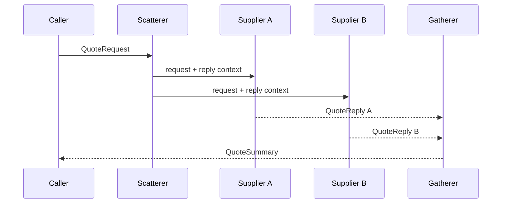

Ở Spring Integration, request-reply headers và các endpoint liên quan có thể quản lý đường reply nội bộ. Khi tạo custom `Message<?>` hoặc đi qua broker, phải đảm bảo reply destination/correlation protocol được giữ đúng.

**Không tự sửa `replyChannel` trên từng nhánh để trỏ về Gateway trực tiếp.** Nếu hai supplier gửi thẳng vào Gateway, caller có thể nhận một reply đơn lẻ, không có cơ chế thu đủ/aggregate, hoặc gặp message đến muộn không còn nơi nhận.

### Một nhánh trả void thì sao?

```java
public void audit(QuoteRequest request) {
    auditRepository.saveRequest(request);
}
```

Handler trên phù hợp cho Recipient List one-way nhưng **không đóng góp `QuoteReply`** cho Scatter-Gather. Nếu gatherer chờ N reply, nhóm có thể thiếu một phần và timeout.

Nếu cần audit **và** báo giá, tách audit khỏi các nhánh reply hoặc tạo một result loại riêng được định nghĩa trong gather contract. Không xem “đã ghi audit” là một báo giá hợp lệ.

## 16. ReleaseStrategy: khi nào Scatter-Gather thực sự hoàn tất?

Gatherer thường là Aggregator, cần quyết định rõ **khi nào release**.

### Case 1: tất cả N supplier trả reply

```text
Selected: [A, B]
Reply A: received
Reply B: received
=> release and summarize
```

Phù hợp nếu caller cần đủ dữ liệu và các supplier có deadline đáp ứng.

### Case 2: đủ một quorum

```text
Selected: [A, B, C]
Reply A: received
Reply B: received
Reply C: still pending
Policy: >= 2 valid independent suppliers
=> release partial/early theo contract
```

Chỉ áp dụng khi nghiệp vụ cho phép đưa ra quyết định mà không chờ tất cả. Output phải nêu rõ đã đủ quorum nhưng chưa đủ toàn bộ recipients.

### Case 3: deadline

```text
Selected: [A, B, C]
Replies: A, C
B: timeout

Policy:
  strict -> fail
  partial allowed -> summarize A,C + missing B
```

**Timeout không đồng nghĩa ReleaseStrategy tự động trả true.** Cần cấu hình group timeout/expiry hoặc một cơ chế deadline/partial release tương ứng.

### Case 4: không có recipient nào được chọn

Nếu policy lọc hết các supplier, scatterer có thể không có ai nhận. Khi đó gatherer có thể không nhận message để tạo group.

Cần định nghĩa kết quả riêng:

- `NO_ELIGIBLE_SUPPLIER`.
- Hoặc fail-fast theo business rule.
- Không để caller chờ vô hạn một gather group chưa được tạo.

## 17. Custom release rule: distinct supplier thay vì đếm thô

Với hai supplier A và B được chọn, một rule có thể chỉ release khi đã có reply từ **cả A lẫn B**, mỗi supplier một reply.

```java
import java.util.Set;
import java.util.stream.Collectors;

import org.springframework.integration.store.MessageGroup;

public boolean receivedBothSuppliers(MessageGroup group) {
    Set<String> required = Set.of("A", "B");

    Set<String> actual = group.getMessages().stream()
        .map(m -> (QuoteReply) m.getPayload())
        .map(QuoteReply::supplier)
        .collect(Collectors.toSet());

    return actual.equals(required)
        && group.size() == required.size();
}
```

Đây là **rule minh họa** chỉ phù hợp với đúng hai supplier cố định. Nó tránh release khi có hai reply cùng từ A mà thiếu B. Tuy nhiên, nếu duplicate đã vào store, rule trả false và nhóm có thể bị kẹt; cần deduplication/recovery riêng.

### Khi danh sách supplier động

Không nên giữ `Set.of("A","B")` hard-code trong production. Thay bằng một tập expected suppliers được chốt khi scatter và lưu trong workflow context/group metadata có thể truy xuất an toàn.

```text
expectedSuppliers = {A, B, C}
receivedSuppliers = {A, C}
release=false

expectedSuppliers = {A, B}
receivedSuppliers = {A, B}
release=true
```

Khi policy thay đổi trong lúc message đang chạy, **không tự tính lại expected suppliers từ config mới**. Đó là một thay đổi contract giữa chừng; cần explicit re-scatter/reroute event nếu nghiệp vụ đòi hỏi.

### Có cần chờ reply “thành công” không?

Một supplier có thể trả `available=false`. Đây vẫn là một reply hoàn tất về mặt giao tiếp. Nếu gather contract đòi một phản hồi từ mỗi supplier, nó vẫn được tính là một contribution. Kết quả cuối có thể là “không có offer phù hợp”.

Không nên chờ vô hạn cho đến khi mọi supplier trả `available=true`; availability có thể là kết quả nghiệp vụ âm, không phải lỗi transport cần retry.

## 18. Độ trễ: chờ tất cả có thể khiến một nhánh chậm chi phối

Giả sử:

| Supplier | Thời gian trả reply |
| --- | --- |
| A | 100 ms |
| B | 450 ms |
| C | 1.200 ms |

Nếu đủ điều kiện cần cả ba, thời gian hoàn tất **không thể sớm hơn reply cuối cùng**. Khi các nhánh thực sự chạy song song, độ trễ có thể gần mức chậm nhất cộng chi phí điều phối; còn nếu scatterer dispatch và handler chạy đồng bộ nối tiếp, tổng thời gian có thể lớn hơn nhiều.

```mermaid
gantt
    title Timeline minh họa nếu ba supplier chạy song song
    dateFormat X
    axisFormat %L
    section Supplier A
    A response :a, 0, 100
    section Supplier B
    B response :b, 0, 450
    section Supplier C
    C response :c, 0, 1200
```

Sơ đồ là minh họa về độ trễ tương đối, không phải số đo của Spring Integration.

### Scatter không bảo đảm song song

Một Recipient List Router gửi tới các `DirectChannel` có thể chạy handler đồng bộ ngay trên thread dispatch. Nếu handler A chậm, nó có thể trì hoãn việc gửi đến B.

Muốn concurrency thật:

- Sử dụng ranh giới executor/adapter phù hợp.
- Thiết kế timeout và bounded queue.
- Đảm bảo handler an toàn khi chạy đồng thời.
- Không để một supplier bị nghẽn chiếm hết worker dành cho các supplier khác.
- Kiểm tra metrics về active threads, queue depth và rejection.

Nếu cần latency thấp và business cho phép, cân nhắc quorum/partial strategy thay vì nhất thiết chờ N/N.

## 19. Timeout: release timeout, Gateway timeout và I/O timeout

Một Scatter-Gather thường có **nhiều thời hạn khác nhau**:

1. **Supplier HTTP/DB timeout:** giới hạn từng cuộc gọi bên ngoài.
2. **Scatter/send timeout:** khi gửi request bị chặn hoặc channel quá tải.
3. **Gather group timeout:** bao lâu chờ các reply trong group.
4. **Gateway reply timeout:** caller chờ kết quả tổng hợp bao lâu.
5. **Business deadline:** đến mốc nào quyết định chọn báo giá còn giá trị.

Không được gọi chúng chung là “timeout 5 giây” mà không xác định điểm áp dụng.

### Sơ đồ hai deadline

```text
Caller / Gateway
  |--------------------------------- reply timeout
  |
  +-- Scatter
        |
        +--> A: HTTP timeout
        +--> B: HTTP timeout
        |
        +-- Gatherer --------------- group timeout
```

Nếu Gateway timeout **trước** Gatherer, một `QuoteSummary` xuất hiện sau đó có thể không còn caller đang chờ. Cần chính sách lưu kết quả và xử lý reply muộn, không giả định framework tự giữ request HTTP mãi.

### Timeout của nhóm phải có kết quả rõ

Nếu B không trả reply:

- **Strict:** tạo lỗi `QUOTE_INCOMPLETE`, không giả thành full success.
- **Partial:** chọn trong các offer đã có, nhưng `complete=false` và có danh sách missing recipients.
- **Deferred:** lưu state `PENDING` để hoàn tất sau và cho caller tra cứu.
- **Cancel/retry:** theo hợp đồng với idempotency và deadline.

Một partial result là **quyết định nghiệp vụ**, không phải một hành vi mặc định tất yếu của Scatter-Gather.

## 20. Lỗi một nhánh: cần tách failure khỏi no-reply

Một supplier có thể:

- Trả reply hợp lệ `available=false`.
- Trả lỗi nghiệp vụ rõ `NOT_SUPPORTED`.
- Timeout vì hạ tầng.
- Throw exception trước khi tạo reply.
- Trả message không đúng schema.
- Trả reply sau thời hạn.
- Trả cùng một reply hai lần.

Các tình huống này khác nhau:

| Tình huống | Có tính là contribution? | Gợi ý |
| --- | --- | --- |
| `available=false` nhưng reply hợp lệ | Có, nếu contract đòi phản hồi | Tổng hợp là không có offer |
| `NOT_SUPPORTED` trong response hợp lệ | Có, nếu policy chấp nhận | Ghi reason |
| HTTP timeout | Chưa có valid reply | Retry/recovery/partial |
| Exception trong handler | Chưa có valid reply nếu không được convert | Error channel và recovery |
| Reply sai requestId | Không | Reject/quarantine |
| Reply duplicate từ cùng supplier | Chỉ một logical contribution | Deduplication |
| Reply đến sau completion | Theo late-message policy | Ignore/audit/quarantine |

### Recovery result

Có thể chuẩn hóa mỗi supplier trả một kết quả có cấu trúc:

```java
public record SupplierOutcome(
    String requestId,
    String supplier,
    String status,
    QuoteReply quote,
    String errorCode
) {}
```

Ví dụ `status` là `SUCCESS`, `NOT_AVAILABLE` hoặc `FAILED`. Nếu cả ba loại đều là **kết quả hoàn tất của một supplier**, gatherer có thể đếm đủ contribution và output processor quyết định business status.

Không dùng `catch (Exception e) { return null; }`. Trong nhiều endpoint request-reply, null nghĩa là không có reply; gatherer sẽ chờ đến timeout và lỗi gốc bị che.

### Khi nào retry?

- Lỗi HTTP 503 hoặc timeout tạm: có thể retry riêng nhánh đó với backoff.
- Supplier trả `available=false`: thường không retry cùng request chỉ để mong có hàng.
- Reply sai schema hoặc customer authorization sai: cần fail-fast/quarantine.
- Gateway timeout sau khi supplier đã xử lý: retry toàn scatter có thể tạo side effect nếu supplier không chỉ đọc dữ liệu.

Kết quả retry phải gắn vào đúng scatter run, không tự phát thêm một đóng góp giả.

## 21. Duplicate, redelivery và idempotency

Một message có thể được phát lại do broker, handler retry hoặc caller gửi lại.

```text
QuoteRequest Q-101
  -> supplier A trả reply A#1
  -> connection lỗi, A retry trả A#2
  -> supplier B trả reply B#1

Nếu gatherer đếm thô:
  A#1, A#2 -> đủ 2 replies => release sai.
```

Nên có logical contribution key:

```text
contributionKey = (scatterRunId, supplierCode)
```

Nếu mỗi supplier có nhiều offer được phép, bổ sung `offerType`/`quoteVersion` theo contract.

**Không dùng mỗi `correlationId` làm idempotency key cho từng supplier.** Tất cả reply của cùng group có chung correlation ID nên nó không phân biệt A với B.

### Retry lại toàn scatter có thể đổi tập recipient

Policy lúc đầu chọn A,B. Một phút sau recipient registry thay đổi, retry tự động lại chọn A,B,C. Nếu gatherer cũ vẫn chờ hai reply, một reply C có thể tới sai group hoặc xuất hiện sau completion.

Muốn replay deterministic:

1. Chốt `selectedRecipients` và `scatterRunId` ở thời điểm bắt đầu.
2. Lưu chúng nếu cần khôi phục qua restart.
3. Retry mỗi supplier theo contribution ID ổn định.
4. Chỉ mở một scatter run mới khi nghiệp vụ quyết định re-scatter.
5. Đảm bảo kết quả cũ và mới không trộn nhóm.

## 22. Filter và Transformer trong các recipient flow

Một nhánh có thể cần chuẩn hóa request hoặc lọc theo điều kiện:

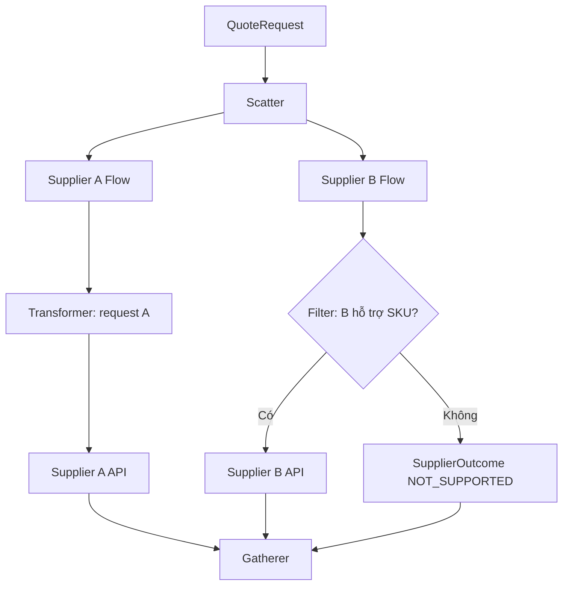

### Transformer: giữ reply correlation

Nếu custom Transformer tạo một `Message<?>` mới mà không giữ những headers điều phối cần thiết, gatherer có thể không ghép đúng reply. Trong flow nội bộ, có thể dùng cơ chế propagation chuẩn hoặc `MessageBuilder` giữ các header đã được lựa chọn.

```java
public Message<QuoteReply> preserveHeaders(
        Message<QuoteRequest> input,
        QuoteReply reply) {

    return MessageBuilder.withPayload(reply)
        .copyHeaders(input.getHeaders())
        .build();
}
```

Đây là mẫu minh họa nội bộ; không sao chép mù quáng `replyChannel`, `errorChannel` hoặc dữ liệu nhạy cảm qua ranh giới trust/broker khác.

### Filter: đừng âm thầm làm mất contribution

Nếu Supplier B không hỗ trợ sản phẩm, một Filter có thể trả false. Nhưng nếu Filter chỉ drop message, gatherer sẽ thiếu reply B.

Thay vì thế, trả `SupplierOutcome(status=NOT_SUPPORTED)` như một contribution hoàn tất. Việc có nên tính nó là một reply hợp lệ phụ thuộc vào release contract.

### Router bên trong recipient

Một supplier adapter có thể route theo region hoặc protocol. Việc định tuyến nội bộ không nên vô tình tạo hai reply cho một supplier, trừ khi hợp đồng đã định nghĩa multiple contributions.

## 23. Splitter/Aggregator khác Scatter-Gather thế nào?

**Splitter → Aggregator** và **Scatter-Gather** đều có fan-out/fan-in, nhưng khác ở nguồn tạo phần tử và mục đích.

- **Splitter** tách **dữ liệu đầu vào** thành nhiều phần tử, ví dụ danh sách line items.
- **Scatter** gửi **một request** đến nhiều handler/supplier, đôi khi payload request gần như giữ nguyên.
- **Aggregator/Gatherer** thu các message liên quan để tạo một output.

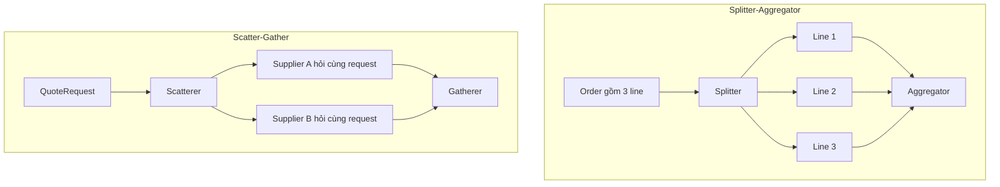

Cả hai có thể sử dụng sequence/correlation headers và release strategies. Tuy nhiên **sequenceSize của Splitter** mô tả số phần tử đã tách, còn **expected replies của Scatter-Gather** phải khớp số đóng góp được chờ từ các recipient.

Nếu một message con từ Splitter lại được scatter tới hai nguồn, cần grouping nhiều cấp hoặc contribution identity chi tiết hơn.

## 24. Gateway request-reply: chỉ gatherer tạo kết quả cho caller

Một `@MessagingGateway` có thể đưa một `QuoteRequest` vào Spring Integration và mong nhận một `QuoteSummary`:

```java
import org.springframework.integration.annotation.MessagingGateway;

@MessagingGateway(defaultRequestChannel = "quoteRequests")
public interface QuoteGateway {
    QuoteSummary compare(QuoteRequest request);
}
```

Đây là interface minh họa. Muốn chạy hoàn chỉnh, cần cấu hình Gateway scan, scatter-gather flow tạo `QuoteSummary`, reply path tương ứng và timeout.

Sơ đồ:

```text
Java Caller
    |
    v
QuoteGateway.compare(...)
    |
    v
Scatter A,B
    |
    v
Gatherer receives replies
    |
    v
QuoteSummary
    |
    v
Gateway reply -> Java Caller
```

**Không** cho supplier A và supplier B đều tự gửi `QuoteReply` về `replyChannel` gốc của Gateway. Nếu vậy, Gateway có thể nhận một quote đơn lẻ hoặc hành vi tranh chấp reply, không phải summary.

### Hai tầng reply

1. Reply từ từng supplier về **gatherer**.
2. Reply cuối từ **gatherer** về **Gateway**.

Đường reply cần được framework hoặc transport quản lý nhất quán. `businessCorrelationId` giúp tracing nhưng không thay thế reply destination.

### Nếu caller chỉ cần “đã tiếp nhận”

Nếu nghiệp vụ hỏi nhiều supplier trong nhiều phút, nên có một lệnh `submitQuoteInquiry` trả `PENDING` kèm `requestId`, rồi hoàn tất qua state store/event callback. Không giữ một lời gọi Gateway đồng bộ quá lâu chỉ để chờ mọi supplier.

## 25. Kiểm thử Scatter-Gather: không chỉ test fan-out

Kiểm thử Recipient List ở mục 8 chỉ cần xác nhận nhiều queue nhận message. Scatter-Gather phải kiểm tra thêm **reply correlation, release và output**.

### 25.1. Test đơn vị cho rule tập supplier

Ví dụ test method `receivedBothSuppliers(...)` bằng một `MessageGroup` giả hoặc fixture phù hợp của Spring Integration:

```text
group Q-101:
  reply(A)                 -> release=false
  reply(A) + reply(B)      -> release=true
  reply(A) + reply(A)      -> release=false
  reply(B)                 -> release=false
```

Ở đây không cần khởi tạo toàn bộ broker. Unit test có thể chứng minh logic distinct supplier, nhưng chưa chứng minh reply được gắn đúng correlation khi chạy Spring Integration thực.

### 25.2. Integration test: hai reply, một summary

Một test toàn flow nên:

1. Tạo `QuoteRequest("Q-101","BOOK-1",2)`.
2. Gửi vào request channel của scatter-gather.
3. Supplier A và B trả `QuoteReply` có cùng requestId.
4. Chờ output từ gatherer.
5. Assert `repliesReceived==2`.
6. Assert supplier được chọn đúng theo rule so sánh giá/khả dụng.
7. Assert chỉ một `QuoteSummary` được phát.
8. Assert không có reply từ cuộc hỏi giá khác trong summary.

Mã assertion mẫu trong JUnit 5, giả định đã inject `quoteRequests` và `quoteSummaries` tương ứng với flow hoàn chỉnh:

```java
@Test
void gathersTwoSupplierRepliesIntoOneSummary() {
    QuoteRequest request =
        new QuoteRequest("Q-101", "BOOK-1", 2);

    assertTrue(quoteRequests.send(
        MessageBuilder.withPayload(request)
            .setHeader(
                "businessCorrelationId", "quote:Q-101")
            .build()));

    Message<?> result = quoteSummaries.receive(2_000);
    assertNotNull(result);
    assertInstanceOf(QuoteSummary.class, result.getPayload());

    QuoteSummary summary = (QuoteSummary) result.getPayload();
    assertEquals("Q-101", summary.requestId());
    assertEquals("B", summary.selectedSupplier());
    assertEquals(2, summary.repliesReceived());
    assertTrue(summary.complete());
    assertEquals(2, summary.allReplies().size());

    assertNull(quoteSummaries.receive(0));
}
```

Đây là **test fragment minh họa**, không phải một class tự chạy nếu chưa khai báo các bean/test fixture. Khi triển khai phải cấu hình scatterer/gatherer theo DSL phiên bản đang dùng và xác minh reply/correlation được tạo đúng.

### 25.3. Test các nhánh kết thúc bất thường

| Tình huống | Điều cần chứng minh |
| --- | --- |
| Supplier A trả trước B | Gatherer chưa release quá sớm |
| Supplier B trả trước A | Summary vẫn đúng |
| Một supplier không trả reply | Timeout/partial/error contract |
| Supplier A trả hai lần | Không tính hai contributions |
| Hai request Q-101 và Q-102 xen kẽ | Không trộn reply |
| Tập selectedRecipients chỉ có A | Expected count là 1 |
| Supplier trả `available=false` | Đếm reply theo contract, không chờ mãi |
| Filter loại nhánh B | Có outcome hoặc chính sách missing reply |
| Supplier reply muộn sau completion | Late-message policy |
| Caller timeout trước gather | Không mất khả năng quan sát kết quả |

### 25.4. Test bất đồng bộ

Khi các supplier chạy qua `ExecutorChannel` hoặc broker, **không** assert output ngay sau `send(...)` mà không có cơ chế chờ. Dùng `CountDownLatch`, Awaitility hoặc `receive(timeout)` và kiểm tra deadline.

Không dùng `Thread.sleep(...)` cố định để suy ra nhóm đã hoàn tất, đặc biệt trên CI có tải biến động.

## 26. Vận hành song song: cân bằng worker và backpressure

Scatter-Gather có thể làm tải tăng nhanh. Một request đến ba supplier tạo ba external calls. Nếu có 1.000 request đồng thời, tổng số cuộc gọi có thể lên tới 3.000 trước khi tính retry.

### Các giới hạn cần có

- Số request đang scatter tối đa.
- Số active task trên executor và giới hạn queue.
- Timeout riêng cho mỗi supplier.
- Rate limit hoặc bulkhead theo supplier.
- Circuit breaker cho nguồn thường xuyên lỗi.
- Độ dài hàng chờ của gatherer/group store.
- Giới hạn bộ nhớ cho reply payload.
- Backpressure khi hệ thống không chịu nổi lượng fan-out.

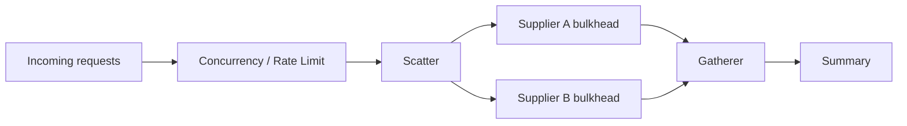

**Không coi dùng executor là tăng throughput vô hạn.** Supplier chậm có thể chiếm worker và làm hàng chờ tăng; nếu không giới hạn, timeout hàng loạt có thể làm overload toàn hệ thống.

### Nên tách tài nguyên theo supplier khi nào?

Nếu supplier B thường phản hồi chậm, một executor dùng chung có thể bị các task B chiếm hết. Tách bulkhead/queue hoặc worker pool theo supplier giúp giảm ảnh hưởng lan truyền, nhưng tăng chi phí vận hành. Lựa chọn phải dựa trên SLA và đo đạc thực tế.

## 27. MessageGroupStore và khả năng phục hồi

Gatherer thường cần lưu những reply đang chờ. Nếu chỉ dùng group store trong RAM, ứng dụng sập trước khi có đủ reply có thể làm mất trạng thái nhóm.

Một yêu cầu bền vững có thể cần:

- Persistent `MessageGroupStore` hoặc state store phù hợp.
- Idempotency của reply/contribution.
- Workflow run ID có scope rõ.
- Chính sách transaction giữa store update và output publish.
- Broker acknowledgement/retry.
- Completion marker cho group đã xong.
- Late message policy.

**Persistent store không tự bảo đảm exactly-once side effect.** Nếu output đã gửi nhưng việc đánh dấu complete thất bại, một group có thể bị xử lý lại. Business handler downstream cần idempotency tương ứng.

### Multi-instance

Nếu reply A tới pod 1 và reply B tới pod 2, hai in-memory group store độc lập sẽ không thấy đủ hai reply. Cần shared store với locking/transaction thích hợp, hoặc route các reply cùng group về cùng partition/consumer theo correlation key.

Một `correlationId` chung **không tự di chuyển** các reply tới cùng node. Cần cơ chế phân vùng hoặc lưu trữ phù hợp ở tầng vận hành.

## 28. Observability: đo cả scatter lẫn gather

Một Recipient List one-way chủ yếu cần theo dõi delivery và processing theo nhánh. Scatter-Gather còn cần biết **group đã thu được bao nhiêu reply và còn thiếu ai**.

| Metric / log | Recipient List | Scatter-Gather |
| --- | --- | --- |
| Số message được phân phối | Quan trọng | Quan trọng |
| Recipient được chọn | Quan trọng | Rất quan trọng để xác định expected |
| Latency từng handler | Theo nhánh | Theo nhánh |
| Error/retry theo recipient | Theo nhánh | Theo nhánh |
| Reply received count | Không phải nghĩa vụ chung | Quan trọng |
| Active gather groups | Không cần mặc định | Quan trọng |
| Gather completion latency | Không có mặc định | Quan trọng |
| Missing recipients | Tùy nghiệp vụ | Quan trọng |
| Partial/timeout result count | Không có mặc định | Quan trọng |
| Duplicate/late reply count | Có thể hữu ích | Quan trọng |

### Log timeline ví dụ

```text
requestId=Q-101 scatterRunId=RUN-701 selected=A,B
stage=SCATTER_DISPATCHED recipients=2

requestId=Q-101 supplier=A stage=REPLY_RECEIVED
group=RUN-701 received=1 expected=2 release=false

requestId=Q-101 supplier=B stage=REPLY_RECEIVED
group=RUN-701 received=2 expected=2 release=true

requestId=Q-101 stage=GATHER_COMPLETED
summary=BEST_SUPPLIER_B complete=true
```

Các dòng là **log ứng dụng minh họa**, không phải Spring Integration tự sinh nguyên văn.

### Correlation giúp giải thích sự chậm trễ

Một trace có thể liên kết:

```text
QuoteGateway
  -> Scatter
       -> Supplier A [100 ms]
       -> Supplier B [450 ms]
  -> Gather [release at 460 ms]
  -> QuoteSummary
```

Không đưa `requestId`, `customerId` hay các ID riêng lẻ vào metric labels gây cardinality cao. Dùng structured logs/traces; không ghi token, thông tin nhạy cảm hoặc toàn bộ response của supplier nếu không cần thiết.

## 29. Các sai lầm thường gặp

### 29.1. Coi Recipient List là Scatter-Gather chỉ vì có fan-out

Fan-out không tự có gatherer, release strategy hay aggregate reply. Định nghĩa rõ output contract.

### 29.2. Dùng Scatter-Gather cho notification không cần reply

Nếu các subscriber chỉ cần ghi log/gửi email, gather là overhead và có thể khiến event bị timeout do một handler `void`. Dùng Recipient List/Publish-Subscribe one-way.

### 29.3. Chờ theo số recipient cấu hình thay vì số đã chọn

Recipient List có selector động. Gatherer đợi ba reply khi chỉ hai recipient được chọn sẽ không hoàn tất đúng.

### 29.4. Đếm thô N reply mà không chống trùng

Hai reply của A không thể thay thế reply của B. Dùng supplier ID hoặc contribution identity duy nhất.

### 29.5. Thiếu reply channel hoặc làm mất headers

Custom Transformer/adapter có thể làm reply không tới gatherer. Kiểm tra propagation và transport mapping.

### 29.6. Một nhánh Filter drop message

Một nhánh được kỳ vọng trả reply nhưng bị Filter loại âm thầm. Cần SupplierOutcome có cấu trúc hoặc partial/timeout policy.

### 29.7. Giả định scatter luôn thực thi đồng thời

Với DirectChannel/handler đồng bộ, tổng độ trễ có thể cao. Muốn parallel execution phải cấu hình executor/adapter.

### 29.8. Nhầm “không có hàng” với “không có reply”

`available=false` là dữ liệu kinh doanh hợp lệ. Timeout là thiếu reply. Hai trường hợp có retry và release policy khác nhau.

### 29.9. Gateway nhận reply của một supplier thay vì summary

Các supplier không nên gửi thẳng về caller nếu yêu cầu gather. Gatherer phải tạo final reply theo contract.

### 29.10. Không xử lý reply muộn

Một supplier trả sau timeout có thể làm phát kết quả thứ hai hoặc tạo group mới. Dùng completion record và late-message policy.

### 29.11. Retry toàn scatter mà không có ID run

Hai lượt scatter có thể lẫn reply. Chốt `scatterRunId`, selected recipients và phiên bản policy.

### 29.12. Coi persistent group store là bảo đảm exactly-once

Store bền vững không thay thế transaction, idempotency và broker acknowledgements.

## 30. Bài thực hành: so sánh hai kiến trúc trong cùng nghiệp vụ

**Bối cảnh:** ứng dụng nhận `TravelBookingRequest` gồm mã hành trình và thời điểm khởi hành. Khi người dùng tìm chuyến, hệ thống hỏi hai nhà cung cấp vé. Khi người dùng đặt vé thành công, hệ thống phát event cho audit và notification.

### Phần A — Recipient List

1. Tạo `BookingCreated` bất biến.
2. Gửi event vào `bookingEvents`.
3. Recipient List chuyển tới `auditEvents` và `notificationEvents`.
4. Thêm selector để notification chỉ nhận khi người dùng cho phép thông báo.
5. Kiểm thử audit luôn nhận; notification chỉ nhận khi đủ điều kiện.
6. Chứng minh không cần một `BookingSummary` thu từ replies.
7. Xử lý exception và retry theo từng subscriber, có idempotency.

### Phần B — Scatter-Gather

1. Tạo `TicketQuoteRequest(requestId, itinerary, passengerCount)`.
2. Chọn supplier A/B/C theo thị trường mà request hỗ trợ.
3. Lưu tập selected suppliers và `scatterRunId`.
4. Gửi request tới các supplier qua scatterer.
5. Mỗi supplier trả `TicketQuoteOutcome` một lần theo contract.
6. Gatherer gom theo run ID.
7. Release chỉ khi đủ supplier được chọn hoặc đến deadline theo partial policy.
8. Output processor chọn giá tốt nhất trong các offer hợp lệ.
9. Gateway trả đúng một `TicketQuoteSummary`.
10. Kiểm thử reply đến sai thứ tự, missing reply, duplicate và request xen kẽ.
11. Đánh giá timeout/I/O budget và concurrency.
12. Nếu lookup kéo dài, chuyển sang workflow có lưu state và reply `PENDING`.

### Bảng kết quả mong đợi

| Tình huống | Recipient List | Scatter-Gather |
| --- | --- | --- |
| Hai subscriber nhận event | Hai nơi nhận message | Chưa đủ để gọi là gather |
| Recipient không trả reply | Có thể hoàn toàn hợp lệ | Có thể gây thiếu contribution |
| A/B trả kết quả giá | Không tự tổng hợp | Gather và tạo summary |
| A đến trước B | Không quan trọng với one-way flow | Chờ release policy |
| Chỉ A được chọn | Chỉ gửi A | Expected count phải là 1 |
| A trả hai reply | Có thể là hai sự kiện khác nhau theo contract | Phải chống duplicate contribution |
| B timeout | Nhánh B xử lý lỗi riêng | Group partial/timeout/recovery |
| Gateway cần một summary | Không mặc định có | Output của gatherer |
| Một reply đến muộn | Tùy recipient workflow | Cần late-message policy |

### Câu hỏi tự đánh giá

**Câu 1.** Recipient List có phải là Scatter-Gather không?

*Không. Recipient List chỉ tập trung xác định và gửi tới tập recipient; Scatter-Gather còn thu và tổng hợp replies theo completion contract. Recipient List có thể được dùng làm scatterer.*

**Câu 2.** Có nên dùng Scatter-Gather khi các nhánh chỉ ghi audit và gửi email `void`?

*Thông thường không. Nếu không cần kết quả tổng hợp, Recipient List hoặc Publish-Subscribe one-way đơn giản hơn.*

**Câu 3.** Nếu cấu hình ba recipient nhưng request chỉ chọn hai, gatherer nên chờ bao nhiêu reply?

*Theo hợp đồng một reply/recipient, nó nên chờ hai. Phải ghi nhận tập recipients thực sự được chọn.*

**Câu 4.** Hai reply từ supplier A có thể thay thế reply của A và B không?

*Không. Cần contribution identity và deduplication; đếm thô hai message có thể release sai.*

**Câu 5.** Khi một supplier không có hàng nhưng trả reply hợp lệ, có tính là đã phản hồi không?

*Có nếu gather contract cần biết kết quả của mỗi supplier; sự không khả dụng là một kết quả nghiệp vụ, khác với timeout không có reply.*

**Câu 6.** Vì sao cần tách `replyChannel` và `businessCorrelationId`?

*Reply channel quyết định nơi phản hồi được gửi; business correlation ID dùng liên kết log và đối soát. Chúng không thay thế nhau.*

## 31. Checklist chọn pattern trước khi triển khai

- **Mục tiêu:** chỉ fan-out hay cần một aggregated result?
- **Recipient selection:** tập recipient cố định hay có điều kiện theo message?
- **Request-reply:** recipient phải trả result hay được phép one-way?
- **Scatterer:** dùng Recipient List Router hay Publish-Subscribe Channel?
- **Expected contributions:** dựa trên selected recipients, không dựa trên số khai báo cố định.
- **Correlation:** có request ID, scatter run ID, group key và reply destination rõ.
- **ReleaseStrategy:** định nghĩa all, quorum, deadline hoặc partial theo nghiệp vụ.
- **Duplicate:** không tính hai reply từ cùng một logical contributor.
- **Missing reply:** có timeout, error outcome và recovery policy.
- **Failure semantics:** phân biệt business negative result và infrastructure exception.
- **Ordering:** không tin reply arrival order; cần sort nếu output đòi.
- **Concurrency:** có executor/bulkhead/backpressure, không giả định luôn chạy song song.
- **Gateway:** chỉ nhận final summary từ gatherer nếu contract yêu cầu.
- **Headers:** giữ metadata phù hợp qua Transformer, Filter, broker, HTTP.
- **Retry:** không trộn kết quả giữa các scatter run hoặc policy version.
- **Durability:** MessageGroupStore/outbox/broker đáp ứng nhu cầu phục hồi.
- **Idempotency:** tại recipient và final output, không chỉ trong gatherer.
- **Observability:** đo dispatched recipients, replies received, group age, timeout, late/duplicate.
- **Testing:** full replies, partial, dynamic selected set, out-of-order, duplicate, two concurrent requests.

## 32. Kết luận

**Recipient List** giải quyết câu hỏi: *“Thông điệp cần được phân phối tới những recipient nào?”* **Scatter-Gather** giải quyết bài toán lớn hơn: *“Gửi yêu cầu tới các recipient rồi thu những reply nào, nhóm theo khóa nào và khi nào tạo một kết quả tổng hợp?”*

Trong Spring Integration, Recipient List Router hoặc Publish-Subscribe Channel có thể đóng vai trò **scatterer**. Điểm biến nó thành Scatter-Gather là **gatherer, correlation, release strategy và final reply contract**.

Vì vậy, hãy chọn Recipient List cho fan-out một chiều như Audit/Notification; chọn Scatter-Gather khi kết quả từ nhiều nguồn phải được so sánh hoặc kết hợp. Khi có recipient động, asynchronous execution, retry và lỗi nhánh, cần chốt tập đóng góp kỳ vọng, chống trùng, xử lý timeout/late replies và theo dõi lifecycle của từng nhóm.

Hiểu rõ ranh giới này giúp xây dựng các pipeline EIP ít phụ thuộc, có thể mở rộng và vẫn kiểm thử, đối soát được cả **việc phân phối** lẫn **việc tổng hợp kết quả**.
