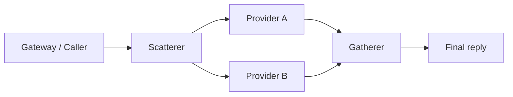
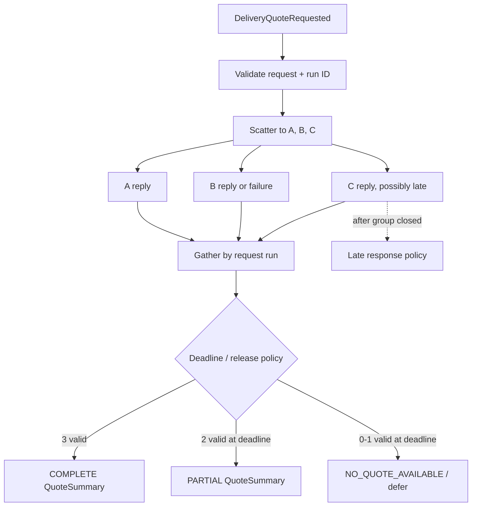

# Kiểm thử đầy đủ, thiếu và quá hạn reply

Trong mẫu **Scatter–Gather** của Enterprise Integration Patterns (EIP), một request được phát tới nhiều recipient (*scatter*) và hệ thống chờ các reply để tạo một kết quả tổng hợp (*gather*). Một bài kiểm thử chỉ chứng minh rằng **tất cả recipient đều trả lời đúng lúc** là chưa đủ. Trong production, một nhánh có thể trả `null`, bị Filter loại, timeout, trả reply trễ, ném exception hoặc gửi lại cùng response khi retry. Nếu không kiểm thử những trường hợp đó, Gatherer có thể **chờ mãi**, phát kết quả **thiếu dữ liệu**, **release quá sớm** hoặc phát **hai kết quả cho cùng một request**.

Bài này thuộc chương **Scatter gather** của module `SPRING_INTEGRATION_PATTERN`, hướng tới việc triển khai Spring Integration và các mẫu Router, Filter, Transformer, Splitter, Aggregator, Gateway, retry, error channel và correlation để xây dựng luồng thông điệp ít phụ thuộc, dễ mở rộng, kiểm thử được từng nhánh và giám sát được điểm nghẽn.

Trọng tâm của bài là **kiểm thử ba trạng thái cốt lõi của reply**:

1. **Đầy đủ:** tất cả reply hợp lệ của những recipient được kỳ vọng đều đến trong hạn.
2. **Thiếu:** một hoặc nhiều recipient không gửi reply, gửi lỗi, hoặc bị loại khỏi flow.
3. **Quá hạn:** reply hoặc group hoàn tất sau deadline, có thể đến **sau khi caller đã timeout** hoặc sau khi Gatherer đã release/expire group.

Sau bài học, bạn có thể thiết kế dữ liệu test, chọn chỗ đặt timeout, viết các test có giới hạn thời gian, xây dựng policy xử lý partial/late response, kiểm tra correlation và duplicate, và phân biệt một **test logic điều phối** với một **test tích hợp Spring Integration thật**.

## 1. Tại sao happy-path test không đủ?

Giả sử một hệ thống cần báo giá giao hàng từ hai nhà vận chuyển `A` và `B`:

```text
QuoteRequest(requestId=Q-101)
             |
             v
          Scatter
          /     \
         A       B
         |       |
       25.000  28.000
          \     /
           Gather
             |
             v
     QuoteSummary(Q-101)
```

Kịch bản lý tưởng có hai kết quả hợp lệ. Nhưng hệ thống thực tế có thể thấy:

| Kịch bản | Dữ liệu nhận được | Vấn đề phải kiểm thử |
| --- | --- | --- |
| **FULL** | A và B trả reply trong deadline. | Group được release một lần, đúng request, đủ hai nguồn. |
| **MISSING** | Chỉ A trả; B không có reply. | Không tạo kết quả hoàn chỉnh sai; không treo vô hạn. |
| **TIMEOUT** | B trả sau deadline. | Policy xác định rõ B bị coi là late, không tạo summary thứ hai. |
| **DUPLICATE** | A trả hai lần; B chưa trả. | Không coi `A + A` thành hai recipient hợp lệ. |
| **ERROR** | A thành công, B ném exception. | Exception có biến thành failure response không hay group vẫn thiếu? |
| **WRONG_CORRELATION** | A thuộc Q-101, B thuộc Q-102. | Không trộn response của hai request. |
| **INVALID_REPLY** | B trả dữ liệu không đúng schema/đơn vị. | Không tạo tổng hợp nghiệp vụ sai dù count đã đủ. |
| **CANCELLED** | Caller đã hủy/hết hạn, provider tiếp tục trả. | Late reply được quan sát và xử lý theo chính sách. |

**Đừng đồng nhất `send()` thành công với “đã nhận đủ replies”.** `MessageChannel.send(...)` xác nhận một thao tác gửi ở ranh giới channel theo semantics của channel đó. Nó không tự chứng minh remote provider đã trả lời, Aggregator đã release, kết quả đã được ghi bền vững hoặc caller đã nhận response.

## 2. Mô hình thời gian: ba deadline khác nhau

Một flow Scatter–Gather có thể có ít nhất ba giới hạn thời gian:



| Đồng hồ | Kiểm soát điều gì? | Khi hết thời gian |
| --- | --- | --- |
| **Provider timeout** | Một lời gọi HTTP/JDBC/remote gateway tới từng provider. | Nhánh cần retry có giới hạn, trả failure outcome hoặc thông báo lỗi. |
| **Gather/group timeout** | Một nhóm được phép chờ bao lâu để đủ các reply. | Group có thể expire, release partial hoặc fail theo cấu hình. |
| **Caller/Gateway reply timeout** | Caller sẽ chờ một kết quả tổng hợp trong bao lâu. | Caller có thể ngừng chờ, **không mặc nhiên hủy các worker hoặc group**. |

Ví dụ thiết kế:

```text
t0       Gateway nhận request Q-201
t0+20ms  Scatterer gửi tới A và B
t0+80ms  A trả reply
t0+300ms B client timeout
t0+450ms Gather deadline hết hạn
t0+500ms Gateway reply timeout
t0+700ms B trả reply muộn do thao tác đã hoàn tất ở xa
```

**Số liệu chỉ minh họa.** Điểm quan trọng là các sự kiện tách biệt: B có thể bị client coi là timeout nhưng vẫn hoàn tất ở phía remote; Gatherer có thể expire trước/đúng/sau deadline của Gateway; một reply đến muộn không tự biến thành một response hợp lệ.

### Deadline tuyệt đối và thời gian chờ tương đối

Trong kiểm thử, nên định nghĩa:

```text
startedAt = 2026-11-21T08:00:00Z
deadline  = startedAt + 500 ms
```

Thay vì cộng dồn nhiều `Thread.sleep(...)`, sử dụng **`Clock` hoặc `Instant` do test kiểm soát** cho phần chính sách. Với những timer thật của framework, kiểm thử có timeout hữu hạn và buffer hợp lý để giảm flaky test. Một timeout ở client thực cần được cấu hình trên chính client, không chỉ trong test.

## 3. Correlation: đủ hai reply nhưng sai request vẫn là lỗi

Một reply hợp lệ phải **thuộc đúng lượt request**. Nếu hai request Q-301 và Q-302 chạy song song:

```text
t1  A trả Q-302
t2  A trả Q-301
t3  B trả Q-302
t4  B trả Q-301
```

Gatherer phải tạo:

```text
Summary Q-301 = {A/Q-301, B/Q-301}
Summary Q-302 = {A/Q-302, B/Q-302}
```

Không phải `{A/Q-302, A/Q-301}` chỉ vì hai message đến trước.

| Giá trị | Ý nghĩa | Dùng trong test thế nào? |
| --- | --- | --- |
| `requestId` trong payload | ID nghiệp vụ do ứng dụng định nghĩa. | Assert mọi response trong summary có đúng request ID. |
| `requestRunId` | ID một lần thực thi/scatter cụ thể. | Phân biệt retry/replay ở mức run nếu hợp đồng cần. |
| `correlationId` | Group key mà Aggregator dùng để gom. | Assert các reply của cùng run được nhóm, run khác không lẫn. |
| `sequenceNumber` | Vị trí nhánh/sequence được đánh dấu. | Kiểm tra hợp lệ, không dùng thay recipient identity. |
| `sequenceSize` | Số phần tử kỳ vọng khi biết. | Không xem count như bằng chứng chống duplicate. |
| `replyChannel` | Đích phản hồi cho cơ chế request–reply. | Assert kết quả cuối về đúng Gateway/output; không dùng làm group key. |
| `MessageHeaders.id` | ID một Spring message. | Không coi là khóa idempotency bền vững qua replay. |

Trong Spring Integration, scatterer và Gatherer có thể tạo hoặc truyền metadata tương quan theo endpoint được dùng. **Không nên hard-code** rằng `correlationId` luôn bằng `requestId`: hãy kiểm tra đúng topology và kiểm thử quan hệ giữa các message. Khi qua broker, có thể cần envelope riêng để tái tạo group identity.

## 4. Định nghĩa contract cho ba kết quả kiểm thử

Để test rõ ràng, một request cần công bố **tập recipient thực sự được kỳ vọng** và một deadline có ý nghĩa.

```java
import java.util.Set;

record QuoteRequest(
        String requestId,
        String requestRunId,
        String sku,
        Set<String> expectedProviders
) {
    QuoteRequest {
        expectedProviders = Set.copyOf(expectedProviders);
    }
}

record ProviderQuote(
        String requestId,
        String requestRunId,
        String providerId,
        long amountMinorUnits,
        String currencyCode
) {}

enum GatherStatus {
    PENDING,
    COMPLETE,
    TIMED_OUT
}
```

Các kiểu này là **contract minh họa của ứng dụng**, không phải Spring Integration tự tạo. Hãy quyết định semantics trước khi viết test:

- **COMPLETE:** nhận đủ một response hợp lệ của từng provider trong `expectedProviders` **trước deadline**.
- **PENDING:** chưa nhận đủ và **chưa quá deadline**.
- **TIMED_OUT:** deadline đã đến mà vẫn thiếu provider; nhóm được đóng theo policy kiểm thử.
- **LATE:** response đến khi group đã đóng hoặc tại/sau deadline.
- **DUPLICATE:** cùng provider đã có response hợp lệ trong lượt request.
- **WRONG_GROUP:** response không khớp `requestId`/`requestRunId` của nhóm.

Nếu sản phẩm cho phép **partial result**, nó phải là một hợp đồng bổ sung — ví dụ `QuoteSummary(complete=false, missingProviders=...)` — chứ không được dùng cùng một trạng thái `COMPLETE` cho cả kết quả đủ và thiếu.

## 5. Thiết kế oracle kiểm thử độc lập với framework

Một test tốt cần biết **đúng sai được xác định ở đâu**. Không nên để test kiểm tra “framework trả gì thì đó là expected”. Với Scatter–Gather, ta có thể xây một **oracle** đơn giản:

```text
expected = {A, B}
received = {}
deadline = t0 + 500ms

on(A, t0+100ms):
  received = {A}
  status = PENDING

on(B, t0+200ms):
  received = {A, B}
  status = COMPLETE

on(B, t0+700ms) after timeout:
  status remains TIMED_OUT if the group was previously closed
  response classified as LATE
```

Oracle mô tả **chính sách của sản phẩm**, không phải cơ chế scheduler nội bộ của Spring Integration. Khi test một flow thật, dùng oracle để assert output/side effects và so sánh trạng thái thực tế với chính sách đã chọn.

### Tại sao cần xác định thời điểm đúng biên?

Nếu deadline là `t0+500ms`, phải định nghĩa reply tới **đúng** `t0+500ms` được coi là đúng hạn hay quá hạn. Trong bài này, quy ước minh họa là:

```text
accepted if receivedAt < deadline
late     if receivedAt >= deadline
```

Quy ước khác có thể hợp lệ, nhưng test cần kiểm tra **cả trước hạn, đúng hạn và sau hạn** để không có khoảng mơ hồ ở biên.

## 6. Lớp kiểm thử chính sách dùng thời gian giả lập

Để test ba trạng thái mà không phải ngủ chờ, ta xây một bộ trạng thái thuần Java nhận `Instant now` tường minh. Đây là **model nghiệp vụ cho test và thiết kế**, không phải class của Spring Integration, không tự tạo thread hay hẹn giờ.

```java
import java.time.Instant;
import java.util.ArrayList;
import java.util.HashMap;
import java.util.HashSet;
import java.util.List;
import java.util.Map;
import java.util.Set;

enum ReceiveStatus {
    ACCEPTED,
    COMPLETE,
    DUPLICATE,
    LATE
}

record GatherView(
        GatherStatus status,
        Set<String> receivedProviders,
        Set<String> missingProviders,
        List<ProviderQuote> quotes
) {}

final class QuoteGatherState {
    private final String requestId;
    private final String runId;
    private final Set<String> expected;
    private final Instant deadline;
    private final Map<String, ProviderQuote> replies = new HashMap<>();

    private boolean closed;
    private GatherStatus finalStatus;

    QuoteGatherState(
            String requestId,
            String runId,
            Set<String> expectedProviders,
            Instant deadline) {

        if (requestId == null || requestId.isBlank()
                || runId == null || runId.isBlank()
                || expectedProviders == null || expectedProviders.isEmpty()
                || deadline == null) {
            throw new IllegalArgumentException("INVALID_GATHER_CONTRACT");
        }
        this.requestId = requestId;
        this.runId = runId;
        this.expected = Set.copyOf(expectedProviders);
        this.deadline = deadline;
    }

    synchronized ReceiveStatus onReply(ProviderQuote reply, Instant now) {
        if (reply == null || now == null) {
            throw new IllegalArgumentException("INVALID_REPLY");
        }
        if (!requestId.equals(reply.requestId())
                || !runId.equals(reply.requestRunId())
                || !expected.contains(reply.providerId())) {
            throw new IllegalArgumentException("WRONG_REQUEST_OR_PROVIDER");
        }

        expireIfNeeded(now);
        if (closed) {
            return ReceiveStatus.LATE;
        }
        if (replies.containsKey(reply.providerId())) {
            return ReceiveStatus.DUPLICATE;
        }
        if (reply.amountMinorUnits() <= 0
                || !"VND".equals(reply.currencyCode())) {
            throw new IllegalArgumentException("INVALID_QUOTE_CONTRACT");
        }

        replies.put(reply.providerId(), reply);
        if (replies.keySet().containsAll(expected)) {
            closed = true;
            finalStatus = GatherStatus.COMPLETE;
            return ReceiveStatus.COMPLETE;
        }
        return ReceiveStatus.ACCEPTED;
    }

    synchronized GatherView snapshot(Instant now) {
        if (now == null) {
            throw new IllegalArgumentException("CLOCK_REQUIRED");
        }
        expireIfNeeded(now);

        Set<String> missing = new HashSet<>(expected);
        missing.removeAll(replies.keySet());

        List<ProviderQuote> ordered = new ArrayList<>(replies.values());
        ordered.sort(java.util.Comparator.comparing(
                ProviderQuote::providerId));

        GatherStatus status = closed ? finalStatus : GatherStatus.PENDING;
        return new GatherView(
                status,
                Set.copyOf(replies.keySet()),
                Set.copyOf(missing),
                List.copyOf(ordered));
    }

    private void expireIfNeeded(Instant now) {
        if (!closed && !now.isBefore(deadline)) {
            closed = true;
            finalStatus = GatherStatus.TIMED_OUT;
        }
    }
}
```

**Những giới hạn quan trọng của model này:**

1. Nó được dùng làm **oracle và policy ví dụ**, không tuyên bố phản ánh 100% hành vi `ScatterGatherHandler` hoặc `MessageGroupStore` trong mọi phiên bản.
2. `snapshot(now)` kiểm tra deadline **khi được gọi**; nó không tự lập lịch hết hạn. Trong Spring Integration thật, timeout/expiry cần được cấu hình trên endpoint hoặc scheduler/store phù hợp.
3. `onReply()` bảo vệ method trong **một instance** bằng `synchronized`. Nó không tự bảo đảm atomicity giữa nhiều JVM.
4. `closed` ngăn thêm response sau khi group hoàn tất/quá hạn, nhưng chưa có **persistent closed-group tombstone**; restart có thể làm mất trạng thái nếu chỉ dùng memory.
5. Payload được kiểm tra đơn giản với `VND`; production cần contract về currency, schema, số tiền và tính hợp lệ của nhà cung cấp.
6. Một reply sau group `COMPLETE` được trả `LATE` để tránh sửa summary đã công bố; một sản phẩm khác có thể định nghĩa `DUPLICATE_AFTER_COMPLETE` riêng.

Sự tách biệt giữa **đúng logic** và **đúng scheduling/transport** giúp unit test nhanh, lặp lại được, sau đó integration test kiểm chứng cách framework thực thi.

## 7. Unit test 1 — đủ reply trước deadline

Kiểm thử nên chứng minh không release sớm sau response đầu, nhưng release chính xác khi đủ A và B:

```java
import static org.junit.jupiter.api.Assertions.assertEquals;
import static org.junit.jupiter.api.Assertions.assertTrue;

import java.time.Instant;
import java.util.Set;

import org.junit.jupiter.api.Test;

class QuoteGatherStateTest {

    private static final Instant T0 =
            Instant.parse("2026-11-21T08:00:00Z");

    private static ProviderQuote quote(
            String requestId, String provider, long amount) {
        return new ProviderQuote(
                requestId, requestId + "/run-1",
                provider, amount, "VND");
    }

    @Test
    void completeOnlyAfterAllExpectedProvidersReply() {
        QuoteGatherState group = new QuoteGatherState(
                "Q-101", "Q-101/run-1",
                Set.of("A", "B"), T0.plusMillis(500));

        assertEquals(ReceiveStatus.ACCEPTED,
                group.onReply(quote("Q-101", "B", 24_000),
                        T0.plusMillis(80)));
        assertEquals(GatherStatus.PENDING,
                group.snapshot(T0.plusMillis(100)).status());

        assertEquals(ReceiveStatus.COMPLETE,
                group.onReply(quote("Q-101", "A", 25_000),
                        T0.plusMillis(200)));

        GatherView view = group.snapshot(T0.plusMillis(250));
        assertEquals(GatherStatus.COMPLETE, view.status());
        assertTrue(view.missingProviders().isEmpty());
        assertEquals(2, view.quotes().size());
        assertEquals("A", view.quotes().get(0).providerId());
        assertEquals("B", view.quotes().get(1).providerId());
    }
}
```

Đây là test **đảo thứ tự reply** (B đến trước A). Không được chỉ assert `quotes.size()==2`: còn cần kiểm tra **source identity**, group identity và deadline. Khi flow có side effect downstream, cần kiểm tra summary/command cuối **chỉ được phát một lần**.

## 8. Unit test 2 — thiếu một reply trong thời hạn

Một recipient không reply không nhất thiết là exception. Có thể nhánh đã nhận request nhưng trả `null`, Filter từ chối, lỗi remote không được chuyển thành result, hoặc response bị mất trên đường vận chuyển.

```java
@Test
void remainsPendingWhileOneProviderIsMissingBeforeDeadline() {
    QuoteGatherState group = new QuoteGatherState(
            "Q-102", "Q-102/run-1",
            Set.of("A", "B"), T0.plusMillis(500));

    assertEquals(ReceiveStatus.ACCEPTED,
            group.onReply(quote("Q-102", "A", 25_000),
                    T0.plusMillis(100)));

    GatherView view = group.snapshot(T0.plusMillis(499));
    assertEquals(GatherStatus.PENDING, view.status());
    assertEquals(Set.of("A"), view.receivedProviders());
    assertEquals(Set.of("B"), view.missingProviders());
    assertEquals(1, view.quotes().size());
}
```

Test này chứng minh **chưa đủ** không bị đánh đồng với **đã thất bại/đã quá hạn**. Ở một Gatherer mặc định chờ đủ sequence, nhóm vẫn có thể nằm trong store.

### Nếu recipient trả `null`

Trong Spring Integration, một handler request–reply **không tạo reply** nếu nó trả `null` theo semantics endpoint tương ứng. Đừng mặc định `null` trở thành một `Message<null>` hợp lệ để Aggregator đếm. Với một recipient không có response, nhóm có thể thiếu phần tử cho đến khi một policy timeout/expiry được kích hoạt.

Nếu muốn “nhánh này đã hoàn tất nhưng không cung cấp báo giá”, hãy tạo một **outcome có kiểu**:

```java
record ProviderOutcome(
        String requestId,
        String requestRunId,
        String providerId,
        String status,
        Long amountMinorUnits,
        String reasonCode
) {}
```

Ví dụ `status=UNAVAILABLE` là **một response nghiệp vụ có lý do**, còn “không có reply message” nghĩa là Gatherer **chưa nhận được phần tử**.

## 9. Unit test 3 — reply quá hạn và late reply

Khi deadline tới mà thiếu B, test phải xác nhận **TIMED_OUT**. Response B đến sau đó không được biến một nhóm đã đóng thành COMPLETE ngoài ý muốn.

```java
@Test
void closesOnDeadlineAndRejectsLateReply() {
    QuoteGatherState group = new QuoteGatherState(
            "Q-103", "Q-103/run-1",
            Set.of("A", "B"), T0.plusMillis(500));

    group.onReply(quote("Q-103", "A", 25_000),
            T0.plusMillis(100));

    GatherView expired = group.snapshot(T0.plusMillis(500));
    assertEquals(GatherStatus.TIMED_OUT, expired.status());
    assertEquals(Set.of("B"), expired.missingProviders());

    assertEquals(ReceiveStatus.LATE,
            group.onReply(quote("Q-103", "B", 24_000),
                    T0.plusMillis(700)));

    GatherView afterLate = group.snapshot(T0.plusMillis(800));
    assertEquals(GatherStatus.TIMED_OUT, afterLate.status());
    assertEquals(Set.of("B"), afterLate.missingProviders());
    assertEquals(1, afterLate.quotes().size());
}
```

**Mốc đúng hạn cũng được kiểm tra**: khi `now == deadline`, policy minh họa dùng `!now.isBefore(deadline)` nên nhóm được đánh dấu quá hạn. Một test bổ sung nên gửi B tại `T0+499ms` và xác nhận COMPLETE.

### Không đồng nhất timeout với “provider đã thất bại”

Nếu client hết thời gian chờ, remote provider có thể **vẫn đang xử lý** và cuối cùng phát response hợp lệ. Việc Gatherer từ chối response đến muộn là **chính sách về thời hạn chấp nhận của request**, không phải kết luận provider chưa thực hiện side effect.

Với thao tác tạo booking/charge, phải có idempotency hoặc truy vấn trạng thái, không đơn giản retry toàn bộ scatter sau timeout mà không kiểm tra kết quả trước đó.

## 10. Kiểm thử boundary: ngay trước, đúng và sau deadline

Để phát hiện lỗi so sánh thời gian:

| `receivedAt` | Deadline | Kỳ vọng theo policy `< deadline` |
| --- | --- | --- |
| `t0 + 499 ms` | `t0 + 500 ms` | Chấp nhận reply, nếu đủ thì COMPLETE. |
| `t0 + 500 ms` | `t0 + 500 ms` | LATE/TIMED_OUT nếu chưa complete. |
| `t0 + 501 ms` | `t0 + 500 ms` | LATE/TIMED_OUT. |
| Sau khi group đã COMPLETE | Bất kỳ | Không sửa summary đã phát. |
| Sau khi group đã TIMED_OUT | Bất kỳ | Không biến thành COMPLETE trừ khi có policy re-open được thiết kế riêng. |

**Test model dùng `Instant` nên hoàn toàn deterministic.** Với timer thật của Spring, không nên assert công việc chính xác tại một mili giây trên máy CI: scheduler, thread pool và tải hệ thống có jitter. Hãy dùng buffer thời gian rõ ràng và những điều kiện chờ bounded thay vì sleep rồi suy luận.

## 11. Test duplicate, wrong request và response không hợp lệ

Đủ số message **không bảo đảm đủ số recipient**.

```java
@Test
void duplicateFromSameProviderDoesNotCompleteGroup() {
    QuoteGatherState group = new QuoteGatherState(
            "Q-104", "Q-104/run-1",
            Set.of("A", "B"), T0.plusMillis(500));

    group.onReply(quote("Q-104", "A", 25_000),
            T0.plusMillis(100));

    assertEquals(ReceiveStatus.DUPLICATE,
            group.onReply(quote("Q-104", "A", 25_000),
                    T0.plusMillis(200)));

    GatherView view = group.snapshot(T0.plusMillis(250));
    assertEquals(GatherStatus.PENDING, view.status());
    assertEquals(Set.of("B"), view.missingProviders());
}

@Test
void wrongRequestCannotJoinOtherRequestsGroup() {
    QuoteGatherState group = new QuoteGatherState(
            "Q-105", "Q-105/run-1",
            Set.of("A", "B"), T0.plusMillis(500));

    org.junit.jupiter.api.Assertions.assertThrows(
            IllegalArgumentException.class,
            () -> group.onReply(
                    quote("Q-106", "A", 25_000),
                    T0.plusMillis(100)));
}
```

Trong production, có thể cần phân biệt **duplicate hợp lệ** (cùng kết quả/response ID) với **conflicting duplicate** (cùng provider nhưng báo giá khác). Không chọn âm thầm “bản cuối thắng” khi một kết quả có ảnh hưởng giá/tiền; cần revision/version và điều kiện thay thế có chủ đích.

### Test response sai schema

Nên thêm test `amountMinorUnits<=0`, currency không hỗ trợ, provider ngoài allowlist hoặc thiếu `requestRunId`. **Không tính response sai hợp đồng như một reply hợp lệ** chỉ để release group sớm. Nếu muốn trả lỗi nghiệp vụ, chuyển nó thành `ProviderOutcome(status=INVALID_RESPONSE)` có kiểu sau khi đã validation.

## 12. Integration test Spring Integration: hai recipient cùng process

Các unit test trên chỉ chứng minh **policy**. Ta cần test **Scatterer gửi request, recipient thực sự trả reply, Gatherer gom kết quả** trong một Spring application context.

Dưới đây là cấu hình Java DSL minh họa dùng hai nhánh synchronous. Chú ý API cụ thể của `scatterGather`/spec có thể khác nhau giữa các phiên bản Spring Integration; khi đưa vào dự án thực phải đối chiếu phiên bản và biên dịch/test, không dựa vào bài viết như chứng nhận code đã chạy.

```java
import org.springframework.context.annotation.Bean;
import org.springframework.context.annotation.Configuration;
import org.springframework.integration.aggregator.SimpleSequenceSizeReleaseStrategy;
import org.springframework.integration.channel.DirectChannel;
import org.springframework.integration.channel.QueueChannel;
import org.springframework.integration.config.EnableIntegration;
import org.springframework.integration.dsl.IntegrationFlow;

@Configuration
@EnableIntegration
class QuoteScatterGatherConfig {

    @Bean
    DirectChannel quoteInput() {
        return new DirectChannel();
    }

    @Bean
    DirectChannel providerAInput() {
        return new DirectChannel();
    }

    @Bean
    DirectChannel providerBInput() {
        return new DirectChannel();
    }

    @Bean
    QueueChannel quoteOutput() {
        return new QueueChannel();
    }

    @Bean
    IntegrationFlow providerAFlow() {
        return IntegrationFlow.from("providerAInput")
                .handle(QuoteRequest.class, (request, headers) ->
                        new ProviderQuote(
                                request.requestId(), request.requestRunId(),
                                "A", 25_000, "VND"))
                .get();
    }

    @Bean
    IntegrationFlow providerBFlow() {
        return IntegrationFlow.from("providerBInput")
                .handle(QuoteRequest.class, (request, headers) ->
                        new ProviderQuote(
                                request.requestId(), request.requestRunId(),
                                "B", 28_000, "VND"))
                .get();
    }

    @Bean
    IntegrationFlow quoteScatterGather() {
        return IntegrationFlow.from("quoteInput")
                .scatterGather(
                        scatterer -> scatterer
                                .recipient("providerAInput")
                                .recipient("providerBInput"),
                        gatherer -> gatherer
                                .releaseStrategy(
                                        new SimpleSequenceSizeReleaseStrategy()))
                .channel("quoteOutput")
                .get();
    }
}
```

**Điểm cần hiểu:**

- Scatterer gửi request tới hai recipient; handler mỗi nhánh **trả một `ProviderQuote`**.
- Gatherer nhận các reply theo cơ chế Scatter–Gather và dùng sequence/correlation metadata do flow tạo/truyền.
- `SimpleSequenceSizeReleaseStrategy` minh họa việc chờ số lượng; nó **không tự chống duplicate**. Với nghiệp vụ nhạy cảm phải kiểm tra thêm provider identity.
- `quoteOutput` là `QueueChannel` để test đọc kết quả. Trong môi trường thật, dùng group processor phù hợp tạo **`QuoteSummary`** có định danh và trạng thái rõ ràng.
- Cấu hình này **chưa chủ động thiết kế timeout/partial release**, do đó **không dùng nguyên bản để test một recipient im lặng** mà không có giới hạn chờ.
- Đừng đăng ký cùng lúc một flow thử nghiệm thứ hai cũng tiêu thụ `quoteInput` nếu không chủ động thiết kế topology cạnh tranh.

### Test kết quả đủ

```java
import static org.junit.jupiter.api.Assertions.assertEquals;
import static org.junit.jupiter.api.Assertions.assertNotNull;
import static org.junit.jupiter.api.Assertions.assertTrue;

import java.util.List;

import org.junit.jupiter.api.Test;
import org.springframework.beans.factory.annotation.Autowired;
import org.springframework.beans.factory.annotation.Qualifier;
import org.springframework.integration.channel.QueueChannel;
import org.springframework.messaging.Message;
import org.springframework.messaging.MessageChannel;
import org.springframework.messaging.support.MessageBuilder;
import org.springframework.test.annotation.DirtiesContext;
import org.springframework.test.context.junit.jupiter.SpringJUnitConfig;

@SpringJUnitConfig(QuoteScatterGatherConfig.class)
@DirtiesContext(classMode = DirtiesContext.ClassMode.AFTER_EACH_TEST_METHOD)
class QuoteScatterGatherCompleteTest {

    @Autowired @Qualifier("quoteInput")
    MessageChannel input;

    @Autowired @Qualifier("quoteOutput")
    QueueChannel output;

    @Test
    void receivesBothProviderRepliesBeforeCompleting() {
        var request = new QuoteRequest(
                "Q-201", "Q-201/run-1",
                "SKU-10", java.util.Set.of("A", "B"));

        assertTrue(input.send(
                MessageBuilder.withPayload(request)
                        .setHeader("traceId", "trace-201")
                        .build()));

        Message<?> gathered = output.receive(1_000);
        assertNotNull(gathered);

        // Output mặc định có thể là collection/tập hợp payload
        // tùy Gatherer/group processor đã cấu hình.
        // Trong test production, chuẩn hóa về QuoteSummary và
        // assert request ID, provider identities, count, currency.
    }
}
```

**Không nên chỉ assert `gathered != null` rồi kết luận bài test đã đủ.** Với flow production, cần custom group processor để tạo kết quả có kiểu và assert cụ thể: `requestId`, `requestRunId`, `providerIds={A,B}`, số result hợp lệ, `complete=true` và chỉ **một** final reply. Đoạn test trên chỉ minh họa cách boot flow và kiểm tra một output; phần policy phải được test như các mục 7–11.

## 13. Integration test thiếu reply: không được chờ vô hạn

Ở test thiếu reply, thay provider B bằng nhánh **không tạo response**. Tùy điểm nối, handler có thể `return null`, Filter drop hoặc remote adapter không gửi reply về.

```java
// Fixture có chủ đích: đây là handler one-way của recipient B.
IntegrationFlow.from("providerBInput")
        .handle(QuoteRequest.class, (request, headers) -> {
            // Ghi nhận request đã đến B trong test fixture.
            return null; // Không tạo reply cho Gatherer.
        })
        .get();
```

Đây là **một fixture thay thế** flow `providerBFlow()` trong test context riêng; không đăng ký đồng thời cả hai handler ở cùng input channel nếu muốn mô phỏng B không trả lời một cách chắc chắn.

### Không viết test có nguy cơ treo

Không nên:

```java
// Không nên: có thể treo nếu Gatherer không có timeout/recovery.
input.send(message);
assertNull(output.receive());
```

Thay vào đó:

1. **Cấu hình một timeout hữu hạn** cho cơ chế Gatherer/Scatter–Gather được phiên bản Spring Integration hỗ trợ.
2. Cấu hình **chính sách kết quả khi timeout**: không output, partial output, hoặc exception/error message.
3. Gửi request trong test fixture có quản lý thread nếu lời gọi có thể block.
4. Chờ kết quả bằng `receive(timeoutMillis)` hoặc test utility có timeout rõ ràng.
5. Assert **kết quả cuối theo contract**, không chỉ assert rằng một thread đã hết thời gian.

Ví dụ mẫu kiểm tra cho policy **không phát complete summary khi thiếu B**:

```java
// Pseudocode kiểm thử tích hợp, không phải một test chạy
// được độc lập khi thiếu fixture timeout và named channels.

sendRequestWithFiniteGatherDeadline("Q-MISSING");

Message<?> complete = quoteOutput.receive(300);
// Khi policy không phát partial result trước deadline:
assertNull(complete);

// Sau đó cần kiểm tra trạng thái group / expiry / error flow
// theo cấu hình, không kết luận chỉ từ output == null.
assertEquals(1, observedRepliesFrom("Q-MISSING"));
assertEquals(1, missingRecipientsFor("Q-MISSING").size());
```

`sendRequestWithFiniteGatherDeadline`, `observedRepliesFrom`, `missingRecipientsFor` là **hàm kiểm thử giả lập** cần được người triển khai xây dựng, **không phải API Spring Integration**. Ví dụ nhằm mô tả assertion cần có, không giả vờ rằng một `receive()` timeout đã chứng minh toàn bộ đường lỗi đúng.

### Kết quả hợp lệ của test thiếu reply phụ thuộc chính sách

| Chính sách của ứng dụng | Assertion đúng |
| --- | --- |
| **All-or-nothing** | Không phát `COMPLETE`; phát failure/timeout outcome hoặc error response theo contract. |
| **Partial allowed** | Phát `QuoteSummary(complete=false, expected=2, received=1)` khi đến deadline. |
| **Durable defer** | Ghi request vào nơi chờ phục hồi; chưa ACK nguồn nếu hợp đồng yêu cầu. |
| **Failure-as-response** | B được biểu diễn thành `ProviderUnavailable`; Gatherer nhận đủ hai outcomes và release có trạng thái phù hợp. |

Không có một kết quả mặc định đúng cho mọi sản phẩm. **Test cần nêu policy trước rồi mới assert framework**.

## 14. Integration test quá hạn reply: phân biệt “late” với “missing”

Kịch bản **missing** quan sát trạng thái *chưa nhận được*. Kịch bản **late** còn có một sự kiện mới: response thực sự đến **sau khi group/caller đã hết hạn**.

Một test tốt phải điều khiển **thời điểm cho phép provider B trả lời**, không dựa vào việc máy CI có chậm hay không.

### Test fixture dùng latch

```java
import java.util.concurrent.CountDownLatch;
import java.util.concurrent.TimeUnit;

final class DelayedProviderFixture {
    private final CountDownLatch invoked = new CountDownLatch(1);
    private final CountDownLatch allowReply = new CountDownLatch(1);

    ProviderQuote handle(QuoteRequest request) {
        invoked.countDown();

        try {
            if (!allowReply.await(2, TimeUnit.SECONDS)) {
                throw new IllegalStateException("TEST_FIXTURE_NOT_RELEASED");
            }
        } catch (InterruptedException e) {
            Thread.currentThread().interrupt();
            throw new IllegalStateException("TEST_INTERRUPTED", e);
        }

        return new ProviderQuote(
                request.requestId(), request.requestRunId(),
                "B", 28_000, "VND");
    }

    boolean awaitInvocation() throws InterruptedException {
        return invoked.await(1, TimeUnit.SECONDS);
    }

    void releaseReply() {
        allowReply.countDown();
    }
}
```

**Fixture này chỉ có tác dụng** nếu nhánh xử lý B thực sự chạy trên thread/executor riêng hoặc qua adapter bất đồng bộ. Nếu gọi `handle()` đồng bộ trên thread đang gửi request, chính sender sẽ bị block tại `await()` và test có thể không đi đến bước phát lệnh `releaseReply()`. Cần cấu hình một executor/test worker riêng hoặc dùng mock remote adapter thích hợp.

### Trình tự test late reply

```text
1. Khởi tạo context với B có thể bị chặn bởi latch.
2. Gửi Q-LATE qua một lời gọi không làm treo thread test.
3. Chờ fixture xác nhận B đã nhận request.
4. Kích hoạt/đợi Gatherer hết deadline trong test có giới hạn.
5. Assert group = TIMED_OUT hoặc đã phát partial/failure outcome.
6. Mở latch cho B trả reply.
7. Assert reply B được xử lý theo late-arrival policy.
8. Assert không có COMPLETE summary thứ hai và không có side effect trùng.
9. Cleanup executor/latch/context dù assertion trước đó thất bại.
```

Phần **hết deadline** nên được kiểm soát bởi fake clock/test scheduler khi kiến trúc cho phép; nếu cần timer thật, sử dụng timeout **có buffer hợp lý** và test cleanup chắc chắn. `Thread.sleep(1000)` rồi assert “reply chắc chắn tới muộn” là một nguồn flaky test điển hình.

### Test phải kiểm tra điều gì sau khi B đến muộn?

Không chỉ kiểm tra output queue rỗng. Cần quan sát ít nhất một cơ chế:

- Counter/log `lateReply` hoặc một late-response channel.
- Group store/tombstone cho biết group đã đóng.
- Output summary count không tăng ngoài chính sách.
- Side effect downstream không bị gọi lại.
- Nếu cho phép *correction*, bản cập nhật phải có `summaryVersion` và trạng thái rõ ràng.

Nếu group bị xóa khỏi store sau khi release, response B có thể bị xử lý như group mới tùy cấu hình. Cần test **trên chính lựa chọn cleanup/expire** của ứng dụng, không chỉ trên một model giả.

## 15. Hạn chế của `assertTimeout` và `Thread.sleep` trong integration test

JUnit 5 có các API như `assertTimeout` và `assertTimeoutPreemptively`, nhưng cần hiểu chúng khi test messaging:

- **`assertTimeout`** kiểm tra thời lượng sau khi đoạn code chạy xong. Nếu code block **treo vô hạn**, nó không tự cắt được block đó ngay khi vượt hạn.
- **`assertTimeoutPreemptively`** chạy phần code trong thread khác để áp đặt hạn, nhưng **interrupt không bảo đảm dừng mọi lời gọi I/O hoặc task downstream**. Nó còn có thể làm khác biệt context/thread-bound transaction so với thực tế.
- **`Thread.sleep`** không tạo đồng bộ hóa có nghĩa; ngủ đủ lâu trên máy cá nhân có thể vẫn không đủ trên CI.
- **`QueueChannel.receive(timeout)`** giúp test không chờ vô hạn, nhưng chỉ quan sát một channel; không chứng minh group expiry, remote cancel hay error route đúng.
- **`CountDownLatch`** giúp điều khiển thứ tự sự kiện, nhưng phải có cleanup trong `finally` và timeout của fixture để tránh giữ thread sau test.

**Đề xuất:** dùng **unit test với `Instant`/Clock** cho deadline policy; dùng **integration test có timeout hữu hạn** để xác minh Spring wiring, group store, error flow và late handling; dùng **end-to-end test với broker/client thật** cho những cam kết giao nhận xuyên process.

## 16. Cấu hình Gatherer khi có partial result và group expiry

Để ứng dụng phát partial result khi không nhận đủ replies, cần thiết kế **hai thứ**:

1. **Khi nào group hết hạn**: một group timeout/expiry policy hoặc một release trigger được framework hỗ trợ.
2. **Tạo output gì khi group hết hạn**: `PartialQuoteSummary`, failure result, event chờ phục hồi hay drop có audit.

Một cấu hình Aggregator trong Spring Integration có thể có các lựa chọn như `groupTimeout`, `sendPartialResultOnExpiry`, `expireGroupsUponCompletion`, `MessageGroupStore` và custom group processor tùy phiên bản.

Ví dụ dưới đây là **phác thảo DSL định hướng**, cần xác minh overload/tên option chính xác và semantics bằng test ở version sử dụng:

```java
// Phác thảo một Gatherer có expiry/partial policy.
// Không ghép trực tiếp với flow mục 12 khi chưa quyết định
// response contract và group-store lifecycle.

gatherer -> gatherer
        .groupTimeout(500)
        .sendPartialResultOnExpiry(true)
        .expireGroupsUponCompletion(true)
        .outputProcessor(customSummaryProcessor)
```

**`customSummaryProcessor` phải phân biệt complete và partial.** Nếu processor chỉ giả định mỗi group luôn có hai reply, rồi ném exception khi còn một reply, bật `sendPartialResultOnExpiry(true)` không tự làm hệ thống có một partial summary hợp lệ.

### Một DTO cho partial output

```java
import java.util.List;
import java.util.Set;

record QuoteSummary(
        String requestId,
        String requestRunId,
        boolean complete,
        int expectedCount,
        int receivedCount,
        Set<String> missingProviders,
        List<ProviderQuote> quotes
) {
    QuoteSummary {
        missingProviders = Set.copyOf(missingProviders);
        quotes = List.copyOf(quotes);
    }
}
```

Các invariants test nên kiểm tra:

- `receivedCount <= expectedCount`.
- `complete=true` chỉ khi **mọi recipient hợp lệ** đã được phản hồi trước deadline.
- `missingProviders` là tập hiệu `expectedProviders - receivedProviders`.
- Không có hai kết quả cho cùng `(requestRunId, summaryVersion)` trừ khi contract cho phép correction.
- Không lẫn các request/tenant khác nhau trong cùng summary.
- Các provider result có currency/schema hợp lệ, không chỉ đủ count.

### Message group store và timer là hai vấn đề

Một persistent `MessageGroupStore` có thể giữ các reply đã nhận qua restart, nhưng **không tự có nghĩa** group sẽ được quét/expire đúng hạn, hoặc summary được gửi exactly-once. Muốn hỗ trợ timeout/restart, cần cấu hình group expiry, scheduler/recovery và transaction/locking tương thích với store. Điều này cần integration test, không suy ra từ việc có một bean lưu trữ.

## 17. Gateway reply timeout khác Gatherer timeout

Một Gateway có thể đợi tối đa 600 ms, trong khi Gatherer cho phép một nhóm chờ 1.000 ms. Khi caller đã nhận timeout:

```text
t0       Gateway gửi request
t0+600ms Gateway hết hạn chờ
t0+800ms Gatherer nhận reply cuối và release summary
```

Kết quả tổng hợp đã hình thành, nhưng caller **không còn chờ theo contract ban đầu**. Bài test phải quyết định late result được lưu trạng thái, phát event hay bỏ, thay vì giả định Gateway sẽ tự nhận sau timeout.

### Kiểm thử cặp timeout không hợp lý

| Cấu hình | Nguy cơ |
| --- | --- |
| Gateway timeout **ngắn hơn** deadline của Gatherer | Caller hết hạn trước khi summary sẵn sàng. |
| Provider timeout **dài hơn** deadline của Gatherer | Provider tiếp tục xử lý dù nhóm đã đóng. |
| Retry của mỗi provider cộng lại **vượt** deadline tổng | Tăng tải và late reply; làm sai kỳ vọng “mọi nhánh đủ trước hạn”. |
| Không có deadline cho group | Một recipient mất reply khiến state/queue tích lũy vô hạn. |

Các test nên gắn rõ **time budget** vào từng stage; không mặc định cấu hình chỉ một timeout sẽ giải quyết tất cả.

### Khi nên đổi sang async API

Nếu nghiệp vụ có thể chờ hàng phút hoặc vài giờ, request–reply đồng bộ qua HTTP Gateway thường không phù hợp. Có thể trả `ACCEPTED_FOR_PROCESSING` cùng `requestId`, lưu tiến trình bền vững và cung cấp **status query/event kết quả**. Một Scatter–Gather nội bộ không tự cung cấp workflow bền vững.

## 18. Lỗi recipient: failure-as-response hay exception?

Một recipient B có thể không trả lời vì:

- **Business failure**: nhà cung cấp từ chối báo giá.
- **Technical failure**: HTTP 503/timeout.
- **Contract failure**: response JSON sai schema.
- **No reply**: handler trả `null` hoặc không phát output.
- **Rejected path**: Filter loại request trước khi gọi B.

Nếu Gatherer cần biết **B đã kết thúc nhưng không có báo giá**, tạo **một outcome có kiểu** có thể là phương án tốt:

```java
record ProviderOutcome(
        String requestId,
        String requestRunId,
        String providerId,
        OutcomeStatus status,
        ProviderQuote quote,
        String reasonCode
) {}

enum OutcomeStatus {
    QUOTED,
    DECLINED,
    UNAVAILABLE,
    INVALID_RESPONSE
}
```

Một `ProviderOutcome(status=UNAVAILABLE)` vẫn có thể được tính là **một reply của B** theo release policy, nhưng summary không được ngụy trang `QUOTED` hoặc `COMPLETE_SUCCESS` nếu đó không phải kết quả nghiệp vụ thật.

### Khi exception không được biến thành reply

Nếu handler ném exception trên `DirectChannel`, lỗi có thể lan về sender. Với executor/poller/broker, có thể có error handler và `errorChannel` nếu cấu hình phù hợp. **Không tự giả định** một `ErrorMessage` được gửi cho global error channel sẽ tự đến Gatherer như một response của B.

Để bảo toàn correlation, recovery flow phải tạo **`ProviderOutcome` có request/run/recipient và metadata nhóm phù hợp**, hoặc đi vào một nhánh khác đã được thiết kế để close/expire group.

### Retry phải có deadline và idempotency

Nếu B bị timeout sau khi đã tạo booking hoặc charge ở xa, retry toàn bộ scatter có thể lặp side effect của cả A và B. Cần khóa idempotency bền vững và lựa chọn retry **theo recipient** khi phù hợp. Không dùng `MessageHeaders.id` của lần gửi như khóa bền vững duy nhất khi broker redelivery.

## 19. Bảo vệ correlation khi qua Router, Transformer, Splitter và broker

**Router:** Scatterer có thể chọn số lượng recipient khác nhau theo vùng; `expectedProviders` phải phản ánh **tập thực tế đã gửi**. Không hard-code mọi group là 2 nếu có request dùng 3 recipient.

**Transformer:** Một worker đổi `QuoteRequest` thành `ProviderQuote`. Nếu tự tạo `MessageBuilder.withPayload(reply).build()` và không truyền các header cần thiết, `correlationId`/`replyChannel` có thể bị mất; test trên boundary. Ngược lại, đừng copy toàn bộ header từ nguồn không tin cậy khi có quyền/route nội bộ.

**Filter:** Nếu một recipient bị Filter trả `false`, group vẫn có thể chờ reply cho recipient đó. Cần `ProviderSkipped`/`ProviderUnavailable` hoặc partial/failure policy.

**Splitter:** Nếu một provider tự tách request thành nhiều subtask, cần gom **kết quả bên trong provider** trước khi trả **một outcome** cho outer Scatter–Gather, hoặc thiết kế correlation nhiều tầng. Đừng dùng `sequenceSize` của tầng trong để release group tầng ngoài.

**Broker/HTTP:** Qua Kafka, AMQP hoặc REST, Spring headers không tự được serialize và khôi phục đầy đủ. Nên có **application envelope** chứa `requestId`, `requestRunId`, `recipientId`, `responseId` và expected-set/version phù hợp. Inbound adapter ánh xạ vào correlation strategy, không tin raw external headers như bằng chứng quyền.

```json
{
  "requestId": "Q-901",
  "requestRunId": "Q-901/run-1",
  "recipientId": "A",
  "responseId": "R-901-A-1",
  "outcome": "QUOTED",
  "amountMinorUnits": 25000,
  "currencyCode": "VND"
}
```

Đây là **schema minh họa của ứng dụng**, không phải định dạng mặc định của Spring Integration. Việc duplicate/replay phải được kiểm soát trên `responseId` hoặc khóa nghiệp vụ thích hợp. Với nhiều tenant, cần tenant-scoped correlation key và xác thực nguồn để tránh trộn response khác chủ thể.

## 20. Kiểm thử restart, late arrival và nhiều instance

Test cùng JVM với `QueueChannel` không đủ để kết luận flow sẽ phục hồi sau crash hoặc xử lý đúng nhiều replica. Nếu yêu cầu cao, hãy kiểm thử thêm:

```text
1. Nhận A/Q-1001, lưu group state.
2. Restart application / consumer.
3. Nhận B/Q-1001.
4. Xác nhận summary được tạo chính xác một lần.
5. Redeliver A/Q-1001 sau summary.
6. Xác nhận duplicate/late policy giữ nguyên tính đúng đắn.
```

### In-memory và persistent group store

| Vấn đề | In-memory | Persistent store với cấu hình đúng |
| --- | --- | --- |
| Group qua restart | Thường không còn. | Có khả năng phục hồi state. |
| Multi-instance | State không tự chia sẻ. | Có thể dùng chung nếu store và locking phù hợp. |
| Group expiry | Vẫn cần scheduler/policy. | Vẫn cần scheduler/policy và xử lý transaction. |
| Duplicate | Không tự chống duplicate. | **Cũng không tự chống** duplicate nghiệp vụ. |
| Exactly-once side effects | Không được bảo đảm. | Không được tự bảo đảm bởi store. |

Nếu các response của cùng group phân bố tới ba JVM nhưng mỗi instance có store riêng, không instance nào nhất thiết nhận đủ. Cần group affinity/partitioning hoặc store dùng chung kèm locking. Với tác vụ nhạy cảm, phải chứng minh correlation và idempotency trong test qua broker/store thật.

### Late response sau group cleanup

Một reply B có thể tới sau khi group partial đã bị xóa. Nếu nó tạo group mới, hệ thống có thể sinh summary thứ hai hoặc lưu một group không bao giờ hoàn tất. Test phải đo **số summary cuối**, trạng thái idempotency, group count và late counter, không chỉ payload của message cuối cùng.

## 21. Quan sát và chống flaky test

Một suite kiểm thử Scatter–Gather nên đo **tiến trình group**, không chỉ throughput tổng:

| Metric minh họa | Mục đích |
| --- | --- |
| `scatter_request_total` | Số lượt request phát tới các recipient. |
| `scatter_recipient_dispatched_total{recipient}` | Số lần gửi tới từng recipient. |
| `gather_reply_received_total{recipient,status}` | Số reply nhận được theo nhánh/outcome. |
| `gather_group_open` | Số group còn chờ. |
| `gather_group_complete_total` | Group đầy đủ được release. |
| `gather_group_partial_total` | Group partial được phát theo policy. |
| `gather_group_timeout_total` | Group quá hạn. |
| `gather_reply_late_total` | Reply đến sau khi group đã đóng. |
| `gather_reply_duplicate_total` | Reply trùng recipient/run. |
| `gather_group_age_seconds` | Thời gian chờ của group còn mở. |

Các tên metric là **ví dụ tự instrument**, không phải Spring Integration tự bảo đảm cung cấp đúng các tên trên. Không đưa `requestId`, `responseId`, `traceId` hoặc customer ID vào metric label vì high cardinality và rò rỉ dữ liệu.

Ví dụ log:

```text
requestRunId=Q-103/run-1 expected=2 received=1
status=TIMED_OUT missingProviders=B
deadline=2026-11-21T08:00:00.500Z

requestRunId=Q-103/run-1 provider=B
status=LATE receivedAt=2026-11-21T08:00:00.700Z
```

Khi test lỗi không ổn định, hãy thu thập **timeline sự kiện**, trạng thái group store, queue size, thread/executor trạng thái, số lần retry, deadline thực và error channel. Đừng sửa test bằng cách tăng `Thread.sleep` vô hạn: hãy tìm nguyên nhân về synchronization và time budget.

### Quy tắc giúp suite đáng tin

1. **Unit policy dùng fake clock hoặc Instant tường minh**; không chạy timer thật cho logic biên deadline.
2. **Integration test có timeout hữu hạn** cho mọi `receive`, latch và remote call.
3. **Mỗi test có state riêng** hoặc reset group store, queues và mocks; `@DirtiesContext` là một cách đơn giản nhưng có chi phí.
4. **Đóng resource sau test**: executor, scheduler, temporary broker/containers, latch, subscription.
5. **Không assert thứ tự arrival** của các nhánh bất đồng bộ nếu hợp đồng không bảo đảm.
6. **Assert identity chứ không chỉ count**: request ID, run ID, provider ID, response ID, status và số summary đã xuất.
7. **Test đúng failure policy**: full, partial, no-result/error, late/correction — không cho một test nhận nhiều outcome bất kỳ.
8. **Theo dõi cả side effect**: không chỉ output DTO mà cả số lần gọi handler hoặc ghi store nếu điều đó quan trọng.

## 22. Ma trận kiểm thử đầy đủ cho Scatter–Gather

| Ca | Input/tình huống | Assertion tối thiểu |
| --- | --- | --- |
| FULL-01 | A rồi B trước deadline | COMPLETE, đủ A/B, đúng request, một output. |
| FULL-02 | B rồi A trước deadline | Như FULL-01, không phụ thuộc arrival order. |
| FULL-03 | Hai request xen kẽ | Không trộn group; hai output độc lập. |
| MISSING-01 | Chỉ A trả, trước deadline | PENDING, missing={B}, không complete output. |
| MISSING-02 | B handler trả `null` | No-reply policy đúng; không đếm `null` như reply. |
| MISSING-03 | Filter loại B | Discard/failure-result policy rõ, group không treo vô hạn. |
| TIMEOUT-01 | Thiếu B khi tới deadline | TIMED_OUT hoặc partial/fail output đúng policy. |
| TIMEOUT-02 | B trả đúng deadline | Biên inclusive/exclusive được kiểm tra rõ. |
| LATE-01 | B trả sau expiry | Late được ghi nhận, không sinh complete summary sai. |
| LATE-02 | B trả sau Gateway timeout | Không gửi nhầm cho request khác, có recovery. |
| DUP-01 | A trả hai lần, B thiếu | Không release sớm theo count=2. |
| DUP-02 | Response trùng sau completion | Không tạo side effect/summary lần hai. |
| ERROR-01 | B ném lỗi mạng | Error policy, retry/failure-as-response đúng. |
| ERROR-02 | B trả schema sai | Không tính là valid quote. |
| CORR-01 | B thuộc request khác | Không trộn; reject/quarantine. |
| CORR-02 | Thiếu correlation header qua adapter | Không gom vào group mặc định chung. |
| DYNAMIC-01 | Recipient list thay 2 → 3 | Expected count/set phản ánh recipients thực. |
| NESTED-01 | Provider A có Splitter nội bộ | Outer group chỉ nhận outcome theo contract. |
| RESTART-01 | Crash sau A, trước B | State phục hồi nếu yêu cầu durability. |
| CLUSTER-01 | A/B replies đi tới hai instance | Group affinity/shared store hoạt động đúng. |
| SECURITY-01 | Cùng ID nhưng khác tenant | Không trộn dữ liệu hoặc vượt quyền. |
| LOAD-01 | Nhiều request và reply muộn | Giới hạn group age/store/backpressure, không memory leak. |

## 23. Bài tập tình huống: ba nhà vận chuyển, trả báo giá trong 800 ms

**Bối cảnh:** Ứng dụng gửi `DeliveryQuoteRequested` tới ba đối tác A, B và C. A trả nhanh, B có thể lỗi, C thường chậm hơn deadline. Người dùng chỉ muốn chờ tối đa **800 ms**; nghiệp vụ cho phép trả **partial quote** nếu có ít nhất hai kết quả hợp lệ. Nếu chỉ có một kết quả, phải trả `NO_QUOTE_AVAILABLE` hoặc hẹn xử lý sau theo chính sách. Giá không được lấy nhầm từ request khác.



### Các bước thực hành

1. **Định nghĩa contract** gồm `requestId`, `requestRunId`, `tenantId`, `providerId`, `responseId`, `currency`, `receivedAt`, deadline và summary status.
2. **Xác định đồng hồ**: provider timeout A/B/C, Gatherer deadline và Gateway reply timeout; đảm bảo ngân sách tổng không mâu thuẫn.
3. **Viết unit test deterministic** cho ba kết quả: đủ 3, thiếu B nhưng còn trước hạn, thiếu C khi quá hạn.
4. **Viết test đúng biên**: response tại 799 ms, 800 ms và 801 ms; nêu rõ `< deadline` hay `<= deadline`.
5. **Test duplicate**: A trả hai lần nhưng B/C chưa trả; group không được coi là hai provider đã hoàn tất.
6. **Test correlation**: hai request Q-X/Q-Y xen kẽ, không có summary chứa kết quả từ request khác.
7. **Test lỗi**: B bị timeout/503, phân biệt exception với một `ProviderUnavailable` có kiểu.
8. **Test late response**: C trả sau partial release, assert không có summary thứ hai nếu không có correction contract.
9. **Test Gateway**: caller timeout trước Gatherer thì hệ thống xử lý reply đến muộn thế nào?
10. **Test restart**: nếu ứng dụng bắt buộc phục hồi, dùng group store/transport bền vững, chạy lại kịch bản crash sau khi nhận một reply.
11. **Test bảo mật**: một response có `tenantId` sai hoặc `providerId` mạo danh không được vào group.
12. **Quan sát**: đếm group full, partial, timed out, late và duplicate; không dùng request ID làm metric label.

### Câu hỏi tự đánh giá

**Câu 1:** A trả thành công, B không trả, deadline chưa hết. Có thể assert COMPLETE không? **Không.** Group vẫn thiếu theo contract; chỉ có thể kết luận PENDING hoặc theo cơ chế kết thúc sớm được thiết kế riêng.

**Câu 2:** A trả hai lần và B chưa trả. `sequenceSize=2` và group có hai message đã đủ để coi là complete chưa? **Không.** Cần distinct recipient identity/deduplication; count thuần có thể sai.

**Câu 3:** `QueueChannel.receive(300)` trả `null` có chứng minh group đã expire không? **Không.** Chỉ chứng minh không quan sát được message trong khoảng chờ; phải kiểm tra group expiry/error/partial policy.

**Câu 4:** Gateway đã timeout có chắc các worker và Gatherer cũng dừng không? **Không.** Caller timeout, provider timeout và group expiry khác nhau.

**Câu 5:** Response C đến muộn sau partial release. Có được ngầm biến partial thành complete không? **Không nên mặc định.** Cần correction/version policy hoặc ghi nhận late và giữ kết quả đã phát.

**Câu 6:** Có thể giải quyết mọi kiểm thử thời gian bằng cách tăng `Thread.sleep` không? **Không.** Cần fake clock, latch và bounded waits để giảm flaky test và chứng minh đúng logic.

## Tổng kết

- **Kiểm thử Scatter–Gather phải có ba nhóm ca nền tảng:** **đầy đủ reply**, **thiếu reply** và **reply quá hạn**; sau đó mở rộng sang duplicate, sai correlation, exception, partial và late arrival.
- **Correlation đúng không chứng minh group đã đủ**: phải kiểm tra distinct recipient identity, expected set, response hợp lệ và release policy; `sequenceSize`/count đơn thuần không tự chống duplicate.
- **Provider timeout, Gather/group timeout và Gateway reply timeout** là ba đồng hồ khác nhau; `receive(timeout)` không tự chứng minh group đã expire hoặc downstream đã ngừng.
- Dùng **unit test deterministic với `Instant`/Clock** cho deadline và trạng thái, **integration test Spring Integration** cho wiring/correlation/reply path, rồi **test broker/store thật** nếu cần durability/recovery xuyên process.
- Test missing/late phải có **timeout hữu hạn, kiểm soát thread/fixture và cleanup**, tránh treo hoặc flaky `Thread.sleep`.
- Khi có **partial/failure-as-response/late correction**, dùng payload có status rõ, giữ business ID bền vững, thiết kế idempotency và kiểm thử **không phát summary hoặc side effect trùng**.
- Giám sát **group đang chờ, timeout, partial, late, duplicate và tuổi group**; kết quả `send()` thành công chưa phải bằng chứng mọi recipient đã trả lời hoặc nghiệp vụ hoàn tất.
