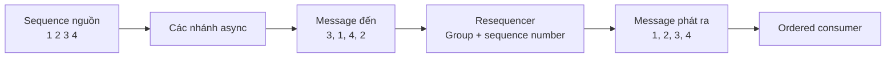
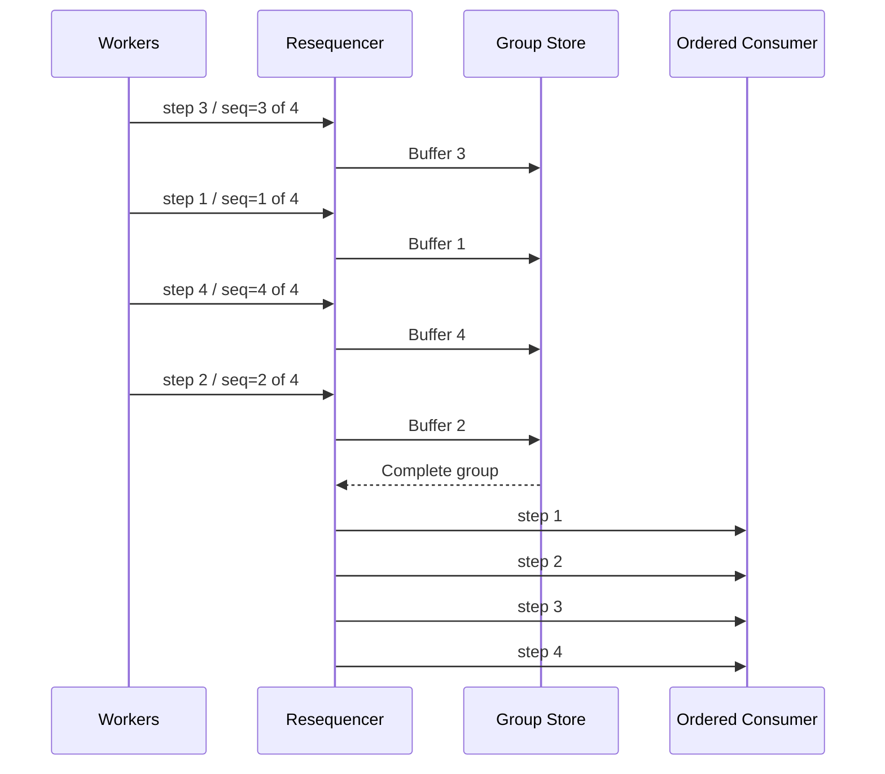
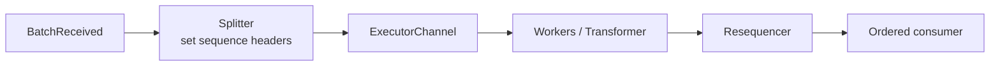

# Resequencer sắp xếp message theo sequence

## 1. Vấn đề: message đến không đúng thứ tự nghiệp vụ

Giả sử hệ thống xử lý một lô hàng gồm bốn bước đã được đánh số từ 1 đến 4. Sau Splitter, từng bước được gửi qua các nhánh xử lý có thời gian phản hồi khác nhau. Bước thứ ba xử lý xong trước, bước thứ hai lại chậm nhất:

```text
Thứ tự nghiệp vụ:       1 → 2 → 3 → 4
Thứ tự message đến:     3 → 1 → 4 → 2

Mong muốn ở downstream: 1 → 2 → 3 → 4
```

Nếu downstream tạo nhật ký vận chuyển, sinh số thứ tự sự kiện hoặc thực hiện những thao tác **cần đúng thứ tự**, cứ chuyển tiếp message theo thứ tự đến sẽ gây sai lệch. **Resequencer** trong Enterprise Integration Patterns (EIP) giải quyết bài toán đó bằng cách **gom các message cùng một sequence, sắp xếp theo số thứ tự, rồi phát chúng ra đúng thứ tự đã định nghĩa**.

Trong chương **Resequencer** của module **SPRING_INTEGRATION_PATTERN**, người học thực hành Enterprise Integration Patterns bằng Spring Integration để xây dựng những luồng thông điệp ít phụ thuộc và dễ mở rộng. Resequencer xuất hiện trong các pipeline có Splitter, Router, Filter, Transformer, Gateway và các kênh bất đồng bộ; việc sử dụng đúng còn liên quan tới Aggregator, correlation, retry, error channel và kiểm thử những nhánh xử lý.



**Điều Resequencer hứa hẹn là sắp xếp các message theo metadata thứ tự trong phạm vi group và release policy của nó.** Nó không tự tạo thứ tự nghiệp vụ, không sửa dữ liệu payload, không đảm bảo exactly-once, và cũng không thể biết một message bị mất nếu không có quy tắc biết số phần tử kỳ vọng hoặc tín hiệu kết thúc.

## 2. Resequencer khác Aggregator, Sort và Queue như thế nào?

Resequencer và Aggregator đều **có trạng thái theo nhóm** và cần một cách xác định message nào cùng nhóm. Nhưng chúng tạo output khác nhau:

| Pattern / thành phần | Mục tiêu | Output |
| --- | --- | --- |
| **Splitter** | Tách một message thành nhiều message con | Nhiều message riêng |
| **Resequencer** | Sắp lại **thứ tự phát message** trong một sequence | Vẫn là **nhiều message riêng**, theo thứ tự |
| **Aggregator** | Gom nhiều message thành một kết quả | Thường một message tổng hợp |
| **Filter** | Chấp nhận hoặc loại message theo predicate | Ít hơn hoặc bằng số message vào |
| **Router** | Chọn channel xử lý | Message đi tới các nhánh được chọn |
| **Queue** | Lưu và chuyển message | Không mặc nhiên biết thứ tự *nghiệp vụ* sau xử lý song song |
| **Sort một List** | Sắp xếp collection đã ở sẵn trong RAM | Một collection được sắp xếp |
 
Ví dụ:

```text
Input messages (theo thứ tự đến):
  Message(step=3)
  Message(step=1)
  Message(step=2)

Resequencer output:
  Message(step=1)
  Message(step=2)
  Message(step=3)

Aggregator output:
  Message(payload=[step=1, step=2, step=3])
```

**Điểm quan trọng:** Resequencer không phải thao tác `List.sort` trong một Transformer. Nó tiếp nhận các message **đến vào những thời điểm khác nhau**, giữ phần chưa thể phát trong group store, chờ các phần còn thiếu và quyết định khi nào giải phóng.

### 2.1. Khi nào cần Resequencer?

Một số trường hợp phù hợp:

- Splitter phát các phần việc cho nhiều executor/worker, nhưng kết quả cần được gửi downstream theo thứ tự ban đầu.
- Các sự kiện thuộc một chuỗi hữu hạn có sequence metadata và đi qua nhiều nhánh xử lý chậm/nhanh.
- Những phần của một tài liệu hoặc tập kết quả được xử lý đồng thời, sau đó cần trình tự đã chỉ định trước.
- Một lô command có thứ tự xác định nhưng message broker hoặc logic consumer không bảo đảm đến đúng thứ tự.

**Không phải trường hợp nào cũng nên dùng.** Nếu các bước cần phụ thuộc nhau (bước 2 phải đọc kết quả bước 1), chỉ sắp xếp **sau** khi chúng xử lý song song không bảo đảm logic thực thi đúng. Khi đó cần **orchestration tuần tự hoặc workflow dependency**, không chỉ đặt Resequencer ở cuối.

### 2.2. Khi nào không nên dùng?

- Stream vô hạn không có sequence boundary hoặc cách xác định window.
- Các nhóm cực lớn có nhiều lỗ hổng sequence và không thể giữ state có giới hạn.
- Hệ thống yêu cầu **thứ tự toàn cục** giữa mọi tenant/batch; Resequencer chỉ đảm bảo theo group, không tạo tổng thứ tự giữa các group.
- Luồng sau Resequencer lại gửi tới nhiều executor độc lập mà không có cơ chế giữ thứ tự.
- Nguồn không có sequence number đáng tin; arrival order hoặc timestamp không tự biến thành business sequence.

Theo tài liệu Spring Integration, Resequencer thích hợp nhất với **những sequence tương đối ngắn, ít khoảng trống**; nhiều nhóm bị đứt quãng và gap lớn có thể làm suy giảm hiệu năng do phải giữ và kiểm tra state.

## 3. Ba header nền tảng: correlation, sequence number, sequence size

Spring Integration thường dùng ba loại thông tin sau để Resequencer làm việc:

| Header | Trách nhiệm | Ví dụ |
| --- | --- | --- |
| `IntegrationMessageHeaderAccessor.CORRELATION_ID` | Khóa nhận dạng sequence/group | `tenant-hcm:SHIP-105:v1` |
| `IntegrationMessageHeaderAccessor.SEQUENCE_NUMBER` | Thứ tự **một-based** của message trong sequence | `3` |
| `IntegrationMessageHeaderAccessor.SEQUENCE_SIZE` | Tổng số phần tử dự kiến của sequence hữu hạn | `4` |

**Sequence number bắt đầu từ 1, không phải 0.** Nếu một application lưu `sourceIndex` bắt đầu từ 0, cần chuyển sang sequence number theo hợp đồng, chẳng hạn `sequenceNumber = sourceIndex + 1`. Không tự coi chúng là tương đương.

```text
SourceIndex:         0   1   2   3
SequenceNumber:      1   2   3   4
SequenceSize:        4   4   4   4
CorrelationId:     SHIP-105 cho cả 4 messages
```

Nếu cùng `SEQUENCE_NUMBER=2` lại xuất hiện trong **hai group khác nhau**, đó là hai message độc lập và có thể đều hợp lệ. Nếu hai message cùng group đều mang `SEQUENCE_NUMBER=2`, có nguy cơ duplicate/conflict và phải áp dụng chính sách rõ ràng.

### 3.1. Không lấy Message ID làm correlation key

`MessageHeaders.ID` là định danh **envelope**. Khi broker phát lại hoặc adapter tái tạo một `Message`, ID có thể đổi. Thứ tự nghiệp vụ và nhóm phải được nhận dạng bằng một khóa ổn định như `(tenantId, batchId, sequenceVersion)` do nguồn đáng tin tạo ra.

### 3.2. Header phải nhất quán trong cùng group

Một group hợp lệ có:

- Cùng `CORRELATION_ID`, được xác định từ nguồn đã xác thực.
- `SEQUENCE_NUMBER` là số nguyên dương và nằm trong range dự kiến.
- `SEQUENCE_SIZE` cùng một giá trị dương cho các message của sequence cố định.
- Một `tenantId`, `schemaVersion`, `workflowVersion` nhất quán khi những thông tin đó ảnh hưởng nghiệp vụ.
- Phần tử được nhận dạng bằng stable item key để chống duplicate khi redelivery.

Nếu client được phép tự gắn `CORRELATION_ID` tùy ý, hai tenant có thể gửi một khóa trùng nhau và bị gộp vào cùng group. Resequencer chỉ làm đúng thứ tự nếu **các message được nhóm đúng ngay từ đầu**.

## 4. Resequencer giữ state và giải phóng message như thế nào?

Một cách nhìn trực quan là mỗi correlation group có:

```text
Group {
  correlationId
  expectedSize
  bufferedMessages keyed by sequenceNumber
  lastReleasedSequence / release progress
  createdAt / updatedAt
  completion / expiration state
}
```

Đây là **mô hình khái niệm** để giải thích cơ chế. Cấu trúc nội bộ thực tế do framework và `MessageGroupStore` quản lý, không nhất thiết có các trường Java đúng như trên.

Khi message đến:

1. Đọc correlation key, sequence number và size.
2. Đưa message vào group trong store, xử lý duplicate theo chính sách.
3. Xác định sequence nào có thể phát dựa trên **release strategy**.
4. Khi điều kiện thỏa, phát các message đã đủ điều kiện theo `SEQUENCE_NUMBER` tăng dần.
5. Duy trì state/tombstone cần thiết để nhận biết group đã hoàn tất và xử lý late arrivals.

### 4.1. Ví dụ arrival order 3 → 1 → 4 → 2

Với sequence hữu hạn có `size=4`, ở **chế độ chờ đủ sequence**:

| Lần nhận | Item mới | Buffer sau nhận | Đã đủ bộ chưa? | Output mới |
| --- | ---: | --- | --- | --- |
| 1 | 3 | {3} | Chưa | Không |
| 2 | 1 | {1,3} | Chưa | Không |
| 3 | 4 | {1,3,4} | Chưa | Không |
| 4 | 2 | {1,2,3,4} | Đủ | **1,2,3,4** |

Không dùng arrival order làm thứ tự output; `SEQUENCE_NUMBER` mới quyết định vị trí.



### 4.2. Resequencer không biến message thành một payload mới

Khi release, Resequencer **chuyển tiếp từng message** theo thứ tự; nó không thực hiện phép merge payload như Aggregator. Bài toán thay đổi payload, tính tổng hoặc xây summary thuộc Transformer/Aggregator. Tuy nhiên, khi một message qua nhiều endpoint, metadata điều phối vẫn có thể chịu quy tắc framework; nên test headers trên output thay vì mặc định rằng mọi transport-specific header sẽ luôn được giữ nguyên.

## 5. Hai chính sách phát: full sequence và partial sequence

Spring Integration hỗ trợ lựa chọn:

- **Full sequence / releasePartialSequences(false):** đợi sequence hoàn chỉnh rồi phát theo thứ tự.
- **Partial contiguous / releasePartialSequences(true):** có thể phát sớm **phần liên tiếp đúng thứ tự** đã sẵn sàng, sau đó chờ phần còn thiếu.

Theo cấu hình thông thường, `releasePartialSequences` mặc định là **false**. Khi bật true, nó **không có nghĩa** bất kỳ item nào đến cũng được phát ngay: các lỗ hổng vẫn phải được tôn trọng.

### 5.1. Trường hợp partial = false

```text
arrival:      3, 1, 4, 2
after 3:     output []
after 1:     output []
after 4:     output []
after 2:     output [1, 2, 3, 4]
```

Phù hợp khi downstream cần một **bộ đầy đủ** và không được thấy dữ liệu một phần. Đổi lại, tổng độ trễ bằng hoặc lớn hơn thời gian chờ item cuối cùng.

### 5.2. Trường hợp partial = true

```text
arrival:      3, 1, 4, 2
after 3:     output []
after 1:     output [1]
after 4:     output []
after 2:     output [2, 3, 4]

Final output order: 1, 2, 3, 4
```

Nếu group đã release sequence 1, khi nhận sequence 3 mà chưa có sequence 2, Resequencer **không được phát 3 vượt qua lỗ hổng 2** trong cách hiểu “partial contiguous”.

| Thuộc tính | Full sequence | Partial contiguous |
| --- | --- | --- |
| Khi bắt đầu phát | Sau khi nhóm đủ điều kiện hoàn tất | Khi có một dải liên tiếp bắt đầu từ vị trí kế tiếp |
| Độ trễ của item đầu | Có thể cao | Thường thấp hơn |
| Chờ khi thiếu item giữa | Cả group chờ | Các item phía sau gap chờ |
| State cần giữ | Cho tới khi đủ sequence | Giữ phần chưa thể phát; quản lý tiến độ release |
| Dùng với workflow yêu cầu all-or-nothing | Thích hợp hơn về **điều kiện phát** | Có thể để downstream thấy kết quả trước khi group đủ |
| Bảo đảm transaction của consumer | **Không** | **Không** |

**Lưu ý quan trọng:** Full release không phải transaction. Nếu đã đủ bốn item rồi Resequencer phát item 1 thành công, item 2 downstream lỗi, side effect của item 1 có thể đã commit. Do đó vẫn cần idempotency, error handling và recovery.

### 5.3. Partial không sửa được gap vĩnh viễn

Nếu message số 2 bị mất:

```text
expected:  1  2  3  4
received:  1     3  4

partial mode:
  1 được phát
  3 và 4 có thể tiếp tục bị giữ vì thiếu 2
```

Cần timeout/expiration, cảnh báo, redelivery, truy hồi message thiếu hoặc một **chính sách cho phép partial result khi group hết hạn**. Không nên cấu hình `releasePartialSequences(true)` rồi mặc định mọi message sẽ được giải phóng cuối cùng.

## 6. Một pipeline thực tế và vị trí đặt Resequencer

Pipeline thường gặp:



**Cần đặt Resequencer sau đoạn có thể đổi thứ tự và trước consumer thực sự cần thứ tự.** Nếu đặt nó **trước** một `ExecutorChannel` xử lý song song, message có thể lại chạy không theo thứ tự sau resequence.

### 6.1. Trình tự đến và trình tự hoàn thành khác nhau

- `DirectChannel` thường thực thi handler trong cùng thread gọi; thứ tự tại một điểm gửi có thể dễ kiểm soát hơn.
- `ExecutorChannel` chuyển xử lý sang thread pool; dù message được gửi theo 1,2,3,4, các worker có thể hoàn thành 3,1,4,2.
- `PublishSubscribeChannel` có executor hoặc nhiều consumer có thể phát sinh thời gian hoàn thành khác nhau giữa nhánh.
- Kafka/RabbitMQ có semantics partition/ordering riêng; **không** được suy ra rằng một ứng dụng sử dụng broker sẽ luôn bảo toàn một trật tự nghiệp vụ toàn cục.

Resequencer chỉ xử lý được thứ tự tại **điểm mà các message kết quả hội tụ**. Nếu flow còn async sau nó, cần bảo toàn thứ tự ở đoạn downstream tiếp theo hoặc gắn identity/sequence để một layer khác đảm nhận.

### 6.2. Không tạo sequence metadata bằng cách “đếm message đã tới”

Một nguồn gửi bốn item phải biết mapping:

```text
sourceIndex 0 -> sequenceNumber 1
sourceIndex 1 -> sequenceNumber 2
sourceIndex 2 -> sequenceNumber 3
sourceIndex 3 -> sequenceNumber 4
sequenceSize   = 4
```

Không cấp sequence number **theo thứ tự arrival sau worker** vì như thế biến thứ tự hoàn thành thành thứ tự nghiệp vụ. Metadata nên được gắn **trước khi phát tán bất đồng bộ**, thường ở Splitter hoặc producer có hợp đồng.

## 7. Java DSL: cấu hình Resequencer cơ bản

Ví dụ Spring Integration Java DSL sau chỉ cần bean channel đầu vào, channel đầu ra và một `IntegrationFlow` dùng `resequence()`. Có thể cấu hình `releasePartialSequences(false)` rõ ràng để thể hiện hợp đồng muốn chờ đủ group.

### 7.1. Cấu hình channel và flow

```java
import org.springframework.context.annotation.Bean;
import org.springframework.context.annotation.Configuration;
import org.springframework.integration.channel.DirectChannel;
import org.springframework.integration.config.EnableIntegration;
import org.springframework.integration.dsl.IntegrationFlow;
import org.springframework.messaging.MessageChannel;

@Configuration
@EnableIntegration
class ShipmentResequencerFlow {

    @Bean("shipment.parts.in")
    MessageChannel partsIn() {
        return new DirectChannel();
    }

    @Bean("shipment.parts.ordered")
    MessageChannel orderedParts() {
        return new DirectChannel();
    }

    @Bean
    IntegrationFlow reorderShipmentParts() {
        return IntegrationFlow.from("shipment.parts.in")
                .resequence(spec -> spec
                        .releasePartialSequences(false))
                .channel("shipment.parts.ordered")
                .get();
    }
}
```

`IntegrationFlow.resequence()` là EIP method có sẵn trong DSL. Vì cấu hình Resequencer chủ yếu là một endpoint/handler đặc biệt, Spring Integration không cung cấp một annotation `@Resequencer` tương đương với `@Splitter`; cấu hình bằng Java DSL hoặc cấu hình framework được hỗ trợ.

**Trách nhiệm của mỗi bước:**

1. `shipment.parts.in` nhận những message có headers correlation/sequence hợp lệ.
2. Resequencer nhóm và giữ message cho đến khi release condition thỏa.
3. `shipment.parts.ordered` nhận từng message **theo thứ tự sequence trong group**.
4. Consumer subscribe vào `shipment.parts.ordered` để xử lý một phần tử mỗi lần.

`DirectChannel` trong ví dụ dùng cho integration test đồng bộ. Việc nhận đúng thứ tự ở output channel không đảm bảo một broker/executor downstream sau đó cũng giữ đúng thứ tự nếu tiếp tục xử lý song song.

### 7.2. Payload và producer tạo các message out-of-order

```java
record ShipmentStep(
        String shipmentId,
        int businessStep,
        String action) {}
```

Tạo message kèm sequence metadata bằng những hằng số chính thức của Spring Integration:

```java
import org.springframework.integration.IntegrationMessageHeaderAccessor;
import org.springframework.messaging.Message;
import org.springframework.messaging.support.MessageBuilder;

final class ShipmentPartFactory {

    static Message<ShipmentStep> step(
            String tenantId,
            String shipmentId,
            int sequenceNumber,
            int sequenceSize,
            String action) {

        if (tenantId == null || tenantId.isBlank()
                || shipmentId == null || shipmentId.isBlank()
                || action == null || action.isBlank()
                || sequenceSize <= 0
                || sequenceNumber < 1
                || sequenceNumber > sequenceSize) {
            throw new IllegalArgumentException("Invalid shipment sequence");
        }

        var payload = new ShipmentStep(
                shipmentId, sequenceNumber, action);

        String groupKey =
                tenantId + "|" + shipmentId + "|plan-v1";

        return MessageBuilder.withPayload(payload)
                .setHeader(
                        IntegrationMessageHeaderAccessor.CORRELATION_ID,
                        groupKey)
                .setHeader(
                        IntegrationMessageHeaderAccessor.SEQUENCE_NUMBER,
                        sequenceNumber)
                .setHeader(
                        IntegrationMessageHeaderAccessor.SEQUENCE_SIZE,
                        sequenceSize)
                .setHeader("tenantId", tenantId)
                .setHeader("eventId",
                        tenantId + ":" + shipmentId
                                + ":plan-v1:step:" + sequenceNumber)
                .setHeader("planVersion", "plan-v1")
                .build();
    }

    private ShipmentPartFactory() {}
}
```

Ví dụ producer gửi theo thứ tự hoàn thành:

```java
import org.springframework.messaging.MessageChannel;

// input: bean MessageChannel tên "shipment.parts.in".
input.send(ShipmentPartFactory.step(
        "tenant-hcm", "SHIP-105", 3, 4, "PACK"));
input.send(ShipmentPartFactory.step(
        "tenant-hcm", "SHIP-105", 1, 4, "VALIDATE"));
input.send(ShipmentPartFactory.step(
        "tenant-hcm", "SHIP-105", 4, 4, "DISPATCH"));
input.send(ShipmentPartFactory.step(
        "tenant-hcm", "SHIP-105", 2, 4, "RESERVE"));
```

Đầu ra mong đợi ở `shipment.parts.ordered` là lần lượt:

```text
ShipmentStep(shipmentId=SHIP-105, businessStep=1, action=VALIDATE)
ShipmentStep(shipmentId=SHIP-105, businessStep=2, action=RESERVE)
ShipmentStep(shipmentId=SHIP-105, businessStep=3, action=PACK)
ShipmentStep(shipmentId=SHIP-105, businessStep=4, action=DISPATCH)
```

**Giới hạn của demo:** Không được cho dữ liệu caller chưa xác thực tự quyết định `CORRELATION_ID`. Trong hệ thống nhiều tenant, group key phải được xây dựng từ tenant đã xác thực và một ID workflow đủ độc nhất. Việc nối chuỗi bằng `|` chỉ để dễ đọc; production cần mã hóa không nhập nhằng hoặc ID nhóm đáng tin cậy.

### 7.3. Một consumer có tác dụng phụ đặt sau Resequencer

```java
import org.springframework.integration.annotation.ServiceActivator;
import org.springframework.messaging.Message;
import org.springframework.stereotype.Component;

interface ShipmentStepService {
    void apply(ShipmentStep step, String eventId);
}

@Component
class OrderedShipmentConsumer {
    private final ShipmentStepService service;

    OrderedShipmentConsumer(ShipmentStepService service) {
        this.service = service;
    }

    @ServiceActivator(inputChannel = "shipment.parts.ordered")
    public void handle(Message<ShipmentStep> message) {
        String eventId = (String) message.getHeaders().get("eventId");
        if (eventId == null || eventId.isBlank()) {
            throw new IllegalArgumentException("Missing eventId");
        }
        service.apply(message.getPayload(), eventId);
    }
}
```

Resequencer chỉ sắp thứ tự **message được chuyển tới handler**. Nếu service `apply` có side effect, cần transaction và idempotency theo khóa như `(tenantId, shipmentId, businessStep, planVersion)`. Không dùng `sequenceNumber` đơn độc vì các shipment khác nhau đều có bước 1, 2, 3, 4.

### 7.4. Bảo toàn headers qua Transformer

Nếu message đi qua một custom Transformer trước Resequencer, cần bảo toàn `CORRELATION_ID`, `SEQUENCE_NUMBER`, `SEQUENCE_SIZE` và những business IDs cần thiết. Với `IntegrationFlow.transform(...)` trả payload mới, framework hỗ trợ xử lý message metadata, nhưng khi tự tạo một `Message` mới hoặc đi qua broker/HTTP, **phải integration test** header mapping.

Một transform viết sai có thể khiến các message mất correlation header và bị từ chối hoặc không thể nhóm đúng. Header sequence không phải một đối tượng tùy chọn muốn xóa khi nào cũng được nếu Resequencer downstream đang phụ thuộc vào nó.

## 8. Partial release bằng Java DSL

Nếu consumer có thể xử lý sớm từng **dải liên tiếp**, có thể dùng một flow **thay thế** với tên channel riêng:

```java
import org.springframework.context.annotation.Bean;
import org.springframework.context.annotation.Configuration;
import org.springframework.integration.channel.DirectChannel;
import org.springframework.integration.config.EnableIntegration;
import org.springframework.integration.dsl.IntegrationFlow;
import org.springframework.messaging.MessageChannel;

@Configuration
@EnableIntegration
class PartialShipmentResequencerFlow {

    @Bean("shipment.partial.in")
    MessageChannel partialInput() {
        return new DirectChannel();
    }

    @Bean("shipment.partial.ordered")
    MessageChannel partialOutput() {
        return new DirectChannel();
    }

    @Bean
    IntegrationFlow resequenceWithPartialRelease() {
        return IntegrationFlow.from("shipment.partial.in")
                .resequence(spec -> spec
                        .releasePartialSequences(true))
                .channel("shipment.partial.ordered")
                .get();
    }
}
```

Dùng cùng thứ tự gửi `3,1,4,2`:
- Sau message 3: chưa có bước đầu, không phát.
- Sau message 1: có thể phát bước 1.
- Sau message 4: vẫn thiếu bước 2, chưa phát 3 và 4.
- Sau message 2: có thể phát 2,3,4.

Đây là **một cấu hình thay thế**, không nên lắp cả hai flow cùng tiêu thụ một `DirectChannel` đầu vào rồi mong mỗi message được gửi cho cả hai. Khi cần so sánh, dùng channel và test context riêng như hai ví dụ.

**Nguồn tham khảo kỹ thuật:** Spring Integration Reference — [Resequencer](https://docs.spring.io/spring-integration/reference/resequencer.html) và [Aggregators and Resequencers (Java DSL)](https://docs.spring.io/spring-integration/reference/6.2/dsl/java-aggregators.html). API cụ thể cần được đối chiếu với phiên bản dependency của dự án trong vòng QA/compile tiếp theo.
## 9. Khi sequence thiếu, trùng, sai metadata hoặc đến muộn

Trong môi trường thật, sequence hiếm khi đẹp như bốn item demo. Producer có thể gửi sai header, broker phát lại một message, Filter loại item hoặc consumer mất kết nối trong lúc group đang chờ.

### 9.1. Thiếu message giữa sequence

```text
size=5
received: 1, 2, 4, 5
missing:  3
```

Ở **full release**, group chưa đủ để phát bình thường. Ở **partial release**, có thể phát 1,2 nhưng phải giữ 4,5 vì lỗ hổng 3.

Nếu 3 không bao giờ đến:
- Group có thể tồn tại rất lâu và tiêu thụ memory/store.
- Tăng số group pending và độ trễ.
- Một Gateway chờ phản hồi cuối cùng có thể bị timeout.
- Một bước Aggregator downstream cũng có thể chờ một kết quả không bao giờ được phát.

Giải pháp là **timeout + recovery policy**: yêu cầu gửi lại item 3, đưa group sang quarantine, hoặc phát phần hợp lệ khi hết hạn **chỉ nếu nghiệp vụ cho phép**. Không có cấu hình nào có thể tự suy ra nội dung message 3 đã mất.

### 9.2. Trùng sequence number

```text
correlationId = tenant-hcm:SHIP-105:v1
received sequence numbers = 1, 2, 2, 4
expected size = 4
```

Có thể hai bản sao đều đại diện cho cùng event (broker redelivery) hoặc là hai sự kiện khác nhau bị gán nhầm sequence number. Không được chỉ dùng số message nhận được để kết luận đủ sequence.

Phân biệt:
1. **Exact duplicate:** cùng `itemBusinessId` và cùng version → có thể suppress theo idempotency.
2. **Conflicting duplicate:** cùng group và sequence number nhưng payload khác → lỗi contract cần điều tra.
3. **New revision có chủ đích:** item được sửa và gửi lại → tạo version của sequence hoặc workflow mới theo quy tắc.

MessageStore hoặc framework có thể xử lý duplicate theo thông tin message ID, nhưng **không nên mặc định** nó tự deduplicate mọi duplicate nghiệp vụ khi hai envelope có ID khác nhau. Dedupe phải dựa trên stable business identity và được integration test.

### 9.3. Sequence number ngoài phạm vi và sequence size không thống nhất

Một chuỗi có `SEQUENCE_SIZE=4` nhưng item mang `SEQUENCE_NUMBER=0` hoặc 9 là dữ liệu không hợp lệ. Nếu một item nói size 4, item khác nói size 5, group không có một kỳ vọng nhất quán.

Thực hành:
- Validate ngay tại ingress hoặc trước Resequencer.
- Giới hạn `SEQUENCE_SIZE` tối đa theo khả năng hệ thống để tránh group vô hạn/DoS.
- Kiểm tra `tenantId` và `planVersion` nhất quán trong cùng sequence.
- Không tự “chữa” sai size bằng cách dùng max(size) nếu không có hợp đồng nghiệp vụ.
- Phân loại lỗi đầu vào khác với lỗi downstream tạm thời.

### 9.4. Late-arriving messages

Giả sử group đã release đủ 1..4 rồi một bản sao của item 2 đến sau. Nó có thể bị framework discard hoặc được xử lý theo group metadata đã hoàn tất, tùy cấu hình retention/expiration. Cần có chính sách **late arrival**:

| Loại | Ví dụ | Cách xử lý |
| --- | --- | --- |
| Bản sao message đã release | Step 2 tới lần nữa | Suppress idempotently |
| Item bị thiếu tới sau timeout | Step 3 tới quá hạn | Replay có kiểm soát hoặc ghi nhận late |
| Revision mới cố ý | Step 2 bản sửa sau khi sequence đóng | Đưa sang sequence/version mới |
| Message sai group key | Tenant khác cùng correlation ID | Reject, cảnh báo bảo mật |

**Không xóa hết dấu vết của group ngay khi release mà không tính khả năng late arrivals.** Spring Integration có các tùy chọn giữ metadata group rỗng/tombstone và cơ chế dọn group; lựa chọn cụ thể phụ thuộc cấu hình MessageStore, expiration và version framework.

## 10. Validate sequence headers trước khi đưa vào Resequencer

Đặt điều kiện rõ ở biên giúp tránh những group không bao giờ giải phóng. Ví dụ helper kiểm tra cấu trúc metadata:

```java
import org.springframework.integration.IntegrationMessageHeaderAccessor;
import org.springframework.messaging.Message;

final class SequenceEnvelopeValidator {
    private static final int MAX_SEQUENCE_SIZE = 10_000;

    static void validate(Message<?> message) {
        Object group = message.getHeaders().get(
                IntegrationMessageHeaderAccessor.CORRELATION_ID);
        Object number = message.getHeaders().get(
                IntegrationMessageHeaderAccessor.SEQUENCE_NUMBER);
        Object size = message.getHeaders().get(
                IntegrationMessageHeaderAccessor.SEQUENCE_SIZE);

        if (!(group instanceof String key) || key.isBlank()) {
            throw new IllegalArgumentException("MISSING_CORRELATION_ID");
        }
        if (!(number instanceof Integer position)
                || !(size instanceof Integer expectedSize)) {
            throw new IllegalArgumentException("INVALID_SEQUENCE_HEADERS");
        }
        if (expectedSize < 1 || expectedSize > MAX_SEQUENCE_SIZE
                || position < 1 || position > expectedSize) {
            throw new IllegalArgumentException("OUT_OF_RANGE_SEQUENCE");
        }
    }

    private SequenceEnvelopeValidator() {}
}
```

Helper này kiểm tra **kiểu/range** nhưng không thể chứng minh tenant hợp lệ hoặc toàn bộ group cùng size: cần thêm security context và state/version validation tại producer/control-plane hoặc một bước kiểm tra nhất quán cho group.

Khi dùng một ingress từ HTTP/broker, đừng để caller tự gắn headers `tenantId` và `CORRELATION_ID` mà không xác thực. Một key độc hại có thể:
- Trộn dữ liệu giữa tenant.
- Tạo quá nhiều group mới dẫn tới dùng hết memory.
- Gây ra gap khổng lồ hoặc sequence không bao giờ hoàn tất.
- Tạo flood message tới error/quarantine.

### 10.1. Phân biệt “invalid input” và “incomplete sequence”

Một group có đúng headers nhưng thiếu item 3 là **chưa hoàn tất**, không phải message parse lỗi. Một item với `sequenceNumber=-1` là **invalid input**, nên chặn ngay. Nếu cùng error channel xử lý cả hai, phải gắn reason code rõ để recovery không retry dữ liệu không hợp lệ vô hạn.

## 11. MessageStore, timeout và giới hạn tài nguyên

Resequencer cần giữ các message chưa thể phát. Tùy cấu hình, group store có thể ở memory hoặc một persistent store. Mỗi message giữ payload, headers và metadata, nên chi phí tăng theo số group đang chờ và số phần tử được buffer.

### 11.1. In-memory và persistent store

| Lựa chọn | Ưu điểm | Rủi ro |
| --- | --- | --- |
| In-memory MessageStore | Dễ cấu hình, độ trễ thấp | Restart có thể mất group chưa hoàn tất |
| JDBC / persistent group store | Có thể khôi phục state sau restart | Cần thiết kế transaction, lock, cleanup |
| Distributed store | Nhiều instance có thể chia sẻ state | Thêm consistency, lock contention, network latency |
| Partition route theo correlation key | Các item cùng group về cùng worker | Phải xử lý rebalance/failover |

**Persistent MessageStore không tự tạo exactly-once**. Một message có thể đã được gửi tới consumer rồi nhưng crash xảy ra trước ACK/commit của nguồn. Resequencer hoặc consumer có thể xử lý lại; side effects downstream phải có idempotency.

### 11.2. Timeout và group expiration

Khi quá hạn mà sequence vẫn thiếu một số item, hệ thống phải quyết định:

1. **Chờ tiếp có giới hạn** (nếu nguồn vẫn có khả năng gửi đủ).
2. **Request resend** các sequence number còn thiếu.
3. **Expire và quarantine group**; lưu correlation ID, số item đã có, khoảng trống và thông tin replay.
4. **Phát partial result khi hết hạn** nếu điều đó được **nghiệp vụ chấp nhận** (không mặc định).
5. **Từ chối flow và trả lỗi Gateway** với lý do/timeouts cụ thể.

Spring Integration có các thuộc tính về group timeout, expiration, discard và gửi partial result khi group hết hạn. Không nên thử thêm một dòng `sleep` trong handler để “chờ item cuối”; đó là cách chiếm thread, không giải quyết persistence/recovery.

**Quan trọng:** Phát kết quả không đầy đủ theo timeout **khác** với bật `releasePartialSequences(true)`. Một tùy chọn cho phép phát sớm những prefix liên tiếp; tùy chọn kia quy định số phận nhóm khi quá hạn.

### 11.3. Giám sát lỗ hổng và group bị kẹt

Các thông tin nên quan sát:

```text
correlationId = tenant-hcm:SHIP-105:v1
expectedSize  = 4
received      = [1,3,4]
missing       = [2]
groupAge      = 15 seconds
releaseMode   = PARTIAL_CONTIGUOUS
lastReleased  = 1
```

Mô hình log này mang tính minh họa; các giá trị `missing` hoặc `lastReleased` có thể do ứng dụng thống kê từ store, không mặc định được Resequencer trả ra dưới cùng một cấu trúc.

Cần giới hạn:
- Số group đồng thời.
- Kích thước payload và sequence size tối đa.
- Thời gian chờ tối đa và retention group metadata.
- Số message chưa release trong mỗi group.
- Tốc độ message đầu vào và số worker/downstream concurrency.

Resequencer dùng nhiều memory không nhất thiết là lỗi memory leak: có thể do nghiệp vụ thường xuyên mất những item ở giữa.

## 12. Retry, error channel và idempotency

Resequencer xử lý **thứ tự**, không chịu trách nhiệm duy nhất cho reliability. Một message có thể bị giao lại bởi producer, broker, adapter, hoặc một group được replay từ MessageStore.

### 12.1. Ba tầng thất bại thường gặp

| Tầng | Ví dụ | Hướng xử lý |
| --- | --- | --- |
| **Input metadata** | Missing correlation, sequence number sai | Reject/quarantine; không retry vô hạn |
| **Resequencer/group state** | Store timeout, lock conflict, group expired | Retry có giới hạn, phục hồi state, xử lý late arrival |
| **Consumer sau resequence** | DB timeout, HTTP API lỗi | Idempotent consumer, backoff, compensation khi cần |

Với `DirectChannel`, exception từ downstream handler có thể truyền về thread gửi. Với `ExecutorChannel`, poller hoặc broker, lỗi có thể phát sinh ở thread khác và được xử lý qua error handler/`errorChannel` tùy cấu hình. **Error channel không tự tạo retry, persistence hay dead-letter queue.**

### 12.2. Không xem Resequencer là bộ chống duplicate

Nếu hai message có cùng `SEQUENCE_NUMBER` và cùng group nhưng hai `MessageHeaders.ID` khác nhau, framework có thể cần một chính sách xử lý duplicate rõ. Ngay cả khi group đã release đúng sequence, broker vẫn có thể redeliver message sau khi ACK bị mất. Vì vậy downstream cần một key idempotency như:

```text
(tenantId, shipmentId, planVersion, businessStep)

tenant-hcm : SHIP-105 : plan-v1 : 2
```

Một giải pháp khi side effects và dedupe nằm trong cùng database là dùng unique constraint và ghi dấu xử lý trong **cùng transaction** với thay đổi nghiệp vụ. Với API từ xa, cần idempotency key hoặc đối soát kết quả khi timeout không rõ đã thực thi hay chưa.

### 12.3. Khi consumer hỏng ở phần giữa

Full sequence đã đủ và Resequencer phát item 1,2,3,4. Nếu handler item 2 lỗi:

- Side effect của item 1 có thể đã thành công.
- Tùy cơ chế dispatch/error, item 3,4 có thể chưa được xử lý.
- Retry cả group có nguy cơ thực hiện lại item 1.
- Retry chỉ item 2 có thể đủ nếu consumer hỗ trợ checkpoint.

Đừng tuyên bố việc nhận đủ group rồi release là một **transaction toàn batch**. Nếu nghiệp vụ yêu cầu mọi thao tác hoàn thành theo thứ tự và toàn vẹn, phải có orchestration, transaction phù hợp hoặc compensation riêng.

## 13. Unit test cho metadata và logic thứ tự

### 13.1. Kiểm thử validation

```java
import org.junit.jupiter.api.Test;
import org.springframework.integration.IntegrationMessageHeaderAccessor;
import org.springframework.messaging.support.MessageBuilder;

import static org.junit.jupiter.api.Assertions.*;

class SequenceEnvelopeValidatorTest {

    @Test
    void acceptsValidSequenceHeaders() {
        var message = ShipmentPartFactory.step(
                "tenant-hcm", "SHIP-105", 2, 4, "RESERVE");
        assertDoesNotThrow(() ->
                SequenceEnvelopeValidator.validate(message));
    }

    @Test
    void rejectsOutOfRangeSequence() {
        var invalid = MessageBuilder.withPayload("bad")
                .setHeader(
                        IntegrationMessageHeaderAccessor.CORRELATION_ID,
                        "tenant-hcm:SHIP-105:v1")
                .setHeader(
                        IntegrationMessageHeaderAccessor.SEQUENCE_NUMBER, 5)
                .setHeader(
                        IntegrationMessageHeaderAccessor.SEQUENCE_SIZE, 4)
                .build();

        assertThrows(IllegalArgumentException.class, () ->
                SequenceEnvelopeValidator.validate(invalid));
    }

    @Test
    void rejectsMissingCorrelation() {
        var missing = MessageBuilder.withPayload("bad")
                .setHeader(
                        IntegrationMessageHeaderAccessor.SEQUENCE_NUMBER, 1)
                .setHeader(
                        IntegrationMessageHeaderAccessor.SEQUENCE_SIZE, 2)
                .build();

        assertThrows(IllegalArgumentException.class, () ->
                SequenceEnvelopeValidator.validate(missing));
    }
}
```

Unit test này xác minh format/range headers, nhưng **không thay thế** integration test của Resequencer. Cần gửi message thực qua Spring Integration và quan sát thứ tự mà consumer nhận.

## 14. Integration test: message đến 3,1,4,2 và ra 1,2,3,4

Một integration test tối thiểu dùng Spring context có `ShipmentResequencerFlow` và một subscriber ghi nhận output. Mỗi test tạo context riêng để tránh state/tombstone của group từ test khác.

```java
import java.util.ArrayList;
import java.util.List;
import org.junit.jupiter.api.Test;
import org.springframework.context.annotation.AnnotationConfigApplicationContext;
import org.springframework.integration.channel.DirectChannel;
import org.springframework.messaging.Message;
import org.springframework.messaging.MessageChannel;

import static org.junit.jupiter.api.Assertions.*;

class ShipmentResequencerFlowTest {

    @Test
    void holdsWholeGroupThenReleasesInSequenceOrder() {
        try (var context = new AnnotationConfigApplicationContext(
                ShipmentResequencerFlow.class)) {

            var received = new ArrayList<Message<?>>();
            DirectChannel output = context.getBean(
                    "shipment.parts.ordered", DirectChannel.class);
            output.subscribe(received::add);

            MessageChannel input = context.getBean(
                    "shipment.parts.in", MessageChannel.class);

            input.send(ShipmentPartFactory.step(
                    "tenant-hcm", "SHIP-105", 3, 4, "PACK"));
            assertTrue(received.isEmpty());

            input.send(ShipmentPartFactory.step(
                    "tenant-hcm", "SHIP-105", 1, 4, "VALIDATE"));
            assertTrue(received.isEmpty());

            input.send(ShipmentPartFactory.step(
                    "tenant-hcm", "SHIP-105", 4, 4, "DISPATCH"));
            assertTrue(received.isEmpty());

            input.send(ShipmentPartFactory.step(
                    "tenant-hcm", "SHIP-105", 2, 4, "RESERVE"));

            List<Integer> actual = received.stream()
                    .map(m -> ((ShipmentStep) m.getPayload())
                            .businessStep())
                    .toList();
            assertEquals(List.of(1, 2, 3, 4), actual);
            assertEquals(4, received.size());
        }
    }
}
```

**Vì sao test này có thể assert ngay sau send?** Ví dụ dùng `DirectChannel` đồng bộ và subscriber ghi output ngay trong thread gửi. Với async channel/broker, phải dùng `CountDownLatch`/Awaitility với timeout hữu hạn, không dùng `Thread.sleep` tùy tiện.

### 14.1. Integration test chế độ partial

```java
import java.util.ArrayList;
import java.util.List;
import org.junit.jupiter.api.Test;
import org.springframework.context.annotation.AnnotationConfigApplicationContext;
import org.springframework.integration.channel.DirectChannel;
import org.springframework.messaging.Message;
import org.springframework.messaging.MessageChannel;

import static org.junit.jupiter.api.Assertions.*;

class PartialShipmentResequencerFlowTest {

    @Test
    void releasesOnlyContiguousPrefixes() {
        try (var context = new AnnotationConfigApplicationContext(
                PartialShipmentResequencerFlow.class)) {

            var received = new ArrayList<Message<?>>();
            var output = context.getBean(
                    "shipment.partial.ordered", DirectChannel.class);
            output.subscribe(received::add);

            var input = context.getBean(
                    "shipment.partial.in", MessageChannel.class);

            input.send(ShipmentPartFactory.step(
                    "tenant-hcm", "SHIP-206", 3, 4, "PACK"));
            assertTrue(received.isEmpty());

            input.send(ShipmentPartFactory.step(
                    "tenant-hcm", "SHIP-206", 1, 4, "VALIDATE"));
            assertEquals(List.of(1), sequenceOf(received));

            input.send(ShipmentPartFactory.step(
                    "tenant-hcm", "SHIP-206", 4, 4, "DISPATCH"));
            assertEquals(List.of(1), sequenceOf(received));

            input.send(ShipmentPartFactory.step(
                    "tenant-hcm", "SHIP-206", 2, 4, "RESERVE"));
            assertEquals(List.of(1, 2, 3, 4), sequenceOf(received));
        }
    }

    private static List<Integer> sequenceOf(
            List<Message<?>> received) {
        return received.stream()
                .map(m -> ((ShipmentStep) m.getPayload())
                        .businessStep())
                .toList();
    }
}
```

Test này so sánh hành vi thực tế: với chế độ partial, message 1 được phát **trước khi** nhận item 2; nhưng item 3,4 vẫn phải đợi gap đóng lại.

### 14.2. Ma trận kiểm thử tối thiểu

| Kịch bản | Điều cần xác minh |
| --- | --- |
| 3,1,4,2 với full release | Output 1,2,3,4 **sau khi đủ** |
| 3,1,4,2 với partial release | Output 1 sớm; 2,3,4 khi gap được lấp |
| 1,2,3,4 đúng thứ tự | Output đúng, không bị đổi |
| Hai correlation IDs xen kẽ | Mỗi group giữ thứ tự **riêng**, không đòi global order |
| Sequence number 0 hoặc > size | Bị validation từ chối |
| Sequence size khác nhau trong group | Phát hiện contract conflict |
| Duplicate item có message ID khác | Không side effect trùng, không release sai |
| Group thiếu item | Giữ/expire/recovery theo policy |
| Late arrival sau release | Discard/reopen/version theo policy rõ |
| Crash trước khi group đủ | State phục hồi nếu đã chọn persistent store |
| Downstream handler lỗi sau item 1 | Retry/compensation/idempotency đúng |
| Splitter + Filter loại item | Không chờ sai số phần tử kỳ vọng |
| Headers qua Transformer/broker | Correlation, number và size không mất |
| Async sau Resequencer | Kiểm tra có bị đảo thứ tự lại không |

### 14.3. Đừng chỉ assert số message nhận

Bốn message có thể được phát đủ nhưng sai thứ tự 1,3,2,4; hoặc bốn arrivals gồm 1,2,2,4 mà thiếu 3. Vì vậy:
- Assert **danh sách `SEQUENCE_NUMBER` hoặc businessStep** đúng thứ tự.
- Assert số output đúng với số identity độc nhất theo contract.
- Assert correlation ID không bị trộn giữa batch/tenant.
- Assert trạng thái cuối của consumer khi có retry, không chỉ số lần gọi mock.
- Với partial mode, assert *thời điểm tương đối*: 1 được phát trước khi 2 đến, còn 3 không vượt 2.

## 15. Metrics và vận hành

Resequencer thường làm tăng latency vì chờ message còn thiếu. Dashboard cần phân biệt **chờ đúng chính sách** và **group bị kẹt**.

| Chỉ số | Ý nghĩa |
| --- | --- |
| `resequencer.groups.active` | Số group chưa hoàn tất |
| `resequencer.messages.buffered` | Số message còn chờ release |
| `resequencer.group.age` | Thời gian từ item đầu tới lúc đóng group |
| `resequencer.missing.positions` | Số vị trí còn thiếu trong các group |
| `resequencer.release.latency` | Thời gian message chờ trước khi được phát |
| `resequencer.out.of.order.arrivals` | Message đến không theo thứ tự |
| `resequencer.duplicate.detected` | Duplicate/sequence conflict |
| `resequencer.group.expired` | Group quá hạn |
| `resequencer.late.arrival` | Message đến sau khi group đóng |
| `resequencer.store.errors` | Lỗi state store/lock |
| `downstream.retry` | Lỗi khi consumer nhận item đã reorder |

Những metric tên trên là **gợi ý metric ứng dụng**, không mặc định là tên metrics được Spring Integration tự xuất ra. Có thể bổ sung Micrometer observations và log ở đúng endpoint.

Log nên ghi group reference, `eventId`, `tenantId` (theo chính sách bảo mật), sequenceNumber/sequenceSize, attempt count và reason code. Tránh dùng `eventId` hoặc group ID làm **metric labels** cardinality cao. Không log payload/headers chứa PII, token hoặc thông tin tài chính nhạy cảm.

### 15.1. Cách đọc triệu chứng

| Triệu chứng | Nghi ngờ | Hướng điều tra |
| --- | --- | --- |
| Nhiều group active tăng liên tục | Mất item hoặc không có group timeout | Xem gap/nguồn gửi |
| Full release latency cao | Item cuối chậm | Đo worker theo sequence |
| Partial release vẫn kẹt sau 1 | Thiếu item 2 | Truy hồi step 2 |
| Output bị đảo thứ tự lần nữa | Async downstream sau Resequencer | Xem channel/executor tiếp theo |
| Duplicate side effect | Redelivery/consumer thiếu idempotency | Kiểm tra stable business keys |
| Cross-tenant group | Correlation key không scope tenant | Vá ingress và xác thực correlation |
| Restart làm mất group | Dùng store volatile | Xem persistence/ACK recovery |
| Resequencer chiếm nhiều bộ nhớ | Group dài/gap lớn/payload to | Giới hạn group size và retention |

## 16. Những lỗi thiết kế thường gặp

1. **Coi sequence number là thứ tự message đến** thay vì thứ tự nghiệp vụ đã được producer/Splitter đánh dấu.
2. **Đánh số từ 0** cho header sequence dùng cơ chế chuẩn một-based.
3. **Dùng Message ID làm correlation key** khiến replay tạo group khác.
4. **Không gắn sequence size hoặc định nghĩa completion** rồi chờ sequence tự hoàn tất.
5. **Dùng `releasePartialSequences(true)` và tưởng gap sẽ được bỏ qua**.
6. **Coi full release là transaction toàn batch**, bỏ qua partial downstream commits.
7. **Đặt Resequencer trước một ExecutorChannel khác** nhưng kỳ vọng output ở cuối vẫn tuần tự.
8. **Dùng group key chung giữa tenant** dẫn tới trộn dữ liệu.
9. **Không kiểm tra duplicate sequence numbers** khi broker redelivery.
10. **Không thiết kế timeout/expiration** cho group mất phần tử.
11. **Không giới hạn sequence size hoặc số group active**, khiến store và memory bị quá tải.
12. **Tin vào in-memory store để sống qua restart**.
13. **Coi Resequencer là bộ idempotency** dù consumer vẫn có side effects.
14. **Sao chép sai correlation/sequence headers qua Transformer hoặc protocol adapter**.
15. **Coi sequence order là dependency execution order**, chạy những bước phụ thuộc nhau đồng thời rồi mới sắp.
16. **Chỉ test output count**, không assert thứ tự và thời điểm phát partial prefix.

## 17. Bài tập thực hành và tự đánh giá

**Bài tập:** Tạo một flow xử lý `DocumentChunk` của một tài liệu có bốn đoạn. Mỗi message mang `documentId`, `tenantId`, `chunkIndex`, `chunkText`, `eventId`, các sequence headers. Các worker có thể hoàn thành không theo thứ tự.

1. Tạo một Splitter hoặc producer gắn `SEQUENCE_NUMBER=chunkIndex+1` và `SEQUENCE_SIZE=4`.
2. Chạy bốn worker mock để gửi kết quả theo thứ tự `4,2,1,3`.
3. Dùng Java DSL `resequence()` và kiểm tra output `1,2,3,4`.
4. Bật `releasePartialSequences(true)`; chứng minh chỉ prefix liên tiếp được phát.
5. Tạo hai document khác nhau có chunk gửi xen kẽ; mỗi group phải giữ thứ tự riêng.
6. Giả lập thiếu chunk 2; thiết kế timeout, retry/recovery và quarantine phù hợp.
7. Gửi lại chunk 1 với message ID mới; kiểm tra chính sách duplicate/idempotency.
8. Thử header number=0, number=5/size=4, missing correlation và size inconsistent.
9. Cho một Filter loại chunk 3; giải thích phải thay đổi completion contract hoặc phát rejected status ra sao.
10. Đặt `ExecutorChannel` sau Resequencer; chứng minh vì sao consumer có thể hoàn thành không theo thứ tự dù Resequencer đã phát đúng.
11. Tạo một store bền vững cho group và test restart giữa các chunk.
12. Thiết kế key `(tenantId, documentId, chunkIndex, revision)` để chống xử lý trùng downstream.
13. Gắn tracing/metrics theo group age, missing chunks, buffered messages và release latency.
14. So sánh yêu cầu “đọc các đoạn theo đúng thứ tự” với “gộp các đoạn thành một văn bản”; khi nào cần Resequencer, khi nào cần Aggregator?

**Tự kiểm tra:** Resequencer khác Aggregator ở output như thế nào? Một message có `sequenceNumber=3` tới trước số 1 có được phát ngay khi partial=true không? Nếu thiếu số 2, các message 3 và 4 sẽ ra sao? Khi đầy đủ group nhưng consumer item 2 lỗi, các side effects trước đó có tự rollback không? Resequencer có bảo đảm thứ tự toàn hệ thống giữa các correlation groups không?

**Resequencer sắp xếp message theo sequence** là pattern giải quyết việc message đến lệch thứ tự **trong phạm vi một group có sequence metadata đáng tin**. Để sử dụng an toàn với Spring Integration, cần thiết kế correlation/sequence/size, lựa chọn full hay partial release, quản lý state/timeout, xử lý missing/duplicate/late arrivals, bảo vệ idempotency downstream và kiểm thử đúng thứ tự output. Nó bổ sung khả năng sắp xếp cho các luồng bất đồng bộ, nhưng không thay thế orchestration, transaction hay Aggregator khi nghiệp vụ cần gom nội dung thành một kết quả.

