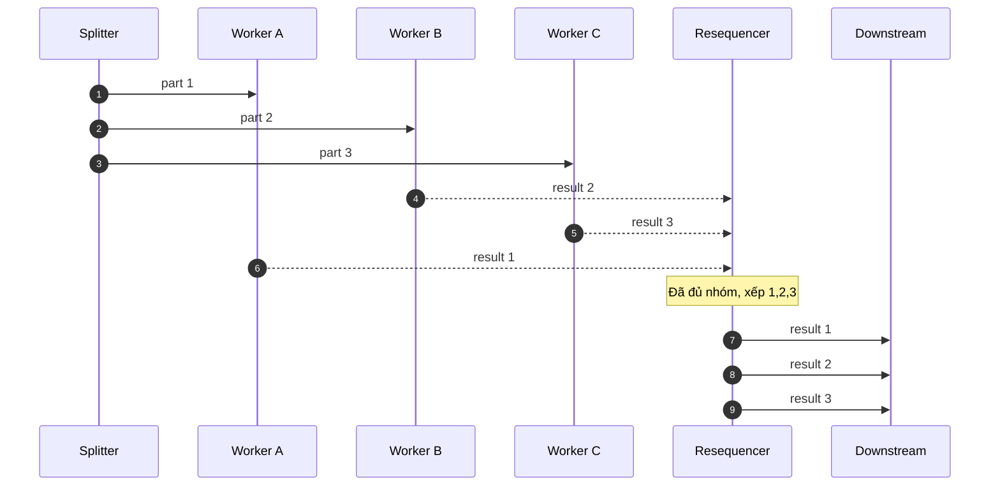
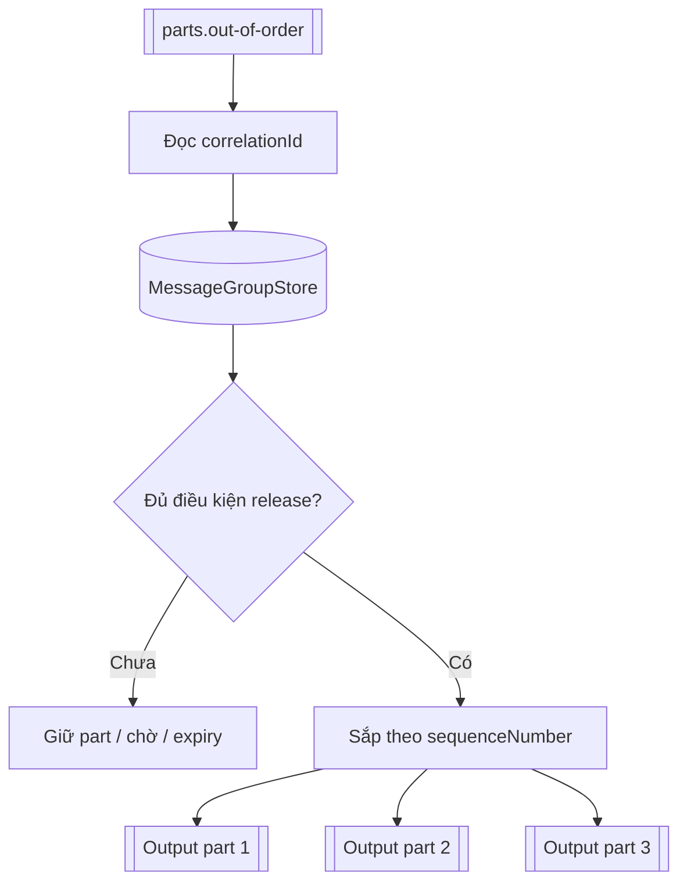
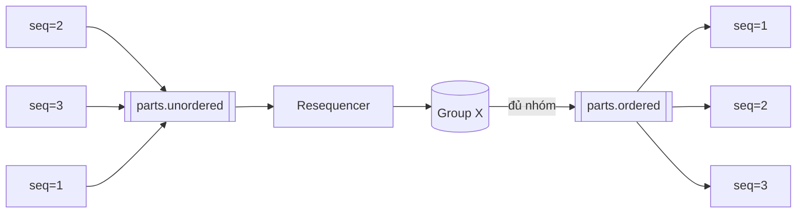
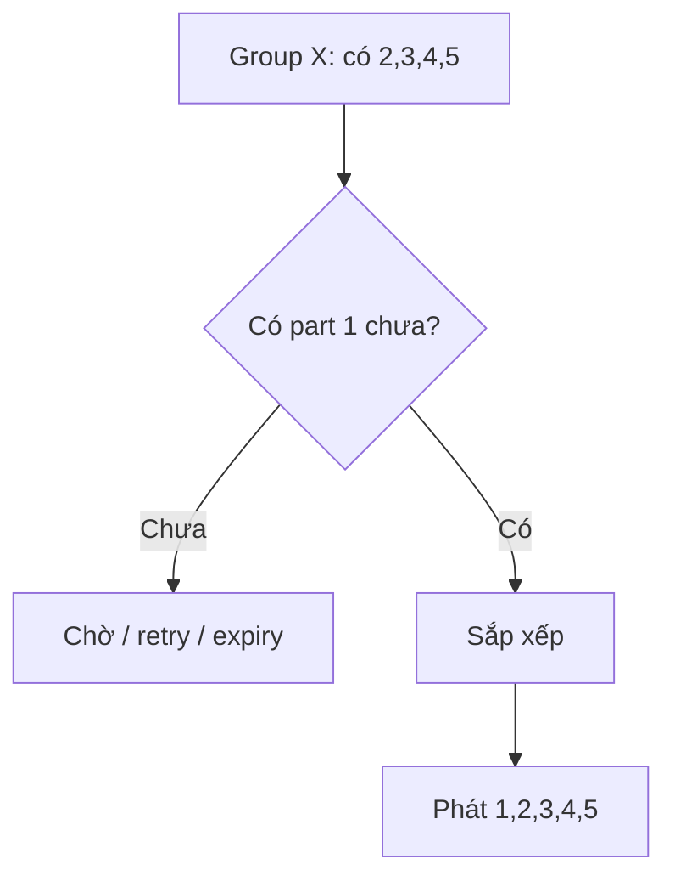
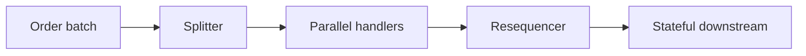
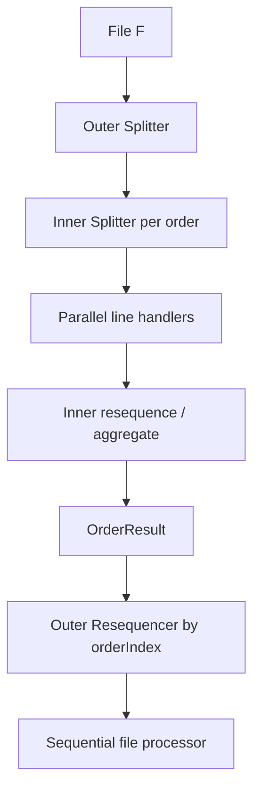

# Message đến không đúng thứ tự

Một hệ thống xử lý đơn hàng tách một batch gồm ba dòng sản phẩm thành ba message con. Mỗi dòng được kiểm tra độc lập trên các worker khác nhau. Dòng thứ hai hoàn thành sau 100 ms, dòng thứ ba sau 300 ms, còn dòng thứ nhất phải chờ dịch vụ tồn kho tới 800 ms. **Kết quả đến theo thứ tự 2 → 3 → 1**, dù các phần ban đầu được tạo theo thứ tự **1 → 2 → 3**.

Điều này bình thường trong kiến trúc **bất đồng bộ và phân tán**, nhưng có thể gây lỗi nếu downstream yêu cầu những phần của **cùng một nhóm** được xử lý **đúng thứ tự**. **Resequencer**, một mẫu trong **Enterprise Integration Patterns (EIP)**, giúp **thu nhận các message tới sai thứ tự và phát lại theo thứ tự được xác định từ metadata**. Nó khác **Aggregator**: Resequencer tiếp tục phát ra **từng message riêng**, còn Aggregator thường tạo **một kết quả tổng hợp**.

Bài **“Message đến không đúng thứ tự”** thuộc chương **Resequencer** của module `SPRING_INTEGRATION_PATTERN`. Nội dung tập trung vào cách dùng Spring Integration để kiểm soát thứ tự message mà không buộc các hệ thống luôn chạy tuần tự: hiểu nguyên nhân out-of-order, `sequenceNumber`/`sequenceSize`/`correlationId`, cách Resequencer giữ và release nhóm, tình huống thiếu hoặc trùng phần, độ bền `MessageGroupStore`, Java DSL và JUnit 5, cùng các liên hệ đến Router, Filter, Transformer, Splitter, Aggregator, Gateway, retry, error channel và correlation.

> **Nguyên tắc:** Resequencer **không suy ra thứ tự nghiệp vụ từ thời gian message tới**. Nó cần **một thứ tự có ý nghĩa và đủ tin cậy** được cung cấp qua sequence metadata hoặc chiến lược tương đương. Việc sắp xếp đúng thứ tự cũng **không đồng nghĩa** message đã được xử lý đúng một lần, giao dịch đã commit hay thứ tự toàn hệ thống được bảo đảm.

## 1. Khi nào message có thể đến sai thứ tự?

Trong một phương thức Java gọi tuần tự, ta dễ kỳ vọng kết quả đầu ra giữ nguyên thứ tự đầu vào. Nhưng một flow Spring Integration có thể đi qua nhiều ranh giới đồng thời:

- **ExecutorChannel/TaskExecutor:** các handler chạy trên thread khác nhau; thread nhận sau có thể hoàn tất trước.
- **Publish–Subscribe/Recipient List:** mỗi subscriber/recipient có tốc độ và điều kiện xử lý khác nhau.
- **Router:** message đi các branch riêng, mỗi branch có thời gian xử lý và retry khác nhau.
- **HTTP/database adapter:** mỗi lời gọi network có độ trễ khác nhau.
- **Broker:** partition, nhiều consumer, redelivery/requeue, retry và rebalance làm thay đổi thứ tự hoàn tất.
- **Gateway timeout/retry:** caller hết hạn chờ rồi gửi lại, trong khi attempt cũ có thể vẫn đang chạy.
- **Splitter:** tạo các message con đúng thứ tự nhưng không bảo đảm các bước async phía sau giữ thứ tự đó.

Ví dụ timeline:

| Message | Thứ tự được tạo | Thời gian xử lý | Vị trí đến Resequencer |
| --- | ---: | ---: | ---: |
| Dòng A | 1 | 800 ms | 3 |
| Dòng B | 2 | 100 ms | 1 |
| Dòng C | 3 | 300 ms | 2 |



**Vấn đề không phải message bị tạo sai số thứ tự**. Vấn đề là **thời gian đến** không còn phản ánh **thứ tự logic**. Resequencer giữ các phần theo cùng nhóm rồi phát ra theo chính sách sequence thay vì theo lịch hoàn tất của worker.

### 1.1. Bốn dạng “thứ tự” không nên đánh đồng

| Khái niệm | Định nghĩa | Ví dụ |
| --- | --- | --- |
| **Thứ tự nghiệp vụ** | Vị trí mà domain yêu cầu. | Dòng hàng 1, 2, 3; các lần cập nhật version 7, 8, 9. |
| **Thứ tự phát** | Producer/adapter gửi message trước sau. | Producer publish part 1 rồi part 2. |
| **Thứ tự nhận** | Resequencer nhận message ở đầu vào. | Part 2 tới trước part 1. |
| **Thứ tự hoàn tất side effect** | DB/API/handler commit xong lúc nào. | Part 3 commit trước part 1. |

Resequencer chủ yếu kiểm soát **thứ tự phát ra ở output của chính nó**. Nó không thể đảo ngược những side effect đã diễn ra **trước** khi message đến Resequencer. Vì vậy, **đặt Resequencer ở đâu** là một quyết định kiến trúc quan trọng.

## 2. Resequencer hoạt động như thế nào?

Ở mức logic, Resequencer:

1. Nhận một message.
2. Xác định **nhóm** bằng correlation strategy.
3. Lưu message trong **message group store**.
4. Kiểm tra group có đủ dữ liệu để release theo policy không.
5. Sắp xếp các message theo **sequence number**.
6. Phát tiếp **từng message**, không mặc định gộp payload thành danh sách.
7. Quản lý group còn chờ, đã hoàn tất, hết hạn và message đến muộn.



**Điểm khác biệt so với sắp xếp một List:** Resequencer thường nhận **các message độc lập ở các thời điểm khác nhau**. Nó phải có state cho nhóm chưa đủ, quyết định khi thiếu part và xử lý các message tới sau khi nhóm đã được release.

### 2.1. Resequencer và Aggregator

| Tiêu chí | **Resequencer** | **Aggregator** |
| --- | --- | --- |
| Mục đích | Sửa thứ tự của **các message riêng lẻ**. | Gom **nhiều message** thành một kết quả nhóm. |
| Input | Các phần có cùng correlation và thứ tự logic. | Các message có quan hệ nhóm. |
| Output tiêu biểu | `part1`, `part2`, `part3` theo thứ tự. | Một `BatchResult`/`List<Part>`. |
| Dùng message group | Có. | Có. |
| Điều kiện release | Nhóm hoàn chỉnh hoặc chính sách partial sequence. | Tùy release strategy: size, role, quorum, timeout… |
| Thứ tự nghiệp vụ | Trọng tâm chính. | Chỉ là một thuộc tính nếu processor cần sắp xếp. |
| Xử lý duplicate/missing part | Vẫn cần policy, không tự có exactly-once. | Vẫn cần policy. |

Nếu downstream cần **một bản báo cáo tổng hợp**, Aggregator thường phù hợp hơn. Nếu downstream cần **từng sự kiện theo đúng chuỗi** để cập nhật một state machine, Resequencer là ứng viên phù hợp.

## 3. Ba header làm nền tảng cho resequencing

Một message có thể mang:

```text
correlationId   = 8f...        # Nhận diện nhóm
sequenceNumber  = 2           # Vị trí message này
sequenceSize    = 3           # Số message dự kiến (nếu biết)
```

Spring Integration cung cấp các tên header kỹ thuật qua `IntegrationMessageHeaderAccessor`.

### 3.1. `correlationId`: không trộn các nhóm

Ví dụ:

```text
Batch A: (A, seq=1), (A, seq=2), (A, seq=3)
Batch B: (B, seq=1), (B, seq=2)
```

Hai part có `seq=1` nhưng `correlationId` khác nhau **không được gom cùng group**. Một Resequencer sẽ tạo trạng thái độc lập cho A và B theo chính sách correlation.

Trong luồng Splitter tiêu chuẩn, correlation ID thường liên hệ đến **ID message gốc của lần split**, không mặc nhiên bằng `orderId` hoặc `batchId` nghiệp vụ. Nếu cùng batch được gửi lại thành một message mới, nó có thể có correlation ID khác. Cần một **group identity bền vững** nếu nghiệp vụ yêu cầu cùng chuỗi xuyên restart/replay.

### 3.2. `sequenceNumber`: vị trí logic, không phải arrival index

Trong một nhóm thông thường, thứ tự `1,2,3` được biểu diễn bởi `sequenceNumber` nguyên tương ứng. Nếu part số 3 tới đầu tiên, **giá trị sequence vẫn là 3**, không bị đổi thành 1.

Hai điểm quan trọng:

- `sequenceNumber` **phải nhất quán với contract**: thường bắt đầu từ 1 trong chuỗi do Splitter tạo, không phải 0.
- Nó **không tương đương Kafka offset, timestamp, lineId hoặc thứ tự nhận**. Nếu nghiệp vụ dùng thứ tự version 100, 101, 102 thì cần chiến lược mapping/sắp xếp đúng, không ép những version đó thành metadata của một nhóm khác.

### 3.3. `sequenceSize`: số phần dự kiến, không phải số đã tới

Với một nhóm gồm ba part:

```text
seq=2, size=3   → group hiện có 1/3
seq=3, size=3   → group hiện có 2/3
seq=1, size=3   → group hiện có 3/3
```

`sequenceSize=3` có thể giúp một cấu hình Resequencer mặc định biết khi đã nhận đủ các phần của một chuỗi **có kích thước xác định**. Nhưng metadata này:

- Không khẳng định ba part đã thực sự được phát.
- Không khẳng định ba part đã tới.
- Không khẳng định ba part đã commit nghiệp vụ.
- Không tự loại duplicate.
- Không bảo đảm nguồn Iterator/Stream **biết N từ trước**.

Nếu size không biết hoặc không có header, **không tự coi số part hiện nhận là số part cuối**. Phải có completion contract khác hoặc chính sách partial/expiry.

### 3.4. Đọc header đúng kiểu

```java
import org.springframework.integration.IntegrationMessageHeaderAccessor;
import org.springframework.messaging.Message;

void inspectSequence(Message<?> message) {
    Object correlation = message.getHeaders().get(
        IntegrationMessageHeaderAccessor.CORRELATION_ID);
    Integer position = message.getHeaders().get(
        IntegrationMessageHeaderAccessor.SEQUENCE_NUMBER,
        Integer.class);
    Integer expected = message.getHeaders().get(
        IntegrationMessageHeaderAccessor.SEQUENCE_SIZE,
        Integer.class);

    // Kiểm tra/đối chiếu trong test hoặc xử lý metadata được phép.
    System.out.printf("corr=%s, number=%s, size=%s%n",
        correlation, position, expected);
}
```

Đây là ví dụ kiểm tra metadata. Với production, đừng log nguyên correlation ID nếu nó chứa dữ liệu nhạy cảm; tránh dump toàn bộ payload/header. Sau HTTP/Kafka/AMQP adapter, phải xác minh header mapping có giữ các trường này với đúng kiểu không.

## 4. Đủ nhóm rồi release hay release một phần?

Có hai kiểu hành vi cần hiểu:

1. **Complete sequence:** chờ đủ những phần theo sequence trước khi phát theo thứ tự.
2. **Partial sequence:** có thể phát một đoạn liên tiếp đã có theo quy tắc, dù những phần về sau chưa đến.

Các phiên bản và cấu hình Spring Integration Resequencer có thể hỗ trợ chính sách **release partial sequences**. Chính xác khi nào nó release, xử lý gap và group expiry phụ thuộc vào handler, release strategy và phiên bản đang dùng. Không suy rằng chỉ bật một tùy chọn là mọi trường hợp partial đều an toàn.

### 4.1. Chờ đủ toàn bộ nhóm

Ví dụ group có ba phần:

| Lúc | Part mới | Những phần đã lưu | Output |
| --- | --- | --- | --- |
| T1 | `seq=2` | `{2}` | Chưa phát. |
| T2 | `seq=3` | `{2,3}` | Chưa phát. |
| T3 | `seq=1` | `{1,2,3}` | `1,2,3`. |

Ưu điểm: đơn giản, không phát chuỗi thiếu phần trước khi biết đủ.

Nhược điểm: **head-of-line blocking**. Một part đầu hoặc một part bất kỳ không bao giờ đến có thể khiến toàn nhóm chờ mãi nếu không có expiry.

### 4.2. Release một đoạn liên tục

Ví dụ một hệ thống muốn giảm latency và cho phép phát các phần đầu tiên khi đã có một tiền tố liên tiếp:

```text
Part 1 đến → có thể phát 1
Part 3 đến → phải giữ 3 vì thiếu 2
Part 2 đến → có thể phát 2 rồi 3
```

Đây là **ý tưởng partial resequencing**, không phải lời cam kết về từng lần gọi `send`/`receive` của mọi cấu hình mặc định. Phải test chính sách được bật, đặc biệt sau khi có **group timeout** hoặc khi message tới sau một lần partial release.

### 4.3. So sánh

| Mục tiêu | Complete sequence | Partial sequence |
| --- | --- | --- |
| Tính đơn giản khi batch biết N | Cao. | Cần theo dõi vị trí đã phát. |
| Độ trễ cho part 1 khi part N còn chậm | Có thể cao. | Có thể thấp hơn. |
| Thiếu part giữa chuỗi | Nhóm bị giữ. | Các part phía sau gap vẫn phải giữ nếu yêu cầu thứ tự. |
| Xử lý duplicate sau đã phát | Cần policy. | Càng cần tracking vị trí/tombstone. |
| Caller cần một batch result cuối | Thường cân nhắc Aggregator. | Không thay thế GroupResult. |

**Chỉ bật partial release nếu downstream chấp nhận xử lý từng phần trước khi nhóm đủ.** Nếu quy trình yêu cầu xác thực toàn batch trước khi ghi DB, phát sớm part 1 có thể làm vi phạm hợp đồng.

## 5. Java DSL: một Resequencer độc lập

Ví dụ sau tạo một flow nhận các message part đã mang sequence metadata:

```text
parts.unordered → Resequencer → parts.ordered
```

Nó khác `.aggregate()` vì output vẫn là **nhiều message riêng**. Để tập trung vào thứ tự, ta gửi **các part giả lập tới input**, không dùng broker hoặc giả lập độ trễ network.

### 5.1. DTO đại diện một kết quả

```java
// LineResult.java
public record LineResult(
    String lineId,
    String status
) {}
```

### 5.2. Spring Integration flow

```java
// ResequencerConfiguration.java
import org.springframework.context.annotation.Bean;
import org.springframework.context.annotation.Configuration;
import org.springframework.integration.channel.QueueChannel;
import org.springframework.integration.config.EnableIntegration;
import org.springframework.integration.dsl.IntegrationFlow;

@Configuration
@EnableIntegration
public class ResequencerConfiguration {

    @Bean("parts.ordered")
    QueueChannel orderedParts() {
        return new QueueChannel(32);
    }

    @Bean
    IntegrationFlow resequenceResults() {
        return IntegrationFlow.from("parts.unordered")
            .resequence()
            .channel("parts.ordered")
            .get();
    }
}
```

Với sequence/correlation headers hợp lệ và cấu hình hoàn tất theo nhóm thông thường, `.resequence()` **chờ các part cần thiết rồi gửi chúng theo sequenceNumber**. `parts.ordered` là `QueueChannel` để test dễ nhận tuần tự.

**Đừng suy từ đoạn code ngắn rằng có persistence hoặc retry.** MessageGroupStore mặc định trong một flow đơn giản có thể là in-memory; nếu JVM chết khi group còn thiếu part, trạng thái đang chờ có thể mất. Còn muốn xử lý nghiệp vụ, phải nối handler/adapter downstream hoặc một flow khác vào `parts.ordered`.

### 5.3. Chuỗi logic khi Resequencer nhận 2,3,1



Đây là **thứ tự được phát ra** tại output của Resequencer. Nếu downstream lại chuyển vào nhiều executor/partition, thứ tự **hoàn tất side effect phía sau** có thể bị đảo lần nữa.

## 6. JUnit 5: gửi 2 → 3 → 1 và nhận 1 → 2 → 3

Test sử dụng `MessageBuilder` để **chủ động tạo header nhóm**. Điều này giúp kiểm chứng Resequencer thay vì phụ thuộc vào cơ chế Splitter tạo dữ liệu test.

```java
import static org.junit.jupiter.api.Assertions.*;

import java.util.ArrayList;
import java.util.List;
import org.junit.jupiter.api.Test;
import org.springframework.beans.factory.annotation.Autowired;
import org.springframework.context.ApplicationContext;
import org.springframework.integration.IntegrationMessageHeaderAccessor;
import org.springframework.integration.channel.QueueChannel;
import org.springframework.messaging.Message;
import org.springframework.messaging.MessageChannel;
import org.springframework.messaging.support.MessageBuilder;
import org.springframework.test.context.junit.jupiter.SpringJUnitConfig;

@SpringJUnitConfig(ResequencerConfiguration.class)
class ResequencerTest {

    @Autowired ApplicationContext context;

    private void sendPart(int position, String lineId) {
        MessageChannel input =
            context.getBean("parts.unordered", MessageChannel.class);

        Message<LineResult> part = MessageBuilder
            .withPayload(new LineResult(lineId, "CHECKED"))
            .setHeader(
                IntegrationMessageHeaderAccessor.CORRELATION_ID,
                "GROUP-101")
            .setHeader(
                IntegrationMessageHeaderAccessor.SEQUENCE_NUMBER,
                position)
            .setHeader(
                IntegrationMessageHeaderAccessor.SEQUENCE_SIZE,
                3)
            .build();

        assertTrue(input.send(part));
    }

    @Test
    void restoresOrderAfterOutOfOrderArrival() {
        QueueChannel output =
            context.getBean("parts.ordered", QueueChannel.class);

        sendPart(2, "L-2");
        assertNull(output.receive(0)); // Chưa đủ group.

        sendPart(3, "L-3");
        assertNull(output.receive(0)); // Vẫn thiếu seq=1.

        sendPart(1, "L-1");

        List<String> ordered = new ArrayList<>();
        for (int expectedNumber = 1; expectedNumber <= 3;
                expectedNumber++) {
            Message<?> message = output.receive(0);
            assertNotNull(message);

            Integer actualNumber = message.getHeaders().get(
                IntegrationMessageHeaderAccessor.SEQUENCE_NUMBER,
                Integer.class);
            assertEquals(expectedNumber, actualNumber);

            LineResult result = (LineResult) message.getPayload();
            ordered.add(result.lineId());
        }

        assertEquals(List.of("L-1", "L-2", "L-3"), ordered);
        assertNull(output.receive(0));
    }
}
```

**Test chứng minh:**

1. Hai part tới trước nhưng còn thiếu part 1 **chưa được phát** với chính sách chờ đủ.
2. Khi group đủ ba phần, output có thứ tự **1,2,3** dù input theo **2,3,1**.
3. Payload vẫn biểu diễn **ba kết quả riêng lẻ**, không phải một List aggregated.
4. Không có output dư sau ba phần.

**Giới hạn:** test nội bộ đồng bộ này không chứng minh thứ tự được giữ sau khi output đi qua broker, nhiều consumer hoặc executor. Nó cũng không test duplicate, partial release, group expiry, restart hay side effects. Nếu một phiên bản Spring Integration có defaults khác, cần cấu hình release strategy rõ và kiểm tra lại.

### 6.1. Tại sao không dùng `Thread.sleep(...)`?

Test “send 2, rồi sleep, send 3, rồi sleep, send 1” không cần thiết để kiểm tra **logic resequencing**. Ta chủ động gửi sai thứ tự và kiểm tra output. Nếu muốn kiểm thử cạnh tranh thread, có thể thêm executor/latch và đồng bộ điều kiện thay vì dựa vào thời gian cố định dễ flaky.

### 6.2. Test bổ sung cho hai nhóm độc lập

Một bài test mở rộng:

```text
G-A: seq=2/2
G-B: seq=1/2
G-A: seq=1/2
G-B: seq=2/2
```

Kết quả phải giữ **thứ tự bên trong từng nhóm**, nhưng **không bắt buộc** toàn bộ output phải có thứ tự tuyệt đối giữa nhóm A và B. Nếu downstream cần toàn cục A trước B, phải có thêm contract sắp thứ tự giữa các nhóm; Resequencer theo correlation không tự biết thứ tự business của tất cả group.

## 7. Những điều kiện tối thiểu để sắp xếp đúng

Trước khi dùng Resequencer, hãy tự hỏi:

| Câu hỏi | Điều kiện cần |
| --- | --- |
| Part thuộc nhóm nào? | Correlation key ổn định và được kiểm tra. |
| Vị trí của part là gì? | `sequenceNumber` đúng kiểu, không âm, không mâu thuẫn. |
| Nhóm có bao nhiêu phần? | `sequenceSize` khi biết trước, hoặc completion/partial policy khác. |
| Đã thấy những số thứ tự nào? | Trạng thái group đủ tin cậy; không chỉ một counter. |
| Part bị thiếu sẽ đến nữa không? | Retry/expiry/reconciliation policy. |
| Một part có thể đến lặp không? | Deduplication và idempotency trước side effect. |
| Message tới sau completion thì sao? | Late-arrival/group lifecycle policy. |
| Downstream cần thứ tự gì? | Theo batch, order, tenant, key hay toàn cục? |

**Không có sequence metadata đáng tin, Resequencer không thể tạo lại một thứ tự nghiệp vụ từ hư không.** Cần sửa producer/adapter hoặc định nghĩa sequence key đúng trước khi thêm endpoint này.

### 7.1. Validation trước khi lưu group

Một boundary đáng tin nên từ chối hoặc cách ly:

- `correlationId` không có/không hợp lệ.
- `sequenceNumber` không phải số nguyên đúng hợp đồng.
- `sequenceNumber < 1` ở hệ thống dùng chỉ số từ 1.
- `sequenceSize` âm, quá lớn hoặc mâu thuẫn giữa các phần.
- `sequenceNumber > sequenceSize` khi size dương đã biết.
- Message từ sai tenant hoặc producer không có quyền ghi group.

**Đừng chỉ để Resequencer chờ mãi một group hỏng dữ liệu**. Validation nên ở ingress với outcome/error flow cụ thể.

## 8. Head-of-line blocking: một gap giữ cả chuỗi

Một message bị mất hoặc chậm ở đầu chuỗi:

```text
Đã nhận:
seq = 2, 3, 4, 5

Chưa nhận:
seq = 1

Downstream cần 1 → 2 → 3 → 4 → 5.
```

Nếu không thể phát part 2 trước part 1, toàn bộ các part phía sau phải chờ. Đây là **head-of-line blocking**. Những quyết định thực tế:

1. **Chờ:** phù hợp với dữ liệu có yêu cầu thứ tự nghiêm ngặt và thời hạn hữu hạn.
2. **Retry/re-fetch part thiếu:** cần khả năng phát lại từ producer/broker/event store.
3. **Expire/fail group:** báo lỗi hoặc quarantine để không giữ vô hạn.
4. **Partial processing:** chỉ khi nghiệp vụ chấp nhận một tiền tố liên tiếp hoặc một kết quả thiếu dữ liệu.
5. **Chuyển sang Aggregator/đơn giản hóa:** nếu thực sự chỉ cần kết quả cuối và không cần từng message ra tuần tự.



### 8.1. Tăng timeout không giải quyết được part bị mất

Nếu part 1 đã bị Filter drop hoặc router chuyển vào kênh không có consumer, Resequencer chờ thêm 30 giây **không làm part xuất hiện**. Phải truy nguyên upstream, bảo đảm có terminal outcome hoặc cơ chế replay.

### 8.2. Tại sao gap còn ảnh hưởng memory?

Nếu hàng nghìn group cùng thiếu phần đầu, Resequencer có thể giữ rất nhiều message trong group store. Nếu dùng store trong memory, nguy cơ heap pressure; nếu dùng persistent store, nguy cơ disk/quota/lock contention. Cần:

- Giới hạn số group và số message/nhóm.
- Group timeout/expiry hoặc deadline.
- Backpressure tới producer.
- Metrics cho **oldest group age, missing positions và buffer utilization**.
- Quy trình xử lý group kẹt, không chỉ restart ứng dụng rồi hy vọng hết.

## 9. Group timeout và partial-sequence policy

Giả sử input chờ `seq=1/3`, nhưng chỉ nhận `seq=2` và `seq=3`. Nếu hết hạn:

| Chính sách | Ý nghĩa | Điều phải kiểm tra |
| --- | --- | --- |
| **Fail/expire group** | Không phát dữ liệu thiếu, đưa vào error/quarantine/đối soát. | Có lưu nguyên nhân và cách retry từ nguồn. |
| **Partial release được cho phép** | Phát những phần đủ điều kiện theo chính sách. | Không vi phạm thứ tự cần thiết, có dấu trạng thái partial. |
| **Chờ thêm có kiểm soát** | Gia hạn vì biết part đang retry. | Có deadline tối đa và giới hạn tài nguyên. |
| **Skip gap theo business rule** | Coi part thiếu là không cần thiết và tiếp tục. | Domain thực sự cho phép thiếu, có audit/mark gap. |

Spring Integration có các tùy chọn về `releasePartialSequences`, `groupTimeout`/group expiry tùy phiên bản DSL. **Không giả định** thay một option đủ để áp dụng mọi kịch bản phía trên. Cần kiểm thử:

- Part thiếu ở **đầu nhóm** khác part thiếu ở **giữa nhóm**.
- Part đến sau khi group đã partial release.
- Group hết hạn khi output channel đang đầy.
- Reply từ Gateway đến muộn.
- Duplicate/replay sau completion.

### 9.1. Minh họa cấu hình có chính sách partial

Trong một DSL version hỗ trợ các option tương ứng, cấu hình có thể có dạng:

```java
// Biến thể minh họa; không khai báo đồng thời
// với resequenceResults() trên cùng input channel.
@Bean
IntegrationFlow resequenceWithPartialPolicy() {
    return IntegrationFlow.from("parts.partial.in")
        .resequence(spec -> spec
            .releasePartialSequences(true)
            .groupTimeout(5_000))
        .channel("parts.partial.out")
        .get();
}
```

Đoạn này chỉ cho thấy **vị trí cấu hình policy**; cần bean channel, message store, scheduler/expiry phù hợp và kiểm tra tên method theo version Spring Integration thật. Đặc biệt, **`groupTimeout` không tương đương Gateway reply timeout**; group expiry không tự hủy client HTTP/DB và không tự dựng `BatchFailed`.

**Bài học:** hành vi partial phải được mô tả thành **hợp đồng dữ liệu và release cụ thể**, rồi mới map vào API/framework được dùng. Không hứa “bật partial là part nào đến cũng phát ngay” nếu vẫn tồn tại gap về thứ tự.

## 10. Duplicate và redelivery: thứ tự đúng vẫn có thể sai nghiệp vụ

Một broker có thể redeliver part 2 khi consumer đã xử lý nó nhưng chưa ack, hoặc retry ở producer làm phát lại part có cùng số thứ tự.

```text
Group X:
seq=1  → payload A
seq=2  → payload B
seq=2  → payload B  (duplicate)
seq=3  → payload C
```

Nếu Resequencer chỉ đếm số message, một duplicate có thể khiến completion logic bị nhầm. Ngay cả khi Resequencer nhận diện trùng sequence, side effect ở handler **trước nó** có thể đã được thực hiện hai lần.

### 10.1. Identity ổn định

Nên có một `partId`/`eventId` do nghiệp vụ hoặc producer đáng tin tạo, kết hợp với `batchId` hoặc generation:

```text
(businessBatchId, generation, partId)
```

hoặc một identity tương đương được thống nhất cho retry/replay. `(correlationId, sequenceNumber)` có thể hữu ích **trong một lần split**, nhưng nếu một lần replay tạo correlation ID mới thì cặp này không còn ổn định xuyên lần gửi.

### 10.2. Hai part cùng số thứ tự nhưng payload khác nhau

```text
seq=2, detail=PRICE:100
seq=2, detail=PRICE:200
```

Đây không còn là duplicate vô hại. Có thể là **version conflict, kết quả không nhất quán hoặc lỗi serialization**. Không tự chọn part đến sớm nhất hoặc part cuối cùng trừ khi có rule versioning rõ. Quarantine và đối soát là lựa chọn an toàn cho dữ liệu quan trọng.

### 10.3. Idempotency trước và sau Resequencer

| Ranh giới | Bảo vệ |
| --- | --- |
| Producer publish | Stable event/part ID; cân nhắc outbox để tránh dual-write. |
| Handler trước Resequencer | Idempotent side effect; retry budget. |
| Đầu vào Resequencer | Schema validation, dedup/conflict policy. |
| Output Resequencer | Không gửi duplicate cùng logical part. |
| Handler sau Resequencer | Idempotency nếu broker/outbound path có thể redeliver. |

**Thứ tự đúng không tự là exactly-once.** Có thể xử lý part theo 1,2,2,3 — thứ tự không giảm nhưng part 2 vẫn bị lặp.

## 11. Kafka, RabbitMQ và thứ tự theo key

Nhiều người cho rằng “đã dùng broker thì message tới đúng thứ tự”. Điều này chỉ đúng **trong một phạm vi có điều kiện**:

| Hệ thống | Điều có thể dựa vào | Cần cẩn trọng |
| --- | --- | --- |
| **Kafka** | Thứ tự record theo **partition**, với các điều kiện producer/consumer phù hợp. | Không có thứ tự toàn cục trên nhiều partition; nhiều branch có thể xử lý sai thứ tự hoàn tất. |
| **RabbitMQ** | Queue có semantics thứ tự delivery trong một số điều kiện. | Multiple consumers, redelivery/requeue, priority và async processing làm thứ tự hoàn tất thay đổi. |
| **JMS queue/topic** | Thứ tự theo contract provider/destination và các hạn chế của JMS. | Redelivery, selectors, nhiều consumer/subscription và priority. |
| **ExecutorChannel** | Giao tác vụ cho executor. | Thread scheduling không bảo đảm thứ tự hoàn thành. |

### 11.1. Khi không cần Resequencer

Nếu một Kafka consumer group xử lý toàn bộ event cho **mỗi orderId** trong **cùng partition** bằng **một luồng xử lý tuần tự**, và hợp đồng chỉ cần giữ thứ tự *theo key*, thêm Resequencer có thể làm phức tạp hệ thống không cần thiết.

Tuy nhiên, nếu consumer fan-out các event cho nhiều worker rồi gom kết quả, chính bước fan-out có thể làm mất thứ tự completion. Lúc đó vẫn có thể cần Resequencer **ở ngay trước nơi bắt buộc tuần tự**.

### 11.2. Resequencer không chữa được missing records ngoài retention

Kafka lưu record theo retention, RabbitMQ queue có TTL/quota/ack policy. Nếu part bị mất hoặc đã bị xóa trước khi consumer đọc, Resequencer **không thể tạo ra message còn thiếu**. Cần replay từ nguồn còn dữ liệu, quarantine hoặc fail theo hợp đồng.

### 11.3. Ordering vs throughput

Một ràng buộc thứ tự toàn cục thường đánh đổi khả năng song song. Cách thiết kế hợp lý hơn là **thứ tự theo khóa nghiệp vụ** (`orderId`, `accountId`, `batchId`) với correlation và partitioning tương ứng, nếu nghiệp vụ không đòi toàn hệ thống phải có một chuỗi duy nhất.

## 12. Resequencer đặt trước hay sau các EIP khác?

Vị trí Resequencer ảnh hưởng trực tiếp đến kết quả:

### 12.1. Splitter → xử lý async → Resequencer



Đây là ứng dụng tự nhiên khi **từng phần được xử lý song song**, nhưng một bước downstream cần **nhận các kết quả theo thứ tự ban đầu**.

### 12.2. Filter có thể tạo một gap

```text
Splitter phát 1/3, 2/3, 3/3
Filter loại seq=2
Resequencer chỉ thấy 1/3 và 3/3
```

Với complete sequence, nhóm có thể không bao giờ release. Nếu Filter buộc phải loại part, hãy:

- **Lọc trước Splitter** để size phản ánh danh sách còn lại; hoặc
- **Biến part bị loại thành outcome** `SKIPPED/REJECTED` giữ cùng identity/sequence để Resequencer vẫn có đủ phần; hoặc
- Chọn partial/expiry policy được nghiệp vụ cho phép.

**Filter không tự giảm `sequenceSize`** trên các message đã phát.

### 12.3. Router có thể tạo các nhánh không quay về

Khi `seq=3` đi vào nhánh unmatched hoặc handler không trả reply, Resequencer chỉ nhận hai part. Phải thiết kế **đường trở về chung** cho tất cả các outcome cần chờ, kể cả rejection và terminal failure, hoặc định nghĩa expected set khác.

### 12.4. Transformer phải giữ sequence metadata

Một handler:

```java
// Có nguy cơ mất metadata nếu tạo message mới từ đầu:
Message<LineResult> transformWithoutHeaders(
        Message<String> input) {
    return org.springframework.messaging.support.MessageBuilder
        .withPayload(new LineResult(input.getPayload(), "OK"))
        .build();
}
```

Nếu transform thủ công tạo message như trên, correlation và sequence metadata có thể không được bảo toàn. Khi cần tạo message mới, **copy những header được phép và cần thiết**, hoặc dùng Transformer endpoint với semantics propagation được kiểm thử:

```java
// Minh họa giữ header hiện hữu có chọn lọc theo contract.
Message<LineResult> transformPreservingAllowedHeaders(
        Message<String> input) {
    var headers = input.getHeaders();
    return org.springframework.messaging.support.MessageBuilder
        .withPayload(new LineResult(input.getPayload(), "OK"))
        .setHeader(
            IntegrationMessageHeaderAccessor.CORRELATION_ID,
            headers.get(IntegrationMessageHeaderAccessor.CORRELATION_ID))
        .setHeader(
            IntegrationMessageHeaderAccessor.SEQUENCE_NUMBER,
            headers.get(IntegrationMessageHeaderAccessor.SEQUENCE_NUMBER))
        .setHeader(
            IntegrationMessageHeaderAccessor.SEQUENCE_SIZE,
            headers.get(IntegrationMessageHeaderAccessor.SEQUENCE_SIZE))
        .build();
}
```

Đây là ví dụ **kỹ thuật minh họa**, cần import `IntegrationMessageHeaderAccessor` và validate header trước khi copy. Đừng copy mù toàn bộ header HTTP chứa token/cookie hay metadata không được tin cậy.

### 12.5. Resequencer và Aggregator có thể dùng liên tiếp

Nếu nghiệp vụ cần **giữ thứ tự đầu vào khi xây kết quả cuối**, có hai hướng:

1. **Resequencer → Aggregator:** phát part đã đúng thứ tự vào Aggregator rồi gom.
2. **Aggregator với group processor sắp xếp:** gom rồi sắp xếp phần tử theo sequence trước khi dựng kết quả.

Không nhất thiết cần **cả hai**. Nếu chỉ cần một `BatchResult` cuối, processor sắp xếp trong Aggregator thường đơn giản hơn. Resequencer hữu ích khi **mỗi part vẫn phải được xử lý riêng theo thứ tự** ở downstream.

### 12.6. Recipient List/Publish–Subscribe thêm một tầng sequence

Một part từ Splitter được fan-out tới Pricing và Inventory có thể tạo **hai reply** cho cùng part. Nếu Resequencer nhìn cả hai như hai phần cùng `sequenceNumber`, logic có thể gặp duplicate/conflict dù hai reply có **role khác nhau**.

Thiết kế rõ hơn:

```text
Splitter: 3 LineRequests
  → Scatter mỗi line cho Pricing + Inventory
  → Inner Aggregator: 1 LineResult / line
  → Resequencer: LineResult seq=1,2,3
  → Stateful downstream
```

Nhờ **Inner Aggregator**, Resequencer nhận đúng **một logical result cho mỗi line sequence**, thay vì 6 reply không cùng semantics.

## 13. Gateway, timeout và trả kết quả cuối

Một `@MessagingGateway` có thể che chi tiết flow bên trong:

```java
import java.util.List;
import org.springframework.integration.annotation.MessagingGateway;

@MessagingGateway(defaultRequestChannel = "orders.batch.in")
interface OrderBatchGateway {
    BatchReceipt process(List<String> lines);
}

// BatchReceipt là DTO do ứng dụng cung cấp.
// Flow thật cần Aggregator/handler tạo một reply tương ứng.
```

**Đừng mong chỉ thêm Resequencer là Gateway sẽ tự nhận `BatchReceipt`.** Resequencer trả **nhiều message con**, không mặc nhiên tạo **một reply** cho caller. Nếu Gateway cần kết quả batch, phải có Aggregator hoặc bước tạo receipt đúng hợp đồng sau Resequencer và một reply path.

### 13.1. Phân biệt các timeout

| Timeout | Ý nghĩa |
| --- | --- |
| **Resequencer group timeout** | Nhóm chờ sequence đủ quá lâu. |
| **Gateway reply timeout** | Caller chờ một reply từ flow quá thời hạn. |
| **Channel send timeout** | Không giao được message cho channel trong thời gian cho phép. |
| **HTTP/DB client timeout** | Lời gọi I/O tới dependency không hoàn tất đúng hạn. |
| **Business deadline** | Toàn bộ xử lý không được vượt ngưỡng nghiệp vụ. |

Gateway timeout **không tự làm một part đang chạy ở worker hoặc HTTP client bị hủy**. Group expiry cũng không tự rollback side effect đã thực hiện. Phải có chính sách **retry, idempotency và late-result handling** riêng.

## 14. Resequencer không tự có độ bền sau restart

Giả sử:

```text
Group X nhận seq=2/3, seq=3/3
Process crash
Process restart
seq=1/3 đến
```

Nếu group state chỉ nằm trong memory, hai part trước có thể đã mất; part 1 đến sau không thể tự biết những message cũ đã ở đâu.

Spring Integration có hạ tầng **MessageGroupStore** cho những thành phần cần giữ group. Khi yêu cầu survive restart, phải chọn **persistent store** và bảo đảm semantics phù hợp.

### 14.1. Cần phối hợp nhiều ranh giới

1. **Broker durability:** message đã được broker nhận/lưu như thế nào?
2. **Group store persistence:** part đã được Resequencer giữ bền chưa?
3. **Consumer ack/offset:** lúc nào broker coi part đã xử lý xong?
4. **Output dispatch:** part đã được gửi đến downstream hay vẫn chỉ đang nằm trong group?
5. **Downstream side effect:** DB/API đã commit hay chưa?
6. **Completed-group tracking:** replay/late part có bị xử lý lại không?

Broker persistent không tự làm group store persistent. Group store persistent không tự giải quyết **output được phát thành công nhưng process crash trước khi ghi dấu**. Cần test crash ở từng boundary.

### 14.2. Nhiều instance cần khóa nhóm an toàn

Nếu hai instance cùng cập nhật một group từ một store chung, phải đảm bảo không:

- mất một part do concurrent write;
- cùng release một nhóm hai lần;
- phát các part theo thứ tự xen kẽ do hai node cùng xử lý;
- vô tình tạo lại group sau khi nó complete/expire;
- trộn parts của hai tenant hoặc hai generation.

Khi ordering là bắt buộc, cần tính đến **single-owner/partitioning theo key, distributed locking/fencing hoặc store transaction** tương ứng, không chỉ `HashMap` trong JVM.

### 14.3. Thứ tự phát không tương đương thứ tự commit

Resequencer có thể gửi seq 1, 2, 3 theo thứ tự, nhưng nếu kênh output là `ExecutorChannel` và ba handler chạy song song, chúng có thể **commit DB theo 2,3,1**. Nếu business cần **side effect tuần tự**, downstream phải xử lý tuần tự theo key hoặc có cơ chế version/concurrency guard.

## 15. Error channel và retry cho out-of-order

| Sự cố | Không nên làm | Nên xem xét |
| --- | --- | --- |
| Thiếu seq=1 do upstream lỗi | Chờ mãi không giới hạn. | Retry/replay, group expiry/quarantine. |
| Seq=2 đến hai lần | Đếm như hai phần mới. | Duplicate detection và idempotency. |
| Message thiếu correlation | Tự gom vào group chung. | Validation/rejection có lý do. |
| Sequence size sai | Tự đoán lại N. | Metadata contract và error policy. |
| Handler sau Resequencer timeout | Coi là lỗi Resequencer. | Retry/error tại đúng handler, bảo vệ side effect. |
| Queue output đầy | Đánh dấu part đã xử lý thành công. | Backpressure và recovery. |
| Late part sau group completion | Tự phát lại vào downstream. | Completed-group/late policy rõ. |

**`errorChannel` không tự tạo message còn thiếu.** Trong flow đồng bộ, exception có thể quay về sender; trong async/poller/adapter, lỗi có thể trở thành `ErrorMessage` theo cấu hình. Một part trong error channel **không mặc nhiên được tính là đã tới Resequencer**, và retry không bảo đảm nó sẽ tới trước các part khác.

### 15.1. Retry theo part, không nhân cả batch

Nếu chỉ part 1 bị lỗi, retry **toàn batch** có thể gửi lại part 2 và 3, tạo duplicate hoặc side effect trùng. Tốt hơn là:

- Track `batchId`, `partId`, `attempt`.
- Retry **phần bị lỗi** trong giới hạn deadline.
- Giữ đúng `sequenceNumber/sequenceSize/correlation` khi retry nếu đó là cùng logical part.
- Dùng idempotent handlers cho các thao tác có side effect.
- Đưa part không thể phục hồi vào quarantine với **kết quả lỗi cấu trúc** hoặc expiry policy.

Nếu domain yêu cầu fail cả batch khi một part lỗi, đừng giả định Resequencer tự biết. Cần workflow/group-level failure rõ ràng.

## 16. Nested Splitter và nhiều lớp sequence

Một file chứa ba đơn, mỗi đơn hai dòng:

```text
File F
  Outer split: Order 1, Order 2, Order 3
      Inner split: Line 1, Line 2 trong mỗi Order
```

Hai loại thứ tự:

| Cấp | Thứ tự cần bảo toàn | Nhóm |
| --- | --- | --- |
| Outer | Order 1 → Order 2 → Order 3 | File F. |
| Inner | Line 1 → Line 2 | Từng order. |

**Một bộ ba header `correlationId/sequenceNumber/sequenceSize` phẳng không tự biểu diễn đầy đủ hai cấp lồng nhau.** Inner Splitter có thể tạo metadata sequence cho nhóm mới; muốn tái dựng thứ tự cấp ngoài phải giữ `fileId` và `orderIndex` theo hợp đồng hoặc thiết kế hai tầng group/Resequencer.



Không cố dùng thứ tự của inner line để xác định thứ tự của outer order. Nếu inner flow được aggregate thành `OrderResult`, output cần mang **outer correlation và orderIndex** để Resequencer cấp ngoài hoạt động đúng.

## 17. Security: sequence metadata là dữ liệu điều khiển

Một client không đáng tin có thể gửi:

```text
correlationId = another-tenant-batch
sequenceNumber = 1
sequenceSize = 999999999
```

Nếu Resequencer tin giá trị này, có thể bị:

- trộn dữ liệu giữa tenant;
- tạo group rất lớn hoặc tồn đọng vô hạn;
- làm nghẽn group store và tài nguyên ứng dụng;
- phát message theo một thứ tự giả mạo, dẫn tới side effect sai.

Biện pháp:

1. **Tạo hoặc validate correlation tại trusted ingress**.
2. Giới hạn `sequenceSize`, số group mở và kích thước payload.
3. Validate `sequenceNumber`, expected count, schema/generation và ownership.
4. Chỉ nhận part từ producer/channel/topic được phân quyền.
5. Không dùng email, token, số tài khoản làm correlation ID hoặc metric label.
6. Mask thông tin nhạy cảm trong logs, failed messages, DLQ và persistent store.
7. Có quota, TTL/retention và cơ chế xử lý group expired.
8. Phân tách group identity theo tenant/security boundary.

**Tái sắp thứ tự chính xác về số học không bảo đảm an toàn nếu thứ tự hoặc group identity bị giả mạo.**

## 18. Observability: quan sát gap, buffer và thời gian chờ

Chỉ đo số message đã vào/ra Resequencer không giải thích vì sao một group đang bị giữ. Nên theo dõi:

| Tín hiệu đề xuất | Mục đích |
| --- | --- |
| `resequencer_received_total` | Số message vào đầu Resequencer. |
| `resequencer_emitted_total` | Số message phát ra theo sequence. |
| `resequencer_open_groups` | Số nhóm đang chờ. |
| `resequencer_buffered_messages` | Số message còn trong store chưa phát. |
| `resequencer_group_age_seconds` | Thời gian nhóm lâu nhất đang chờ. |
| `resequencer_missing_positions` | Vị trí thiếu trong một group khi expected size biết. |
| `resequencer_duplicate_parts_total` | Số part lặp được nhận diện. |
| `resequencer_conflicting_parts_total` | Số duplicate khác dữ liệu. |
| `resequencer_group_expiries_total` | Nhóm hết hạn mà chưa đủ. |
| `resequencer_late_parts_total` | Part tới sau khi group complete/expire. |
| `resequencer_release_latency` | Thời gian chờ trước khi part/group được phát. |
| `downstream_processing_latency` | Phân biệt chờ resequencing với handler chậm. |

Đây là **tên metric gợi ý**, không phải toàn bộ đã có mặc định trong Spring Integration. Dùng các nhãn hữu hạn như `flow=orderLines`, `reason=GAP`, `outcome=EXPIRED`. **Không dùng correlation ID của mỗi batch làm metric label**; lưu trong logs/traces có phân quyền nếu cần điều tra.

### 18.1. Log nhóm bị kẹt

```text
event=resequencer_waiting
flow=orderLines
group_ref=opaque-group
expected_parts=3
received_positions=2,3
missing_positions=1
outcome=WAITING
```

```text
event=resequencer_released
flow=orderLines
group_ref=opaque-group
emitted_sequence=1,2,3
release_reason=COMPLETE_SEQUENCE
```

Đây là **format minh họa do ứng dụng tự thiết kế**. Để biết missing positions, phải theo dõi **tập vị trí thực nhận**, không chỉ `group.size()`. Với nhóm có `sequenceSize` rất lớn, tránh log danh sách số quá dài; dùng lượng hóa/summary có giới hạn.

### 18.2. Chẩn đoán khi output không ra

1. Message đã tới đúng **input channel** chưa?
2. `correlationId` có đúng group không?
3. `sequenceNumber` và `sequenceSize` có hợp lệ, nhất quán không?
4. Có **Filter drop** hoặc Router unmatched làm thiếu part không?
5. Có part đi tới **error channel/DLQ** mà chưa được replay không?
6. Đã nhận đủ các vị trí duy nhất hay đang có duplicate?
7. Group timeout/expiry được cấu hình và scheduler có hoạt động không?
8. MessageGroupStore có lock/persistence lỗi không?
9. Resequencer đã release nhưng **output channel** bị chặn/không có consumer không?
10. Downstream lại chạy async làm **thứ tự hoàn tất** khác thứ tự phát không?

Không tăng `groupTimeout` vô hạn nếu nguyên nhân thực sự là một part **sẽ không bao giờ tới**.

## 19. Những sai lầm phổ biến

### Sai lầm 1 — “Message tới trước có `sequenceNumber=1`”

**Sai.** Sequence number biểu diễn vị trí logic đã được xác định, không phải thứ tự arrival. Một part số 3 có thể tới trước.

### Sai lầm 2 — “Có Resequencer là toàn hệ thống giữ FIFO”

**Sai.** Nó kiểm soát thứ tự output theo **group và chính sách của chính nó**. Downstream chạy song song có thể hoàn thành sai thứ tự; nhiều group không tự có thứ tự global.

### Sai lầm 3 — “Resequencer và Aggregator là một”

**Sai.** Resequencer phát **nhiều message đã sắp xếp**, Aggregator thường phát **một kết quả nhóm**.

### Sai lầm 4 — “Thấy seq cuối cùng là đủ nhóm”

**Sai.** `seq=3/3` có thể tới trước `seq=1/3` và `seq=2/3`. Cần biết đủ các vị trí.

### Sai lầm 5 — “`sequenceSize=3` nghĩa là ba part đã đến”

**Sai.** Đây là expected size; số thực nhận có thể bằng 0, 1, 2 hoặc có duplicate.

### Sai lầm 6 — “Filter drop một part thì sequence size tự giảm”

**Sai.** Cần outcome thay thế, lọc trước Splitter hoặc expiry/partial policy.

### Sai lầm 7 — “Retry không ảnh hưởng thứ tự”

**Sai.** Retry có thể làm part 1 tới sau part 2/3 hoặc redeliver duplicate. Cần stable identity, metadata và idempotency.

### Sai lầm 8 — “Có broker là không cần resequence”

**Không nhất thiết.** Broker có thứ tự trong một phạm vi, nhưng fan-out, concurrency và retry downstream vẫn có thể làm out-of-order. Ngược lại, thêm Resequencer khi không cần thiết cũng gây state/latency.

### Sai lầm 9 — “MessageGroupStore in-memory đủ bền vững”

**Sai.** Restart có thể làm mất group đang chờ; cần persistence/recovery nếu hợp đồng yêu cầu.

### Sai lầm 10 — “Release partial nghĩa là bất cứ part nào tới cũng được phát ngay”

**Không nên giả định.** Vẫn cần duy trì thứ tự cho các phần được phát; cách release khi gap/expiry phụ thuộc policy và phiên bản.

### Sai lầm 11 — “Gateway timeout sẽ hủy mọi part còn chạy”

**Sai.** Caller ngừng chờ không có nghĩa mọi worker, I/O hoặc transaction đã hủy.

### Sai lầm 12 — “Sắp đúng thứ tự là không có duplicate”

**Sai.** Có thể xuất hiện `1,2,2,3`. Cần identity/dedup và idempotency riêng.

## 20. Bài tập thực hành

**Bài 1 — Nhận diện thứ tự.** Một batch có bốn part, arrival order `3,1,4,2`. Viết expected output của complete-sequence Resequencer; giải thích khi nào nhóm đủ.

**Bài 2 — Chạy Java DSL/JUnit.** Dùng cấu hình `ResequencerConfiguration`, gửi `2,3,1`. Bổ sung test khác gửi `3,1,2` và kiểm tra đầu ra luôn `1,2,3`.

**Bài 3 — Hai correlation group.** Trộn message nhóm A và B, mỗi nhóm có N khác nhau. Xác minh **thứ tự trong từng nhóm**, không khẳng định group A luôn release trước B.

**Bài 4 — Gap tại đầu.** Gửi `2,3,4` khi `sequenceSize=4` nhưng không gửi 1. Thiết kế group timeout, error/quarantine và cách truy hồi part 1 từ nguồn còn lưu.

**Bài 5 — Partial release.** So sánh complete vs partial với arrival `1,3,2`. Viết timeline output mong đợi theo **policy đã kiểm thử**; tránh giả định mọi phiên bản hoạt động hệt nhau.

**Bài 6 — Filter làm thiếu part.** Splitter phát `1,2,3`; Filter loại 2. Thiết kế message `SKIPPED` giữ correlation/sequence để Resequencer không chờ vô hạn, hoặc quyết định partial expiry với domain contract.

**Bài 7 — Duplicate conflict.** Gửi seq 2 hai lần cùng payload rồi với payload khác. Định nghĩa stable identity và conflict policy trước khi nhóm được release.

**Bài 8 — Retry sau Gateway timeout.** Caller timeout khi part 1 đang chạy. Giải thích tại sao attempt cũ và mới có thể cùng tạo side effect; đề xuất idempotency key và deadline.

**Bài 9 — Kafka partitions.** Có ba event cho cùng orderId nhưng được publish vào hai partition. Phân tích vì sao không có thứ tự total; đề xuất partition key hoặc stateful Resequencer nếu cần.

**Bài 10 — Nested split.** Một file có hai đơn, mỗi đơn ba dòng. Thiết kế hai cấp correlation và thứ tự để trả kết quả line trước, order sau, không trộn sequence.

**Bài 11 — Crash/restart.** Resequencer đang giữ 2/3 và 3/3 thì process restart. Dùng MessageGroupStore bền vững phù hợp, kiểm tra khi 1/3 tới sau restart, có phát đúng một lần hay không và cách xử lý duplicate.

**Bài 12 — Metrics.** Thiết kế dashboard gap age, open groups, buffered messages, duplicate và release latency; giải thích cách phân biệt upstream mất part với output channel quá tải.

## 21. Checklist triển khai Resequencer

| Câu hỏi | Điều cần kiểm chứng |
| --- | --- |
| Thực sự có yêu cầu giữ thứ tự không? | Biết **thứ tự theo group/key** nào, không thêm Resequencer vô cớ. |
| Nguồn gán sequence number đáng tin chưa? | Giá trị đúng kiểu, ổn định, được xác thực. |
| Group identity đúng chưa? | `correlationId`/business key không trộn batch/tenant/generation. |
| Expected size có biết không? | Có `sequenceSize` hoặc completion/partial policy thay thế. |
| Chọn complete hay partial? | Có yêu cầu ordering và test khi xuất hiện gap. |
| Resequencer có đặt đúng vị trí không? | Nó nằm **trước** side effect bắt buộc tuần tự. |
| Upstream có Filter/Router làm mất part không? | Có outcome thay thế hoặc expiry/error policy rõ. |
| Transformer/adapter có giữ metadata không? | Có test qua đúng HTTP/Kafka/AMQP/JMS boundary. |
| Có fan-out/nested split không? | Sequence/correlation theo **đúng tầng**, không nhầm reply với part. |
| Có duplicate/redelivery không? | Stable event/part ID, dedup/conflict và idempotency. |
| Có timeout/expiry cho nhóm thiếu part không? | Có giới hạn giữ state và quarantine/replay. |
| Group store có cần survive restart không? | Có persistence, locking, recovery và test crash. |
| Downstream có lại xử lý song song không? | Nếu cần commit theo thứ tự, đã ràng buộc thực thi hoặc có version guard. |
| Có Gateway reply không? | Có Aggregator/handler tạo một reply phù hợp và deadline rõ. |
| Error channel có đúng semantics không? | Không coi ErrorMessage là part còn thiếu tự được phục hồi. |
| Có bảo mật metadata sequence không? | Validate, allowlist, quotas, tenant isolation. |
| Có giám sát được gap không? | Open groups, missing positions, buffered count, group age, output failure. |
| Có test điều kiện hỏng không? | Out-of-order, missing, duplicate, late, restart, queue full, concurrency. |

## Kết luận

**Message đến không đúng thứ tự** là điều thường gặp khi Spring Integration kết hợp các nhánh xử lý bất đồng bộ, Router, Splitter, broker và retry. **Resequencer** giúp khôi phục một **thứ tự logic** cho các message thuộc **cùng nhóm** dựa trên `correlationId`, `sequenceNumber` và `sequenceSize` hoặc chiến lược tương đương. Nó phát **các message riêng lẻ theo thứ tự**, không phải một kết quả tổng hợp như Aggregator.

Một luồng Resequencer đáng tin phải tính đến **gap/head-of-line blocking, complete hay partial release, group expiry, duplicate/late arrivals, persistence, correlation và idempotency**. Đồng thời cần đặt Resequencer **trước bước thực sự cần tuần tự**, vì thứ tự output không tự bảo đảm thứ tự commit ở downstream chạy song song. Khi được phối hợp đúng với Filter, Transformer, Router, Gateway, Aggregator, retry, error channel và observability, hệ thống có thể **xử lý song song để tăng thông lượng mà vẫn giữ thứ tự cần thiết ở đúng ranh giới nghiệp vụ**.
