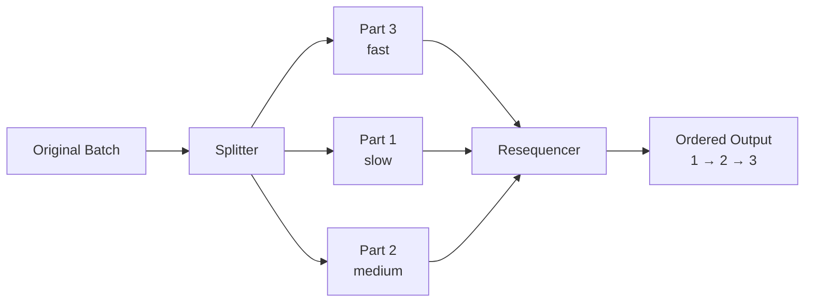
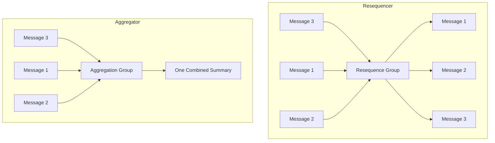
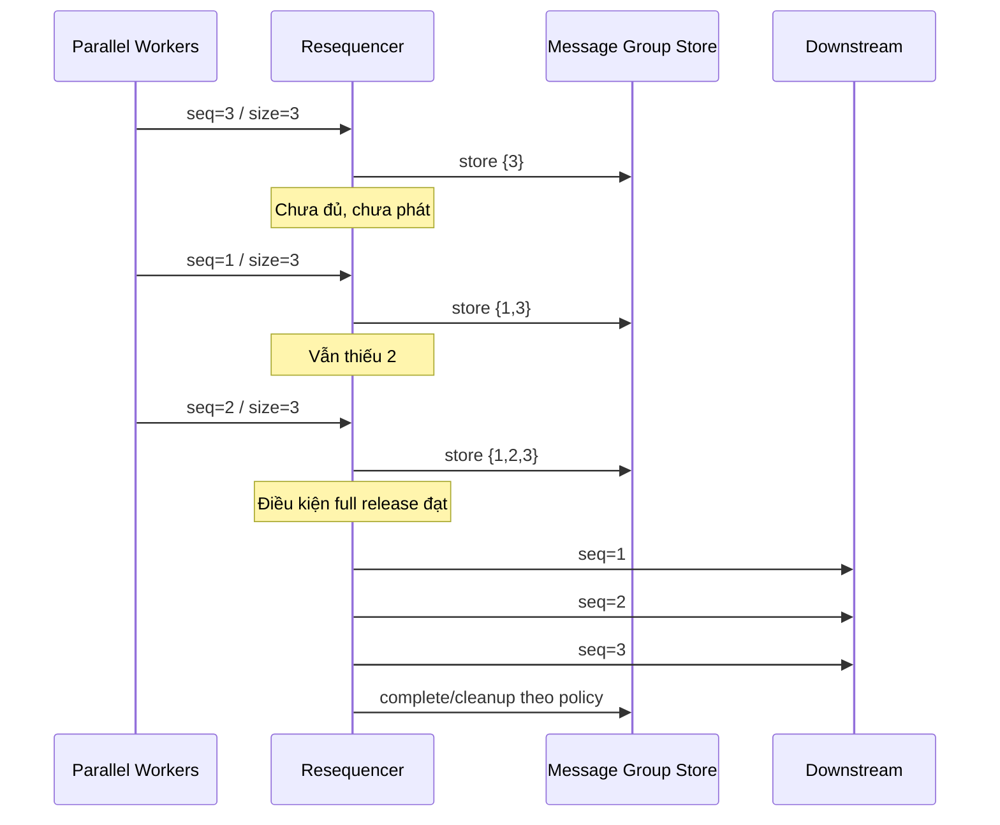
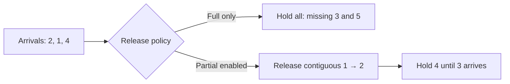
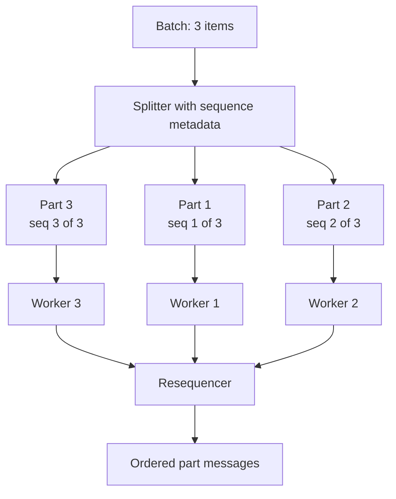
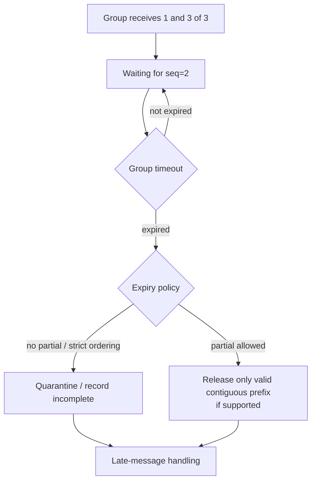
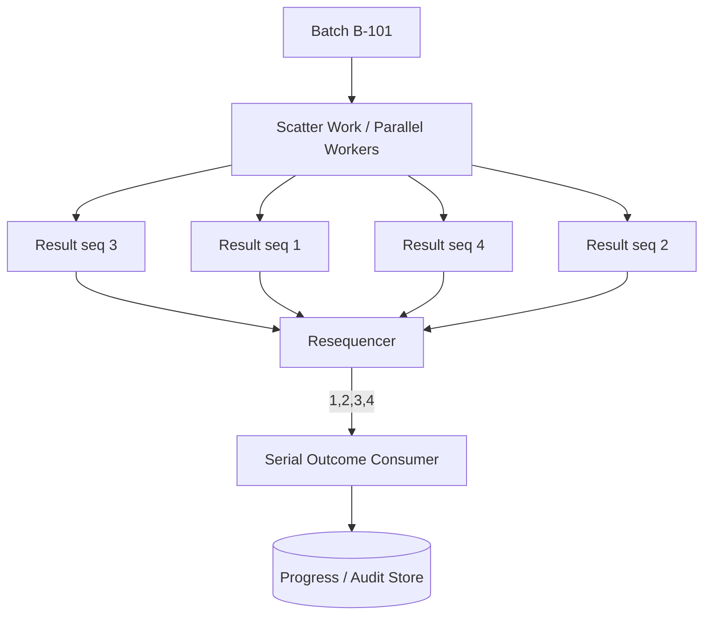

# Release khi đủ sequence

**Resequencer** là một Enterprise Integration Pattern (EIP) dùng để **đưa các message của cùng một nhóm về đúng thứ tự** khi chúng đã tới hệ thống không theo thứ tự ban đầu. Trong Spring Integration, Resequencer thường dựa trên metadata như `correlationId`, `sequenceNumber` và `sequenceSize` để nhận biết các phần tử của nhóm, chờ điều kiện release rồi phát **từng message** theo đúng thứ tự.

Ví dụ, một đơn hàng được Splitter tách thành ba phần, gửi tới các worker độc lập. Vì thời gian xử lý khác nhau, kết quả về theo trình tự **3 → 1 → 2**. Nhưng một downstream handler yêu cầu xử lý theo thứ tự **1 → 2 → 3**. Nếu chuyển tiếp ngay khi nhận, việc gửi kết quả số 3 trước số 1 có thể phá vỡ ngữ nghĩa xử lý.

Bài học **“Release khi đủ sequence”** thuộc chương **Resequencer** của module **SPRING_INTEGRATION_PATTERN**. Mục tiêu của module là thực hành triển khai Enterprise Integration Patterns với Spring Integration để xây dựng các luồng thông điệp ít phụ thuộc, dễ mở rộng: Router, Filter, Transformer, Splitter, Aggregator, Gateway, retry, error channel, correlation và các kỹ thuật kiểm thử/quan sát nhánh xử lý.

Trọng tâm của bài là **khi nào Resequencer có đủ thông tin để release một nhóm**, đâu là giới hạn của `sequenceSize`, cách xử lý thiếu/trùng/đến muộn và cách cấu hình một luồng Spring Integration có thể kiểm thử.

**Sau bài học**, bạn có thể phân biệt Resequencer với Aggregator, hiểu cơ chế chờ sequence hoàn chỉnh, thiết kế metadata nhất quán, phân biệt chế độ release toàn bộ và partial release, chọn timeout/message store phù hợp, rồi xây test chứng minh message chỉ được phát đúng thứ tự theo hợp đồng.

## 1. Vì sao phải resequence?

Trong một pipeline tuần tự, message thường đi qua các bước theo thứ tự phát. Nhưng khi có Splitter, ExecutorChannel, nhiều worker, broker hoặc xử lý song song, **thứ tự hoàn tất** có thể khác **thứ tự nguồn**.



Ví dụ có ba kết quả:

| Message | `sequenceNumber` | Thời gian hoàn tất | Thứ tự đến Resequencer |
| --- | ---: | ---: | ---: |
| `Part-1` | 1 | 700 ms | Thứ 2 |
| `Part-2` | 2 | 950 ms | Thứ 3 |
| `Part-3` | 3 | 200 ms | Thứ 1 |

Nếu downstream cần ghi nhật ký theo thứ tự hoặc áp dụng các bước có quan hệ phụ thuộc, kết quả nhận được **3, 1, 2** là không phù hợp. Resequencer **lưu tạm theo nhóm**, chờ đủ điều kiện và phát theo số thứ tự:

```text
Arrival order : 3, 1, 2
Group members : {1, 2, 3}
Release order : 1, 2, 3
```

Tuy nhiên, không phải luồng nào cũng cần Resequencer. Nếu kết quả được ghi bằng upsert có version guard hoặc các phép toán giao hoán, thứ tự arrival có thể không quan trọng. **Không nên thêm bộ đệm chờ vô hạn chỉ vì muốn “trông có thứ tự”.**

### Tại sao đúng thứ tự đôi khi là điều kiện bắt buộc?

- **Audit nghiệp vụ:** sự kiện `CREATED` phải được ghi trước `PAID` trong một trình tự có ngữ nghĩa.
- **Tích lũy state theo sự kiện:** bước sau không được áp dụng trước bước trước nếu các phép biến đổi không giao hoán.
- **Lắp nội dung:** các đoạn dữ liệu cần được phát theo `chunkIndex` để tái tạo chính xác.
- **Xử lý batch có thứ tự:** downstream yêu cầu phần tử 1 trước phần tử 2 theo hợp đồng.
- **Replay có kiểm soát:** message bị phát lại không được ghi đè kết quả của phiên bản mới.

Resequencer có thể giải quyết **thứ tự output message trong phạm vi nhóm đã xác định**. Nó **không tự kiểm chứng business state, không tạo transactional commit order xuyên các consumer bất đồng bộ** và không tự làm các side effect trở thành idempotent.

## 2. Resequencer khác Aggregator như thế nào?

Hai pattern cùng giữ message thành nhóm và đánh giá điều kiện release, nhưng mục đích khác nhau.

| Tiêu chí | Resequencer | Aggregator |
| --- | --- | --- |
| Mục đích | **Sắp lại** thứ tự message | **Ghép** nhiều message thành một kết quả |
| Đầu vào | N message có correlation/sequence | N message có correlation/điều kiện ghép |
| Đầu ra | Thường **N message riêng lẻ** theo đúng thứ tự | Thường **một message/result tổng hợp** |
| Điều kiện release | Nhóm đủ sequence hoặc partial policy được cấu hình | Release strategy tùy nghiệp vụ |
| Xử lý payload | Giữ từng payload/message theo hợp đồng | Tạo payload kết hợp, tổng hợp, merge |
| Ví dụ | 3,1,2 → 1,2,3 | 3 item results → BatchSummary |



Hai pattern có thể xuất hiện nối tiếp: Splitter chia message, các worker trả kết quả, Resequencer phục hồi thứ tự từng kết quả, rồi Aggregator gom thành báo cáo. Nhưng **nếu Aggregator chỉ cần gom theo tập ID và không quan tâm thứ tự**, thêm Resequencer có thể không cần thiết.

### Đừng nhầm “release đủ message” với “business success”

Nhóm có đủ 3 phản hồi không có nghĩa cả 3 xử lý thành công. Một result `FAILED` vẫn có thể là **một member hợp lệ** của sequence theo hợp đồng. Resequencer phục hồi thứ tự các result ấy; quyết định batch thành công hay thất bại thuộc bước downstream.

## 3. Ba metadata cốt lõi: correlation, number và size

Resequencer cần biết **message thuộc nhóm nào**, **vị trí của nó** và **cần bao nhiêu phần tử**.

| Thuộc tính | Vai trò | Ví dụ |
| --- | --- | --- |
| `correlationId` | Nhóm những message cùng một chuỗi | `batch-101` |
| `sequenceNumber` | Số thứ tự của một phần trong nhóm | `1`, `2`, `3` |
| `sequenceSize` | Số message dự kiến trong chuỗi hoàn chỉnh | `3` |
| `eventId`/`partId` | Định danh nghiệp vụ ổn định để chống duplicate | `evt-101-part-2` |
| `tenantId`/`workflowId` | Phạm vi phân quyền và tách biệt nhóm | `tenant-a` |

Ví dụ ba message cùng nhóm:

```text
Message A
  payload = "fragment-1"
  headers:
    correlationId = "batch-101"
    sequenceNumber = 1
    sequenceSize = 3

Message B
  payload = "fragment-2"
  headers:
    correlationId = "batch-101"
    sequenceNumber = 2
    sequenceSize = 3

Message C
  payload = "fragment-3"
  headers:
    correlationId = "batch-101"
    sequenceNumber = 3
    sequenceSize = 3
```

Trong Spring Integration, các header tương ứng thường được biểu diễn qua `IntegrationMessageHeaderAccessor` và các cơ chế Splitter/correlation handler của framework. Nếu qua transport ngoài như Kafka/JMS/HTTP, hãy **kiểm tra header mapper, serializer và hợp đồng dữ liệu**; không mặc định tên hoặc kiểu header trong một JVM sẽ còn nguyên khi sang tiến trình khác.

### Correlation ID phải đủ duy nhất

Nếu chỉ đặt `correlationId=orderId`, hai lần xử lý hợp lệ của cùng đơn có thể bị nhập vào một nhóm. Tốt hơn là dùng một **generation/batch attempt ID** do server tạo, ví dụ `tenantId + orderId + processingRunId`.

Đặc biệt, correlation ID do client tự gửi không được tin để vượt qua ranh giới tenant. Một key trùng hoặc giả mạo có thể khiến message của hai khách hàng bị ghép nhóm và gây lộ dữ liệu.

### Sequence number là vị trí trong *nhóm*, không phải toàn bộ stream

`sequenceNumber=2` của nhóm A không có quan hệ trực tiếp với `sequenceNumber=2` của nhóm B. Cũng không được nhầm nó với **version của aggregate** như `orderVersion=42`, trừ khi business contract thật sự quy định hai đại lượng ấy là một.

## 4. “Release khi đủ sequence” nghĩa chính xác là gì?

Với một nhóm có `sequenceSize=N` đáng tin cậy, điều kiện release toàn bộ nên được hiểu là:

> Nhóm đã nhận các phần tử hợp lệ ở **mọi vị trí từ 1 đến N**, với cùng correlation scope và metadata nhất quán; khi đó các message được phát theo vị trí tăng dần.

Tập sequence đầy đủ:

\[
S = \{1, 2, \ldots, N\}
\]

Tập vị trí thực nhận sau khi loại trùng là \(R\). Điều kiện:

\[
R = S
\]

Ví dụ `N=4`:

| Đã nhận | Đủ sequence? | Lý do |
| --- | --- | --- |
| `{3}` | Không | Thiếu 1, 2, 4 |
| `{1,3,4}` | Không | Thiếu 2 |
| `{1,2,3,4}` | Có | Đủ mọi vị trí |
| `{1,2,2,4}` | Không | Message trùng vị trí 2, vẫn thiếu 3 |
| `{1,2,3,5}` | Không hợp lệ | Vị trí 5 vượt N=4 |
| `{1,2,3,4,4}` | Đủ về **vị trí**, nhưng có duplicate cần policy riêng | Không được phát phần tử 4 hai lần vô tình |

**Chỉ nhìn `group.size() == sequenceSize` chưa đủ** trong một hệ thống có duplicate hoặc dữ liệu đầu vào sai. Hợp đồng đúng cần kiểm tra *các vị trí phân biệt*, giới hạn số thứ tự và identity của message.

### Cần phân biệt mặc định framework và business contract bổ sung

Resequencer Spring Integration có cơ chế grouping/release theo metadata sequence và các tùy chọn của nó. Tuy nhiên, **không nên suy ra rằng framework luôn xác minh mọi bất biến nghiệp vụ** như tenant ID, part ID, signature, schema version hay duplicate hợp lệ.

Với nguồn bên ngoài không đáng tin cậy, hãy kiểm tra ở ingress hoặc một Filter/validation step trước khi đưa message vào group. Điều này quan trọng hơn việc dựa trên đếm số lượng.

## 5. Diễn biến một nhóm khi message tới sai thứ tự

Giả sử `N=3` và message lần lượt tới 3 → 1 → 2:



Đây là **mô hình diễn giải**, không hứa các thao tác store/send là một giao dịch nguyên tử trong mọi cấu hình.

Hệ thống cần trả lời:

1. Các message có được giữ bền vững không?
2. Nếu process restart khi đang có `{1,3}`, chúng còn không?
3. Nếu sau khi phát seq=1 mà output channel lỗi ở seq=2, retry từ đâu?
4. Nếu một duplicate seq=2 đến sau release, nó bị xử lý thế nào?
5. Nếu các nhóm A và B xen kẽ, có cần thứ tự *giữa hai nhóm* không?
6. Nếu output là ExecutorChannel có nhiều worker, downstream có thể hoàn tất seq=3 trước seq=1 không?

Resequencer có thể giải quyết **thứ tự phát**, nhưng các điểm 3–6 cần thêm idempotency, policy late message và kiểm soát concurrency downstream.

## 6. Khi nào nên chờ đủ cả nhóm, khi nào cho partial release?

Có hai cách nhìn khác nhau:

- **Full release:** chờ toàn bộ các vị trí từ 1 đến N rồi phát N message theo thứ tự.
- **Partial sequence release:** cho phép phát **đoạn đầu liên tục** khi điều kiện và cấu hình hỗ trợ, dù chưa nhận toàn bộ N message.

Ví dụ `N=5`, các message tới theo thứ tự `2, 1, 4`:

- Với **full release**, chưa có output nào cho đến khi 3 và 5 đến.
- Với **partial release**, có thể phát 1 rồi 2 vì đã có **đoạn đầu liên tục**. Không thể phát 4 trước 3 chỉ vì 4 đã đến.



Trong Spring Integration, Resequencer có lựa chọn **`releasePartialSequences`** ở các cấu hình hỗ trợ. Hành vi đầy đủ của partial release, việc giữ group và timeout cần được xác minh với phiên bản framework đang dùng.

### Chọn full release khi nào?

Phù hợp nếu một downstream chỉ được bắt đầu sau khi **tất cả phần tử đã có mặt**, hoặc khi cần một nhóm đầu ra không bị xé nhỏ giữa các lần release. Ví dụ một hệ thống tái tạo tài liệu đòi đủ mọi chunk trước khi phát bất kỳ phần nào.

Nhược điểm: một message bị thiếu có thể làm **toàn bộ nhóm mắc kẹt**, gây tăng độ trễ và lượng lưu trữ.

### Chọn partial release khi nào?

Phù hợp với stream mà việc phát đoạn đầu liên tục là an toàn, ví dụ một hệ thống render các chunk nội dung theo thứ tự. Nó giảm latency nhưng yêu cầu downstream có thể tiếp tục xử lý khi chuỗi chưa hoàn tất.

**Partial release của Resequencer không giống “partial batch success” của Aggregator.** Nó nói về **đoạn sequence liên tục được phép phát**, không tự quyết định tình trạng hoàn tất của một nghiệp vụ.

## 7. Trường hợp sequence bị thiếu

Giả sử nhận được:

```text
correlationId=batch-101
sequenceSize=4
arrivals: 1, 3, 4
missing: 2
```

Nếu cấu hình chờ full release, nhóm sẽ chưa thể phát toàn bộ theo hợp đồng. Nếu partial release được bật, phần tử 1 có thể đã được phát, nhưng 3 và 4 không thể đi qua khoảng trống số 2 mà vẫn bảo toàn thứ tự.

**Timeout không có khả năng làm xuất hiện sequence number 2.** Nó chỉ kích hoạt một hành vi expiration/recovery đã được quy định.

### Các lựa chọn nghiệp vụ khi thiếu một phần tử

| Phương án | Điều kiện áp dụng | Cần bảo vệ |
| --- | --- | --- |
| **Tiếp tục chờ** | SLA chưa hết, message có thể đến | Giới hạn thời gian/dung lượng |
| **Retry producer/worker cho phần tử 2** | Có đủ identity và retry an toàn | Idempotency, không tạo duplicate |
| **Quarantine cả group** | Không được bỏ qua vị trí 2 | Lưu state, vận hành và SLA |
| **Emit một failure/skip marker cho vị trí 2** | Business cho phép đánh dấu phần tử không thành công | Thống nhất sequence và outcome semantics |
| **Đóng group và ghi incomplete** | Không thể phục hồi hợp lý | Terminal outcome, late-message handling |
| **Cho release một phần theo policy** | Downstream chấp nhận đoạn đầu hợp lệ | Không phát 3 trước 2 |

Một cách làm nguy hiểm là **tự điều chỉnh `sequenceSize` từ 4 xuống 3** chỉ để nhóm release. Nếu seq=2 thật sự tồn tại nhưng đến chậm, thay đổi size làm sai hợp đồng nguồn và có thể khiến message đó không có nơi xử lý.

### Message bị Filter loại phải được xét trong expected count

Nếu Splitter tạo 4 phần nhưng Filter bỏ phần số 2, Resequencer vẫn đợi đủ bốn số nếu không có cơ chế điều chỉnh hợp lệ. Có thể:

- Filter **trước Splitter**, để Splitter tạo sequence metadata dựa trên những item thực sự sẽ được xử lý.
- Nếu Filter sau Splitter, nhánh discard tạo **typed result** mang `sequenceNumber=2` (ví dụ `REJECTED` hoặc `SKIPPED`), giúp downstream biết vị trí ấy được giải quyết theo policy.
- Thiết kế **manifest** và endpoint điều phối lại sequence khi thay đổi số phần, không sửa trực tiếp header một cách tùy tiện.

Discard flow của Filter **không tự tạo một message thay thế** cho Resequencer.

## 8. Tạo metadata chuẩn ở nguồn Splitter

Một Splitter của Spring Integration có thể phát sequence headers cho các phần được tách. Khi dùng dạng này, các phần có chung correlation metadata và các `sequenceNumber` trong phạm vi batch.



Trước khi áp dụng:

- Xác minh Splitter có cấu hình **apply sequence** phù hợp và nguồn có thể biết đầy đủ số phần tử.
- Mỗi worker phải **giữ** correlation và sequence metadata khi tạo result, hoặc ánh xạ chúng bằng một hợp đồng envelope rõ ràng.
- Nếu qua broker, xác minh header mapper còn chuyển đủ dữ liệu; không mặc định một object Java trong header được serialize.
- Nếu Splitter nhận stream không có kích thước xác định, `sequenceSize` có thể không được cung cấp như mong đợi; lúc đó cần một chiến lược release khác, không giả định luôn biết N.
- Nếu Splitter có nhiều cấp lồng nhau, metadata của nhóm ngoài và nhóm trong phải được phân biệt. Không lấy sequence header của nhóm sai.

**Một message có `sequenceNumber=3` không bảo đảm đã từng có message 1 và 2**. Nguồn phải tạo metadata từ một tập đầu vào đáng tin và vận hành phải có cách khôi phục phần tử thất lạc.

## 9. Ví dụ Java: dữ liệu cho kết quả xử lý từng phần

Chúng ta xây một ví dụ cho batch gồm ba dòng hàng. Các worker có thể hoàn tất sai thứ tự nhưng downstream muốn thấy kết quả được phát theo `1, 2, 3`.

```java
import java.time.Instant;

record PartResult(
    String batchId,
    String itemId,
    int index,
    int expectedCount,
    String status,
    Instant completedAt
) {
    PartResult {
        if (batchId == null || batchId.isBlank()
                || itemId == null || itemId.isBlank()
                || index <= 0 || expectedCount <= 0
                || index > expectedCount
                || completedAt == null) {
            throw new IllegalArgumentException("Invalid part result");
        }
    }
}
```

Ở ví dụ này, `index` và `expectedCount` là trường nghiệp vụ có thể được dùng để **đối chiếu** với headers. Resequencer theo cấu hình mặc định thường sử dụng **sequence headers** để xác định nhóm và thứ tự, không tự dựa vào `PartResult.index` trừ khi bạn cấu hình strategy khác.

Khi xây message, bảo đảm hai nguồn thông tin khớp nhau:

```java
import org.springframework.messaging.Message;
import org.springframework.messaging.support.MessageBuilder;

final class PartMessageFactory {

    Message<PartResult> toMessage(PartResult result) {
        return MessageBuilder.withPayload(result)
            .setHeader("correlationId", result.batchId())
            .setHeader("sequenceNumber", result.index())
            .setHeader("sequenceSize", result.expectedCount())
            .setHeader("partId", result.itemId())
            .build();
    }
}
```

Đây là cách tạo message nội bộ đã có metadata. Với nhiều tenant, một `batchId` đơn lẻ **không đủ** nếu ID có thể trùng giữa các tenant. Khi đó hãy sử dụng batch generation ID duy nhất phía server hoặc một correlation strategy tạo khóa hợp lệ từ tenant và batch. Tương tự, `sequenceSize` phải do nguồn đáng tin cậy cấp, không lấy một header client tự khai mà không kiểm tra.

### Kiểm tra header và payload tại ingress

```java
final class PartResultContract {
    void validate(Message<PartResult> message) {
        PartResult part = message.getPayload();

        Object number = message.getHeaders().get("sequenceNumber");
        Object size = message.getHeaders().get("sequenceSize");
        Object correlation = message.getHeaders().get("correlationId");

        if (!(number instanceof Integer n)
                || !(size instanceof Integer s)
                || !(correlation instanceof String key)
                || !key.equals(part.batchId())
                || n != part.index()
                || s != part.expectedCount()) {
            throw new IllegalArgumentException(
                "Sequence headers do not match payload");
        }
    }
}
```

Nếu framework hoặc transport dùng kiểu khác cho các trường, cần chuẩn hóa/parse theo contract trước validation. Ví dụ này giả định các header `sequenceNumber` và `sequenceSize` là `Integer` như được tạo bằng factory trên.

**Validation phải chạy trước Resequencer** để không đưa message không hợp lệ vào group store. Nó kiểm tra nhất quán giữa payload và headers, chưa bảo đảm một index thuộc đúng danh sách item kỳ vọng; muốn như vậy cần batch manifest.

## 10. Spring Integration Java DSL: Resequencer chỉ release khi đủ sequence

Một luồng tối giản gồm:

1. Ingress tin cậy kiểm tra `Message<PartResult>` và các sequence headers trước khi gửi.
2. `parts.unordered` nhận message đã được kiểm tra.
3. Resequencer lưu nhóm và chỉ release khi đủ theo chế độ full.
4. `parts.ordered` nhận từng message được phát theo thứ tự.

```java
import org.springframework.context.annotation.Bean;
import org.springframework.context.annotation.Configuration;
import org.springframework.integration.channel.DirectChannel;
import org.springframework.integration.channel.QueueChannel;
import org.springframework.integration.config.EnableIntegration;
import org.springframework.integration.dsl.IntegrationFlow;
import org.springframework.messaging.MessageChannel;
import org.springframework.messaging.PollableChannel;

@Configuration
@EnableIntegration
class OrderedPartFlowConfiguration {

    @Bean("parts.unordered")
    MessageChannel unorderedParts() {
        return new DirectChannel();
    }

    @Bean("parts.ordered")
    PollableChannel orderedParts() {
        // Chỉ để test; queue trong bộ nhớ không tự bền vững.
        return new QueueChannel();
    }

    @Bean
    IntegrationFlow resequenceParts() {
        return IntegrationFlow.from("parts.unordered")
            .resequence(spec -> spec
                .releasePartialSequences(false))
            .channel("parts.ordered")
            .get();
    }
}
```

**Đây là cấu hình minh họa Java DSL**, cần đối chiếu API với phiên bản Spring Integration của ứng dụng và kiểm thử thật. `releasePartialSequences(false)` thể hiện lựa chọn **không phát prefix sớm**; các tùy chọn `groupTimeout`, `messageStore` và `expireGroupsUponCompletion` có thể được bổ sung theo chính sách timeout/durability đã xác định.

### Validation phải ở một bước không làm mất message

Không dùng `Service Activator` một chiều trả `null` để thực hiện validation giữa input và Resequencer: endpoint ấy sẽ **kết thúc luồng**. Một phương án đơn giản là kiểm tra contract **trước khi gửi** vào channel của Resequencer:

```java
import org.springframework.messaging.Message;
import org.springframework.messaging.MessageChannel;

final class ValidatingPartPublisher {
    private final MessageChannel input;
    private final PartResultContract contract =
        new PartResultContract();

    ValidatingPartPublisher(MessageChannel input) {
        this.input = input;
    }

    void publish(Message<PartResult> message) {
        contract.validate(message);
        if (!input.send(message)) {
            throw new IllegalStateException(
                "Resequencer input rejected");
        }
    }
}
```

`ValidatingPartPublisher` phải được nối với `parts.unordered` và nguồn gọi phải được xác thực. Trong production, không cho một nguồn khác gửi thẳng message chưa kiểm tra vào channel; hoặc đưa validation vào một endpoint pass-through phù hợp và đã được kiểm thử. Khi qua broker/adapter, việc chuẩn hóa header có thể cần thực hiện trước `PartResultContract`.

### Điểm khác giữa output và downstream commit

`parts.ordered` là một `QueueChannel` có thể đọc tuần tự trong test. Nếu thay bằng `ExecutorChannel` có nhiều worker hoặc consumer group xử lý song song, việc Resequencer phát **1 trước 2** không chứng minh database commit theo cùng thứ tự. Muốn đúng **commit order**, cần consumer tuần tự theo nhóm/key hoặc version guard ở database.
## 11. Thực hành: gửi 3 rồi 1 rồi 2

Mô phỏng một nguồn xử lý song song trả về message theo thứ tự khác nguồn. Dùng `PartMessageFactory` đã định nghĩa:

```java
import java.time.Instant;
import org.springframework.messaging.Message;
import org.springframework.messaging.MessageChannel;
import org.springframework.messaging.PollableChannel;

// Phác thảo trong Spring test fixture đã inject channel:
MessageChannel unordered = /* bean "parts.unordered" */ null;
PollableChannel ordered = /* bean "parts.ordered" */ null;
PartMessageFactory factory = new PartMessageFactory();

Message<PartResult> third = factory.toMessage(
    new PartResult("batch-101", "item-3", 3, 3,
        "SUCCESS", Instant.now()));
Message<PartResult> first = factory.toMessage(
    new PartResult("batch-101", "item-1", 1, 3,
        "SUCCESS", Instant.now()));
Message<PartResult> second = factory.toMessage(
    new PartResult("batch-101", "item-2", 2, 3,
        "SUCCESS", Instant.now()));

unordered.send(third);
unordered.send(first);

// Nếu cấu hình full release đang hoạt động,
// chưa được có message trong ordered ở thời điểm này.
Message<?> beforeComplete = ordered.receive(100);
// expected: null

unordered.send(second);

Message<?> out1 = ordered.receive(1_000);
Message<?> out2 = ordered.receive(1_000);
Message<?> out3 = ordered.receive(1_000);

// expected sequenceNumber: 1, 2, 3
```

Các biến `unordered`/`ordered` có giá trị `null` ở đây chỉ là **placeholder để minh họa cách gọi**; mã không phải một chương trình độc lập có thể chạy nguyên văn. Phần test JUnit với injection được trình bày ở mục 18.

Khi full release, trước khi nhận seq=2 còn thiếu, không nên có output. Khi seq=2 tới, nhóm hoàn chỉnh và output phải theo thứ tự 1,2,3.

### Nếu nhóm A và B xen kẽ?

Ví dụ:

```text
arrival:
  A3, B2, A1, B1, A2

possible output by full groups:
  B1, B2
  A1, A2, A3
```

Resequencer bảo đảm thứ tự **bên trong từng correlation group** theo contract; nó không có nghĩa toàn bộ message từ các nhóm phải theo thời điểm tạo trên toàn hệ thống. Nếu cần global ordering, cần một **global sequence** và cơ chế tuần tự hóa tương ứng, có thể làm giảm parallelism.

## 12. Sequence size thay đổi hoặc không biết trước

Chế độ full release đơn giản nhất khi `sequenceSize=N` được xác định từ đầu và **không thay đổi** trong cùng group.

Nhưng một số hệ thống có dữ liệu dạng streaming, số phần chỉ biết khi kết thúc. Ví dụ producer gửi các chunk liên tục và chỉ đánh dấu “last chunk” ở cuối.

Các lựa chọn:

- Dùng **manifest/expected count** được phát sau khi chuẩn bị đủ dữ liệu, trước khi gửi các chunk.
- Dùng một **end-of-sequence marker** do nguồn đáng tin cậy phát và thiết kế release strategy tương ứng.
- Dùng **partial contiguous release** để giảm độ trễ, kèm gap policy khi thiếu chunk.
- Xây một **stateful streaming reorder buffer** có sequence tăng dần và deadline, nếu bài toán không phù hợp với kiểu group size cố định của Resequencer.
- Với event stream vô hạn, dùng partition ordering và consumer version guard thay vì giả định tồn tại một nhóm hoàn chỉnh.

**Không tùy tiện gán `sequenceSize=1` cho mọi message** để chúng “ra ngay”; làm vậy loại bỏ ý nghĩa chờ đủ và có thể che mất lỗi dữ liệu.

### Tương tác với Splitter kiểu streaming

Nếu Splitter tách một nguồn không biết kích thước, framework có thể không luôn gắn `sequenceSize` theo cách một tập hữu hạn có thể gắn. Cần xác minh kiểu input, khả năng đếm, option sequence và release policy thực tế. Nếu không biết N, lựa chọn full release **không tự có tiêu chí hoàn tất**.

## 13. Duplicate, retry và out-of-order là ba vấn đề khác nhau

Một thiết kế Resequencer tốt phải chịu được:

| Vấn đề | Ví dụ | Cơ chế bảo vệ |
| --- | --- | --- |
| **Out-of-order** | 3 tới trước 1 | Resequencer giữ và phát có thứ tự |
| **Duplicate** | Seq=2 được gửi hai lần | Dedup theo `batchId + sequenceNumber + itemId`/version |
| **Missing** | Seq=2 không bao giờ tới | Timeout/gap recovery |
| **Late arrival** | Seq=2 tới sau khi group đã đóng | Terminal state/tombstone, policy late reply |
| **Conflicting version** | Hai payload khác nhau cùng seq=2 | Validate version/attempt, reject hoặc resolve theo quy tắc |
| **Cross-tenant key collision** | Hai tenant cùng batch ID | Correlation scope an toàn |
| **Downstream commit reordering** | seq 2 commit trước seq 1 | Serial consumer hoặc database version guard |

**Resequencer không phải công cụ exactly-once**. Dù đầu ra đúng thứ tự, message có thể bị redelivery nếu acknowledgment thất bại. Với side effect quan trọng, consumer phải idempotent.

### Ví dụ duplicate nguy hiểm

```text
sequenceSize=3
messages:
  1: item-A
  2: item-B
  2: item-B   (redelivery)
  3: never received
```

Nếu chỉ đếm ba message để release, có thể coi nhóm đã hoàn chỉnh dù **thiếu vị trí 3**. Cần kiểm tra uniqueness bằng sequence key, không coi mọi item trong store là một phần riêng.

### Dedup nên làm ở đâu?

- **Ở ingress:** chống cùng một event ID được đưa vào group nhiều lần.
- **Trong release validation:** kiểm tra đủ tập sequence 1..N.
- **Ở output:** chống phát lại kết quả sau crash/retry.
- **Ở consumer:** chống side effect lặp dù transport redeliver.

Mỗi lớp bảo vệ một rủi ro khác nhau; không nên chỉ dùng một HashSet trong RAM rồi tuyên bố đã kiểm soát toàn bộ retry/distributed delivery.

## 14. Timeout cho nhóm chưa đủ sequence

Một nhóm có thể không bao giờ hoàn chỉnh. Nếu không có timeout hoặc cleanup, `MessageGroupStore` có thể chứa các phần tử vô hạn.

Trong Spring Integration, cấu hình Resequencer/Aggregator có thể cung cấp cơ chế `groupTimeout` và các option liên quan đến group expiration. Tuy nhiên, **group timeout không tự tạo message bị thiếu** và **không tự chứng minh có thể bỏ qua vị trí thiếu**.



Cần thiết kế:

1. **Thời hạn:** inactivity timeout hay deadline tuyệt đối từ nguồn?
2. **Điều kiện partial:** có được phát 1 khi thiếu 2,3 không?
3. **Bảo toàn thứ tự:** không phát 3 vượt 2 chỉ để kết thúc.
4. **Kết quả thiếu:** lưu missing sequence numbers, batch ID và reason code ở đâu?
5. **Trạng thái terminal:** group hết hạn có bị xóa không; late message đến xử lý thế nào?
6. **Recovery:** có cơ chế xin gửi lại seq=2 hay không?
7. **Quan sát:** mở bao nhiêu group, tuổi bao lâu, tỷ lệ timeout tăng ở nhánh nào?

Trong một số cấu hình, group timeout sẽ dẫn tới expiration/discard chứ không phát các phần tử. **Đừng giả định bật timeout là có partial release an toàn.** Cần kiểm tra tương tác `groupTimeout`, `releasePartialSequences`, output/expiry handler và version framework trong integration tests.

### Timeout của group không phải timeout của worker

Một worker xử lý seq=2 có thể tiếp tục chạy sau khi group hết hạn. Hãy cấu hình timeout riêng cho HTTP/database call và có chính sách khi kết quả đến muộn. Group timeout chỉ quyết định **đến lúc nào không còn chờ nhóm như cũ**.

## 15. MessageGroupStore, restart và nhiều instance

Resequencer là thành phần **có trạng thái**: nó phải giữ message tới khi đủ điều kiện release.

| Lựa chọn store | Ưu điểm | Giới hạn |
| --- | --- | --- |
| In-memory (mặc định thường dùng trong ví dụ) | Dễ cấu hình, latency thấp | Mất group khi restart |
| Persistent store | Có thể khôi phục các group mở | Phải kiểm thử transaction, schema và recovery |
| Shared/distributed store | Nhiều instance cùng thấy state | Locking, ownership, concurrency phức tạp |
| Durable event log + rebuild | Có thể tái dựng state từ các message | Cần checkpoint, version và replay logic |

**Một `QueueChannel` đầu ra trong RAM không tạo durability**, kể cả khi group store là persistent. Muốn đảm bảo không mất output sau release, cần đánh giá **cả group state, output publish, ack và idempotency của downstream**.

### Group completion và cleanup

Khi nhóm đã release, framework có thể giữ hoặc xóa group metadata theo `expireGroupsUponCompletion` và các option khác. Nếu xóa hoàn toàn, một duplicate đến muộn có thể tạo group mới với cùng correlation ID.

Giải pháp thực tế khi cần bảo đảm:

- Lưu một **terminal group record/tombstone** theo `tenantId + batchId + generation`.
- Dedup trước khi nhận message vào Resequencer.
- Có retention phù hợp với redelivery và replay window.
- Nếu cần phát một sequence mới cho cùng batch, dùng **generation ID mới**.
- Khi multi-instance, áp dụng cơ chế lock/fencing/transaction phù hợp để tránh hai node cùng release.
- Nếu group đã phát một phần trước crash, lưu tiến độ release theo policy để không phát lại sai vị trí.

**Persistent MessageGroupStore không tự đảm bảo exactly-once end-to-end.** Đây là trách nhiệm chung của cả transport, store, output và consumer.

## 16. Header propagation qua Transformer, Router và broker

Resequencer thường dựa trên metadata; mất một header có thể khiến message không còn được nhóm đúng.

### 16.1. Transformer trả payload hoặc Message mới

Nếu Transformer chỉ trả payload mới, Spring Integration thường tạo message output và truyền những header phù hợp của input. Nếu tự xây `Message<?>`, phải kiểm tra propagation thật tại output endpoint.

Khi input là `seq=2/3`, output vẫn phải giữ đúng correlation scope và sequence nếu nó là **cùng một part**. Nếu Transformer lại Splitter thành các part mới, sequence metadata cũ có thể không còn phù hợp; cần tạo group/sequence mới theo contract.

### 16.2. Router và Filter

Nếu Router đưa các part của cùng nhóm sang những nhánh khác nhau, không nhánh nào được làm mất sequence metadata nếu dự kiến tập hợp lại. Filter có thể bỏ một part; khi đó Resequencer sẽ chờ phần thiếu nếu policy vẫn kỳ vọng N.

Để không tạo gap giả, cân nhắc Filter trước Splitter hoặc phát một typed rejection/skip result cho phần bị loại.

### 16.3. Broker và nhiều consumer

Kafka bảo toàn **thứ tự record trong một partition**, nhưng không tự sửa một stream mà producer đã gửi sai business sequence; cũng không có ordering toàn topic. Nếu nhiều worker xử lý song song, output completion có thể vẫn đảo thứ tự.

Khi message đi từ Spring Integration qua Kafka/AMQP/JMS rồi quay lại, phải xác minh:

- Correlation ID/sequence được serialize thành dữ liệu đáng tin cậy.
- Part identity và tenant scope có mặt ở phía consumer.
- Consumer không tự tạo sequenceSize khác nguồn.
- Schema/version đủ để reconstruct message khi retry.
- Không cho một client dùng raw header để điều khiển correlation hoặc reply route nội bộ.

Resequencer hữu ích khi **thứ tự đến không được bảo đảm** nhưng tập hữu hạn và metadata sequence rõ ràng; không nên đưa nó vào mọi luồng streaming chỉ vì có broker.

## 17. Giữ đúng thứ tự output chưa đủ để giữ thứ tự side effect

Một Resequencer có thể phát:

```text
seq=1 -> seq=2 -> seq=3
```

Nhưng nếu đầu ra chuyển sang ba executor worker:

```text
seq=1 start  t=0 ms ; completes t=500 ms
seq=2 start  t=10 ms; completes t=30 ms
seq=3 start  t=20 ms; completes t=40 ms
```

Lúc này commit order là **2,3,1**, bất chấp Resequencer đã dispatch theo thứ tự.

Muốn downstream áp dụng kết quả theo sequence, các lựa chọn gồm:

- **Một consumer tuần tự** cho mỗi group/key ở phần cuối.
- **Partitioning theo key** và consumer thực thi tuần tự từng partition.
- **Optimistic version guard**: chỉ áp dụng seq=k nếu seq=k−1 đã được áp dụng; xử lý gap rõ ràng.
- **Tách side effect không giao hoán** khỏi các phép tính có thể chạy song song.
- **Idempotency** cho retry/redelivery, tránh áp dụng cùng seq hai lần.

**Resequencer bảo vệ thứ tự phát message trong phạm vi cơ chế của nó, không phải một transaction coordinator.**

## 18. Kiểm thử “chỉ release khi đủ sequence” với JUnit

Một unit test chỉ kiểm tra comparator sort `[3,1,2]` thành `[1,2,3]` không chứng minh Resequencer **giữ message cho tới khi đủ nhóm**. Cần test hành vi qua channel.

### 18.1. Ma trận kiểm thử

| Tình huống | Kỳ vọng |
| --- | --- |
| Gửi seq=3 rồi seq=1, N=3 | **Không có output** trong chế độ full release |
| Sau đó gửi seq=2 | Phát đúng thứ tự 1,2,3 |
| Gửi 1,2,3 từ đầu | Phát 1,2,3 sau đủ điều kiện release |
| Hai group A/B xen kẽ | Thứ tự đúng **trong mỗi group**, không trộn dữ liệu |
| Sai `sequenceSize` | Reject/quarantine theo validation policy |
| Seq=0 hoặc seq>N | Reject trước store |
| Duplicate seq=2 | Không được làm release sai |
| Hai payload khác nhau cùng seq | Conflict theo idempotency policy |
| Thiếu seq=2 | Không phát seq=3 vượt seq=2 ở chế độ strict |
| Full release có timeout | Xử lý group chưa hoàn chỉnh theo expiry/recovery policy |
| Bật partial release | Chỉ phát prefix liên tục theo semantics đã kiểm chứng |
| Late message sau completion | Chống tạo group mới/outcome trùng |
| Restart với group đang mở | Recovery theo store được chọn |
| Downstream xử lý đồng thời | Test riêng commit order/version guard |
| Splitter→Transformer→Resequencer | Các header vẫn đủ để group/release |
| Broker redelivery | Event ID còn ổn định, không double side effect |

### 18.2. Integration test với Spring Test

```java
import static org.junit.jupiter.api.Assertions.*;

import java.time.Instant;
import org.junit.jupiter.api.Test;
import org.springframework.beans.factory.annotation.Autowired;
import org.springframework.beans.factory.annotation.Qualifier;
import org.springframework.boot.test.context.SpringBootTest;
import org.springframework.messaging.Message;
import org.springframework.messaging.MessageChannel;
import org.springframework.messaging.PollableChannel;

@SpringBootTest
class ResequencerReleaseIntegrationTest {

    @Autowired
    @Qualifier("parts.unordered")
    MessageChannel input;

    @Autowired
    @Qualifier("parts.ordered")
    PollableChannel output;

    private final PartMessageFactory factory =
        new PartMessageFactory();

    private Message<PartResult> part(int index) {
        return factory.toMessage(new PartResult(
            "batch-101", "item-" + index,
            index, 3, "SUCCESS", Instant.now()));
    }

    @Test
    void releasesOnlyWhenAllThreeSequenceMembersArrive() {
        input.send(part(3));
        input.send(part(1));

        // Không phát message nào khi thiếu seq=2.
        assertNull(output.receive(100));

        input.send(part(2));

        Message<?> first  = output.receive(1_000);
        Message<?> second = output.receive(1_000);
        Message<?> third  = output.receive(1_000);

        assertNotNull(first);
        assertNotNull(second);
        assertNotNull(third);
        assertEquals(1, first.getHeaders().get("sequenceNumber"));
        assertEquals(2, second.getHeaders().get("sequenceNumber"));
        assertEquals(3, third.getHeaders().get("sequenceNumber"));
        assertNull(output.receive(50));
    }
}
```

Đây là **ví dụ test cần fixture thực sự**: cấu hình Spring Boot, bean được import/scanned, trạng thái group store và queue phải được cô lập giữa các test. Nếu dùng Spring Integration không có Spring Boot, có thể chuyển sang `@SpringJUnitConfig` và đăng ký đúng configuration class.

Không mặc định test này kiểm tra concurrency, durability, retry hoặc late arrival. Nó chỉ kiểm chứng **một group đủ ba phần** với đầu vào cố ý gửi sai thứ tự.

### 18.3. Kiểm thử trùng và thiếu có điều kiện thời gian

Một test bổ sung:

1. Gửi 1,3 cho nhóm N=3.
2. Đợi ngắn hơn timeout policy và assert chưa có output.
3. Gửi duplicate 3, xác minh **không tạo full release**.
4. Gửi 2, xác minh chỉ có đúng 1,2,3 theo policy.
5. Nếu app có dedup ingress, kiểm tra duplicate bị loại/ghi metric đúng cách.

Nếu muốn kiểm tra timeout, hãy cấu hình deadline ngắn **trong test configuration** và chờ qua scheduler với thời hạn hữu hạn. Tránh chỉ dùng `Thread.sleep` rồi suy luận rằng scheduler luôn xử lý đúng ở mọi load.

### 18.4. Kiểm thử thất bại ở output

Cho consumer/output channel ném exception khi nhận seq=2, rồi xác minh theo transport/transaction:

- seq=1 đã được commit hay chỉ đã dispatch?
- seq=2 được retry thế nào?
- seq=3 có bị phát sau seq=2 thất bại không?
- Group state có còn để recover không?
- Có duplicate seq=1 khi replay không?
- Side effect cuối có idempotency/version guard không?

Một test chỉ nhận đúng thứ tự từ `QueueChannel` **không** giải quyết những câu hỏi này.

## 19. Observability: biết nhóm đang chờ số thứ tự nào

Không nên chỉ quan sát tổng số message input/output. Với một nhóm đã nhận `{1,3,4}` của N=4, câu hỏi vận hành là: **“Sequence 2 đang ở đâu?”**

Một log nên ghi:

```json
{
  "event": "resequencer_group_waiting",
  "groupId": "batch-101",
  "expectedSize": 4,
  "receivedUniqueSequence": [1, 3, 4],
  "missingSequence": [2],
  "releasePolicy": "FULL",
  "status": "WAITING"
}
```

Đây là **mô hình log minh họa**. Spring Integration không tự phát chính xác JSON này; ứng dụng phải instrument ở các điểm phù hợp nếu cần.

Gợi ý metric:

```text
resequencer_messages_received_total{flow="order-parts"}
resequencer_groups_open{flow="order-parts"}
resequencer_group_releases_total{flow="order-parts",type="full"}
resequencer_group_timeouts_total{flow="order-parts"}
resequencer_duplicate_messages_total{flow="order-parts"}
resequencer_late_messages_total{flow="order-parts"}
resequencer_group_age_seconds{flow="order-parts"}
resequencer_output_failures_total{flow="order-parts"}
```

Không dùng `batchId`/`eventId` làm metric tag vì cardinality cao; các ID nên có trong log/trace/audit với phân quyền hợp lệ.

### Mốc cần theo dõi

| Mốc | Cần ghi nhận |
| --- | --- |
| Input accepted | Group ID, seq, size, part ID |
| Group updated | Received count, unique positions, missing count |
| Full release | Group ID, sequence range, release reason |
| Partial release | Vị trí cuối đã phát, còn thiếu những số nào |
| Timeout | Group age, expected/received, expiry outcome |
| Late message | Seq nào đến sau terminal state |
| Output dispatched | Đích nhận, attempt, lỗi send nếu có |
| Downstream committed | Last applied sequence, transaction outcome |

Nếu chỉ log “đã nhận seq=3” nhưng không lưu `lastAppliedSequence` ở consumer, sẽ khó phân biệt **reorder ở Resequencer** với **reorder ở downstream**.

## 20. Các sai lầm thường gặp

**“Nhận đủ N message nghĩa là đủ N sequence.”** Không nếu có duplicate. Cần kiểm tra các vị trí phân biệt 1..N.

**“Đã có message seq=N thì nhóm hoàn chỉnh.”** Không; seq=1 tới seq=N−1 có thể chưa đến.

**“Resequencer tự biết group thuộc tenant nào.”** Chỉ biết correlation metadata được cung cấp; tenant/key phải được kiểm chứng ở ranh giới tin cậy.

**“Sequence ID của batch giống version của nghiệp vụ.”** Hai khái niệm có phạm vi khác nhau, không thay thế nhau nếu không có contract rõ.

**“Resequencer giống Aggregator, phát một payload kết hợp.”** Không; nó tập trung phát các message riêng theo thứ tự.

**“Cứ bật partial là phát được mọi message đang có.”** Không; không được phá vỡ thứ tự bằng cách phát seq=4 trước seq=3 nếu hợp đồng yêu cầu liên tục.

**“Thiếu message thì đặt timeout để bỏ qua nó.”** Timeout không tạo message thiếu và không hợp thức hóa việc bỏ một bước bắt buộc.

**“Filter loại một phần nhưng sequenceSize không cần điều chỉnh.”** Nếu Resequencer vẫn kỳ vọng phần bị loại, nhóm có thể mắc kẹt. Cần typed skipped result hoặc tái lập sequence có kiểm soát.

**“Resequencer output đúng thứ tự thì commit cũng đúng.”** Sai nếu downstream chạy song song; phải kiểm soát concurrency hoặc dùng version guard.

**“Một lần release có nghĩa exactly-once.”** Group store, ack, retry, output và consumer còn có thể phát lại hoặc xử lý trùng.

**“Dùng queue trong RAM là đã durable.”** Queue/group store mặc định có thể mất dữ liệu khi restart, cần cơ chế lưu bền phù hợp.

**“Xóa group đã complete thì late message tự bị loại.”** Nếu mất terminal state, message muộn có thể tạo group mới.

**“Copy mọi header qua broker là an toàn.”** Header điều khiển, tenant và reply/error routing không đáng tin từ nguồn ngoài; cần mapper/allowlist.

**“Full release phù hợp cho stream không có kết thúc.”** Không nếu không có sequenceSize hoặc end marker đáng tin; cần một mô hình streaming khác.

## 21. Bài tập: giữ thứ tự sự kiện theo đơn khi xử lý song song

Một nền tảng bán hàng có batch `B-101` gồm bốn sự kiện cần áp dụng theo thứ tự:

```text
seq=1: validate order
seq=2: reserve inventory
seq=3: charge payment
seq=4: confirm order
```

Các bước được thực hiện trên worker song song theo một quy trình đã thiết kế; message kết quả đến như sau:

```text
t=100ms   seq=3, SUCCESS
t=150ms   seq=1, SUCCESS
t=240ms   seq=4, SUCCESS
t=700ms   seq=2, FAILED
```

Ứng dụng dùng Resequencer trước một consumer ghi nhận tiến độ. Hãy thiết kế:



Trả lời:

1. `correlationId` nên gồm những gì để không trộn kết quả của hai lần chạy?
2. Cần những header/field nào: `sequenceNumber`, `sequenceSize`, part ID, event ID, tenant?
3. Khi mới nhận 3,1,4, có được release group trong chế độ full không?
4. Khi seq=2 tới với status `FAILED`, nhóm đã **đủ kết quả** chưa? Điều đó có đồng nghĩa workflow thành công không?
5. Nếu duplicate seq=3 đến trước seq=2, có thể làm release sai bằng cách đếm message không?
6. Nếu seq=2 không bao giờ đến, chính sách timeout và missing sequence phải thế nào?
7. Nếu bật partial release và mới nhận 1,3,4, message nào có thể được phát?
8. Nếu consumer ghi database trên nhiều thread, Resequencer có đủ để đảm bảo commit thứ tự không?
9. Khi restart sau khi lưu 1,3,4, cần MessageGroupStore/recovery gì?
10. Nếu batch `B-101` chạy lại, có dùng cùng correlation ID không?
11. Nếu một item bị Filter loại, bạn phát typed `SKIPPED` result hay thay đổi manifest thế nào?
12. Test nào chứng minh “đủ ba message nhưng chỉ có hai số thứ tự khác nhau” vẫn không được full release?

**Tiêu chí hoàn thành:** Thiết kế có sequence metadata đáng tin, release policy rõ, xử lý missing/duplicate/late message an toàn, output đúng thứ tự và consumer có idempotency/version guard nếu side effect cần thứ tự commit.

## 22. Checklist triển khai Resequencer

- [ ] Đã xác định **mỗi group** dùng correlation key đủ duy nhất theo tenant/workflow generation.
- [ ] `sequenceNumber` bắt đầu/diễn tiến theo contract nhất quán.
- [ ] `sequenceSize` phản ánh số phần tử thật và được cấp từ nguồn tin cậy.
- [ ] Duplicate message không được làm nhóm “đủ” giả.
- [ ] Đã kiểm tra out-of-range, inconsistent size và trùng sequence với payload mâu thuẫn.
- [ ] Full release hoặc partial release được chọn có lý do nghiệp vụ rõ.
- [ ] Partial release chỉ cho phép đoạn liên tục, không âm thầm vượt gap.
- [ ] Có chính sách khi một sequence không tới.
- [ ] Đã xem xét timeout, group expiration và recovery.
- [ ] Filter/Router/Transformer không phá correlation/sequence metadata.
- [ ] Splitter biết trước kích thước, hoặc có manifest/end marker khi cần.
- [ ] MessageGroupStore phù hợp yêu cầu durability và multi-instance concurrency.
- [ ] Trạng thái terminal/tombstone bảo vệ late arrivals và redelivery.
- [ ] Output consumer có idempotency và kiểm soát commit order khi cần.
- [ ] Error channel/retry không bị nhầm với group timeout.
- [ ] Có metrics cho open group, missing gaps, timeout, duplicate và late message.
- [ ] Test gửi 3,1,2 rồi xác nhận **không output trước khi đủ nhóm**.
- [ ] Test nhiều group xen kẽ, timeout và restart nếu yêu cầu.
- [ ] Đã kiểm tra Java DSL/API theo phiên bản Spring Integration đang dùng.

## Ghi nhớ

**Release khi đủ sequence** có nghĩa Resequencer biết **những message nào cùng nhóm**, **cần những vị trí nào** và **chỉ phát theo thứ tự khi điều kiện release đạt**. Với nhóm hữu hạn có `sequenceSize=N`, điều kiện nghiêm ngặt là đủ các số **1..N**, không phải chỉ nhận N lần gửi có thể trùng.

Trong Spring Integration, Resequencer giúp phục hồi thứ tự message sau Splitter, xử lý song song hoặc transport không duy trì thứ tự hoàn tất. Muốn hệ thống an toàn, hãy thiết kế đúng `correlationId`, `sequenceNumber`, `sequenceSize`, kiểm soát duplicate/missing/late arrivals, chọn full hay partial release rõ ràng, kiểm thử timeout và MessageGroupStore, rồi bảo vệ idempotency/commit order ở downstream. **Resequencer sắp lại message; nó không tự biến một luồng xử lý phân tán thành giao dịch tuần tự hay exactly-once.**

