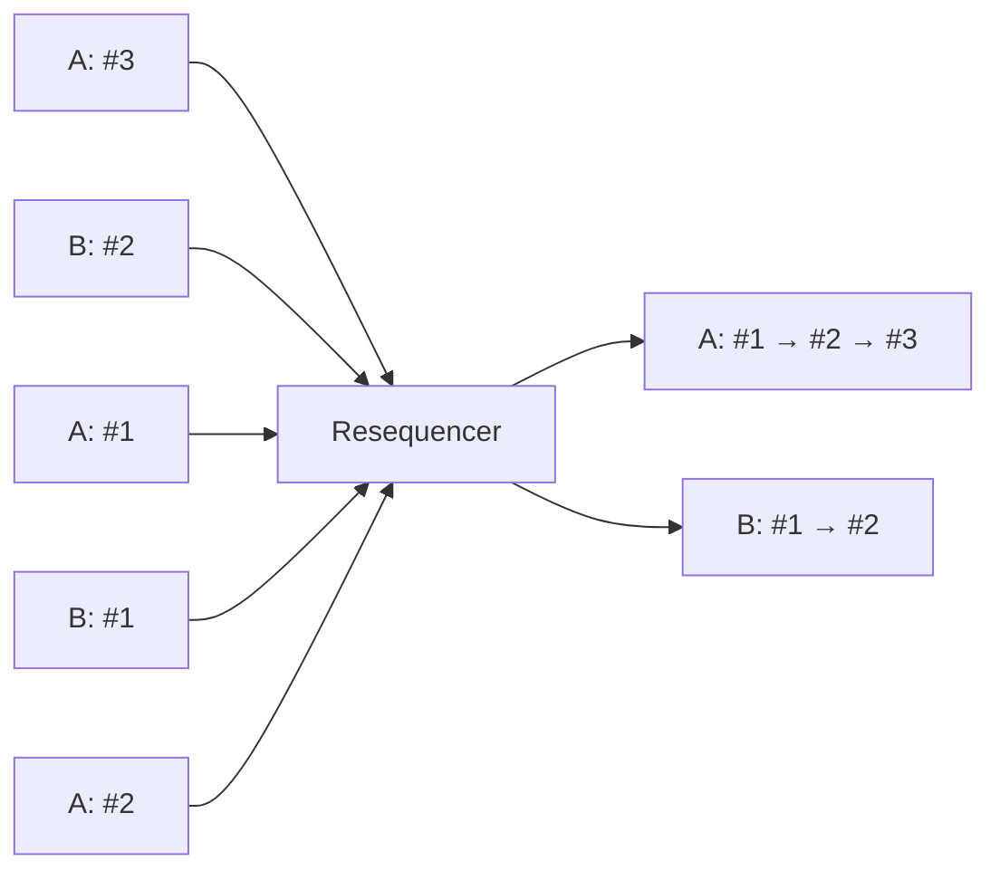
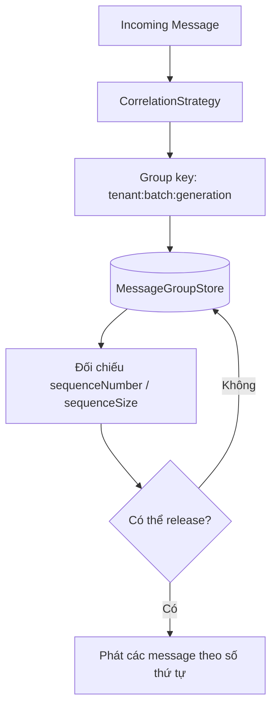
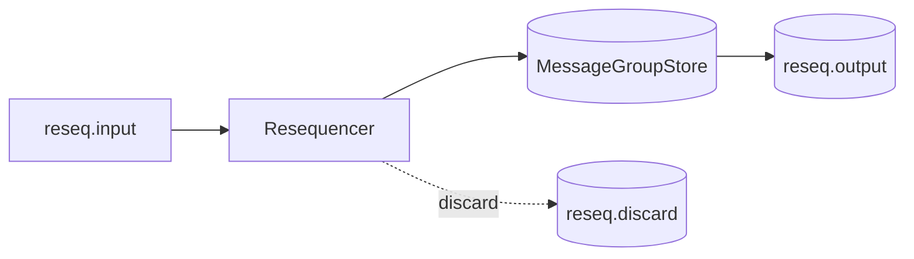
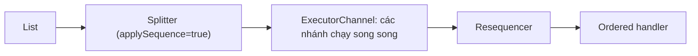
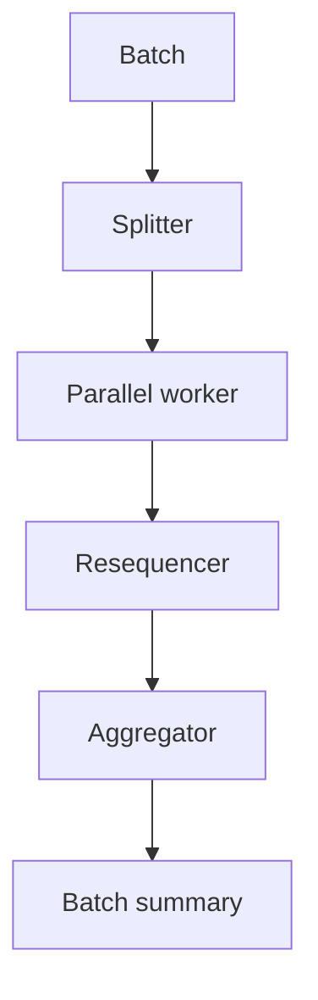
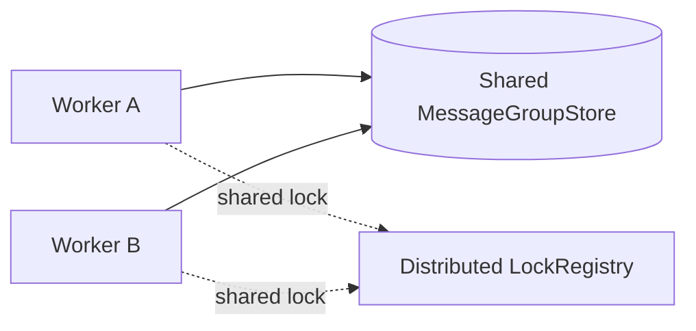

# Sequence group và correlation key trong Resequencer của Spring Integration

## Mục tiêu bài học

Một hệ thống nhận các phần dữ liệu được xử lý song song. Các phần có **thứ tự logic** 1, 2, 3 nhưng thực tế đến lần lượt 3, 1, 2. Nếu áp dụng chúng ngay lúc nhận, trạng thái nghiệp vụ có thể sai: phần #3 cập nhật một đối tượng khi phần #1 chưa khởi tạo xong.

Đồng thời, hai yêu cầu độc lập có thể đến xen kẽ:

```text
Thời điểm nhận       Group       Sequence
T1                   A           3
T2                   B           2
T3                   A           1
T4                   B           1
T5                   A           2
```

Một **Resequencer** cần hiểu hai điều trước khi sắp thứ tự:

1. **Những message nào thuộc cùng một sequence group?** Câu trả lời thường dựa trên `correlationId` hoặc custom correlation key.
2. **Trong mỗi group, message đứng thứ mấy?** Câu trả lời dựa trên `sequenceNumber` và thông tin kích thước `sequenceSize`.

Spring Integration **Resequencer** dùng trạng thái nhóm để nhận message có thể đến sai thứ tự, rồi phát chúng theo thứ tự `sequenceNumber`. Nó **không gộp payload thành một kết quả chung** như Aggregator.

Bài thuộc chương **Resequencer** của module **SPRING_INTEGRATION_PATTERN**, nơi chúng ta thực hành Enterprise Integration Patterns bằng Spring Integration để tạo các luồng thông điệp ít phụ thuộc và dễ mở rộng, kết hợp Router, Filter, Transformer, Splitter, Aggregator, Gateway, retry, error channel, correlation và kiểm thử, theo dõi những nhánh xử lý.

Sau bài học, bạn có thể:

1. Giải thích vai trò của `correlationId`, `sequenceNumber` và `sequenceSize` trong việc hình thành nhóm và khôi phục thứ tự.
2. Phân biệt **sequence group** của Resequencer với tập tất cả message trên cùng một channel.
3. Viết Java DSL `.resequence(...)`, xây kiểm thử JUnit cho hai group có message đến xen kẽ.
4. So sánh **đợi đủ cả nhóm** với **release partial sequences** khi đã có đoạn thứ tự liên tục.
5. Thiết kế custom correlation key cho multi-tenant, batch và nhiều vòng xử lý (generation).
6. Hiểu tác động của message thiếu/trùng, size không nhất quán, timeout, late arrival và retention trong `MessageGroupStore`.
7. Biết khi nào Splitter sinh sequence headers, khi nào phải gán thủ công và khi nào cần lựa chọn khác Resequencer.
8. Xây tiêu chí quan sát, retry, idempotency và kiểm thử lỗi để không nhầm **phát theo thứ tự** với **xử lý thành công đúng một lần**.

## 1. Resequencer thực hiện chính xác điều gì?

Mô hình:



**Lưu ý sơ đồ:** hai đường ra biểu diễn **thứ tự nội bộ của mỗi group**, không phải hai output channel thật. Với một `outputChannel` chung, các phần thuộc các group khác nhau vẫn có thể xen kẽ tùy thời điểm từng group sẵn sàng và thread thực thi.

Resequencer có bốn trách nhiệm chính:

1. **Tính group key** cho từng message.
2. **Lưu message chưa được phát** trong một `MessageGroupStore`.
3. **Đánh giá chiến lược release** khi các phần phù hợp đã đến.
4. **Phát lại từng message** theo thứ tự sequence.

Ví dụ với group A:

```text
Input order:  A3, A1, A2
Output order: A1, A2, A3
```

Ví dụ group B độc lập:

```text
Input order:  B2, B1
Output order: B1, B2
```

Việc group B hoàn tất **trước** group A hoàn toàn hợp lệ. Resequencer không cố tạo một thứ tự tổng quát giữa các group chỉ dựa vào thời điểm producer phát message.

### Resequencer khác Aggregator

| Tiêu chí | Resequencer | Aggregator |
| --- | --- | --- |
| Mục tiêu | Khôi phục thứ tự các phần | Gom nhiều phần thành một kết quả |
| State | Lưu các message theo correlation key | Lưu các message theo correlation key |
| Mỗi phần đầu ra | Thông thường vẫn là **message con** | Thường là **một message kết quả cho group** |
| Dữ liệu payload | Không chủ đích biến đổi payload | Có thể tạo payload tổng hợp mới |
| Thứ tự | Dựa trên `sequenceNumber` | Tùy processor/strategy, không phải chức năng chính |
| Điều kiện phát | Full sequence hoặc đoạn liên tục khi partial | Release strategy cho nhóm kết quả |
| Use case | Sửa thứ tự bị đảo bởi concurrency | Tổng hợp các kết quả của fan-out |

Không dùng Aggregator chỉ để sort danh sách nếu downstream vẫn cần nhận **từng message**; và không dùng Resequencer nếu business muốn **một summary duy nhất** từ nhiều nhánh.

## 2. Ba header cốt lõi: correlation, number và size

Một message thuộc sequence A có thể có:

```text
Message:
  payload = "A-2"
  headers:
    correlationId  = "BATCH-A"
    sequenceNumber = 2
    sequenceSize   = 3
    traceId        = "trace-A"
```

Ý nghĩa:

| Header | Ví dụ | Chức năng |
| --- | --- | --- |
| `correlationId` | `"BATCH-A"` | Cho biết message thuộc **group nào** |
| `sequenceNumber` | `2` | Vị trí của message **bên trong group** |
| `sequenceSize` | `3` | Số phần được kỳ vọng trong một sequence có kích thước biết trước |
| `traceId` | `"trace-A"` | Quan sát/truy vết, **không tự là group key** |
| `sourceId` | `"document-42"` | Định danh nguồn nghiệp vụ |
| `tenantId` | `"tenant-a"` | Bối cảnh tenant đã xác thực |
| `attempt` | `2` | Lượt thử; không được mặc định dùng thay `sequenceNumber` |

Resequencer mặc định tra cứu **`IntegrationMessageHeaderAccessor.CORRELATION_ID`** để phân group và phát theo **`IntegrationMessageHeaderAccessor.SEQUENCE_NUMBER`**. Với cách phát đủ nhóm, thông tin **`SEQUENCE_SIZE`** hỗ trợ quyết định khi nào group hoàn tất. <https://docs.spring.io/spring-integration/reference/resequencer.html>

### Correlation key không quyết định thứ tự

```text
Group = "BATCH-A"

A-1: sequenceNumber 1
A-2: sequenceNumber 2
A-3: sequenceNumber 3
```

Tất cả cùng correlation key nhưng có sequence number khác nhau. Nếu đổi correlation key của A-3 thành `"BATCH-B"`, A-3 **không thể bù vị trí 3 của A** dù payload giống nhau.

### Sequence number không xác định group

Hai message sau có cùng `sequenceNumber=1`, nhưng không phải duplicate:

```text
BATCH-A: seq=1
BATCH-B: seq=1
```

Chúng là phần đầu của **hai nhóm khác nhau**. Không xây dedup key chỉ bằng `sequenceNumber`; tối thiểu phải kết hợp **group key + position**, và nhiều hệ thống còn cần **generation/version**.

### Size không phải thứ tự đến

Với `sequenceSize=3`, dù các message đến theo `3,1,2`, tổng số phần hợp lệ vẫn là ba. `sequenceSize` không có nghĩa “đã nhận ba message thì chắc chắn đủ mọi vị trí”: hai bản sao cùng vị trí có thể làm số message tăng mà vẫn thiếu một position.

## 3. Sequence group là một ranh giới nghiệp vụ

Một group nên tương ứng với **một đơn vị xử lý có thứ tự riêng**: một tài liệu, một batch, một stream của account hoặc một workflow generation.

Ví dụ:

```text
tenant-a / document-42 / run-1
tenant-a / document-42 / run-2
tenant-b / document-42 / run-1
```

Ba key trên nên được xem là **ba group khác nhau** nếu nghiệp vụ cho phép cùng tài liệu được chạy lại hoặc có ID trùng giữa các tenant.

### Quy tắc tạo group key

Một key tốt cần:

- **Ổn định** trong mọi message của cùng một chu kỳ.
- **Đủ duy nhất** để không trộn hai chu kỳ.
- **Dựa trên thông tin đáng tin**, đặc biệt ở môi trường multi-tenant.
- **Khả dụng tại thời điểm nhận**; không cần gọi network để suy ra key cho mọi message nếu tránh được.
- **Có vòng đời xác định**: biết khi nào group được hoàn tất và trạng thái được dọn.

Có thể định nghĩa:

```text
correlationId = tenantId + ":" + batchId + ":" + generation
```

Ví dụ:

```text
tenant-a:batch-42:1
tenant-a:batch-42:2
tenant-b:batch-42:1
```

`generation` không phải lúc nào cũng bắt buộc, nhưng cần khi **cùng batchId được tái sử dụng trong một lần chạy mới**. Nếu không tách generation, message mới có thể bị coi là late arrival của group cũ hoặc lẫn với state chưa hoàn tất.

### Tránh dùng `MessageHeaders.ID` làm group key

`MessageHeaders.ID` thường định danh **một message cụ thể**, không phải tập message. Từng phần được Splitter sinh ra có thể có ID khác nhau. Nếu dùng ID của chính từng phần làm correlation, Resequencer sẽ tạo nhiều group một phần và không thể khôi phục thứ tự.

`traceId` cũng không tự là group key đáng tin: một trace có thể bao gồm nhiều group, hoặc các lần retry có trace mới. Chỉ dùng trace làm correlation khi đã có hợp đồng rõ ràng rằng chúng thật sự đại diện cùng một sequence.

## 4. Mối quan hệ giữa group và MessageGroupStore

Resequencer là một **stateful endpoint**. Khi group A thiếu phần #2, nó cần lưu những phần #1/#3 đang có cho đến khi có đủ dữ liệu hoặc một điều kiện xử lý quá hạn xảy ra.



Các yếu tố thực tế:

| Thành phần | Vai trò | Lưu ý |
| --- | --- | --- |
| `MessageGroupStore` | Lưu message và metadata nhóm | In-memory mặc định không bền sau restart |
| `CorrelationStrategy` | Xác định group key | Key null/nhầm có thể gây lỗi hoặc gộp sai |
| `ReleaseStrategy` | Quyết định khi nào được phát | Đừng thay bằng count tùy tiện nếu không hiểu gap |
| `LockRegistry` | Đồng bộ thao tác với cùng group | Lock local không thay thế lock phân tán |
| `MessageGroupStoreReaper` | Dọn nhóm cũ | Có thể khiến khả năng nhận diện late messages biến mất |
| `discardChannel` | Quan sát message không được nhận vào group | Cần consumer và chính sách replay rõ |
| `groupTimeout` | Xử lý group chờ quá lâu | Có tác động đến partial release/discard |

**In-memory group state không tự trở thành durable sequence log.** Nếu cần tiếp tục sau restart hoặc nhiều instance dùng chung state, phải cấu hình store/lock/transaction phù hợp.

### Một group không phải một thread cố định

Nhiều thread có thể đưa message vào cùng group. Hệ thống cần đồng bộ việc bổ sung và phát message của group; không được dùng `HashMap` ứng dụng tự tạo mà không có lock nếu cạnh tranh cập nhật.

Ngược lại, hai group khác nhau thường không cần chờ nhau về mặt logic. Tuy nhiên, output channel/worker dùng chung có thể gây backpressure hoặc interleaving.

## 5. Ví dụ đầu tiên: hai group có arrival order xen kẽ

Giả sử sequence A có 3 phần và sequence B có 2 phần:

```text
Arrival:
  A#3
  B#2
  A#1
  B#1
  A#2

Full-sequence release:
  A#3 -> lưu A, chưa output
  B#2 -> lưu B, chưa output
  A#1 -> lưu A, vẫn thiếu A#2
  B#1 -> group B đủ: output B#1, B#2
  A#2 -> group A đủ: output A#1, A#2, A#3
```

**Đầu ra toàn cục của ví dụ có thể là:** `B#1, B#2, A#1, A#2, A#3`.

Điều này đúng vì **thứ tự bên trong mỗi group** đều được phục hồi:

```text
A: 1, 2, 3
B: 1, 2
```

Nếu nghiệp vụ đòi “**toàn bộ A trước toàn bộ B**” bất kể group nào hoàn tất trước, cần thêm một **cơ chế điều phối thứ tự giữa các group**. Resequencer mặc định không biết thứ tự nghiệp vụ giữa các correlation key.

## 6. Java DSL: Resequencer theo headers mặc định

Một flow đơn giản có:

- Input: `reseq.input`.
- Resequencer: nhóm theo `correlationId`, đợi đủ toàn bộ sequence.
- Output: `reseq.output` để test đọc từng message theo thứ tự.
- Discard: `reseq.discard` cho những message bị loại trong các tình huống phù hợp.



### Cấu hình Spring Integration (Java 17+, Spring Integration 6.x/7.x)

```java
import org.springframework.context.annotation.Bean;
import org.springframework.context.annotation.Configuration;
import org.springframework.integration.channel.DirectChannel;
import org.springframework.integration.channel.QueueChannel;
import org.springframework.integration.config.EnableIntegration;
import org.springframework.integration.dsl.IntegrationFlow;
import org.springframework.messaging.MessageChannel;
import org.springframework.messaging.PollableChannel;

@Configuration
@EnableIntegration
public class GroupResequencerConfig {

    @Bean("reseq.input")
    MessageChannel input() {
        return new DirectChannel();
    }

    @Bean("reseq.output")
    PollableChannel output() {
        // Test sink: không có consumer nền trong ví dụ.
        return new QueueChannel();
    }

    @Bean("reseq.discard")
    PollableChannel discarded() {
        return new QueueChannel();
    }

    @Bean
    IntegrationFlow groupResequencerFlow() {
        return IntegrationFlow.from("reseq.input")
            .resequence(spec -> spec
                // Chờ đủ sequence trước khi phát.
                .releasePartialSequences(false)
                .discardChannel("reseq.discard"))
            .channel("reseq.output")
            .get();
    }
}
```

Các điểm quan trọng:

1. `.resequence(...)` tạo endpoint Resequencer. Spring Integration không yêu cầu annotation `@Resequencer`; Java DSL là lựa chọn trực quan.
2. `releasePartialSequences(false)` ghi rõ ý định **không phát prefix liên tục trước khi có đủ group**.
3. Mặc định Resequencer lấy group key từ `correlationId` và thứ tự từ `sequenceNumber`.
4. `DirectChannel` giúp các test thực hiện theo từng lần `send` một cách có thể kiểm soát.
5. `QueueChannel` nhận từng message đã được resequence để test qua `receive()`.
6. `discardChannel` có thể nhận message đến quá muộn khi trạng thái group đã hoàn tất và còn được giữ. Nó **không tự là nơi nhận mọi exception**.

**Đừng đồng thời gắn một Aggregator khác vào `reseq.input` để “giúp sắp thứ tự”.** Các endpoint trên một `DirectChannel` có thể cạnh tranh nhận message theo dispatcher, không tự broadcast. Nếu cần cả resequence và aggregate, hãy đặt chúng thành hai bước **nối tiếp**.

## 7. Gửi sequence message đúng header

Một producer đã có các phần con có thể tự gắn header sequence. Phần dưới là snippet dùng bean input trong Spring context:

```java
import org.springframework.messaging.Message;
import org.springframework.messaging.MessageChannel;
import org.springframework.messaging.support.MessageBuilder;

// input được inject từ bean MessageChannel tên "reseq.input".
void sendPart(
    MessageChannel input,
    String groupId,
    int sequenceNumber,
    int sequenceSize,
    String payload
) {
    Message<String> message = MessageBuilder
        .withPayload(payload)
        .setHeader("correlationId", groupId)
        .setHeader("sequenceNumber", sequenceNumber)
        .setHeader("sequenceSize", sequenceSize)
        .setHeader("sourceId", groupId)
        .setHeader("traceId", "trace-" + groupId)
        .build();

    input.send(message);
}
```

Gửi sai thứ tự:

```java
sendPart(input, "A", 3, 3, "A-3");
sendPart(input, "B", 2, 2, "B-2");
sendPart(input, "A", 1, 3, "A-1");
sendPart(input, "B", 1, 2, "B-1");
sendPart(input, "A", 2, 3, "A-2");
```

Hệ thống sắp **các message đã được gắn header**, không dựa vào hậu tố `"-1"` của payload. `"A-1"` có thể đổi thành DTO nghiệp vụ và Resequencer vẫn hoạt động nếu sequence/correlation headers đúng.

### Vì sao không dựa vào tên kênh để nhóm?

Tất cả message A và B đều đi vào **cùng `reseq.input`**. Tên channel chỉ là vị trí nhận, không phân biệt những sequence logic. Ngược lại, một group có thể có message đến từ nhiều nguồn nhưng được normalize về cùng key sau khi xác thực.

### Header type phải nhất quán

`sequenceNumber` và `sequenceSize` trong ví dụ là `Integer`. Đừng gửi chuỗi `"3"` rồi dựa vào giả định mọi endpoint sẽ tự chuyển kiểu đúng như một API hợp đồng. Với dữ liệu từ HTTP/JSON/Kafka, nên validate và chuyển sang đúng kiểu ở boundary.

## 8. Kiểm thử JUnit: cô lập group và đúng thứ tự

Các test dưới đây dựa trên `GroupResequencerConfig`. Hai group khác nhau được hoàn tất ở thời điểm khác nhau; test xác nhận output **không bị lẫn**.

```java
import static org.assertj.core.api.Assertions.assertThat;

import java.util.List;

import org.junit.jupiter.api.Test;
import org.springframework.beans.factory.annotation.Autowired;
import org.springframework.beans.factory.annotation.Qualifier;
import org.springframework.messaging.Message;
import org.springframework.messaging.MessageChannel;
import org.springframework.messaging.PollableChannel;
import org.springframework.messaging.support.MessageBuilder;
import org.springframework.test.context.junit.jupiter.SpringJUnitConfig;

@SpringJUnitConfig(GroupResequencerConfig.class)
class GroupResequencerFlowTest {

    @Autowired
    @Qualifier("reseq.input")
    MessageChannel input;

    @Autowired
    @Qualifier("reseq.output")
    PollableChannel output;

    @Autowired
    @Qualifier("reseq.discard")
    PollableChannel discarded;

    private void send(
        String groupId, int number, int size, String payload
    ) {
        Message<?> m = MessageBuilder.withPayload(payload)
            .setHeader("correlationId", groupId)
            .setHeader("sequenceNumber", number)
            .setHeader("sequenceSize", size)
            .setHeader("traceId", "trace-" + groupId)
            .build();
        assertThat(input.send(m)).isTrue();
    }

    private Message<?> receive() {
        Message<?> message = output.receive(2_000);
        assertThat(message).isNotNull();
        return message;
    }

    @Test
    void twoIndependentGroupsReleaseInTheirOwnSequenceOrder() {
        send("GROUP-A-101", 3, 3, "A-3");
        send("GROUP-B-101", 2, 2, "B-2");
        send("GROUP-A-101", 1, 3, "A-1");

        // Cả hai nhóm đều chưa hoàn chỉnh.
        assertThat(output.receive(0)).isNull();

        send("GROUP-B-101", 1, 2, "B-1");
        Message<?> b1 = receive();
        Message<?> b2 = receive();
        assertThat(List.of(b1.getPayload(), b2.getPayload()))
            .containsExactly("B-1", "B-2");

        assertThat(b1.getHeaders().get("correlationId"))
            .isEqualTo("GROUP-B-101");
        assertThat(b2.getHeaders().get("sequenceNumber"))
            .isEqualTo(2);
        assertThat(output.receive(0)).isNull();

        send("GROUP-A-101", 2, 3, "A-2");
        Message<?> a1 = receive();
        Message<?> a2 = receive();
        Message<?> a3 = receive();

        assertThat(List.of(
            a1.getPayload(), a2.getPayload(), a3.getPayload()))
            .containsExactly("A-1", "A-2", "A-3");

        assertThat(a1.getHeaders().get("correlationId"))
            .isEqualTo("GROUP-A-101");
        assertThat(a2.getHeaders().get("sequenceNumber"))
            .isEqualTo(2);
        assertThat(a3.getHeaders().get("sequenceSize"))
            .isEqualTo(3);
        assertThat(a3.getHeaders().get("traceId"))
            .isEqualTo("trace-GROUP-A-101");

        assertThat(output.receive(0)).isNull();
        assertThat(discarded.receive(0)).isNull();
    }

    @Test
    void oneOutOfOrderSequenceIsEmittedInOrder() {
        send("GROUP-C-102", 2, 3, "second");
        send("GROUP-C-102", 3, 3, "third");
        assertThat(output.receive(0)).isNull();

        send("GROUP-C-102", 1, 3, "first");

        assertThat(List.of(
            receive().getPayload(),
            receive().getPayload(),
            receive().getPayload()
        )).containsExactly("first", "second", "third");

        assertThat(output.receive(0)).isNull();
    }

    @Test
    void aStillIncompleteGroupDoesNotEmitEarly() {
        send("GROUP-D-103", 1, 3, "first");
        send("GROUP-D-103", 3, 3, "third");

        assertThat(output.receive(0)).isNull();

        // Hoàn tất nhóm để test không để lại group dang dở.
        send("GROUP-D-103", 2, 3, "second");
        assertThat(List.of(
            receive().getPayload(),
            receive().getPayload(),
            receive().getPayload()
        )).containsExactly("first", "second", "third");
        assertThat(output.receive(0)).isNull();
    }
}
```

**Điều được chứng minh:** với `releasePartialSequences(false)`, group A/B được tách theo correlation ID, mỗi group phát các message theo sequence number khi đã đủ phần.

**Điều chưa được chứng minh:** exactly-once processing, khả năng tiếp tục sau restart, distributed locks giữa nhiều instance, hay nghiệp vụ đã commit thành công sau khi downstream tiêu thụ output.

### Cô lập trạng thái test

Resequencer giữ state của group chưa hoàn tất. Test `aStillIncompleteGroupDoesNotEmitEarly` xác minh trạng thái chờ **trước** khi gửi phần thiếu, rồi hoàn tất group để dọn input chưa release. Trong những test cố ý mô phỏng group mãi không đủ, nên dùng **context riêng hoặc `@DirtiesContext`**, hoặc có timeout/cleanup để tránh ảnh hưởng test khác dùng chung store.

## 9. Hai chế độ release: đợi đủ nhóm và phát prefix liên tục

Đây là lựa chọn quan trọng nhất sau khi xác định group key.

### Chế độ A — Đợi toàn bộ sequence

```java
.resequence(spec -> spec.releasePartialSequences(false))
```

Giả sử sequence size = 4:

```text
Arrival #3      -> buffer
Arrival #1      -> buffer
Arrival #4      -> buffer
Arrival #2      -> release #1, #2, #3, #4
```

Ưu điểm:

- Downstream có thể nhận toàn bộ sequence theo một đợt khi đủ.
- Logic kiểm tra “mọi phần đã có” dễ hình dung.
- Thích hợp cho các nhóm ngắn với deadline rõ.

Hạn chế:

- Một phần thiếu có thể giữ **toàn bộ group** trong store.
- Latency phần #1 bị phụ thuộc phần đến chậm nhất.
- Kích thước group và số group chưa hoàn tất ảnh hưởng bộ nhớ.

### Chế độ B — Phát đoạn liên tục sớm

```java
.resequence(spec -> spec.releasePartialSequences(true))
```

Khi bật `releasePartialSequences(true)`, Resequencer có thể phát một **prefix hợp lệ theo thứ tự**, không cần chờ đủ cả group.

```text
Arrival #3      -> buffer, chưa có #1/#2
Arrival #1      -> release #1
Arrival #2      -> release #2 rồi #3
Arrival #4      -> release #4
```

Điều kiện cốt lõi: **không nhảy qua lỗ hổng trong sequence**. Có `#3` chưa cho phép phát nó nếu `#2` chưa xuất hiện và chưa có chính sách bỏ qua #2.

Lợi ích:

- Giảm thời gian chờ của prefix sớm.
- Hữu ích khi downstream có thể xử lý tuần tự từng phần mà không chờ kết thúc toàn bộ batch.

Đánh đổi:

- Group có thể vẫn chưa complete dù một số phần đã được phát.
- Nếu thiếu `#2` mãi, `#3` và những phần sau vẫn bị giữ.
- Downstream phải phân biệt **prefix đã nhận** với **sequence đã hoàn tất**.
- Khi message late hoặc duplicate xuất hiện, vẫn cần cơ chế bảo vệ khỏi side effect trùng.

Theo tài liệu Spring Integration, `releasePartialSequences` mặc định là **`false`**. <https://docs.spring.io/spring-integration/reference/resequencer.html>

### Khi nào chọn chế độ nào?

| Nhu cầu | Gợi ý |
| --- | --- |
| Chỉ xử lý khi có tất cả phần | `false` |
| Cho phép streaming prefix đã đúng thứ tự | `true` |
| Có lỗ hổng lớn hoặc phần thiếu thường xuyên | Cân nhắc pattern khác, timeout và tracking |
| Phải phát *một* summary cuối | Dùng thêm Aggregator/processor phù hợp |
| Cần đúng thứ tự xuyên nhiều group | Điều phối tầng cao hơn, không chỉ `resequence` |

**Không nhầm `releasePartialSequences(true)` với `sendPartialResultOnExpiry(true)`.** Cái đầu cho phép phát sớm **đoạn liên tục hợp lệ** khi nhóm vẫn đang nhận thêm; cái sau liên quan đến hành vi **khi nhóm hết hạn** và có thể cần chính sách xử lý gap khác.

## 10. Custom correlation key: tenant, batch và generation

Thực tế có thể upstream chỉ gắn ba header:

```text
tenantId = "tenant-a"
batchId = "batch-42"
generation = 2
```

Khi đó có thể dùng một `CorrelationStrategy` tùy chỉnh hoặc SpEL `correlationExpression` để tạo key từ những field đã được chuẩn hóa.

### Cấu hình Java DSL bằng expression

```java
@Bean
IntegrationFlow tenantAwareResequencerFlow() {
    return IntegrationFlow.from("tenant.reseq.input")
        .resequence(spec -> spec
            .correlationExpression(
                "headers['tenantId'] + ':' + " +
                "headers['batchId'] + ':' + headers['generation']")
            .releasePartialSequences(false)
            .discardChannel("tenant.reseq.discard"))
        .channel("tenant.reseq.output")
        .get();
}
```

Đây là **đoạn trích**: phải định nghĩa các channel được tham chiếu và đảm bảo input đã qua bước validation. `correlationExpression(...)` trả về key dùng để phân group; `sequenceNumber` và `sequenceSize` vẫn phải phù hợp để Resequencer sắp thứ tự.

### Vì sao cần validate header trước?

Nếu `tenantId` hoặc `batchId` là `null`, expression có thể trả key sai hoặc ném lỗi, gây mất tính cô lập. Nếu `tenantId` do client tự khai mà không đối chiếu với identity đã xác thực, các message của tenant khác có thể bị gộp nhầm.

Đặt một bước ở ingress:

1. Xác thực tenant.
2. Chuẩn hóa batch/generation.
3. Kiểm tra `sequenceNumber`, `sequenceSize` và phạm vi hợp lệ.
4. Tạo header group key tin cậy hoặc gắn đúng `correlationId`.
5. Đưa message vào Resequencer.

### Khi đã có correlationId đáng tin

Nếu producer/adapter đã gắn `correlationId` đúng, không cần custom correlation expression. **Ít cấu hình hơn thường ít rủi ro hơn**, đặc biệt khi nhiều endpoint Splitter/Aggregator cùng dựa vào chuẩn header của Spring Integration.

### Đừng ghép chuỗi tùy tiện nếu có ký tự phân tách

`tenantId + ":" + batchId + ":" + generation` dễ hiểu nhưng có thể va chạm nếu một trường được phép chứa dấu `:`. Có thể validate charset, escape từng thành phần hoặc dùng một value object immutable làm key ở phạm vi in-process. Nếu key cần lưu qua broker/store, hãy chọn dạng mã hóa ổn định và được tất cả instance sử dụng thống nhất.

## 11. Sequence headers được tạo từ đâu?

Thông thường chúng đến từ **Splitter** hoặc thành phần scatter có bật `applySequence`.



Một ví dụ Java DSL rút gọn:

```java
@Bean
IntegrationFlow splitThenResequence(
    org.springframework.core.task.TaskExecutor executor
) {
    return IntegrationFlow.from("batch.input")
        .split()
        .channel(
            org.springframework.integration.dsl.MessageChannels.executor(
                executor))
        .resequence()
        .channel("batch.ordered")
        .get();
}
```

Đoạn này cần các bean channel `batch.input` và `batch.ordered`, bean `TaskExecutor` và xử lý kết quả phía sau. `split()` khi dùng collection tạo message con cùng correlation ID và sequence metadata, theo cơ chế mặc định; đường executor có thể làm thay đổi **thời điểm xử lý/đến**, nên Resequencer có việc để làm.

**Lưu ý:** ví dụ không tự tạo tải song song phức tạp; một số ExecutorChannel có thể vẫn bảo toàn thứ tự trong điều kiện nhất định. Muốn test resequencing chắc chắn, nên **gửi message sai thứ tự một cách chủ động** như mục 8.

### Splitter có thể tạo `sequenceSize=0`

Với Splitter dựa trên `Iterator` hoặc một stream không biết trước tổng số phần, `sequenceSize` có thể bằng **0**. Khi ấy, Resequencer ở chế độ chờ đủ nhóm không thể suy ra “đã nhận hết” chỉ từ kích thước.

Nếu cần hoàn tất nhóm khi stream kết thúc, cân nhắc:

- Đưa ra count/expected size sau khi đọc metadata đáng tin.
- Dùng marker kết thúc (ví dụ FileSplitter START/END) với tracker/release policy có chủ đích.
- Dùng cửa sổ thời gian có deadline và trạng thái terminal/outcome.
- Chọn chiến lược khác nếu không thể cung cấp thông tin về vị trí/kết thúc.

**Đừng biến `sequenceSize=0` thành `1` chỉ để group release**: bạn đang thay hợp đồng của sequence chứ không giải quyết được tính đúng đắn.

## 12. Header bị mất giữa Splitter và Resequencer

Một topology phức tạp có thể:

```text
Splitter
   -> Transformer
   -> Router
   -> async queue / broker
   -> Resequencer
```

Các bước trung gian có thể tạo message mới hoặc dùng adapter serialize. Nếu `correlationId`/`sequenceNumber`/`sequenceSize` bị mất, Resequencer không biết group và vị trí của phần.

### Cách kiểm tra và phòng ngừa

- Kiểm thử header ở **đầu ra Splitter** và **đầu vào Resequencer**.
- Khi tạo `Message<?>` mới ở flow nội bộ, dùng `MessageBuilder` với chính sách copy/allowlist headers phù hợp.
- Khi đi qua Kafka/JMS/AMQP/HTTP, kiểm tra `headerMapper`, kiểu value được hỗ trợ và serialization.
- Không serialize object `replyChannel` hoặc `errorChannel` nội bộ tùy ý ra ngoài tiến trình.
- Đừng đặt một Transformer xóa `correlationId` rồi kỳ vọng Resequencer “tự nhận” các phần cùng batch theo payload.
- Nếu có nested Splitter, kiểm tra cách `sequenceDetails` được push/pop và header nào đang đại diện group tại tầng hiện hành.

### Nested sequence là bài toán khác

Giả sử batch A được tách thành các file, rồi mỗi file lại được tách thành dòng. Các sequence number bên trong file không thể tự động dùng để sắp thứ tự **các file** ở tầng ngoài.

```text
Batch A
  File 1
    Line 1, Line 2
  File 2
    Line 1, Line 2
```

Cần giữ thông tin level: `batchId`/`fileId`/`lineNo` hoặc dùng cơ chế sequence details đúng với topology. Không nhầm group key của inner sequence với outer sequence; mỗi Resequencer chỉ nên phụ trách **một cấp thứ tự** đã xác định.

## 13. Không thể dùng group key để khôi phục thứ tự tổng quát

Nếu A và B là hai batch khác nhau:

```text
A#1 -> A#2
B#1 -> B#2
```

Resequencer có thể bảo đảm **trật tự trong A và B**, nhưng không thể biết rằng nghiệp vụ muốn hoàn tất A trước B nếu không có một **global order index**.

So sánh ba khái niệm:

| Thứ tự | Dữ liệu cần có | Pattern/công cụ |
| --- | --- | --- |
| **Per group** | `correlationId + sequenceNumber` | Resequencer |
| **Per key/partition** | Business key + event offset/version | Broker partition ordering hoặc sequencer theo key |
| **Global total order** | Một nguồn đánh số toàn hệ thống và cơ chế commit tuần tự | Cần coordinator/log/transaction policy mạnh hơn |

Một Resequencer trên mỗi ứng dụng không tự tạo global order giữa các instance. Nếu nhiều instance chia group state, cần store/lock chung; nếu group được phân vùng theo key tới một owner, phải kiểm tra quy tắc partition/ownership của adapter/broker.

## 14. Duplicate sequence number: cùng vị trí không phải hai phần mới

Ví dụ:

```text
Group = G-42, size = 3

Receive seq=1: event v1
Receive seq=2: event v1
Receive seq=2: event v1 redelivery (new message ID)
Receive seq=3: event v1
```

Nếu chỉ dựa vào **số message**, group có thể trông như đã đủ ba phần ngay khi bản sao seq=2 đến, dù seq=3 chưa tới. Cần phân biệt:

- **Cùng message ID:** store có thể coi là phần đã có; không biến thành business dedup contract.
- **Hai message ID khác, cùng sequenceNumber:** phải có policy xử lý duplicate rõ.
- **Cùng sequenceNumber nhưng payload khác:** đó có thể là lỗi producer, race hoặc một bản cập nhật có version mới — không được tự chọn ngẫu nhiên.
- **Cùng payload nhưng sequenceNumber khác:** hai phần hợp lệ có thể có nội dung giống nhau.

Spring Integration có những release strategy khác nhau, trong đó có cách kiểm tra duplicate sequence number với đánh đổi hiệu năng. Mặc định của `AbstractCorrelatingMessageHandler` trong các trường hợp thông dụng đã thay đổi qua các phiên bản; **không nên coi mặc định là cơ chế idempotency nghiệp vụ**.

### Dedup key gợi ý

```text
tenantId + batchId + generation + sequenceNumber
```

Nhưng khóa này chỉ cho biết **vị trí logic**. Khi một vị trí được phép cập nhật sau retry, cần thêm `partVersion` hoặc trạng thái cuối. Quy tắc xử lý duplicate có thể là:

1. Reject bản sao hoàn toàn.
2. Giữ kết quả terminal đầu tiên.
3. Thay bằng part có version/attempt hợp lệ lớn hơn.
4. Chuyển conflict sang quarantine và không release.

Mỗi lựa chọn tác động tới thứ tự, tính đúng đắn và khả năng replay. Cần test việc **message thiếu** và **message duplicate** xảy ra cùng lúc.

### Resequencer không bảo đảm exactly-once

Việc phát message theo thứ tự không ngăn consumer downstream xử lý lại khi broker redelivery, caller retry hoặc process crash. Side effect nghiệp vụ vẫn cần idempotency key và giao dịch phù hợp.

## 15. Sequence size không nhất quán

Cùng group nhưng header khác nhau:

```text
G-42 seq=1 size=3
G-42 seq=2 size=4
G-42 seq=3 size=3
```

Đây là **contract lỗi** trừ khi có chính sách đặc biệt. Resequencer không có đủ một ý nghĩa nhóm duy nhất nếu cùng một generation vừa kỳ vọng 3 vừa kỳ vọng 4 phần.

Các bước bảo vệ:

1. Khi nhận phần đầu, lưu `expectedSequenceSize` từ nguồn đã được xác thực.
2. Đối chiếu mọi phần tiếp theo.
3. Bảo đảm `sequenceNumber >= 1` và `sequenceNumber <= expectedSequenceSize` khi size biết trước.
4. Nếu không biết size, dùng marker/end-of-stream hoặc deadline riêng.
5. Nếu policy cho phép tăng số phần, tạo **generation mới** hoặc một hợp đồng window/append-only phù hợp thay vì sửa size tùy tiện.

### Không coi count là bằng chứng đủ phần

```text
Count=3
Seen sequence numbers={1, 2, 2}
Expected={1, 2, 3}
```

Đã nhận 3 message nhưng **thiếu #3**. Đây là lý do phải tách:

- Số message được **nhận**.
- Số **sequenceNumber duy nhất** đã thấy.
- Tập **position còn thiếu**.
- Số phần **đã release**.

Khi có bộ theo dõi riêng cho group, các chỉ số trên đặc biệt hữu ích cho chẩn đoán lỗi.

## 16. Message đến muộn sau khi group hoàn tất

Sau khi một group đã phát đầy đủ sequence, một phần cũ có thể đến do retry:

```text
G-42: #1, #2, #3 -> đã release
Sau đó: #2 đến lại
```

Nếu completed-group metadata vẫn còn trong store, phần late có thể bị discard; nếu đã xóa metadata, cùng group key có thể mở một nhóm mới hoặc bị giữ chờ các phần khác.

### Retention của completed group

- Giữ completed-group state đủ lâu để nhận diện late arrivals.
- Xác định rõ thời hạn giữ metadata dựa trên retry/redelivery window.
- Dọn metadata bằng reaper theo giới hạn memory/storage.
- Sau khi cleanup, nếu nghiệp vụ vẫn yêu cầu chống trùng, cần **business idempotency ledger** bền vững.

`discardChannel` thích hợp để quan sát các message đến sau khi group đã complete; nhưng **không có nghĩa discard tự bù trừ cho side effect**.

### Khi dùng custom generation

`tenant-a:batch-42:1` và `tenant-a:batch-42:2` là hai chu kỳ khác nhau. Một message cũ thuộc generation 1 không được đưa nhầm vào generation 2 để “bù” vị trí đang thiếu, dù batch ID giống nhau.

Đây là một lý do mạnh để đưa generation vào correlation key thay vì tái sử dụng mã batch trần.

## 17. Timeout, missing part và partial expiry

Một group có thể chờ mãi vì:

- Producer không gửi một part.
- Một phần bị Filter loại trước Resequencer.
- Worker processing phần đó lỗi và không trả kết quả.
- Broker retry chậm.
- Correlation/sequence header bị mất hoặc gán sai.

Ví dụ:

```text
Group G, size=4
Received: #1, #3, #4
Missing:  #2
```

Với `releasePartialSequences(false)`, nhóm không thể hoàn chỉnh. Với `true`, prefix `#1` có thể được phát, nhưng `#3`/#4` phải đợi gap được giải quyết.

### Group timeout không giống send timeout

| Thuộc tính | Ý nghĩa |
| --- | --- |
| `groupTimeout` | Thời điểm một group chưa đủ được xét expiry |
| `sendPartialResultOnExpiry` | Có phát những message đang chờ khi group hết hạn không |
| `discardChannel` | Nhận message bị loại theo cơ chế discard/expiry được cấu hình |
| `expireGroupsUponTimeout` | Giữ hay xóa state nhóm khi timeout |
| `minimumTimeoutForEmptyGroups` | Hỗ trợ giữ metadata nhóm rỗng đủ lâu khi cleanup |
| `sendTimeout` | Giới hạn thời gian gửi tới channel đích nếu channel có thể block |

Một trích đoạn cấu hình:

```java
.resequence(spec -> spec
    .releasePartialSequences(false)
    .groupTimeout(5_000L)
    .sendPartialResultOnExpiry(false)
    .expireGroupsUponTimeout(false)
    .discardChannel("reseq.discard"))
```

Đây là **ví dụ chính sách hết hạn** chứ không phải flow đầy đủ. Cần cấu hình scheduler, message store và xử lý kết quả phù hợp với ứng dụng. 5 giây là số minh họa, không phải SLA mặc định.

### Khi cần xử lý gap bằng partial result

Nếu nghiệp vụ muốn “đến deadline thì phát các phần đã có”, `sendPartialResultOnExpiry(true)` liên quan đến **expiry policy**, không phải `releasePartialSequences(true)`. Khi còn gap, cần xác định downstream có được chấp nhận một chuỗi **không liên tục** hay phải tạo kết quả `MISSING_PART`.

Ví dụ:

```text
G-42 received = {#1, #3, #4}
Deadline reached
Policy A: discard #3/#4, báo thiếu #2
Policy B: phát những phần có sẵn kèm cảnh báo gap
Policy C: fail whole group, yêu cầu replay từ producer
```

Không chọn policy B khi downstream đòi một chuỗi liên tục để duy trì state. “Partial expiry” không được đánh đồng với “sắp xong rồi, có thể bỏ gap”.

### Timeout tương đối và deadline tuyệt đối

Một số group timeout được lên lịch lại khi nhận message mới. Nếu nghiệp vụ yêu cầu một deadline tuyệt đối tính từ lúc bắt đầu batch, có thể cần **timestamp deadline đã được lưu** và `groupTimeoutExpression`/tracker phù hợp. Đừng dùng một khoảng timeout tương đối rồi khẳng định group luôn hoàn tất trong đúng N giây kể từ part đầu.

## 18. Resequencer sau Filter, Transformer và Router

### Splitter → Filter → Resequencer

```text
Splitter tạo 4 phần: 1,2,3,4
Filter loại phần #2
Resequencer nhận: 1,3,4
```

Resequencer không tự biết #2 đã bị Filter cố ý loại. Nếu chế độ full sequence, group có thể không bao giờ release. Nếu chế độ partial, nó có thể phát #1 và giữ #3/#4.

Giải pháp:

1. **Lọc trước Splitter** để các phần còn lại được đánh lại sequence number/size nhất quán.
2. **Phát một placeholder/outcome `SKIPPED` cho phần bị loại**, giữ slot #2 để sequence vẫn liên tục.
3. Thiết kế custom completion + timeout cho loại luồng chấp nhận gap, và biểu diễn rõ thông tin thiếu.

Không sửa `sequenceSize` riêng cho những message đã đến để “lách” release; group metadata phải thống nhất.

### Transformer có thể làm mất header

Một Transformer tạo message mới cần giữ `correlationId`, `sequenceNumber` và `sequenceSize` khi vẫn đại diện cùng part. Nếu transform thay cấu trúc thành nhiều message khác nhau, đó đã gần với Splitter mới và phải thiết kế sequence cấp mới.

### Router và nhiều nhánh

Một Router có thể gửi các part đến worker khác nhau, sau đó họ trả kết quả bất đồng bộ. Khi gom các kết quả về Resequencer, phải giữ **sequence position gốc**. Không sử dụng thứ tự worker hoàn tất làm sequence number.

### Recipient List/Publish-Subscribe

Nếu **cùng một part được fan-out tới ba subscriber**, không nên cho cả ba kết quả mang cùng correlation/sequence trực tiếp vào **một** Resequencer chỉ đang chờ một kết quả cho mỗi position. Đó có thể là ba bản khác nhau của cùng vị trí. Cần xác định unit cần sắp thứ tự: **part trong batch** hay **branch outcome của part**; có thể phải tổng hợp per-part trước khi resequence.

## 19. Resequencer và Aggregator có thể dùng nối tiếp

Một pipeline phổ biến:



- Splitter chia thành message con có sequence headers.
- Worker có thể làm các phần hoàn tất khác thứ tự.
- Resequencer phát chúng theo `sequenceNumber`.
- Aggregator có thể kết hợp thành **một** kết quả, ví dụ danh sách hoặc summary.

Điều cần nhớ:

- Aggregator không bắt buộc phải có Resequencer trước nó: Aggregator có thể gom kết quả dựa trên correlation và processor có thể sort khi tạo summary nếu cần.
- Resequencer hữu ích khi có **handler ở giữa cần xử lý từng phần theo thứ tự**.
- Nếu Aggregator dùng sequence headers, đừng làm mất correlation/sequence khi đi qua Resequencer hoặc handler.
- Với nhiều message group chạy song song, không giả định một output channel tạo global order.

### Trường hợp request-reply với Gateway

Gateway chờ **một reply**, trong khi Resequencer phát **nhiều message**. Nếu nối Gateway trực tiếp vào Resequencer mà không định nghĩa đoạn gom kết quả, có thể có reply không mong đợi hoặc timeout.

Thiết kế rõ:

```text
Gateway request
  -> Splitter
  -> parallel work
  -> Resequencer
  -> Aggregator
  -> one BatchSummary reply
```

Hoặc Gateway gửi một command và chỉ nhận acknowledgment đã nhận batch; kết quả từng part được phát qua một kênh sự kiện khác. Đừng mặc định Gateway tự biến nhiều output message thành một response.

## 20. Thứ tự phát không đồng nghĩa thứ tự xử lý xong

Giả sử Resequencer phát:

```text
#1 -> #2 -> #3
```

Nếu output channel là `ExecutorChannel` và downstream xử lý song song, #3 có thể **commit DB trước #1**.

Cần phân biệt:

1. **Arrival order:** thứ tự message đến Resequencer.
2. **Release order:** thứ tự Resequencer gửi ra.
3. **Processing start order:** thứ tự worker bắt đầu.
4. **Commit order:** thứ tự side effect được ghi nhận.

Resequencer có thể giải quyết (2) trong một group; nó không bảo đảm (3) hoặc (4) nếu downstream vẫn chạy song song không có ràng buộc.

Nếu nghiệp vụ đòi commit tuần tự theo account, hãy:

- Chọn channel/consumer tuần tự theo **business key**.
- Dùng partitioning/actor per key nếu có nhiều instance.
- Kiểm soát transaction và version/optimistic locking.
- Áp dụng idempotency và kiểm tra expected next version ở database.

### Một chiến lược state version

```sql
-- Minh họa nguyên tắc kiểm tra phiên bản mong đợi.
UPDATE account_state
SET balance = :new_balance,
    next_sequence = next_sequence + 1
WHERE account_id = :account_id
  AND next_sequence = :received_sequence;
```

Dòng được cập nhật bằng 0 có thể nghĩa là message đến sai thứ tự, bản sao đã xử lý hoặc account chưa tồn tại. Cần phân loại cụ thể; câu SQL này không phải giải pháp đầy đủ cho ledger tài chính.

## 21. Multi-instance, lock và persistence

Khi triển khai nhiều replica:



Nếu một group có part đến hai replica khác nhau:

- Store local ở mỗi instance làm group **bị chia làm hai** và không bao giờ đủ.
- Shared store nhưng lock chỉ local có thể gây race khi add/release.
- Persistent store chưa tự đảm bảo downstream nhận exactly once khi process crash giữa state update và output send.
- Cần chiến lược routing nhất quán theo key hoặc shared store + distributed lock phù hợp, cùng transaction và retry.

### Khi nào nên dùng store bền?

- Batch có thể kéo dài hàng phút/giờ.
- Message cần sống qua restart.
- Nhiều replica chia sẻ trách nhiệm một group.
- Không thể yêu cầu producer phát lại toàn bộ phần sau crash.

Với ứng dụng đơn giản, `SimpleMessageStore` trong RAM dễ dùng nhưng không có những bảo đảm trên.

### Cleanup groups đã hoàn tất

Completed-group metadata giúp nhận diện late message, nhưng lưu mãi có thể tăng storage. Cần đặt retention theo retry/redelivery window và quy định **external business dedup ledger** khi state đã bị xóa.

### Resequencer phù hợp nhóm ngắn, gap nhỏ

Tài liệu Spring Integration lưu ý Resequencer được thiết kế chủ yếu cho **sequence tương đối ngắn với các lỗ hổng nhỏ**. Với vô số stream dài hoặc gap lớn không có điểm kết thúc, cần đánh giá mô hình streaming/broker partition ordering và cửa sổ thời gian khác để tránh áp lực memory và latency. <https://docs.spring.io/spring-integration/reference/resequencer.html>

## 22. Observability: quan sát theo group chứ không chỉ theo message

Một số metric có thể do ứng dụng định nghĩa:

| Metric | Ý nghĩa |
| --- | --- |
| `reseq_part_received_total` | Tổng phần đã vào Resequencer |
| `reseq_part_released_total` | Tổng phần đã được phát ra |
| `reseq_group_open` | Số group còn đang chờ |
| `reseq_group_completed_total` | Số group đã hoàn tất |
| `reseq_group_timeout_total` | Số group hết hạn |
| `reseq_late_discard_total` | Số part đến sau completion |
| `reseq_duplicate_position_total` | Số vị trí sequence trùng |
| `reseq_missing_position_count` | Số position còn thiếu trong group |
| `reseq_group_wait_duration` | Thời gian chờ để đủ phần hoặc prefix |
| `reseq_buffered_messages` | Số message chưa được release |
| `reseq_store_failure_total` | Lỗi lưu/đọc group |
| `reseq_replay_total` | Số lần phát lại một batch/part |

Các tên trên là **minh họa**, không phải bộ metric được Spring Integration tự xuất toàn bộ với đúng tên này. Có thể tích hợp Micrometer, structured logging, tracing và dashboard theo group state.

### Ví dụ log

```text
traceId=trace-A sourceId=batch-A groupId=tenant-a:batch-A:1
event=part_received sequenceNumber=3 sequenceSize=3

traceId=trace-A groupId=tenant-a:batch-A:1
event=group_ready received=3 uniquePositions=3
releasedPositions=1,2,3 durationMs=18

traceId=trace-B groupId=tenant-a:batch-B:1
event=group_gap missingPositions=2 bufferedPositions=1,3
```

**Đừng dùng `groupId` có hàng triệu giá trị làm tag metric**; lưu ID cụ thể trong log/trace có quyền truy cập phù hợp. Không log toàn payload chứa thông tin thanh toán, cá nhân hay token.

### Dữ liệu tốt để debug

- Group key và generation.
- Expected size, số position duy nhất và những position còn thiếu.
- Số phần đã release.
- Thời điểm phần đầu/ cuối đến.
- Lý do timeout/expiry/discard.
- Retry/duplicate count.
- Instance xử lý và policy version khi có nhiều replica.

Nếu chỉ log `message received`, rất khó biết group chờ do mất #2 hay do correlation sai.

## 23. Bảng xử lý sự cố

| Triệu chứng | Nguyên nhân có thể | Hướng kiểm tra |
| --- | --- | --- |
| Message group không bao giờ phát | Thiếu một sequence number hoặc size không đúng | Đo missing positions và timeout |
| Các group bị trộn | Dùng cùng correlationId cho hai batch/generation | Tạo business key đủ duy nhất |
| Mỗi message đứng một group | Dùng message ID làm correlation key | Dùng batch/workflow ID ổn định |
| Sequence ra sai thứ tự | Header sequenceNumber bị đổi/mất hoặc downstream chạy song song | Kiểm tra headers trước/sau Resequencer và commit order |
| Group B hoàn tất trước A | Hai group độc lập, B đủ phần sớm hơn | Đây thường là hành vi đúng |
| Prefix không được phát sớm | `releasePartialSequences(false)` hoặc còn thiếu #1 | Đổi policy nếu nghiệp vụ cho phép |
| Prefix bị giữ sau #1 | Có gap #2 nên #3/#4 chưa liên tục | Khôi phục phần thiếu hoặc expiry policy |
| Group đủ count nhưng sai part | Duplicate seq trước release | Dedup theo group + position, validate unique sequence |
| Late message tạo group mới | Group metadata đã bị xóa | Retention + ledger chống trùng |
| Sau restart mất state | In-memory MessageGroupStore | Persistent store hoặc replay có kiểm soát |
| Multi-instance có state không nhất quán | Shared store thiếu distributed lock hoặc group bị chia local | Shared LockRegistry/partitioning |
| Aggregator phía sau chờ mãi | Filter đã loại một part, sequenceSize không đổi | Outcome SKIPPED hoặc custom release |
| Gateway trả lời nhiều lần hoặc timeout | Resequencer phát nhiều message, không có bước gom reply | Thêm Aggregator hoặc thiết kế async event |
| Downstream DB vẫn ghi sai thứ tự | Sau Resequencer dùng executor parallel | Serialize commit theo business key và version check |
| `sequenceSize=0` | Splitter streaming không biết total | End marker/deadline/custom completion |
| Store tăng dung lượng nhanh | Quá nhiều group chưa đủ hoặc tombstones không dọn | TTL/reaper/capacity/alert |

## 24. Bài tập thực hành

### Bài 1 — Hai group xen kẽ

Dùng `GroupResequencerConfig`, gửi A#3, B#2, A#1, B#1, A#2. Chứng minh B phát #1/#2 trước, A phát #1/#2/#3 sau. Assert group/correlation headers đúng.

### Bài 2 — Chờ đủ sequence

Gửi group C có `sequenceSize=4`, theo thứ tự #4, #1, #3; xác nhận chưa có output. Gửi #2 rồi kiểm tra chính xác bốn message theo thứ tự logic.

### Bài 3 — Partial prefix

Tạo flow test riêng với `releasePartialSequences(true)`. Gửi #3 rồi #1, kiểm tra có thể nhận #1 trước khi đủ nhóm; sau đó gửi #2 và quan sát #2/#3 được phát, không vượt qua gap.

### Bài 4 — Đổi correlation key

Gửi ba part có cùng `batchId` nhưng hai tenant khác nhau. Dùng `correlationExpression` ghép tenant/batch/generation và kiểm tra không có group nào bị trộn. Thêm trường hợp tenant thiếu để validation reject.

### Bài 5 — Duplicate sequence

Gửi #1, #2, #2 (message ID khác), #3 với size 3. Quan sát policy release hiện tại; thêm dedup theo group key + position. Không chỉ assert count mà kiểm tra tập vị trí.

### Bài 6 — Inconsistent size

Gửi #1 size 3, #2 size 4, #3 size 3. Đề xuất bước kiểm tra input và cách quarantine thay vì để group tồn tại với metadata mâu thuẫn.

### Bài 7 — Filter trước Resequencer

Cho Splitter tạo 4 phần và Filter loại #2. So sánh ba hướng xử lý: Filter trước Splitter, SKIPPED placeholder, custom timeout. Kiểm tra Aggregator phía sau không chờ mãi.

### Bài 8 — Timeout và late message

Không gửi part #2, cấu hình `groupTimeout` và discard flow. Sau expiry, gửi #2 muộn; kiểm tra hành vi khi giữ/xóa completed-group metadata.

### Bài 9 — Restart

Dùng persistent MessageGroupStore trong một môi trường test được cấu hình phù hợp. Gửi #3 và #1, restart ứng dụng rồi gửi #2. Đối chiếu kết quả với in-memory store; kiểm tra cả repeated output khi restart gần thời điểm release.

### Bài 10 — Ordering của DB

Cho Resequencer phát đúng #1, #2, #3 nhưng consumer dùng executor nhiều thread, làm #3 commit trước. Thêm optimistic version check hoặc worker tuần tự theo key rồi chạy lại test.

### Bài 11 — Nested Splitter

Batch có hai file, mỗi file có nhiều dòng. Gắn group key riêng cho thứ tự file và thứ tự dòng; kiểm tra không dùng `sequenceNumber=1` của các dòng để sắp thứ tự các file.

### Bài 12 — Observability

Thêm metric buffered positions, group gaps, timeout, duplicate và release latency. Viết log group ID/expected size/missing positions, không đưa toàn payload hoặc ID cardinality cao làm metric tags.

## 25. Checklist triển khai

1. Message có **đúng `correlationId`, `sequenceNumber` và `sequenceSize`** khi vào Resequencer?
2. Group key có ổn định trong một batch và đủ duy nhất giữa các tenant/generation?
3. Có phân biệt `traceId`/`MessageHeaders.ID` với business correlation key?
4. `sequenceNumber` bắt đầu từ 1 và không vượt quá size được khai báo?
5. Với một group, `sequenceSize` có nhất quán và có thể là 0 không?
6. Đã chọn **full sequence release** hay **partial contiguous prefix**?
7. Missing position được xử lý bằng retry, timeout, SKIPPED hay replay?
8. Duplicate position được phát hiện/dedup bằng business key nào?
9. Headers có được truyền qua Transformer, Router và adapter trước khi vào Resequencer?
10. Nếu có nested splitter, đã chỉ rõ cấp sequence và correlation ở từng tầng?
11. Đã biết Resequencer không tự tạo **global order giữa các group**?
12. Downstream có concurrency/queue/broker làm thay đổi thứ tự **commit** không?
13. Group state có cần persistent store qua restart?
14. Nhiều instance có dùng đúng store/lock registry hoặc partition ownership?
15. Retention completed groups có khớp cửa sổ retry/late arrival?
16. `discardChannel`, error channel và group expiry đã có xử lý rõ?
17. Gateway cần reply thì flow có bước gom output vào một kết quả?
18. Có kiểm thử sai thứ tự, interleaving groups, thiếu/trùng size, timeout và restart?
19. Có theo dõi buffered count, missing positions, release latency và duplicate?
20. Có hạn chế kích thước group và dữ liệu nhạy cảm trong logs?

### Ghi nhớ

**Sequence group** trả lời câu hỏi “những phần nào thuộc cùng một chuỗi”; **correlation key** là khóa để Resequencer lưu và tìm đúng group; **sequence number** cho biết vị trí của từng phần; **sequence size** hỗ trợ xác định khi nào một chuỗi biết trước kích thước đã hoàn tất. Với Spring Integration, Resequencer phát **từng message**, giữ nội dung nghiệp vụ, theo thứ tự vị trí của chúng trong **từng group**, thay vì gộp thành một payload như Aggregator.

Khi triển khai, cần phân biệt **đợi đủ group** với **phát prefix liên tục**, không nhầm duplicate với phần mới, không để group key của tenant/generation khác nhau va chạm và không xem đúng thứ tự phát là bảo đảm exactly-once hoặc thứ tự commit của downstream. Những yếu tố như **gap, timeout, state store, distributed lock, retry và observability** quyết định một hệ thống resequencing có hoạt động tin cậy trong thực tế hay không.

### Tài liệu tham khảo

- [Spring Integration Reference — Resequencer](https://docs.spring.io/spring-integration/reference/resequencer.html)
- [Spring Integration Reference — Aggregators and Resequencers (Java DSL)](https://docs.spring.io/spring-integration/reference/dsl/java-aggregators.html)
- [Spring Integration Reference — Aggregator](https://docs.spring.io/spring-integration/reference/aggregator.html)
- [Spring Integration Reference — Message Store](https://docs.spring.io/spring-integration/reference/message-store.html)
- [Spring Integration API — BaseIntegrationFlowDefinition](https://docs.spring.io/spring-integration/api/org/springframework/integration/dsl/BaseIntegrationFlowDefinition.html)
- [Spring Integration API — ResequencerSpec](https://docs.spring.io/spring-integration/api/org/springframework/integration/dsl/ResequencerSpec.html)
