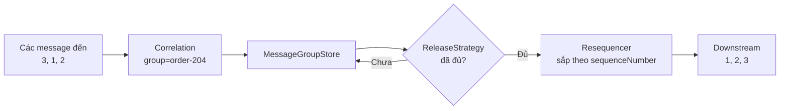
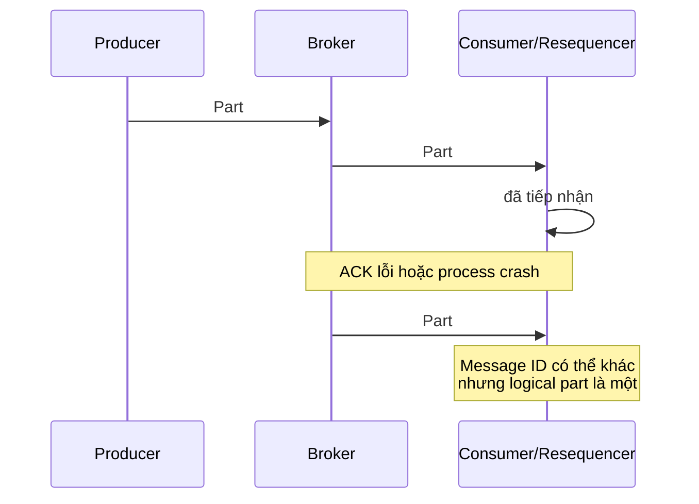
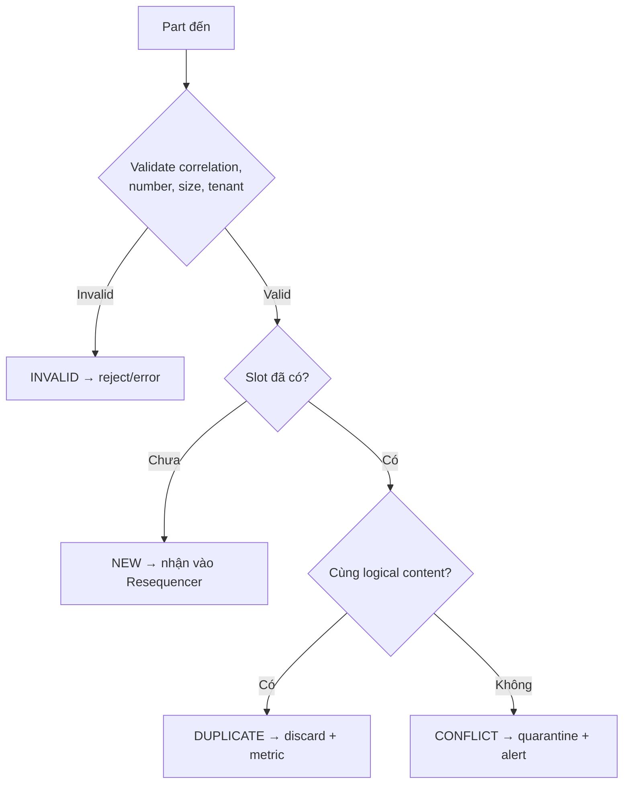
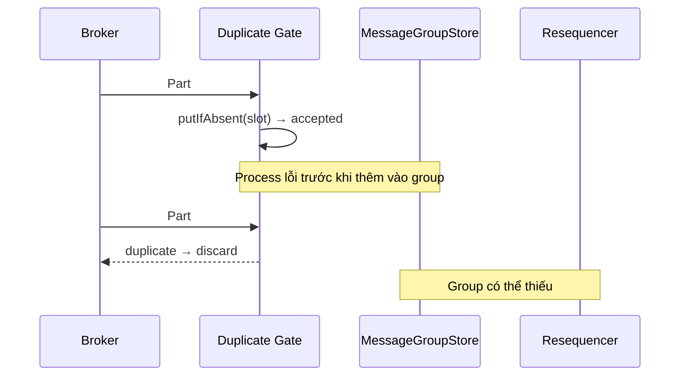
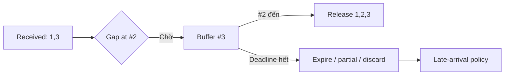
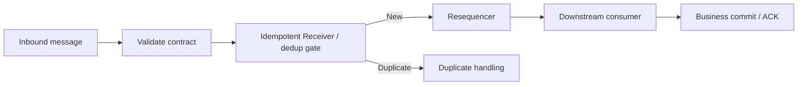

# Duplicate sequence number

## 1. Khi cùng một số thứ tự xuất hiện hai lần

Một đơn hàng có ba tác vụ xử lý độc lập, kết quả được gửi về một luồng theo thứ tự không bảo đảm:

```text
batchId = order-204
sequenceSize = 3

Đến thực tế:
  3 → kết quả đóng gói
  1 → kết quả xác thực
  1 → kết quả xác thực (broker redelivery)
  2 → kết quả tính thuế

Thứ tự mong muốn ở downstream:
  1 → 2 → 3
```

Vấn đề nằm ở hai message đều mang `sequenceNumber=1`. Nếu hệ thống coi chúng là hai **phần độc lập**, nhóm có thể đạt ba message ở thời điểm nhận `3, 1, 1` dù **chưa nhận phần số 2**. Nếu cả hai bản số 1 được phát ra, downstream lại xử lý cùng một bước hai lần.

Trong Enterprise Integration Patterns, **Resequencer** nhận các message thuộc cùng chuỗi, giữ chúng cho đến khi điều kiện release được đáp ứng rồi **phát các message riêng lẻ theo thứ tự sequence**. Nó không gom thành một payload tổng hợp như Aggregator.

Bài **“Duplicate sequence number”** thuộc chương **Resequencer**, module **SPRING_INTEGRATION_PATTERN**. Module hướng dẫn triển khai Enterprise Integration Patterns bằng Spring Integration để tạo luồng ít phụ thuộc và dễ mở rộng, kết hợp Router, Filter, Transformer, Splitter, Aggregator, Gateway, retry, error channel và correlation, đồng thời kiểm thử và quan sát các nhánh xử lý.

Sau bài này, bạn có thể:

1. Phân biệt **message trùng**, **sequence number trùng**, **part nghiệp vụ trùng** và **retry attempt**.
2. Hiểu cách Resequencer sử dụng `CORRELATION_ID`, `SEQUENCE_NUMBER` và `SEQUENCE_SIZE`.
3. Giải thích rủi ro của release dựa trên **message count** khi số thứ tự bị lặp.
4. Thiết kế validation và duplicate/conflict gate trước Resequencer.
5. Viết ví dụ Spring Integration Java DSL và JUnit kiểm thử `3,1,1,2 → 1,2,3`.
6. Đánh giá partial release, gap, late arrival, MessageGroupStore, replay và multi-instance.
7. Biết khi nào cần persistent dedup ledger, idempotent consumer và recovery thay vì một Set trong RAM.

## 2. Mô hình cơ bản của Resequencer



Ba loại metadata:

| Header | Vai trò | Ví dụ |
| --- | --- | --- |
| `CORRELATION_ID` | Xác định các message thuộc **cùng chuỗi** | `tenant-A/order-204/rev-1` |
| `SEQUENCE_NUMBER` | Vị trí của một phần trong chuỗi | `1`, `2`, `3` |
| `SEQUENCE_SIZE` | Tổng số phần dự kiến của chuỗi | `3` |

**Correlation** không phải sequence number. Một message số 1 thuộc order-204 và một message số 1 thuộc order-205 là hợp lệ vì chúng nằm ở hai nhóm khác nhau.

**Resequencer không phải Aggregator:** Resequencer giữ nguyên ý tưởng “một message vào tương ứng một message được phát khi release”, chỉ chỉnh lại thứ tự; Aggregator thường tạo **một message mới** chứa kết quả của cả nhóm.

Định nghĩa *đã đủ* cần khớp thực tế: một group có ba message không có nghĩa ba số thứ tự khác nhau nếu không kiểm soát duplicate.

## 3. Phân biệt bốn trường hợp dễ nhầm

| Tình huống | Ví dụ trong cùng batch | Đánh giá | Hành động |
| --- | --- | --- | --- |
| Hai phần khác nhau | `#1=validate`, `#2=tax` | Hợp lệ | Sắp đúng thứ tự |
| Duplicate giống hệt | Hai lần `#1=validate, eventId=e1` | Có thể là redelivery | Chỉ nhận **một logical part** |
| Cùng số nhưng nội dung khác | `#1=validate OK` và `#1=validate FAIL` | **Conflict** hoặc revision chưa khai báo | Từ chối/quarantine, không lấy tùy ý |
| Cùng số ở batch khác | `order-204/#1` và `order-205/#1` | Hợp lệ | Tạo hai correlation groups |

Thêm một tình huống quan trọng: hai message có **cùng business part ID** nhưng sequence number khác nhau. Đây có thể là lỗi producer gán lại sequence không ổn định. Nếu chỉ dedup bằng số thứ tự, bạn có thể không phát hiện **một part nghiệp vụ xuất hiện ở hai vị trí**.

```text
batch=order-204, logicalPartId=validate
  attempt 1: sequenceNumber=1
  attempt 2: sequenceNumber=2   ← lỗi contract
```

Một hệ thống nghiêm ngặt cần xác định **hợp đồng mapping** giữa logical part ID và sequence number, chứ không chỉ đếm các số khác nhau.

## 4. Vì sao cùng message được phát lại?



Các nguồn duplicate:

- Broker **at-least-once** phát lại sau khi chưa có ACK.
- Producer publish thành công nhưng timeout, rồi retry cùng part.
- Một Gateway/HTTP callback được gọi nhiều lần.
- Pipeline có hai flow gửi trùng kết quả.
- Một operator replay message từ DLQ.
- Một Splitter bị chạy lại sau timeout ở downstream.
- Nhiều worker xử lý cùng business task khi cơ chế claim bị lỗi.

**Không dùng `MessageHeaders.ID` để xác định business duplicate.** Cùng một part có thể được bọc trong các instance `Message` khác nhau, có ID framework khác nhau. Ngược lại, số thứ tự chỉ có nghĩa **trong phạm vi correlation group**, không được dùng làm khóa duy nhất toàn hệ thống.

## 5. Sự khác nhau giữa hai chế độ release

Resequencer có hai cách sử dụng phổ biến:

**Release khi đủ chuỗi:** chờ đầy đủ các sequence dự kiến, sau đó phát theo thứ tự. Đây là kiểu dễ kiểm thử khi `sequenceSize` biết trước.

**Release partial sequences:** phát đoạn liên tục hợp lệ sớm hơn, không nhất thiết chờ hết group. Cấu hình này có thể giảm latency nhưng cần quản lý **gaps, late arrivals và duplicate đã phát** cẩn thận hơn.

```text
Đến: 2, 3             Chưa có 1 → phải chờ
Đến: 1, 2, 3          Có đoạn hợp lệ bắt đầu từ 1
Đến: 1, 3             Thiếu 2 → không thể giả định 3 đã sẵn sàng
Đến: 1, 2, 2, 3       #2 lặp → không được phát thêm #2
```

**Cảnh báo đặc thù Spring Integration:** hành vi phát hiện duplicate number phụ thuộc release strategy và phiên bản. Tài liệu Spring Integration ghi nhận:

- `SequenceSizeReleaseStrategy` từng là default trước Spring Integration 5.0; chiến lược này có xử lý phát hiện số thứ tự trùng, nhưng có thể tốn chi phí với group lớn.
- Với các tình huống không dùng partial release, `SimpleSequenceSizeReleaseStrategy` trở thành default từ Spring Integration 5.0; nó được tối ưu để kiểm tra kích thước nhóm và **không phải một bộ kiểm tra duplicate nghiệp vụ đầy đủ**.
- Resequencer dùng chung các khái niệm `MessageGroupStore` và `ReleaseStrategy` với Aggregator, nhưng nó **phát lại từng message** theo `SEQUENCE_NUMBER`.

Không nên dựa vào ký ức rằng “Resequencer luôn tự chặn mọi sequence number trùng” hoặc suy rằng release theo size là an toàn cho mọi nguồn. Khi tính đúng phụ thuộc vào dedup, hãy **chủ động đưa duplicate policy thành một contract có test**. Xem các liên kết tài liệu Spring ở cuối bài.

### Default không bảo đảm exactly-once

Ngay cả khi một phiên bản framework chặn duplicate sequence trong group, điều đó **không** giải quyết:

- Message trùng **sau khi group đã hoàn tất và state bị xóa**.
- Cùng part được gửi với **sequence number khác**.
- Hai content mâu thuẫn cùng sequence và **quy tắc chọn phiên bản**.
- Side effect downstream đã commit nhưng ACK bị mất.
- State bị mất hoặc phân mảnh qua nhiều JVM.

Resequencing và idempotency là hai trách nhiệm liên quan nhưng không đồng nhất.

## 6. Thiết kế khóa cho một sequence slot

Nên tách các định danh:

| Khóa | Ví dụ | Dùng để |
| --- | --- | --- |
| `tenantId` | `tenant-A` | Ranh giới dữ liệu và quyền truy cập |
| `batchId` | `order-204` | Nhóm nghiệp vụ |
| `processingRevision` | `r1` | Phân biệt một lần xử lý được phép bắt đầu lại |
| `sequenceNumber` | `2` | Slot thứ tự trong một nhóm |
| `logicalPartId` | `calculateTax` | Định danh tác vụ riêng trong nhóm |
| `eventId` | `evt-tax-204-r1` | ID ổn định xuyên retry |
| `attemptId` | `attempt-3` | Nỗ lực giao message; **không dùng** làm dedup key |

Một **slot key** có thể là:

```text
(tenantId, batchId, processingRevision, sequenceNumber)
```

Một **logical part key** có thể là:

```text
(tenantId, batchId, processingRevision, logicalPartId)
```

Hai dạng key hỗ trợ các kiểm tra khác nhau. Chỉ dùng slot key thì có thể bỏ sót trường hợp cùng task bị gán vào hai vị trí; chỉ dùng logical part key thì có thể bỏ sót **hai task khác nhau cùng nhận một sequence number**.

### Fingerprint và tính tương đương của payload

Sau khi phát hiện slot đã có, ứng dụng cần biết hai bản có **thực sự tương đương** không.

- Cùng `eventId` và cùng nội dung có thể là duplicate hợp lệ.
- Cùng `eventId` nhưng payload khác có thể là **vi phạm tính toàn vẹn**.
- Khác `eventId` nhưng cùng slot có thể là hai producer đang tranh quyền ghi.
- Có cùng payload text nhưng khác tenant hoặc revision **không phải** duplicate.

Dùng **canonical business fingerprint** hoặc so sánh các trường được định nghĩa rõ, không chỉ hash raw JSON. JSON có thể khác thứ tự trường, timestamp kỹ thuật, whitespace hoặc số dạng `1.0` so với `1.00`. Nếu có currency/precision/schema version, phải chuẩn hóa theo hợp đồng trước khi so sánh.

## 7. Quy tắc tiếp nhận trước khi Resequencer

Một *admission gate* có thể trả về ba kết quả:



**Trọng tâm:** duplicate giống hệt có thể được ACK/bỏ qua theo hợp đồng delivery; conflict không được “đè bản cũ bằng bản mới” tùy thứ tự mạng.

Một state machine production có thể gồm `NEW`, `ACCEPTED`, `RELEASED`, `COMPLETED`, `CONFLICT`. Một cache ghi `seen=true` trước khi gửi message vào resequencer **chưa** cho biết message đã được store giữ lại hoặc được downstream xử lý. Đó là giới hạn cần làm rõ trong ví dụ dưới đây.

## 8. Java: mô hình input và validator

Ví dụ dùng chuỗi cố định **ba phần** để dễ kiểm chứng. Mỗi part có `sequenceNumber` 1–3, cùng `sequenceSize=3`. Ở production, expected size/expected set phải đến từ một kế hoạch đã xác thực của batch, không được tin một số tùy ý do client khai.

```java
record ShipmentPart(
        String tenantId,
        String batchId,
        String processingRevision,
        String eventId,
        String logicalPartId,
        int sequenceNumber,
        int sequenceSize,
        String result) {}

record SequenceSlot(
        String tenantId,
        String batchId,
        String revision,
        int sequenceNumber) {}

final class SequenceContracts {

    private SequenceContracts() {}

    static void requireValid(ShipmentPart part) {
        if (part == null
                || blank(part.tenantId())
                || blank(part.batchId())
                || blank(part.processingRevision())
                || blank(part.eventId())
                || blank(part.logicalPartId())
                || blank(part.result())
                || part.sequenceSize() != 3
                || part.sequenceNumber() < 1
                || part.sequenceNumber() > part.sequenceSize()) {
            throw new IllegalArgumentException(
                "Invalid shipment sequence part");
        }
    }

    static String groupKey(ShipmentPart part) {
        // Length-prefix: tránh key ambiguity khi ID có dấu ':'.
        String tenant = part.tenantId();
        String batch = part.batchId();
        String revision = part.processingRevision();
        return tenant.length() + "#" + tenant
            + batch.length() + "#" + batch
            + revision.length() + "#" + revision;
    }

    static SequenceSlot slot(ShipmentPart part) {
        return new SequenceSlot(
            part.tenantId(), part.batchId(),
            part.processingRevision(), part.sequenceNumber());
    }

    private static boolean blank(String s) {
        return s == null || s.isBlank();
    }
}
```

**Ý nghĩa:**

1. `sequenceNumber` phải nằm trong đoạn 1 đến `sequenceSize`.
2. `sequenceSize=3` là hợp đồng demo, không phải giá trị tự suy ra từ `group.size()`.
3. `groupKey` bao gồm tenant, batch và revision để không trộn hai chuỗi khác nhau.
4. `logicalPartId` và `eventId` phải ổn định khi cùng part bị gửi lại.
5. Một event dùng `processingRevision=r2` chỉ có ý nghĩa nếu nghiệp vụ **chủ động cho phép** xử lý lại toàn batch; không tự tăng revision vì network retry.

### Vì sao cần kiểm tra size ở mọi part?

Nếu #1 mang `sequenceSize=3` nhưng #2 lại mang `sequenceSize=4`, không có hợp đồng rõ để biết group cần ba hay bốn phần. Với luồng có partial release, các phần đã được phát có thể không thể thu hồi.

Trong production, nên lưu **expected plan** ngoài message hoặc ký/kiểm chứng metadata trước khi nhận vào group. Giá trị từ header không đáng tin cậy chỉ là dữ liệu khai báo, không phải sự thật đã được xác nhận.

## 9. Java: gate chống số thứ tự trùng trong một JVM

Một `ConcurrentHashMap.putIfAbsent(...)` có thể đảm bảo **một slot chỉ được chấp nhận một lần trong phạm vi một JVM**. Đoạn dưới cố tình tách gate ra khỏi framework để dễ unit test.

```java
import java.util.concurrent.ConcurrentHashMap;
import java.util.concurrent.ConcurrentMap;

final class SequenceAdmissionGate {

    private final ConcurrentMap<SequenceSlot, ShipmentPart> accepted =
        new ConcurrentHashMap<>();

    boolean acceptFirst(ShipmentPart part) {
        SequenceContracts.requireValid(part);

        SequenceSlot slot = SequenceContracts.slot(part);
        ShipmentPart existing = accepted.putIfAbsent(slot, part);

        if (existing == null) {
            return true;
        }

        if (existing.equals(part)) {
            // Một bản logical duplicate; không nhận thêm.
            return false;
        }

        throw new IllegalStateException(
            "Conflicting payload for sequence slot: "
                + slot);
    }
}
```

**Giới hạn quan trọng:**

- Gate chỉ kiểm soát duplicate cùng **slot** trong RAM của một process; nhiều pod có thể chấp nhận cùng slot.
- Nếu crash/restart, Map bị mất.
- Nếu message được đánh dấu trong Map nhưng **chưa vào MessageGroupStore**, retry cùng part trong process có thể bị Filter loại dù group chưa có dữ liệu.
- Nếu side effect downstream đã commit nhưng ACK lỗi, Map không thể thay thế idempotency của consumer.
- Nếu mỗi group có nhiều phần và số group không được giới hạn, Map có thể phình vô hạn.
- Code so sánh toàn record theo `equals`, nên các trường kỹ thuật không ổn định giữa retry **không được đưa vào record này** nếu muốn coi chúng là một duplicate tương đương.
- Gate chưa kiểm chứng hai slot khác nhau có trỏ cùng `logicalPartId` hay không. Đó là invariant khác cần kiểm tra trong production.
- Thread-safety trong một JVM không bảo đảm atomic transaction giữa Map, queue, database và broker.

Vì vậy đây là **demo để học cơ chế admission, duplicate và conflict**, không phải giải pháp exactly-once dành cho nghiệp vụ tài chính hoặc luồng dữ liệu bắt buộc không mất.

## 10. Java DSL: Filter trước Resequencer

Ví dụ flow:

```text
seq.in
  → Filter(SequenceAdmissionGate)
      ├─ identical duplicate → seq.duplicates
      ├─ conflict/invalid    → exception + error policy
      └─ first accepted      → Resequencer
                                  → seq.out (1,2,3)
```

Cấu hình Spring Integration:

```java
import org.springframework.context.annotation.Bean;
import org.springframework.context.annotation.Configuration;
import org.springframework.integration.channel.DirectChannel;
import org.springframework.integration.channel.QueueChannel;
import org.springframework.integration.config.EnableIntegration;
import org.springframework.integration.dsl.IntegrationFlow;

@Configuration
@EnableIntegration
public class DuplicateSequenceResequencerConfig {

    @Bean
    SequenceAdmissionGate admissionGate() {
        return new SequenceAdmissionGate();
    }

    @Bean("seq.in")
    DirectChannel sequenceInput() {
        return new DirectChannel();
    }

    @Bean("seq.out")
    QueueChannel orderedOutput() {
        return new QueueChannel();
    }

    @Bean("seq.duplicates")
    QueueChannel duplicateOutput() {
        return new QueueChannel();
    }

    @Bean
    IntegrationFlow resequenceShipmentParts(
            SequenceAdmissionGate gate) {

        return IntegrationFlow.from("seq.in")
            .filter(ShipmentPart.class,
                gate::acceptFirst,
                spec -> spec.discardChannel("seq.duplicates"))
            .resequence()
            .channel("seq.out")
            .get();
    }
}
```

Điểm chính:

- Filter **chủ động xử lý duplicate trước khi lưu group**.
- Duplicate giống hệt đi sang `seq.duplicates`, không tạo thêm một số thứ tự trong Resequencer.
- Conflict/invalid ném exception; trong đường `DirectChannel` đồng bộ, lỗi có thể lan về sender.
- Resequencer phát lại các message được chấp nhận theo `SEQUENCE_NUMBER` khi release.
- Cấu hình không bật partial sequence release; bài test chờ đủ ba phần. Những overload và default cụ thể cần đối chiếu với dependency Spring Integration khi biên dịch.
- `QueueChannel` dùng để đọc kết quả trong test. Nó không chứng minh worker downstream đã hoàn thành nghiệp vụ hay có persistence qua restart.
- Trong ví dụ, gate lấy key từ **payload trusted**. Các sequence header phải được sinh nhất quán với payload tại ingress, không để client tự thiết lập một bộ header khác.

**Tại sao không dùng `.releaseStrategy(g -> g.size() == 3)` để chống trùng?** Vì release strategy không làm cho Map duplicate biến mất, và việc đếm ba message không thể chứng minh đã có đủ ba sequence number khác nhau.

## 11. Xây Message có sequence headers nhất quán

Spring Integration sử dụng các header sequence để resequence. Trong bài này, helper tạo message từ payload đã được validate, tránh trường hợp payload nói `#2` nhưng header nói `#1`.

```java
import org.springframework.integration.IntegrationMessageHeaderAccessor;
import org.springframework.messaging.Message;
import org.springframework.messaging.support.MessageBuilder;

final class ShipmentMessages {

    private ShipmentMessages() {}

    static Message<ShipmentPart> of(ShipmentPart part) {
        SequenceContracts.requireValid(part);

        return MessageBuilder.withPayload(part)
            .setHeader(
                IntegrationMessageHeaderAccessor.CORRELATION_ID,
                SequenceContracts.groupKey(part))
            .setHeader(
                IntegrationMessageHeaderAccessor.SEQUENCE_NUMBER,
                part.sequenceNumber())
            .setHeader(
                IntegrationMessageHeaderAccessor.SEQUENCE_SIZE,
                part.sequenceSize())
            .setHeader("businessEventId", part.eventId())
            .build();
    }
}
```

Các header này cần đến từ một boundary đã xác thực, ví dụ Splitter/adapter hoặc application mapper trusted. Trong production, nếu một message đi qua broker có header mapping khác, phải kiểm tra ở đầu vào:

- `CORRELATION_ID` có đúng tenant/batch/revision không?
- `SEQUENCE_NUMBER` có khớp logical part/expected plan không?
- `SEQUENCE_SIZE` có đồng nhất với kế hoạch đã lưu không?
- `eventId` có đúng publisher/tenant được phép không?

**Đừng tin trực tiếp `tenantId` hoặc `correlationId` client gửi** nếu thông tin này quyết định việc ghép dữ liệu của nhiều khách hàng. Một header sai có thể dẫn đến trộn message giữa hai group không liên quan.

## 12. Integration test: 3, 1, duplicate 1, 2

Dùng JUnit 5, AssertJ và Spring Test. Khi chưa có part số 2, output phải rỗng. Sau part số 2, Resequencer phát đúng thứ tự 1–2–3.

```java
import static org.assertj.core.api.Assertions.assertThat;
import static org.assertj.core.api.Assertions.assertThatThrownBy;

import org.junit.jupiter.api.Test;
import org.springframework.beans.factory.annotation.Autowired;
import org.springframework.beans.factory.annotation.Qualifier;
import org.springframework.integration.channel.QueueChannel;
import org.springframework.messaging.Message;
import org.springframework.messaging.MessageChannel;
import org.springframework.test.context.junit.jupiter.SpringJUnitConfig;

@SpringJUnitConfig(DuplicateSequenceResequencerConfig.class)
class DuplicateSequenceResequencerTest {

    @Autowired
    @Qualifier("seq.in")
    MessageChannel input;

    @Autowired
    @Qualifier("seq.out")
    QueueChannel output;

    @Autowired
    @Qualifier("seq.duplicates")
    QueueChannel duplicates;

    private ShipmentPart part(
            String batch, int seq, String value) {
        return new ShipmentPart(
            "tenant-A", batch, "r1",
            batch + "-part-" + seq,
            "step-" + seq,
            seq, 3, value);
    }

    private void send(ShipmentPart part) {
        assertThat(input.send(ShipmentMessages.of(part)))
            .isTrue();
    }

    private int receiveSequenceNumber() {
        Message<?> message = output.receive(1_000);
        assertThat(message).isNotNull();
        return (Integer) message.getHeaders().get(
            "sequenceNumber");
    }

    @Test
    void duplicatePositionDoesNotFillMissingGap() {
        ShipmentPart first = part("b-out-of-order", 1, "validate");
        ShipmentPart third = part("b-out-of-order", 3, "pack");

        send(third);
        send(first);
        send(first); // duplicated logical part, same slot & content

        assertThat(output.receive(0)).isNull();

        Message<?> duplicate = duplicates.receive(1_000);
        assertThat(duplicate).isNotNull();
        assertThat(duplicate.getPayload()).isEqualTo(first);

        send(part("b-out-of-order", 2, "tax"));

        assertThat(receiveSequenceNumber()).isEqualTo(1);
        assertThat(receiveSequenceNumber()).isEqualTo(2);
        assertThat(receiveSequenceNumber()).isEqualTo(3);
        assertThat(output.receive(0)).isNull();
    }

    @Test
    void conflictingPositionIsNotSilentlyReplaced() {
        ShipmentPart original = part("b-conflict", 1, "OK");
        ShipmentPart changed = part("b-conflict", 1, "FAILED");

        send(original);

        assertThatThrownBy(() -> send(changed))
            .isInstanceOf(RuntimeException.class);
        assertThat(output.receive(0)).isNull();
    }

    @Test
    void samePositionInDifferentBatchIsNotDuplicate() {
        send(part("b-a", 1, "validate"));
        send(part("b-b", 1, "validate"));

        assertThat(duplicates.receive(0)).isNull();

        send(part("b-a", 2, "tax"));
        send(part("b-a", 3, "pack"));

        assertThat(receiveSequenceNumber()).isEqualTo(1);
        assertThat(receiveSequenceNumber()).isEqualTo(2);
        assertThat(receiveSequenceNumber()).isEqualTo(3);

        // b-b vẫn đang chờ 2 và 3, chưa phát kết quả.
        assertThat(output.receive(0)).isNull();
    }
}
```

### Kết quả test bảo vệ điều gì?

- **Out of order:** 3 rồi 1 không được xuất ngay khi dùng release đủ nhóm.
- **Exact duplicate:** hai lần #1 chỉ cho qua Filter một lần.
- **Gap:** khi chưa có #2, output vẫn rỗng.
- **Completion:** khi #2 đến, downstream nhận #1, #2, #3.
- **Conflict:** cùng slot nhưng payload khác không được ghi đè.
- **Correlation:** hai batch có cùng sequence number không gây duplicate lẫn nhau.

Các test là ví dụ cho một ApplicationContext đồng bộ. Chúng **không chứng minh** hành vi của persistent store, transaction, remote broker hay khả năng khôi phục sau crash. Khi dùng executor hoặc poller, cần assertion theo deadline và quan sát error channel; không bê nguyên giả định `send()` sẽ chờ đủ mọi downstream handler.

### Lưu ý khi chạy nhiều test chung context

`SequenceAdmissionGate` là singleton, chứa state giữa các test. Mỗi test dùng `batchId` khác nhau và đọc hết output của batch hoàn thành để giảm nhiễu. Trong dự án thật, nên cô lập fixture/context hoặc cung cấp cleanup hợp lệ; không phụ thuộc vào thứ tự JUnit.

## 13. Unit test gate mà không cần Spring

Một unit test nhỏ xác nhận duplicate và conflict logic:

```java
import static org.assertj.core.api.Assertions.assertThat;
import static org.assertj.core.api.Assertions.assertThatThrownBy;

import org.junit.jupiter.api.Test;

class SequenceAdmissionGateTest {

    private final SequenceAdmissionGate gate =
        new SequenceAdmissionGate();

    private ShipmentPart event(
            String eventId, int seq, String result) {
        return new ShipmentPart(
            "tenant-A", "batch-unit", "r1",
            eventId, "step-" + seq, seq, 3, result);
    }

    @Test
    void sameSlotAndSameLogicalPayloadIsDuplicate() {
        ShipmentPart first = event("evt-1", 1, "valid");

        assertThat(gate.acceptFirst(first)).isTrue();
        assertThat(gate.acceptFirst(first)).isFalse();
    }

    @Test
    void differentPayloadAtSamePositionIsConflict() {
        gate.acceptFirst(event("evt-1", 1, "valid"));

        assertThatThrownBy(() ->
            gate.acceptFirst(event("evt-2", 1, "invalid")))
            .isInstanceOf(IllegalStateException.class)
            .hasMessageContaining("Conflicting");
    }

    @Test
    void differentSequencePositionsAreIndependent() {
        assertThat(gate.acceptFirst(
            event("evt-1", 1, "validate"))).isTrue();
        assertThat(gate.acceptFirst(
            event("evt-2", 2, "tax"))).isTrue();
    }

    @Test
    void outOfRangeNumberIsRejected() {
        assertThatThrownBy(() ->
            gate.acceptFirst(event("evt-0", 0, "bad")))
            .isInstanceOf(IllegalArgumentException.class);
    }
}
```

Nếu code ở production áp dụng fingerprint canonical thay vì record equality, unit tests nên kiểm tra cả `100.0` so với `100.00`, field order của JSON, value enum và version để tránh false conflict hoặc false duplicate.

## 14. Race condition: vì sao check-then-put sai?

Một implementation ngây thơ:

```java
// Không an toàn khi nhiều thread cùng nhận một slot.
if (!map.containsKey(slot)) {
    map.put(slot, part);
    return true;
}
return false;
```

Hai thread có thể cùng thấy key chưa tồn tại và cùng trả true. `ConcurrentHashMap.putIfAbsent(...)` giải quyết race **trong một JVM** ở bước claim một slot, nhưng nó không tạo transaction nguyên tử với MessageGroupStore.

Một test concurrent nên:

1. Tạo 20 thread cùng gọi `acceptFirst(part)` cho cùng một slot.
2. Cho các thread bắt đầu bằng `CountDownLatch`.
3. Thu số kết quả `true`.
4. Khẳng định **chỉ một** thread được nhận.
5. Đặt timeout hữu hạn, đóng executor sau test.

Đừng dùng `Thread.sleep(100)` làm bằng chứng không có race. Và **đừng áp dụng kết luận cho nhiều JVM**, vì mỗi JVM dùng một Map khác nhau.

## 15. Crash window: “đã thấy” khác “đã lưu vào nhóm”



Đây là nguyên nhân **không thể dùng Filter in-memory ở mục 9 làm giải pháp bền vững**. Thêm record vào dedup store và thêm part vào MessageGroupStore là **hai thao tác riêng**.

Một trường hợp ngược:

```text
1. Part #1 đã được lưu vào MessageGroupStore.
2. Process chết trước khi ACK broker.
3. Broker phát lại #1.
4. Nếu dedup state mất và store vẫn còn #1, part có thể bị ghi lại.
```

Và sau khi release:

```text
1. Resequencer phát #1 đến downstream.
2. Downstream commit thành công.
3. ACK bị mất; message được giao lại.
4. Nếu downstream không idempotent, side effect chạy thêm lần nữa.
```

**Resequencer chỉ xử lý thứ tự phát message; nó không thay thế cơ chế exactly-once cho side effect.**

### Một mô hình recovery đáng tin hơn

Có thể dùng ledger/gateway trước Resequencer:

```text
accepted_part(
  tenant_id,
  batch_id,
  processing_revision,
  sequence_no,
  logical_part_id,
  event_id,
  canonical_fingerprint,
  state,  -- RECEIVED/BUFFERED/RELEASED/COMPLETED
  PRIMARY KEY(tenant_id, batch_id, processing_revision, sequence_no)
)
```

Nếu ledger và group state cùng nằm trong một transactional database, có thể kết hợp các bước lưu trong một transaction được kiểm chứng. Nếu dùng Redis + JDBC + broker riêng, cần recovery protocol/transactional outbox hoặc chiến lược replay phù hợp. **Không được khẳng định có tính nguyên tử xuyên các storage khác nhau chỉ vì chúng đều có cơ chế atomic put.**

## 16. Cùng sequence nhưng khác payload: nên xử lý ra sao?

Ví dụ:

```text
batch=order-204, sequence=2, eventId=e-tax-204

Reply 1: tax = 35.50
Reply 2: tax = 36.00
```

Có ít nhất ba khả năng:

- Producer đã phát **hai phiên bản logic khác nhau**, nhưng quên tăng revision.
- Có lỗi chuyển đổi/serialize khiến dữ liệu bị thay đổi.
- Một trong hai reply không đáng tin hoặc bị sửa trên đường truyền.

**Không nên tự chọn “last write wins”.** Message đến sau có thể được tạo trước; broker/retry có thể đảo thứ tự.

Quy tắc đề xuất:

1. Normalize schema/currency/precision trước khi so sánh.
2. Nếu một slot đã có fingerprint **giống**, phân loại `DUPLICATE_IDENTICAL`.
3. Nếu fingerprint **khác**, phân loại `CONFLICTING_SEQUENCE` và đưa vào quarantine/error flow.
4. Chỉ cho phép thay thế bằng revision/epoch mới nếu hợp đồng nghiệp vụ quy định rõ và audit đầy đủ.
5. Nếu có signature hoặc trusted producer ID, kiểm chứng ở ingress trước khi chấp nhận message.

Nếu downstream từng nhận #2 phiên bản cũ, muốn phát #2 phiên bản mới phải có **update/compensation contract**. Resequencer vốn nhằm **phát message đúng thứ tự**, không tự rollback kết quả đã công bố.

## 17. Trường hợp cùng logicalPartId ở hai vị trí

Ví dụ:

```text
batch=b-204
  #1: logicalPartId=validate-order
  #2: logicalPartId=validate-order  ← cùng thao tác, sai mapping
  #3: logicalPartId=write-order
```

Gate mục 9 chỉ biết slot #1, #2, #3 là khác nhau nên có thể cho qua cả ba.

Một hệ thống production có thể thêm **logical part index**:

```text
(tenantId, batchId, revision, logicalPartId) → sequenceNumber
```

Khi một logical part đã được ánh xạ tới sequence=1 nhưng lại xuất hiện ở sequence=2, đó là **vi phạm contract**. Tuy nhiên có những bài toán thực sự cho phép nhiều step cùng một *type*, ví dụ 100 bước `validate-line` cho 100 dòng đơn. Khi đó `logicalPartId` phải có ID từng dòng, không phải chỉ tên thao tác.

Bài học là phải phân biệt **loại tác vụ** với **định danh một phần cụ thể**.

## 18. Duplicate sau khi sequence đã hoàn tất

Tình huống:

```text
09:00:01 #1 received
09:00:02 #2 received
09:00:03 #3 received → release 1,2,3
09:00:04 #2 redelivered
```

Sau khi release, một MessageGroupStore/Resequencer có thể giữ **empty completed group metadata** để phát hiện late arrivals hoặc xóa group tùy cấu hình. Tài liệu Spring Integration mô tả rằng trạng thái nhóm hoàn tất giúp bỏ những message tới muộn, còn xóa hoàn toàn group có thể cho phép group mới cùng correlation key được tạo.

**Không dựa vào group tombstone có thời hạn vô hạn**:

- Nếu metadata hoàn tất được giữ quá lâu, store có thể phình.
- Nếu xóa quá sớm, duplicate sau restart/replay có thể được coi là chuỗi mới.
- Nếu đổi group key khi retry, tombstone cũ không giúp gì.

Nên tính **retention horizon** từ thời gian broker có thể redeliver, producer retry, DLQ replay, thời hạn xử lý nghiệp vụ và policy lưu dữ liệu.

### Late duplicate khác late missing part

- **Late duplicate #2:** #2 đã có trong chuỗi được phát, có thể bỏ an toàn nếu có bằng chứng.
- **Late missing #2:** group trước đó timeout và phát partial #1/#3 theo policy; #2 đến muộn là một phần mới nhưng quá hạn. Ứng dụng cần chính sách xử lý late arrival (ignore, quarantine, hoặc revision), không coi nó là duplicate chỉ vì group đã complete.

## 19. Gap và partial release

Nếu nhận `1, 3` cho chuỗi size 3:

- Không có đủ bộ 1–3 để phát toàn bộ.
- Nếu partial release được bật, có thể phát **đoạn liên tiếp bắt đầu tại vị trí hợp lệ** theo semantics của Resequencer, nhưng #3 không nên vượt qua khoảng trống #2 khi hợp đồng yêu cầu thứ tự.
- Nếu #2 không bao giờ đến, group có thể bị giữ tới timeout/expiry.



Không nên chỉ bật `releasePartialSequences(true)` và giả định mọi trường hợp được giải quyết. Cần biết:

- Đã phát vị trí nào?
- Có giữ phần chưa liên tục trong group không?
- Nếu duplicate của vị trí đã phát đến, handler nào bỏ nó?
- Nếu phần thiếu tới sau group expiry, có tạo batch revision mới không?
- Kết quả downstream có chấp nhận partial output không?

Với sequence lớn, nhiều gap và nhiều group chưa hoàn tất, Resequencer có chi phí giữ state đáng kể. Tài liệu Spring Integration lưu ý Resequencer phù hợp hơn với **sequence tương đối ngắn và ít khoảng trống**.

## 20. SEQUENCE_SIZE không nhất quán

Ví dụ:

```text
Part #1: size=3
Part #2: size=4
Part #3: size=3
```

Không thể suy ra một cách an toàn rằng nhóm phải đợi ba hay bốn message nếu không có nguồn authoritative cho expected size.

Quy tắc:

1. Chốt `expectedSize` và expected-part plan khi bắt đầu batch.
2. Mỗi part phải khớp plan đã lưu.
3. `sequenceNumber` phải dương và không vượt `expectedSize`.
4. Nếu plan có thể thay đổi, phải dùng **revision mới** với semantics rõ.
5. Không để message từ revision cũ chen vào nhóm revision mới.
6. Trường hợp size sai cần được ghi nhận là **INVALID_SEQUENCE_METADATA**, không âm thầm sửa về group.size().

Một số flow dùng Splitter để tạo header sequence tự động. Nếu splitter được chạy lại với danh sách đã thay đổi, cùng correlation ID có thể đi kèm size khác; phải quyết định replay sử dụng snapshot cũ hay revision mới.

## 21. MessageGroupStore và nhiều instance

Resequencer là endpoint **có trạng thái**. Nó nhận các part ở những thời điểm khác nhau, lưu group trong `MessageGroupStore` và phát khi phù hợp.

| Store/triển khai | Ưu điểm | Rủi ro |
| --- | --- | --- |
| In-memory store trong một JVM | Đơn giản, phù hợp demo | Mất group khi restart; mỗi instance giữ một phần khác nhau |
| Persistent JDBC store | Có thể khôi phục group qua restart | Schema, transaction, lock và cleanup |
| Shared store/distributed coordination | Nhiều instance có thể phối hợp | Network, consistency, contentions |
| Broker partition theo group | Giữ cùng batch về một consumer | Partition reassignment, replay, duplicate vẫn có thể xảy ra |
| Workflow/part ledger riêng | Kiểm soát slot, conflict và completion rõ | Nhiều schema và cơ chế phục hồi hơn |

**Nguy cơ phân mảnh:**

```text
Instance A nhận sequence 1,3
Instance B nhận sequence 2
Mỗi instance có in-memory store riêng
→ Không instance nào có đủ 1,2,3.
```

Cần co-locate/partition các message cùng group hoặc dùng store có transaction và locking phù hợp. Dùng **shared store** không tự đảm bảo producer sẽ không phát trùng; vẫn phải có dedup logic và idempotency tại consumer.

### Không chỉ lưu Map gate, còn phải lưu group

Nếu dedup state được persist nhưng group chỉ ở memory, sau restart một part cũ có thể bị chặn vì “đã thấy” trong khi group đã mất. Nếu group persist nhưng dedup state ở memory, duplicate có thể được đưa lại vào group.

Với workflow quan trọng, hai lớp phải có **hợp đồng nhất quán và recovery**: ví dụ một ledger dùng làm source of truth, từ đó có thể tái dựng group sau crash.

## 22. Retry, ACK và error channel

Có ba ranh giới lỗi khác nhau:

| Ranh giới | Ví dụ | Retry thích hợp |
| --- | --- | --- |
| **Ingress/validation** | Sequence number ngoài khoảng, conflict | Không retry vô hạn; sửa dữ liệu/quarantine |
| **Store/resequencer** | Database/lock unavailable | Bounded retry theo message và store transaction |
| **Downstream** | HTTP/database consumer timeout | Retry output với idempotency, không đánh lại số sequence |

Lỗi trong một `DirectChannel` thường có thể lan về sender. Với executor, poller và broker listener, exception có thể được xử lý qua error flow theo cấu hình. **Không giả định mọi lỗi luôn tự động đi vào global `errorChannel`**.

Một duplicate identical có thể là outcome bình thường: đã nhận logical part từ trước, có thể ACK theo hợp đồng nếu có bằng chứng nó được lưu đủ bền vững. Nhưng với gate in-memory, nhận duplicate và trả ACK không chứng minh group hoặc side effect đã được lưu.

### Vì sao retry toàn pipeline có thể gây hại?

Ví dụ upstream Splitter phát 1,2,3 rồi downstream báo lỗi; nếu retry toàn Splitter, mỗi part lại được phát một lần. Resequencer phải xử lý các bản trùng đó, và consumer phía sau vẫn phải idempotent.

Nếu lỗi chỉ nằm ở handler nhận #3, nên có cơ chế retry **handler/output #3** theo key nghiệp vụ, thay vì gửi lại cả sequence mà không biết 1,2 đã commit.

## 23. Resequencer và idempotent receiver của Spring Integration

Spring Integration có **Idempotent Receiver** pattern, trong đó `IdempotentReceiverInterceptor` có thể kết hợp `MetadataStoreSelector` và metadata store để nhận biết message lặp.

Một topology khả dĩ:



Nhưng cần chú ý:

- Selector/metadata store phải dùng business key đúng, không phải chỉ `MessageHeaders.ID`.
- Nếu marker được lưu trước khi Resequencer nhận part, vẫn tồn tại crash window.
- `SimpleMetadataStore` hoặc Map local không giải quyết nhiều JVM.
- Shared Redis/JDBC store cần được kiểm tra atomicity, transaction, TTL.
- Duplicate ở consumer sau resequencing cần kiểm soát riêng nếu output có side effect.
- Quy tắc conflict (cùng slot, payload khác) phải được định nghĩa; một selector boolean đơn giản có thể chưa đủ để phân loại.

**Không đồng nhất “lọc duplicate message” với “bảo đảm chính xác một lần”.** Idempotency là hợp đồng nghiệp vụ xuyên quá trình lưu, retry, transport và side effect.

## 24. Nên đặt dedup trước hay sau Resequencer?

| Vị trí | Điều giải quyết | Điều không tự giải quyết |
| --- | --- | --- |
| **Trước Resequencer** | Không để slot trùng làm méo group/release | Crash giữa claim và store; output side effect |
| **Ngay tại group admission/store** | Có thể đồng bộ slot uniqueness với group state | Remote consumer commit; cross-store transaction |
| **Sau Resequencer** | Chống xử lý lại phần đã release | Group trước đó vẫn có thể release sai do duplicate |
| **Ở business consumer** | Ngăn side effect nhiều lần | Không sửa gap/order/group do duplicate upstream |
| **Cả hai ranh giới** | Bảo vệ group correctness và business correctness | Cần phối hợp key, retention và recovery |

Với yêu cầu quan trọng, thường cần **dedup trước/ở group admission** và **idempotency ở downstream**. Hai lớp có mục tiêu khác nhau và không nên dùng một biến `seen=true` để thay thế cả hai.

## 25. Quan sát duplicate sequence

Chỉ log “message received” không đủ. Mẫu log ứng dụng:

```text
event=sequence_admission
tenantScope=tenant-A
batchId=order-204
revision=r1
sequenceNumber=1
sequenceSize=3
logicalPartId=validate-order
eventId=evt-validate-204-r1
decision=DUPLICATE_IDENTICAL
attempt=2
```

Đây là schema gợi ý, không phải các trường framework luôn tự sinh. Không log raw payload nhạy cảm hoặc secret. Các ID nghiệp vụ dùng cho trace/log cần tuân thủ quyền truy cập và retention.

Metric gợi ý:

| Metric | Theo dõi |
| --- | --- |
| `resequencer.input.total` | Số message đầu vào |
| `resequencer.sequence.invalid.total{reason}` | Invalid number, size, missing correlation |
| `resequencer.duplicate.total{kind}` | Identical, conflict, late |
| `resequencer.group.open` | Số group đang chờ |
| `resequencer.group.age.seconds` | Tuổi các group chưa hoàn tất |
| `resequencer.gap.count` | Số sequence position còn thiếu |
| `resequencer.group.released.total` | Số group đã release |
| `resequencer.group.expired.total` | Số group hết hạn |
| `resequencer.output.redelivery.total` | Số output được giao lại |
| `resequencer.store.error.total` | Lỗi MessageGroupStore |
| `resequencer.downstream.failed.total` | Lỗi handler sau Resequencer |

Các metric trên là **đề xuất tự instrument**. Tránh dùng `batchId` hoặc `eventId` làm metric label có cardinality vô hạn. Nếu cần truy vết một batch cụ thể, dùng trace/log với correlation ID được bảo vệ.

### Phân biệt số “received” và “unique”

Một dashboard báo `group size=3` nhưng `uniqueSequencePositions=2` phải cho thấy **group chưa đầy đủ**, không được đánh dấu đã đạt success chỉ vì số lượng message.

## 26. Những lỗi thường gặp

| Triệu chứng | Nguyên nhân có thể | Hướng xử lý |
| --- | --- | --- |
| Thấy output 1,1,3 | Duplicate không được chặn, release sai | Gate trước resequencer; kiểm tra strategy |
| Output phát sớm dù thiếu #2 | Đếm message thay vì sequence distinct | Kiểm chứng unique slots và expected set |
| Conflict #1 không được phát hiện | First-wins âm thầm hoặc so sánh sai fingerprint | Chính sách conflict + quarantine |
| Hai batch khác nhau chặn lẫn nhau | Key chỉ dùng sequence number | Key phải có tenant/batch/revision |
| Message #2 bị chặn khi retry chưa hoàn thành | Gate mark seen trước group admission | Transaction/ledger và recovery |
| Duplicate sau restart | In-memory gate bị mất | Durable state hoặc replay có kiểm soát |
| Group không bao giờ release | Missing number, size sai hoặc state phân tán | Kiểm tra gap, expected plan và store |
| Nhiều group treo tăng memory | Không có expiration/cleanup | Group timeout, reaper, quota |
| Message đến muộn tạo group mới | Completed metadata bị xóa quá sớm | Tombstone/retention phù hợp |
| Consumer xử lý trùng sau release | ACK mất, downstream không idempotent | Consumer dedup theo business key |
| Sau bật partial, #3 ra khi #2 chưa đến | Misconfigured release/gap policy | Kiểm tra partial semantics và test gaps |
| Một part dùng hai số thứ tự | Producer mapping không ổn định | Validate logicalPartId→seq mapping |
| Tenant A và B bị ghép nhóm | Correlation thiếu tenant được xác thực | Sửa trusted key, kiểm tra bảo mật |
| Lỗi không thấy trên errorChannel | Lỗi đồng bộ hoặc endpoint chưa cấu hình | Quan sát đúng thread/error policy |
| Throughput tụt khi group dài | Release strategy kiểm tra sâu, nhiều gaps | Giới hạn group, đo chi phí, xem xét partition |

## 27. Bảo mật và tính tin cậy

Resequencer có thể vô tình trở thành nơi lưu nhiều message do một client đưa ra metadata sai:

- Không cho client tự chọn `CORRELATION_ID` dẫn tới nhóm của tenant khác.
- Giới hạn `SEQUENCE_SIZE` tối đa để ngăn một message tuyên bố cần hàng triệu phần.
- Kiểm tra `SEQUENCE_NUMBER` đúng miền giá trị.
- Xác thực source của mỗi logical part; không để một producer giả mạo part của producer khác.
- Quản lý limit cho số nhóm mở, số message/group, memory và storage.
- Đối với reply từ service khác, kiểm tra `logicalPartId` thuộc scatter/split plan được phép.
- Dùng allowlist/schema/plan thay vì dựa vào header tùy ý.
- Đánh giá các buffer, DLQ và message store có chứa PII hay không.
- Bảo vệ dedup ledger bằng ACL, encryption, retention và audit thay đổi dữ liệu.
- Không cho một conflicting duplicate âm thầm ghi đè kết quả đã phát trước đó.

Duplicate/conflict tăng bất thường có thể do lỗi retry, deployment hoặc hành vi lạm dụng; nên đặt alert theo tỷ lệ, không chỉ tổng số.

## 28. Ma trận kiểm thử cần có

| Kịch bản | Expected |
| --- | --- |
| 1,2,3 | Phát đúng 1,2,3 |
| 3,1,2 | Phát đúng 1,2,3 |
| 3,1,1,2 | Exact duplicate #1 bị bỏ, vẫn phát 1,2,3 |
| 1,1,3 | Không coi là đủ chuỗi; #2 còn thiếu |
| 1(A),1(B) cùng slot | Conflict nếu payload không tương đương |
| 1 của batch A, 1 của batch B | Hai slot độc lập |
| #0 hoặc #4 với size=3 | Reject metadata sai |
| #1 size=3, #2 size=4 | Reject hoặc quarantine inconsistent plan |
| Cùng logicalPartId ở #1/#2 | Bắt lỗi ở domain mapping |
| #1 hoàn tất rồi duplicate sau release | Không xử lý business side effect thêm lần nữa |
| Group thiếu #2 quá deadline | Timeout/expiration/partial policy rõ |
| #2 đến sau khi group expired | Late arrival policy, không phát summary/sequence lặp |
| Crash sau dedup claim | Khôi phục từ ledger; không làm mất #1 |
| Crash sau business commit | Redelivery không nhân đôi side effect |
| Concurrent duplicate trên nhiều worker | Claim/dedup nhất quán toàn cụm |
| Splitter chạy lại cùng batch | Không tăng count/không lặp nghiệp vụ |
| Hai tenant có cùng batchId | Không ghép nhầm |
| Payload khác nhưng cùng eventId | Bị đánh dấu integrity conflict |
| Bật partial release | Output đúng tính liên tục theo cấu hình/test |
| MessageGroupStore restart | Group được khôi phục nếu SLA yêu cầu |

## 29. Bài tập thực hành

### Bài 1 — Nhận biết duplicate sequence number

Với group size=3, mô phỏng các thứ tự `[1,2,3]`, `[3,1,1,2]`, `[1,1,3]` và `[2,2,2]`. Xác định tập sequence number thực tế, những vị trí thiếu và khi nào mới release hợp lệ. Giải thích vì sao group size không phải unique sequence count.

### Bài 2 — Triển khai Filter trước Resequencer

Dùng `SequenceAdmissionGate` và `DuplicateSequenceResequencerConfig` để phát `3,1,1,2`. Assert kết quả output đúng 1–2–3 và duplicate được đưa sang channel riêng. Thêm test không có output khi #2 còn thiếu.

### Bài 3 — Conflict và canonical fingerprint

Một producer gửi số tiền `100.0`, sau đó retry với `100.00`; producer khác gửi `101.00` cho cùng slot. Định nghĩa quy tắc so sánh tương đương theo BigDecimal và source. Viết unit tests phân biệt exact duplicate, equivalent formatting và conflicting value.

### Bài 4 — Logical part ID bị đổi số

Thêm một Map kiểm chứng `logicalPartId → sequenceNumber`. Gửi cùng logical part ID ở #1 và #2. Giải thích vì sao gate chỉ nhìn sequence slot sẽ bỏ sót và cách phối hợp hai index trong một transaction.

### Bài 5 — Partial release với gap

Dùng Java DSL `.resequence(r -> r.releasePartialSequences(true))` trên một flow **thay thế**. Gửi `1,3` trước; kiểm chứng những gì đã/ chưa được phát theo version thực. Sau đó gửi #2 và duplicate #1. Thiết kế idempotency để một sequence position không được xử lý lần thứ hai sau khi đã phát.

### Bài 6 — Thử lỗi khi consumer commit xong nhưng ACK mất

Resequencer phát #1; consumer cập nhật database rồi crash trước ACK. Broker redeliver #1. Đề xuất idempotency key nghiệp vụ và một transaction hoặc workflow state để chống trùng side effect. Giải thích tại sao một Filter in-memory trước Resequencer là chưa đủ.

### Bài 7 — Persistent store và nhiều instance

Cho instance A nhận #1/#3, instance B nhận #2. Giải thích tại sao mỗi instance có store riêng không đủ. Đề xuất partition theo trusted group key hoặc persistent shared group store có locking. Mô phỏng restart trước khi nhận đủ chuỗi.

### Bài 8 — Expiration và replay

Một group size=3 chỉ nhận #1 và #3 rồi timeout. Operator replay #2 sau một ngày. Thiết kế retention và late-arrival policy. Nếu quyết định phát revision mới, hãy ghi revision và chặn trùng ở downstream.

### Bài 9 — Lỗi bảo mật

Client gửi `tenantId=tenant-B` và `correlationId` của tenant B để chèn message #2 vào group không thuộc quyền. Thiết kế trusted ingress tạo lại metadata; kiểm thử nguồn chưa xác thực bị từ chối, không ghép lẫn hai tenant.

### Bài 10 — Quan sát và runbook

Tạo dashboard gồm số group mở, tuổi nhóm lớn nhất, số gap, duplicate identical, conflict, nhóm expired và output redelivery. Viết runbook phân biệt producer gửi thiếu, size metadata sai, group state phân mảnh và duplicate do retry.

**Tiêu chí hoàn thành:** chỉ ra được **slot nào là duplicate**, **slot nào thiếu**, **khi nào đủ điều kiện release**, **xử lý payload mâu thuẫn thế nào**, **state nằm ở đâu** và **vì sao downstream vẫn phải idempotent**.

## 30. Checklist trước production

- [ ] Correlation key bao gồm đúng tenant, business batch và revision.
- [ ] SEQUENCE_NUMBER và SEQUENCE_SIZE được kiểm chứng theo plan tin cậy.
- [ ] Có business ID ổn định cho mỗi logical part và event.
- [ ] Không dùng MessageHeaders.ID làm dedup key nghiệp vụ.
- [ ] Có phân loại exact duplicate, conflict, invalid, late arrival.
- [ ] Release policy không nhầm message count với unique sequence positions.
- [ ] Hiểu default/release strategy theo phiên bản Spring Integration thực tế.
- [ ] Có test cho cả complete và partial release.
- [ ] Dedup state không bị mất hoặc gây false completion khi crash/retry.
- [ ] Có atomic claim/transaction hoặc recovery protocol giữa ledger và group state khi cần.
- [ ] Có idempotency ở downstream consumer nếu có side effect.
- [ ] Có MessageGroupStore phù hợp với restart/multi-instance SLA.
- [ ] Có group timeout, expiration, retention và cleanup.
- [ ] Có cách xử lý sequence number bị đổi, gap không được lấp và size không nhất quán.
- [ ] Có chính sách ACK, bounded retry, error channel/DLQ.
- [ ] Không cho client tự sửa group key hoặc giả mạo tenant.
- [ ] Có quota giới hạn số group, size, payload và backlog.
- [ ] Có metric duplicate/gap/group age/store errors và cảnh báo.
- [ ] Có kiểm thử concurrency, redelivery, crash, replay.
- [ ] Có kế hoạch schema/key migration khi version của logical part thay đổi.

## 31. Tổng kết

**Duplicate sequence number** là một lỗi về định danh và tính toàn vẹn của chuỗi, không chỉ là việc sắp xếp một danh sách số.

Spring Integration Resequencer dùng `CORRELATION_ID` để gom nhóm, `SEQUENCE_NUMBER` để xác định thứ tự và `SEQUENCE_SIZE` cùng release strategy để quyết định khi nào phát. Tuy nhiên **hành vi phát hiện duplicate phụ thuộc release strategy/phiên bản** và không đủ để bảo đảm idempotency nghiệp vụ.

Thiết kế có trách nhiệm gồm:

1. **Validate** nguồn, correlation, sequence number, size và revision.
2. **Deduplicate/Detect conflict** bằng khóa slot cùng logical part identity được kiểm soát.
3. **Resequence** theo thứ tự trong group với release/timeout policy rõ.
4. **Persist/Recover** state nếu cần xử lý qua restart hoặc nhiều instance.
5. **Idempotent downstream** để không nhân đôi side effect khi output bị redeliver.

**Không để hai bản của #1 làm Resequencer tưởng rằng phần #2 đã đến.** Và không coi việc phát một message đúng thứ tự là bằng chứng toàn bộ nghiệp vụ đã commit đúng một lần.

## Tài liệu tham khảo

- [Spring Integration Reference — Resequencer](https://docs.spring.io/spring-integration/reference/resequencer.html)
- [Spring Integration Reference — Aggregator](https://docs.spring.io/spring-integration/reference/aggregator.html)
- [Spring Integration Reference — Aggregators and Resequencers Java DSL](https://docs.spring.io/spring-integration/reference/dsl/java-aggregators.html)
- [Spring Integration API — SequenceSizeReleaseStrategy](https://docs.spring.io/spring-integration/api/org/springframework/integration/aggregator/SequenceSizeReleaseStrategy.html)
- [Spring Integration Reference — Message Group Store](https://docs.spring.io/spring-integration/reference/message-store.html)
- [Spring Integration Reference — Message Filtering](https://docs.spring.io/spring-integration/reference/filter.html)
- [Spring Integration Reference — Idempotent Receiver](https://docs.spring.io/spring-integration/reference/handler-advice/idempotent-receiver.html)
- [Spring Integration Reference — Error Handling](https://docs.spring.io/spring-integration/reference/error-handling.html)
- [Enterprise Integration Patterns — Resequencer](https://www.enterpriseintegrationpatterns.com/patterns/messaging/Resequencer.html)
- [Enterprise Integration Patterns — Idempotent Receiver](https://www.enterpriseintegrationpatterns.com/patterns/messaging/IdempotentReceiver.html)
- [Enterprise Integration Patterns — Message Sequence](https://www.enterpriseintegrationpatterns.com/patterns/messaging/MessageSequence.html)

Các ví dụ dùng Java 17+ (records), Spring Integration Java DSL và JUnit 5 để minh họa. Khi tích hợp vào hệ thống thực, cần đối chiếu API/release strategy theo phiên bản đang chạy và kiểm thử trên MessageGroupStore, channel, transaction và transport thực tế. Bài thuộc STEP 4 NEW; việc biên dịch, chạy integration tests và vòng Content QA chuyên môn được thực hiện ở giai đoạn riêng.
