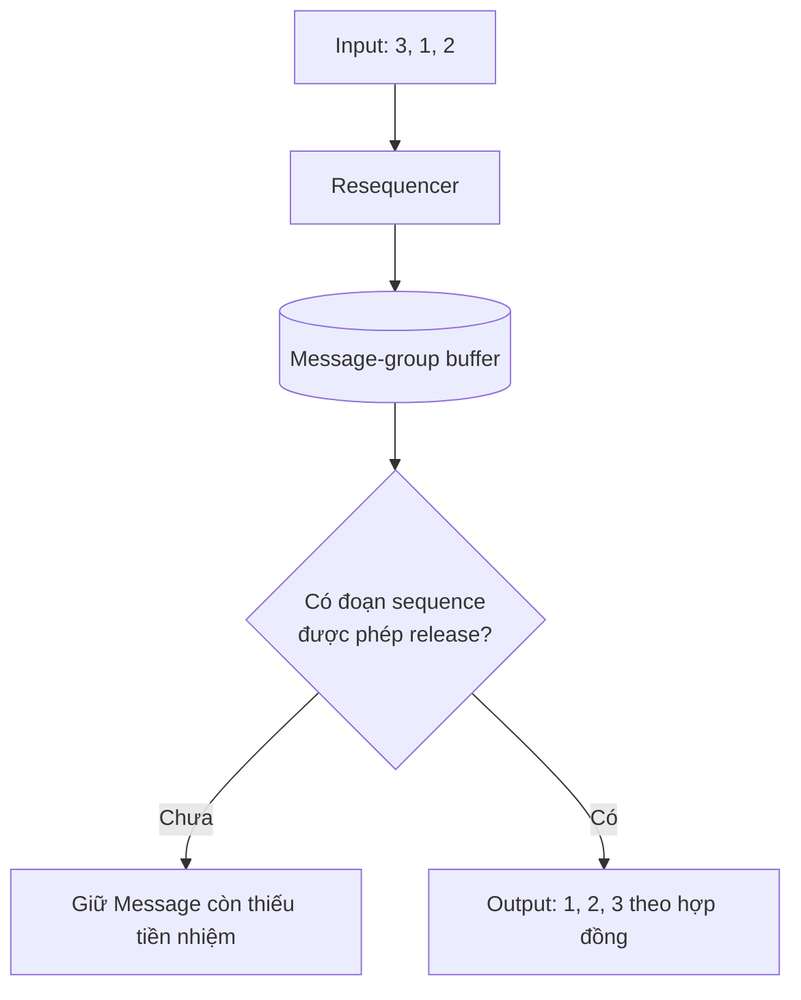
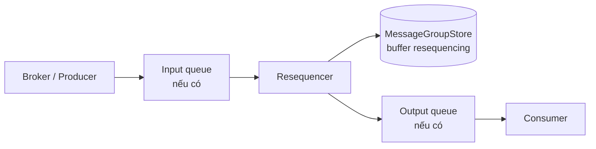
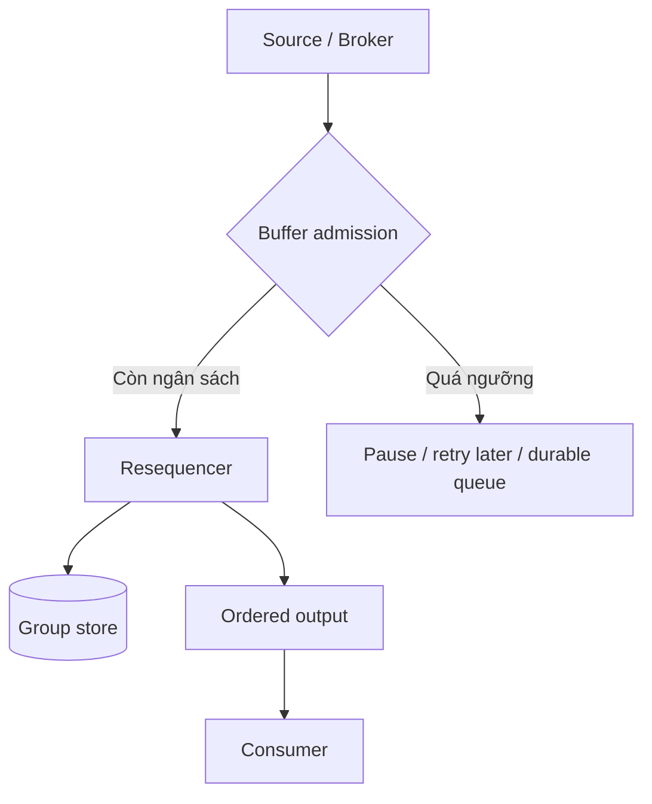
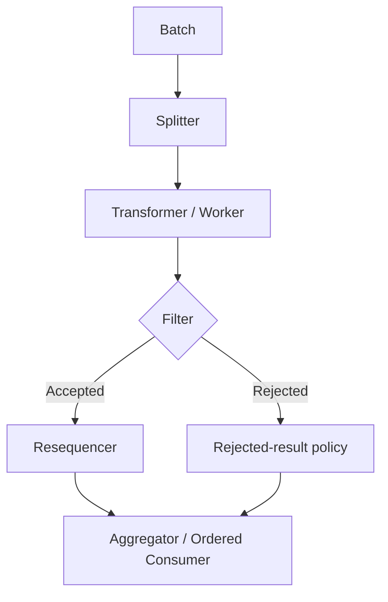

# Giới hạn bộ nhớ buffer trong Resequencer

Trong một hệ thống xử lý sự kiện, Message không nhất thiết đến theo đúng thứ tự được tạo ra. Một batch gồm ba phần tử có thể đi qua các worker song song và tới endpoint cuối theo thứ tự `3 → 1 → 2`. Nếu nghiệp vụ yêu cầu xử lý theo `1 → 2 → 3`, hệ thống cần một **Resequencer** để sắp xếp lại các Message. Để làm được việc đó, Resequencer thường phải **giữ tạm các Message chưa thể phát đi**.

Vấn đề xuất hiện khi Message mang số thứ tự kế tiếp không tới, một nhánh bị lỗi, tốc độ đầu vào vượt quá đầu ra hoặc có quá nhiều nhóm đang chờ. Các Message có thể tích tụ trong **buffer** và tiêu thụ bộ nhớ ngày càng lớn. Một cấu hình hoạt động tốt với ba Message trong unit test chưa chắc chịu được hàng nghìn nhóm chưa hoàn tất trong production.

Bài **Giới hạn bộ nhớ buffer** thuộc chương **Resequencer** của module `SPRING_INTEGRATION_PATTERN`. Module học triển khai Enterprise Integration Patterns bằng Spring Integration, kết hợp Router, Filter, Transformer, Splitter, Aggregator, Gateway, retry, error channel và correlation, đồng thời kiểm thử, theo dõi các nhánh. Bài tập trung vào **nguyên nhân tăng bộ nhớ trong quá trình resequence, cách xác định ngân sách buffer, chính sách timeout/eviction/backpressure, sự khác nhau giữa in-memory và persistent store, cùng cách kiểm thử các tình huống gây nghẽn**.

## 1. Vì sao Resequencer cần buffer?

Giả sử một đơn hàng có ba công việc được đánh số `1`, `2`, `3`:

```text
Thứ tự logic:
    M1 → M2 → M3

Thứ tự Message đến:
    M3 → M1 → M2

Thứ tự mà consumer cần:
    M1 → M2 → M3
```

Resequencer không thể phát `M3` trước `M1`, nếu hợp đồng downstream yêu cầu thứ tự từ đầu nhóm. Khi nhận `M3`, nó phải **chờ**. Sau khi `M1` đến, tùy cấu hình release nó có thể phát ngay phần liên tục đã đủ hoặc chờ thêm; khi `M2` đến, luồng có thể hoàn tất chuỗi.



**Buffer là hệ quả tất yếu của việc cần chờ thứ tự**, không phải một lỗi của framework. Rủi ro nằm ở chỗ **phải chờ bao lâu, tối đa bao nhiêu phần tử và điều gì xảy ra khi điều kiện chờ không thể thỏa**.

### 1.1. Resequencer khác Aggregator

| Thành phần | Đầu vào | Đầu ra | Vai trò của buffer |
| --- | --- | --- | --- |
| **Resequencer** | Nhiều Message có sequence | Nhiều Message được phát theo thứ tự quy định | Giữ phần tử đến sớm khi chưa thể phát |
| **Aggregator** | Nhiều Message cùng group | Thường một Message kết quả tổng | Giữ thành viên để tính kết quả nhóm |
| **Splitter** | Một Message chứa nhiều phần | Nhiều Message con | Thường là nguồn tạo sequence headers |
| **QueueChannel** | Các Message được gửi vào queue | Message được consumer nhận sau | Đệm vận chuyển, không tự sắp xếp lại theo sequence |

Resequencer có thể dùng những trừu tượng nhóm Message tương tự Aggregator, nhưng **mục tiêu không phải gộp payload thành một kết quả duy nhất**. Việc giới hạn bộ nhớ phải bám sát ngữ nghĩa phát lại từng Message đúng thứ tự.

## 2. Một group của Resequencer được xác định thế nào?

Trong Spring Integration, các Message con thường mang các header:

| Header | Ý nghĩa | Ví dụ |
| --- | --- | --- |
| `correlationId` | Message thuộc nhóm nào | `batch-A-01` |
| `sequenceNumber` | Thứ tự logic của Message trong nhóm | `1`, `2`, `3` |
| `sequenceSize` | Tổng số phần tử kỳ vọng khi biết trước | `3` |
| `eventId` | Định danh sự kiện nghiệp vụ do ứng dụng đặt | `evt-A-03` |
| `businessOrderId` | Khóa nghiệp vụ liên hệ với đơn | `ORD-1001` |

Ví dụ:

```text
Message A3
  payload: LineReady(lineId="L3")
  correlationId: batch-A-01
  sequenceNumber: 3
  sequenceSize: 3

Message A1
  payload: LineReady(lineId="L1")
  correlationId: batch-A-01
  sequenceNumber: 1
  sequenceSize: 3
```

`correlationId` chọn **message group**; `sequenceNumber` quyết định vị trí **trong group**. Không được dùng `sequenceNumber` làm khóa nhóm: mọi batch đều có thể có phần tử số 1.

### 2.1. Một order ID có thể có nhiều lượt xử lý

Nếu cùng `ORD-1001` được xử lý hai lần, `correlationId="ORD-1001"` có thể khiến Message của hai lượt bị trộn. Một khóa an toàn hơn là **theo attempt/batch**, ví dụ:

```text
tenant-7:ORD-1001:attempt-01
tenant-7:ORD-1001:attempt-02
```

Phạm vi khóa đúng giúp giảm cả rủi ro **sắp xếp sai** lẫn **buffer chứa những nhóm không bao giờ kết thúc**.

### 2.2. Sequence metadata phải có hợp đồng rõ

Khi một Message không có `sequenceNumber`, có giá trị âm/0, `sequenceSize` không khớp, hoặc metadata bị Transformer/adapter làm mất, Resequencer không có đủ căn cứ để phát đúng theo kỳ vọng. Không được giải quyết bằng cách tự đánh số theo thứ tự nhận nếu nghiệp vụ cần **thứ tự của nguồn**.

Với sequence kích thước chưa biết, hợp đồng về điểm kết thúc cần được thiết kế rõ ràng; không nên mặc định mọi nguồn streaming đều có `sequenceSize` chính xác ngay từ đầu.

## 3. Ba nơi có thể chứa Message chờ

Khi phân tích bộ nhớ, rất dễ chỉ nhìn vào channel mà bỏ qua các nơi khác:



| Vị trí | Đang giữ gì? | Có liên quan tới RAM JVM? |
| --- | --- | --- |
| **Input QueueChannel** | Message chưa được Resequencer lấy | Có nếu queue nằm trong bộ nhớ |
| **MessageGroupStore** | Message thuộc group chưa được xử lý/release/cleanup hết | Có với in-memory store; persistent store vẫn có cache/metadata/objects tạm |
| **Output QueueChannel** | Message đã được release nhưng consumer chưa nhận | Có nếu queue nằm trong bộ nhớ |
| **Executor tasks** | Message và lambda/task đang chờ thread | Có thể có, tùy executor |
| **Broker bên ngoài** | Message ở hệ thống messaging ngoài JVM | Không trực tiếp chiếm heap JVM như queue RAM, nhưng vẫn chiếm tài nguyên broker |

**Một `QueueChannel(100)` không có nghĩa toàn bộ Resequencer chỉ được giữ tối đa 100 Message.** Nó giới hạn riêng số Message trong queue đó; `MessageGroupStore` là một vùng trạng thái **khác**.

Một Message có thể đã được lấy khỏi input queue nhưng vẫn nằm trong group store đang chờ sequence bị thiếu. Đo chỉ số queue depth bằng 0 lúc đó **không chứng minh buffer đã rỗng**.

## 4. Buffer tăng không giới hạn trong những tình huống nào?

### 4.1. Thiếu sequence đầu tiên

```text
Expected: 1 2 3 4 5 6 ...
Received:   2 3 4 5 6 ...
Missing: 1
```

Nếu chính sách không cho release khi chưa có `1`, các phần tử sau có thể tích tụ. Thêm throughput downstream không giúp ích, vì **không có đoạn hợp lệ để phát**.

### 4.2. Thiếu một sequence ở giữa

```text
Expected: 1 2 3 4 5 6 7 8
Received: 1 2   4 5 6 7 8
Missing: 3
```

Một implementation có thể đã release `1`, `2`, nhưng sẽ phải giữ phần tử sau khoảng trống nếu hợp đồng là không phát vượt qua số thứ tự thiếu.

### 4.3. Quá nhiều group song song

```text
Group A: chờ seq 2
Group B: chờ seq 1
Group C: chờ seq 5
...
Group Z: chờ seq 3
```

Ngay cả khi mỗi group chỉ giữ vài Message, **số group đang mở** tăng cao vẫn tiêu thụ bộ nhớ cho các thành viên, metadata nhóm, khóa tương quan và cấu trúc quản lý.

### 4.4. Group có sequenceSize rất lớn

Một batch gồm hàng trăm nghìn phần tử có thể tạo áp lực bộ nhớ trước khi phần tử cuối xuất hiện, đặc biệt khi release policy chờ toàn nhóm hoặc có một gap kéo dài.

### 4.5. Message lỗi bị retry/redeliver

Một nguồn gửi lại cùng một Message có thể làm tăng số Message được nhận, gây duplicate hoặc làm bộ phận trước Resequencer quá tải. **Retry không tự khắc phục một sequence bị thiếu vĩnh viễn**.

### 4.6. Downstream chậm

Ngay cả khi Resequencer giải phóng các Message theo thứ tự hợp lệ, output queue hoặc executor có thể bị nghẽn. Khi đó áp lực chuyển từ **group buffer** sang **output backlog**. Cần nhìn cả hai phía.

## 5. Tính ngân sách bộ nhớ: không chỉ đếm Message

Một mô hình ước lượng ban đầu:

\[
B_{\text{groups}} \approx \sum_{g \in G}
  \left(M_g + \sum_{m \in g} S_m\right)
\]

Trong đó:

- \(G\): tập các group đang được lưu.
- \(M_g\): phần overhead của group, collection, khóa, metadata và trạng thái.
- \(S_m\): bộ nhớ thực tế của một Message, bao gồm payload, headers và object overhead.

Tổng nhu cầu trong JVM còn gồm input queue, output queue, executor backlog, cache, thread stacks, thư viện và phần heap của logic nghiệp vụ khác.

### 5.1. Ví dụ lập ngân sách

Giả sử để lập kế hoạch sơ bộ:

- Có tối đa **2.000 group đang mở**.
- Mỗi group giữ trung bình **20 Message** vì chờ gap.
- Kích thước ước lượng một Message trong buffer là **3 KiB**, đã gộp payload và phần overhead dự kiến.

Phần Message được giữ tương đương:

```text
2.000 groups × 20 messages/group = 40.000 messages
40.000 × 3 KiB = 120.000 KiB ≈ 117,2 MiB
```

Con số trên **chưa tính** metadata của từng group, overhead runtime, input/output queue và các cấu trúc tạm. Không được xem đây là số đo heap chính xác. Một payload có trường `byte[]` lớn, đối tượng lồng nhau hoặc chia sẻ reference sẽ khiến phép ước lượng khác đáng kể.

### 5.2. Cần đo gì trong môi trường thực?

| Đại lượng | Đơn vị | Vì sao quan trọng |
| --- | --- | --- |
| In-flight group count | nhóm | Giới hạn số nhóm đang mở |
| Buffered Message count | Message | Ước lượng số phần tử đang giữ |
| Estimated buffered bytes | byte | Phát hiện Message kích thước lớn |
| Oldest group age | thời gian | Phát hiện group thiếu sequence |
| Max messages per group | Message/nhóm | Phát hiện batch quá lớn hoặc duplicate |
| Input queue depth | Message | Áp lực nguồn vào |
| Output queue depth | Message | Áp lực downstream |
| JVM heap / GC pause | byte/ms | Kiểm tra tác động thực tế |

**Đếm Message là chưa đủ**: 100 Message chứa payload 5 MiB nguy hiểm hơn 1.000 Message chứa 1 KiB. Hãy đo kích thước serialized payload hoặc một hàm ước lượng được kiểm chứng, không dựa vào `String.length()` cho mọi kiểu dữ liệu.

## 6. Có những loại giới hạn buffer nào?

Một thiết kế thực tế thường cần kết hợp nhiều giới hạn:

| Giới hạn | Ví dụ chính sách | Bảo vệ điều gì? |
| --- | --- | --- |
| **Max in-flight groups** | Không mở thêm quá N nhóm cùng lúc | Overhead và số nhóm kẹt |
| **Max messages per group** | Không giữ quá M phần tử/nhóm | Một batch lớn bất thường |
| **Max buffered bytes** | Không cho tổng ước lượng vượt B | Heap và payload lớn |
| **Max group age** | Nhóm quá hạn phải có chính sách | Gap không bao giờ được lấp |
| **Max input queue depth** | Queue bounded | Message chưa qua Resequencer |
| **Max output queue depth** | Queue bounded | Message đã release chưa được tiêu thụ |
| **Max concurrent processing** | Executor/poller có giới hạn | Số tác vụ đồng thời và nhu cầu RAM |

Các giới hạn trên là **chính sách kiến trúc**. Không phải tất cả đều là property có thể bật trực tiếp bằng một phương thức `.resequence(...)`. Tùy phiên bản Spring Integration, có thể cần admission control ở upstream, `MessageGroupStore` phù hợp, scheduler dọn group, monitoring hoặc một thành phần tùy chỉnh.

### 6.1. Giới hạn cứng và giới hạn cảnh báo

- **Soft limit:** phát cảnh báo khi buffer dùng 70–80% ngân sách dự kiến, giúp vận hành có thời gian xử lý.
- **Hard limit:** quyết định không tiếp nhận thêm, dừng/pause consumer, hoặc đưa công việc sang đường bền vững khi vượt ngưỡng.
- **Recovery threshold:** mức thấp hơn hard limit để cho phép nhận lại, tránh hệ thống liên tục bật/tắt.

Các tỷ lệ là **ví dụ thiết kế**, không phải giá trị mặc định từ framework. Ngưỡng phải được hiệu chỉnh bằng số đo lưu lượng, kích thước payload và đặc điểm lỗi thực tế.

## 7. Spring Integration Java DSL: một Resequencer cơ bản

Ví dụ Java 17+ sau tạo hai channel, một `SimpleMessageStore` trong bộ nhớ và một flow sử dụng `.resequence(...)`. Mục tiêu là thấy **message-group buffer nằm ở đâu**, không phải tuyên bố cấu hình này đã có hard memory cap.

```java
package example.integration;

import org.springframework.context.annotation.Bean;
import org.springframework.context.annotation.Configuration;
import org.springframework.integration.channel.DirectChannel;
import org.springframework.integration.channel.QueueChannel;
import org.springframework.integration.config.EnableIntegration;
import org.springframework.integration.dsl.IntegrationFlow;
import org.springframework.integration.store.MessageGroupStore;
import org.springframework.integration.store.SimpleMessageStore;
import org.springframework.messaging.MessageChannel;
import org.springframework.messaging.PollableChannel;

@Configuration
@EnableIntegration
public class ResequencerBufferConfiguration {

    public record LineReady(String orderId, String lineId) {
    }

    @Bean
    public MessageChannel incomingLines() {
        return new DirectChannel();
    }

    @Bean
    public PollableChannel orderedLines() {
        // Chỉ giới hạn output queue, KHÔNG giới hạn group store.
        return new QueueChannel(64);
    }

    @Bean
    public MessageGroupStore resequencerStore() {
        // Dùng RAM để minh họa; group chờ không sống qua JVM restart.
        return new SimpleMessageStore();
    }

    @Bean
    public IntegrationFlow resequenceLines(MessageGroupStore resequencerStore) {
        return IntegrationFlow.from("incomingLines")
                .resequence(spec -> spec
                        .messageStore(resequencerStore)
                        .correlationStrategy(message -> {
                            Object groupKey =
                                    message.getHeaders().get("batchAttemptKey");
                            if (!(groupKey instanceof String key)
                                    || key.isBlank()) {
                                throw new IllegalArgumentException(
                                        "batchAttemptKey is required");
                            }
                            return key;
                        })
                        .groupTimeout(30_000))
                .channel("orderedLines")
                .get();
    }
}
```

Các điểm cần hiểu:

1. `incomingLines` nhận Message từ producer.
2. `.resequence(...)` áp dụng cơ chế sắp xếp lại theo sequence metadata của Message.
3. `.correlationStrategy(...)` xác định khóa nhóm từ `batchAttemptKey`, tránh gom những lần xử lý không liên quan.
4. `.messageStore(resequencerStore)` chỉ định nơi giữ Message của từng group đang chờ.
5. `.groupTimeout(30_000)` minh họa một ngưỡng timeout để kích hoạt xử lý group quá thời hạn theo cơ chế endpoint; **không phải giới hạn số Message hoặc số byte**.
6. `orderedLines` giữ các Message đã được phát để test/consumer nhận.

**Đây là cấu hình giải thích cơ chế, không phải một mẫu production đã có memory cap.** API cấu hình timeout, expiration và partial release có thể thay đổi theo phiên bản Spring Integration; cần đối chiếu API đúng dependency khi triển khai. Đặc biệt, cách xử lý Message đang đợi sau timeout phải được xác định và kiểm thử, không suy ra chỉ từ giá trị `30_000`.

### 7.1. Không nhầm timeout với eviction đã hoàn tất

Thiết lập timeout không tự chứng minh group sẽ được dọn, ghi dead-letter, trả lời cho Gateway hay khôi phục sau restart. Cần xác định handler khi hết hạn sẽ:

- Giải phóng phần có thể release hay không.
- Bỏ phần chưa đủ hay chuyển vào kênh lỗi/audit.
- Giữ group để chờ thêm hay expire/cleanup.
- Xử lý Message đến muộn sau khi group đóng ra sao.

Khi dùng persistent store, cần cấu hình cơ chế quét/hết hạn thích hợp để các group cũ vẫn được xử lý ngay cả khi không có Message mới tới.

## 8. Tạo Message có correlation và sequence headers

Producer nên tạo header đúng hợp đồng từ đầu thay vì đợi Resequencer suy ra thứ tự. Ví dụ một `OrderBatch` được Splitter tạo ba Message con với cùng group key:

```java
package example.integration;

import org.springframework.integration.IntegrationMessageHeaderAccessor;
import org.springframework.messaging.Message;
import org.springframework.messaging.support.MessageBuilder;

import example.integration.ResequencerBufferConfiguration.LineReady;

public final class LineEventFactory {

    private LineEventFactory() {
    }

    public static Message<LineReady> line(
            String groupKey, int number, int total, String lineId) {

        if (groupKey == null || groupKey.isBlank()) {
            throw new IllegalArgumentException("groupKey is required");
        }
        if (number <= 0 || total <= 0 || number > total) {
            throw new IllegalArgumentException("Invalid sequence metadata");
        }

        return MessageBuilder
                .withPayload(new LineReady("ORD-1001", lineId))
                .setHeader("batchAttemptKey", groupKey)
                .setHeader(
                        IntegrationMessageHeaderAccessor.CORRELATION_ID,
                        groupKey)
                .setHeader(
                        IntegrationMessageHeaderAccessor.SEQUENCE_NUMBER,
                        number)
                .setHeader(
                        IntegrationMessageHeaderAccessor.SEQUENCE_SIZE,
                        total)
                .setHeader("businessOrderId", "ORD-1001")
                .setHeader("eventId", groupKey + ":" + number)
                .build();
    }
}
```

Ở ví dụ, `batchAttemptKey` và framework `correlationId` có cùng giá trị do ứng dụng chủ động chọn. Điều này không có nghĩa chúng luôn phải giống nhau trong mọi flow; điều bắt buộc là **Resequencer phải có chiến lược xác định nhóm nhất quán**.

### 8.1. Không tin sequence từ nguồn không được xác thực

Nếu producer bên ngoài có thể tự gửi `sequenceSize=1_000_000_000` hoặc tạo vô hạn `batchAttemptKey` khác nhau, hệ thống có thể phải chờ những nhóm không thực tế.

Vì vậy hãy kiểm tra:

- `sequenceNumber` dương, không vượt giới hạn batch theo hợp đồng.
- `sequenceSize` nằm trong giới hạn được cho phép, khi có giá trị.
- Group key thuộc đúng tenant hoặc nguồn hợp lệ.
- Một sequence number không bị tái sử dụng sai trong cùng attempt.
- Payload không vượt kích thước tối đa được chấp nhận.

Validation nên xảy ra **trước khi Message đi vào vùng tích lũy** để không giữ dữ liệu chắc chắn không thể hoàn tất.

## 9. Demo: nhận `3 → 1 → 2` và phát theo thứ tự

Đoạn code dưới đây sử dụng cấu hình từ mục 7:

```java
package example.integration;

import java.util.ArrayList;
import java.util.List;

import org.springframework.context.annotation.AnnotationConfigApplicationContext;
import org.springframework.messaging.Message;
import org.springframework.messaging.MessageChannel;
import org.springframework.messaging.PollableChannel;

import example.integration.ResequencerBufferConfiguration.LineReady;

public class ResequencerDemo {

    public static void main(String[] args) {
        try (var context = new AnnotationConfigApplicationContext(
                ResequencerBufferConfiguration.class)) {

            MessageChannel input =
                    context.getBean("incomingLines", MessageChannel.class);
            PollableChannel output =
                    context.getBean("orderedLines", PollableChannel.class);

            input.send(LineEventFactory.line("attempt-A", 3, 3, "L3"));
            input.send(LineEventFactory.line("attempt-A", 1, 3, "L1"));
            input.send(LineEventFactory.line("attempt-A", 2, 3, "L2"));

            List<String> lineIds = new ArrayList<>();
            for (int i = 0; i < 3; i++) {
                Message<?> result = output.receive(0);
                if (result == null) {
                    throw new IllegalStateException(
                            "Expected 3 resequenced messages");
                }
                lineIds.add(((LineReady) result.getPayload()).lineId());
            }

            System.out.println(lineIds); // [L1, L2, L3]
        }
    }
}
```

Kết quả mong đợi là thứ tự logic `L1`, `L2`, `L3`. **Không cần giả định Resequencer đợi đủ cả ba rồi mới phát đồng loạt**: tùy chiến lược phát, nó có thể trả `L1` khi đầu chuỗi đã hợp lệ và trả `L2`, `L3` sau đó. Điều cần test là **thứ tự trên output**, không phải thời điểm mọi Message rời buffer.

Vì ví dụ dùng `DirectChannel` đồng bộ và `QueueChannel` không có consumer khác, `receive(0)` phù hợp sau khi đã gửi đủ ba Message. Với executor/broker/poller, phải dùng chờ có timeout hữu hạn.

## 10. JUnit 5: kiểm thử cơ chế sắp xếp và metadata

Một test chỉ gọi thuật toán `sort()` trên danh sách Java chưa xác minh endpoint Resequencer đã nhận và phát Message đúng. Cần test qua channel thật.

```java
package example.integration;

import static org.junit.jupiter.api.Assertions.*;

import java.util.ArrayList;
import java.util.List;

import org.junit.jupiter.api.Test;
import org.springframework.context.annotation.AnnotationConfigApplicationContext;
import org.springframework.messaging.Message;
import org.springframework.messaging.MessageChannel;
import org.springframework.messaging.PollableChannel;

import example.integration.ResequencerBufferConfiguration.LineReady;

class ResequencerIntegrationTest {

    @Test
    void emitsOutOfOrderInputsInSequenceOrder() {
        try (var context = new AnnotationConfigApplicationContext(
                ResequencerBufferConfiguration.class)) {

            MessageChannel input =
                    context.getBean("incomingLines", MessageChannel.class);
            PollableChannel output =
                    context.getBean("orderedLines", PollableChannel.class);

            assertTrue(input.send(
                    LineEventFactory.line("attempt-A", 3, 3, "L3")));
            assertTrue(input.send(
                    LineEventFactory.line("attempt-A", 1, 3, "L1")));
            assertTrue(input.send(
                    LineEventFactory.line("attempt-A", 2, 3, "L2")));

            List<String> actual = new ArrayList<>();
            for (int i = 0; i < 3; i++) {
                Message<?> message = output.receive(0);
                assertNotNull(message);
                LineReady line = (LineReady) message.getPayload();
                actual.add(line.lineId());
                assertEquals(
                        "ORD-1001",
                        message.getHeaders().get("businessOrderId"));
            }

            assertEquals(List.of("L1", "L2", "L3"), actual);
            assertNull(output.receive(0));
        }
    }

    @Test
    void twoGroupsNeverMixTheirSequenceOrder() {
        try (var context = new AnnotationConfigApplicationContext(
                ResequencerBufferConfiguration.class)) {

            MessageChannel input =
                    context.getBean("incomingLines", MessageChannel.class);
            PollableChannel output =
                    context.getBean("orderedLines", PollableChannel.class);

            input.send(LineEventFactory.line("A", 2, 2, "A2"));
            input.send(LineEventFactory.line("B", 2, 2, "B2"));
            input.send(LineEventFactory.line("A", 1, 2, "A1"));
            input.send(LineEventFactory.line("B", 1, 2, "B1"));

            List<String> received = new ArrayList<>();
            for (int i = 0; i < 4; i++) {
                Message<?> message = output.receive(0);
                assertNotNull(message);
                received.add(
                        ((LineReady) message.getPayload()).lineId());
            }

            assertEquals(List.of("A1", "A2", "B1", "B2"), received);
            assertNull(output.receive(0));
        }
    }
}
```

Test thứ nhất kiểm tra output có thứ tự dù input đến `3 → 1 → 2`. Test thứ hai kiểm tra hai nhóm độc lập; các Message của B **không được tính vào group A** dù cùng có sequence number 1 hoặc 2.

Ở test đồng bộ này, sau khi A nhận số 1, các phần tử của A có thể trở nên đủ điều kiện phát trước khi B nhận số 1; vì vậy expected order giữa A và B phản ánh **thứ tự gửi Message hoàn tất của demo**. Trong mô hình bất đồng bộ, không nên đòi một thứ tự toàn cục giữa các group; chỉ cần mỗi group giữ đúng thứ tự nội bộ.

**Phạm vi:** đây là mã ví dụ để người học dùng khi tích hợp dự án; bước viết nội dung chưa chạy Gradle/JUnit. Khi thay phiên bản thư viện hoặc tùy chỉnh release policy, hãy chạy test để xác minh đúng semantics của ứng dụng.

## 11. Unit test không chứng minh memory cap

Hai test ở mục 10 giúp chứng minh thứ tự, nhưng **không chứng minh bộ nhớ được giới hạn**. Để kiểm thử nguy cơ buffer tăng, cần kịch bản có Message bị thiếu và đo số nhóm/số phần tử giữ trong store.

### 11.1. Test nhóm không thể giải phóng vì thiếu số 1

Kịch bản:

```text
Group A, sequenceSize=5
Receive: 2, 3, 4, 5
Missing: 1
```

Điều cần xác minh:

1. Không được phát một thứ tự sai như `2, 3, 4, 5` nếu hợp đồng yêu cầu bắt đầu từ 1.
2. Các Message chờ được phản ánh trong metric group store.
3. Ngưỡng age/timeout được kích hoạt đúng policy.
4. Sau khi `1` đến trong thời hạn, output có thứ tự hợp lệ.
5. Nếu `1` không bao giờ đến, group được xử lý theo chính sách đã định; không chờ vô hạn mà không có cảnh báo.

Với resequencing có **partial release được cấu hình**, assertion cần phản ánh chính sách đó; không được dùng giả định “không có output cho tới khi đủ toàn nhóm” nếu framework được yêu cầu phát các đoạn hợp lệ sớm.

### 11.2. Test nhiều group chờ đồng thời

```text
group-A: nhận seq 2/3
group-B: nhận seq 2/3
group-C: nhận seq 2/3
...
group-N: nhận seq 2/3
```

Sau khi gửi, cần đo:

- Số group đang mở và tuổi của group cũ nhất.
- Số Message đang nằm trong group store.
- Độ sâu input/output queue.
- Kích thước heap và số lần GC.
- Hành vi khi chạm soft/hard limit do hệ thống định nghĩa.

Điểm cần chú ý: **đường đo phải quan sát store thật hoặc metric từ ứng dụng**, không suy ra số Message chờ chỉ từ số lần gọi `input.send()`.

## 12. Giới hạn `QueueChannel` không đồng nghĩa giới hạn buffer

Giả sử dùng:

```java
@Bean
public PollableChannel orderedLines() {
    return new QueueChannel(64);
}
```

Khi queue đầu ra đầy, việc gửi Message tiếp theo có thể bị chặn hoặc thất bại theo cơ chế channel, timeout và thread hiện tại. Nhưng điều đó **không giải quyết trực tiếp** những Message còn nằm trong `MessageGroupStore` vì sequence chưa đủ.

```text
Input queue capacity   = 100 (giới hạn riêng)
Resequencer group store = chưa có hard cap nếu không thiết kế
Output queue capacity  = 64 (giới hạn riêng)
```

Một flow có thể có output queue rỗng nhưng group store tăng vì các phần tử số 1 bị thiếu. Ngược lại, group store có thể giải phóng Message nhanh nhưng output queue tăng vì consumer chậm.

**Cần đo và giới hạn theo từng vùng**, không dựa trên một tham số queue capacity để khẳng định toàn flow an toàn bộ nhớ.

## 13. Kiểm soát admission trước Resequencer

Nếu Message sẽ được giữ lâu trong group store, giới hạn hữu ích nhất thường bắt đầu **trước khi chấp nhận thêm công việc**.

Một admission policy có thể xem:

```text
allow(message) khi:
    số group đang mở < MAX_GROUPS
    AND số Message đã buffer + 1 <= MAX_MESSAGES
    AND estimatedBufferedBytes + estimate(message) <= MAX_BYTES
    AND group không vượt quá MAX_PER_GROUP
```

Đây là **pseudocode chính sách**, không phải phương thức có sẵn tên `allow()` của Spring Integration.

### 13.1. Khi vượt ngưỡng thì làm gì?

| Hành động | Khi phù hợp | Cần tránh |
| --- | --- | --- |
| **Pause nguồn/poller** | Có consumer/broker hỗ trợ pause/retry | Pause mãi không có cảnh báo |
| **Trả trạng thái overload/retryable error** | Producer có hợp đồng retry/backoff | Retry quá nhanh gây thundering herd |
| **Đẩy vào durable queue** | Muốn tách tải và không mất dữ liệu | Gọi queue RAM là durable |
| **Chuyển dead-letter/inspection** | Message không hợp lệ hoặc batch vượt chính sách | Dùng DLQ làm nơi bỏ mọi Message có thể phục hồi |
| **Chấp nhận partial release có chủ đích** | Nghiệp vụ chịu được thiếu phần tử | Khẳng định thứ tự đầy đủ khi còn gap |
| **Thay đổi mô hình xử lý** | Stream rất lớn hoặc group sống lâu | Giữ tất cả Message trong JVM vô thời hạn |

Nếu dùng một bộ đếm quota tự xây, phải có **reserve/release nguyên tử** khi nhiều thread chạy cùng lúc, xử lý rollback khi Message không được lưu, và phục hồi quota sau restart. Một `AtomicInteger` đơn lẻ không giải quyết được tính nhất quán giữa nhiều instance.

### 13.2. Đếm group mới khác group đã tồn tại

Trong chính sách max groups, một Message mới của **group đang mở** có thể được chấp nhận dù số group đã đạt ngưỡng, để giúp group đó hoàn tất. Nếu chặn **mọi** Message khi đầy, hệ thống có thể từ chối chính phần tử còn thiếu cần thiết để giải phóng buffer.

Ví dụ:

```text
MAX_GROUPS = 100
Đang có 100 group, mỗi group chờ seq 1

Nếu chặn tất cả:
    seq 1 không vào được
    100 group không thể tiến lên
    hệ thống kẹt
```

Vì vậy, admission policy cần phân biệt **mở group mới**, **thêm vào group đang chờ** và **Message quan trọng để đóng gap**. Điều này phải kết hợp với hạn mức bytes/per-group để không biến một nhóm cũ thành nơi tích lũy vô hạn.

## 14. Group timeout và expiration: dọn đúng chỗ, đúng chính sách

**Timeout** là giới hạn thời gian chờ; **eviction/expiration** là hành động xử lý hoặc dọn nhóm. Hai ý này liên quan nhưng không hoàn toàn giống nhau.

Một nhóm được tạo lúc 10:00:

```text
10:00:00 group A nhận sequence 2
10:00:05 group A nhận sequence 3
10:00:30 vẫn thiếu sequence 1
```

Nếu nhóm đã vượt deadline, các lựa chọn gồm:

1. Ghi nhận lỗi `MISSING_SEQUENCE` và dừng xử lý nhóm.
2. Chuyển Message đang chờ sang một nơi bền vững để kiểm tra/replay.
3. Phát phần được cho phép bởi chính sách partial release.
4. Cho phép thêm thời gian theo số lần retry có giới hạn.
5. Đóng nhóm và ghi dấu hoàn tất/thất bại để xử lý late arrival.

### 14.1. Không im lặng bỏ Message để lấy lại RAM

Xóa nhóm khỏi store có thể giảm bộ nhớ, nhưng nếu đó là kết quả nghiệp vụ quan trọng, hệ thống đã đánh mất dữ liệu chưa được xử lý. Cần xác định:

- Có được bỏ không?
- Ai được báo lỗi và theo định danh nào?
- Message có thể phát lại từ broker/outbox không?
- Có lưu reason code, group ID, sequence đang thiếu không?
- Nhóm có thể được tái mở hay phải tạo attempt mới?

Một hệ thống xử lý lệnh tài chính có thể không cho phép bỏ group; một pipeline phân tích không quan trọng có thể chấp nhận skip có kiểm soát. Đây là **lựa chọn nghiệp vụ**, không chỉ tối ưu kỹ thuật.

### 14.2. Timeout không bảo đảm bộ nhớ có giới hạn tuyệt đối

Ngay cả khi mỗi group tồn tại tối đa 30 giây, một đợt tăng đột biến có thể tạo rất nhiều Message **trong chính 30 giây đó**. Vì vậy `groupTimeout` không thay được **hard caps theo số nhóm/bytes**.

Ngoài ra, nếu `MessageGroupStore` được chia sẻ hoặc persistence sau restart, cần có **scheduler/reaper/expiration configuration** phù hợp để những nhóm cũ thực sự được xử lý theo chính sách.

## 15. Partial resequencing: giảm chờ nhưng đổi hợp đồng

Một số flow có thể cho phép **release từng đoạn sequence hợp lệ** trước khi toàn bộ nhóm hoàn tất. Ví dụ:

```text
Received: 3, 1, 2

Khi nhận 1:
    có thể release 1

Khi nhận 2:
    có thể release tiếp 2, 3
```

Điều này làm giảm thời gian giữ một số Message trong buffer nếu implementation và cấu hình hỗ trợ. Tuy nhiên, nó không giải quyết hoàn toàn khoảng trống:

```text
Received: 1, 2, 5, 6
Missing: 3, 4

Có thể release 1, 2
Nhưng 5, 6 vẫn phải chờ nếu yêu cầu thứ tự nghiêm ngặt
```

Nếu hết hạn rồi **bỏ qua gap** để phát `5, 6`, hệ thống đã chọn một chính sách **best-effort**: consumer có thể không bao giờ nhận `3`, `4`. Cần ghi rõ những sequence nào bị thiếu và downstream có chấp nhận điều này hay không.

Không mặc định mọi `releaseStrategy` hoặc mọi phiên bản Spring Integration đều có cùng hành vi partial. Hãy kiểm thử rõ:

- Phát sớm phần liên tục đã nhận được hay đợi đủ?
- Có giữ thứ tự khi sequence đến muộn?
- Nếu group timeout, có phát partial không?
- Phát partial có làm nhóm đóng hay vẫn đợi?
- Late arrival xử lý thế nào?

## 16. Persistent MessageGroupStore: chuyển áp lực khỏi heap

Nếu không thể giữ hàng nghìn group chờ lâu trong RAM, có thể dùng persistent store hỗ trợ bởi database. Spring Integration cung cấp trừu tượng `MessageGroupStore` và các triển khai như `JdbcMessageStore` thuộc Spring Integration JDBC.

Ví dụ **thay thế** bean in-memory ở mục 7:

```java
package example.integration;

import javax.sql.DataSource;

import org.springframework.context.annotation.Bean;
import org.springframework.context.annotation.Configuration;
import org.springframework.integration.jdbc.store.JdbcMessageStore;
import org.springframework.integration.store.MessageGroupStore;

@Configuration
public class PersistentResequencerStoreConfiguration {

    // Dùng thay cho bean resequencerStore() in-memory,
    // KHÔNG đăng ký hai bean cùng tên trong cùng cấu hình.
    @Bean
    public MessageGroupStore resequencerStore(DataSource dataSource) {
        return new JdbcMessageStore(dataSource);
    }
}
```

Đoạn code này chỉ minh họa việc thay **implementation của store**. Nó chưa tạo datasource, schema bảng Message Store, migration, serializer, transaction manager hoặc distributed lock. Cần thêm module Spring Integration JDBC và cấu hình đúng với phiên bản framework được sử dụng.

### 16.1. Persistent store được gì?

- Trạng thái nhóm đã commit có thể tồn tại qua restart ứng dụng.
- Giảm phụ thuộc vào việc giữ toàn bộ Message trong heap, tùy cơ chế cache/truy vấn.
- Có khả năng chia sẻ nhóm giữa nhiều tiến trình nếu cấu hình đồng bộ/locking phù hợp.
- Cho phép vận hành nhóm chờ lâu với retention, backup và kiểm soát dữ liệu.

### 16.2. Persistent store không giải quyết được gì?

- Không tự chặn **database tables tăng vô hạn**.
- Không tự bảo đảm `groupTimeout` sẽ dọn nhóm sau restart.
- Không tự giảm băng thông, CPU, lock contention hoặc I/O.
- Không tự xử lý broker ACK, redelivery hoặc exactly-once.
- Không tự bảo vệ khỏi correlation key sai hoặc duplicate sequence.
- Không tự giữ được header chứa object Java không phù hợp serialization.

**Đổi từ RAM sang JDBC là thay đổi vị trí và đặc tính của buffer, không phải xóa bỏ bài toán capacity.** Hạn mức, cleanup, metric và load test vẫn cần thiết.

### 16.3. Payload và header phải có khả năng lưu/đọc lại

Khi persistence, hãy kiểm tra:

- Payload được serialization theo định dạng/version nào?
- Class DTO có thay đổi giữa hai lần deploy không?
- Header `replyChannel`/`errorChannel` dạng object trong JVM có ý nghĩa khi restart không?
- Correlation/sequence metadata có được lưu đủ không?
- Store có vùng namespace/region ổn định giữa các instance không?

Đặc biệt, không dùng một `replyChannel` object trong RAM làm giải pháp duy nhất để trả kết quả cho Gateway sống qua restart.

## 17. Backpressure và điều tiết nguồn vào

Nếu số Message đầu vào tăng nhanh hơn khả năng resequence và tiêu thụ, cần **backpressure** thay vì liên tục cho buffer phình to.

Một hệ thống có thể:



### 17.1. `DirectChannel` không tạo backpressure bền vững tự động

Trong flow đồng bộ, áp lực hoặc exception có thể lan ngược về người gửi. Nhưng producer có thực sự giảm tốc hay gửi lại an toàn hay không phụ thuộc vào **hợp đồng phía gửi**. Nếu caller liên tục retry ngay lập tức khi buffer đầy, hệ thống có thể càng quá tải.

### 17.2. Broker cần pause/ack/retry phù hợp

Với Kafka/AMQP hoặc broker khác, cần xem xét:

- Khi nào consumer xác nhận Message?
- Nếu buffer chưa nhận được Message, có thể retry/redeliver an toàn không?
- Có thể pause partition/consumer khi quá ngưỡng không?
- Khi một group chờ gap, có nên vẫn tiếp nhận Message của group đó?
- Có thể dùng key partition để bảo toàn thứ tự ngay từ nguồn không?

Nếu thứ tự được bảo đảm bởi partition theo khóa phù hợp, đôi khi **không cần Resequencer** cho đoạn đó. Tránh thêm một stateful buffer nếu transport/producer đã đáp ứng hợp đồng ordering.

### 17.3. Không dùng queue vô hạn như giải pháp

Một queue unbounded chỉ di chuyển rủi ro: thay vì Message đợi trong group store, chúng đợi ở input/output queue và vẫn chiếm tài nguyên. Cần giới hạn lưu lượng, năng lực consumer, timeout và chiến lược lỗi trên toàn đường đi.

## 18. Transaction, redelivery và idempotency

Giả sử Message số 2 đã được lưu vào JDBC MessageGroupStore nhưng broker chưa nhận ACK thì ứng dụng crash. Sau restart, broker phát lại Message số 2.

```text
T1: save group A seq=2 -> DB commit
T2: crash trước broker ACK
T3: broker redeliver seq=2
```

Nếu hệ thống lưu cả hai bản như hai phần tử hợp lệ, buffer tăng và logic resequence có thể bị ảnh hưởng.

Một chiến lược phù hợp:

- Định danh mỗi phần tử bằng `(groupKey, sequenceNumber, eventVersion)` hoặc một khóa nghiệp vụ ổn định.
- Phân biệt replay cùng sự kiện với bản cập nhật hợp lệ có version mới.
- Dedupe ở nơi đủ tin cậy, có lưu trạng thái bền vững nếu cần.
- Không dùng `MessageHeaders.ID` như khóa ổn định xuyên các lần producer tạo lại Message.
- Chỉ ACK sau khi bảo đảm Message được tiếp nhận theo hợp đồng bền vững mong muốn.

Một JDBC transaction cục bộ chỉ bảo đảm tính nguyên tử cho tài nguyên DB trong transaction đó; nó **không tự đồng bộ atomic** với Kafka offset, HTTP response hoặc broker khác. Thiết kế consumer phải đánh giá failure window giữa commit group store và ACK.

### 18.1. Khi output đã release mà consumer còn chậm

Nếu Message được resequence và gửi ra một broker khác, có thể có:

```text
Release group state thành công
Gửi output thành công
Crash trước khi ghi nhận completion
```

Kết quả có thể bị phát lại. Consumer cuối cần idempotency hoặc lưu trạng thái completion phù hợp. Resequencer **không tự bảo đảm exactly-once side effects**.

## 19. Multi-instance: giới hạn phải thống nhất toàn cụm

Nếu hai replica cùng nhận Message của group A nhưng dùng hai `SimpleMessageStore` riêng, một replica có thể giữ sequence 1, 3 còn replica kia giữ sequence 2. **Không replica nào thấy đủ dữ liệu nhóm**, và mỗi bộ nhớ đều có thể tăng.

Các cách kiến trúc có thể chọn:

| Cách | Ưu điểm | Điều phải lưu ý |
| --- | --- | --- |
| Partition theo group key | Các Message liên quan ưu tiên tới cùng consumer | Phụ thuộc tính đúng của partitioning và rebalancing |
| Persistent MessageGroupStore chia sẻ | Các instance truy cập cùng state | Cần lock/transaction đồng bộ |
| Distributed LockRegistry | Phối hợp cập nhật cùng group | Cần triển khai và timeout lock đúng |
| Single consumer per partition | Giảm tranh chấp | Không tự giải quyết replay/late arrival |
| Sharding group state | Phân tải theo key | Cần định tuyến ổn định, tránh mất state khi scale |

Nếu dùng **admission counter per-instance**, mỗi instance có thể nhận tối đa `MAX_GROUPS`, khiến tổng toàn cụm lớn hơn dự tính. Với hard cap toàn hệ thống, quota và thông tin sử dụng phải được phối hợp hoặc phân bổ theo shard/replica rõ ràng.

## 20. Khi đi qua Filter, Transformer, Splitter và Aggregator



### 20.1. Splitter

Splitter thường tạo các Message con mang `correlationId`, `sequenceNumber`, `sequenceSize`. Đây là nguồn tự nhiên cho Resequencer. Nếu `sequenceSize=100` nhưng chỉ 99 Message được gửi vì lỗi giữa chặng, group có thể bị kẹt nếu thiếu chính sách cho phần còn thiếu.

### 20.2. Filter

Filter loại một Message con có thể tạo **lỗ hổng trong sequence**. Ví dụ số 2 bị loại thì Resequencer nhận `1, 3` và có thể phải chờ số 2 mãi.

Nếu cần giữ chuỗi, thay vì bỏ im lặng, có thể phát **tombstone / rejected result** với đúng sequence number để ghi nhận phần tử không được xử lý, hoặc điều chỉnh hợp đồng đầu vào trước khi split. Việc làm này phải an toàn với nghiệp vụ và không tạo side effect sai.

### 20.3. Transformer

Transformer đổi payload thường không cần đổi thứ tự, nhưng nếu tạo Message mới mà bỏ correlation/sequence headers, Resequencer không thể sắp xếp chính xác. Cần test header propagation qua Transformer và các adapter ra/vào broker.

### 20.4. Router và Publish–Subscribe

Nếu Message đi qua nhiều recipient hoặc subscriber, một sequence đầu vào có thể sinh nhiều kết quả. Resequencer cần biết **một kết quả nào** đại diện cho sequence; không nên đưa hai reply khác nhau với cùng sequence number vào cùng group mà không có quy tắc.

### 20.5. Aggregator

Aggregator thường chờ một group đủ điều kiện rồi tạo một output tổng. Nếu đặt Resequencer trước Aggregator, mục tiêu có thể là giữ thứ tự các kết quả trước khi tính tổng. Nhưng nếu aggregation không quan tâm thứ tự (ví dụ tính tổng số lượng), thêm Resequencer có thể chỉ tạo thêm bộ nhớ và độ trễ.

**Chỉ resequence khi thứ tự có giá trị nghiệp vụ thật.** Đó là cách hạn chế buffer hiệu quả nhất.

## 21. Gateway, timeout và đường phản hồi

Gateway kiểu request-reply có thể mong một kết quả trong vài giây. Nếu Resequencer giữ Message chờ một sequence không đến, Gateway có thể timeout trước khi Message được release.

```text
Gateway request timeout = 3 s
Resequencer group timeout = 30 s
Sequence cần đợi không đến

→ Caller có thể timeout ở 3 s
→ Group vẫn tiếp tục chờ
```

Timeout Gateway và timeout group là **hai giới hạn khác nhau**. Cần quyết định:

- Khi caller đã hết chờ, có còn cần resequence và xử lý Message không?
- Nếu vẫn cần, có thể trả `ACCEPTED` + `requestId` rồi xử lý bất đồng bộ không?
- Khi nhóm quá hạn, lỗi hoặc partial result phải được gửi tới đâu?
- Reply channel có còn tồn tại qua restart không?
- Có chính sách late arrival để tránh trả một kết quả lần hai không?

Không nên xem việc Gateway timeout là cơ chế tự xóa buffer trong Resequencer. Chúng là hai thành phần với vòng đời khác nhau.

## 22. Observability: phải thấy buffer đang chờ gì

Một Resequencer có thể im lặng trong khi bộ nhớ tăng, vì nó chưa có đoạn sequence hợp lệ để phát. Vì vậy quan sát cần trả lời **group nào đang chờ, thiếu sequence nào và bao lâu**.

### 22.1. Chỉ số vận hành đề xuất

| Metric minh họa | Ý nghĩa |
| --- | --- |
| `resequencer.groups.active` | Số group còn đang giữ state |
| `resequencer.buffer.messages` | Số Message trong buffer |
| `resequencer.buffer.estimated_bytes` | Kích thước ước lượng dữ liệu chờ |
| `resequencer.group.oldest_age` | Tuổi nhóm chờ lâu nhất |
| `resequencer.group.max_size` | Số Message lớn nhất đang giữ ở một nhóm |
| `resequencer.sequence.gaps` | Số group có sequence bị thiếu |
| `resequencer.messages.released` | Message đã phát theo chính sách |
| `resequencer.messages.duplicate` | Message trùng sequence/business key |
| `resequencer.groups.expired` | Nhóm đã quá hạn/được xử lý hết hạn |
| `resequencer.admission.rejected` | Message không được tiếp nhận vì quota |
| `resequencer.output.queue.depth` | Backlog sau resequencing |
| `jvm.gc.pause` / heap used | Dấu hiệu ảnh hưởng tới JVM |

Đây là **các tên metric gợi ý**, không phải danh mục mặc định được Spring Integration/Micrometer tự cung cấp đầy đủ. Một số metric cần instrument ở boundary hoặc lấy từ store/monitoring phù hợp với phiên bản.

### 22.2. Log có cấu trúc

```json
{
  "stage": "order-resequencer",
  "batchAttemptKey": "tenant-7:ORD-1001:attempt-01",
  "receivedSequences": [1, 3, 4],
  "nextExpectedSequence": 2,
  "bufferedMessageCount": 2,
  "oldestBufferedAgeMs": 12000,
  "groupState": "WAITING_FOR_GAP",
  "action": "RETAIN"
}
```

Log này là **schema ứng dụng tự xây**, không phải cấu trúc mặc định của framework. Nó minh họa cách log một nhóm đang giữ `3,4` vì thiếu `2`, sau khi đã cho `1` đi tiếp theo chính sách.

Tránh đưa `batchAttemptKey` hoặc `eventId` làm tag metric có cardinality lớn; những khóa này phù hợp hơn với log/tracing có chính sách bảo mật và retention rõ ràng.

### 22.3. Cảnh báo có ích

- Buffer messages/bytes tăng liên tục trong khi throughput output giảm.
- Nhiều group vượt deadline mà chưa được cleanup.
- Group có `sequenceSize` bất thường.
- Input rate tăng nhưng phần trăm group hoàn tất giảm.
- Retry và duplicate tăng bất thường.
- Memory pressure/JVM GC pause cao.
- Persistent store có số bản ghi cũ tăng nhưng không giảm.

Đặt cảnh báo theo **xu hướng và ngưỡng phù hợp lưu lượng**, tránh chỉ dựa vào một phép đo tức thời.

## 23. Load test và failure-injection dành riêng cho buffer

Một bộ test năng lực Resequencer cần nhiều hơn “Message ra đúng thứ tự”:

| Kịch bản | Dữ liệu test | Điều phải đo |
| --- | --- | --- |
| Bình thường | Các group đủ `1..N` | Throughput, độ trễ và ordering |
| Đảo thứ tự | `N, ..., 2, 1` | Peak buffered messages/bytes |
| Thiếu số đầu | `2..N`, không có `1` | Group age, timeout/cleanup |
| Thiếu số giữa | `1,2,4..N` | Có chờ gap, không phát sai thứ tự |
| Nhiều group đồng thời | Hàng nghìn khóa khác nhau | Tổng buffer và heap |
| Payload lớn | Message có payload nhiều MiB | Quota bytes, GC, serialization |
| Duplicate | Gửi cùng sequence nhiều lần | Dedupe, không tăng vô hạn |
| Late arrival | Gửi phần thiếu sau expiration | Late-arrival policy |
| Downstream chậm | Giảm tốc consumer | Output backlog và backpressure |
| Restart | Giữ một group trong persistent store rồi restart | State đọc lại và release tiếp |
| Multiple instances | Message cùng group tới các replica | Correlation, locking, quota toàn cụm |
| Store failure | DB timeout/connection loss | Error handling và retry theo hợp đồng |

### 23.1. Test ngân sách, không chỉ correctness

Một kết quả có thể được xem là đạt khi:

1. Heap và kích thước buffer không vượt ngân sách xác định dưới tải được phép.
2. Khi chạm hard limit, producer/consumer nhận một tín hiệu xử lý có dự đoán được.
3. Group quá hạn được xử lý theo chính sách đã công bố.
4. Không phát Message sai thứ tự hoặc bỏ Message không có audit.
5. Hệ thống có thể phục hồi sau khi giảm tải và xử lý backlog.

Không nên suy ra các tiêu chí này đạt chỉ từ việc `JUnit` đơn giản trả PASS. Cần môi trường tải và số đo tương ứng.

## 24. Các lỗi triển khai thường gặp

| Biểu hiện | Nguyên nhân | Khắc phục |
| --- | --- | --- |
| Heap tăng dù output queue rỗng | Message đang giữ trong `MessageGroupStore` chờ gap | Đo group store, timeout, quota |
| Đặt `QueueChannel(100)` nhưng vẫn OOM | Queue cap không bao phủ group buffer | Limit tổng groups/messages/bytes |
| Chỉ một group làm đầy RAM | Batch lớn hoặc sequence không đến | Max per-group, validation, expiration |
| Nhiều nhóm nhỏ làm đầy RAM | Group key mới được tạo quá nhanh | Max in-flight groups, admission |
| Timeout vẫn OOM | Lưu lượng quá lớn trong thời gian chờ | Hard cap cùng backpressure |
| Đã dùng JDBC nhưng DB lớn vô hạn | Không có retention/cleanup | Expiration, reaper, giám sát table |
| Kết quả sai thứ tự sau partial | Bỏ qua gap mà consumer cần đủ sequence | Định nghĩa strict vs best-effort rõ |
| Group không bao giờ hoàn tất | Filter drop một phần tử hoặc metadata mất | Tombstone/rejected result, test headers |
| Hai instance không thấy đủ group | Mỗi JVM có in-memory store riêng | Partition hoặc shared store/locking |
| Một sequence được đếm hai lần | Broker redelivery | Dedupe theo group/sequence/version |
| Release rồi lại phát trùng | Late arrival sau cleanup | Completion state và idempotency |
| Gateway timeout nhưng group còn giữ mãi | Không liên kết hai vòng đời | Deadline và cleanup/error policy |
| Producer retry làm quá tải | Overload response không có backoff | Rate limit và retry có backoff |
| Metric tốt nhưng heap vẫn cao | Chỉ đếm queue, quên store và cache | Metric end-to-end, heap profiling |

## 25. Checklist thiết kế giới hạn buffer cho Resequencer

- **Chứng minh cần resequence:** nếu transport đã giữ thứ tự theo key, tránh thêm buffer không cần thiết.
- **Xác định group key:** mỗi attempt có khóa riêng, không trộn tenant hoặc hai lần xử lý.
- **Định nghĩa sequence chính xác:** numbering, total size, missing/duplicate và late arrivals.
- **Đo đủ vùng chờ:** input queue, MessageGroupStore, output queue, executor và cache.
- **Lập memory budget:** theo group count, Message count, estimated bytes và heap overhead.
- **Đặt soft/hard limits:** không chỉ một giới hạn queue.
- **Thiết kế admission thông minh:** không chặn phần tử còn thiếu có thể giải phóng group mà không có chính sách.
- **Có timeout/expiration:** group thiếu sequence được xử lý, không tồn tại mãi.
- **Không silent drop:** nếu loại Message, phải có chính sách lỗi/audit/replay phù hợp nghiệp vụ.
- **Chọn strict hay partial ordering:** ghi rõ khi được phát vượt qua gap.
- **Cân nhắc persistent store:** khả năng restart, schema, transaction, cleanup và lock.
- **Thiết kế backpressure:** pause/retry/durable queue và deadline của producer.
- **Giữ metadata qua EIP:** Splitter, Filter, Transformer và adapter không phá correlation/sequence.
- **Chống duplicate:** idempotency key ổn định, không chỉ Message ID do framework tạo.
- **Kiểm thử theo tải:** nhiều group thiếu phần tử, payload lớn, downstream chậm và restart.
- **Quan sát được vùng buffer:** active groups, missing sequences, age, bytes, GC và backlog.

---

**Giới hạn bộ nhớ buffer của Resequencer không thể giải quyết chỉ bằng cách tăng heap hoặc đặt capacity cho một QueueChannel.** Cần hiểu vì sao Message phải chờ thứ tự, giới hạn số nhóm và số byte được phép giữ, có deadline và đường xử lý các sequence bị thiếu, đồng thời kết hợp backpressure, persistent store và idempotency khi cần. Một Resequencer tốt không chỉ phát đúng thứ tự lúc mọi Message tới đầy đủ, mà còn **giữ hệ thống ổn định và giải thích được quyết định** khi Message tới muộn, bị mất hoặc vượt quá ngân sách tài nguyên.
