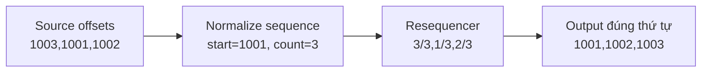
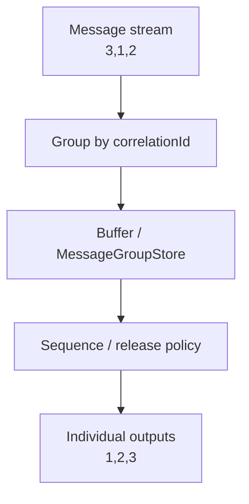
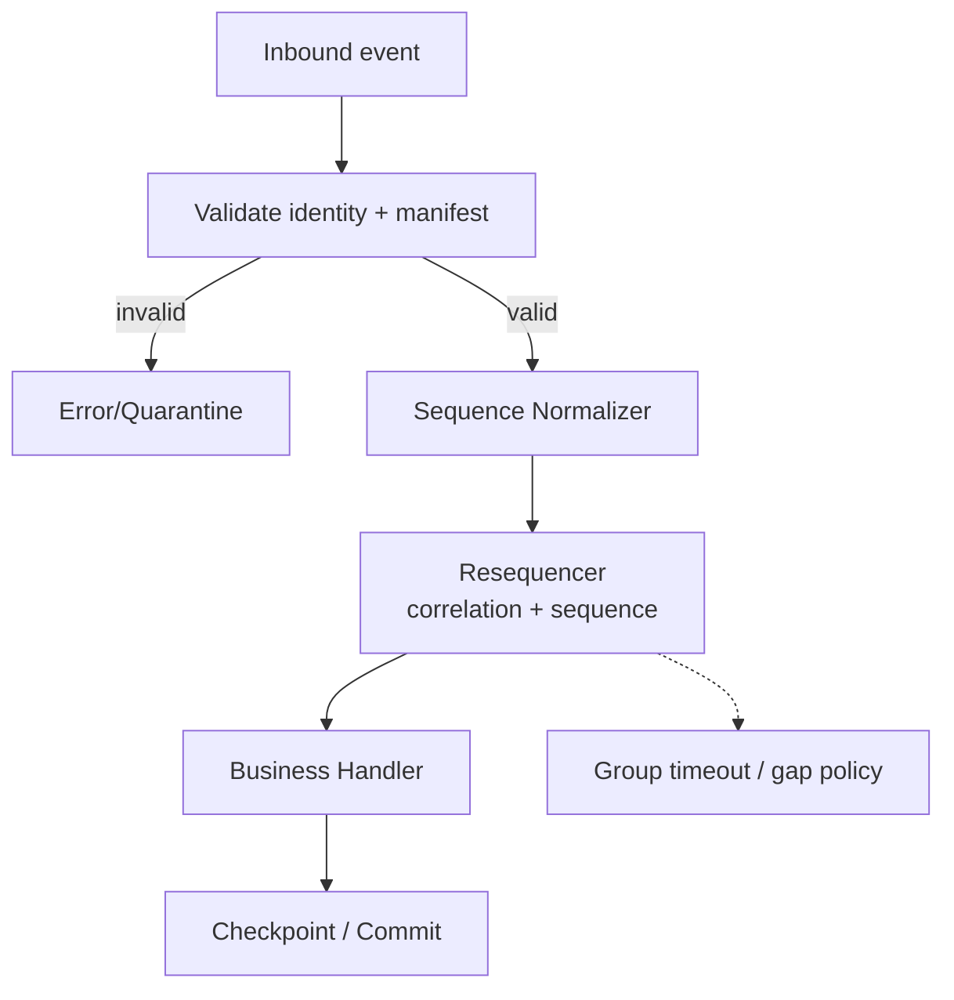
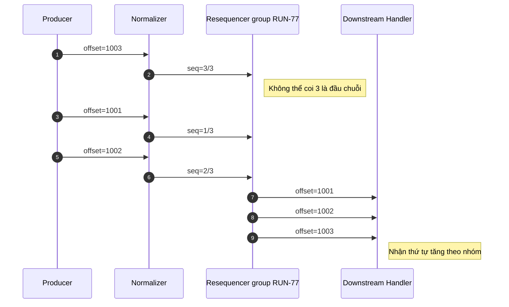
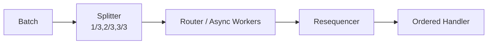
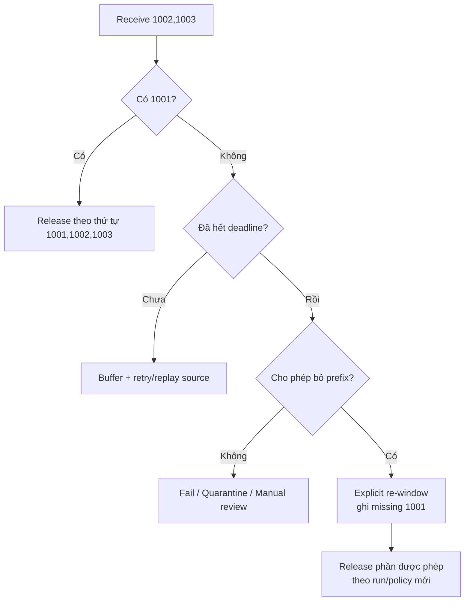
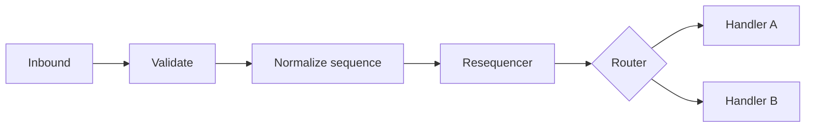
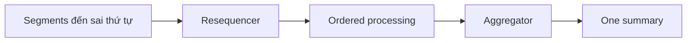
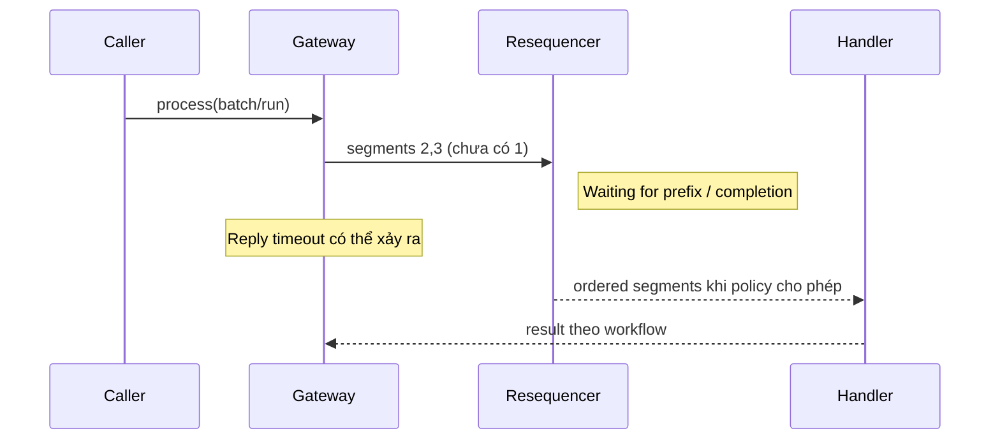

# Xử lý sequence không bắt đầu từ giá trị dự kiến với Resequencer trong Spring Integration

> **Chương:** Resequencer  
> **Bài học:** Xử lý sequence không bắt đầu từ giá trị dự kiến  
> **Ngữ cảnh:** Thực hành Enterprise Integration Patterns (EIP) với Spring Integration. Bài học kết hợp Resequencer, Splitter, Aggregator, Router, Filter, Transformer, Gateway, retry, error channel, correlation và kiểm thử để xử lý an toàn các luồng thông điệp đến sai thứ tự.

## 1. Vấn đề: message đầu tiên đến không nhất thiết là phần tử đầu tiên

Một hệ thống nhập dữ liệu từ đối tác vận chuyển. Đối tác đánh số các bản ghi của mỗi lô theo offset nghiệp vụ: `1001`, `1002`, `1003`. Các message được phân phối qua nhiều worker nên thứ tự thực tế có thể là:

```text
Thứ tự nguồn:        1001 -> 1002 -> 1003
Thứ tự đến consumer: 1003 -> 1001 -> 1002
Thứ tự muốn xử lý:   1001 -> 1002 -> 1003
```

Trong Spring Integration, **Resequencer** giúp nhận các message liên quan, chờ theo chiến lược thích hợp rồi phát chúng theo thứ tự sequence. Tuy nhiên, có một chi tiết rất quan trọng: các sequence headers thường dùng trong luồng **Splitter/Resequencer** là số thứ tự **1-based** trong một nhóm, còn source offset nghiệp vụ có thể bắt đầu từ 0, 1001, 50000 hoặc một mốc khác.

Một lỗi phổ biến là lấy `sourceOffset=1003` rồi gán thẳng:

```text
correlationId  = batch-77
sequenceNumber = 1003
sequenceSize   = 3
```

Khi đó metadata **mâu thuẫn**: nhóm tuy có ba phần tử nhưng chúng được đánh số 1001, 1002, 1003, không phải 1, 2, 3. Nếu Resequencer hoặc một release strategy dựa trên điều kiện sequence chuẩn, nhóm có thể không release như kỳ vọng.



**Giải pháp chính:** phân biệt **thứ tự của nguồn** và **sequence metadata mà Resequencer dùng**, rồi chuẩn hóa theo một **mốc bắt đầu đáng tin**, không được suy luận mốc đó từ message đến đầu tiên.

### Sau bài này, bạn có thể

1. Giải thích vì sao `sequenceNumber`, `sequenceSize` và `correlationId` phải nhất quán.
2. Phân biệt source offset, sequence kỹ thuật và business correlation.
3. Nhận diện trường hợp nguồn đánh số từ 0, 1001 hoặc một số tùy ý.
4. Chuẩn hóa offset sang sequence 1-based bằng expected start và expected count.
5. Phân biệt sequence đầu bị **đánh số khác** với sequence đầu **thực sự bị thiếu**.
6. Thiết kế buffering, timeout, gap handling, late-message, retry và idempotency.
7. Xây một ví dụ Spring Integration Java DSL và các kiểm thử JUnit 5.
8. Tổ chức tracing, Gateway reply, correlation và recovery khi dùng broker/đa instance.

## 2. Resequencer làm gì?

Trong EIP, **Resequencer** tiếp nhận một tập message liên quan nhưng đến không đúng thứ tự mong muốn; nó tổ chức lại thứ tự và phát các message riêng lẻ theo một chính sách sequence.



Phân biệt với **Aggregator**:

| Tiêu chí | Resequencer | Aggregator |
| --- | --- | --- |
| Mục tiêu | Sắp lại các message | Gom nhiều message thành một kết quả |
| Output | Thường phát từng message theo thứ tự đã xác định | Thường phát một aggregate result |
| Correlation | Cần xác định những message cùng chuỗi | Cần xác định những message cùng nhóm |
| Sequence | Rất quan trọng để đặt thứ tự | Có thể quan trọng cho release/aggregation |
| Điều kiện hoàn tất | Chính sách chờ phần tử/chuỗi và partial release | Chính sách release của message group |
| Vấn đề khi thiếu phần tử đầu | Có thể không xác định được điểm bắt đầu đúng | Có thể không đủ điều kiện hoàn tất nhóm |
| Sử dụng điển hình | Khôi phục thứ tự event, chunk, reply | Tổng hợp kết quả xử lý nhiều nhánh |

Resequencer thường dựa trên infrastructure nhóm message tương tự Aggregator, nhưng **không được hiểu rằng hai pattern có cùng output contract**.

### Không nhầm sắp lại thứ tự với “xử lý đúng một lần”

Một Resequencer có thể phát đúng thứ tự 1,2,3 nhưng downstream handler vẫn có thể được gọi lại do broker redelivery. Cần idempotency cho side effect.

Tương tự, Resequencer không tự giải quyết mất message, không thể tự sáng tạo phần tử 1 nếu nó chưa bao giờ tới, và không tự bảo đảm tính đúng của source offset do bên ngoài cung cấp.

## 3. Các header quan trọng và phạm vi sử dụng

Một message được đưa vào Resequencer cần mang metadata phù hợp.

```text
payload:
  SegmentEvent(eventId="EV-1002", sourceOffset=1002, data="...")

headers:
  correlationId         = stream:RUN-77
  sequenceNumber        = 2
  sequenceSize          = 3
  sourceOffset          = 1002
  expectedStartOffset   = 1001
  businessCorrelationId = shipment:SHIP-2048
```

| Header/field | Ý nghĩa | Ví dụ | Không nên dùng thay cho |
| --- | --- | --- | --- |
| `correlationId` | Khóa nhóm kỹ thuật để resequence | `stream:RUN-77` | Source offset |
| `sequenceNumber` | Vị trí trong nhóm theo contract 1-based | `2` | Offset gốc |
| `sequenceSize` | Số phần tử kỳ vọng khi đã biết | `3` | Mốc offset kết thúc |
| `sourceOffset` | Thứ tự do nguồn cung cấp | `1002` | Sequence kỹ thuật nếu không chuẩn hóa |
| `expectedStartOffset` | Offset đầu của run/window | `1001` | Số thứ tự arrival đầu tiên |
| `businessCorrelationId` | Liên kết các event thuộc cùng nghiệp vụ | `shipment:SHIP-2048` | Group key mặc định |
| `eventId` | Định danh logical event phục vụ dedup | `EV-1002` | `correlationId` |
| `MessageHeaders.id` | ID một Spring message | UUID | ID ổn định của event qua replay |

### Vì sao không dùng `businessCorrelationId` làm khóa nhóm mặc định?

Một đơn hàng có thể phát nhiều lô dữ liệu hoặc được replay. Nếu nhóm Resequencer chỉ dùng `shipmentId`, các phần tử của nhiều run có thể trộn với nhau. Nhóm kỹ thuật nên có phạm vi chính xác như `streamRunId` hoặc `(streamId, windowId)`.

### Vì sao cần giữ source offset sau khi chuẩn hóa?

Header `sequenceNumber=2` giúp Resequencer làm việc, nhưng offset `1002` giúp đối soát nguồn, phát hiện mất bản ghi và lưu checkpoint. Khi downstream ghi trạng thái vào kho dữ liệu nguồn, thường cần **offset gốc**, không phải chỉ số trong cửa sổ đã chuẩn hóa.

## 4. Hai trường hợp dễ bị nhầm: offset bắt đầu khác 1 và message đầu bị thiếu

Đây là trọng tâm của bài.

### Trường hợp A — nguồn đánh số từ 1001 nhưng đủ dữ liệu

```text
Nguồn có:        [1001,1002,1003]
Consumer nhận:   [1003,1001,1002]
Run manifest:    start=1001, count=3

Sau normalize:
1001 -> sequenceNumber=1, sequenceSize=3
1002 -> sequenceNumber=2, sequenceSize=3
1003 -> sequenceNumber=3, sequenceSize=3
```

Không có message nào bị thiếu. Vấn đề chỉ là **hệ quy chiếu sequence** khác nhau. Chuẩn hóa là đủ trước khi sử dụng Resequencer.

### Trường hợp B — sequence dự kiến thật sự bắt đầu ở 1001 nhưng chưa thấy 1001

```text
Run manifest:    start=1001, count=3
Consumer mới nhận: 1002,1003

Sau normalize:
1002 -> 2/3
1003 -> 3/3
Missing: 1/3
```

**Không được** lấy `1002` làm start mới để đổi 1002 thành 1/2 chỉ vì nó đến trước. Có thể message 1001 đang bị chậm, đang retry hoặc đã bị mất.

Cách xử lý phải dựa trên **deadline và chính sách missing-prefix**: đợi, retry nguồn, báo lỗi, partial release có ghi rõ gap hoặc hủy workflow. Không thể suy luận đầu chuỗi từ thời điểm nhận.

### Trường hợp C — không biết expected start

```text
Consumer thấy đầu tiên: 1003
Không có manifest/checkpoint.
Không biết message 1001,1002 có tồn tại hay không.
```

Đây là vấn đề **thiếu thông tin**, không phải một lỗi sắp xếp có thể giải quyết bằng cách sort một buffer ngắn. Cần xác định contract nguồn:

- Nguồn có một manifest công bố offset đầu/cuối?
- Consumer có lưu checkpoint từ lần xử lý trước?
- Có message `BEGIN_WINDOW` hoặc `WINDOW_CLOSED`?
- Có thể query nguồn để biết earliest expected offset?
- Hệ thống cho phép bỏ prefix cũ theo chính sách nào?

Nếu chưa có câu trả lời, không nên tuyên bố “chuỗi đã đủ” chỉ vì các message đang có được sắp theo số tăng.

## 5. Đừng lấy first arrival làm expected start

Phản mẫu:

```java
// Không nên dùng để suy luận mốc bắt đầu của một run.
long expectedStart = firstMessageReceived.getSourceOffset();
```

Giả sử message 1003 đến trước message 1001, việc chọn start=1003 có thể khiến:

- 1001 và 1002 bị coi là “đến trước cửa sổ” hoặc negative sequence.
- Message 1003 được xử lý sớm dù thiếu hai phần tử trước.
- Reconnect/replay chọn start khác nhau cho cùng dữ liệu.
- Log/metrics không giải thích được vì sao có bản ghi biến mất.

### Mốc start nên đến từ đâu?

| Nguồn xác định start | Phù hợp | Điều cần kiểm tra |
| --- | --- | --- |
| Manifest của batch | Lô hữu hạn | Manifest được xác thực và nhất quán |
| Checkpoint đã commit | Stream liên tục | Checkpoint chỉ tiến khi side effect đã commit |
| Event `BEGIN_WINDOW` | Workflow theo cửa sổ | Marker không bị mất/đến sai scope |
| Metadata của producer | Producer quản lý số thứ tự | Không cho client tùy ý giả mạo |
| Kho dữ liệu authoritative | Cần khôi phục từ nguồn | Có version, timeout và consistency |
| Chính sách cửa sổ theo thời gian | Cho phép bỏ phần cũ | Có watermark/lateness và business acceptance |

**Quy tắc:** *expected first* là thông tin nghiệp vụ/điều phối, không phải một giả định ngẫu nhiên từ thứ tự mạng.

## 6. Công thức chuẩn hóa sequence không bắt đầu từ 1

Với nhóm hữu hạn có `expectedStartOffset` và `expectedCount` đáng tin:

\[
\text{sequenceNumber} = \text{sourceOffset} - \text{expectedStartOffset} + 1
\]

\[
\text{sequenceSize} = \text{expectedCount}
\]

Ví dụ:

| Source offset | Expected start | SequenceNumber | SequenceSize |
| --- | --- | --- | --- |
| 1001 | 1001 | 1 | 3 |
| 1002 | 1001 | 2 | 3 |
| 1003 | 1001 | 3 | 3 |

Nếu source offset bắt đầu từ 0, với 3 phần tử là `0,1,2`, kết quả lần lượt là `1,2,3`.

### Phải kiểm tra phạm vi

Chỉ hợp lệ khi:

```text
expectedCount > 0
sourceOffset >= expectedStartOffset
sourceOffset - expectedStartOffset < expectedCount
sequenceNumber thuộc 1..expectedCount
```

Nếu `sourceOffset=999`, `expectedStart=1001` thì không phải thành viên của run này. Nếu `sourceOffset=1004`, `count=3` thì offset nằm ngoài cửa sổ.

**Không tự ép về 1 hoặc 3** bằng `Math.max`/`Math.min`. Làm vậy biến những offset khác nhau thành cùng sequence, gây duplicate và mất khả năng đối soát.

### Cẩn trọng overflow

Offset thường có kiểu `long`; nếu tính `int` trực tiếp có thể overflow với giá trị lớn. Dùng `Math.subtractExact` và `Math.toIntExact` hoặc kiểm tra phạm vi trước khi ép kiểu.

## 7. Kiến trúc đề xuất: validate manifest → normalize → resequence



Trách nhiệm từng bước:

1. **Ingress:** nhận event và xác minh nguồn metadata.
2. **Manifest validation:** bảo đảm `streamRunId`, start offset và count nhất quán cho cùng run.
3. **Sequence Normalizer:** chuyển source offset thành 1-based `sequenceNumber`.
4. **Resequencer:** sắp đúng các message cùng group, không tự thay đổi offset nghiệp vụ.
5. **Business Handler:** thực hiện side effect có idempotency.
6. **Checkpoint:** lưu vị trí đã xử lý theo chính sách commit, không tiến chỉ vì đã nhận message.
7. **Error/Recovery:** xử lý thiếu prefix, duplicate, late arrival, invalid metadata và timeout.

Mô hình trên tách **chính sách xác định đầu chuỗi** khỏi **cơ chế sắp thứ tự**. Resequencer không bị buộc phải đoán thông tin nó không có.

## 8. DTO cho ví dụ Java 17+ và contract đáng tin

Xây ví dụ nhận ba event của một lô dữ liệu. Mỗi event mang metadata giúp ánh xạ sang thứ tự kỹ thuật.

```java
package example.integration;

public record StreamSegment(
    String eventId,
    String streamRunId,
    String businessId,
    long sourceOffset,
    long expectedStartOffset,
    int expectedCount,
    String data
) {}
```

Ví dụ ba payload:

```java
new StreamSegment("EV-1003", "RUN-77", "SHIP-2048",
    1003L, 1001L, 3, "part-3");

new StreamSegment("EV-1001", "RUN-77", "SHIP-2048",
    1001L, 1001L, 3, "part-1");

new StreamSegment("EV-1002", "RUN-77", "SHIP-2048",
    1002L, 1001L, 3, "part-2");
```

**Điều kiện quan trọng:** `expectedStartOffset`, `expectedCount` và `streamRunId` trong ví dụ được giả định là **metadata đã xác minh từ manifest của run**, không phải ba giá trị mà một client bất kỳ có thể tự gửi và được tin ngay.

Nếu producer của từng event có thể tự thay start/count, một event lỗi có thể làm cả group mâu thuẫn. Production nên lưu manifest authoritative keyed theo `streamRunId` và xác minh từng event khớp manifest đó trước khi gọi normalizer.

### Vì sao giữ `eventId` và `sourceOffset`?

- `eventId` nhận diện logical event để deduplicate.
- `sourceOffset` nhận diện vị trí tại nguồn, dùng khi replay hoặc checkpoint.
- `sequenceNumber` là **vị trí kỹ thuật trong một run/window**, có thể khác source offset.
- `streamRunId` ngăn nhiều lần chạy có cùng business object bị trộn nhóm.

## 9. SequenceNormalizer: gắn correlation và headers theo một hợp đồng

Dùng một component nhận `Message<StreamSegment>` và trả message mới đã có metadata phù hợp cho Resequencer.

```java
package example.integration;

import org.springframework.messaging.Message;
import org.springframework.messaging.support.MessageBuilder;

public final class SequenceNormalizer {

    public Message<StreamSegment> normalize(
            Message<StreamSegment> input) {

        StreamSegment segment = input.getPayload();

        if (segment.eventId() == null
                || segment.eventId().isBlank()
                || segment.streamRunId() == null
                || segment.streamRunId().isBlank()
                || segment.businessId() == null
                || segment.businessId().isBlank()
                || segment.data() == null
                || segment.expectedCount() <= 0) {
            throw new IllegalArgumentException(
                "Thiếu dữ liệu/manifest của segment");
        }

        long position = Math.subtractExact(
            segment.sourceOffset(),
            segment.expectedStartOffset());

        if (position < 0 || position >= segment.expectedCount()) {
            throw new IllegalArgumentException(
                "Offset nằm ngoài expected window");
        }

        int sequence = Math.toIntExact(position + 1L);

        return MessageBuilder.fromMessage(input)
            // Ghi đè metadata không đáng tin từ ingress.
            .setHeader(
                "correlationId", "stream:" + segment.streamRunId())
            .setHeader("sequenceNumber", sequence)
            .setHeader("sequenceSize", segment.expectedCount())
            .setHeader("sourceOffset", segment.sourceOffset())
            .setHeader(
                "expectedStartOffset",
                segment.expectedStartOffset())
            .setHeader(
                "businessCorrelationId",
                "shipment:" + segment.businessId())
            .build();
    }
}
```

### Phân tích từng điểm

**Một lần tính vị trí:** `position = offset - start`; output 1-based là `position+1`.

**Validation trước khi build:** offset ngoài expected window không được âm thầm chuyển thành một sequence khác.

**Giữ payload gốc:** business handler vẫn có `sourceOffset` và `data`; không buộc phải khôi phục offset từ `sequenceNumber`.

**Gắn group key ổn định:** `stream:RUN-77` khác với `shipment:SHIP-2048`. Lần nhập khác của cùng shipment cần có `streamRunId` khác nếu không được phép trộn nhóm.

**Header trust boundary:** không cho inbound client tùy ý chỉ định `correlationId` và `sequenceNumber`. Normalizer ghi lại theo manifest đã xác thực.

### Giới hạn của normalizer

Method trên kiểm tra **tính hợp lệ của từng event**, không tự chứng minh tất cả event trong group cùng một manifest. Production vẫn cần một nguồn manifest authoritative hoặc một bước kiểm tra group-level nhất quán:

```text
RUN-77:
  expectedStart=1001
  expectedCount=3
  sourceVersion=17

Mọi event RUN-77 phải được xác thực khớp thông tin này.
```

Với run có nhiều cửa sổ, group key phải phân biệt cả `windowId`; nếu không, sequence number 1 từ hai window có thể xuất hiện trong cùng group.

## 10. Spring Integration Java DSL: Normalize → Resequence → Output

Cấu hình dưới đây ghép normalizer vào Resequencer bằng Java DSL. Dùng `DirectChannel` cho input và `QueueChannel` cho output để kiểm chứng thứ tự phát ra; chưa nối business handler có side effect.

```java
package example.integration;

import org.springframework.context.annotation.Bean;
import org.springframework.context.annotation.Configuration;
import org.springframework.integration.channel.DirectChannel;
import org.springframework.integration.channel.QueueChannel;
import org.springframework.integration.config.EnableIntegration;
import org.springframework.integration.dsl.IntegrationFlow;
import org.springframework.messaging.MessageChannel;

@Configuration
@EnableIntegration
public class StreamResequencerConfiguration {

    @Bean
    public MessageChannel segmentsInput() {
        return new DirectChannel();
    }

    @Bean
    public QueueChannel orderedSegments() {
        return new QueueChannel();
    }

    @Bean
    public SequenceNormalizer sequenceNormalizer() {
        return new SequenceNormalizer();
    }

    @Bean
    public IntegrationFlow reorderStreamSegments(
            SequenceNormalizer normalizer) {

        return IntegrationFlow.from("segmentsInput")
            // Đổi source offset sang sequence 1-based.
            .transform(normalizer, "normalize")

            // Nhóm theo correlation và phát theo sequence.
            .resequence()

            .channel("orderedSegments")
            .get();
    }
}
```

### Giải thích

- `segmentsInput` tiếp nhận event từ adapter/producer.
- `SequenceNormalizer.normalize(...)` tạo correlation/sequence headers từ manifest đáng tin.
- `.resequence()` sử dụng Resequencer của Spring Integration để điều phối thứ tự các message cùng nhóm.
- `orderedSegments` giữ các message đã được phát ra theo sequence để test.
- Output vẫn là các message riêng lẻ chứa `StreamSegment`; **không phải** một `List<StreamSegment>` do Aggregator tạo.
- Việc bắt đầu phát một phần chuỗi hay chờ đủ nhóm phụ thuộc release/partial-sequence policy của Resequencer trong phiên bản/cấu hình thực tế. Test phải xác nhận contract mong muốn, không đoán từ tên method.

Ví dụ chọn nhóm hữu hạn có size xác định vì dễ minh họa. Khi áp dụng với dữ liệu streaming dài hạn, cần policy cửa sổ/offset và lưu state thích hợp; không để một group vô hạn chỉ tăng mãi.

### Tại sao không sắp xếp đơn giản bằng `Collections.sort`?

Một danh sách đã có đủ phần tử trong RAM có thể sort bằng Java thuần. Nhưng ứng dụng integration thường nhận các message **rời rạc, bất đồng bộ, có correlation, retry và timeout**.

```text
Batch có sẵn cả 3 phần tử:
  list.sort(...) -> đủ cho việc xử lý nội bộ

Message đến độc lập:
  recv offset 1003
  ... chờ ...
  recv offset 1001
  ... chờ ...
  recv offset 1002
  -> cần message group, completion, error/recovery policy
```

Resequencer có ích khi thứ tự cần được khôi phục **ở cấp luồng thông điệp**, không chỉ trong một collection đã hoàn chỉnh.

## 11. Timeline: nhận 1003 trước nhưng phát 1001 trước

Giả định expected start 1001 và count 3 được xác thực trước khi dispatch.



Sơ đồ mô tả **thứ tự output khi đủ nhóm**. Với cấu hình có hỗ trợ phát một prefix liên tiếp trước khi toàn bộ nhóm đến, Resequencer có thể phát một phần sớm hơn. Yêu cầu bất biến vẫn là **không phát 1003 trước 1001** nếu contract bắt buộc bắt đầu từ 1001.

### Bảng trạng thái

| Thời điểm | Offset vừa nhận | Sequence chuẩn hóa | Prefix liên tiếp hiện có từ 1 | Có thể hoàn tất toàn nhóm? |
| --- | --- | --- | --- | --- |
| T1 | 1003 | 3 | Chưa có | Không |
| T2 | 1001 | 1 | 1 | Không |
| T3 | 1002 | 2 | 1,2,3 | Có |

Nếu policy chỉ release **đầy đủ nhóm**, output được phát sau T3. Nếu policy cho phép release prefix, cần xác định khi nào prefix có thể được coi là an toàn để phát, đặc biệt khi message cũ đến trễ.

## 12. JUnit 5: kiểm chứng thứ tự output và metadata

Test đầu tiên dùng Spring context thật. Nó gửi ba event theo thứ tự 1003,1001,1002; sau đó kiểm tra output có thứ tự 1001,1002,1003.

```java
package example.integration;

import static org.junit.jupiter.api.Assertions.*;

import org.junit.jupiter.api.Test;
import org.springframework.beans.factory.annotation.Autowired;
import org.springframework.beans.factory.annotation.Qualifier;
import org.springframework.integration.channel.QueueChannel;
import org.springframework.messaging.Message;
import org.springframework.messaging.MessageChannel;
import org.springframework.messaging.support.MessageBuilder;
import org.springframework.test.annotation.DirtiesContext;
import org.springframework.test.context.junit.jupiter.SpringJUnitConfig;

@SpringJUnitConfig(StreamResequencerConfiguration.class)
@DirtiesContext(
    classMode = DirtiesContext.ClassMode.AFTER_EACH_TEST_METHOD)
class StreamResequencerTest {

    @Autowired
    @Qualifier("segmentsInput")
    private MessageChannel segmentsInput;

    @Autowired
    @Qualifier("orderedSegments")
    private QueueChannel orderedSegments;

    private StreamSegment segment(long offset) {
        return new StreamSegment(
            "EV-" + offset,
            "RUN-77",
            "SHIP-2048",
            offset,
            1001L,
            3,
            "part-" + offset);
    }

    private void send(StreamSegment payload) {
        Message<StreamSegment> message =
            MessageBuilder.withPayload(payload).build();
        assertTrue(segmentsInput.send(message));
    }

    @Test
    void emitsOffsetsInOrderEvenIfReceivedOutOfOrder() {
        send(segment(1003L));
        send(segment(1001L));
        send(segment(1002L));

        long[] expectedOffsets = {1001L, 1002L, 1003L};

        for (int i = 0; i < expectedOffsets.length; i++) {
            Message<?> message = orderedSegments.receive(1_000);
            assertNotNull(message);

            StreamSegment output =
                (StreamSegment) message.getPayload();

            assertEquals(
                expectedOffsets[i], output.sourceOffset());

            assertEquals(i + 1,
                ((Number) message.getHeaders()
                    .get("sequenceNumber")).intValue());

            assertEquals(3,
                ((Number) message.getHeaders()
                    .get("sequenceSize")).intValue());

            assertEquals(
                "stream:RUN-77",
                message.getHeaders().get("correlationId"));

            assertEquals(
                "shipment:SHIP-2048",
                message.getHeaders().get(
                    "businessCorrelationId"));
        }

        assertNull(orderedSegments.receive(0));
    }
}
```

**Điều được chứng minh:** khi đủ dữ liệu, output của Resequencer mang thứ tự kỹ thuật đã chuẩn hóa và vẫn giữ source offset để đối soát.

**Điều test chưa chứng minh:** cách xử lý timeout, duplicate, overflow queue, group persistence hay một stream vô hạn. Cần các test riêng cho chúng.

### Tại sao không assert “chưa có output” ngay sau mỗi lần send?

Resequencer có thể có các chế độ release/partial sequence khác nhau tùy cấu hình. Test trên xác nhận **thứ tự tổng thể** sau khi đủ dữ liệu mà không áp đặt một timing policy không được cấu hình rõ. Nếu SLA yêu cầu “chỉ phát sau khi đủ cả ba”, test phải cấu hình release strategy tương ứng rồi mới assert không có output ở T1/T2.

## 13. Unit test normalizer: từ nguồn 0-based và 1001-based

Ta có thể kiểm thử riêng `SequenceNormalizer` mà không cần Spring context.

```java
package example.integration;

import static org.junit.jupiter.api.Assertions.*;

import org.junit.jupiter.api.Test;
import org.springframework.messaging.Message;
import org.springframework.messaging.support.MessageBuilder;

class SequenceNormalizerTest {

    private final SequenceNormalizer normalizer =
        new SequenceNormalizer();

    @Test
    void normalizesOffsetStartingAtZero() {
        StreamSegment segment = new StreamSegment(
            "EV-0", "RUN-0", "SHIP-1",
            0L, 0L, 3, "first");

        Message<StreamSegment> output = normalizer.normalize(
            MessageBuilder.withPayload(segment).build());

        assertEquals(1,
            output.getHeaders().get("sequenceNumber"));
        assertEquals(3,
            output.getHeaders().get("sequenceSize"));
        assertEquals(0L,
            output.getHeaders().get("sourceOffset"));
    }

    @Test
    void normalizesOffsetStartingAtOneThousandOne() {
        StreamSegment segment = new StreamSegment(
            "EV-1003", "RUN-77", "SHIP-2048",
            1003L, 1001L, 3, "third");

        Message<StreamSegment> output = normalizer.normalize(
            MessageBuilder.withPayload(segment).build());

        assertEquals(3,
            output.getHeaders().get("sequenceNumber"));
        assertEquals(3,
            output.getHeaders().get("sequenceSize"));
    }

    @Test
    void rejectsOffsetBeforeExpectedStart() {
        StreamSegment segment = new StreamSegment(
            "EV-999", "RUN-77", "SHIP-2048",
            999L, 1001L, 3, "too early");

        assertThrows(IllegalArgumentException.class, () ->
            normalizer.normalize(
                MessageBuilder.withPayload(segment).build()));
    }

    @Test
    void rejectsOffsetBeyondWindow() {
        StreamSegment segment = new StreamSegment(
            "EV-1004", "RUN-77", "SHIP-2048",
            1004L, 1001L, 3, "too late");

        assertThrows(IllegalArgumentException.class, () ->
            normalizer.normalize(
                MessageBuilder.withPayload(segment).build()));
    }

    @Test
    void rejectsInvalidExpectedCount() {
        StreamSegment segment = new StreamSegment(
            "EV-101", "RUN-77", "SHIP-2048",
            1001L, 1001L, 0, "invalid");

        assertThrows(IllegalArgumentException.class, () ->
            normalizer.normalize(
                MessageBuilder.withPayload(segment).build()));
    }
}
```

### Cần thêm test overflow và sai manifest

`Math.subtractExact` ném `ArithmeticException` nếu phép trừ `long` overflow. Production nên bắt và phân loại lỗi input có nghĩa, thay vì để exception bị coi là một lỗi hạ tầng retryable.

Một test khác phải gửi cùng `RUN-77` nhưng event có `expectedStart=1002` hoặc `expectedCount=4`, rồi xác nhận manifest validation từ chối. Method `normalize(...)` một mình không có state để nhận biết một event khác cùng run dùng metadata mâu thuẫn — đó là trách nhiệm của bước xác minh manifest.

## 14. Nhiều run xen kẽ: group key phải có phạm vi đúng

Hai lô độc lập có thể được gửi xen kẽ:

```text
RUN-77: 1003, 1001, 1002
RUN-88: 5002, 5001

Arrival:
  RUN-77:1003
  RUN-88:5002
  RUN-77:1001
  RUN-88:5001
  RUN-77:1002
```

Nếu cùng dùng `correlationId="shipment"`, Resequencer có nguy cơ trộn hai nhóm hoặc sequence trùng. Cần group key riêng:

```text
RUN-77 -> correlationId=stream:RUN-77
RUN-88 -> correlationId=stream:RUN-88
```

### Một test cần có

- Gửi xen kẽ hai run.
- Thu tất cả output với timeout.
- Gom output test theo `correlationId`.
- Assert offsets của mỗi run tăng đúng theo thứ tự dự kiến.
- Không assert **global order** giữa RUN-77 và RUN-88 nếu hai nhóm độc lập.

Thứ tự của nhiều nhóm là bài toán khác với thứ tự **trong từng nhóm**. Nếu nghiệp vụ cần thứ tự toàn cục, phải thiết kế một cơ chế đồng bộ toàn cục, không dựa vào nhiều Resequencer group riêng.

### Re-run và replay

Cùng `businessId=SHIP-2048` có thể được xử lý lại trong `RUN-99` sau thất bại. Nếu phải phân biệt output của hai run, correlation key cần `RUN-77` và `RUN-99` khác nhau, còn business correlation vẫn giúp truy vết cùng shipment.

## 15. Dùng sequenceNumber có sẵn từ Splitter: trường hợp thường đơn giản hơn

Nếu message xuất phát từ Spring Integration Splitter được cấu hình áp dụng sequence theo danh sách hữu hạn, nó thường tạo những headers như:

```text
correlationId = group G
sequenceNumber = 1, 2, 3
sequenceSize = 3
```

Nếu các message đi qua nhánh bất đồng bộ rồi quay về, có thể nối trực tiếp vào Resequencer mà **không cần normalizer offset**.



Chỉ thêm normalizer khi nguồn thực sự sử dụng một hệ đánh số khác hoặc metadata bị mất/biến đổi qua ranh giới transport.

**Đừng chuẩn hóa hai lần.** Một message đã có `sequenceNumber=1` nhưng mang sourceOffset=1001 có thể bị tính sai nếu một bước khác lại lấy sequenceNumber làm sourceOffset. Phải chọn **nguồn chân lý** của từng trường.

### Một lưu ý về nested Splitter

Nếu trong một batch có nhiều package, rồi mỗi package lại split thành các line, có thể có sequence metadata ở nhiều cấp. Không dùng một `correlationId` duy nhất cho tất cả các cấp nếu chúng có group lifecycle khác nhau.

Khi Resequencer nằm trong nhánh xử lý line, nó phải dùng key của **nhóm line**. Khi quay về Aggregator cấp package/order, cần bảo toàn hoặc khôi phục đúng metadata nhóm ở cấp ngoài.

## 16. Khi sequence đầu thực sự thiếu: đợi bao lâu?

Giả sử expected start=1001, count=3; consumer chỉ nhận 1002 và 1003. Với contract strict, message 1001 chưa tới nên **không được xử lý 1002 như phần tử đầu**.



### Các chính sách khả thi

| Chính sách | Khi thiếu phần tử đầu | Hệ quả |
| --- | --- | --- |
| **Strict ordering** | Tiếp tục đợi đến deadline, sau đó fail/recover | Không bỏ qua gap ngầm |
| **Re-fetch** | Query nguồn để lấy offset thiếu | Cần source replay/checkpoint |
| **Partial after timeout** | Bỏ qua gap theo SLA, phát kết quả có dấu vết | Có nguy cơ mất dữ liệu nếu policy sai |
| **Re-window explicit** | Tạo run/window mới bắt đầu ở offset khác | Phải audit lý do thay đổi mốc |
| **Park message** | Lưu vào queue/store chờ điều tra | Chi phí state, cần worker xử lý |
| **Compensate** | Hủy hoặc bù trừ xử lý trước đó | Phù hợp workflow có side effect |

Một timeout chỉ là **tín hiệu rằng nhóm đang chậm**. Nó không chứng minh offset bị thiếu là không bao giờ tồn tại.

### Vì sao không “giảm expected count” tùy tiện?

Giả sử count=3, missing 1001. Nếu sửa `sequenceSize=2` trên một message trong khi các message khác vẫn size=3, metadata nhóm mâu thuẫn. Nếu đổi start của cùng group khi đã phát output, các sequence đã dùng có thể mất nghĩa.

Muốn bỏ prefix có chủ đích:

1. Ghi rõ offset bị thiếu và business approval.
2. Chốt một window/run mới hoặc một state transition được kiểm soát.
3. Tính lại expected start, expected count và group key nhất quán.
4. Bảo đảm không trộn output cũ với output mới.
5. Xác định cách xử lý nếu offset 1001 cuối cùng vẫn xuất hiện.

## 17. Buffering và backpressure khi đợi prefix

Nếu một phần tử đầu bị thiếu nhưng hàng nghìn phần tử sau vẫn đến, Resequencer có thể phải buffer nhiều message, khiến memory/store tăng.

```text
expectedNext=1001
received=1002..200000
missing=1001

Nếu cứ buffer tất cả:
  memory/store growth
  timeout backlog
  latency tăng
  recovery khó
```

### Giới hạn cần có

- Số message tối đa mỗi group.
- Số group đang mở.
- Độ tuổi tối đa của group.
- Thời gian chờ mỗi missing gap.
- Dung lượng queue và MessageGroupStore.
- Giới hạn inflight theo producer/tenant.
- Backpressure khi một group vượt giới hạn.
- Chính sách trả lỗi/parking khi nguồn quá nhanh nhưng prefix mất.

Đối với stream vô hạn, nên sử dụng **cửa sổ hữu hạn hoặc checkpoint** thay vì chờ toàn bộ stream trong một group. Đây là quyết định kiến trúc quan trọng hơn việc chỉ đổi vài header.

## 18. Windowing: giải pháp cho source offset lớn và stream dài

Một stream có thể dùng offset tăng không ngừng: `50000, 50001, 50002, ...`. Sẽ không hợp lý nếu khai báo `sequenceSize` bằng giá trị offset cuối hoặc gom cả đời stream vào một group.

Hãy chia thành những **window hữu hạn**:

```text
Window W-1: source offsets 50000..50099
   expectedStart=50000
   expectedCount=100
   correlationId=stream:S1:W-1
   sequenceNumber=1..100

Window W-2: source offsets 50100..50199
   expectedStart=50100
   expectedCount=100
   correlationId=stream:S1:W-2
   sequenceNumber=1..100
```

### Những điểm phải xác định

1. Producer hoặc coordinator công bố window boundaries bằng cách nào?
2. Một event được gán vào window đúng theo source offset hay event time?
3. Có thể phát window W-2 trước W-1 không? Nếu không, cần thêm điều phối giữa các window.
4. Window được đóng khi nhận đủ count hay khi có completion marker?
5. Khi một offset mất, deadline/window expiry xử lý ra sao?
6. Nếu producer retry, event có giữ đúng window ID không?

**Resequencer theo từng window chỉ đảm bảo thứ tự trong window**, không tự đảm bảo thứ tự giữa các window. Nếu downstream cần ordering toàn stream, phải có checkpoint hoặc stage chọn thứ tự window đã completed.

### Watermark và event-time không giống source offset

Một watermark trong stream processing thường giúp đánh giá mức độ đầy đủ theo **event time**; source offset thường là thứ tự trong partition/source log. Hai thứ không thể hoán đổi tùy ý. Chọn cách ordering phù hợp nghiệp vụ.

## 19. Message đến muộn sau khi đã bỏ một gap

Giả sử hệ thống cho phép xử lý 1002,1003 sau deadline, ghi nhận thiếu 1001 và đóng run. Một giờ sau, offset 1001 được gửi lại.

Nếu đưa message này vào cùng luồng mà không có chính sách:

- Nó có thể xuất hiện **sau** những event có offset lớn hơn, phá thứ tự đã cam kết.
- Một group mới có thể được tạo nếu group cũ đã cleanup.
- Business handler có thể thực hiện side effect của một trạng thái quá cũ.
- Checkpoint có thể bị lùi hoặc bị cập nhật không nhất quán.

### Late-arrival policy phải tường minh

```text
RUN-77:
  expected=1001..1003
  resolvedGap=1001
  closedAt=...
  outputCommittedUpTo=1003

Khi receive offset=1001:
  -> không dispatch như event bình thường
  -> audit late arrival
  -> reconcile/quarantine/compensate theo contract
```

Các chính sách có thể là:

- **Ignore with audit:** khi event quá hạn được phép bỏ theo nghiệp vụ.
- **Reconcile:** đối chiếu thiếu hụt và tạo bút toán/điều chỉnh riêng.
- **Compensating action:** bù trừ những xử lý đã diễn ra khi thiếu event.
- **Restart a new run:** chỉ khi nghiệp vụ cho phép tính lại đầy đủ, có version/run ID mới.

Không tự động đẩy late event vào business handler với cùng `correlationId` rồi tin Resequencer sẽ khôi phục mọi tác dụng phụ.

### Cần giữ completion state

Nếu group đã bị xóa sau khi release/expire, hệ thống có thể không biết nó từng đóng. Với bài toán có replay lâu ngày, nên giữ một completion record hoặc tombstone theo `streamRunId`/`windowId` và retention phù hợp.

## 20. Duplicate sequence: cùng offset chưa chắc là cùng event

Hai message có thể mang cùng `sourceOffset=1002`:

```text
RUN-77, sourceOffset=1002, eventId=EV-1002
RUN-77, sourceOffset=1002, eventId=EV-1002   // redelivery

hoặc:

RUN-77, sourceOffset=1002, eventId=EV-1002-A
RUN-77, sourceOffset=1002, eventId=EV-1002-B // dữ liệu mâu thuẫn
```

Trường hợp đầu là bản sao của cùng logical event nếu producer bảo đảm ID ổn định. Trường hợp thứ hai có thể là lỗi nguồn, overwrite hoặc dùng sai group key.

**Không được chỉ dựa vào `sequenceNumber` để quyết định toàn bộ semantics duplicate**. Cần biết event ID, checksum/version và hợp đồng của source.

### Ba tình huống

| Trường hợp | Hành động phù hợp |
| --- | --- |
| Same run + same offset + same eventId + same data | Deduplicate, ghi metric nếu cần |
| Same run + same offset + different payload/version | Quarantine hoặc conflict resolution có audit |
| Same businessId + same offset nhưng run khác | Phân biệt theo run ID, không gộp mù |

Một khóa dedup có thể là:

```text
deduplicationKey = (streamRunId, sourceOffset, eventId)
```

Nếu source cho phép sửa dữ liệu ở cùng offset, cần thêm version/fingerprint và một quy tắc replacement rõ. Không tự lấy header `MessageHeaders.id` làm logical ID vì message mới khi redelivery có thể có ID khác.

### Idempotency sau Resequencer

Resequencer làm đúng thứ tự **không đảm bảo downstream chỉ thực thi một lần**. Khi handler ghi DB, gửi email hoặc gọi thanh toán, cần idempotency key phù hợp từng thao tác:

```text
idempotencyKey = (businessEventId, operationType)
```

Checkpoint và dedup phải phối hợp với commit. Nếu checkpoint đã tiến mà side effect chưa commit, một event có thể bị mất về mặt nghiệp vụ. Nếu side effect commit rồi checkpoint chưa tiến, event có thể được phát lại; idempotency giúp tránh nhân đôi.

## 21. Error channel và retry: lỗi thuộc bước nào?

Một lỗi “không sắp đúng thứ tự” có thể đến từ nhiều nguyên nhân:

| Vị trí | Ví dụ | Định hướng xử lý |
| --- | --- | --- |
| Ingress | Thiếu `streamRunId`, offset sai kiểu | Validation error/quarantine |
| Manifest validation | Start/count không nhất quán | Fail group, không retry dữ liệu y hệt |
| Normalizer | Offset ngoài window | Reject hoặc chuyển sang đúng window |
| Resequencer | Thiếu prefix, group quá hạn | Gap recovery/expiry policy |
| Transport | Một message không đến do broker failure | Redelivery/replay nguồn |
| Business Handler | API timeout sau khi đã resequence | Retry tại handler, giữ metadata |
| Checkpoint Store | Commit checkpoint thất bại | Transaction/recovery, không tiến mù |
| Downstream Adapter | Không có consumer/reply | Error handling theo endpoint |

### Retry nên ở boundary đúng

Nếu Normalizer ném `IllegalArgumentException` vì `sourceOffset=1004` ngoài `[1001,1003]`, retry cùng dữ liệu vào đúng flow sẽ luôn thất bại. Cần sửa input/manifest hoặc chọn đúng window, không retry vô hạn.

Nếu handler gọi external API gặp HTTP 503, có thể retry riêng handler với backoff và idempotency. Không nhất thiết phải chạy lại toàn bộ source stream hoặc tạo group mới.

### Error channel không tự thu đủ nhóm

Một event lỗi trước Resequencer có thể khiến nhóm không bao giờ nhận đủ phần tử. Error channel xử lý exception, nhưng không tự tạo “sequence 1” để hoàn tất nhóm.

Hệ thống cần phối hợp:

1. Error handler ghi metadata về run/offset bị lỗi.
2. Coordinator xem group có cần chờ, replay hoặc đóng failure.
3. Nếu có output với gap, ghi rõ missing offsets.
4. Gateway/consumer nhận lỗi hoặc trạng thái chờ theo contract.

### Đồng bộ và bất đồng bộ

- Trên `DirectChannel` đồng bộ, exception có thể quay về thread gửi.
- Sau `ExecutorChannel` hoặc listener Kafka/AMQP, lỗi có thể được adapter/error flow xử lý riêng.
- `errorChannel` headers của Spring Messaging không phải lúc nào cũng serialize an toàn qua transport.
- Cần cấu hình dead-letter/recovery/acknowledgement đúng theo message adapter thực tế.

## 22. Resequencer với Filter, Router và Transformer

Đặt Resequencer ở đâu trong một pipeline ảnh hưởng trực tiếp tới correctness.



Nếu nghiệp vụ yêu cầu **mọi event được xử lý theo đúng source order trước khi chọn route**, nên đặt Resequencer trước Router.

Ngược lại, nếu mỗi route là một stream độc lập và chỉ yêu cầu ordering trong từng route, có thể đặt Router trước Resequencer, **nhưng group scope/sequence contract phải được điều chỉnh**. Không thể dùng một global sequence 1..3 cho mỗi nhánh nếu Router chỉ gửi các sequence 1 và 3 vào nhánh A, sequence 2 vào nhánh B.

### Filter trước Resequencer

Giả sử source có ba message, nhưng Filter loại sequence 1:

```text
Source:    1,2,3
Filter:    1 -> drop
Resequence receives: 2,3
```

Resequencer downstream chờ prefix 1 không còn xuất hiện. Các lựa chọn:

- Đặt Filter sau Resequencer khi policy cho phép.
- Thay vì drop, tạo một completion/skip marker có sequence 1.
- Recompute một **sequence mới** cho tập đã lọc, với manifest/count mới nhất quán.
- Cấu hình gap/timeout policy cho phép bỏ phần tử có chủ đích.

Đừng chỉ sửa `sequenceSize=2` khi các message còn lại mang `sequenceNumber=2,3`. Số lượng và vị trí vẫn không theo contract 1..2.

### Transformer giữa Normalizer và Resequencer

Nếu custom Transformer tạo message mới, phải giữ headers kỹ thuật:

```java
public Message<ProcessedSegment> transformPreservingSequence(
        Message<StreamSegment> input) {

    ProcessedSegment result =
        convert(input.getPayload()); // method nghiệp vụ

    return MessageBuilder.withPayload(result)
        .copyHeaders(input.getHeaders())
        .build();
}
```

Đây là **mẫu method minh họa**; `ProcessedSegment` và `convert` cần được định nghĩa trong ứng dụng. Trong nhiều endpoint Spring Integration chuẩn, headers có thể được propagation tự động; vẫn cần test khi tự dựng `Message<?>`.

### Không truyền mọi header ra bên ngoài một cách mù quáng

`replyChannel`, `errorChannel` hoặc security context có thể chứa thông tin nội bộ JVM. Khi đi qua broker/HTTP, dùng header mapper/allowlist và chỉ giữ metadata cần thiết. Không đưa header nhạy cảm từ một nguồn không đáng tin qua một trust boundary.

## 23. Resequencer và Aggregator: phối hợp nhưng không thay thế nhau

Một hệ thống cần **xử lý event theo thứ tự** rồi **tổng hợp kết quả** có thể dùng cả hai:



Resequencer có thể phát:

```text
Segment 1
Segment 2
Segment 3
```

Aggregator có thể phát:

```text
BatchSummary(total=3, status=SUCCESS)
```

**Resequencer không thay Aggregator:** thứ tự đúng không tự tạo một summary. **Aggregator không thay Resequencer:** gom đủ phần tử không tự đảm bảo downstream được xử lý theo source order.

### Khi xử lý song song sau Resequencer

Một lưu ý quan trọng: Resequencer phát message 1 rồi 2 rồi 3 nhưng nếu downstream chuyển sang `ExecutorChannel` chạy nhiều thread, handler **có thể hoàn tất 3 trước 1**.

Vì thế cần phân biệt:

- **Dispatch order:** thứ tự phát khỏi Resequencer.
- **Execution start order:** thứ tự handler thực sự bắt đầu.
- **Completion/commit order:** thứ tự tác vụ hoàn tất.

Nếu nghiệp vụ yêu cầu **commit theo thứ tự**, chỉ resequence trước một executor song song chưa đủ. Cần xử lý tuần tự theo key, partition ownership, per-key serial queue hoặc commit coordinator.

### Nested aggregation

Trong Splitter → processing → Aggregator, các child có group correlation riêng. Nếu đưa Resequencer vào trước Aggregator, phải đảm bảo cùng một group/sequence contract được dùng đúng cấp. Đừng ghi đè `correlationId` bằng business ID của một tầng khác.

## 24. Gateway request-reply và chuỗi chưa hoàn tất

Một Gateway có thể gọi xử lý một batch rồi chờ kết quả. Nếu sequence đầu chưa tới, Resequencer có thể giữ message chờ; caller không tự nhận được reply.



Đây là **sơ đồ logic**, không phải cấu hình request-reply hoàn chỉnh. Gateway phải có flow tạo reply cuối đúng contract; chỉ phát các segment qua Resequencer không tự tạo một batch response.

### Những yếu tố cần phối hợp

- Reply timeout của Gateway.
- Group timeout/expiry của Resequencer.
- Retry deadline ở nguồn và downstream handler.
- Quy tắc trả `PENDING`, `PARTIAL`, `FAILED`.
- Khả năng lưu kết quả đến sau khi caller đã timeout.
- Correlation giữa request và toàn bộ segments/run.

Với luồng chờ dữ liệu nhiều phút/giờ, không nên giữ một lời gọi Gateway/HTTP mở vô hạn. Có thể nhận request, lưu trạng thái `PENDING` và trả `requestId`; completion được báo qua event/webhook hoặc API tra cứu trạng thái.

## 25. Qua Kafka, AMQP hoặc HTTP: metadata có thể mất hoặc đổi kiểu

Trong cùng JVM, Spring Messaging quản lý headers. Khi đi qua transport ngoài:

```text
Spring Message<StreamSegment>
  correlationId = String
  sequenceNumber = Integer
  sequenceSize = Integer
  sourceOffset = Long

      |
      v
Kafka/AMQP/HTTP adapter + header mapping
      |
      v
Spring Message<StreamSegment> được dựng lại
```

Các lỗi phổ biến:

- `sequenceNumber` thành `byte[]` mà Resequencer/release strategy không hiểu.
- `sequenceSize` bị lược bỏ khỏi header mapper.
- `correlationId` đổi cách encode ở các producer khác nhau.
- Source offset bị nhầm với Kafka offset trong một partition khác.
- Header của một retry bị đổi group key và trở thành nhóm mới.
- Message đến nhiều node nhưng mỗi node có store độc lập, không ai thấy đủ nhóm.

### Checklist qua transport

1. Xác nhận tên và kiểu từng header sau deserialize.
2. Giữ `streamRunId` và `windowId` trong envelope dữ liệu khi cần khôi phục.
3. Dùng schema/version rõ cho `expectedStartOffset` và `expectedCount`.
4. Kiểm thử redelivery, duplicate, gap và out-of-order qua adapter thật.
5. Xác định partition/consumer ownership theo ordering scope.
6. Không serialize `MessageChannel` object hoặc context nội bộ sang broker.
7. Có shared MessageGroupStore hoặc keyed partitioning khi nhiều node xử lý cùng một run.

### Kafka offset không phải sequence của toàn hệ thống

Kafka bảo đảm thứ tự record **trong một partition theo thứ tự được append**, không tự cung cấp một sequence toàn cục xuyên nhiều partition. Nếu business event từ nhiều partition có một source offset chung, cần một contract ordering riêng.

Resequencer không thể tái tạo thứ tự toàn cục nếu không có một nguồn sequence đáng tin xuyên các nguồn dữ liệu.

## 26. Group store, lifecycle và khôi phục sau restart

Resequencer phải giữ state cho những message chưa thể phát. Nếu store chỉ ở RAM, crash có thể làm mất buffer.

Một thiết kế bền vững cần trả lời:

- Group nào đang mở?
- Expected start và count của group là gì?
- Đã nhận những source offsets nào?
- Đã phát tới offset nào?
- Nhóm có gap nào đang chờ?
- Nhóm đã complete/expire hay chưa?
- Late arrivals và replay được xử lý thế nào?
- Sau restart, consumer có thể lấy lại message còn thiếu từ đâu?

### In-memory và persistent state

| Mức lưu trữ | Ưu điểm | Giới hạn |
| --- | --- | --- |
| Bộ nhớ trong JVM | Đơn giản, độ trễ thấp | Mất state khi restart |
| Persistent MessageGroupStore | Giữ nhóm qua restart theo cấu hình | Cần transaction, locking và cleanup |
| Broker + checkpoint store | Có thể replay và quản lý offset | Đòi hỏi protocol ack/recovery |
| Workflow state store | Phù hợp run dài và manual recovery | Chi phí vận hành và điều phối cao hơn |

Một MessageGroupStore bền vững không tự bảo đảm exactly-once side effect. Nếu Resequencer phát message rồi crash trước khi cập nhật state/ack, message có thể được phát lại. Downstream vẫn phải idempotent.

### Không giữ group mãi

Một run bị thiếu prefix có thể tồn tại vô hạn nếu không có expiry. Cần metric/alert khi group age vượt SLA, và chính sách đóng nhóm có ghi nhận tình trạng xử lý.

## 27. Checkpoint và bảo đảm tiến độ theo thứ tự

Với stream liên tục, một hệ thống có thể theo dõi:

```text
lastCommittedSourceOffset = 1000
nextExpectedSourceOffset  = 1001
```

Nếu consumer nhận 1003 trước, có thể buffer nó; khi 1001 và 1002 đến thì phát theo thứ tự. Nhưng **không nên cập nhật checkpoint=1003 chỉ vì đã nhận 1003**.

Một chính sách commit nghiêm ngặt:

1. Nhận event.
2. Xác minh nguồn/group và chuẩn hóa.
3. Resequence theo expected offset.
4. Business handler hoàn tất tác vụ với idempotency.
5. Commit checkpoint cho **prefix liên tiếp đã hoàn tất**.
6. Sau restart, replay các event chưa được commit.

```text
Committed prefix: 1001,1002
Completed out of order: 1004
Still missing/incomplete: 1003

Checkpoint an toàn:
  1002, không phải 1004.
```

Ngay cả khi một đoạn flow có Resequencer, các handler bất đồng bộ phía sau có thể hoàn tất sai thứ tự; checkpoint phải theo **commit order**, không chỉ dispatch order.

### Outbox và transaction

Nếu handler vừa ghi DB vừa phát event mới, cần xem xét outbox/transaction tương ứng để không có trạng thái “đã checkpoint nhưng event downstream chưa được ghi”. Không có một header sequence nào giải quyết hoàn toàn atomicity giữa DB và broker.

## 28. Observability: phát hiện “đang đợi phần tử đầu”

Nếu chỉ log “received offset 1003”, người vận hành không biết lỗi là do source đánh số từ 1001 hay do offset 1001 thực sự chưa tới. Cần theo dõi **expected start, received offsets và gap**.

Ví dụ log có cấu trúc:

```text
runId=RUN-77
businessCorrelationId=shipment:SHIP-2048
expectedStart=1001
expectedCount=3
receivedOffsets=[1002,1003]
missingOffsets=[1001]
groupAgeMs=12500
stage=WAITING_FOR_PREFIX
```

Khi nhận đủ:

```text
runId=RUN-77
stage=RESEQUENCE_COMPLETED
emittedOffsets=[1001,1002,1003]
missingOffsets=[]
```

Đây là **log ứng dụng minh họa**, không phải format mặc định của Spring Integration.

### Metrics cần theo dõi

| Metric | Ý nghĩa |
| --- | --- |
| Active resequencer groups | Số run/window chưa hoàn tất |
| Oldest group age | Nhóm chờ lâu nhất |
| Buffered messages | Mức sử dụng memory/store |
| Missing prefix count | Số nhóm chưa nhận phần tử bắt đầu |
| Gap count | Số offset thiếu trong các nhóm |
| Out-of-range sequence count | Metadata không thuộc expected window |
| Duplicate/late event count | Retry/redelivery hoặc sự cố nguồn |
| Resequence latency | Từ message đầu đến output theo policy |
| Timeout/expiry count | Nhóm không đủ trong thời hạn |
| Source replay attempts | Số lần truy vấn gửi lại offset thiếu |
| Checkpoint lag | Độ trễ giữa source và committed prefix |
| Error/recovery queue size | Số message cần điều tra |

Tránh đưa từng `streamRunId`, `eventId` hay `businessId` làm metric label vì cardinality lớn. Dùng structured logs/tracing để tra trường hợp cụ thể.

### Phân biệt các mốc

```text
MESSAGE_RECEIVED        : adapter nhận event
SEQUENCE_NORMALIZED     : metadata kỹ thuật đã xác minh
RESEQUENCE_EMITTED      : message được phát theo policy
HANDLER_COMPLETED       : nghiệp vụ đã xử lý xong
CHECKPOINT_COMMITTED    : trạng thái tiến độ đã lưu bền vững
```

Đừng diễn giải `RESEQUENCE_EMITTED` thành `CHECKPOINT_COMMITTED` nếu downstream còn lỗi hoặc chưa thực hiện side effect.

## 29. Những phản mẫu thường gặp

### 29.1. Gán source offset 1001 thẳng vào sequenceNumber

Với group có `sequenceSize=3`, sequence 1001..1003 không thuộc dải 1..3. Cần normalizer hoặc một strategy custom có contract phù hợp.

### 29.2. Lấy offset của message đến đầu tiên làm expected start

Message 1003 có thể đến trước 1001. Cách suy luận này làm mất prefix và khiến replay không nhất quán.

### 29.3. Không phân biệt lệch mốc với thiếu prefix

Nguồn bắt đầu hợp lệ ở 1001 khác với nguồn dự kiến từ 1001 nhưng chưa nhận offset đó. Trường hợp đầu cần mapping; trường hợp sau cần gap policy.

### 29.4. Đổi start/count của group giữa chừng

Các message trong group có thể mang metadata mâu thuẫn. Chốt manifest cho mỗi run/window và dùng explicit re-window khi nghiệp vụ cho phép.

### 29.5. Đặt Filter drop seq 1 trước Resequencer

Nhóm vẫn chờ prefix 1 dù Filter đã loại nó. Thiết kế skip marker, renumber có manifest mới hoặc đặt Filter sau Resequencer.

### 29.6. Tưởng Resequencer đảm bảo handler hoàn tất tuần tự

Sau ExecutorChannel, handler 3 có thể commit trước handler 1. Cần keyed serial processing hoặc commit coordinator nếu yêu cầu strict commit ordering.

### 29.7. Không chống duplicate

Redelivery có thể làm cùng offset xuất hiện nhiều lần. Deduplication và idempotency phải tồn tại ở boundary phù hợp.

### 29.8. Dùng một group vô hạn cho stream dài

Nhóm có thể buffer không giới hạn khi thiếu một offset đầu. Dùng finite window, bounded state và timeout.

### 29.9. Không xử lý late event sau khi skip gap

Offset 1001 đến sau khi 1002,1003 đã commit không thể được xem như event bình thường. Cần reconcile/compensate/quarantine.

### 29.10. Dùng business ID làm correlation duy nhất cho nhiều run

Các lần replay hoặc window khác nhau có thể bị trộn. Tách groupRunId và businessCorrelationId.

### 29.11. Mất header qua Transformer hoặc broker

Tạo Message mới mà không giữ correlation/sequence hoặc deserialize sai kiểu làm Resequencer không hiểu metadata. Kiểm thử end-to-end.

### 29.12. Retry mãi lỗi validation

Offset ngoài window hay count sai không tự sửa bằng retry. Phân loại non-retryable và đưa vào error/recovery có ghi nhận.

## 30. Bài thực hành: sắp lại sự kiện vận chuyển theo cửa sổ

**Bối cảnh:** hệ thống nhận `ShipmentEvent(eventId, runId, shipmentId, sourceOffset, expectedStart, expectedCount)`. Source đánh offset theo batch bất kỳ, ví dụ 7001..7004, và các message có thể đến sai thứ tự.

### Yêu cầu triển khai

1. Tạo record bất biến cho event và run manifest.
2. Xác minh manifest trước khi sử dụng expected start/count.
3. Tạo `SequenceNormalizer` chuyển offset nguồn thành sequence 1-based.
4. Gắn `correlationId` có scope theo run/window, giữ business correlation riêng.
5. Tạo Java DSL flow `Input → Normalize → Resequencer → Output`.
6. Test input `7004,7002,7001,7003` cho output đúng `7001,7002,7003,7004`.
7. Test source 0-based `0,1,2` thành sequence `1,2,3`.
8. Test một event có offset dưới expected start và một event vượt expected window.
9. Test hai run có offset trùng nhau nhưng correlation khác nhau.
10. Giả lập missing prefix 7001; xác định deadline và strict/partial policy.
11. Test duplicate offset và định nghĩa kết quả khi payload khác nhau.
12. Thêm checkpoint chỉ tiến theo processed/committed prefix.
13. Thử Resequencer sau ExecutorChannel; xác nhận output order và phân biệt completion order.
14. Thử qua broker, xác minh header mapper giữ type/meaning.
15. Thêm metrics active groups, age, gap, replay, timeout và late events.

### Bảng kết quả mong đợi

| Đầu vào/điều kiện | Hành vi mong đợi |
| --- | --- |
| 7004,7002,7001,7003; start=7001 | Output 7001,7002,7003,7004 |
| Source 0,1,2; start=0 | Sequence 1,2,3 |
| Chỉ có 7002,7003; start=7001 | Không coi 7002 là phần tử đầu |
| Không có manifest/checkpoint | Không đoán start từ first arrival |
| Offset ngoài window | Validation error hoặc đúng window khác |
| Hai run xen kẽ | Không trộn các group |
| Redelivery một offset | Không gây side effect trùng |
| Một event đến sau skip-gap/close | Late-arrival policy |
| Handler chạy song song | Commit ordering phải được kiểm soát riêng |
| Broker đổi kiểu sequence header | Mapping/test/validation sửa trước Resequencer |

### Câu hỏi tự đánh giá

**Câu 1.** Vì sao source offset=1001 không nên tự gán thành `sequenceNumber=1001` khi `sequenceSize=3`?

*Vì sequence kỹ thuật của một nhóm có ba phần tử thường cần vị trí 1..3; offset nguồn nằm trong hệ đánh số khác. Cần chuẩn hóa theo expected start.*

**Câu 2.** Vì sao không lấy message đến đầu tiên làm sequence 1?

*Vì thứ tự arrival có thể khác source order; message 1003 có thể đến trước 1001.*

**Câu 3.** Thiếu prefix và lệch mốc source có giống nhau không?

*Không. Lệch mốc có thể được mapping khi manifest đầy đủ; thiếu prefix đòi hỏi wait/replay/timeout/partial policy.*

**Câu 4.** Resequencer phát theo thứ tự có bảo đảm các handler bất đồng bộ commit đúng thứ tự?

*Không. Dispatch order khác completion order; cần thêm cơ chế tuần tự hoặc commit coordinator.*

**Câu 5.** Khi offset 1001 đến sau khi run đã skip và commit tới 1003, cần làm gì?

*Không âm thầm xử lý như message đúng hạn; cần late-arrival/reconciliation policy rõ ràng.*

**Câu 6.** Vì sao cần giữ cả `correlationId` và `businessCorrelationId`?

*Correlation ID nhóm các message của một lần/window cần resequence; business ID liên kết vòng đời nghiệp vụ có thể trải qua nhiều run.*

## 31. Checklist áp dụng trong production

- **Thứ tự mong muốn:** xác định rõ theo source offset, event time hay domain sequence.
- **Expected start:** lấy từ manifest/checkpoint/authoritative source; không đoán từ arrival đầu.
- **Expected count:** nêu rõ khi biết count và khi streaming không biết size.
- **Sequence normalization:** dùng mapping 1-based có validation/overflow checks.
- **Group identity:** scope theo stream/run/window, không dùng business ID mơ hồ.
- **Metadata trust:** chỉ dùng start/count/group key từ nguồn đáng tin.
- **Header propagation:** giữ correlation/sequence qua Transformer, Router, Filter và broker.
- **Missing prefix:** có bounded wait, source replay và deadline.
- **Gap policy:** strict, partial, re-window hoặc quarantine được phê duyệt rõ.
- **Late events:** có completion state, reconciliation và alert.
- **Duplicate:** dedup theo logical event/offset/run, có conflict handling.
- **Idempotency:** handler và output/checkpoint chịu được redelivery.
- **Buffering:** giới hạn kích thước nhóm, memory/store và inflight.
- **Streaming:** chia window hữu hạn hoặc có cơ chế checkpoint/completion.
- **Multi-node:** shared store/partition ownership phù hợp.
- **Ordering guarantee:** phân biệt dispatch, execution và commit order.
- **Gateway:** reply timeout hợp lý, trạng thái PENDING cho workflow dài.
- **Recovery:** phân biệt validation, missing data, timeout và business failure.
- **Observability:** log expected start, received offsets, gaps, group age, release, commit.
- **Testing:** 0-based, non-1 start, missing prefix, out-of-order, invalid range, duplicate, replay và restart.

## 32. Kết luận

**“Sequence không bắt đầu từ giá trị dự kiến” có ít nhất hai nghĩa:** nguồn dùng hệ đánh số khác với sequence 1-based của Resequencer, hoặc phần tử đầu theo contract thực sự chưa đến. Hai tình huống cần hai cách xử lý khác nhau.

Khi source offset bắt đầu từ 0, 1001 hay một mốc bất kỳ **được công bố đáng tin**, hãy chuẩn hóa:

\[
\text{sequenceNumber} = \text{sourceOffset} - \text{expectedStartOffset} + 1
\]

Khi prefix bị thiếu, **đừng đổi start theo message đến đầu tiên**. Hãy dùng buffer, replay, timeout, skip-gap/re-window có chủ đích và quản lý late arrivals. Luôn giữ correlation theo run, chống duplicate, kiểm soát checkpoint/commit và test thứ tự thực tế từ input tới downstream.

Với những nguyên tắc này, Resequencer trong Spring Integration trở thành thành phần khôi phục thứ tự có thể giải thích, kiểm thử và phục hồi được, thay vì một bộ sắp xếp che giấu những khoảng trống dữ liệu.
