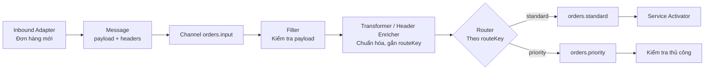

# Message gồm payload và headers

## 1. Message là đơn vị trao đổi trong Spring Integration

Trong mô hình **message-driven integration**, các thành phần thường trao đổi dữ liệu bằng *message* thay vì gọi trực tiếp phương thức của nhau. Một component nhận message từ **MessageChannel**, thực hiện một phần công việc (chuyển đổi, lọc, định tuyến, xử lý nghiệp vụ...) rồi có thể gửi message sang channel tiếp theo. Nhờ cách tổ chức này, Router, Filter, Transformer, Splitter, Aggregator và Gateway phối hợp được với nhau mà không cần biết chi tiết triển khai nội bộ của từng bước.

Trong chương **Message system** của module **SPRING_INTEGRATION_PATTERN**, việc hiểu rõ payload và headers là nền tảng để triển khai Enterprise Integration Patterns với Spring Integration theo hướng ít phụ thuộc và dễ mở rộng. Những ví dụ dưới đây nối khái niệm Message với các mẫu Router, Filter, Transformer, Splitter, Aggregator, Gateway, cũng như retry, error channel, correlation và cách kiểm thử, theo dõi từng nhánh xử lý.

Trong Spring Framework, cấu trúc trung tâm là interface `org.springframework.messaging.Message<T>`:

```java
public interface Message<T> {
    T getPayload();
    MessageHeaders getHeaders();
}
```

Message gồm đúng hai phần chính:

- **Payload**: dữ liệu chính mà flow cần xử lý, ví dụ đơn hàng, sự kiện, văn bản, byte, đối tượng DTO.
- **Headers**: tập metadata mô tả message và ngữ cảnh xử lý, ví dụ khóa định danh, loại sự kiện, correlation ID, thông tin định tuyến hoặc channel nhận phản hồi/lỗi.

Ví dụ minh họa một thông điệp đơn hàng (biểu diễn JSON chỉ để dễ hình dung, không phải định dạng serialize bắt buộc của Spring Integration):

```json
{
  "payload": {
    "orderId": "ORD-001",
    "amountVnd": 450000
  },
  "headers": {
    "id": "6dbfb14d-12ec-44cb-8ec5-689c1bd11401",
    "timestamp": 1795200000000,
    "tenantId": "store-hcm",
    "eventType": "order.created",
    "traceId": "trace-9f0"
  }
}
```

Trong message thực tế, `headers` là `MessageHeaders` (các giá trị có kiểu Java, không chỉ chuỗi), còn payload có thể là bất kỳ đối tượng hợp lệ nào. Hai message có payload giống nhau vẫn có thể mang metadata khác nhau và do đó đi qua **các nhánh xử lý khác nhau**.

## 2. Payload: nội dung nghiệp vụ của message

Payload trả lời câu hỏi: **“Hệ thống đang xử lý dữ liệu gì?”**

Một số loại payload phổ biến:

| Payload | Ví dụ | Cách sử dụng thường gặp |
| --- | --- | --- |
| `String` | Nội dung CSV hoặc JSON chưa parse | Đọc file, nhận dữ liệu thô, parsing |
| `byte[]` | Nội dung file hoặc dữ liệu nhị phân | File/HTTP/broker adapters |
| `record` hoặc DTO | `OrderCreated(orderId, amountVnd)` | Service Activator, nghiệp vụ có kiểu rõ ràng |
| `Map<String, Object>` | Dữ liệu từ nguồn linh hoạt | Tích hợp với schema biến đổi |
| Collection | Danh sách đơn hàng | Splitter chia message thành nhiều phần |

Ví dụ dùng `record` trong Java để biểu diễn sự kiện:

```java
record OrderCreated(String orderId, long amountVnd) {}
```

`Message<OrderCreated>` cho phép mã xử lý biết kiểu payload ngay tại thời điểm biên dịch. Một handler có thể lấy đối tượng bằng `getPayload()` mà không cần parse toàn bộ header. Tuy nhiên, **`Message<T>` không tự kiểm tra tính hợp lệ của payload**; kiểm tra `orderId` rỗng, số tiền âm, schema và quy tắc nghiệp vụ vẫn thuộc trách nhiệm của flow.

Trong các triển khai message mặc định, payload không được `null`. Khi muốn biểu đạt “không có kết quả”, cần chọn quy ước phù hợp với endpoint (ví dụ handler kết thúc không trả reply), thay vì giả định `MessageBuilder.withPayload(null)` hợp lệ.

**Tách payload khỏi metadata:** `amountVnd` và `orderId` là dữ liệu nghiệp vụ nên ở payload. `tenantId` hoặc `traceId` có thể đặt trong header nếu chúng thực sự là ngữ cảnh xử lý chung. Nếu một thuộc tính quyết định ý nghĩa bền vững của sự kiện, cần cân nhắc đưa nó vào schema payload để các hệ thống bên ngoài không đánh mất nó.

## 3. Headers: ngữ cảnh để xử lý và điều phối luồng

`MessageHeaders` là tập ánh xạ **tên header → giá trị**, có thể truy cập qua `message.getHeaders()`. Header không nhất thiết phải xuất hiện ở mọi message; đọc header tùy chọn cần có giá trị mặc định hoặc xử lý khi thiếu.

| Header / nhóm | Ý nghĩa | Lưu ý thực tế |
| --- | --- | --- |
| `id` | Định danh của một **message instance** | Không đồng nhất với khóa nghiệp vụ; có thể thay đổi khi tạo message mới |
| `timestamp` | Thời điểm gắn metadata cho message, thường tính bằng mili giây epoch | Không tự chứng minh thời điểm sự kiện nghiệp vụ phát sinh |
| `replyChannel` | Đích nhận phản hồi của một số flow request-reply | Có thể là channel hoặc tên channel tùy bối cảnh |
| `errorChannel` | Đích nhận lỗi ở các endpoint hỗ trợ cơ chế ErrorMessage | Không bảo đảm mọi exception đều tự động vào channel này |
| `contentType` | Gợi ý loại nội dung, ví dụ `application/json` | Hữu ích khi có chuyển đổi định dạng |
| `correlationId`, `sequenceNumber`, `sequenceSize` | Metadata thường được dùng khi chia/gom các phần của message | Có thể được tạo hoặc quản lý bởi Splitter/Aggregator; phải hiểu chiến lược correlation |
| Header tùy biến: `tenantId`, `routeKey`, `traceId` | Ngữ cảnh riêng của ứng dụng | Định nghĩa ý nghĩa, kiểu dữ liệu và quy tắc truyền qua ranh giới |

Các hằng số cho header hệ thống được cung cấp bởi `MessageHeaders`, `IntegrationMessageHeaderAccessor` hoặc những lớp liên quan, tùy loại header. Đừng hardcode một tên nếu framework đã có constant phù hợp; các tên literal trong bảng nhằm giúp nhận dạng khi đọc log.

### 3.1. ID của message khác ID nghiệp vụ

Ba khái niệm cần phân biệt:

- **Message ID**: định danh instance của envelope được tạo trong Spring Messaging.
- **Business ID / event ID**: khóa ổn định, ví dụ `orderId` hoặc `eventId`, gắn với một nghiệp vụ/sự kiện.
- **Correlation ID**: khóa liên hệ nhiều message thuộc cùng một yêu cầu, lô xử lý hoặc nhóm cần gom.

Ví dụ đơn hàng `ORD-001` được xử lý lại sau timeout có thể tạo **message ID mới**, nhưng vẫn phải giữ cùng `orderId` hoặc `eventId`. Để tránh thanh toán hai lần, consumer cần dựa vào khóa idempotency ổn định, **không dựa vào message ID mới sinh**.

### 3.2. Header định tuyến không thay thế nội dung nghiệp vụ

Một `routeKey` như `priority` hoặc `standard` giúp Router chọn channel đích. Cùng payload `OrderCreated`, một message có `routeKey=priority` có thể đi qua nhánh kiểm tra thủ công, còn message khác đi nhánh tự động.

Nhưng nếu nhánh xử lý chỉ được xác định dựa trên điều kiện nghiệp vụ (ví dụ `amountVnd >= 1_000_000`), hãy có một quy tắc tính header rõ ràng và kiểm thử được. Metadata định tuyến không nên vô tình trở thành một bản sao mất đồng bộ với payload.

## 4. Tạo và đọc Message bằng MessageBuilder

Spring Messaging cung cấp `org.springframework.messaging.support.MessageBuilder` để tạo message. Đoạn Java dưới đây tự chứa phần tạo message và thêm metadata:

```java
import org.springframework.messaging.Message;
import org.springframework.messaging.support.MessageBuilder;

public class MessageExample {
    record OrderCreated(String orderId, long amountVnd) {}

    public static void main(String[] args) {
        Message<OrderCreated> original = MessageBuilder
                .withPayload(new OrderCreated("ORD-001", 450_000L))
                .setHeader("tenantId", "store-hcm")
                .setHeader("eventType", "order.created")
                .setHeader("traceId", "trace-9f0")
                .build();

        OrderCreated order = original.getPayload();
        String tenant = original.getHeaders().get("tenantId", String.class);

        System.out.println(order.orderId());    // ORD-001
        System.out.println(order.amountVnd()); // 450000
        System.out.println(tenant);             // store-hcm
        System.out.println(original.getHeaders().getId());

        Message<OrderCreated> enriched = MessageBuilder
                .fromMessage(original)
                .setHeader("routeKey", "standard")
                .build();

        System.out.println(enriched.getHeaders().get("routeKey"));
        System.out.println(original.getHeaders().get("routeKey")); // null
    }
}
```

Ở đây:

1. `withPayload(...)` thiết lập dữ liệu nghiệp vụ.
2. `setHeader(...)` bổ sung thông tin ngữ cảnh; framework tạo/cung cấp các header hệ thống theo cơ chế của message builder.
3. `getPayload()` lấy đối tượng đơn hàng; `getHeaders().get(name, type)` lấy giá trị header có kiểu.
4. `fromMessage(original)` bắt đầu từ message cũ, cho phép giữ thông tin cần thiết khi bổ sung metadata, rồi `build()` trả về một message.

**Bất biến (immutability) cần hiểu đúng:** không nên cập nhật trực tiếp `MessageHeaders` của message đã tạo; hãy xây một message mới bằng builder khi cần thay đổi headers. Tuy nhiên, nếu payload là một đối tượng mutable, message **không tự deep-copy hoặc làm payload bất biến**. Hai message có thể cùng tham chiếu một payload và thấy những thay đổi của đối tượng đó. Ưu tiên payload bất biến (như các `record` chỉ chứa trường bất biến hoặc DTO được thiết kế tương tự) khi truyền qua nhiều luồng.

## 5. Message đi qua Channel và Endpoint như thế nào?

Trong Spring Integration, `MessageChannel` là nơi **chuyển giao** message, còn endpoint/handler là nơi **xử lý** message. Một flow đơn giản có thể như sau:



Ví dụ handler dạng Java DSL: một flow nhận payload `OrderCreated`, lọc số tiền không hợp lệ và chuyển đơn hàng hợp lệ tới `InvoiceService`. Đoạn này minh họa cách handler nhận **payload đã được ánh xạ đúng kiểu** cùng **headers của message**:

```java
import org.springframework.context.annotation.Bean;
import org.springframework.context.annotation.Configuration;
import org.springframework.integration.config.EnableIntegration;
import org.springframework.integration.dsl.IntegrationFlow;

record OrderCreated(String orderId, long amountVnd) {}

interface InvoiceService {
    void createInvoice(String tenantId, OrderCreated order);
}

@Configuration
@EnableIntegration
class OrderFlowConfig {
    @Bean
    IntegrationFlow orderFlow(InvoiceService invoiceService) {
        return IntegrationFlow.from("orders.input")
                .filter(OrderCreated.class, order -> order.amountVnd() > 0)
                .handle(OrderCreated.class, (order, headers) -> {
                    String tenantId = (String) headers.get("tenantId");
                    if (tenantId == null || tenantId.isBlank()) {
                        throw new IllegalArgumentException("Missing tenantId");
                    }
                    invoiceService.createInvoice(tenantId, order);
                    return null; // Xử lý xong, không tạo reply.
                })
                .get();
    }
}
```

Để chạy đoạn cấu hình, ứng dụng cần Spring Integration Java DSL, một bean `InvoiceService` và producer gửi `Message<OrderCreated>` tới channel `orders.input`. Filter trong ví dụ có thể loại bỏ message không đạt điều kiện; việc **loại bỏ theo chính sách** khác với **lỗi nghiệp vụ**. Khi cần quan sát từ chối, hãy cấu hình discard channel hoặc nhánh validation riêng thay vì để thông điệp biến mất mà không dấu vết.

**Một điểm quan trọng:** không phải mọi thành phần sẽ giữ nguyên toàn bộ header sau xử lý hoặc khi message rời khỏi JVM. Transformer thường tạo payload mới; framework cố gắng chuyển tiếp các header phù hợp theo cơ chế từng endpoint, nhưng một số header có thể bị loại bỏ, thay thế hoặc không thể serialize. Với thông tin sống còn cho flow, hãy kiểm chứng nó ở chính ranh giới mà message đi qua.

## 6. Payload và headers trong các mẫu EIP

| Mẫu EIP | Thường đọc từ payload | Thường đọc/ghi qua headers | Ví dụ |
| --- | --- | --- | --- |
| **Filter** | Số tiền, trạng thái, schema | `tenantId`, phân loại thông điệp | Chặn đơn hàng âm hoặc sai tenant |
| **Router** | Thuộc tính để phân nhánh | `routeKey`, `eventType` | Chọn nhánh `priority` / `standard` |
| **Transformer** | Đối tượng nguồn cần chuyển đổi | Context, content type, dấu vết | Chuyển DTO đơn hàng sang payload dành cho hóa đơn |
| **Splitter** | Danh sách các item | Correlation và sequence metadata | Tách một đơn hàng thành message của từng dòng hàng |
| **Aggregator** | Các phần cần tổng hợp | `correlationId`, `sequenceNumber`, `sequenceSize` | Gom kết quả xử lý các dòng hàng |
| **Gateway** | Request và reply nghiệp vụ | `replyChannel`, `errorChannel`, correlation | Gọi flow từ interface service |
| **Service Activator** | Dữ liệu để gọi nghiệp vụ | Tenant, trace, chính sách xử lý | Lưu database hoặc gọi API ngoài |

### 6.1. Splitter và Aggregator cần correlation

Giả sử payload chứa danh sách ba dòng hàng:

```text
Message<Order>
  payload: Order(ORD-001, [Item-A, Item-B, Item-C])
  headers: {tenantId: "store-hcm", traceId: "trace-9f0"}
```

Sau khi Splitter tách, mỗi message con có payload tương ứng từng `Item`. Để gom kết quả, các message con cần có cơ chế nhận biết mình thuộc **cùng một nhóm**:

```text
Message<Item-A>  correlationId=GROUP-01  sequenceNumber=1  sequenceSize=3
Message<Item-B>  correlationId=GROUP-01  sequenceNumber=2  sequenceSize=3
Message<Item-C>  correlationId=GROUP-01  sequenceNumber=3  sequenceSize=3
```

Ví dụ trên minh họa *ý nghĩa* metadata; giá trị correlation ID thực tế có thể do framework cấp hoặc theo cấu hình của ứng dụng. Aggregator phải có **correlation strategy** xác định nhóm và **release strategy** xác định thời điểm đã đủ phần tử. Nếu một phần tử lỗi hoặc timeout, cần quyết định chờ, trả kết quả từng phần, phát lại hoặc chuyển nhóm sang nhánh lỗi. Chỉ nhìn `sequenceSize` mà bỏ qua duplicate, thiếu phần tử hoặc timeout có thể khiến nhóm bị giữ mãi.

### 6.2. Gateway, replyChannel và errorChannel

Với request-reply, header `replyChannel` có thể hướng dẫn nơi trả kết quả; `errorChannel` có thể được dùng để gửi `ErrorMessage` khi lỗi phát sinh trong những endpoint có hỗ trợ. Đây là thông tin **điều khiển luồng**, khác với `orderId` hoặc `amountVnd` trong payload.

Không nên mặc định rằng gắn `errorChannel` sẽ bắt được mọi exception hay làm message tự retry. Trong handler đồng bộ, exception có thể truyền ngược về bên gọi; trong flow bất đồng bộ, lỗi có thể được phát hành qua cơ chế error channel được cấu hình. Retry, lưu lỗi và giao dịch phải được thiết kế độc lập theo đặc tính của endpoint.

## 7. Quy tắc thiết kế header đáng tin cậy

### 7.1. Phân biệt “metadata để điều phối” với dữ liệu nghiệp vụ

Một cách xác định nhanh:

- Nếu thay đổi thuộc tính làm **thay đổi sự kiện nghiệp vụ mà người nhận cần hiểu**, thuộc tính thường là một phần của payload.
- Nếu thuộc tính dùng để **điều phối, truy vết hoặc xử lý kỹ thuật**, nó thường phù hợp trong headers.
- Nếu dữ liệu cần đi qua broker, dịch vụ và ngôn ngữ lập trình khác nhau, phải **chuẩn hóa schema** (payload và những header cần thiết) thành hợp đồng tích hợp được công bố.

Chẳng hạn, `orderId` cần có trong payload của `OrderCreated` vì đây là định danh nghiệp vụ. `traceId` có thể ở header vì dùng để liên kết log. `tenantId` tùy hợp đồng: nếu hệ thống downstream cần tenant để xác thực, định tuyến hoặc lưu dữ liệu chính xác, phải bảo đảm header đó được truyền đi và được kiểm tra ở đầu vào, không tin tuyệt đối vào metadata do client ngoài gửi tới.

### 7.2. Bảo toàn thông tin qua ranh giới hệ thống

Khi message đi qua Kafka, RabbitMQ, JMS, HTTP hoặc file, các adapter/serializer có quy tắc riêng về header. Không được kỳ vọng mọi giá trị Java trong `MessageHeaders` (đặc biệt đối tượng `MessageChannel`) đều có thể được truyền nguyên vẹn qua mạng.

Tại ranh giới tích hợp nên xác định rõ:

1. Header nào cần giữ (`eventId`, `correlationId`, `traceId`, `tenantId`...).
2. Kiểu dữ liệu cho phép (thường ưu tiên chuỗi/số/byte chuẩn hóa).
3. Header nào do phía nhận tự tạo hoặc ánh xạ lại.
4. Header nào phải xác thực, không được tin từ nguồn không đáng tin.
5. Quy tắc đặt tên để tránh đụng header hệ thống.

Không đặt token truy cập, mật khẩu, dữ liệu cá nhân nhạy cảm hoặc payload lớn vào header nếu không có lý do thiết kế và biện pháp bảo vệ cụ thể. Headers thường xuất hiện trong log, middleware, công cụ quan sát và metadata của broker.

### 7.3. Message không tự bảo đảm delivery hoặc transaction

`Message<T>` chỉ mô tả dữ liệu được gửi đi. Chính **channel, endpoint, broker, message store, ACK/NACK, retry, idempotency và transaction manager** mới quyết định mức độ bền vững và cách phục hồi. Chẳng hạn, message có header `eventId` không tự ngăn việc xử lý trùng; consumer phải dùng khóa đó trong thao tác kiểm tra/ghi nhận nguyên tử.

## 8. Kiểm thử Message và header propagation

Ở cấp unit test, có thể xác minh payload, custom headers và metadata của message mới tạo mà không cần chạy toàn bộ ứng dụng:

```java
import org.junit.jupiter.api.Test;
import org.springframework.messaging.Message;
import org.springframework.messaging.support.MessageBuilder;

import static org.junit.jupiter.api.Assertions.*;

class MessageContractTest {
    record OrderCreated(String orderId, long amountVnd) {}

    @Test
    void messageHasPayloadAndContextHeaders() {
        Message<OrderCreated> message = MessageBuilder
                .withPayload(new OrderCreated("ORD-001", 450_000L))
                .setHeader("tenantId", "store-hcm")
                .setHeader("traceId", "trace-9f0")
                .build();

        assertEquals("ORD-001", message.getPayload().orderId());
        assertEquals(450_000L, message.getPayload().amountVnd());
        assertEquals("store-hcm",
                message.getHeaders().get("tenantId", String.class));
        assertNotNull(message.getHeaders().getId());

        Message<OrderCreated> updated = MessageBuilder
                .fromMessage(message)
                .setHeader("routeKey", "standard")
                .build();

        assertEquals("standard", updated.getHeaders().get("routeKey"));
        assertNull(message.getHeaders().get("routeKey"));
    }
}
```

Khi kiểm thử flow thực tế, bổ sung các tình huống:

| Kịch bản | Điều cần xác minh |
| --- | --- |
| Header `routeKey` hợp lệ | Message đi đúng channel đích |
| Header bắt buộc bị thiếu | Flow từ chối có dấu vết hoặc trả lỗi theo chính sách |
| Payload bị Transformer đổi kiểu | Các header đã cam kết vẫn được giữ đúng |
| Splitter tạo nhiều phần | Correlation/sequence đủ để Aggregator gom đúng nhóm |
| Message đi qua broker rồi quay về | Những header được chọn sống sót sau serialization và ánh xạ |
| Retry tạo lại envelope | `eventId` ổn định, tránh tác động nghiệp vụ trùng |
| Nhiều message cùng tenant và trace | Không rò context giữa các request chạy song song |

Nên kiểm thử bằng cả giá trị payload và các header *quan trọng với hợp đồng của flow*. Chỉ assert rằng handler “được gọi một lần” chưa đủ để phát hiện lỗi mất `tenantId` hoặc nhầm `correlationId`.

## 9. Bài tập thực hành và tự đánh giá

**Bài tập:** Thiết kế flow xử lý sự kiện `OrderCreated` với payload chứa `orderId`, `amountVnd`; headers chứa `tenantId`, `traceId`, `eventId`.

1. Dùng `MessageBuilder` tạo hai message mang cùng payload nhưng có `routeKey` khác nhau.
2. Dùng Filter loại bỏ đơn hàng có số tiền không hợp lệ; ghi nhận rõ thông điệp nào bị loại.
3. Dùng Router chuyển `priority` và `standard` đến hai channel tương ứng.
4. Thêm một Transformer tạo payload của hóa đơn; xác minh các header bắt buộc vẫn được truyền theo thiết kế.
5. Giả lập cùng `eventId` được gửi lần thứ hai; giải thích vì sao không thể chỉ dựa vào `MessageHeaders.ID` để chống tạo hóa đơn trùng.

Khi hoàn thành, hãy tự trả lời: **Payload mang điều gì? Headers mang điều gì? Khi nào message ID đổi? Correlation ID liên kết những message nào? Header nào phải đi qua ranh giới ứng dụng và vì sao?**

Một flow Spring Integration dễ bảo trì thường có **payload mô tả nghiệp vụ rõ ràng** và **headers mô tả ngữ cảnh xử lý có hợp đồng cụ thể**. Phân tách đúng hai thành phần này giúp Router, Filter, Transformer, Splitter, Aggregator, Gateway và các nhánh retry/error-channel hoạt động nhất quán, dễ kiểm thử và dễ quan sát khi hệ thống mở rộng.
