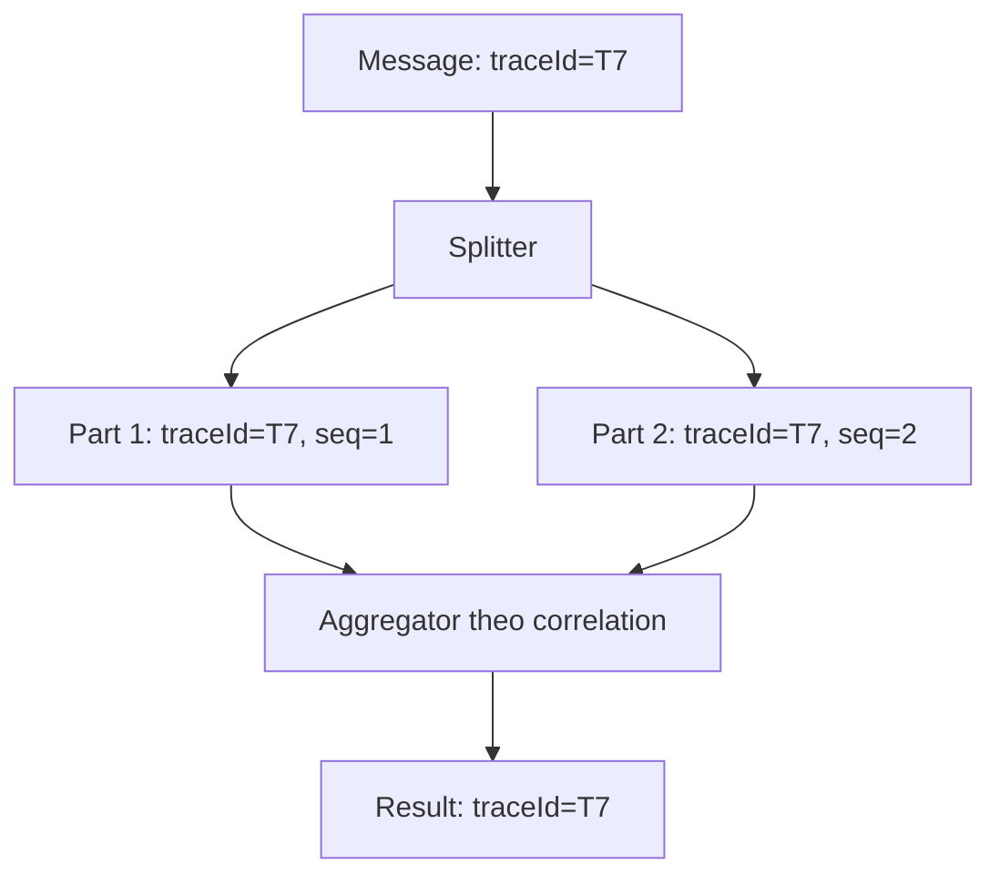

# Header propagation qua các endpoint trong Spring Integration

## Mục tiêu bài học

Trong **Message system** của Spring Integration, một thông điệp không chỉ có dữ liệu nghiệp vụ (`payload`) mà còn có **headers** mang ngữ cảnh xử lý. Khi triển khai Enterprise Integration Patterns, việc giữ đúng headers giữa các endpoint giúp các nhánh Router, Filter, Transformer, Splitter, Aggregator, Gateway, retry và error channel hoạt động nhất quán, có thể kiểm thử và theo dõi.

Sau bài này, bạn có thể:

- Giải thích khi nào một header được giữ nguyên, bổ sung, thay thế hoặc cần ánh xạ sang giao thức khác.
- Truyền các header như `traceId`, `tenantId` và `correlationId` xuyên qua nhiều endpoint mà không phụ thuộc vào trạng thái của thread.
- Viết một `IntegrationFlow` có header enricher, transformer và service activator; kiểm thử các header tại đầu ra.
- Nhận biết các điểm dễ mất ngữ cảnh ở Splitter/Aggregator, handler trả về `Message<?>`, gateway và adapter HTTP/Kafka/AMQP.
- Chọn chính sách header rõ ràng để tránh truyền nhầm dữ liệu nhạy cảm hoặc header điều khiển nội bộ.

## 1. Message và ý nghĩa của việc truyền header

Một Spring `Message<T>` có hai phần chính:

| Thành phần | Vai trò | Ví dụ |
| --- | --- | --- |
| `payload` | Nội dung cần xử lý, có thể đổi kiểu qua Transformer | `OrderRequest`, JSON, `String` |
| `headers` | Metadata dùng để định tuyến, liên kết và quan sát xử lý | `traceId`, `tenantId`, `contentType` |

`MessageHeaders` về cơ bản là tập các cặp tên/giá trị, được biểu diễn theo hướng **bất biến**. Khi muốn thay header, ta thường tạo message mới bằng `MessageBuilder` hoặc để endpoint của Spring Integration tạo reply message. Việc một message mới xuất hiện **không đồng nghĩa** mọi header đều phải thay đổi.

Cần phân biệt hai nhóm header:

1. **Header nghiệp vụ hoặc quan sát do ứng dụng quy định:** `traceId`, `tenantId`, `sourceSystem`, `orderType`. Ứng dụng quyết định header nào phải tồn tại đến cuối luồng.
2. **Header do hạ tầng messaging quản lý:** `id`, `timestamp`, `replyChannel`, `errorChannel`, cùng các header phân nhóm như `correlationId`, `sequenceNumber`, `sequenceSize`. Ý nghĩa và vòng đời của chúng tùy endpoint.

**Không dùng `id` của message thay cho mã truy vết nghiệp vụ.** `id` và `timestamp` là metadata do framework tạo/quản lý và có thể thay đổi khi sinh message mới. Nếu cần một khóa xuyên suốt qua nhiều endpoint hoặc dịch vụ, hãy dùng header riêng như `traceId`, hoặc cơ chế distributed tracing được cấu hình cho ứng dụng.

Ví dụ mong muốn:

```text
HTTP request
  payload = " order-42 "
  traceId = "trace-7"
  tenantId = "tenant-a"
        |
        v
Inbound adapter -> Header enricher -> Transformer -> Router -> Service activator
        |                  |                 |                  |
        |                  + sourceSystem    + payload đổi      + xử lý nghiệp vụ
        |                    = "checkout"      thành "order-42"   nhưng vẫn cần
        |                                                     traceId/tenantId
        v
Outbound adapter -> HTTP/Kafka/... (ánh xạ các header được phép ra giao thức đích)
```

Ở đây, `traceId` và `tenantId` là **hợp đồng ngữ cảnh** của luồng: các endpoint cần chúng phải nhận được cùng giá trị đã được kiểm tra. Không nhất thiết phải sao chép tất cả header nội bộ ra bên ngoài.

## 2. Header đi qua từng loại endpoint như thế nào?

| Điểm trong luồng | Hành vi thường gặp | Điều cần kiểm soát |
| --- | --- | --- |
| `DirectChannel`, `ExecutorChannel`, `QueueChannel` | Channel vận chuyển `Message<?>`; bản thân channel không có nhiệm vụ viết lại header nghiệp vụ. | Interceptor, message store, serialization và chuyển thread có thể ảnh hưởng ngữ cảnh ngoài message. |
| Header enricher | Tạo/bổ sung/điều chỉnh header theo cấu hình. | Tên header, nguồn giá trị, chính sách ghi đè, độ tin cậy của dữ liệu đầu vào. |
| Transformer | Thường biến đổi `payload`; với kết quả là payload thuần, các header yêu cầu thường được Spring Integration chuyển sang reply. | Khi tự tạo `Message<?>`, cần kiểm soát header được giữ; không coi mọi kiểu kết quả đều có cùng quy tắc. |
| Filter | Message đạt điều kiện được gửi tiếp; message bị loại có thể bị bỏ hoặc chuyển tới `discardChannel`. | Đừng kỳ vọng một message bị filter loại vẫn đi đến endpoint kế tiếp. |
| Router | Điều hướng message tới một hoặc nhiều channel theo header/payload. | Các nhánh có thể có chính sách xử lý header khác nhau; nếu fan-out thì phải nghĩ tới correlation. |
| Service activator / Gateway | Handler nhận payload/header rồi tạo kết quả; gateway chuyển tham số method thành message và reply về caller. | Quy tắc tạo reply, `replyChannel` nội bộ và những header được ứng dụng chủ động chuyển tiếp. |
| Splitter | Chia một message thành nhiều message con, thường kèm thông tin `correlationId`, `sequenceNumber`, `sequenceSize` khi bật sequence. | Bảo đảm mỗi phần vẫn có `traceId`; không suy ra quan hệ từ `id` của từng phần. |
| Aggregator | Nhóm message theo correlation và release strategy, rồi phát một kết quả. | Header xung đột giữa các phần cần chính sách hợp nhất rõ ràng. |
| HTTP/Kafka/AMQP/JMS adapter | Chuyển message nội bộ sang đối tượng giao thức và ngược lại. | Chỉ các header được header mapper/serializer hỗ trợ hoặc cấu hình mới đi qua ranh giới. |

### 2.1. Channel không thay cho context propagation

Trong `DirectChannel`, handler thường chạy đồng bộ theo luồng gọi. `ExecutorChannel` chuyển việc xử lý sang executor; các giá trị đặt trong `ThreadLocal` hoặc MDC của thread gọi không mặc nhiên đi theo message. Muốn endpoint phía sau biết `tenantId` hay khóa correlation, hãy đặt thông tin cần thiết **trong message header**, đồng thời cấu hình tracing/MDC riêng nếu muốn log giữa các thread nối được với nhau.

Với channel bền vững hoặc truyền qua broker, header còn phải có kiểu dữ liệu phù hợp với cách lưu/serialize. Một đối tượng `MessageChannel` nằm trong `replyChannel` là chi tiết điều phối trong tiến trình; không thể giả định đối tượng ấy dùng được ở tiến trình khác.

### 2.2. Payload thuần và message do handler tự tạo

Hai cách viết sau có ý nghĩa khác nhau:

```java
// Handler trả payload: Spring Integration có thể tạo reply Message
// và chuyển các request header phù hợp sang reply.
String normalize(String value) {
    return value.trim();
}

// Handler chủ động tạo Message: chính mã của ứng dụng phải nêu rõ
// những header cần giữ và những header cần thêm.
Message<String> normalizeExplicitly(Message<String> request) {
    return MessageBuilder.withPayload(request.getPayload().trim())
        .copyHeaders(request.getHeaders())
        .setHeader("processingStage", "normalized")
        .build();
}
```

`MessageBuilder` ở ví dụ trên là `org.springframework.messaging.support.MessageBuilder`. Không cố gắng ép giữ nguyên `id`/`timestamp` khi tạo message mới; hãy dùng `traceId` ổn định để liên kết các bước. Việc Spring Integration hợp nhất request/reply headers còn phụ thuộc loại endpoint, cấu hình và kiểu reply, nên **kiểm thử header đầu ra thực tế** thay vì dựa vào một quy tắc chung cho mọi handler.

Nếu handler cần thay đổi kiểu payload từ `Order` sang `OrderResult`, cũng có thể dùng `MessageBuilder.withPayload(result).copyHeaders(request.getHeaders()).build()`. Chỉ sao chép có chọn lọc khi message sẽ đi qua ranh giới tin cậy.

## 3. Ví dụ Java DSL: header đi xuyên một luồng

Giả sử một ứng dụng checkout nhận mã đơn, cần biết `tenantId` để chọn ngữ cảnh xử lý và `traceId` để điều tra lỗi. Luồng có nhiệm vụ:

1. Nhận `Message<String>` trên `orders.in`.
2. Thêm header `sourceSystem=web-checkout`.
3. Chuẩn hóa payload bằng Transformer.
4. Dùng Service Activator kiểm tra `tenantId`, trả payload đã chuyển thành chữ hoa.
5. Phát reply lên `orders.out`, giữ `traceId` và `tenantId`.

```java
import java.util.Locale;

import org.springframework.context.annotation.Bean;
import org.springframework.context.annotation.Configuration;
import org.springframework.integration.channel.DirectChannel;
import org.springframework.integration.channel.QueueChannel;
import org.springframework.integration.config.EnableIntegration;
import org.springframework.integration.dsl.IntegrationFlow;
import org.springframework.messaging.MessageChannel;
import org.springframework.messaging.PollableChannel;

@Configuration
@EnableIntegration
public class HeaderPropagationConfig {

    @Bean("orders.in")
    MessageChannel ordersIn() {
        return new DirectChannel();
    }

    @Bean("orders.out")
    PollableChannel ordersOut() {
        return new QueueChannel();
    }

    @Bean
    IntegrationFlow orderFlow() {
        return IntegrationFlow.from("orders.in")
            .enrichHeaders(headers ->
                headers.header("sourceSystem", "web-checkout"))
            .transform(String.class, String::trim)
            .handle(String.class, (payload, headers) -> {
                String tenantId = (String) headers.get("tenantId");
                if (tenantId == null || tenantId.isBlank()) {
                    throw new IllegalArgumentException("Missing tenantId");
                }

                // Đọc được header từ message sau Transformer.
                String traceId = (String) headers.get("traceId");
                if (traceId == null || traceId.isBlank()) {
                    throw new IllegalArgumentException("Missing traceId");
                }

                return payload.toUpperCase(Locale.ROOT);
            })
            .channel("orders.out")
            .get();
    }
}
```

Đoạn mã dùng Spring Integration Java DSL; trong một dự án Spring Boot thông dụng cần dependency Spring Integration và bộ thư viện kiểm thử Spring. `QueueChannel` được chọn ở đầu ra để ví dụ có thể đọc kết quả trực tiếp. Trong hệ thống thực tế, đầu ra có thể là một service activator, outbound adapter hoặc một flow khác.

Ví dụ kiểm thử tích hợp:

```java
import static org.assertj.core.api.Assertions.assertThat;

import org.junit.jupiter.api.Test;
import org.springframework.beans.factory.annotation.Autowired;
import org.springframework.beans.factory.annotation.Qualifier;
import org.springframework.messaging.Message;
import org.springframework.messaging.MessageChannel;
import org.springframework.messaging.PollableChannel;
import org.springframework.messaging.support.MessageBuilder;
import org.springframework.test.context.junit.jupiter.SpringJUnitConfig;

@SpringJUnitConfig(HeaderPropagationConfig.class)
class HeaderPropagationTest {

    @Autowired
    @Qualifier("orders.in")
    MessageChannel input;

    @Autowired
    @Qualifier("orders.out")
    PollableChannel output;

    @Test
    void preservesBusinessHeadersAcrossEndpoints() {
        Message<String> request = MessageBuilder.withPayload("  order-42  ")
            .setHeader("traceId", "trace-7")
            .setHeader("tenantId", "tenant-a")
            .build();

        assertThat(input.send(request)).isTrue();

        Message<?> result = output.receive(2_000);
        assertThat(result).isNotNull();
        assertThat(result.getPayload()).isEqualTo("ORDER-42");
        assertThat(result.getHeaders().get("traceId")).isEqualTo("trace-7");
        assertThat(result.getHeaders().get("tenantId")).isEqualTo("tenant-a");
        assertThat(result.getHeaders().get("sourceSystem"))
            .isEqualTo("web-checkout");
    }
}
```

Kiểm thử này xác nhận hợp đồng quan trọng: payload đã đổi qua hai endpoint xử lý, trong khi ba header cần thiết vẫn đọc được ở đầu ra. Nó **không** kiểm tra các header `id`/`timestamp` có bất biến hay không, bởi đó không phải yêu cầu nghiệp vụ.

### Khi dùng Gateway

`@MessagingGateway` cho phép khai báo header từ đối số method:

```java
@MessagingGateway
interface OrderGateway {

    @Gateway(requestChannel = "orders.in", replyChannel = "orders.out")
    String submit(
        String orderId,
        @Header("traceId") String traceId,
        @Header("tenantId") String tenantId
    );
}
```

Các annotation trong ví dụ đến từ `org.springframework.integration.annotation.Gateway`, `org.springframework.integration.annotation.MessagingGateway` và `org.springframework.messaging.handler.annotation.Header`. Khi muốn sử dụng interface này thành gateway bean, cấu hình `@IntegrationComponentScan` trên lớp cấu hình hoặc đăng ký gateway tương đương. Gateway xây request message theo chữ ký phương thức; các header do caller cung cấp đi vào luồng. `replyChannel` ở đây là kênh điều phối reply của gateway. Không chuyển nguyên đối tượng channel nội bộ này thành HTTP/Kafka header.

## 4. Header enrichment: tạo, giữ và thay có chủ đích

Header enricher hữu ích khi một bước cần bổ sung metadata mà không thay payload:

```java
.enrichHeaders(h -> h
    .header("sourceSystem", "checkout")
    .headerFunction("receivedFrom", message ->
        message.getHeaders().getOrDefault("sourceSystem", "unknown")))
```

Ở đây, `headerFunction` đọc message hiện tại để tính một header khác. Trước khi sử dụng trong nghiệp vụ, cần xác định rõ header có thể đã tồn tại hay không và có cho phép ghi đè hay không. Ví dụ, `tenantId` lấy từ người dùng bên ngoài cần được **xác thực/đối chiếu** với danh tính đã xác thực; chỉ thêm một header không khiến giá trị tự nhiên trở nên đáng tin.

Một cách chia trách nhiệm dễ bảo trì:

- **Tại điểm vào:** nhận diện hoặc tạo `traceId`, xác thực `tenantId`, chuẩn hóa tên header.
- **Trong flow:** giữ header ổn định; thêm các mốc như `processingStage` khi thực sự cần.
- **Tại điểm ra:** ánh xạ ra tên header của giao thức đích, loại header không được phép xuất hiện.

Tên header phân biệt chữ hoa/chữ thường ở mức map Java; khi đi qua HTTP, quy tắc tên header của HTTP lại khác. Nếu liên thông nhiều công nghệ, hãy thống nhất bảng ánh xạ như `traceId` (nội bộ) ↔ `X-Trace-Id` (HTTP) và kiểm thử cả hai chiều.

## 5. Router, Splitter và Aggregator: ngữ cảnh ở các nhánh

Một Router thường chỉ cần đọc header, chẳng hạn `region` hoặc `orderType`, để chọn kênh. Nếu router gửi một message đến nhiều nhánh, từng nhánh có thể biến đổi dữ liệu theo cách khác nhau. Hãy coi `traceId` là khóa nối log của mọi nhánh và sử dụng một định danh nhóm độc lập nếu các kết quả sẽ được gom lại.



Khi `applySequence` được bật, Splitter có thể gắn `correlationId`, `sequenceNumber`, `sequenceSize` để giúp Aggregator xác định nhóm và thứ tự. Cấu hình và loại splitter quyết định metadata nào được tạo; đừng coi mọi bước fan-out đều tự sinh đủ các header này. Một số tập message có thể không biết trước tổng số phần tử, nên release strategy phải phù hợp thay vì mặc định dựa vào `sequenceSize`.

**Tình huống xung đột:** hai message con cùng `correlationId` nhưng lần lượt mang `sourceSystem=api` và `sourceSystem=batch`. Aggregator không thể bảo toàn cả hai dưới một key duy nhất mà không có quy tắc. Có thể chọn header từ message gốc, từ metadata của nhóm, hoặc tự tạo danh sách nguồn. Quyết định này thuộc hợp đồng nghiệp vụ, cần được viết trong custom `MessageGroupProcessor` hoặc logic tạo kết quả tương ứng.

Một số quy tắc thực hành:

- Giữ `traceId` chung cho tất cả message thuộc cùng một hành trình yêu cầu; dùng `correlationId` để gom message theo công việc cụ thể.
- Giữ `tenantId` nhất quán trong cùng một nhóm; nếu khác nhau, coi là lỗi dữ liệu hoặc tách nhóm theo tenant.
- Không kỳ vọng Aggregator tự giải quyết đúng mọi header trùng tên có giá trị khác nhau.
- Kiểm thử một nhóm hoàn chỉnh, một nhóm thiếu phần tử và một nhóm có header xung đột.

## 6. Ranh giới với HTTP, Kafka, AMQP và JMS

Header propagation trong một `IntegrationFlow` khác với truyền header qua mạng. Inbound adapter xây dựng Spring message từ request/record bên ngoài; outbound adapter phải đổi headers sang dạng mà giao thức đích chấp nhận. Các adapter thường có cơ chế **header mapper**, danh sách header được chọn và quy tắc chuyển kiểu riêng.

| Ranh giới | Điểm cần chú ý |
| --- | --- |
| HTTP | Chỉ ánh xạ những request/response header được phép; chuẩn hóa `X-Trace-Id` ↔ `traceId`; xác thực dữ liệu từ client. |
| Kafka | Record headers là dữ liệu dạng byte; cần chiến lược chuyển đổi kiểu và mapping phù hợp với Spring Kafka/Spring Integration đang dùng. |
| AMQP | Phân biệt application headers với properties của message; broker và converter có thể ràng buộc kiểu giá trị. |
| JMS | Header/properties chịu quy tắc tên và kiểu dữ liệu của JMS; không thể sao chép tùy ý toàn bộ object từ message nội bộ. |

Ví dụ hợp đồng qua hai dịch vụ:

```text
Service A                               Service B
----------------------------            -----------------------------
header nội bộ: traceId = T7             inbound mapping:
outbound HTTP mapping:                  X-Trace-Id -> traceId
traceId -> X-Trace-Id      ---------->   tiếp tục xử lý với traceId = T7
```

Không tự động xuất các header như `replyChannel`, `errorChannel`, credential, token hoặc đối tượng Java tùy ý. Đối với header nhạy cảm, áp dụng allowlist và chính sách bảo mật của từng kết nối. Cần kiểm thử tại **đầu bên nhận** vì việc header có mặt trong message trước outbound adapter chưa chứng minh được nó đã đến nơi.

## 7. Retry, error channel và quan sát luồng xử lý

Khi handler lỗi, Spring Integration có thể đưa lỗi tới `errorChannel` dưới dạng `ErrorMessage` chứa một `Throwable`. Trong nhiều trường hợp, nguyên nhân là `MessagingException` có `failedMessage`, từ đó lấy lại header của message gây lỗi:

```java
void inspectError(ErrorMessage error) {
    Throwable cause = error.getPayload();
    if (cause instanceof MessagingException messagingException) {
        Message<?> failed = messagingException.getFailedMessage();
        if (failed != null) {
            Object traceId = failed.getHeaders().get("traceId");
            // Ghi log traceId theo chính sách logging của ứng dụng.
        }
    }
}
```

Ví dụ cần import `org.springframework.messaging.support.ErrorMessage`, `org.springframework.messaging.MessagingException` và `org.springframework.messaging.Message`. Không phải lỗi nào cũng mang một `failedMessage`; vì vậy cần kiểm tra `null` và biết thêm cách adapter/flow đang phát lỗi.

Khi bật retry, một công việc có thể được xử lý lại nhiều lần. `traceId` thường nên giữ ổn định cho cùng yêu cầu, còn `attempt` hoặc số lần retry nên được ghi nhận có quy tắc riêng. Nếu message được dựng lại hay nhận lại từ broker, `id` có thể khác; log cần dùng khóa correlation bền vững để nối các lần thử. Muốn kết nối với MDC/tracing qua `ExecutorChannel`, cần cấu hình cơ chế truyền tracing context hoặc khôi phục MDC từ headers tại handler.

## 8. Các lỗi thường gặp và cách chẩn đoán

| Triệu chứng | Nguyên nhân nên kiểm tra | Hướng xử lý |
| --- | --- | --- |
| `traceId` biến mất sau custom handler | Handler tạo `Message<?>` nhưng không giữ header cần thiết; hoặc endpoint có quy tắc reply khác mong đợi. | Kiểm tra kiểu return và dùng `MessageBuilder`/header mapper phù hợp; thêm assert tại đầu ra. |
| Header có trước outbound adapter nhưng dịch vụ nhận không có | Mapper không cho phép tên header hoặc converter không hỗ trợ kiểu giá trị. | Xem cấu hình mapper, đổi sang kiểu serialize được, kiểm thử ở consumer. |
| Router đi sai nhánh | Tên header không thống nhất, kiểu dữ liệu sai hoặc giá trị không được xác thực. | Quan sát headers ở đầu vào router và kiểm thử từng giá trị định tuyến. |
| Aggregator không release | Correlation/release strategy không khớp với sequence, thiếu phần tử hoặc timeout. | Kiểm tra `correlationId`, `sequenceNumber`, `sequenceSize` và group store. |
| Log mất thông tin theo request sau `ExecutorChannel` | Dựa vào MDC/`ThreadLocal` nhưng chưa truyền context qua thread. | Mang khóa correlation trong message headers và cấu hình bridge MDC/tracing. |
| Exception handler không thấy `traceId` trong header của `ErrorMessage` | Lỗi được bọc, message gốc nằm trong `failedMessage` hoặc adapter tạo lỗi khác. | Kiểm tra exception chain và `failedMessage` một cách an toàn. |

Khi debug, ưu tiên log **chọn lọc** các header nghiệp vụ (`traceId`, `tenantId` nếu được phép, `correlationId`) tại các checkpoint. Không dump toàn bộ headers ra log vì có thể lộ dữ liệu nhạy cảm hoặc object nội bộ khó đọc.

## 9. Checklist thiết kế và bài tập

Trước khi đưa một flow vào vận hành, hãy trả lời:

1. Header nào là hợp đồng phải đi từ đầu đến cuối? Header nào chỉ dùng trong một nhánh?
2. Điểm vào đã tạo hoặc xác thực các header nghiệp vụ chưa?
3. Handler nào trả payload thuần, handler nào tự tạo `Message<?>`? Có test propagation tại ranh giới ấy không?
4. Nếu Splitter/Aggregator tạo hoặc hợp nhất message, correlation/release và header xung đột được xử lý ra sao?
5. Nếu đi qua broker hoặc HTTP, adapter map đúng tên, kiểu, chiều truyền và allowlist chưa?
6. Khi retry hoặc lỗi bất đồng bộ, có truy được khóa correlation của message gây lỗi không?

**Bài tập 1 — Theo dõi qua Transformer:** Chạy `HeaderPropagationTest` ở mục 3, thêm header `priority=HIGH` vào request và kiểm tra giá trị của nó tại `orders.out`. Sau đó viết một custom handler trả `Message<?>` và quan sát kết quả khi có/không `copyHeaders(...)`.

**Bài tập 2 — Phân nhánh:** Thêm Router dựa trên header `orderType` để gửi `STANDARD` và `EXPRESS` tới hai flow khác nhau. Dùng `traceId` chung, kiểm tra rằng cả hai nhánh đều có header cần thiết và nhánh không phù hợp bị từ chối theo thiết kế.

**Bài tập 3 — Chia/gom:** Dùng Splitter chia một đơn thành các dòng hàng, sau đó Aggregator ghép kết quả. Kiểm tra `correlationId`/sequence, `tenantId` và trường hợp một message con mang `tenantId` khác.

**Bài tập 4 — Ranh giới mạng:** Thiết kế mapping `traceId` ↔ `X-Trace-Id` cho một HTTP outbound/inbound pair, rồi viết kiểm thử xác nhận header đi tới service nhận. Đảm bảo các header điều phối như `replyChannel` không bị xuất ra ngoài.

### Ghi nhớ

**Header propagation là một phần của hợp đồng tích hợp.** Với Spring Integration, nhiều endpoint hỗ trợ chuyển tiếp metadata, nhưng hợp đồng cuối cùng phải được biểu đạt qua mã, cấu hình header mapper và kiểm thử tại các điểm chuyển đổi. Duy trì `traceId` xuyên suốt, tách `correlationId` dành cho nhóm message và chọn lọc những header được phép rời khỏi tiến trình giúp hệ thống ít phụ thuộc, dễ quan sát và dễ mở rộng.
