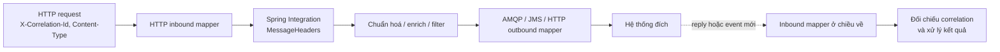

# Header mapping giữa các hệ thống

## 1. Vấn đề cần giải quyết

Trong một hệ thống tích hợp, cùng một thông điệp có thể đi qua HTTP API, Spring Integration, RabbitMQ (AMQP), JMS hoặc Kafka. Mỗi giao thức có **cách biểu diễn metadata khác nhau**. HTTP dùng các trường header dạng tên/giá trị; AMQP có cả thuộc tính chuẩn (`correlationId`, `replyTo`, `contentType`) và bảng header ứng dụng; JMS có header chuẩn và các message property; trong Spring Integration, metadata nằm ở `MessageHeaders`.

**Header mapping** là quá trình chọn, đổi tên, chuyển kiểu và kiểm soát những metadata nào được đưa từ giao thức ngoài vào `MessageHeaders`, cũng như từ `MessageHeaders` ra giao thức đích. Payload giữ dữ liệu nghiệp vụ chính; header cung cấp ngữ cảnh để định tuyến, tương quan, theo dõi, xử lý lỗi hoặc thương lượng định dạng.

Ví dụ, dịch vụ nhận đơn hàng bằng HTTP cần giữ mã truy vết của khách, nhưng không được tự động chuyển `Authorization` của khách sang broker hay sang API đối tác. Nếu chỉ sao chép toàn bộ headers, luồng có thể rò rỉ thông tin, mang theo kiểu dữ liệu mà broker không hỗ trợ hoặc làm hỏng correlation giữa request và reply.

Trong module **SPRING_INTEGRATION_PATTERN**, việc mapping header là một phần của triển khai **Enterprise Integration Patterns (EIP)**: giúp các luồng Router, Filter, Transformer, Splitter, Aggregator, Gateway, retry và error channel tương tác với nhau mà vẫn giới hạn sự phụ thuộc vào giao thức. Sau bài này, người học có thể:

- Phân biệt header nghiệp vụ, header điều khiển nội bộ và header thuộc transport.
- Thiết kế một bộ quy tắc mapping hai chiều, xác định rõ nguồn dữ liệu nào đáng tin cậy.
- Dùng `DefaultHttpHeaderMapper`, `Header Enricher` và `Header Filter` trong Spring Integration.
- Kiểm tra dữ liệu đi qua HTTP, AMQP/JMS và phát hiện sai lệch trong correlation, kiểu dữ liệu và bảo mật.

## 2. Bản đồ đường đi của header



Tách rõ **ba lớp tên**:

| Lớp | Ví dụ | Ý nghĩa |
| --- | --- | --- |
| Header ở HTTP | `X-Correlation-Id`, `Content-Type`, `traceparent` | Metadata theo hợp đồng HTTP; tên header HTTP không phân biệt chữ hoa/thường. |
| Header chuẩn hóa trong flow | `appCorrelationId`, `tenantId`, `contentType` | Tên có nghĩa ổn định trong ứng dụng, độc lập transport. |
| Header hoặc thuộc tính của adapter | `amqp_correlationId`, `jms_correlationId`, Kafka key | Metadata cụ thể mà adapter chuyển thành thuộc tính hoặc header của giao thức đích. |

Không có quy tắc tổng quát rằng hai header cùng chữ "correlation" là đồng nghĩa. Ví dụ, `correlationId` mà một Aggregator của Spring Integration dùng để nhóm các message **khác ngữ nghĩa** với AMQP `correlationId` hoặc `JMSCorrelationID` dùng trong cơ chế request/reply của broker. Cần đặt tên rõ và chuyển đổi có chủ đích.

### Mapping diễn ra ở ranh giới nào?

Trong Spring Integration, `HeaderMapper<T>` có hai thao tác cốt lõi:

- `toHeaders(T)`: đọc metadata **từ giao thức ngoài** và tạo map dùng cho Spring Integration `MessageHeaders`.
- `fromHeaders(MessageHeaders, T)`: xuất các header **từ Spring Integration** sang đối tượng metadata của giao thức đích.

Đối với một **HTTP outbound gateway**, request được xuất bằng `fromHeaders`, còn HTTP response nhận về bằng `toHeaders`. Đối với **HTTP inbound gateway**, chiều áp dụng ngược lại. Vì vậy `inbound/outbound` của mapper phải được hiểu theo **hướng adapter**, không đơn thuần theo tên phương thức.

| Loại endpoint | Bước đọc metadata | Bước ghi metadata |
| --- | --- | --- |
| HTTP inbound gateway | HTTP request → `MessageHeaders` | `MessageHeaders` của reply → HTTP response |
| HTTP outbound gateway | HTTP response → `MessageHeaders` | `MessageHeaders` của request → HTTP request |
| AMQP/JMS inbound | Broker message → `MessageHeaders` | Có thể xuất reply qua broker nếu là gateway |
| AMQP/JMS outbound | Đọc reply từ broker nếu có | `MessageHeaders` → broker message |

`MessageHeaders` là cấu trúc chỉ đọc đối với người dùng. Muốn thêm hoặc bỏ header, hãy tạo message đầu ra qua `MessageBuilder` hoặc dùng các endpoint như `Header Enricher` và `Header Filter`; không gọi `put()` trực tiếp lên `MessageHeaders`. Hai header hệ thống `id` và `timestamp` là read-only, không được dùng như mã định danh nghiệp vụ bền vững giữa nhiều hệ thống.

## 3. Thiết kế hợp đồng mapping trước khi cấu hình adapter

Giả sử ứng dụng nhận đơn hàng, xử lý nội bộ và gọi API đối tác. Chính sách mong muốn:

| Tại nguồn | Tên nội bộ đề xuất | Tại đích | Chính sách |
| --- | --- | --- | --- |
| HTTP `X-Correlation-Id` | `appCorrelationId` | HTTP `X-Correlation-Id` hoặc AMQP `amqp_correlationId` nếu đúng use case | Kiểm tra độ dài/định dạng; giữ qua retry, không lấy `MessageHeaders.ID` thay thế. |
| HTTP `X-Tenant-Id` | `tenantId` | HTTP `X-Tenant-Id` | Chỉ chuyển tiếp giá trị đã xác thực/ủy quyền; không tin giá trị client tự khai. |
| HTTP `Content-Type` | `contentType` hoặc giá trị định dạng thống nhất | Thuộc tính content type của transport | Phải phù hợp với payload đã được converter tạo ra. |
| W3C `traceparent` | Ngữ cảnh trace | `traceparent` | Chỉ truyền qua đường tin cậy, theo cấu hình tracing và giới hạn header. |
| HTTP `Authorization`, `Cookie` | Không lưu làm metadata luân chuyển | Không chuyển tiếp | Xử lý xác thực ở edge; tạo credential riêng cho bên nhận nếu cần. |
| AMQP `amqp_receivedExchange`, `amqp_deliveryTag` | Metadata adapter cục bộ | Không chuyển sang HTTP hoặc broker khác | Chỉ có giá trị trong ngữ cảnh consumer hiện tại. |
| `replyChannel`, `errorChannel` | Điều khiển luồng nội bộ | Không ánh xạ ra header công khai | Do Spring Integration sử dụng để đưa reply/lỗi về đúng kênh. |

Các hàng trên là **hợp đồng minh họa**, không phải bảng tự động có sẵn trong Spring Integration. Chẳng hạn `appCorrelationId → X-Correlation-Id` là phép đổi tên bạn chủ động cài bằng Header Enricher; cấu hình tên header trong `DefaultHttpHeaderMapper` chủ yếu chọn header nào được đi qua, không tự hiểu các tên nghiệp vụ tùy ý là đồng nghĩa.

Một ví dụ dễ đọc:

```text
HTTP inbound
  X-Correlation-Id: req-204
  X-Tenant-Id:       tenant-7
  Authorization:     Bearer <token>

MessageHeaders nội bộ (sau xác thực, chuẩn hóa)
  appCorrelationId: req-204
  tenantId:         tenant-7
  contentType:      application/json
  id:               <UUID của chính message này>

HTTP outbound sang đối tác
  X-Correlation-Id: req-204
  X-Tenant-Id:       tenant-7
  Content-Type:      application/json

Authorization của HTTP inbound không được sao chép ra ngoài.
```

**Quy trình thiết kế**: xác định producer/consumer → lập bảng header bắt buộc và header cấm → quyết định kiểu dữ liệu → tạo tên nội bộ → xác định quy tắc cho từng chiều (request/reply) → kiểm tra tại ranh giới adapter. Việc đặt chính sách theo allowlist thường an toàn và dễ thay đổi hơn dùng wildcard cho mọi header.

## 4. Mapping HTTP với Spring Integration Java DSL

Spring Integration HTTP dùng `DefaultHttpHeaderMapper` để chuyển giữa `HttpHeaders` và `MessageHeaders`. Với cấu hình mặc định, các header HTTP chuẩn được hỗ trợ. Khi cung cấp danh sách `mappedRequestHeaders` hoặc `mappedResponseHeaders`, danh sách đó **thay thế lựa chọn mặc định** ở chiều tương ứng; muốn giữ nhóm header chuẩn có thể dùng mẫu đặc biệt `HTTP_REQUEST_HEADERS` hoặc `HTTP_RESPONSE_HEADERS`. Ký tự `*` cho phép khớp theo mẫu tên; với biên bảo mật, nên liệt kê cụ thể.

Ví dụ một flow nhận message nghiệp vụ đã được xác thực trên channel `validatedOrders`. Message này có sẵn `appCorrelationId` và `tenantId` từ bước xử lý trước. Flow xóa header không cần thiết, đặt tên HTTP theo contract, rồi gọi API đối tác:

```java
import org.springframework.context.annotation.Bean;
import org.springframework.context.annotation.Configuration;
import org.springframework.http.HttpMethod;
import org.springframework.integration.dsl.IntegrationFlow;
import org.springframework.integration.http.dsl.Http;

@Configuration
public class PartnerHeaderMappingConfiguration {

    @Bean
    public IntegrationFlow sendOrdersToPartner() {
        return IntegrationFlow.from("validatedOrders")
            .headerFilter(
                "Authorization", "Cookie",
                "amqp_receivedExchange", "amqp_deliveryTag",
                "X-Correlation-Id", "X-Tenant-Id")
            .enrichHeaders(headers -> headers
                .headerFunction(
                    "X-Correlation-Id",
                    m -> m.getHeaders().get("appCorrelationId"),
                    true)
                .headerFunction(
                    "X-Tenant-Id",
                    m -> m.getHeaders().get("tenantId"),
                    true))
            .handle(Http.outboundGateway("https://partner.example/api/orders")
                .httpMethod(HttpMethod.POST)
                .expectedResponseType(String.class)
                .mappedRequestHeaders(
                    "Content-Type", "Accept",
                    "X-Correlation-Id", "X-Tenant-Id")
                .mappedResponseHeaders(
                    "Content-Type", "X-Partner-Request-Id"))
            .channel("partnerReplies")
            .get();
    }
}
```

Cách đọc flow:

1. `headerFilter(...)` loại bỏ header nhận từ client và một số metadata AMQP chỉ có ý nghĩa tại nguồn.
2. `enrichHeaders(...)` tạo các tên header HTTP từ metadata nội bộ đã xác minh. Đối số `true` yêu cầu ghi đè nếu header đích đã có; tránh dùng giá trị chưa xác thực từ phía ngoài.
3. `mappedRequestHeaders(...)` là allowlist **HTTP request xuất đi**. `mappedResponseHeaders(...)` chọn metadata của **HTTP response nhận về**, ví dụ `X-Partner-Request-Id` để tra log đối tác.
4. `outboundGateway` đợi reply và trả về message cho channel `partnerReplies`. Nếu không cần reply, dùng `outboundChannelAdapter` phù hợp hơn.

Ví dụ giả định payload đã được chuyển thành JSON và có `Content-Type` phù hợp trước khi đến HTTP handler; việc chọn header không thay thế cấu hình message converter. Địa chỉ `partner.example` là placeholder cần đổi thành endpoint thực tế. Các dependency Spring Integration HTTP phải dùng cùng nhánh phiên bản tương thích với ứng dụng.

Có thể kiểm soát mapper qua bean khi muốn tái sử dụng hoặc tùy chỉnh sâu:

```java
import org.springframework.context.annotation.Bean;
import org.springframework.integration.http.support.DefaultHttpHeaderMapper;

@Bean
public DefaultHttpHeaderMapper partnerHttpHeaderMapper() {
    DefaultHttpHeaderMapper mapper = DefaultHttpHeaderMapper.outboundMapper();
    mapper.setOutboundHeaderNames(
        "Content-Type", "Accept", "X-Correlation-Id", "X-Tenant-Id");
    mapper.setInboundHeaderNames(
        "Content-Type", "X-Partner-Request-Id");
    return mapper;
}
```

Khi dùng cách này, đưa mapper vào endpoint bằng `.headerMapper(partnerHttpHeaderMapper())` **thay cho** hai lời gọi `mappedRequestHeaders/mappedResponseHeaders` trong ví dụ trước. Không cấu hình hai cách cùng lúc vì dễ gây hiểu nhầm về quy tắc nào có hiệu lực.

### Chọn đúng chiều và hiểu các mẫu

- `DefaultHttpHeaderMapper.inboundMapper()` dùng cho adapter nhận HTTP request và gửi HTTP response.
- `DefaultHttpHeaderMapper.outboundMapper()` dùng cho adapter gửi HTTP request và đọc HTTP response.
- `setOutboundHeaderNames(...)` chọn tên để ghi **từ `MessageHeaders` ra HTTP**; `setInboundHeaderNames(...)` chọn tên để đọc **từ HTTP vào `MessageHeaders`**.
- Các mẫu `X-*` hoặc `*` dùng để mở rộng matching; chúng có thể vô tình mang theo header nhạy cảm hoặc header của hệ thống khác. Không chọn toàn bộ chỉ vì làm cho demo chạy nhanh.
- Tên header tùy chỉnh không tự được thêm tiền tố `X-` ở các phiên bản Spring Integration hiện đại; nếu hệ thống đích yêu cầu cách đặt tên cũ, hãy chỉ rõ hợp đồng hoặc tùy chỉnh mapper.

## 5. Khi đi qua RabbitMQ/AMQP, JMS và Kafka

Header mapper là khái niệm chung, nhưng **định dạng và giới hạn của từng transport không giống nhau**.

| Transport | API/khái niệm cần biết | Vấn đề thường gặp |
| --- | --- | --- |
| HTTP | `DefaultHttpHeaderMapper`, `HttpHeaders`; request và response mapping riêng | Tên không phân biệt hoa thường, một tên có thể có nhiều giá trị; không nên ép mọi header thành một chuỗi tùy tiện. |
| RabbitMQ/AMQP | `DefaultAmqpHeaderMapper`, `AmqpHeaders`; thuộc tính chuẩn và bảng custom headers | Header có nguồn gốc broker, đặc biệt `x-*`, không nên tùy tiện chuyển tiếp sang broker/queue khác. |
| JMS | `DefaultJmsHeaderMapper`; `JMSCorrelationID`, `JMSReplyTo`, message properties | Custom property thường phải là kiểu đơn giản được JMS cho phép; không đưa object ứng dụng tùy ý. |
| Kafka | Kafka record headers, record key và serializer/deserializer; Spring Kafka cung cấp mapper riêng | Header trên wire là byte array, cần quy ước mã hóa/kiểu. Kafka key không phải mọi lúc đều tương đương correlation id. |

**AMQP:** `DefaultAmqpHeaderMapper` ánh xạ các thuộc tính AMQP vào header có tiền tố `amqp_` trong Spring Integration. Các bản hiện đại có thể mang cả user-defined headers, nhưng có ngoại lệ bảo vệ `x-*`. Nếu dùng mẫu `*` bừa bãi, header như `x-received-from` có thể quay lại federation và khiến broker xem là message bị lặp. Khi nối hai broker, phải xét lại danh sách header ở cả hai phía, bao gồm header do broker tự tạo. Các mẫu loại trừ bằng `!` được hỗ trợ trong cấu hình của mapper AMQP.

**JMS:** `jms_correlationId` ánh xạ tới `JMSCorrelationID` ở tầng JMS, còn `correlationId` của Spring Integration thường được dùng để nhóm các phần của message phục vụ Aggregator/Resequencer. Giữ hai tên tách biệt, chỉ quyết định chuyển đổi khi hai hệ thống có cùng mục đích correlation. Những thuộc tính QoS như delivery mode, priority, TTL có cơ chế thiết lập riêng của JMS producer; sao chép header không đảm bảo tự động thay đổi mọi thuộc tính QoS.

**Kafka:** giá trị của header Kafka có biểu diễn nhị phân. Nếu hệ thống A gửi `trace-id` bằng UTF-8 còn hệ thống B giải mã theo một định dạng khác, metadata có thể hỏng dù tên vẫn đúng. Thống nhất schema, encoding, kích thước và cách xử lý giá trị thiếu. Không kỳ vọng mapper của HTTP hoặc AMQP hiểu tự động header Kafka.

Ví dụ chuyển một lệnh thanh toán từ HTTP sang AMQP cần quyết định trước: `appCorrelationId` là mã truy vết nghiệp vụ, `amqp_correlationId` chỉ đặt khi cần correlation cho request/reply của AMQP; `contentType` đi theo định dạng thực của payload; `Authorization` HTTP bị loại. Retry giữ `appCorrelationId` nhưng có thể tạo delivery mới của broker. Mỗi lần giao hoặc biến đổi message không có nghĩa là phát sinh yêu cầu nghiệp vụ mới.

## 6. Bốn vấn đề dễ nhầm

### 6.1. Chuyển kiểu và tên header

`MessageHeaders` có thể chứa object Java tùy ý, nhưng HTTP truyền văn bản, JMS giới hạn kiểu property và Kafka headers là bytes. Chẳng hạn `UUID` nên được chuyển rõ ràng thành chuỗi ở hợp đồng HTTP; thời gian cần thống nhất ISO-8601 hoặc epoch; danh sách nhiều giá trị cần được xử lý đúng thay vì gọi `toString()` của một `List`.

Tên HTTP không phân biệt hoa/thường theo giao thức, nhưng không nên dựa vào điều này để đặt tùy tiện các key trong `MessageHeaders` nội bộ; chọn một chuẩn tên nhất quán. Với header một giá trị cần dùng `getFirst(...)` ở phía HTTP; với header cho phép nhiều giá trị, giữ toàn bộ danh sách theo hợp đồng.

### 6.2. Metadata framework và correlation nghiệp vụ

`id`/`timestamp` là metadata do framework quản lý và có thể đổi khi message được tạo lại. `replyChannel` và `errorChannel` là thông tin điều khiển routing trong process; không serialize object kênh và đưa qua network. `correlationId`, `sequenceNumber`, `sequenceSize` có ý nghĩa khi dùng Splitter/Aggregator; chỉ đưa chúng qua broker nếu đã có hợp đồng tái dựng group/sequence ở bên nhận.

Nếu muốn nhận biết cùng một đơn hàng qua nhiều lần retry, định nghĩa thêm `eventId` hoặc `businessMessageId` ổn định ở tầng ứng dụng. Đừng giả định UUID của Spring message chính là idempotency key của bên ngoài.

### 6.3. Ranh giới tin cậy và thông tin nhạy cảm

Header từ HTTP client là **dữ liệu không tin cậy** cho đến khi được xác thực. Một client có thể tự gửi `X-Tenant-Id` hay `X-Role`; không được dùng trực tiếp để phân quyền. Header chứa bearer token, cookie, thông tin cá nhân hoặc nội dung bí mật phải được xử lý theo chính sách dữ liệu và không tự động chuyển tiếp đến các đối tác.

Quy tắc tối thiểu:

1. Chỉ cho phép các header mà consumer cần (allowlist).
2. Kiểm tra định dạng và độ dài của `correlation-id`/`traceparent`, loại bỏ giá trị chứa ký tự không hợp lệ.
3. Thay các giá trị quan trọng bằng metadata do ứng dụng xác thực tạo ra.
4. Hạn chế log giá trị header nhạy cảm; log tên header và mã truy vết đã duyệt là đủ cho nhiều trường hợp.
5. Tách credential dùng để gọi đối tác khỏi credential client đã gửi vào API.

### 6.4. Mapping hai chiều không đồng nghĩa với sao chép đối xứng

Header cần đi **ra ngoài** chưa chắc phải được chấp nhận **từ bên ngoài đi vào**. Ví dụ gửi `X-Correlation-Id` của ứng dụng cho đối tác, nhưng khi nhận reply vẫn phải kiểm tra tương quan với request trước đó; không mặc nhiên dùng `X-Correlation-Id` trong response để ghi đè id nội bộ. HTTP request và response có các header chuẩn khác nhau; broker inbound cũng có metadata chỉ phục vụ consumer. Vì vậy nên có bốn tập quy tắc riêng: HTTP inbound request, HTTP inbound reply, outbound request, outbound reply.

## 7. Kiểm thử quy tắc mapping mà không cần gọi mạng

Có thể kiểm thử trực tiếp `DefaultHttpHeaderMapper` như một hàm biến đổi metadata. Ví dụ JUnit 5 + AssertJ dưới đây xác nhận allowlist xuất ra HTTP và chặn `Authorization`:

```java
import static org.assertj.core.api.Assertions.assertThat;

import java.util.HashMap;
import java.util.Map;

import org.junit.jupiter.api.Test;
import org.springframework.http.HttpHeaders;
import org.springframework.integration.http.support.DefaultHttpHeaderMapper;
import org.springframework.messaging.MessageHeaders;

class PartnerHeaderMapperTest {

    @Test
    void onlyApprovedHeadersAreSentToHttp() {
        DefaultHttpHeaderMapper mapper =
            DefaultHttpHeaderMapper.outboundMapper();
        mapper.setOutboundHeaderNames(
            "X-Correlation-Id", "X-Tenant-Id");

        Map<String, Object> data = new HashMap<>();
        data.put("X-Correlation-Id", "req-204");
        data.put("X-Tenant-Id", "tenant-7");
        data.put("Authorization", "Bearer top-secret");
        data.put("amqp_deliveryTag", 48L);

        HttpHeaders httpHeaders = new HttpHeaders();
        mapper.fromHeaders(new MessageHeaders(data), httpHeaders);

        assertThat(httpHeaders.getFirst("X-Correlation-Id"))
            .isEqualTo("req-204");
        assertThat(httpHeaders.getFirst("X-Tenant-Id"))
            .isEqualTo("tenant-7");
        assertThat(httpHeaders.containsKey("Authorization")).isFalse();
        assertThat(httpHeaders.containsKey("amqp_deliveryTag")).isFalse();
    }

    @Test
    void inboundHttpMappingIgnoresUnapprovedClientHeaders() {
        DefaultHttpHeaderMapper mapper =
            DefaultHttpHeaderMapper.inboundMapper();
        mapper.setInboundHeaderNames("X-Correlation-Id");

        HttpHeaders request = new HttpHeaders();
        request.add("X-Correlation-Id", "req-205");
        request.add("Authorization", "Bearer untrusted");

        Map<String, Object> mapped = mapper.toHeaders(request);

        assertThat(mapped).containsKey("X-Correlation-Id");
        assertThat(mapped).doesNotContainKey("Authorization");
    }
}
```

Đây là **kiểm thử unit minh họa**, không thay thế kiểm thử tích hợp với adapter thực tế. Khi tích hợp end-to-end, nên kiểm tra thêm bằng mock HTTP server hoặc broker thử nghiệm:

| Trường hợp | Kết quả mong đợi |
| --- | --- |
| Request hợp lệ chứa correlation và tenant đã xác thực | Header đích có đúng tên, kiểu và giá trị theo hợp đồng. |
| Có `Authorization` hoặc `Cookie` ở nguồn | Đích không nhận các giá trị này. |
| Thiếu `appCorrelationId` | Flow xử lý thiếu header theo chính sách (ví dụ từ chối, sinh id tại trusted edge và ghi log); không âm thầm lấy message id ngẫu nhiên. |
| Retry cùng `eventId` | Giá trị idempotency giữ nguyên; delivery metadata có thể đổi. |
| Response của đối tác có `X-Partner-Request-Id` | Reply message nhận được metadata đó; dữ liệu request tin cậy không bị ghi đè tùy tiện. |
| Header quá dài, nhiều giá trị, sai encoding | Có validate/giới hạn rõ ràng; không đẩy lỗi mơ hồ sang broker. |
| Aggregator dùng `correlationId` và `sequenceNumber` | Chỉ tái nhóm đúng các message thuộc cùng group. |

Khi kiểm tra trace, đặt mã yêu cầu giả (ví dụ `req-204`) tại edge; quan sát nó qua từng điểm trong flow và endpoint đích. Đừng chỉ khẳng định mapper chạy vì payload đã đến: payload thành công không chứng minh correlation, tenant hay metadata đã đúng.

## 8. Lỗi thường gặp và cách khoanh vùng

| Triệu chứng | Nguyên nhân có thể | Cách kiểm tra |
| --- | --- | --- |
| Header ứng dụng biến mất ở HTTP request | Cấu hình `mappedRequestHeaders` ghi đè tập mặc định và thiếu header tương ứng | Kiểm tra danh sách allowlist của **request outbound**; kiểm tra tên trong `MessageHeaders` ngay trước HTTP handler. |
| Header từ response không thấy trong flow | Đưa nó vào `mappedRequestHeaders` thay vì `mappedResponseHeaders` | Kiểm tra cấu hình mapping chiều response; dùng mock HTTP response có giá trị cố định. |
| Hệ thống đích nhận header kiểu dữ liệu lạ | Java object được mang qua transport không có converter thống nhất | Xác nhận kiểu trên wire: chuỗi, số, bytes và mã hóa. |
| Correlation của Aggregator bị sai | Gộp nhầm `correlationId` nội bộ với correlation của AMQP/JMS | Đặt tên riêng cho id nghiệp vụ, chỉ chuyển tên khi có hợp đồng. |
| Message bị lặp hoặc bị bỏ ở luồng AMQP federation | Chuyển tiếp `x-*`/metadata broker qua nhiều chặng | Chặn header broker nhận được, chỉ cho phép header ứng dụng cần thiết. |
| Tenant hoặc quyền bị đổi qua một hop | Tin header do client gửi, hoặc cho phép response ghi đè giá trị nội bộ | Xác minh từ identity đã xác thực; ghi đè bằng metadata đáng tin cậy. |
| Có trace id nhưng log không nối được | Một hop sinh id mới không liên kết hoặc làm mất trace context | Theo dõi tên, value và định dạng header ở từng ranh giới; kiểm tra tracing config. |

Cách debug hiệu quả là chụp **tên và kiểu** của các header được cho phép ở ba điểm: sau inbound adapter, trước outbound adapter và tại consumer đích. Với production, cần redaction trước khi log.

## 9. Bài thực hành

**Bài 1 — HTTP sang HTTP.** Tạo một flow gửi JSON tới mock server. Message nội bộ mang `appCorrelationId` và `tenantId`, đồng thời cố tình chứa `Authorization` và `Cookie`. Áp dụng Header Filter + Enricher + `mappedRequestHeaders` để mock server chỉ nhận `X-Correlation-Id`, `X-Tenant-Id` và các header HTTP cần thiết. Viết assertion chứng minh hai header nhạy cảm không bị chuyển tiếp.

**Bài 2 — HTTP sang AMQP.** Thiết kế bảng mapping cho `traceparent`, `appCorrelationId`, `contentType`, `amqp_receivedRoutingKey` và `amqp_deliveryTag`. Giải thích header nào giữ nguyên, header nào phải chuyển kiểu hoặc đổi tên, header nào phải xóa trước khi phát sang broker khác. Thử tình huống retry và nêu id nào dùng cho idempotency.

**Bài 3 — Request/reply và Aggregator.** Một message được tách thành ba phần rồi gửi qua broker; consumer phản hồi theo từng phần. Thiết kế metadata để Aggregator nhận đủ ba phần đúng group mà không nhầm correlation id của broker. Mô tả hành vi khi thiếu một reply, khi bị gửi trùng và khi reply đến ngoài thứ tự.

Một bài làm đạt yêu cầu phải trình bày được **hợp đồng header theo từng chiều**, mã cấu hình tương ứng, kiểm thử assertion ở ranh giới và lý do một số header không nên truyền qua transport khác.

## Tài liệu tham khảo

- [Spring Integration — Message và MessageHeaders](https://docs.spring.io/spring-integration/reference/message.html)
- [Spring Integration — HTTP Header Mappings](https://docs.spring.io/spring-integration/reference/http/header-mapping.html)
- [Spring Integration — HTTP Java configuration](https://docs.spring.io/spring-integration/reference/http/java-config.html)
- [Spring Integration — Content Enricher](https://docs.spring.io/spring-integration/reference/content-enrichment.html)
- [Spring Integration — Transformer / Header Filter](https://docs.spring.io/spring-integration/reference/transformer.html)
- [Spring Integration — AMQP Message Headers](https://docs.spring.io/spring-integration/reference/amqp/message-headers.html)
- [Spring Integration — JMS Support](https://docs.spring.io/spring-integration/reference/jms.html)

Các API, thuộc tính mapper và converter phụ thuộc phiên bản Spring Integration/Spring Framework; khi áp dụng vào dự án, dùng tài liệu đúng với version đang chạy.
