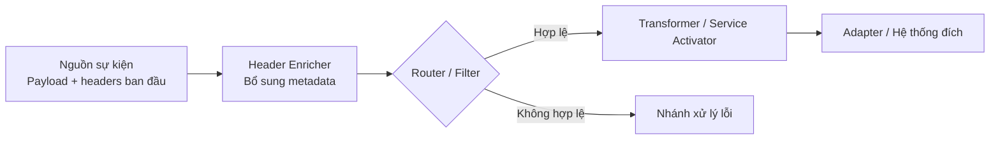

# Header Enricher và bổ sung metadata trong Spring Integration

> **Chương:** Message system  
> **Chủ đề:** Enterprise Integration Patterns (EIP) với Spring Integration  
> **Mục tiêu:** Biết bổ sung, chuẩn hóa và kiểm soát metadata của một thông điệp bằng Header Enricher, để các bước Router, Filter, Gateway, retry, error channel và theo dõi luồng có đủ ngữ cảnh mà vẫn giữ nghiệp vụ ít phụ thuộc.

## 1. Vì sao một thông điệp cần metadata?

Trong hệ thống tích hợp, phần dữ liệu nghiệp vụ thường trả lời câu hỏi **“đã xảy ra việc gì?”**, còn metadata trả lời **“dữ liệu đến từ đâu, thuộc ngữ cảnh nào, cần được xử lý ra sao?”**.

Ví dụ, dịch vụ thanh toán phát một sự kiện đặt hàng:

```json
{
  "orderId": "ORD-2048",
  "amount": 1250000,
  "currency": "VND"
}
```

Bản thân dữ liệu này chưa nói rõ kênh nhận, hệ thống phát sinh, mã theo dõi hay thời điểm đi vào luồng tích hợp. Một luồng xử lý có thể cần bổ sung:

| Header | Ví dụ | Ý nghĩa trong luồng |
| --- | --- | --- |
| `sourceSystem` | `checkout-api` | Xác định hệ thống phát sinh để audit hoặc chọn adapter |
| `tenantId` | `tenant-a` | Xác định phạm vi khách hàng; phải lấy từ nguồn đã được xác thực |
| `businessKey` | `ORD-2048` | Tra cứu và đối soát theo mã nghiệp vụ |
| `receivedAt` | `2026-11-21T03:15:00Z` | Ghi nhận thời điểm tiếp nhận tại ranh giới luồng |
| `traceId` | `7e45...` | Liên kết log và trace giữa các thành phần |
| `schemaVersion` | `v2` | Gợi ý bộ xử lý hoặc cách giải mã payload phù hợp |

Nếu mỗi Router, Filter hay handler phải tự suy đoán các thông tin đó từ payload, phụ thuộc giữa các thành phần sẽ tăng lên. **Header Enricher** giúp bổ sung metadata tại một vị trí có chủ đích trước khi thông điệp đi tiếp.

## 2. Vị trí của Header Enricher trong mô hình Message

Một Spring `Message<T>` có hai thành phần chính:

- **Payload**: dữ liệu cần xử lý, ví dụ `OrderCreated`, JSON hoặc chuỗi văn bản.
- **Headers**: tập thuộc tính có tên, ví dụ `sourceSystem`, `tenantId`, `replyChannel` hoặc `errorChannel`.

Sơ đồ luồng điển hình:



Header Enricher thực hiện **Message Enrichment ở phần headers**: nó đọc thông điệp đến, tính hoặc gán một số header, rồi phát thông điệp đầu ra. Về nguyên tắc, payload vẫn là dữ liệu nghiệp vụ ban đầu.

Cần nhớ rằng `MessageHeaders` của Spring là cấu trúc **không cho phép sửa trực tiếp**. Khi thay đổi header, framework tạo thông điệp/headers đầu ra theo cơ chế xây dựng message; không gọi `put()` để thay đổi tập headers của message đang nhận.

### Header Enricher khác gì với các EIP gần nó?

| Pattern/thành phần | Trách nhiệm chính | Ví dụ |
| --- | --- | --- |
| **Header Enricher** | Thêm hoặc tính metadata | Gắn `sourceSystem=checkout-api` |
| **Transformer** | Biến đổi hình dạng hoặc nội dung payload | `OrderCreated` → `PaymentCommand` |
| **Content Enricher** | Bổ sung dữ liệu nghiệp vụ, thường từ nguồn bên ngoài | Lấy thêm hồ sơ khách hàng vào payload |
| **Router** | Chọn kênh/nhánh dựa trên điều kiện | Đọc `region` để chuyển đến kênh khu vực |
| **Filter** | Cho phép hoặc loại thông điệp | Loại thông điệp có `schemaVersion` không được hỗ trợ |
| **Header Filter** | Loại bỏ một số header không nên đi tiếp | Bỏ header nội bộ trước khi chuyển ra ngoài |

Header Enricher **không tự động xác thực** metadata, không thay thế phân quyền và cũng không bảo đảm header được giữ nguyên khi đi qua HTTP, Kafka, AMQP hay một hệ thống khác. Việc ánh xạ headers qua các ranh giới vận chuyển cần được cấu hình ở adapter tương ứng.

## 3. Những cách bổ sung metadata

Một header có thể đến từ nhiều nguồn:

1. **Giá trị cố định:** `sourceSystem=checkout-api` cho toàn bộ thông điệp đi qua nhánh đó.
2. **Payload:** lấy `orderId` làm `businessKey` để tìm kiếm log hoặc đối soát.
3. **Headers hiện có:** chuẩn hóa một header đến từ gateway hoặc adapter nguồn.
4. **Ngữ cảnh xử lý:** thời điểm tiếp nhận, tên bước xử lý, phiên bản hợp đồng.
5. **Dịch vụ bên ngoài:** chỉ khi thực sự cần; các thao tác I/O nên được cân nhắc về timeout, retry và khả năng làm chậm toàn luồng.

Không phải metadata nào cũng thích hợp để tự sinh. Ví dụ, `tenantId` và danh tính người dùng phải được lấy từ **ngữ cảnh tin cậy đã xác thực**, không lấy từ trường tùy ý do client gửi rồi coi đó là quyền truy cập.

### Ba quyết định trước khi thêm một header

- **Nguồn dữ liệu:** ai chịu trách nhiệm tạo và xác minh giá trị?
- **Vòng đời:** header có nên tồn tại qua mọi bước hay phải bỏ ở ranh giới hệ thống?
- **Quy tắc xung đột:** khi header đã có, giữ giá trị cũ hay thay bằng giá trị mới?

Thiết kế rõ ba điều này giúp tránh ghi đè metadata của gateway, làm mất ngữ cảnh correlation hoặc vô tình rò rỉ thông tin nội bộ.

## 4. Cài đặt Header Enricher bằng Java DSL

Giả sử đầu vào là sự kiện đặt hàng `OrderCreated`. Ta muốn thêm hệ thống nguồn, khóa nghiệp vụ và thời điểm nhận trước khi chuyển sang kênh `ordersOutput`.

```java
import java.math.BigDecimal;
import java.time.Instant;

import org.springframework.context.annotation.Bean;
import org.springframework.context.annotation.Configuration;
import org.springframework.integration.config.EnableIntegration;
import org.springframework.integration.channel.DirectChannel;
import org.springframework.integration.channel.QueueChannel;
import org.springframework.integration.dsl.IntegrationFlow;

@Configuration
@EnableIntegration
public class OrderFlowConfig {

    public record OrderCreated(String orderId, BigDecimal amount) {}

    @Bean
    public DirectChannel ordersInput() {
        return new DirectChannel();
    }

    @Bean
    public QueueChannel ordersOutput() {
        return new QueueChannel();
    }

    @Bean
    public IntegrationFlow enrichOrdersFlow(
            DirectChannel ordersInput,
            QueueChannel ordersOutput) {

        return IntegrationFlow.from(ordersInput)
            .enrichHeaders(headers -> headers
                .header("sourceSystem", "checkout-api")
                .headerFunction("businessKey", message ->
                    ((OrderCreated) message.getPayload()).orderId())
                .headerFunction("receivedAt", message ->
                    Instant.now().toString())
            )
            .channel(ordersOutput)
            .get();
    }
}
```

Trong ví dụ:

- `IntegrationFlow.from(ordersInput)` lấy message từ kênh đầu vào.
- `enrichHeaders(...)` cấu hình Header Enricher như một bước độc lập trong flow.
- `header("sourceSystem", "checkout-api")` thêm metadata cố định.
- `headerFunction("businessKey", ...)` lấy mã đơn hàng từ payload; tránh đặt cả đối tượng nghiệp vụ lớn vào header.
- `headerFunction("receivedAt", ...)` tính giá trị động lúc thông điệp đi qua enricher.
- `channel(ordersOutput)` đưa thông điệp đã bổ sung header sang kênh tiếp theo.

**Ý nghĩa kiến trúc:** downstream có thể đọc `businessKey`, `sourceSystem` mà không cần biết cấu trúc riêng của từng adapter đầu vào. Payload vẫn là `OrderCreated`.

Trong ứng dụng thật, nên dùng `Clock` được inject để kiểm soát thời gian trong kiểm thử, và đặt tên header thành hằng số dùng chung nếu nhiều flow cần cùng một hợp đồng metadata.

### Đọc metadata ở bước tiếp theo

```java
import org.springframework.messaging.Message;

public void process(Message<OrderFlowConfig.OrderCreated> message) {
    OrderFlowConfig.OrderCreated order = message.getPayload();

    String sourceSystem =
        message.getHeaders().get("sourceSystem", String.class);
    String businessKey =
        message.getHeaders().get("businessKey", String.class);

    // Dùng sourceSystem/businessKey để logging, routing hoặc audit.
    // Xử lý nghiệp vụ chính vẫn dùng order.
}
```

`get("name", String.class)` giúp đọc giá trị theo kiểu mong đợi, nhưng vẫn cần quy ước rõ kiểu dữ liệu và chính sách khi header vắng mặt. Không giả định mọi adapter đều giữ được kiểu Java gốc khi message đi qua serialization.

## 5. Header tĩnh, header động và SpEL

Ngoài hàm Java, Java DSL hỗ trợ biểu thức để lấy giá trị từ thông điệp. Chọn cách đơn giản nhất diễn đạt được quy tắc.

```java
.enrichHeaders(headers -> headers
    // Gán giá trị cố định
    .header("channelName", "online")

    // Tính từ payload bằng Java
    .headerFunction("businessKey",
        message -> ((OrderCreated) message.getPayload()).orderId())

    // Tính qua Spring Expression Language (SpEL)
    .headerExpression("priorityLabel",
        "headers['priority'] != null ? headers['priority'] : 'NORMAL'")
)
```

Trong SpEL, `payload` thường biểu diễn payload đầu vào và `headers` cho phép truy cập headers hiện có. Chẳng hạn, `headers['priority']` đọc giá trị header `priority`. Khi biểu thức phức tạp, cần nhiều nhánh điều kiện hoặc tương tác dịch vụ, đưa logic vào một component có tên và kiểm thử riêng sẽ dễ bảo trì hơn.

Các giá trị header nên đơn giản, có hợp đồng rõ ràng: `String`, số, boolean, timestamp theo ISO-8601 hoặc một kiểu tương thích với môi trường truyền tải. Tránh lưu vào header các đối tượng chứa kết nối, tài nguyên chưa đóng hoặc payload phụ quá lớn.

## 6. Header đã tồn tại: giữ hay ghi đè?

Xung đột là tình huống thường gặp khi thông điệp đi qua nhiều gateway và flow. Giả sử nguồn gửi `sourceSystem=mobile-app`, còn Header Enricher định gắn `sourceSystem=checkout-api`. Hai giá trị mang ý nghĩa khác nhau; ghi đè tùy tiện sẽ làm sai audit.

Về mặt thiết kế có hai chính sách:

| Chính sách | Hành vi mong đợi | Nên dùng khi |
| --- | --- | --- |
| **Chỉ thêm nếu thiếu** | Có `sourceSystem` thì giữ nguyên; thiếu mới thêm mặc định | Bảo toàn thông tin nguồn đã được xác thực |
| **Ghi đè có chủ đích** | Luồng đặt lại header theo giá trị đã kiểm soát | Chuẩn hóa metadata ở ranh giới tin cậy |

Header Enricher cung cấp cấu hình về **overwrite** ở mức chung hoặc theo từng header, tùy biến thể cấu hình/phiên bản Spring Integration. Phải kiểm tra quy tắc overwrite áp dụng cho flow của mình thay vì suy từ kết quả một lần chạy.

Nếu tự xây message bằng Spring Messaging, có thể thấy rõ ý nghĩa hai chính sách:

```java
Message<?> keepExisting = MessageBuilder
    .fromMessage(incoming)
    .setHeaderIfAbsent("sourceSystem", "checkout-api")
    .build();

Message<?> replaceExisting = MessageBuilder
    .fromMessage(incoming)
    .setHeader("sourceSystem", "trusted-gateway")
    .build();
```

Đoạn trên chỉ **minh họa chính sách** với `MessageBuilder`; trong flow đang học, hãy triển khai quy tắc tại Header Enricher để metadata được bổ sung tập trung.

Đối với header ảnh hưởng đến quyền truy cập, chẳng hạn `tenantId`, thứ tự xử lý hợp lý là **xác thực → chuẩn hóa metadata → kiểm tra ranh giới tenant → xử lý nghiệp vụ**. Không dùng Header Enricher để “hợp thức hóa” một giá trị chưa được xác minh.

## 7. Tương tác với Router, Splitter, Aggregator và Gateway

### Router / Filter

Sau khi có `region`, Router có thể chuyển message đến xử lý riêng cho từng khu vực; Filter có thể kiểm tra `schemaVersion` hoặc `sourceSystem` đã được chuẩn hóa. Flow có hợp đồng metadata ổn định sẽ giảm nhu cầu phân tích payload ở nhiều chỗ.

Ví dụ một quy tắc logic:

```text
input
  → enrichHeaders(region, schemaVersion)
  → filter(schemaVersion nằm trong tập được hỗ trợ)
  → route(region)
  → xử lý theo từng khu vực
```

Lưu ý Filter chỉ là điều kiện tiếp nhận thông điệp. Nếu cần báo lỗi nghiệp vụ hay trả phản hồi cho người gọi, cần thiết kế kênh loại bỏ, exception và reply path phù hợp.

### Splitter / Aggregator và correlation

Khi tách một message thành nhiều message con, Spring Integration sử dụng các header phục vụ nhóm và thứ tự, điển hình là `correlationId`, `sequenceNumber` và `sequenceSize` (các tên/hằng số chuẩn của framework). Aggregator phụ thuộc vào các thông tin này để xác định những message nào thuộc cùng một nhóm và thời điểm có thể hoàn tất nhóm.

**Không tự ý ghi đè header correlation hoặc sequence do Splitter/framework tạo ra.** Nếu cần gắn ID giao dịch nghiệp vụ, nên đặt một header riêng như `businessKey` hoặc `externalCorrelationKey` và phân biệt nó với metadata kỹ thuật của Aggregator. Nếu cần chỉnh chiến lược nhóm, hãy cấu hình correlation/release strategy một cách tường minh ở Aggregator.

### Messaging Gateway / ranh giới giao thức

Gateway có thể nhận metadata từ HTTP, message broker hoặc một lời gọi Java, rồi đưa vào message. Header Enricher đặt sau gateway là nơi hợp lý để chuẩn hóa những trường đáng tin cậy cho các nhánh downstream.

Khi xuất ra transport khác, chỉ một số headers có thể được ánh xạ. Kiểm tra header mapper và quy tắc serialization của HTTP/Kafka/AMQP tương ứng; không dựa vào việc header tự động đi xuyên suốt mọi hệ thống.

## 8. Lỗi, retry và khả năng quan sát

Một Header Enricher cũng có thể gặp lỗi: payload sai kiểu, metadata bắt buộc thiếu, biểu thức SpEL không hợp lệ hoặc dịch vụ tra cứu metadata bị timeout.

Ví dụ, `((OrderCreated) message.getPayload())` sẽ lỗi nếu luồng nhận một payload khác kiểu dự kiến. Do đó:

- Kiểm tra hoặc chuyển đổi kiểu payload tại ranh giới đầu vào.
- Với metadata bắt buộc, xác định rõ trường hợp thiếu là lỗi, chuyển nhánh hay loại bỏ.
- Với logic có I/O, áp dụng timeout và chính sách retry phù hợp; tránh gọi dịch vụ ngoài cho mỗi message chỉ để trang trí header.
- Xử lý ngoại lệ qua cơ chế lỗi của endpoint/flow và `errorChannel` phù hợp; không giả định mọi exception đều tự chuyển đến một error channel trong mọi kiểu kênh đồng bộ.

Một chuỗi log có thể dùng `businessKey` và `traceId`:

```text
received   sourceSystem=checkout-api businessKey=ORD-2048 traceId=7e45...
validated  sourceSystem=checkout-api businessKey=ORD-2048 traceId=7e45...
published  sourceSystem=checkout-api businessKey=ORD-2048 traceId=7e45...
```

Nếu hệ thống đã dùng Micrometer Observation hoặc OpenTelemetry, hãy ưu tiên propagation và convention của hệ thống tracing thay vì tự tạo một trace ID riêng không tương thích. Dùng ID để liên kết sự kiện nhưng không đưa token truy cập, mật khẩu, dữ liệu cá nhân nhạy cảm hay toàn bộ payload vào header/log.

## 9. Kiểm thử hành vi của Header Enricher

Đoạn kiểm thử dưới đây dùng cấu hình `OrderFlowConfig` ở mục 4. Nó xác nhận Header Enricher thêm metadata mới, vẫn giữ header đã có và không làm biến đổi payload.

```java
import static org.junit.jupiter.api.Assertions.*;

import java.math.BigDecimal;

import org.junit.jupiter.api.Test;
import org.springframework.beans.factory.annotation.Autowired;
import org.springframework.messaging.Message;
import org.springframework.messaging.support.MessageBuilder;
import org.springframework.integration.channel.DirectChannel;
import org.springframework.integration.channel.QueueChannel;
import org.springframework.test.context.junit.jupiter.SpringJUnitConfig;

@SpringJUnitConfig(OrderFlowConfig.class)
class OrderFlowTest {

    @Autowired
    DirectChannel ordersInput;

    @Autowired
    QueueChannel ordersOutput;

    @Test
    void enrichesHeadersWithoutChangingPayload() {
        var order = new OrderFlowConfig.OrderCreated(
            "ORD-2048", new BigDecimal("1250000"));

        Message<?> incoming = MessageBuilder
            .withPayload(order)
            .setHeader("tenantId", "tenant-a")
            .build();

        assertTrue(ordersInput.send(incoming));

        Message<?> outgoing = ordersOutput.receive(1_000);
        assertNotNull(outgoing);

        assertSame(order, outgoing.getPayload());
        assertEquals("tenant-a",
            outgoing.getHeaders().get("tenantId"));
        assertEquals("checkout-api",
            outgoing.getHeaders().get("sourceSystem"));
        assertEquals("ORD-2048",
            outgoing.getHeaders().get("businessKey"));
        assertNotNull(outgoing.getHeaders().get("receivedAt"));
    }
}
```

Bài kiểm thử nên được mở rộng theo hợp đồng thực tế: metadata trống, payload sai kiểu, header xung đột, giá trị không đáng tin cậy, thứ tự xuất hiện trong flow và propagation khi chuyển qua broker. Với giá trị thời gian, inject `Clock` để có thể kiểm tra chính xác thay vì phụ thuộc đồng hồ máy chạy test.

Đối với luồng đi qua HTTP/Kafka/AMQP, nên có thêm kiểm thử tích hợp kiểm tra phía nhận thực sự thấy được những header cần thiết. Kiểm thử tại `QueueChannel` chỉ chứng minh hành vi **bên trong cùng một ứng dụng Spring Integration**.

## 10. Các lỗi thiết kế thường gặp

| Hiện tượng | Nguyên nhân có thể | Cách xử lý |
| --- | --- | --- |
| Header bị mất sau khi publish | Adapter không map header đó, hoặc kiểu giá trị không thể serialize | Xác định whitelist/mapper và kiểu header được hỗ trợ |
| Audit báo sai hệ thống nguồn | Enricher ghi đè header `sourceSystem` đã được xác minh | Quy định nguồn sở hữu header và chiến lược overwrite |
| Aggregator ghép nhầm hoặc không hoàn tất | Header correlation/sequence bị sửa sai | Giữ metadata Splitter tạo; chỉnh strategy tại Aggregator nếu cần |
| Flow bị chậm | Header function thực hiện I/O đồng bộ hoặc tính toán nặng | Chuyển enrichment phức tạp sang bước riêng, cấu hình timeout/caching |
| Dữ liệu tenant bị lẫn | Tin vào `tenantId` do client tự cung cấp | Lấy tenant từ principal/nguồn đã xác thực rồi kiểm soát ở downstream |
| Test không ổn định | Dùng `Instant.now()` và so sánh chuỗi thời gian cố định | Inject `Clock`, kiểm tra định dạng hoặc dùng thời gian cố định |
| Log chứa dữ liệu nhạy cảm | Ghi nguyên `headers` vào log | Chỉ log các trường đã được duyệt và che dữ liệu nhạy cảm |

## 11. Bài thực hành có hướng dẫn

Giả sử một ứng dụng nhận thông điệp từ hai nguồn `web` và `mobile`. Mỗi nguồn phát `OrderCreated` nhưng cách ghi metadata chưa thống nhất.

**Yêu cầu thực hành:**

1. Đặt Header Enricher sau adapter đầu vào; giữ payload `OrderCreated`.
2. Gắn `schemaVersion=v1` cho thông điệp thiếu trường này.
3. Tạo `businessKey` từ `orderId` để phục vụ log và đối soát.
4. Giữ nguyên `sourceSystem` đã được xác thực ở gateway; không để một nhánh tự thay tên nguồn.
5. Cấu hình Router dựa trên một header `region` đã chuẩn hóa; đưa giá trị không hỗ trợ vào nhánh xử lý rõ ràng.
6. Viết kiểm thử cho trường hợp header có sẵn, header thiếu, payload sai kiểu và message đi qua transport bên ngoài.

Có thể dùng bảng này làm tiêu chí kiểm tra:

| Đầu vào | Kết quả mong đợi |
| --- | --- |
| Có `sourceSystem=mobile` đã tin cậy | Vẫn là `mobile` ở downstream |
| Thiếu `schemaVersion` | Được bổ sung `v1` |
| Payload có `orderId=ORD-2048` | Có `businessKey=ORD-2048` |
| Có `region=VN` đã chuẩn hóa | Router đưa vào nhánh khu vực VN |
| Header `region` không được hỗ trợ | Nhánh lỗi/loại bỏ được xử lý theo hợp đồng |
| Publish qua broker | Header bắt buộc còn tồn tại ở ứng dụng nhận sau khi map |

**Câu hỏi tự kiểm tra:** Một giá trị `customerName` nên nằm trong payload hay header? Nếu nó là dữ liệu nghiệp vụ cốt lõi của đơn hàng, nó thường thuộc payload. Chỉ tạo metadata khi có nhu cầu vận hành/routing rõ ràng và được phép xử lý dữ liệu đó.

## 12. Nguyên tắc áp dụng trong dự án thật

Header Enricher phát huy hiệu quả khi mỗi header có **tên ổn định, ý nghĩa rõ, chủ sở hữu xác định, kiểu dữ liệu nhất quán và chính sách vòng đời cụ thể**. Đặt enrichment gần ranh giới nơi metadata được sinh hoặc xác minh; tránh nhân bản logic bổ sung header ở nhiều handler.

Nên thiết kế theo thứ tự: **xác định metadata cần dùng → xác minh nguồn tin cậy → thêm tại Header Enricher → định tuyến/xử lý → kiểm tra propagation → quan sát và kiểm thử**. Nhờ vậy, Router, Filter, Transformer, Splitter, Aggregator và Gateway có thể trao đổi thông điệp với ngữ cảnh đầy đủ hơn, trong khi phần payload vẫn tập trung vào dữ liệu nghiệp vụ.

### Ghi nhớ nhanh

- **Header Enricher bổ sung metadata; Transformer biến đổi payload.**
- **Message headers có tính bất biến ở cấp message; dùng cơ chế xây dựng message để thay đổi.**
- **Quy tắc overwrite, correlation, bảo mật và mapping qua transport là một phần của hợp đồng tích hợp.**
- **Kiểm thử cả metadata mới lẫn metadata phải được bảo toàn, đặc biệt tại ranh giới hệ thống.**
