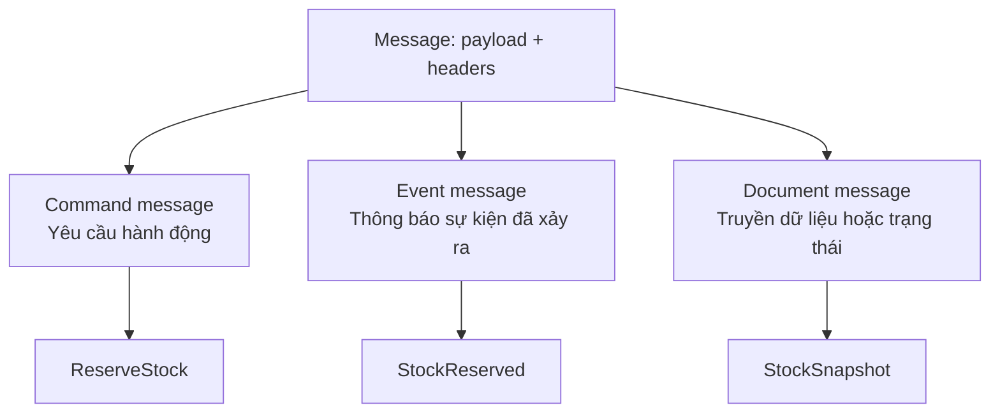
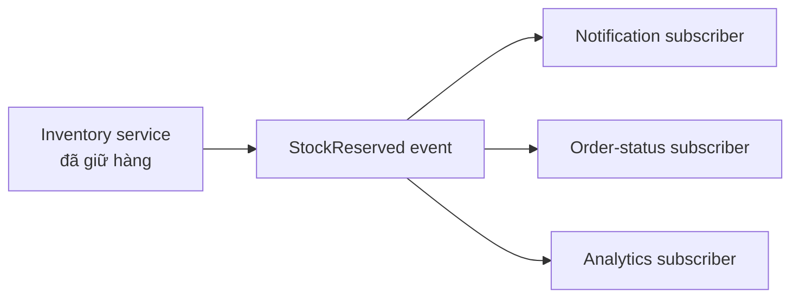
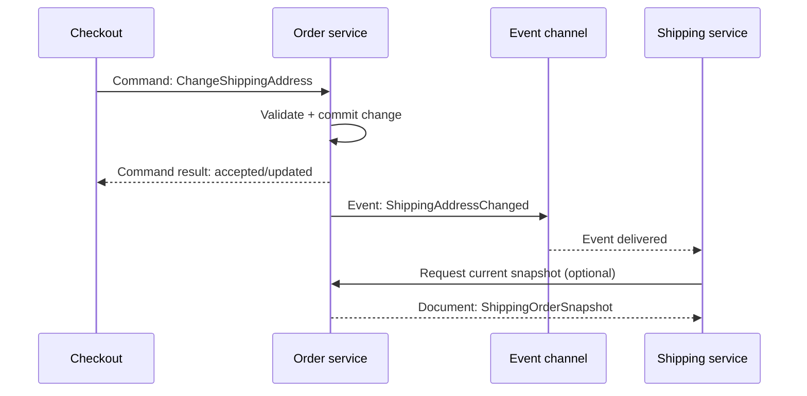

# Phân biệt message với command, event và document

> **Chương:** Message system  
> **Module:** `SPRING_INTEGRATION_PATTERN` — triển khai Enterprise Integration Patterns (EIP) bằng Spring Integration để xây dựng các luồng thông điệp ít phụ thuộc, dễ mở rộng, kiểm thử và theo dõi được. Bài này làm rõ ý nghĩa của **message** và ba kiểu thông điệp theo mục đích **command, event, document** trước khi dùng Gateway, Filter, Transformer, Router, Splitter, Aggregator, retry, error channel và correlation.

## 1. Mục tiêu học tập

Sau bài này, bạn có thể:

1. Phân biệt **message** (đơn vị trao đổi qua hệ thống messaging) với **command message**, **event message** và **document message** (các kiểu thông điệp xét theo *ý định*).
2. Nhìn tên và nội dung một thông điệp để nhận biết nó **yêu cầu làm gì**, **thông báo điều đã xảy ra**, hay **chuyển dữ liệu**.
3. Quyết định kiểu thông điệp phù hợp cho tích hợp đơn hàng, kho vận và đồng bộ dữ liệu; tránh nhầm **đã nhận command** với **đã hoàn thành nghiệp vụ**.
4. Hiểu tác động của từng kiểu lên **định tuyến, request–reply, pub/sub, schema, idempotency, correlation, retry, lỗi và kiểm thử**.
5. Minh họa các lựa chọn này bằng `Message<T>`, `MessageBuilder` và `IntegrationFlow` của Spring Integration.

## 2. Cùng là thông điệp, nhưng khác mục đích

Trong tích hợp doanh nghiệp, **message** là một đơn vị dữ liệu được gửi từ thành phần này sang thành phần khác qua kênh hoặc giao thức messaging. Một message có thể mang dữ liệu nghiệp vụ, thông tin định tuyến và metadata để bên nhận hiểu, xử lý hoặc phản hồi.

**Command Message**, **Event Message** và **Document Message** là ba mẫu EIP mô tả *ý nghĩa giao tiếp* của thông điệp:

- **Command:** “Hãy thực hiện hành động X.”
- **Event:** “Sự việc X đã xảy ra.”
- **Document:** “Đây là dữ liệu/trạng thái X mà bên khác cần sử dụng.”

Đây **không phải bốn loại đối tượng ngang cấp**. `Message<T>` là lớp bao/chất mang (envelope). **Một command, event hoặc document thường được chuyên chở bên trong một message**, chẳng hạn `Message<ReserveStockCommand>` hoặc `Message<OrderPlacedEvent>`.



Hình trên biểu diễn **các cách dùng của message**, không phải quan hệ kế thừa Java. Tùy ngữ cảnh, một payload có thể chứa cả dữ liệu trạng thái và thông tin sự kiện; để phân loại, hãy xem **hợp đồng giao tiếp mà người phát và người nhận đã thống nhất**, không chỉ nhìn có bao nhiêu trường trong JSON.

## 3. Message: phần bao và hợp đồng trao đổi

Với Spring Integration, `org.springframework.messaging.Message<T>` có hai thành phần chính:

| Thành phần | Ý nghĩa | Ví dụ |
| --- | --- | --- |
| **Payload** | Nội dung mà bên nhận cần xử lý | `ReserveStockCommand`, `StockReservedEvent`, `StockSnapshot` |
| **Headers** | Metadata phục vụ routing, correlation, phản hồi, tracing hoặc chính sách | `id`, `timestamp`, `messageKind`, `correlationId`, `replyChannel`, `errorChannel` |

Một message cũng được gửi đến **Message Channel** và được endpoint nhận để xử lý. Bản thân channel **không quyết định** thông điệp đó là command hay event. Ví dụ, `DirectChannel`, `QueueChannel`, `PublishSubscribeChannel` mô tả các cách phân phối/chuyển giao; ý định nghiệp vụ do **payload và contract** xác định.

```java
import org.springframework.messaging.Message;
import org.springframework.messaging.support.MessageBuilder;

record ReserveStock(String commandId, String orderId,
                    String sku, int quantity) {}

Message<ReserveStock> message = MessageBuilder
    .withPayload(new ReserveStock("cmd-901", "ORD-501", "SKU-A", 2))
    .setHeader("messageKind", "COMMAND")
    .setHeader("correlationId", "ORD-501")
    .setHeader("sourceSystem", "order-service")
    .build();

System.out.println(message.getPayload().quantity()); // 2
System.out.println(message.getHeaders().get("messageKind")); // COMMAND
```

`messageKind` là **header do ví dụ này tự quy ước**, không phải một header chuẩn bắt buộc của Spring Integration. Có thể phân loại theo class payload, schema/type name hoặc header; cần nhất quán với contract và **không tin cậy một header do bên ngoài tự khai mà chưa kiểm tra payload/quyền**. Spring có thể tạo thêm các header hệ thống như `id`, `timestamp`; `id` của message **không thay thế** ID nghiệp vụ hay khóa idempotency.

## 4. Command Message — yêu cầu một hành động

**Command** diễn đạt *ý định muốn hệ thống khác thực hiện một tác vụ*. Người phát ra lệnh thường biết **trách nhiệm** mà mình muốn bên nhận gánh, như đặt giữ hàng, cấp quyền hoặc tạo vận đơn.

Ví dụ:

```json
{
  "type": "ReserveStock",
  "commandId": "cmd-901",
  "orderId": "ORD-501",
  "sku": "SKU-A",
  "quantity": 2
}
```

### 4.1. Dấu hiệu nhận biết command

- **Tên thường ở dạng yêu cầu/hành động:** `ReserveStock`, `CreateShipment`, `ApproveInvoice`, `CancelOrder`.
- **Có hành động mong đợi:** bên nhận phải kiểm tra điều kiện và thực hiện hoặc từ chối.
- **Có đích chịu trách nhiệm:** thường **một logical handler** hoặc một dịch vụ sở hữu hành động; nhiều instance có thể cạnh tranh xử lý để scale, nhưng không có nghĩa muốn thực hiện lệnh nhiều lần.
- **Có kết quả cần phân biệt:** được tiếp nhận, được chấp nhận nghiệp vụ, hoàn tất, bị từ chối hoặc thất bại.
- **Có nguy cơ tác dụng phụ:** retry cùng một lệnh tạo vận đơn/thu tiền có thể làm trùng thao tác nếu thiếu kiểm soát.

Command có thể được gửi đồng bộ qua Gateway và nhận kết quả request–reply; cũng có thể gửi bất đồng bộ vào queue rồi nhận kết quả qua message khác. **Command không mặc định đồng bộ**, và `send()` thành công không đảm bảo hành động đã được thực hiện.

### 4.2. Thiết kế command an toàn

Giả sử `ReserveStock` đến kho hai lần do lỗi mạng và được retry. Kho cần áp dụng **idempotency**, thường bằng một khóa ổn định như `commandId` hoặc `(orderId, operation, sku)` phù hợp quy tắc nghiệp vụ. Một command được nhận lặp có thể trả cùng kết quả thay vì giữ hàng thêm lần nữa.

Nên xác định rõ:

1. **Precondition:** hàng còn đủ hay không? Người gửi có quyền đặt giữ không?
2. **Kết quả:** thành công (`StockReserved`), từ chối vì nghiệp vụ (`InsufficientStock`) hay thất bại kỹ thuật (`InventoryUnavailable`)?
3. **Độ tin cậy:** timeout, giới hạn retry, backoff, deadline và xử lý message giao lại.
4. **Ownership:** dịch vụ nào có quyền quyết định trạng thái tồn kho? Không phát command tới nhiều đích tự ý cùng thực hiện một side effect.

**Lưu ý:** Khi dùng command qua messaging, một **reply message** có thể mang kết quả trực tiếp. Việc bên nhận phát tiếp `StockReserved` dưới dạng **event** là lựa chọn kiến trúc khác, thường dùng khi các dịch vụ khác cũng cần biết việc giữ hàng đã hoàn tất.

## 5. Event Message — thông báo sự kiện đã xảy ra

**Event** mô tả một **sự kiện đã xảy ra** mà những bên quan tâm có thể phản ứng. Nó phản ánh một sự thật trong ngữ cảnh của hệ thống phát: đơn đã được tạo, hàng đã được giữ, thanh toán đã được xác nhận.

Ví dụ:

```json
{
  "type": "StockReserved",
  "eventId": "evt-310",
  "orderId": "ORD-501",
  "sku": "SKU-A",
  "quantity": 2,
  "occurredAt": "2026-11-21T03:30:00Z"
}
```

### 5.1. Dấu hiệu nhận biết event

- **Tên thường chỉ việc đã xảy ra:** `OrderPlaced`, `StockReserved`, `ShipmentDispatched`.
- **Không ra lệnh cho subscriber:** event cho biết trạng thái/sự kiện để bên nghe **tự quyết định** phản ứng theo trách nhiệm của mình.
- **Có thể có 0, 1 hoặc nhiều subscriber:** báo cáo, gửi email, cập nhật read model hoặc kích hoạt một workflow khác.
- **Thứ tự và thời điểm quan trọng:** nên có `eventId`, mã entity, thời điểm phát sinh, version/sequence khi cần.
- **Có thể được phát lại:** downstream cần hiểu at-least-once delivery, duplicate, out-of-order và khả năng replay.



Sự kiện không nên được đặt tên như command để giấu yêu cầu “hãy gửi email ngay”. Nếu hệ thống đặt hàng **bắt buộc** email service thực hiện một hành động với hợp đồng và phản hồi cụ thể, một **command gửi tới email service** có thể phù hợp hơn; nếu chỉ muốn công bố đơn vừa được đặt, `OrderPlaced` là event phù hợp.

### 5.2. Chỉ công bố điều đã thực sự xảy ra

Không nên công bố `StockReserved` **trước khi** giao dịch giữ hàng được chốt. Nếu cập nhật database thành công nhưng publish event thất bại, các dịch vụ có thể không nhận được tin. Đây là vấn đề **dual write** (hai thao tác thay đổi trạng thái cần nhất quán). Có thể cân nhắc **transactional outbox**: ghi trạng thái nghiệp vụ và bản ghi outbox trong cùng transaction, sau đó publish outbox với cơ chế retry. Bên nhận vẫn cần idempotency vì outbox có thể phát lặp.

**Event Message không tự đảm bảo event sourcing**: event sourcing là chiến lược lưu trạng thái dưới dạng chuỗi sự kiện, còn event message chỉ là một thông điệp thông báo. Không phải hệ thống phát event nào cũng phải áp dụng event sourcing.

### 5.3. Event có thể mang nhiều dữ liệu, nhưng vẫn là event

`CustomerAddressChanged` có thể chỉ chứa `customerId` và version; subscriber cần tra cứu chi tiết khi cần. Event cũng có thể mang địa chỉ mới để giảm lời gọi truy vấn (kiểu **event-carried state transfer**). Dù payload giống một phần document, *mục đích* vẫn là nói **địa chỉ vừa thay đổi**, không đơn thuần giao một bản dữ liệu không có ngữ cảnh sự kiện.

Quyết định mang bao nhiêu dữ liệu cần cân đối độ coupling schema, quyền truy cập, kích thước message, độ trễ và nhu cầu replay. Tránh ghi dữ liệu cá nhân không cần thiết vào event công bố rộng.

## 6. Document Message — chuyển một cấu trúc dữ liệu

**Document Message** là mẫu EIP dùng để **truyền thông tin/dữ liệu giữa các ứng dụng**. Trọng tâm là *nội dung được chuyển giao* hơn là lời yêu cầu thực hiện một hành động hay tin một sự kiện vừa xảy ra.

Ví dụ gửi bản chụp tồn kho lúc đồng bộ dữ liệu:

```json
{
  "type": "StockSnapshot",
  "snapshotId": "snap-20261121-01",
  "warehouse": "HCM-01",
  "capturedAt": "2026-11-21T03:35:00Z",
  "items": [
    { "sku": "SKU-A", "available": 42 },
    { "sku": "SKU-B", "available": 17 }
  ]
}
```

### 6.1. Dấu hiệu nhận biết document

- **Nội dung là dữ liệu có cấu trúc:** bản ghi khách hàng, catalog, danh sách hóa đơn, snapshot tồn kho, manifest hàng hóa.
- **Có thể là một ảnh chụp hoặc bản delta:** cần định nghĩa rõ *full snapshot* hay *partial update*; hai loại không được áp dụng thay thế cho nhau tùy tiện.
- **Có thể không phát sinh hành động tức thời:** consumer nhận để lưu, so sánh, kiểm tra, nhập dữ liệu hoặc dùng làm đầu vào tính toán theo hợp đồng.
- **Cần quản lý schema và độ mới:** `schemaVersion`, `capturedAt`, ID bản chụp, checksum hoặc pagination khi phù hợp.
- **Quan tâm kích thước và bảo mật:** danh mục lớn có thể cần chia lô; thông tin nhạy cảm cần hạn chế quyền truy cập và chính sách lưu trữ.

Đừng suy rằng “có JSON dài” thì chắc chắn là document. Command và event cũng có thể mang payload nhiều trường. Hãy hỏi: *Mình đang yêu cầu bên kia làm gì? Mình đang thông báo điều vừa xảy ra? Hay mình chỉ chuyển bộ dữ liệu để bên kia sử dụng?*

Ví dụ, **`SendStockSnapshot`** là tên một *command* yêu cầu xuất bản snapshot; bản `StockSnapshot` được trả về hoặc chuyển đi là *document*. Sự kiện **`StockSnapshotPublished`** lại thông báo việc phát hành đã xảy ra. Ba thứ phục vụ ba hợp đồng khác nhau.

### 6.2. Chuyển document không đồng nghĩa đồng bộ trạng thái thành công

Khi consumer nhận một snapshot, nó vẫn cần xử lý version, `capturedAt`, xác thực nguồn, ghi dữ liệu và phản hồi nếu hợp đồng yêu cầu. Một snapshot cũ đến sau snapshot mới có thể ghi đè sai trạng thái. Do đó, với tài liệu chuyển trạng thái nên có quy tắc **version/sequence**, kiểm tra **freshness** và hành vi khi nhận lại cùng document.

## 7. Bảng so sánh nhanh theo ý định giao tiếp

| Tiêu chí | Message (khái niệm chung) | Command Message | Event Message | Document Message |
| --- | --- | --- | --- | --- |
| **Bản chất** | Đơn vị trao đổi payload + metadata | Yêu cầu thực hiện một hành động | Thông báo sự việc đã xảy ra | Chuyển dữ liệu/trạng thái |
| **Câu hỏi chính** | “Thông điệp gì đang được gửi?” | “Hãy làm gì?” | “Điều gì đã xảy ra?” | “Đây là dữ liệu gì?” |
| **Thời điểm ý nghĩa** | Phụ thuộc payload | Hành động mong muốn trong tương lai | Sự thật đã xảy ra trong quá khứ | Nội dung có giá trị tại thời điểm/phiên bản xác định |
| **Bên nhận** | Do routing và contract quyết định | Thường một logical owner của hành động | Có thể nhiều subscriber | Một hoặc nhiều bên cần dữ liệu |
| **Tên thường gặp** | `Message<T>` | `ReserveStock` | `StockReserved` | `StockSnapshot` |
| **Kết quả cần xét** | Delivery/routing | Chấp nhận, thành công, từ chối, lỗi | Subscriber đã nhận/xử lý, replay, thứ tự | Đã nhận và áp dụng đúng schema/version chưa |
| **Rủi ro nổi bật** | Thất lạc, trùng, sai header/payload | Side effect trùng khi retry | Duplicate/out-of-order và phát trước commit | Dữ liệu cũ, ghi đè, payload lớn hoặc nhạy cảm |

**Không chọn loại message chỉ theo transport.** HTTP, Kafka, RabbitMQ hay `DirectChannel` đều có thể mang command, event hoặc document; kiểu kênh chỉ ảnh hưởng cách phân phối và các bảo đảm thực thi.

## 8. Một tình huống, ba kiểu thông điệp khác nhau

Giả sử người dùng cập nhật địa chỉ giao hàng của đơn `ORD-501`.

1. Dịch vụ đơn hàng gửi **command** `ChangeShippingAddress(orderId, newAddress)` đến dịch vụ chịu trách nhiệm thay đổi, với `commandId` để chống tác dụng phụ trùng.
2. Sau khi lưu thay đổi thành công, dịch vụ phát **event** `ShippingAddressChanged(orderId, version, occurredAt)` để hệ thống vận chuyển và audit biết sự việc đã xảy ra.
3. Khi hệ thống vận chuyển cần đối soát toàn bộ thông tin đơn, nó nhận **document** `ShippingOrderSnapshot(orderId, shippingAddress, items, version)`.



Trong sơ đồ, lời gọi **Request current snapshot** là một *request/command-like interaction*, còn **snapshot trả về** là *document*. Việc vận chuyển nhận event **không mặc nhiên** chứng minh nó đã cập nhật toàn bộ dữ liệu; mỗi bước cần outcome/acknowledgement tương ứng.

### Các lựa chọn sai thường gặp

| Thiết kế thiếu rõ ràng | Vì sao nguy hiểm | Cách diễn đạt phù hợp hơn |
| --- | --- | --- |
| Phát `OrderCreated` trước khi lưu đơn thành công | Subscriber tin một việc chưa chắc đã xảy ra | Commit/outbox trước khi publish event |
| Dùng `CreateShipment` làm “event” gửi cho mọi subscriber | Nhiều bên cùng thực hiện lệnh, tạo vận đơn trùng | Command có owner rõ ràng; event `ShipmentCreated` sau thành công |
| Gửi snapshot nhưng không có version | Snapshot cũ đến muộn có thể ghi đè mới | Version/sequence + chính sách cập nhật |
| Tên `UpdateCustomer` nhưng thực tế chỉ mang hồ sơ | Consumer không rõ cần thực hiện hay chỉ nhận dữ liệu | Xác định đó là command cập nhật hay document khách hàng |
| Chỉ dùng `messageId` cho dedup nghiệp vụ | Cùng một command có thể đi lại với message ID mới | Khóa nghiệp vụ/`commandId` ổn định |

## 9. Spring Integration: định tuyến theo loại message

Spring Integration cung cấp EIP như **Message Channel**, **Gateway**, **Filter**, **Transformer**, **Router** và **Service Activator**; message đi qua từng endpoint và có thể đổi payload/header theo bước xử lý. Không tồn tại một class chuẩn bắt buộc tên `CommandMessage`, `EventMessage` hay `DocumentMessage`: bạn tự định nghĩa **schema/hợp đồng nghiệp vụ**.

Ví dụ sau sử dụng header ứng dụng `messageKind` để route ba loại message vào ba channel. Đoạn mã dùng Java 17+, Java DSL của Spring Integration và giả định Spring đã có dependency/cấu hình tích hợp phù hợp. Handler bên dưới chỉ in ra nội dung để làm rõ luồng, không xử lý nghiệp vụ thật.

```java
import org.springframework.context.annotation.Bean;
import org.springframework.context.annotation.Configuration;
import org.springframework.integration.config.EnableIntegration;
import org.springframework.integration.dsl.IntegrationFlow;

@Configuration
@EnableIntegration
class BusinessMessageFlows {

    @Bean
    IntegrationFlow classifyIncomingMessages() {
        return IntegrationFlow.from("business.inbound")
            .route("headers['messageKind']", spec -> spec
                .channelMapping("COMMAND", "commands.inbound")
                .channelMapping("EVENT", "events.inbound")
                .channelMapping("DOCUMENT", "documents.inbound")
                .defaultOutputChannel("messages.invalid"))
            .get();
    }

    @Bean
    IntegrationFlow commandHandling() {
        return IntegrationFlow.from("commands.inbound")
            .handle(msg -> System.out.println("COMMAND: " + msg.getPayload()))
            .get();
    }

    @Bean
    IntegrationFlow eventHandling() {
        return IntegrationFlow.from("events.inbound")
            .handle(msg -> System.out.println("EVENT: " + msg.getPayload()))
            .get();
    }

    @Bean
    IntegrationFlow documentHandling() {
        return IntegrationFlow.from("documents.inbound")
            .handle(msg -> System.out.println("DOCUMENT: " + msg.getPayload()))
            .get();
    }

    @Bean
    IntegrationFlow invalidMessages() {
        return IntegrationFlow.from("messages.invalid")
            .handle(msg -> System.err.println("UNKNOWN KIND: " + msg.getPayload()))
            .get();
    }
}
```

Ví dụ gửi một message vào flow:

```java
import org.springframework.messaging.Message;
import org.springframework.messaging.MessageChannel;
import org.springframework.messaging.support.MessageBuilder;

// Lấy business.inbound từ Spring ApplicationContext.
MessageChannel inbound = context.getBean("business.inbound", MessageChannel.class);

Message<ReserveStock> cmd = MessageBuilder
    .withPayload(new ReserveStock("cmd-901", "ORD-501", "SKU-A", 2))
    .setHeader("messageKind", "COMMAND")
    .setHeader("correlationId", "ORD-501")
    .build();

inbound.send(cmd); // In: COMMAND: ReserveStock[...]
```

### 9.1. Hiểu chính xác ví dụ

1. **Router phân loại thông điệp:** header `messageKind` quyết định channel. Đây là lựa chọn minh họa; production có thể định tuyến theo class payload, event type đã được validate hoặc schema registry.
2. **Command đến một handler:** handler thật phải kiểm tra quyền, điều kiện và idempotency trước khi thực hiện side effect. Console output không đủ để kết luận command hoàn tất.
3. **Event đến một handler chỉ là bản demo:** nếu muốn nhiều subscriber độc lập, cấu hình publish–subscribe hoặc hạ tầng event broker và cơ chế lỗi/delivery phù hợp. *Một channel tên `events.inbound` không tự động biến thành fan-out*.
4. **Document đến consumer:** consumer cần kiểm tra tính toàn vẹn, độ mới của dữ liệu và schema/version trước khi áp dụng.
5. **Loại không hợp lệ:** ví dụ gửi đến `messages.invalid` để tránh âm thầm bỏ qua; hệ thống thật cần log có cấu trúc, cảnh báo hoặc luồng cách ly nếu payload không đáng tin cậy.

### 9.2. Vai trò của các EIP khác với ba kiểu thông điệp

| EIP / cơ chế | Áp dụng cho command | Áp dụng cho event | Áp dụng cho document |
| --- | --- | --- | --- |
| **Gateway** | Gửi yêu cầu và có thể chờ phản hồi | Có thể là điểm đưa event vào flow | Yêu cầu/nhận tài liệu theo contract |
| **Filter** | Kiểm tra điều kiện tiếp nhận | Lọc sự kiện subscriber quan tâm | Lọc dữ liệu theo schema/nguồn |
| **Transformer** | Đổi input thành dạng command nội bộ | Chuẩn hóa event type/version | Chuyển đổi cấu trúc hoặc định dạng document |
| **Router** | Chọn logical owner của hành động | Chọn các nhóm subscriber quan tâm | Chọn consumer hoặc pipeline nhập dữ liệu |
| **Splitter / Aggregator** | Tách/gom công việc con và kết quả | Phân tích/gom chuỗi sự kiện theo khóa | Chia lô bản ghi và gom kết quả xử lý |
| **Retry / error channel** | Chú ý side effect và idempotency | Chú ý redelivery và failure của subscriber | Chú ý lỗi schema, version, dữ liệu lặp/cũ |

Một flow có thể dùng nhiều EIP nhưng **không nên thay đổi ý nghĩa command/event/document chỉ để dễ route**. Nên tách interface và schema theo hợp đồng nghiệp vụ, sau đó chọn EIP phục vụ hợp đồng ấy.

## 10. Correlation, ID và reply không giống nhau

Trong hệ thống nhiều bước, dễ gặp các mã sau:

| Mã | Dùng để làm gì? | Ví dụ |
| --- | --- | --- |
| `messageId` | Phân biệt một đối tượng message/đơn vị giao nhận | UUID do messaging tạo |
| `commandId` | Phân biệt một yêu cầu hành động, hỗ trợ idempotency | `cmd-901` |
| `eventId` | Phân biệt một sự kiện đã xảy ra, hỗ trợ dedup/replay | `evt-310` |
| `documentId` / `snapshotId` | Nhận diện tài liệu hoặc phiên bản snapshot | `snap-20261121-01` |
| `correlationId` | Liên kết các message cùng quy trình hoặc nhóm | `ORD-501` |
| `causationId` | Nêu message/command/event nào dẫn tới sự kiện hiện tại | `cmd-901` tạo `evt-310` |

Những tên trên (ngoại trừ các header hệ thống như `id`) là **quy ước hợp đồng**, không phải Spring Integration bắt buộc cung cấp đồng nhất ở mọi hệ thống. Correlation giúp **ghép quan hệ**, không mặc nhiên chống trùng; idempotency cần khóa nghiệp vụ và trạng thái xử lý có tính nhất quán.

Trong request–reply, `replyChannel` và thời gian chờ giúp trả lời **lần gọi**. Còn một event phát sau command có thể đi qua broker và đến muộn hơn; cần cơ chế liên kết (`commandId`, `correlationId`) nếu caller muốn theo dõi kết quả cuối cùng. **Hết thời gian chờ không có nghĩa command chưa được thực hiện.**

## 11. Chọn kiểu thông điệp để thiết kế đúng độ tin cậy

### 11.1. Command: kiểm soát side effect

Với `ChargePayment`, một lần gọi timeout không thể kết luận chưa trừ tiền. Nếu thử lại, dùng một idempotency key ổn định và tra cứu trạng thái trước khi phát sinh tác dụng phụ. Cần phân loại lỗi: lỗi xác thực/sai dữ liệu thường không nên retry tự động, còn lỗi mạng tạm thời có thể retry hữu hạn kèm backoff.

### 11.2. Event: chịu được phân phối lặp và không đúng thứ tự

Với `OrderPaid`, consumer có thể nhận lặp hoặc `OrderCancelled` có thể đến trước vì hạ tầng truyền/đăng ký khác nhau. Consumer nên lưu `eventId` đã xử lý, so sánh version của aggregate khi cần, xác định hành vi replay và xử lý event quá cũ. Nếu bắt buộc thứ tự cho từng `orderId`, cần chọn partition/routing và bảo đảm thứ tự phù hợp, không suy ra mặc định ở mọi broker.

### 11.3. Document: dữ liệu đến đúng nhưng có thể đã cũ

Với `ProductCatalogSnapshot`, payload hợp lệ vẫn có thể là snapshot của ngày hôm qua. Hãy kiểm tra `schemaVersion`, snapshot version/timestamp, completeness và quyền nhận. Nếu dữ liệu lớn, cân nhắc batching, streaming hoặc gửi tham chiếu tới kho dữ liệu đáng tin cậy thay vì nhồi toàn bộ vào một message.

### 11.4. Error channel và retry là cơ chế, không phải ý nghĩa message

Spring Integration có thể dùng **error channel** để định tuyến thông điệp lỗi tùy ngữ cảnh xử lý (đặc biệt ở các ranh giới bất đồng bộ); exception ở luồng đồng bộ thường có thể truyền về caller. Việc **retry** nên đặt ở điểm có khả năng phục hồi, có số lần thử và backoff; không áp retry mù cho mọi command/event/document. “Có error channel” không thay thế chính sách nghiệp vụ khi một command bị từ chối, một event không thể xử lý hay một document sai schema.

## 12. Kiểm thử để tránh nhầm ý định

Kiểm thử một luồng EIP cần quan sát **message vào/ra các channel**, payload/header, nhánh xử lý, số lần gọi handler và đường lỗi. Không chỉ assert method trả về đúng.

| Kịch bản | Điều cần xác minh |
| --- | --- |
| Gửi `ReserveStock` với `messageKind=COMMAND` | Chỉ handler command nhận; `commandId` giữ nguyên theo contract |
| Gửi `StockReserved` với `messageKind=EVENT` | Đi vào flow event; không tự chạy lại command giữ hàng |
| Gửi `StockSnapshot` với `messageKind=DOCUMENT` | Đến flow document; validate version/snapshot trước khi áp dụng |
| Header `messageKind` thiếu hoặc sai | Thông điệp bị từ chối/đi nhánh invalid theo thiết kế; không được gửi nhầm handler |
| Command trùng `commandId` | Side effect thực hiện tối đa một lần về mặt nghiệp vụ theo chính sách idempotency |
| Event trùng `eventId` | Subscriber xử lý/dedup theo hợp đồng; không làm sai projection |
| Document version cũ đến sau version mới | Consumer không ghi đè dữ liệu mới một cách tùy tiện |
| Handler ném exception hoặc adapter timeout | Lỗi đi đúng đường, có retry hữu hạn/timeout, không mất dấu correlation |
| Event có nhiều subscriber | Một subscriber lỗi không làm mất kết quả của bên khác nếu kiến trúc yêu cầu độc lập |

Với Spring Integration, có thể dùng Spring Test/JUnit, fake service, test channel và điểm quan sát để xác minh từng nhánh. Những bài kiểm thử ở ranh giới bất đồng bộ cần có điều kiện chờ hữu hạn, thay vì dựa vào một khoảng `sleep` ngẫu nhiên.

## 13. Bài tập vận dụng

Hệ thống đặt hàng có bốn yêu cầu:

1. Yêu cầu kho **giữ 3 sản phẩm** cho `ORD-701`.
2. Sau khi kho giữ hàng thành công, thông báo việc **hàng đã được giữ** cho hệ thống email và theo dõi đơn.
3. Mỗi đêm, gửi **bản chụp danh mục hàng tồn** để hệ thống báo cáo đối soát.
4. Người dùng tra cứu trạng thái đơn và cần một **phản hồi** chứa bản ghi đơn hiện tại.

**Hãy xác định** kiểu message ở từng bước; tên payload phù hợp; một hay nhiều logical receiver; ID để chống trùng; ranh giới nào cần request–reply, publish–subscribe, retry hoặc correlation.

**Gợi ý đáp án:**

- (1) **Command** `ReserveStock` tới inventory owner; `commandId` và idempotency bảo vệ tác dụng phụ. Có thể nhận kết quả trực tiếp hoặc bất đồng bộ.
- (2) **Event** `StockReserved` sau commit; có `eventId`, `orderId`, thời điểm/version. Nhiều subscriber có thể quan tâm nhưng không vì thế mà gọi lại hành động giữ hàng.
- (3) **Document** `InventorySnapshot` có `snapshotId`, `capturedAt`, schema version và quy tắc cập nhật. Có thể dùng Splitter nếu dữ liệu chia thành nhiều lô.
- (4) Lời **request/query** yêu cầu đọc trạng thái là một thông điệp yêu cầu; **response chứa trạng thái đơn** có thể được mô hình hóa như document. Đừng gọi phản hồi này là event chỉ vì nó mang payload JSON.

## 14. Tổng kết

**Message là phương tiện truyền nội dung và metadata; command, event và document mô tả mục đích trao đổi của nội dung được truyền.** Command yêu cầu thực hiện hành động, event thông báo việc đã xảy ra, document chuyển dữ liệu hoặc trạng thái. Chúng có thể cùng dùng `Message<T>`, cùng đi qua Spring Integration Channel và cùng được Router/Transformer xử lý, nhưng **hợp đồng thành công, rủi ro trùng lặp, thứ tự và cách kiểm thử khác nhau**.

Khi thiết kế luồng Spring Integration, hãy hỏi theo thứ tự: **(1) Bên gửi muốn điều gì? (2) Ai chịu trách nhiệm và bao nhiêu bên cần nhận? (3) Khi nào coi là thành công? (4) Cần correlation, idempotency, version, retry và đường lỗi ra sao?** Trả lời các câu hỏi đó trước khi chọn Gateway, Router, Filter, Transformer, Splitter hoặc Aggregator sẽ giúp flow rõ nghĩa, ít phụ thuộc và dễ quan sát hơn.

**Đọc thêm:** Gregor Hohpe & Bobby Woolf, *Enterprise Integration Patterns* (Command Message, Document Message, Event Message); tài liệu chính thức của Spring Integration về Message, Message Channels, Gateways, Routers, Transformers và Error Handling.
