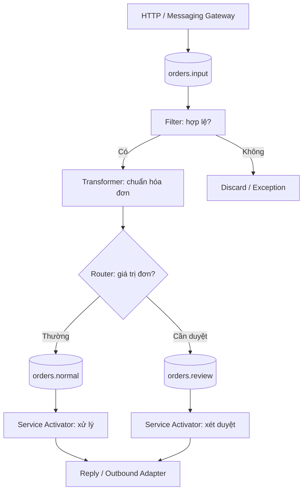
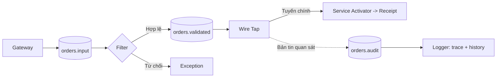
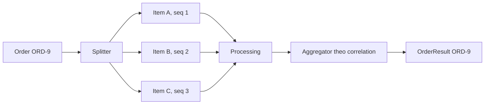

# Message history và truy nguyên flow

## 1. Vì sao phải truy nguyên một integration flow?

Trong Spring Integration, một thông điệp có thể đi qua nhiều `MessageChannel` và endpoint: `Gateway` tiếp nhận, `Filter` kiểm tra, `Transformer` chuyển định dạng, `Router` chọn nhánh, `Splitter` chia thành nhiều thông điệp con rồi `Aggregator` gom kết quả. Khi xử lý thất bại hoặc kết quả đến sai đích, stack trace của một phương thức Java đơn lẻ thường không đủ trả lời: **thông điệp đã đi qua những thành phần nào, rẽ nhánh ở đâu và lỗi xuất hiện tại bước nào?**

Ví dụ, hệ thống tiếp nhận đơn hàng và xử lý theo giá trị:



Giả sử một đơn hàng đáng lẽ đi `orders.review` nhưng lại đi `orders.normal`. Để tìm nguyên nhân, cần biết **định danh giao dịch**, **các điểm đã đi qua**, **giá trị dùng để định tuyến** và **dấu thời gian**. Spring Integration có cơ chế **Message History** hỗ trợ lưu dấu đường đi của message; tuy nhiên, để điều tra hiệu quả và theo dõi qua nhiều dịch vụ, ta cần kết hợp history với logging, correlation, metrics và distributed tracing.

**Mục tiêu bài học:**

1. Hiểu `Message History` là gì, nằm ở đâu và không chứa những gì.
2. Phân biệt message ID, business ID, correlation ID và trace ID.
3. Bật lịch sử trong Spring Integration và đọc nó đúng ngữ cảnh.
4. Quan sát được các nhánh Router/Filter/Transformer, Splitter/Aggregator, Gateway, retry và error flow.
5. Thiết kế truy nguyên từ luồng đồng bộ trong một JVM đến luồng bất đồng bộ hoặc qua broker, và viết kiểm thử cho những tình huống thường gặp.

## 2. Message History là gì?

### 2.1. Lịch sử được gắn vào message

Trong Spring Messaging, `Message<T>` có **payload** và **headers**. Spring Integration có khả năng ghi lại các điểm xử lý được theo dõi vào một header lịch sử, thường được truy cập qua `MessageHistory.HEADER_NAME` (giá trị header `history`). Thay vì lưu toàn bộ dữ liệu tại từng bước, history mô tả **hành trình của message qua các thành phần đã được cấu hình theo dõi**.

Một bản ghi history có thể chứa thông tin như:

| Trường / thông tin | Ý nghĩa |
|---|---|
| `name` | Tên hoặc ID của thành phần đã đi qua. |
| `type` | Loại thành phần, chẳng hạn một endpoint hoặc channel được instrument. |
| `timestamp` | Thời điểm thành phần được ghi nhận. |
| Thứ tự bản ghi | Thứ tự các điểm được ghi vào history của message ở thời điểm quan sát. |

Ví dụ minh họa về ý nghĩa, **không phải output cố định của framework**:

```text
messageId = 6cc7... (ID của message hiện tại)
traceId   = order-trace-9a10 (header tùy biến)
history   = [
  {name=orders.input,       type=channel, timestamp=...},
  {name=validateOrder,      type=filter,  timestamp=...},
  {name=orders.validated,   type=channel, timestamp=...},
  {name=routeOrder,         type=router,  timestamp=...},
  {name=orders.review,      type=channel, timestamp=...}
]
```

Thứ tự và sự xuất hiện của từng component phụ thuộc vào **phiên bản, cấu hình theo dõi và vị trí đọc history**. Không được dựa vào ví dụ trên để khẳng định mỗi `channel` hay mỗi endpoint luôn xuất hiện, hoặc luôn có tên dễ đọc. Hãy chủ động đặt tên ổn định cho các thành phần quan trọng và kiểm tra bản ghi thực tế.

### 2.2. History không phải là nhật ký nghiệp vụ đầy đủ

`Message History` chủ yếu phục vụ **đường đi trong flow**. Nó **không tự động** bảo đảm các chức năng sau:

- Lưu nội dung payload trước/sau mọi `Transformer`.
- Lưu biểu thức điều kiện Router, kết quả predicate của Filter hoặc lý do nghiệp vụ của một quyết định.
- Lưu exception, retry count, trạng thái giao dịch hoặc thời gian đợi hàng đợi theo mẫu log chuẩn hóa.
- Lưu bền vững qua restart, qua broker hoặc qua ranh giới nhiều JVM.
- Tạo distributed trace end-to-end với các span có parent/child và trace context xuyên dịch vụ.

Vì vậy, **message history là một dấu vết kỹ thuật có phạm vi**, không phải thay thế cho audit log, tracing backend hay message store. Có history không đồng nghĩa hệ thống đã đảm bảo delivery, idempotency hoặc exactly-once.

### 2.3. Các loại định danh rất dễ nhầm

| Định danh | Chủ yếu trả lời | Vòng đời và nguồn |
|---|---|---|
| **Message ID** (`id`) | *Đây là message cụ thể nào?* | Metadata của một `Message`; có thể thay đổi khi tạo message mới trong quá trình biến đổi hoặc xử lý. |
| **Business ID** (`orderId`, `paymentId`) | *Đây là đối tượng nghiệp vụ nào?* | Do domain xác định; nhiều message có thể cùng mang một business ID. |
| **Correlation ID** (`correlationId`) | *Những message nào thuộc cùng nhóm công việc?* | Cần thiết cho Splitter/Aggregator, request–reply phức tạp hoặc xử lý song song; do framework/thành phần/ứng dụng tạo theo tình huống. |
| **Trace ID** (`traceId`) | *Những hoạt động nào thuộc cùng hành trình quan sát?* | Thuộc hệ thống tracing hoặc quy ước header; phải được propagate phù hợp giữa các bước/dịch vụ. |
| **Span ID** | *Một thao tác cụ thể nằm ở đâu trong trace?* | Do cơ chế distributed tracing quản lý; mỗi span có thời gian và quan hệ cha/con. |

Ví dụ `orderId=ORD-1001` có thể xuất hiện trong message tiếp nhận đơn, message gọi kho, message tính phí và message phản hồi. Nếu dùng message ID của bước đầu để nối mọi log, các bước tạo message mới sẽ dễ làm đứt chuỗi. Khi truy nguyên, nên kết hợp **business ID** và **trace/correlation ID**, không phụ thuộc một `id` duy nhất.

## 3. Bật Message History trong Spring Integration

### 3.1. Cấu hình cơ bản

Với ứng dụng Java dùng Spring Integration (ví dụ Spring Boot 3.x, Spring Integration 6.x), có thể bật tracking bằng annotation `@EnableMessageHistory` trong cấu hình Spring:

```java
import org.springframework.context.annotation.Configuration;
import org.springframework.integration.config.EnableIntegration;
import org.springframework.integration.config.EnableMessageHistory;

@Configuration
@EnableIntegration
@EnableMessageHistory
public class MessageHistoryConfiguration {
}
```

`@EnableMessageHistory` yêu cầu hạ tầng Spring Integration ghi nhận history cho các component được theo dõi; nó **không** tự tạo một kho log lâu dài. Với hệ thống lớn, nên kiểm tra khả năng giới hạn phạm vi, đo overhead và chính sách chỉ bật ở môi trường hoặc giai đoạn cần chẩn đoán. API tùy chọn để lọc component có thể khác nhau giữa các phiên bản; ví dụ này chỉ dùng dạng annotation cơ bản.

### 3.2. Đọc header trong một điểm xử lý

Ở cuối hoặc tại một vị trí quan sát trong flow, có thể đọc header history bằng API của Spring Integration:

```java
import org.springframework.integration.history.MessageHistory;
import org.springframework.messaging.Message;

void inspect(Message<?> message) {
    Object history = message.getHeaders().get(MessageHistory.HEADER_NAME);
    Object traceId = message.getHeaders().get("traceId");
    Object businessId = message.getHeaders().get("orderId");

    System.out.println("traceId=" + traceId);
    System.out.println("orderId=" + businessId);
    System.out.println("history=" + history);
}
```

Ví dụ dùng `System.out` để người học nhìn thấy giá trị, **không** phải khuyến nghị logging cho production. Trong hệ thống thật, sử dụng logger có cấu trúc, chỉ ghi các trường cần thiết, không log toàn payload hoặc token/PII. `history` có thể là `null` nếu tracking chưa được bật, message chưa đi qua thành phần cần theo dõi hoặc metadata đã mất ở một ranh giới chuyển giao.

### 3.3. Vì sao history quan sát được có thể khác nhau theo vị trí?

Giả sử flow gồm `Filter -> Transformer -> Router -> Service Activator`. Nếu đặt điểm log **trước Router**, bản ghi hiển nhiên chưa phản ánh các thành phần xử lý **sau Router**. Nếu có một `Wire Tap` ở đầu flow, message được nhánh tap nhận tại thời điểm đó, không phải "ảnh chụp tương lai" của mọi bước sẽ chạy.

Đây là quy tắc quan trọng để tránh kết luận sai: **đọc history tại đâu chỉ suy luận được những điểm đã được ghi nhận trước hoặc tại thời điểm đó**. Nếu cần biết nhánh sau Router, đặt điểm quan sát ngay sau các nhánh hoặc ở endpoint thực sự xử lý nhánh, thay vì chỉ đặt tap ở kênh đầu vào.

## 4. Ví dụ có thể thực hành: Gateway, Filter, History và Wire Tap

### 4.1. Yêu cầu nghiệp vụ

Ta xây dựng một flow nhỏ:

1. Caller gọi `OrderGateway.submit(order, traceId)` theo request–reply.
2. `Filter` từ chối các đơn hàng có `total` không hợp lệ.
3. Message hợp lệ đi qua `orders.validated`.
4. `Wire Tap` sao một đường quan sát sang `orders.audit`.
5. `Service Activator` trả `Receipt` cho caller.

Mục tiêu **không phải** ghi mọi thứ vào history, mà là minh họa cách nhìn được history ở một nhánh quan sát mà không sửa payload nghiệp vụ của tuyến chính.



### 4.2. Java DSL minh họa

Ví dụ hướng tới Java 17+, `spring-boot-starter-integration` và Spring Integration 6.x. Đặt các kiểu trong cùng package; khi chuyển thành source của ứng dụng, tách những top-level type cần `public` ra file Java riêng. Các imports dưới đây áp dụng cho một file minh họa cấu hình:

```java
import java.math.BigDecimal;

import org.slf4j.Logger;
import org.slf4j.LoggerFactory;
import org.springframework.context.annotation.Bean;
import org.springframework.context.annotation.Configuration;
import org.springframework.integration.annotation.Gateway;
import org.springframework.integration.annotation.IntegrationComponentScan;
import org.springframework.integration.annotation.MessagingGateway;
import org.springframework.integration.channel.DirectChannel;
import org.springframework.integration.config.EnableIntegration;
import org.springframework.integration.config.EnableMessageHistory;
import org.springframework.integration.dsl.IntegrationFlow;
import org.springframework.integration.history.MessageHistory;
import org.springframework.messaging.MessageChannel;
import org.springframework.messaging.handler.annotation.Header;

record Order(String id, BigDecimal total) {}
record Receipt(String orderId, String status) {}

@MessagingGateway
interface OrderGateway {
    @Gateway(requestChannel = "orders.input")
    Receipt submit(Order order, @Header("traceId") String traceId);
}

@Configuration
@EnableIntegration
@EnableMessageHistory
@IntegrationComponentScan
class OrderTraceFlowConfiguration {
    private static final Logger log =
            LoggerFactory.getLogger(OrderTraceFlowConfiguration.class);

    @Bean(name = "orders.input")
    MessageChannel inputChannel() {
        return new DirectChannel();
    }

    @Bean(name = "orders.validated")
    MessageChannel validatedChannel() {
        return new DirectChannel();
    }

    @Bean(name = "orders.audit")
    MessageChannel auditChannel() {
        return new DirectChannel();
    }

    @Bean
    IntegrationFlow orderFlow() {
        return IntegrationFlow.from("orders.input")
                .filter(Order.class,
                        order -> order.total() != null
                                && order.total().signum() > 0,
                        spec -> spec.throwExceptionOnRejection(true))
                .channel("orders.validated")
                .wireTap("orders.audit")
                .handle(Order.class, (order, headers) ->
                        new Receipt(order.id(), "ACCEPTED"))
                .get();
    }

    @Bean
    IntegrationFlow auditFlow() {
        return IntegrationFlow.from("orders.audit")
                .handle(message -> {
                    Object payload = message.getPayload();
                    String orderId = payload instanceof Order order
                            ? order.id() : "unknown";

                    log.info("traceId={} orderId={} messageId={} history={}",
                            message.getHeaders().get("traceId"),
                            orderId,
                            message.getHeaders().getId(),
                            message.getHeaders().get(MessageHistory.HEADER_NAME));
                })
                .get();
    }
}
```

Caller sử dụng bean `OrderGateway` do Spring đăng ký:

```java
Receipt result = orderGateway.submit(
        new Order("ORD-1001", new BigDecimal("350000")),
        "trace-order-1001");

// result.orderId() = "ORD-1001"
// result.status()  = "ACCEPTED"
```

**Giải thích thiết kế:**

- `@EnableMessageHistory` bật ghi history trong phạm vi cấu hình.
- `@IntegrationComponentScan` cho phép phát hiện `@MessagingGateway` ở package được quét.
- Header `traceId` do caller cung cấp là **quy ước ứng dụng**, không phải tự động một OpenTelemetry trace ID chuẩn.
- `orders.input`, `orders.validated` và `orders.audit` là tên channel có ý nghĩa, hỗ trợ đọc log và truy nguyên.
- `Wire Tap` đưa message sang flow quan sát. Dùng `DirectChannel` cho `orders.audit` khiến nhánh audit chạy **đồng bộ** với quá trình gửi; trong ví dụ đơn giản nó có thể ảnh hưởng độ trễ và lỗi của tuyến chính. Production cần cân nhắc tách thread, giới hạn tài nguyên và chính sách khi nhánh quan sát thất bại.
- `history` được log tại **vị trí tap**, do đó không đại diện cho toàn bộ quá trình xử lý sau tap. Để thấy handler trả `Receipt` hoặc nhánh Router cuối cùng, cần thêm điểm quan sát ở các vị trí ấy.

**Lưu ý bảo mật:** Ngay cả history chỉ chứa tên component và timestamp cũng có thể tiết lộ luồng nghiệp vụ nội bộ. Cần hạn chế quyền truy cập log, thời gian lưu và volume trước khi bật theo dõi trên toàn hệ thống.

## 5. Truy nguyên những nhánh EIP thường gặp

### 5.1. Filter: đã đi tiếp hay bị loại?

`Filter` có hai đường kết quả về mặt nghiệp vụ: **accept** hoặc **reject**. Nếu đặt tap **sau Filter**, thông điệp bị từ chối sẽ **không** đến được tap đó. Vì thế, không thấy message trong log phía sau không đủ kết luận nó đã bị mất khi vận chuyển.

Để quan sát chính xác, có thể:

- Log hoặc đếm chỉ số ở đầu vào của Filter.
- Đặt log ở **đường chấp nhận** và đường **discard/rejection** được cấu hình.
- Ghi nguyên nhân từ chối bằng **mã lý do có kiểm soát**, ví dụ `INVALID_AMOUNT`, thay vì log toàn bộ payload.
- Với gateway request–reply, quyết định rõ reject sẽ ném exception hay trả reply thất bại; tránh bỏ message rồi để caller chờ timeout.

Ví dụ bảng sự kiện nghiệp vụ (không phải nội dung mặc định của history):

| Event | `traceId` | `orderId` | `step` | `outcome` |
|---|---|---|---|---|
| `ORDER_RECEIVED` | `trace-123` | `ORD-1` | `input` | `RECEIVED` |
| `ORDER_VALIDATED` | `trace-123` | `ORD-1` | `filter` | `ACCEPTED` |
| `ORDER_ROUTED` | `trace-123` | `ORD-1` | `router` | `REVIEW` |

Với đơn không hợp lệ, nên có sự kiện `ORDER_REJECTED` thay vì cố suy luận từ **sự thiếu vắng** của `ORDER_ROUTED`.

### 5.2. Router: thông điệp thực sự đi nhánh nào?

`Content-Based Router` đọc payload/headers, tính routing key rồi chuyển message sang channel được mapping. **Message History** có thể giúp xác định một số thành phần đã được ghi nhận; nhưng để xác nhận **quyết định nghiệp vụ**, hãy ghi sự kiện ở Router hoặc tại các nhánh đích với `routeKey`, `destination`, `traceId`, `businessId`.

```text
traceId=trace-123 orderId=ORD-1 event=ROUTE_DECIDED key=review
traceId=trace-123 orderId=ORD-1 event=BRANCH_ENTERED channel=orders.review
```

Hai dòng đó khác bản chất: dòng đầu nói **Router định gửi đi đâu**, dòng sau chứng minh **một endpoint ở nhánh đích đã nhận được**. Khi không có subscriber, mapping sai hoặc downstream lỗi, hai sự kiện có thể không xuất hiện như dự tính. Việc đối chiếu chúng giúp tìm vị trí đứt tuyến.

### 5.3. Transformer: message có thể đổi ID và dạng payload

Một `Transformer` có thể tạo payload mới, `Message<?>` mới hoặc để hạ tầng xây dựng message phản hồi. Vì vậy, không nên thiết kế truy nguyên với giả định message ID đầu vào luôn giữ nguyên cho mọi bước. Mặt khác, phần lớn thao tác xử lý message trong Spring Integration có cơ chế truyền tiếp headers phù hợp, nhưng **không phải mọi cách tạo message mới hay ranh giới adapter đều giữ toàn bộ headers**.

Ví dụ cố ý bảo tồn metadata khi **tự xây dựng** một message mới:

```java
import org.springframework.messaging.Message;
import org.springframework.messaging.support.MessageBuilder;

Message<NormalizedOrder> normalize(Message<Order> input) {
    Order old = input.getPayload();
    NormalizedOrder normalized = new NormalizedOrder(old.id(), old.total());

    return MessageBuilder.withPayload(normalized)
            .copyHeaders(input.getHeaders())
            .build();
}
```

Ví dụ giả định `NormalizedOrder` là DTO đã được định nghĩa trong ứng dụng. Khi sao chép headers, vẫn cần xem xét **header nào nên giữ, header nào không được đưa qua ranh giới tin cậy**; `replyChannel` có thể là tham chiếu đối tượng nội bộ, không phù hợp để truyền qua hệ thống khác. Không mặc định dùng `copyHeaders` như một cách xuất metadata an toàn ra ngoài.

### 5.4. Splitter / Aggregator: một hành trình sinh nhiều message

Đây là trường hợp quan trọng nhất để hiểu sự khác biệt giữa **message ID** và **correlation**.



Khi chia đơn thành các dòng hàng:

```text
Business ID = ORD-9
Trace ID    = trace-ORD-9
  child-1: messageId=m-1, correlation=group-9, sequence=1/3
  child-2: messageId=m-2, correlation=group-9, sequence=2/3
  child-3: messageId=m-3, correlation=group-9, sequence=3/3
Aggregator -> output messageId=m-4, businessId=ORD-9
```

Các giá trị trên chỉ là **ví dụ định danh minh họa**. Thực tế Splitter có thể tạo correlation ID từ message gốc và đặt sequence headers theo cách cấu hình, còn output của Aggregator có thể có headers được kết hợp theo chính sách nhất định.

Để truy nguyên đầy đủ, hãy ghi nhận **group key**, **sequence**, **tổng phần dự kiến nếu biết**, **số phần đã nhận**, **release reason** và **timeout/expiry**. Không nhất thiết tất cả nằm trong `history`; thường cần log và metrics riêng. Nếu một phần thất bại, đừng cho rằng Aggregator tự biết phải chờ, bỏ qua hay trả kết quả một phần: phải định nghĩa release strategy, message store và chính sách expiry.

### 5.5. Gateway và outbound adapter: ranh giới hệ thống

`Gateway` hỗ trợ hợp đồng request–reply, còn `Adapter` thường gửi hoặc nhận theo cách một chiều. Khi request sang hệ thống khác rồi trở về, history của JVM gốc **không tự động trở thành lịch sử toàn hệ thống**. Muốn nối đường đi phải truyền và khôi phục ngữ cảnh tracing hoặc một correlation key theo hợp đồng tích hợp, chẳng hạn qua HTTP headers hoặc message headers của broker.

| Ranh giới | Điều cần truyền/ghi rõ |
|---|---|
| Trong cùng flow/JVM | Component/channel names, business ID, `traceId`, `MessageHistory` nếu bật. |
| Qua `ExecutorChannel` hoặc poller | Ngữ cảnh tương quan trong message; không dựa vào MDC/thread-local tự lan truyền. |
| Qua HTTP | Trace context theo chuẩn dùng trong hệ thống, business/correlation ID cần thiết. |
| Qua Kafka/RabbitMQ/JMS | Mapping header phù hợp, quy tắc serialization, event ID, key, idempotency/retry. |
| Request–reply qua nhiều hệ thống | Request correlation, timeout, reply destination, lỗi remote và xử lý phản hồi đến muộn. |

## 6. History, Wire Tap, logging, metrics và distributed tracing khác nhau thế nào?

| Công cụ | Quan sát được điều gì | Điểm mạnh | Giới hạn |
|---|---|---|---|
| **Message History** | Chuỗi component được theo dõi trên message. | Dễ xem đường đi trong Spring Integration. | Overhead header, phạm vi cục bộ, không tự lưu bền vững hoặc log quyết định. |
| **Wire Tap** | Một bản message tại vị trí tap. | Giữ endpoint nghiệp vụ ít phụ thuộc phần quan sát. | Vị trí tap quyết định dữ liệu nhìn thấy; nhánh tap có thể ảnh hưởng flow tùy cấu hình. |
| **Structured logging** | Event, business outcome, `traceId`, `routeKey`, exception code. | Tìm kiếm và đối chiếu quyết định nghiệp vụ. | Cần schema nhất quán, chú ý PII/volume; không tự suy ra quan hệ span. |
| **Metrics** | Counter, timer, error rate, queue depth. | Nhìn toàn cảnh throughput và bottleneck. | Không giải thích trọn hành trình của một message riêng lẻ. |
| **Distributed tracing** | Trace/span và quan hệ nhân quả giữa thao tác qua process/service. | Phân tích latency, đường đi cross-service. | Cần instrumentation và propagation; có sampling, không thay log nghiệp vụ. |
| **Audit/event store** | Sự kiện nghiệp vụ đã chọn, lưu theo retention/kiểm soát truy cập. | Điều tra nghiệp vụ và tuân thủ. | Cần thiết kế schema, tính toàn vẹn và chính sách lưu trữ riêng. |

Một ứng dụng Spring Integration đủ khả năng theo dõi vận hành thường dùng **nhiều lớp bổ sung nhau**. Ví dụ: metrics báo tăng tỷ lệ timeout ở nhánh `orders.review`, tracing chỉ ra latency tập trung ở outbound HTTP, structured log cho biết `orderId` cụ thể và Router đã chọn `review`, còn Message History giúp thấy message đã đi qua những endpoint nội bộ được theo dõi trước khi gọi ra ngoài.

### 6.1. Nối các log bằng schema thống nhất

Một mẫu event log nên có các trường ổn định:

```json
{
  "event": "INTEGRATION_STEP_COMPLETED",
  "service": "spring-integration-pattern-demo",
  "traceId": "8c4b...",
  "spanId": "4d7a...",
  "businessId": "ORD-1001",
  "messageId": "6cc7...",
  "component": "orders.review.handler",
  "channel": "orders.review",
  "outcome": "SUCCESS",
  "durationMs": 42
}
```

Các giá trị trên minh họa cách tổ chức log, **không** có nghĩa Spring Integration tự phát ra đúng JSON này. `spanId` chỉ nên được ghi khi hệ thống tracing thực sự cung cấp; `durationMs` cần được đo, không tính dựa vào hai timestamp không cùng ngữ nghĩa.

Nên thống nhất quy ước đặt tên: `traceId` gắn hành trình, `businessId` gắn thực thể nghiệp vụ, `messageId` gắn bản tin kỹ thuật. Dùng cùng tên/kiểu trên mọi nhánh giúp truy vấn dễ dàng hơn việc mỗi endpoint tự chế một key khác.

### 6.2. MDC và vấn đề ranh giới thread

MDC của SLF4J là ngữ cảnh **gắn với thread**, rất tiện khi log một chuỗi xử lý đồng bộ. Nhưng khi chuyển qua `ExecutorChannel`, poller hoặc xử lý bất đồng bộ khác, thread tiêu thụ có thể không mang MDC ban đầu.

**Cách đúng về mặt thiết kế** là giữ trace/correlation context trong message hoặc trong context propagation được cấu hình, rồi tạo lại MDC ở điểm xử lý thích hợp (và cleanup sau đó). Không coi việc đặt `MDC.put("traceId", ...)` một lần ở HTTP controller là đủ để tự động bao phủ mọi thread và broker.

Khi dùng Micrometer Observation, OpenTelemetry hoặc tracing của Spring, cần bật instrumentation và propagation tương ứng với các adapter/transport thực tế; `@EnableMessageHistory` **không** thay cho việc đó. Với môi trường nhiều dịch vụ, nên ưu tiên chuẩn trace context như W3C Trace Context cho các giao tiếp hỗ trợ.

## 7. Retry và error channel: truy nguyên thất bại như thế nào?

Một exception xuất hiện sau Filter, Transformer hoặc trong outbound Gateway có thể được quan sát theo những cách khác nhau tùy **luồng đồng bộ hay bất đồng bộ**.

### 7.1. Luồng đồng bộ

Với `DirectChannel`, lỗi trong handler thường được truyền ngược theo call stack. Một `@MessagingGateway` đồng bộ có thể trả exception cho caller. Nên log một sự kiện có `traceId`, `businessId`, tên bước, loại lỗi và trạng thái retry, rồi xử lý exception theo hợp đồng API.

```text
traceId=trace-456 event=ORDER_RECEIVED  step=orders.input
traceId=trace-456 event=ORDER_VALIDATED step=filter result=ACCEPTED
traceId=trace-456 event=OUTBOUND_FAILED  step=inventoryGateway
                   attempt=2 errorCode=INVENTORY_TIMEOUT
```

Trong mô hình retry, **một message có thể đi qua một đoạn xử lý nhiều lần**. Vì vậy history có thể ghi những đoạn lặp lại, hoặc không diễn tả đầy đủ số lần thử theo cấu hình. Dùng **attempt/retry metadata** rõ ràng, không đếm số entry trong history rồi kết luận chắc chắn số lần retry.

### 7.2. Luồng bất đồng bộ và `ErrorMessage`

Khi lỗi được chuyển qua error flow, `ErrorMessage` chứa thông tin lỗi (payload là `Throwable`); với các lỗi Spring Messaging, `MessagingException` có thể cung cấp `failedMessage` để tìm lại message gốc. Nhưng **không thể giả định** mọi lỗi đều mang đủ `failedMessage`, history và trace context, nhất là lỗi trước khi message được tạo, lỗi từ transport hoặc lỗi bị bên ngoài bao lại.

Luồng lỗi có thể được thiết kế như:

```text
Async Endpoint -> Exception
                  |
                  v
              ErrorMessage -> errorChannel -> Error Handler
                                                  |
                                                  +-> structured log
                                                  +-> metrics / alert
                                                  +-> recovery / dead-letter
```

Lưu ý `errorChannel` là cơ chế xử lý lỗi trong **ngữ cảnh hỗ trợ**, không phải một bảo đảm rằng mọi exception ở mọi thread sẽ tự đến chung một channel. Cần phân biệt error handling của Spring Integration với cơ chế retry/DLQ/acknowledgment của broker bên ngoài.

### 7.3. Idempotency và truy nguyên xử lý lặp

Trong hệ thống **at-least-once**, cùng một event nghiệp vụ có thể được giao nhiều lần. Nếu dùng `messageId` của mỗi lần delivery làm khóa duy nhất, có thể bỏ sót bản chất trùng nghiệp vụ. Hãy chọn một `eventId` hoặc idempotency key ổn định theo hợp đồng nguồn, đồng thời ghi `deliveryAttempt`, `traceId` và kết quả deduplication phù hợp.

Ví dụ:

```text
eventId=EVT-99 delivery=1 outcome=TIMEOUT
eventId=EVT-99 delivery=2 outcome=SUCCESS
eventId=EVT-99 delivery=3 outcome=SKIPPED_DUPLICATE
```

Truy nguyên cần trả lời không chỉ **đã nhận mấy lần** mà còn **đã tạo side effect mấy lần**. Từ history một message đơn lẻ không thể suy ra điều này.

## 8. Kiểm thử khả năng truy nguyên, không chỉ kiểm thử nghiệp vụ

### 8.1. Ma trận kiểm thử đề xuất

| Tình huống | Kết quả nghiệp vụ | Bằng chứng truy nguyên cần có |
|---|---|---|
| Đơn hợp lệ | Trả `Receipt(ACCEPTED)` | Có `traceId`, có log/quan sát ở nhánh hợp lệ; history có các điểm được tracking. |
| Đơn bị Filter từ chối | Exception hoặc reply từ chối theo hợp đồng | Sự kiện `REJECTED` có lý do; không suy diễn từ thiếu log phía sau. |
| Router chọn `review` | Đi endpoint xét duyệt | Event `ROUTE_DECIDED` và `BRANCH_ENTERED` khớp nhau. |
| Transformer tạo payload mới | Dữ liệu chuẩn hóa đúng | Trace/business ID còn để nối trước và sau bước biến đổi; không đòi giữ message ID. |
| Splitter chia 3, Aggregator nhận 3 | Phát một kết quả đã gom | Cùng group key, có sequence/received count, release thành công. |
| Thiếu một message con | Timeout/partial/failure theo quy định | Log group timeout, missing count, sự kiện expiry; không im lặng treo vô hạn. |
| Lỗi async/outbound + retry | Có recovery hoặc thất bại rõ ràng | Attempt count, error code, trace context trong error flow. |

### 8.2. Ví dụ kiểm thử có thể mở rộng

Với cấu hình `OrderTraceFlowConfiguration` ở trên, kiểm thử request–reply và đường filter:

```java
import java.math.BigDecimal;
import org.junit.jupiter.api.Test;
import org.springframework.beans.factory.annotation.Autowired;
import org.springframework.messaging.MessagingException;
import org.springframework.test.context.junit.jupiter.SpringJUnitConfig;

import static org.junit.jupiter.api.Assertions.assertEquals;
import static org.junit.jupiter.api.Assertions.assertThrows;

@SpringJUnitConfig(OrderTraceFlowConfiguration.class)
class OrderTraceFlowTest {
    @Autowired
    private OrderGateway gateway;

    @Test
    void validOrderReturnsReceipt() {
        Receipt receipt = gateway.submit(
                new Order("ORD-101", new BigDecimal("200000")),
                "trace-ord-101");

        assertEquals("ORD-101", receipt.orderId());
        assertEquals("ACCEPTED", receipt.status());
    }

    @Test
    void invalidOrderIsRejected() {
        assertThrows(MessagingException.class, () ->
                gateway.submit(
                        new Order("ORD-102", BigDecimal.ZERO),
                        "trace-ord-102"));
    }
}
```

Hai test trên **chưa chứng minh** history hoặc log đúng. Để thực sự kiểm thử history, cần thêm một `MessageHandler` quan sát được ở channel `orders.audit` trong **cấu hình test riêng** hoặc inject một collector có thể kiểm tra:

1. Gửi message có `traceId` xác định.
2. Chờ/nhận message mà điểm audit quan sát thấy (đồng bộ trong ví dụ dùng `DirectChannel`).
3. Kiểm tra header `MessageHistory.HEADER_NAME` **không rỗng** khi bật tracking; không assert cứng toàn bộ chuỗi tên component do framework có thể thêm/thay đổi điểm ghi nhận theo cấu hình/phiên bản.
4. Kiểm tra `traceId` và `orderId` thống nhất giữa message đầu vào, audit event và reply/log của endpoint cuối.
5. Thử tắt history hoặc đưa message qua một ranh giới chỉ giữ một phần headers; xác định khả năng xử lý `null` mà không làm hỏng flow nghiệp vụ.

Đối với nhánh bất đồng bộ, tránh dùng `Thread.sleep(...)` cố định để đoán đã xử lý xong; dùng latch, probe hoặc cơ chế await có **timeout**. Với kiểm thử Broker/HTTP, kiểm tra propagation bằng một consumer hoặc mock server thật sự nhận được headers — đừng suy đoán từ cấu hình.

## 9. Quy trình điều tra sự cố từng bước

Giả sử cảnh báo "đơn `ORD-2001` không nhận được reply". Một quy trình chẩn đoán có hệ thống:

1. **Xác định yêu cầu:** tìm `orderId`, thời gian, nguồn yêu cầu và `traceId` nếu có; tránh chỉ dựa vào message ID của một log.
2. **Xác nhận điểm vào:** có log `RECEIVED` ở inbound gateway/adapter chưa? Nếu không, kiểm tra transport hoặc request ID trước khi nghi Router.
3. **Tìm bước cuối đã xác nhận:** so sánh các event/channels đã ghi; Message History ở message quan sát được giúp đối chiếu thành phần đã đi qua.
4. **Đối chiếu điểm quyết định:** Filter reject hay accept? Router chọn key nào, mapping tới channel nào? Có subscriber/consumer ở channel đích không?
5. **Kiểm tra ranh giới async/remote:** có queue backlog, retry, outbound timeout hoặc lost propagation khiến trace bị đứt không?
6. **Nếu có Splitter/Aggregator:** tìm group key, phần còn thiếu, release/expiry và trạng thái message store.
7. **Kiểm tra error flow:** exception đồng bộ, `errorChannel`, recovery, broker DLQ, retry attempt, dead-letter reason.
8. **Khôi phục an toàn:** xác định idempotency và side effect trước khi replay/retry; sau đó bổ sung test và chỉ số tại điểm thiếu quan sát.

Một truy vấn điều tra thường bắt đầu từ **business ID + khoảng thời gian**, chuyển sang trace ID để xem hành trình, rồi mới kiểm tra component history của từng message. Nếu hệ thống chưa có trace ID, log business ID cùng các điểm nhận/đẩy là giải pháp tối thiểu; không nên cố suy ra trace ID từ `hash(payload)` hoặc từ địa chỉ IP.

## 10. Khuyến nghị vận hành và các lỗi thiết kế cần tránh

| Cách làm dễ sai | Vì sao gây vấn đề | Cách thực hiện phù hợp |
|---|---|---|
| Bật Message History rồi coi đó là audit log bền vững | History nằm trên message, không tự thành bản ghi lâu dài. | Có hệ thống log/audit riêng và retention rõ ràng. |
| Log toàn payload và headers của mọi message | Dễ lộ PII, credentials hoặc thông tin nội bộ; log tăng đột biến. | Chọn các trường an toàn, redact/mask, giới hạn quyền truy cập và retention. |
| Dùng một message ID để nối toàn flow | Transformer, Splitter, Aggregator có thể tạo các message khác nhau. | Kết hợp trace ID, correlation/group key và business ID. |
| Đặt một tap ở đầu flow rồi kỳ vọng thấy nhánh Router cuối | Tap chỉ quan sát thông điệp đến thời điểm đặt tap. | Đặt điểm quan sát ở từng nhánh hoặc tại endpoint xử lý cuối. |
| Cho nhánh audit chạy trực tiếp mà không quản lý lỗi/độ trễ | `Wire Tap` đồng bộ có thể ảnh hưởng luồng nghiệp vụ. | Quy định failure policy, tách thực thi khi phù hợp, giới hạn tài nguyên. |
| Nghĩ MDC tự truyền qua mọi executor và broker | Thread-local không phải context propagation xuyên thread/process. | Truyền trace context qua message/transport và khôi phục ở consumer. |
| Cứ tăng log là có distributed tracing | Log không tự có span tree/latency phân tán. | Bật instrumentation và propagation theo transport/stack thực tế. |
| Retry vô hạn để "đỡ mất message" | Gây tải lặp, side effect trùng, phá thứ tự xử lý. | Retry có giới hạn/backoff, idempotency, DLQ/recovery và quan sát attempt. |
| Log mỗi message history ở mọi hop trong production | Tăng CPU, allocation và dung lượng log rất nhanh. | Bật có chọn lọc, sampling/level phù hợp, đo tác động và chỉ thu thập khi cần. |

## 11. Bài tập thực hành

1. **Quan sát đường cơ bản:** bật `@EnableMessageHistory` cho flow mẫu, in ra trường `history` ở `orders.audit`. Chuyển vị trí tap từ trước Filter sang sau Filter và giải thích vì sao các bản ghi khác nhau.
2. **Truy nguyên Router:** thêm `Content-Based Router`: đơn trên 10 triệu sang `orders.review`, còn lại sang `orders.normal`. Tạo log `ROUTE_DECIDED` và `BRANCH_ENTERED`; viết test cho ngưỡng đúng bằng 10 triệu.
3. **Truy nguyên biến đổi:** thêm transformer đổi `Order` sang `ValidatedOrder`, giữ `traceId` nhưng không giả định giữ nguyên message ID. Kiểm tra cả khi code tạo `Message` thủ công.
4. **Chia/gom:** tách đơn có ba sản phẩm, mô phỏng một nhánh xử lý chậm và một nhánh lỗi. Ghi correlation key, sequence, retry attempt, release reason và expired group; chỉ định rõ chính sách khi không nhận đủ ba phần.
5. **Qua async:** đổi một `DirectChannel` thành `ExecutorChannel`; so sánh thread log trước/sau và kiểm tra `traceId` còn trong message dù MDC có thể khác. Bổ sung timeout cho test thay vì `sleep` cố định.
6. **Đường lỗi:** tạo handler ném exception, cấu hình error/recovery theo loại endpoint, đảm bảo event lỗi có cùng business/trace context; tránh ghi thông tin nhạy cảm.

**Câu hỏi tự kiểm tra:** Nếu hai message có cùng `correlationId` nhưng `MessageHeaders.ID` khác nhau, có phải một lỗi không? **Không.** Đây có thể là hai phần của cùng công việc hoặc hai message trong một request–reply. Nếu `Message History` ghi rằng message đã qua Router mà không có log ở nhánh đích, đã đủ kết luận Router sai chưa? **Chưa.** Cần đối chiếu quyết định routing, mapping channel, subscriber, lỗi/timeout và vị trí quan sát.

**Kết luận:** `Message History` cung cấp dấu vết *message đã đi qua những thành phần Spring Integration nào được theo dõi*. Để truy nguyên một Enterprise Integration Pattern flow đáng tin cậy, cần thêm **định danh đúng cấp độ**, **log quyết định của Filter/Router**, **correlation cho Splitter/Aggregator**, **retry/error context**, **metrics** và **distributed tracing** khi vượt khỏi JVM. Cách thiết kế này giúp phát hiện đúng điểm lỗi, kiểm thử từng nhánh và giữ hệ thống tích hợp ít phụ thuộc, dễ mở rộng.
