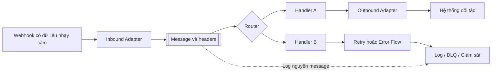
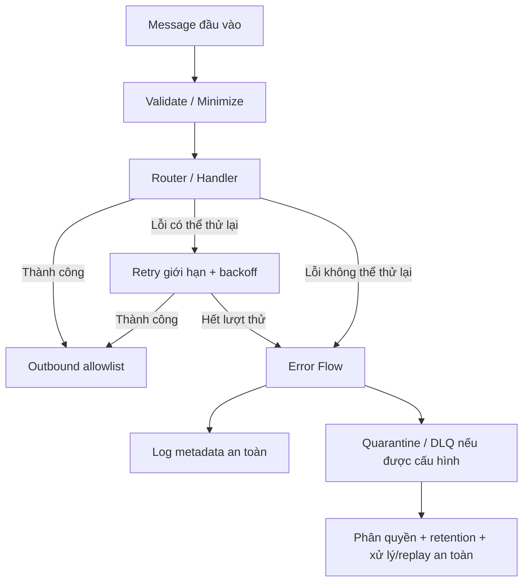

# Không đưa dữ liệu nhạy cảm vào header hoặc log

Trong hệ thống tích hợp, thông điệp không chỉ đi từ nơi gửi đến nơi nhận. Nó còn có thể được chuyển qua **Message Channel**, Router, Filter, Transformer, Splitter, Aggregator, Gateway, bộ chuyển đổi HTTP/Kafka/RabbitMQ, luồng retry và **error channel**. Mỗi điểm có khả năng đọc, sao chép, chuyển tiếp hoặc ghi nhận một phần thông điệp. Vì vậy, một thông tin nhạy cảm vô tình được đặt vào header hoặc log có thể lan ra nhiều hệ thống hơn dự kiến.

Nguyên tắc quan trọng khi học **`SPRING_INTEGRATION_PATTERN`** là: **không đặt bí mật hay dữ liệu cá nhân vào `MessageHeaders` hoặc nhật ký nếu luồng không thật sự cần chúng; tuyệt đối tránh ghi khóa truy cập, mật khẩu, token và payload nhạy cảm ra log**. Nếu một giao thức bắt buộc dùng header xác thực, hãy quản lý nó **ngay tại biên giao tiếp an toàn**, không sao chép bừa bãi vào header của thông điệp nội bộ hay header gửi tiếp sang hệ thống khác.

Bài này thuộc chương **Message system**, tập trung vào ranh giới dữ liệu của `Message`, `headers`, logging và observability. Các kỹ thuật dưới đây có liên hệ trực tiếp với Router, Filter, Transformer, Splitter, Aggregator, Gateway, retry, error channel và correlation của Spring Integration.

## 1. Mục tiêu học tập

Sau bài này, bạn có thể:

1. Phân biệt `MessageHeaders` nội bộ với HTTP headers, Kafka headers và thông tin đặt trong payload.
2. Giải thích vì sao header và log không phải nơi an toàn mặc định để cất dữ liệu nhạy cảm.
3. Thiết kế header theo **danh sách cho phép** (*allowlist*) thay vì sao chép toàn bộ metadata đầu vào.
4. Ghi log phục vụ vận hành mà không để lộ nội dung nghiệp vụ hoặc thông tin xác thực.
5. Nhận ra nguy cơ rò rỉ qua error flow, retry, DLQ, tracing và correlation.
6. Viết các kiểm tra bảo đảm dữ liệu không đi ra các ranh giới không được phép.

## 2. Vấn đề: header và log thường đi xa hơn bạn nghĩ

Giả sử một ứng dụng nhận webhook cập nhật thanh toán với nội dung:

```json
{
  "eventId": "evt-901",
  "orderId": "ord-1024",
  "paymentStatus": "SUCCESS",
  "customerEmail": "customer@example.invalid",
  "sessionToken": "<SECRET-DO-NOT-LOG>"
}
```

Đây chỉ là dữ liệu minh họa, không phải thông tin thật. Trong một thiết kế tốt, việc có cả `customerEmail` và `sessionToken` trong một sự kiện cập nhật thanh toán **đã cần được xem xét lại**: có thể bên nhận không cần chúng. Một sai sót phổ biến là sao chép hai trường này sang headers để mọi handler có thể truy cập, rồi ghi nguyên `Message<?>` ra log mỗi khi cần gỡ lỗi.

```java
// KHÔNG NÊN LÀM: chỉ minh họa lỗi bảo mật.
Message<?> message = /* thông điệp đầu vào */ null;

// logger.info("Received: {}", message); // Có thể in payload lẫn headers.
// logger.error("Failed message: {}", message); // Dễ lộ thông tin khi có lỗi.
// MessageBuilder.fromMessage(message)
//     .setHeader("customerEmail", "...")
//     .setHeader("authorization", "Bearer ...");
```

Thông tin đó có thể xuất hiện trong:

- log ứng dụng, log tập trung, hệ thống phân tích sự cố hoặc cảnh báo;
- dữ liệu lỗi (`ErrorMessage`, exception chứa failed message) và các tuyến retry;
- header được adapter ánh xạ sang giao thức bên ngoài;
- bản sao thông điệp trong nhánh publish–subscribe hoặc kết quả Splitter;
- thông điệp bị giữ lại ở queue, message store, dead-letter queue;
- trace attributes, baggage, MDC hoặc bản chụp phục vụ hỗ trợ kỹ thuật.

Không phải mọi flow đều tự động sao chép mọi header sang tất cả đích. **Hành vi thực tế phụ thuộc endpoint, adapter, header mapper và cấu hình**, nên cần xác minh tại từng ranh giới. Nhưng càng nhiều nơi có thể nhìn thấy một giá trị, phạm vi rủi ro càng rộng.



**Điểm kiểm soát tốt nhất nằm càng gần đầu vào càng tốt**, và cần **kiểm tra lại trước khi đi ra ngoài**. Chỉ xóa dữ liệu khi đã tới cuối flow có thể là quá muộn: các bước trung gian đã ghi log hoặc phát tán nó.

## 3. Thế nào là “dữ liệu nhạy cảm”?

Mức độ nhạy cảm phụ thuộc hệ thống và mục đích xử lý. Bảng sau giúp xác định trường nào nên được ngăn chặn, giảm thiểu hoặc bảo vệ đặc biệt.

| Nhóm dữ liệu | Ví dụ | Nguyên tắc |
| --- | --- | --- |
| **Bí mật xác thực** | Mật khẩu, access/refresh token, API key, session cookie, private key, client secret. | **Không log**; tránh đưa vào message headers; lưu ở secret manager hoặc cơ chế xác thực của adapter khi cần. |
| **Thông tin định danh cá nhân** | Email, số điện thoại, địa chỉ, số giấy tờ, thông tin bệnh án. | Chỉ thu thập/chuyển tiếp khi có mục đích rõ; tránh ở header và log; giới hạn người/hệ thống được đọc. |
| **Thông tin tài chính nhạy cảm** | Số thẻ, mã bảo mật, thông tin tài khoản, dữ liệu chi tiết giao dịch. | Không log chi tiết; áp dụng chuẩn và kiểm soát phù hợp lĩnh vực, ưu tiên mã tham chiếu hoặc token hóa được quản lý an toàn. |
| **Dữ liệu kinh doanh bảo mật** | Giá nội bộ, hợp đồng, tồn kho chiến lược, dữ liệu khách hàng đối tác. | Chỉ đưa đến đích có thẩm quyền; không đưa vào tags/headers chung để “tiện debug”. |
| **Metadata có khả năng liên kết danh tính** | `orderId`, `userId`, IP, device ID, correlation ID gắn với khách hàng. | Không mặc nhiên là vô hại. Dùng định danh mờ, giảm chi tiết, đặt thời hạn giữ và phân quyền truy cập. |
| **Metadata kỹ thuật thông thường** | `eventType`, phiên bản schema, tên bước xử lý, mã lỗi đã chuẩn hóa. | Thường phù hợp hơn cho header/log **nếu không vô tình mã hóa dữ liệu nhạy cảm**. |

Không nên coi “đã hash” hoặc “đã che vài ký tự” là tự động an toàn. Hash không có khóa của email/số điện thoại dễ bị đoán qua từ điển; ID giả danh vẫn có thể liên kết với hồ sơ thật. Mức dữ liệu tối thiểu cần thiết luôn an toàn hơn việc thu thập nhiều rồi cố che giấu về sau.

## 4. Phân biệt các loại header trước khi đặt chính sách

Trong tích hợp bằng Spring, từ **header** có thể chỉ các khái niệm khác nhau:

| Loại header | Nằm ở đâu | Ví dụ | Rủi ro |
| --- | --- | --- | --- |
| **`MessageHeaders` của Spring Messaging** | Metadata bên cạnh payload của `Message<?>` trong JVM hoặc qua các luồng/adapter. | `id`, `timestamp`, `replyChannel`, `errorChannel`, `correlationId`, header tùy biến. | Handler/endpoint có thể đọc; một số header có thể được chuyển tiếp/lưu/ghi log tùy cấu hình. |
| **HTTP request/response headers** | Ranh giới giao thức HTTP. | `Authorization`, `Cookie`, `Content-Type`, `X-Request-ID`. | Token/cookie có thể bị lộ qua access log, proxy, tracing hoặc việc copy sang message nội bộ. |
| **Broker/transport headers** | Metadata được ánh xạ vào Kafka/RabbitMQ/JMS hoặc transport khác. | Event type, correlation key, application headers được chọn. | Có thể lưu cùng record/message và được consumer, công cụ vận hành hoặc bộ đọc lại tiếp cận. |
| **MDC/trace attributes/baggage** | Ngữ cảnh chẩn đoán/logging/tracing. | `traceId`, `spanId`, `tenant`, baggage tùy biến. | Bị nhân bản vào logs, trace backend hoặc lan sang service khác; cần kiểm soát cardinality và quyền truy cập. |

**Ngoại lệ cần hiểu đúng:** HTTP thường cần `Authorization` hoặc cookie để xác thực tại **điểm biên**. Quy tắc “không đưa dữ liệu nhạy cảm vào header” ở bài này **không yêu cầu bỏ cơ chế xác thực HTTP hợp lệ**. Nó yêu cầu không kéo token/cookie ấy vào `MessageHeaders` nội bộ, gửi tiếp sang đối tác không liên quan hay ghi vào log. Khi gọi dịch vụ ngoài, để thành phần kết nối được cấu hình an toàn gắn credential cần thiết đúng lúc, thay vì chuyển token qua toàn bộ integration flow.

### 4.1. MessageHeaders không phải kho bí mật

Trong Spring Messaging, `Message<T>` có `getPayload()` và `getHeaders()`. `MessageHeaders` cung cấp metadata cho định tuyến, tương quan, phản hồi và xử lý. Dù API cho phép đặt giá trị tùy biến, **khả năng ghi một field vào header không có nghĩa field đó nên được đặt ở đó**.

Hai lỗi thiết kế phổ biến là:

1. **Tiện truy cập:** “Gắn `customerEmail` vào header để Router/Handler nào cũng đọc được.” Cách này tạo thêm nhiều nơi nắm dữ liệu cá nhân; nếu cần tra cứu khách hàng, cân nhắc khóa tham chiếu có kiểm soát hoặc một dịch vụ nghiệp vụ chuyên trách.
2. **Tiện xác thực:** “Gắn `accessToken` vào header để adapter nào cũng sử dụng.” Cách này có thể vô tình chuyển credential của hệ thống A sang B. Cần chọn credentials theo **đích nhận và quyền hạn** tại adapter tương ứng.

### 4.2. Header có thể bị ánh xạ qua adapter

Adapter inbound/outbound thường có quy tắc chuyển đổi giữa transport metadata và `MessageHeaders` nội bộ. Header mapper, các mẫu cho phép/chặn và tùy chọn cấu hình có thể khác nhau theo giao thức, phiên bản và adapter.

Ví dụ, **HTTP `Authorization` của request đầu vào** không nên trở thành một application header được gửi lại đến Kafka hoặc ERP. Tại ingress, xác thực và xác định danh tính/phạm vi quyền cần xử lý theo thiết kế an ninh. Sau đó chỉ đưa **kết quả được phép sử dụng** (hoặc reference an toàn) vào lớp tích hợp. Tại egress, ánh xạ riêng các header mà hợp đồng bên nhận cần.

Vì vậy, hãy kiểm tra **hai phía của một adapter**: dữ liệu gì được đưa vào message, và dữ liệu gì từ message được xuất ra transport.

## 5. Mẫu an toàn: tối thiểu hóa payload và allowlist header

Thay vì lấy `Message<?>` đầu vào rồi truyền tiếp cả headers, hãy tạo **thông điệp outbound mới** từ hợp đồng dữ liệu đã được kiểm duyệt.

### 5.1. Ví dụ Java: tạo thông điệp mới với header được phép

Giả sử lớp bên trong có thông tin khách hàng và token phiên làm việc vì một lý do nghiệp vụ trước đó. Đối tác nhận trạng thái đơn **chỉ cần trạng thái và mã tham chiếu đã được phép chia sẻ**.

```java
import java.util.UUID;
import org.springframework.messaging.Message;
import org.springframework.messaging.support.MessageBuilder;

// Các record đơn giản hóa để minh họa cách tạo outbound contract.
record InternalOrderEvent(
    String partnerOrderRef,
    String status,
    String customerEmail,
    String accessToken,
    UUID correlationId
) {}

record PartnerOrderEvent(String partnerOrderRef, String status) {}

final class PartnerMessageFactory {

    Message<PartnerOrderEvent> create(InternalOrderEvent input) {
        PartnerOrderEvent publicPayload = new PartnerOrderEvent(
            input.partnerOrderRef(),
            input.status()
        );

        return MessageBuilder.withPayload(publicPayload)
            .setHeader("eventType", "order.status.changed")
            .setHeader("correlationId", input.correlationId().toString())
            .build();
    }
}
```

Điều kiện để ví dụ này thật sự an toàn:

- `partnerOrderRef` **đã được phê duyệt theo hợp đồng chia sẻ**; không được mặc định rằng mã đơn hàng luôn công khai.
- `correlationId` là UUID mờ, **không tạo trực tiếp từ email/điện thoại/token**; nó vẫn là metadata phải quản lý vì có thể liên kết truy vết.
- `customerEmail` và `accessToken` không xuất hiện trong `PartnerOrderEvent` hay header outbound.
- `MessageBuilder` tạo một message mới thay vì sao chép **toàn bộ** headers từ message nhận được. Các header kỹ thuật như message `id`/`timestamp` vẫn được framework cung cấp.
- Nếu cần credential để gọi ERP, thành phần HTTP/AMQP/Kafka ở **biên outbound** quản lý credential riêng, đúng hệ thống đích.

> **Allowlist an toàn hơn denylist:** Nếu chỉ xóa `authorization` nhưng quên `x-api-key`, `cookie`, `sessionToken` hoặc một header mới do đội khác thêm, bí mật vẫn có thể đi tiếp. Với ranh giới tin cậy quan trọng, **chỉ xây lại các trường được phép**.

### 5.2. Khi phải chuyển tiếp message hiện có

Spring Messaging cho phép dùng `MessageBuilder.fromMessage(original)` để tạo một message dựa trên bản cũ, sau đó sửa hoặc xóa header. Kỹ thuật này hữu ích cho xử lý nội bộ, nhưng **không phải biện pháp kiểm soát chính ở ranh giới bảo mật** vì có thể giữ lại các header không biết trước.

```java
// Chỉ là biện pháp bổ sung cho một luồng đã được phân loại dữ liệu.
Message<?> sanitized = MessageBuilder.fromMessage(original)
    .removeHeader("authorization")
    .removeHeader("cookie")
    .removeHeader("x-api-key")
    .build();
```

Đoạn trên **chưa đủ chứng minh an toàn**: `customerEmail`, `sessionToken`, custom headers khác hoặc payload nhạy cảm vẫn có thể tồn tại. Tại outbound boundary, ưu tiên mẫu **tạo payload mới + chỉ set header được phép** như mục trước. Nếu adapter hỗ trợ danh sách header mapping, cần cấu hình và kiểm tra bổ sung ở đó.

## 6. Log an toàn: ghi *sự kiện vận hành*, không ghi *nội dung bí mật*

Log hữu ích khi trả lời “thông điệp đi qua bước nào, thành công hay lỗi, xử lý trong bao lâu?”. Để trả lời những câu hỏi đó, hiếm khi cần in toàn bộ payload/header.

### 6.1. Ví dụ nên và không nên

```java
// KHÔNG NÊN: đối tượng có thể chứa PII, token hoặc thông tin hợp đồng.
// log.info("message={}", message);
// log.debug("headers={}", message.getHeaders());
// log.error("payload={}", message.getPayload());

// NÊN: event type là hằng số đã được duyệt, correlation ID là UUID mờ.
log.info(
    "integration_event type={} component={} outcome={} correlationId={}",
    "order.status.changed", "orderRouter", "accepted", correlationId
);
```

Ở ví dụ an toàn, `log` là logger SLF4J và `correlationId` là UUID đã được ứng dụng tạo/kiểm tra. Mã minh họa logic logging, không phải một class chạy độc lập. **Không đưa giá trị đầu vào chưa kiểm tra** vào `component`, `eventType` hoặc mã lỗi: thông tin đó có thể chứa dữ liệu nhạy cảm, ký tự điều khiển hay làm tăng vô hạn số nhãn metrics.

### 6.2. Nên log gì?

| Nên có nếu phục vụ vận hành | Tránh đưa vào log mặc định |
| --- | --- |
| Mã sự kiện được định nghĩa trước (`order.status.changed`). | Nội dung JSON/XML chưa lọc, `Message.toString()`. |
| Tên endpoint/flow hoặc tên nhánh ổn định. | Token, password, cookie, API key, private key. |
| Kết quả xử lý (`accepted`, `discarded`, `retry_scheduled`, `failed`). | Email, điện thoại, địa chỉ, thông tin thanh toán thô. |
| Mã lỗi **đã chuẩn hóa** (`TIMEOUT`, `BAD_SCHEMA`). | Exception message tùy ý có thể chứa URL token hoặc request body. |
| Thời lượng, số lần retry, độ sâu queue, tổng số phần Aggregator. | Bản sao toàn bộ request/response của hệ thống đối tác. |
| Correlation/trace ID mờ và có kiểm soát truy cập. | Business ID nhạy cảm trong mọi dòng log hoặc tag metrics. |

Một cách tổ chức log có cấu trúc:

```text
event_type=order.status.changed
component=ordersRouter
branch=priority
outcome=accepted
correlation_id=8dfd1939-6cab-4c6b-abaf-a0649615102e
duration_ms=12
```

Không có `customerEmail`, token hay payload trong dòng log. UUID là ví dụ giả, không đại diện người dùng thực. Kể cả ID mờ vẫn cần thời hạn lưu và phân quyền vì có thể liên kết các hoạt động.

### 6.3. Che dữ liệu không phải phương án ưu tiên duy nhất

Masking có ích với dữ liệu bắt buộc phải xuất hiện ở một số nhật ký phục vụ an ninh hoặc pháp lý, nhưng có nhiều giới hạn:

- Dữ liệu có thể xuất hiện ở nhiều cách biểu diễn: JSON, URL query, HTTP header, exception string, payload lồng nhau.
- Token mới, tên trường mới hoặc dữ liệu mã hóa/base64 có thể vượt qua bộ lọc.
- Logger của thư viện, proxy và hệ thống APM có thể ghi dữ liệu **trước** bước masking của ứng dụng.
- Bản ghi đã đưa lên nền tảng log có thể được sao chép, sao lưu hoặc chia sẻ ngoài nhóm xử lý.

Vì vậy, thứ tự ưu tiên thường là **không thu thập → không đưa vào message/log → rút gọn → che thông tin → mã hóa/phân quyền/giữ có thời hạn**. Bộ lọc log chỉ là một lớp bảo vệ, không thay thế giảm thiểu dữ liệu từ nguồn.

## 7. Spring Integration: những điểm dễ rò rỉ trong luồng

### 7.1. Router và Filter

Router có thể phân loại theo **metadata đã kiểm soát** như `eventType`, tenant hoặc mức ưu tiên được cho phép. Đừng gắn email, tên người hoặc access token vào headers chỉ để router dễ đọc.

Filter có thể phát hiện một message **không được phép xử lý**, nhưng Filter ở giữa flow **không xóa được log** hay bản sao đã tạo trước đó. Nếu payload chứa dữ liệu nhạy cảm không phục vụ luồng, loại bỏ từ inbound mapping hoặc chuyển sang DTO tối thiểu ngay đầu vào.

### 7.2. Transformer

Transformer là điểm thích hợp để chuyển từ **internal event** sang **outbound contract** đã giới hạn trường. Nhưng đừng coi việc đổi tên trường là bảo vệ. `customerEmail` đổi thành `contact` vẫn là email; token được base64 vẫn là token.

### 7.3. Splitter và Aggregator

Splitter có thể tạo nhiều message con; correlation và sequence metadata giúp gom nhóm. Nếu thông tin nhạy cảm được gắn vào headers, **nó có nguy cơ đi theo mỗi message con**, tùy cách framework/flow xây dựng các message. Việc nhân bản làm tăng nơi lưu giữ và số lần tiếp xúc.

Aggregator có thể lưu các message/nhóm tạm thời trong memory hoặc message store; nếu cần bền qua restart, việc lưu sang cơ sở dữ liệu mở thêm **ranh giới lưu trữ** phải bảo vệ. Khi phát kết quả, cần xem lại header được kế thừa/hợp nhất theo chiến lược đang dùng, tránh mang những header không cần thiết sang output.

**Không dùng email hoặc token làm correlation ID.** Hãy tạo khóa mờ và lưu mapping từ khóa đến đối tượng nghiệp vụ trong nơi có kiểm soát quyền truy cập. Một `orderId` cũng có thể được coi là dữ liệu nhạy cảm nếu cho phép suy ra khách hàng hoặc giao dịch.

### 7.4. Gateway và Adapter

Gateway/adapter là nơi một thông điệp băng qua **trust boundary**. Ví dụ:

- **Inbound HTTP:** xác thực header theo cơ chế bảo mật, chuyển dữ liệu cần thiết thành message; không copy `Authorization`/`Cookie` vào mọi message nội bộ.
- **Outbound HTTP:** gắn credential của **đúng đối tác** ở tầng client/adapter an toàn; không dùng token nguồn của người gọi nếu không có cơ chế ủy quyền được thiết kế tường minh.
- **Kafka/RabbitMQ/JMS:** kiểm tra header mapping, ACL, encryption, retention và công cụ quan sát message; không giả định header broker là bí mật chỉ vì không nằm trong payload.
- **File/DB adapter:** kiểm tra dữ liệu được ghi vào file, bảng staging, message store, vùng lưu lỗi và các bản sao lưu.

Một header **được phép trong phạm vi nội bộ** chưa chắc được phép chuyển sang transport phía ngoài. Cần kiểm tra **allowlist theo từng đích**, không dùng một cấu hình chung cho mọi đối tác.

## 8. Error channel, retry và DLQ: rủi ro khi luồng thất bại

Một điểm thường bị bỏ sót là **các đường đi của lỗi có thể lộ nhiều dữ liệu hơn đường đi thành công**.

Trong Spring Integration, lỗi của một số luồng có thể được thể hiện dưới dạng `ErrorMessage`; payload của nó thường là exception, và một số `MessagingException` có thể mang `failedMessage`. Tùy endpoint/cấu hình, lỗi ở luồng đồng bộ cũng có thể được ném trực tiếp về caller thay vì đi qua error channel. Do đó, cả **đường lỗi đồng bộ lẫn bất đồng bộ** đều cần chính sách dữ liệu.

### 8.1. Các cách ghi lỗi nguy hiểm

```java
// KHÔNG NÊN: ví dụ kiểu logging có thể để lộ failedMessage hoặc payload.
// log.error("Integration failed: {}", errorMessage);
// log.error("Failure details", exception); // Stack trace/exception message có thể chứa dữ liệu.
// log.warn("Retrying input: {}", failedMessage);
```

Không có nghĩa là **cấm hoàn toàn stack trace**: chẩn đoán sự cố có thể cần stack trace trong môi trường có bảo vệ. Tuy nhiên, trước khi ghi exception/stack trace phải biết nó có chứa header, URL, request body, SQL parameter hay response của đối tác không; áp dụng phân loại, loại bỏ bí mật, giới hạn truy cập và retention. Ở log vận hành thông thường, ưu tiên **mã lỗi chuẩn, tên thành phần, trạng thái và correlation ID mờ**.

### 8.2. Quy trình lỗi nên thể hiện rõ ranh giới



Sơ đồ là **một thiết kế mục tiêu**, không phải hành vi mặc định mà Spring Integration tự thêm vào mọi flow. Nếu DLQ phải chứa payload để replay, thông điệp ở DLQ vẫn **có thể nhạy cảm**, nên cần encryption, quyền truy cập, chính sách lưu/xóa và giám sát. Đừng giải quyết vấn đề bằng cách đưa toàn bộ payload ra log rồi xóa khỏi DLQ.

### 8.3. Retry làm tăng số lần dữ liệu xuất hiện

Một message được thử lại năm lần có thể tạo năm dòng log chứa cùng một token nếu dùng `log.debug("Retrying {}", message)`. Hãy log `attempt`, `retryPolicy`, `reasonCode`, `endpoint` và một ID mờ, không log input gốc ở mỗi lần thử.

Idempotency là vấn đề khác: retry có thể gây **tác dụng phụ lặp**. Cần khóa ổn định và nơi kiểm tra trạng thái phù hợp. Không lấy session token hoặc thông tin khách hàng làm idempotency key. Nếu sử dụng event ID/transaction ID, phân loại mức nhạy cảm và bảo vệ nó trong logs/header theo nhu cầu thực tế.

## 9. Tracing, MDC, metrics và correlation cũng cần hạn chế dữ liệu

Một sai lầm phổ biến là **không ghi PII vào logger trực tiếp nhưng lại đặt PII vào trace baggage hoặc MDC**, sau đó tracing backend tự gắn nó vào hàng nghìn span/log.

### 9.1. Phân biệt bốn loại định danh

| Định danh | Mục đích | Lưu ý |
| --- | --- | --- |
| **Message ID** | Nhận diện một message ở tầng kỹ thuật. | Có thể thay đổi khi tạo lại message; không phải idempotency key mặc định. |
| **Correlation ID** | Kết nối các message/bước của cùng một yêu cầu hoặc nhóm. | Ưu tiên giá trị mờ; không dùng email/token; có thể bị lan truyền và lưu. |
| **Business ID** | Nhận diện đối tượng nghiệp vụ như đơn hàng, tài khoản. | Có thể là dữ liệu cá nhân/kinh doanh nhạy cảm; không cần ở mọi log. |
| **Trace/span ID** | Theo dõi luồng xử lý phân tán. | Không mang payload; hạn chế baggage và attributes chứa thông tin định danh. |

Với Splitter/Aggregator, Spring Integration có thể dùng correlation và sequence headers để quản lý nhóm. Nếu tự thêm trường correlation, phải **xác định nguồn tạo, phạm vi duy trì và các adapter có chuyển nó ra ngoài hay không**. ID ngẫu nhiên không tự đảm bảo ẩn danh nếu một hệ thống trung tâm có thể ánh xạ về người dùng.

### 9.2. Chọn nhãn metrics đúng cách

Metrics nên có nhãn có **số lượng giá trị hữu hạn** như `flow=orderRouting`, `branch=priority`, `result=success/error`. Không dùng `email`, `accessToken`, `orderId` hoặc UUID theo từng yêu cầu làm **metric labels**: vừa rò rỉ thông tin, vừa gây *high cardinality* làm tăng chi phí và tải hệ thống giám sát.

Với log/traces, chỉ ghi correlation ID mờ khi có nhu cầu theo dõi sự cố và quyền truy cập tương xứng. Với metrics tổng hợp, thường **không cần** correlation ID.

## 10. Thiết kế nhiều lớp bảo vệ, không chỉ một bước xóa header

Nên coi an toàn dữ liệu là trách nhiệm xuyên suốt tích hợp:

| Lớp kiểm soát | Hành động cụ thể |
| --- | --- |
| **Đầu vào** | Xác thực/phân quyền, kiểm tra schema, từ chối trường không cần thiết hoặc chuyển sang DTO tối thiểu. |
| **Message contract** | Quy định payload và allowlist `MessageHeaders` theo từng luồng. |
| **Router/Transformer** | Chỉ dùng metadata phù hợp; không nhân bản secrets; chuẩn hóa output contract. |
| **Adapter đầu ra** | Chỉ map headers được phép; gắn credential theo đích qua cơ chế bảo vệ. |
| **Logging/Tracing** | Structured logging, event type/mã lỗi được duyệt, masking bổ sung, không log raw message. |
| **Retry/Error/DLQ** | Không ghi failed message thô; phân quyền, mã hóa phù hợp, retention và replay có kiểm soát. |
| **Lưu trữ và vận hành** | ACL/RBAC, encryption in transit/at rest khi cần, rotation credentials, giới hạn retention và audit truy cập. |
| **Kiểm thử tự động** | Kiểm tra đầu ra của từng adapter và logs trong các kịch bản success/error/retry. |

### 10.1. Đừng bỏ quên third-party libraries và cấu hình debug

Một team có thể viết logger an toàn nhưng proxy, HTTP client, broker client hoặc APM có khả năng ghi nguyên request/response khi bật logging mức cao. Khi triển khai:

- Kiểm tra cấu hình request/response logging, interceptor, wire logging và tracing instrumentation.
- Không bật DEBUG/TRACE toàn diện ở production nếu chưa xác định dữ liệu nào sẽ được ghi.
- Không gửi payload thật có PII vào môi trường thử nghiệm hoặc dashboard chia sẻ rộng nếu chưa có quyền và kiểm soát.
- Đánh giá những công cụ có thể đọc log, DLQ, message store và trace; phân quyền theo nhu cầu công việc.
- Khi phát hiện rò rỉ secret, cần thực hiện quy trình ứng phó gồm thu hồi/luân chuyển credential, hạn chế truy cập và xử lý bản ghi bị ảnh hưởng; chỉ che log mới không khắc phục được bản ghi cũ.

## 11. Kiểm thử: chứng minh dữ liệu không vượt qua ranh giới

Chính sách chỉ thực sự đáng tin khi có test. Một bộ kiểm thử tối thiểu gồm:

1. **Happy path:** Outbound Message chỉ chứa payload và headers được phép.
2. **Thông điệp có thêm header lạ:** `authorization`, `x-api-key`, `customerEmail`, `sessionToken` không được chuyển qua boundary.
3. **Payload có field nhạy cảm:** Mapper chỉ tạo outbound DTO với trường hợp đồng cho phép.
4. **Đường lỗi:** Filter reject, Transformer lỗi, outbound timeout không log raw message hay exception message chứa secret.
5. **Retry:** N lần thử không tạo N bản ghi chứa payload/credential.
6. **Splitter/Aggregator:** Metadata được phép duy trì để correlation; header không mong muốn không bị phát tán hoặc gom ngược ra output.
7. **Adapter thực:** Kiểm tra message thực được gửi ra HTTP/Kafka/RabbitMQ, không chỉ object Java trước adapter.
8. **Tracing/metrics:** Không có nhãn hoặc baggage chứa email, token, order ID nhạy cảm.

### 11.1. Unit test đơn giản cho outbound mapper

Đoạn JUnit 5 sau tiếp nối `PartnerMessageFactory`, `InternalOrderEvent` và `PartnerOrderEvent` ở phần trên:

```java
import static org.junit.jupiter.api.Assertions.*;

import java.util.UUID;
import org.junit.jupiter.api.Test;
import org.springframework.messaging.Message;

class PartnerMessageFactoryTest {

    @Test
    void outboundDoesNotContainSecrets() {
        UUID correlation = UUID.randomUUID();
        InternalOrderEvent input = new InternalOrderEvent(
            "partner-ref-37", "SUCCESS",
            "customer@example.invalid", "TOP_SECRET_TEST_VALUE", correlation
        );

        Message<PartnerOrderEvent> out =
            new PartnerMessageFactory().create(input);

        assertEquals("partner-ref-37", out.getPayload().partnerOrderRef());
        assertEquals("SUCCESS", out.getPayload().status());
        assertEquals("order.status.changed", out.getHeaders().get("eventType"));
        assertEquals(correlation.toString(), out.getHeaders().get("correlationId"));

        assertFalse(out.getHeaders().containsKey("authorization"));
        assertFalse(out.getHeaders().containsKey("customerEmail"));
        assertFalse(out.getHeaders().containsKey("accessToken"));
        assertFalse(out.toString().contains("TOP_SECRET_TEST_VALUE"));
        assertFalse(out.toString().contains("customer@example.invalid"));
    }
}
```

Đây là **unit test cho mapper**, chưa chứng minh toàn bộ hệ thống an toàn: phải bổ sung kiểm thử adapter, log appender, error flow, message store và tracing nếu các thành phần đó có trong hệ thống. Cũng không nên biến test dùng `toString()` thành bảo đảm cuối cùng: giá trị có thể bị lộ qua serialization hoặc ghi log ở một bước khác dù `toString()` đã được che.

### 11.2. Kiểm thử log và error flow

Có thể dùng appender kiểm thử hoặc cơ chế capture log của framework test đang sử dụng để đưa một **sentinel giả** như `TOP_SECRET_TEST_VALUE` vào request, sau đó tạo thành công, lỗi schema và timeout/retry. Sau mỗi kịch bản, kiểm tra giá trị đó **không xuất hiện** trong log đã thu, tracing test exporter hoặc nội dung gửi ra ngoài. Dùng dữ liệu giả, không dùng secret production để thử khả năng rò rỉ.

Đồng thời kiểm tra **những gì cần quan sát vẫn xuất hiện**: `eventType`, endpoint, outcome, error code và correlation ID cho phép. Nếu chỉ tắt toàn bộ logging, bài toán bảo mật có thể tạm giảm nhưng vấn đề vận hành chưa được giải quyết.

## 12. Tình huống thực hành và câu hỏi tự kiểm tra

### Tình huống A — Router cần biết khách hàng VIP

Một nhóm đề xuất đặt `customerEmail` vào header để Router truy vấn điều kiện VIP.

**Hướng xử lý:** Đặt quyết định VIP tại thành phần nghiệp vụ/ủy quyền phù hợp rồi chuyển cho Router **kết quả phân loại được phép** (chẳng hạn `priorityTier` đã được chuẩn hóa); hoặc sử dụng mã tham chiếu mờ và dịch vụ tra cứu có quyền hạn nếu thật sự cần. Không phát tán email chỉ để Router thuận tiện.

### Tình huống B — HTTP Authorization được nhận tại inbound gateway

Một hệ thống bảo mật cần dùng `Authorization: Bearer ...` để xác thực webhook. Có phải xóa header HTTP ngay từ tầng mạng nên request không thể xác thực?

**Không.** Header xác thực hợp lệ được xử lý tại **biên nhận**; nguyên tắc của bài là không **sao chép** token đó sang `MessageHeaders` nội bộ, logs hoặc outbound headers không liên quan. Quyết định xác thực/ủy quyền có thể được biểu diễn an toàn theo contract riêng.

### Tình huống C — Retry tạo quá nhiều log

Adapter gọi ERP timeout. Hệ thống thử lại ba lần, mỗi lần chạy `log.warn("retry {}", message)`.

**Vấn đề:** Dữ liệu có thể bị ghi lặp, kể cả payload và headers. Thay bằng log `endpoint`, `errorCode=TIMEOUT`, `attempt`, `correlationId` mờ; xử lý exception và credential theo chính sách riêng. Kiểm tra trường hợp ERP đã hoàn tất tác vụ nhưng mất phản hồi trước khi retry.

### Tình huống D — Aggregator nhận phản hồi chứa header lạ

Ba thông điệp con từ các đối tác có header khác nhau, trong đó có `x-session-token`. Nếu Aggregator phát kết quả sang một đối tác thứ tư, có được mặc định rằng token không còn?

**Không.** Cần xem cách message/result được tạo, chiến lược hợp nhất header và cấu hình adapter. Thiết kế output message mới với allowlist tại ranh giới đi ra; kiểm thử trường hợp header lạ, header trùng và phản hồi đến muộn.

### Tình huống E — “Hash email rồi ghi log là ổn”

Một nhóm muốn ghi `SHA-256(email)` làm correlation ID và metric label.

**Không nên mặc định.** Email có không gian giá trị dễ đoán; hash không khóa có thể bị đối chiếu. Hơn nữa metric label với một giá trị trên mỗi người dùng gây high cardinality. Hãy dùng correlation ID mờ, ngẫu nhiên/được quản lý phù hợp; nếu cần ánh xạ sang khách hàng, đặt mapping trong nơi kiểm soát quyền và lưu tối thiểu theo chính sách.

## 13. Checklist rà soát trước khi phát hành

| Kiểm tra | Câu trả lời mong muốn |
| --- | --- |
| Payload của mỗi bước có thật sự cần tất cả trường không? | Không; DTO/contract đã tối thiểu hóa hoặc có mục đích rõ. |
| Headers đã được lập allowlist cho inbound/outbound chưa? | Có, theo từng trust boundary và adapter cụ thể. |
| Có token, cookie, email, mật khẩu trong `MessageHeaders` không? | Không, trừ ngoại lệ có mục đích, kiểm soát và phê duyệt rõ ràng. |
| Logger có in `Message`, headers, request body hoặc exception thô không? | Không theo mặc định; ngoại lệ được phân quyền và xử lý an toàn. |
| Error flow/retry/DLQ có cùng chính sách dữ liệu như luồng chính không? | Có, gồm lưu trữ, mã hóa, retention, truy cập và replay. |
| Correlation/tracing có dùng ID mờ và metadata tối thiểu không? | Có; không dùng PII/secrets làm baggage hoặc metric labels. |
| Có test với sentinel cho success, failure, retry, outbound không? | Có; kiểm tra cả log và dữ liệu thực qua adapter. |
| Khi phát hiện secret bị lộ, có kế hoạch ứng phó không? | Có: thu hồi/luân chuyển, hạn chế truy cập, điều tra và xử lý lưu trữ. |

## Kết luận

Trong **Spring Integration**, `MessageHeaders` phục vụ **điều phối và liên kết thông điệp**, còn log, tracing và metrics phục vụ **quan sát vận hành**. Chúng **không phải kho bí mật**. Thông tin nhạy cảm đưa vào header/log có thể bị sao chép qua Router, Splitter, Aggregator, Gateway, adapter, retry, error channel hoặc các hệ thống giám sát — đôi khi nhiều lần và ngoài phạm vi truy cập dự kiến.

Quy tắc thực hành là **giảm thiểu dữ liệu từ đầu vào, tạo outbound contract mới theo allowlist, không log raw message, dùng correlation ID mờ, quản lý xác thực tại biên, bảo vệ error/DLQ và kiểm thử cả đường thành công lẫn thất bại**. Mục tiêu không phải làm hệ thống “không còn log”, mà là tạo ra luồng tích hợp **vừa an toàn, vừa có thể kiểm thử, theo dõi và xử lý sự cố** mà không đánh đổi bí mật của người dùng hoặc đối tác.
