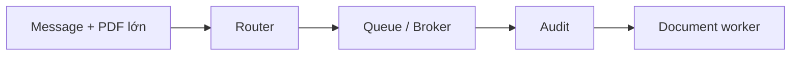
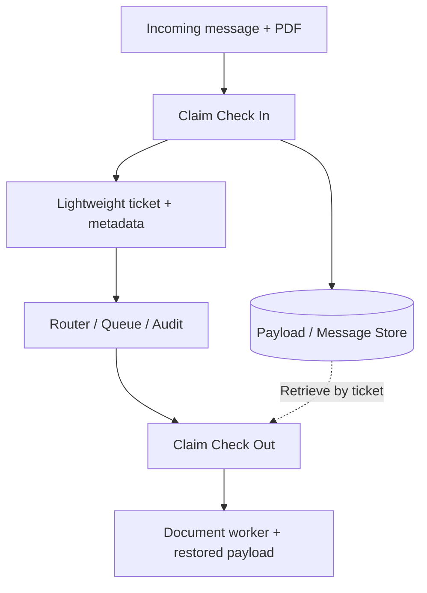
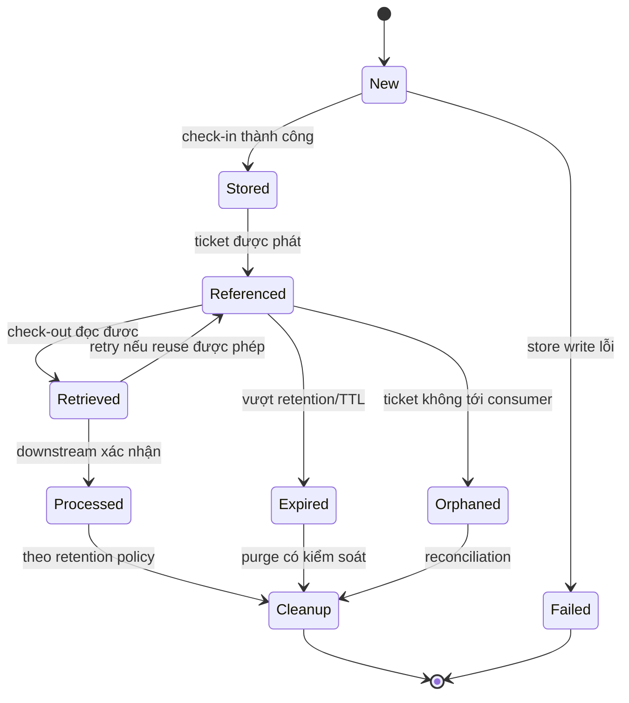
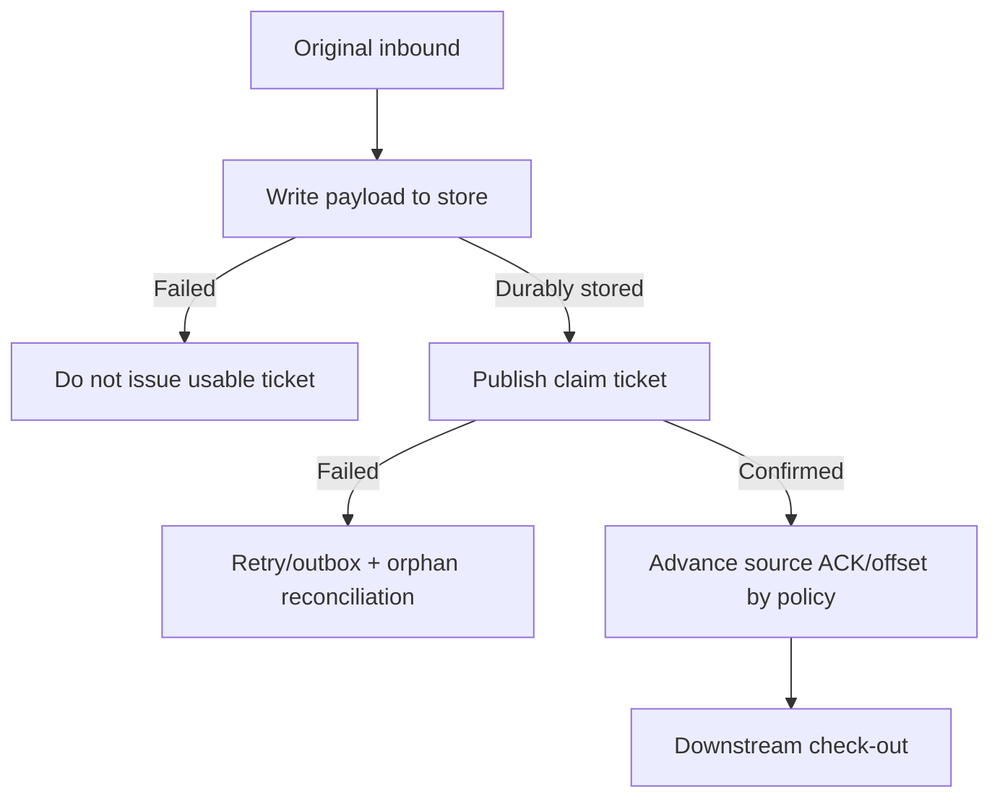
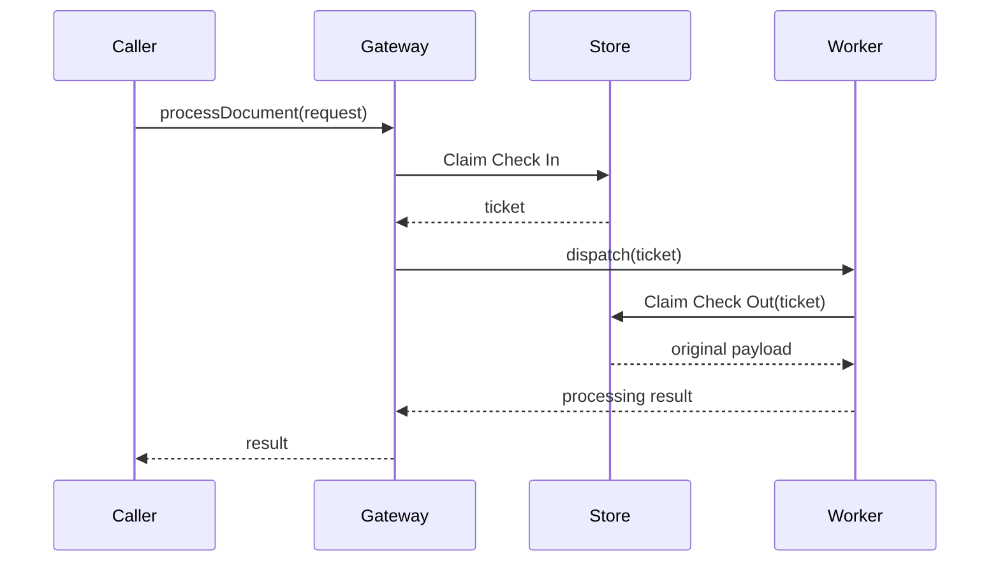
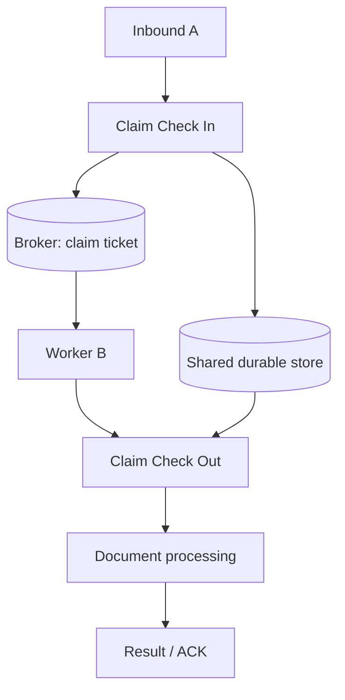
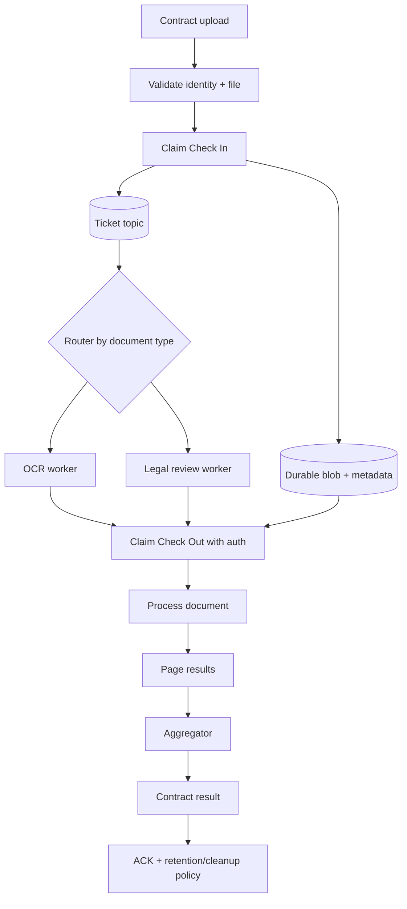

# Claim Check lưu payload ngoài message

Trong một hệ thống tích hợp, không phải message nào cũng nhỏ. Một sự kiện có thể chứa tệp PDF, ảnh, tài liệu định danh, dữ liệu đối soát hoặc một danh sách giao dịch rất lớn. Nếu gửi toàn bộ payload qua nhiều Router, Filter, Queue, Gateway và adapter, mỗi điểm trung gian có thể phải giữ, sao chép, serialize hoặc truyền dữ liệu mà bản thân nó **không cần đọc**. Khi dữ liệu lớn hoặc nhạy cảm, việc đó làm tăng áp lực lên bộ nhớ, network, broker, log và phạm vi tiếp xúc dữ liệu.

**Claim Check** là một mẫu Enterprise Integration Patterns (EIP) giúp **tách dữ liệu lớn ra khỏi luồng điều phối**. Thay vì truyền toàn bộ payload qua tất cả các bước, ứng dụng **cất dữ liệu vào nơi lưu trữ**, thay payload trong luồng bằng một **mã tham chiếu nhẹ (claim check/ticket)**, và **khôi phục dữ liệu** tại bước thực sự cần dùng. Mô hình thường được mô tả bằng hai thao tác **Claim Check In** và **Claim Check Out**.

Bài **“Claim Check lưu payload ngoài message”** thuộc chương **Claim check** của module `SPRING_INTEGRATION_PATTERN`. Mục tiêu của module là học triển khai Enterprise Integration Patterns với Spring Integration để xây dựng luồng thông điệp ít phụ thuộc, dễ mở rộng; thực hành Router, Filter, Transformer, Splitter, Aggregator, Gateway, retry, error channel, correlation và kiểm thử/giám sát các nhánh xử lý.

**Sau bài học, bạn có thể:**

- Giải thích vì sao Claim Check **không phải** nén dữ liệu hoặc tự động tạo độ bền giao nhận.
- Phân biệt **payload gốc**, **message envelope**, **claim ticket**, **MessageStore** và external object store.
- Thiết kế vòng đời **check-in → truyền ticket → check-out → xử lý → cleanup** có tính đến lỗi và retry.
- Viết ví dụ Spring Integration dùng `MessageStore`, `@Transformer`, channel và JUnit 5 để kiểm tra dữ liệu được khôi phục.
- Phân tích transaction, idempotency, retention/TTL, quyền truy cập, mã hóa, giới hạn dung lượng và rủi ro mất dữ liệu.
- Kiểm thử store failure, claim không tồn tại, ticket đến trùng, expired claim, nhiều instance và khôi phục sau restart.

## 1. Bài toán: message quá lớn so với nhiệm vụ của các bước trung gian

Giả sử hệ thống nhận một yêu cầu kiểm tra hợp đồng:

```text
ContractSubmitted
  contractId = "CTR-101"
  tenantId   = "TENANT-A"
  document   = <4 MiB binary PDF>
  priority   = "NORMAL"
```

Flow cần thực hiện các bước:

1. Kiểm tra loại tài liệu và quyền của tenant.
2. Định tuyến theo nhóm hợp đồng.
3. Ghi audit và đưa yêu cầu tới hàng đợi xử lý.
4. Chạy OCR/kiểm tra tính hợp lệ khi đến worker thích hợp.
5. Trả kết quả hoặc phát sự kiện hoàn tất.

**Router** chỉ cần `priority`, `tenantId` và loại tài liệu; **Audit handler** chỉ cần ID và trạng thái. Việc ép mọi bước mang theo 4 MiB PDF làm tăng chi phí mà không mang giá trị cho các bước đó.



Với Claim Check:



Điểm mạnh là các bước trung gian chỉ mang **tham chiếu và metadata cần thiết**, thay vì PDF gốc. Điều này **không đảm bảo** payload sẽ được bảo vệ, persist hoặc khôi phục đúng nếu store, access control và lifecycle không được thiết kế.

### Claim Check giải quyết điều gì?

| Vấn đề | Claim Check có thể giúp | Nó không tự giải quyết |
| --- | --- | --- |
| Payload lớn đi qua nhiều channel/adapter | Chuyển payload qua một tham chiếu nhẹ. | Tốc độ đọc/ghi store, độ trễ tải lại hoặc việc store đầy. |
| Bước trung gian không cần nội dung gốc | Hạn chế việc truyền dữ liệu không cần thiết. | Phân quyền, bảo vệ reference hoặc log nhạy cảm. |
| Broker giới hạn kích thước message | Đưa payload ra ngoài broker và chỉ gửi ticket. | Bảo đảm tính nguyên tử giữa store và broker. |
| Payload cần giữ để xử lý sau | Có thể dùng persistent store. | Retention, TTL, backup, cleanup, transaction. |
| Nhiều worker cần cùng dữ liệu | Dùng shared store và cơ chế cấp quyền phù hợp. | Atomic claim, deduplication, exactly-once side effect. |

**Nguyên tắc:** Claim Check **đổi hình dạng của dữ liệu đang lưu chuyển**, không thay thế hợp đồng lưu trữ hoặc giao nhận.

## 2. Khái niệm và ranh giới: check-in, ticket, check-out

Một Claim Check flow có ba thành phần chính:

- **Claim Check In:** nhận message chứa dữ liệu lớn, ghi payload hoặc cả message vào store; trả một ticket tham chiếu đến dữ liệu đã lưu.
- **Claim ticket:** mã tham chiếu nhỏ, thường đi kèm business metadata để Router/Filter xử lý mà không cần mở payload.
- **Claim Check Out:** nhận ticket, tra cứu store, lấy lại payload/message và đưa nó đến thành phần thực sự cần nội dung.

```text
Before:
  Message<ContractDocument> {
    payload = large binary content
    headers = { tenantId, traceId, correlationId, ... }
  }

After check-in:
  Message<ClaimTicket> {
    payload = claimId / reference
    headers = { tenantId, contentType, businessRoute, ... }
  }

After check-out:
  Message<ContractDocument> {
    payload = restored content
    headers = contract-aware metadata
  }
```

Đây là **mô hình khái niệm**. Với Spring Integration, những transformer theo mẫu Claim Check có thể dùng `MessageStore` để lưu **message** và trả **reference/ID**, trong khi một thiết kế object-store tùy biến có thể chỉ lưu bytes và metadata được chọn. Đừng giả định mọi triển khai Claim Check đều lưu đúng một cấu trúc hoặc truyền nguyên xi mọi header.

### Một ticket không phải “giấy phép truy cập”

Tên *claim check* gợi hình ảnh phiếu nhận hành lý: ai có phiếu thì có thể yêu cầu lấy lại món đồ. Trong hệ thống phần mềm, **chỉ sở hữu ticket không được coi là bằng chứng đủ quyền** để đọc tài liệu. Khi dữ liệu nhạy cảm, check-out phải kiểm tra tenant, danh tính service, quyền truy cập, thời hạn và phạm vi sử dụng.

Không để client truyền ID tùy ý rồi lấy nội dung từ store mà thiếu authorization.

## 3. Nên lưu cả Spring Message hay chỉ payload?

Có hai biến thể đáng phân biệt.

### 3.1. Lưu cả `Message<?>` vào `MessageStore`

Một Spring message chứa `payload` và `headers`. `MessageStore` trong Spring Integration cung cấp các thao tác lưu/đọc message theo ID. Đây là nền tảng phù hợp khi dùng Claim Check với các thành phần sẵn có của framework.

```text
MessageStore:
  key = original message ID (UUID)
  value = Spring Message<?> { payload, headers }
```

**Ưu điểm:** dễ khôi phục payload kèm các header đã lưu, tiện trong flow nội bộ. **Rủi ro:** một số header có thể là object không serialize được hoặc không phù hợp để lưu bền vững, chẳng hạn tham chiếu channel nội bộ, thông tin xác thực hoặc metadata nhạy cảm.

### 3.2. Lưu payload/bytes trong object store

Một kiến trúc khác lưu dữ liệu vào object storage/DB riêng và gửi ticket có `objectKey`, `contentType`, `checksum`, `size`, `tenantId` và chính sách tuổi thọ.

```text
Object store:
  key = claims/TENANT-A/opaque-random-key
  value = PDF bytes

Metadata store:
  claimId, tenantId, objectKey, checksum, status, expiresAt
```

**Ưu điểm:** phù hợp blob lớn, hỗ trợ lifecycle/retention riêng cho dữ liệu. **Rủi ro:** phải tự triển khai mapping, consistency giữa metadata và bytes, khả năng khôi phục, authorization, cleanup và checksum.

| Tiêu chí | `MessageStore` lưu message | Object store + metadata |
| --- | --- | --- |
| Đơn vị lưu | Toàn bộ `Message<?>` hoặc bản biểu diễn của message. | Byte payload/object và metadata do ứng dụng định nghĩa. |
| ID lấy lại | ID message/reference. | Claim ID/object key theo contract riêng. |
| Header handling | Cần kiểm tra khả năng serialize và propagation. | Chỉ lưu headers/metadata đã được chọn. |
| Blob rất lớn | Phụ thuộc store/serializer, có thể không tối ưu. | Thường thích hợp hơn nếu được thiết kế cho blob. |
| Độ bền | Phụ thuộc implementation của store. | Phụ thuộc object store + metadata store. |
| TTL/cleanup | Phải có policy riêng. | Có thể kết hợp lifecycle của object store và scheduler. |
| Tính nguyên tử với broker | Không tự có. | Cũng không tự có. |

**Lưu ý:** Việc thư viện có interface `MessageStore` không có nghĩa đang dùng một **persistent** store. Một `SimpleMessageStore` dùng trong bộ nhớ phù hợp demo/test nhưng không đáp ứng bài toán cần dữ liệu tồn tại qua restart.

## 4. Vòng đời của một claim

Một claim không chỉ có hai trạng thái “đã lưu” và “đã lấy”. Trong hệ thống thật, cần biết nó có đang hợp lệ, đã được sử dụng, quá hạn hay đang cần cleanup.



Các state trong sơ đồ là **mô hình thiết kế của ứng dụng**, không phải enum mặc định của Spring Integration.

| Sự kiện | Câu hỏi cần giải quyết |
| --- | --- |
| Check-in thành công | Store đã **ghi bền vững** chưa hay chỉ giữ trong RAM? |
| Phát ticket | Ticket đi qua broker được xác nhận chưa? |
| Check-out | Đọc một lần hay có thể đọc lại khi retry? |
| Xử lý downstream | Đã hoàn tất side effect/ACK chưa? |
| Message redelivery | Dùng lại ticket cũ hay tạo một claim mới? |
| Hết hạn | Ticket quá hạn trả lỗi nào, có được phục hồi không? |
| Cleanup | Xóa ở thời điểm nào không làm mất cơ hội retry? |
| Restart | Store và metadata có sống qua restart không? |

### Ranh giới quan trọng: retrieval khác processing success

**Đọc thành công một claim không chứng minh payload đã được xử lý thành công.** Nếu check-out xóa dữ liệu ngay, sau đó document worker lỗi hoặc broker redeliver ticket, dữ liệu có thể **không còn để retry**.

Bởi vậy, với công việc quan trọng, thường cần **giữ dữ liệu qua bước xử lý** và chỉ xóa sau mốc xác nhận được thiết kế; hoặc dùng durable outbox/transaction/retention cho phép khôi phục. Một lần dùng (*single-use*) có thể cần trạng thái **leased/claimed** và acknowledgment nguyên tử, chứ không chỉ `get` rồi `remove`.

## 5. Claim Check khác với Transformer, Enricher và Content Filter như thế nào?

| Pattern | Tác động chính | Ví dụ |
| --- | --- | --- |
| **Claim Check** | Cất payload/message và truyền reference; có bước lấy lại. | PDF → ticket → PDF. |
| **Transformer** | Biến đổi biểu diễn A thành B. | `OrderPlaced` → `PaymentInstruction`. |
| **Content Enricher** | Bổ sung dữ liệu vào payload bằng lookup. | Thêm `customerSegment` vào đơn. |
| **Header Enricher** | Bổ sung metadata cho route/trace. | Thêm `documentType=PDF`. |
| **Filter** | Quyết định message có đi tiếp không. | Chỉ chấp nhận tài liệu đủ điều kiện. |
| **Router** | Chọn channel/handler đích. | `CONTRACT` → legal worker. |
| **Splitter** | Tách một payload thành nhiều message con. | Batch nhiều file → từng file riêng. |
| **Aggregator** | Gom các message liên quan thành kết quả chung. | Các kết quả OCR → batch summary. |

Claim Check thường dùng **Transformer-like endpoints** để đổi payload lớn thành reference và khôi phục sau đó, nhưng **mục đích kiến trúc** là kiểm soát kích thước và vị trí lưu dữ liệu.

### Router/Filter nhìn thấy gì ở dạng ticket?

Một Router trước check-out **không còn toàn bộ payload gốc để kiểm tra**. Nó cần metadata đủ cho quyết định như `documentType`, `tenantId`, `priority` hoặc `businessRoute`.

```text
Large message
    |
    v
Validate trusted metadata
    |
    v
Claim Check In
    |
    v
Ticket + whitelisted routing metadata
    |
    +-- Router: CONTRACT -> legalReview
    +-- Router: INVOICE  -> financeReview
    |
    v
Claim Check Out at worker
```

Không sao chép mù mọi header sang ticket. Ví dụ, nếu `replyChannel` là tham chiếu trong JVM, nó có thể không dùng được ở process khác. Nếu `tenantId` do client gửi mà chưa xác thực, route và check-out **không được coi** đó là bằng chứng quyền.

## 6. Một contract ticket có ý nghĩa

Trong demo đơn giản, ticket có thể là `UUID` của Spring message đã lưu. Ở hệ thống nhiều service, nên có một **envelope nghiệp vụ rõ ràng** thay vì truyền một UUID khó giải thích.

```json
{
  "claimId": "opaque-claim-7f2a",
  "eventId": "evt-101",
  "tenantId": "TENANT-A",
  "documentType": "CONTRACT",
  "contentType": "application/pdf",
  "sizeBytes": 4194304,
  "checksumSha256": "<digest>",
  "storageVersion": "v1",
  "expiresAt": "2026-11-22T00:00:00Z"
}
```

Đây là **schema gợi ý do ứng dụng định nghĩa**, không phải payload tự động do Spring Integration cung cấp.

| Trường | Tác dụng |
| --- | --- |
| `claimId` | Tham chiếu opaque tới dữ liệu; không chứa đường dẫn nội bộ lộ quyền. |
| `eventId` | Khóa nghiệp vụ giúp truy vết/deduplicate qua retry. |
| `tenantId` | Ngữ cảnh sở hữu; **cần xác thực độc lập** tại check-out. |
| `documentType` | Hỗ trợ Router mà không cần đọc PDF. |
| `contentType` | Loại dữ liệu được khai báo; vẫn phải kiểm tra sau khi tải nếu nhạy cảm. |
| `sizeBytes` | Giới hạn dung lượng, bảo vệ bộ nhớ và dự toán tài nguyên. |
| `checksumSha256` | Kiểm tra byte payload có còn nguyên vẹn. |
| `storageVersion` | Phục vụ thay đổi schema/format của dữ liệu lưu. |
| `expiresAt` | Hạn sử dụng ticket/claim, không tự thay thế cleanup scheduler. |

Một ticket **không nên chứa secret** hoặc presigned URL có thời hạn dài được phát bừa bãi. Nếu buộc phải dùng URL có chữ ký, giới hạn quyền, phạm vi, thời gian sống và tránh ghi URL vào log.

### ID nghiệp vụ không phải ID message

`MessageHeaders.id` có thể thay đổi khi dựng lại message sau replay. Để idempotency khi xử lý hợp đồng, cần `eventId`/`commandId` bền vững từ domain contract. Có thể dùng message UUID làm ID tra cứu **nội bộ trong demo**, nhưng **không được suy ra nó luôn ổn định hoặc đủ an toàn như capability token công khai**.

## 7. Spring Integration: Claim Check In/Out và `MessageStore`

Spring Integration có các transformer theo mẫu Claim Check để lưu message và khôi phục theo reference. Khi dùng những thành phần có sẵn, cần hiểu ba điểm:

1. **Check-in** lưu message vào `MessageStore` tương ứng rồi phát thông tin tham chiếu.
2. **Check-out** dùng tham chiếu để đọc lại message; tùy cấu hình có thể có chính sách **remove after retrieve**.
3. **Store implementation quyết định durability**: bộ nhớ nội bộ chỉ là bộ nhớ nội bộ; JDBC hoặc store bền vững khác cần cấu hình tương ứng với transaction, schema và serializer.

Để minh họa rõ các ranh giới và tránh lệ thuộc một overload cụ thể giữa các phiên bản DSL, phần code dưới đây **tự hiện thực logic Claim Check bằng `MessageStore` và `@Transformer` của Spring Integration**. Đây là **một triển khai ứng dụng mang semantics Claim Check**, không phải yêu cầu người học phải tự thay thế các transformer sẵn có trong mọi dự án.

### 7.1. Service lưu và lấy message

```java
import java.util.UUID;

import org.springframework.integration.store.MessageStore;
import org.springframework.messaging.Message;

final class ClaimCheckService {
    private final MessageStore store;

    ClaimCheckService(MessageStore store) {
        this.store = store;
    }

    UUID checkIn(Message<?> original) {
        if (original == null) {
            throw new IllegalArgumentException("MESSAGE_REQUIRED");
        }
        UUID claimId = original.getHeaders().getId();
        if (claimId == null) {
            throw new IllegalArgumentException("MESSAGE_ID_REQUIRED");
        }

        // Với store bền vững, thao tác này phải xác nhận ghi thành công
        // trước khi ứng dụng coi ticket là có thể sử dụng.
        store.addMessage(original);
        return claimId;
    }

    Message<?> checkOut(UUID claimId) {
        if (claimId == null) {
            throw new IllegalArgumentException("CLAIM_ID_REQUIRED");
        }
        Message<?> stored = store.getMessage(claimId);
        if (stored == null) {
            throw new IllegalStateException("CLAIM_NOT_FOUND");
        }
        // Cố ý KHÔNG xóa ngay: downstream có thể thất bại và retry.
        return stored;
    }
}
```

`MessageStore` và `Message<?>` là các API của Spring Integration/Spring Messaging; class `ClaimCheckService` và mã lỗi là **ứng dụng tự định nghĩa**.

**Ý nghĩa chính xác của ví dụ:**

- `checkIn()` **lưu toàn bộ Spring message**, không chỉ một file ngoài object store.
- Ticket là UUID của message được lưu, chỉ phục vụ mô hình **nội bộ/trusted** trong demo.
- `checkOut()` trả message đã lưu. Việc **Transformer endpoint** tiếp tục tạo/truyền output message và merge/propagate headers cần được kiểm thử theo version.
- Không xóa khi check-out, vì cần chính sách xóa/ACK riêng.
- `store.addMessage` có thể lỗi; code không `catch` rồi phát ticket giả.
- Không có tenant authorization, expiry, checksum, persistent transaction, anti-replay; **không dùng nguyên bản làm dịch vụ claim công khai**.

### 7.2. Các transformer và channel

```java
import java.util.UUID;

import org.springframework.context.annotation.Bean;
import org.springframework.context.annotation.Configuration;
import org.springframework.integration.annotation.Transformer;
import org.springframework.integration.channel.DirectChannel;
import org.springframework.integration.channel.QueueChannel;
import org.springframework.integration.config.EnableIntegration;
import org.springframework.integration.store.MessageStore;
import org.springframework.integration.store.SimpleMessageStore;
import org.springframework.messaging.Message;

@Configuration
@EnableIntegration
class ClaimCheckDemoConfig {

    @Bean
    MessageStore claimMessageStore() {
        return new SimpleMessageStore();
    }

    @Bean
    ClaimCheckService claimCheckService(MessageStore claimMessageStore) {
        return new ClaimCheckService(claimMessageStore);
    }

    @Bean
    ClaimCheckEndpoints claimCheckEndpoints(ClaimCheckService service) {
        return new ClaimCheckEndpoints(service);
    }

    @Bean
    DirectChannel largeInput() {
        return new DirectChannel();
    }

    @Bean
    QueueChannel lightweightTickets() {
        return new QueueChannel();
    }

    @Bean
    DirectChannel ticketsToRestore() {
        return new DirectChannel();
    }

    @Bean
    QueueChannel restoredMessages() {
        return new QueueChannel();
    }
}

final class ClaimCheckEndpoints {
    private final ClaimCheckService service;

    ClaimCheckEndpoints(ClaimCheckService service) {
        this.service = service;
    }

    @Transformer(inputChannel = "largeInput",
                 outputChannel = "lightweightTickets")
    public UUID checkIn(Message<byte[]> original) {
        return service.checkIn(original);
    }

    @Transformer(inputChannel = "ticketsToRestore",
                 outputChannel = "restoredMessages")
    public Message<?> checkOut(UUID ticket) {
        return service.checkOut(ticket);
    }
}
```

Cấu hình trên minh họa **hai endpoint độc lập**:

- Một endpoint nhận `Message<byte[]>` lớn và tạo `Message<UUID>` ticket.
- Endpoint còn lại nhận UUID ticket, tìm message gốc và phát nội dung khôi phục.
- Giữa hai endpoint, một Router/broker/audit có thể điều phối **ticket** tới đúng worker; demo để hai channel tách riêng để test kiểm soát lúc check-out.
- `QueueChannel` chỉ làm điểm giữ message **trong JVM phục vụ thử nghiệm**; không phải broker hoặc durable queue.
- `SimpleMessageStore` là **in-memory**. Process restart có thể làm mất claim, kể cả khi ticket đã được gửi đi.
- `@Transformer` được xử lý bởi hạ tầng Spring Integration; payload đầu ra và header propagation cần được kiểm chứng bằng integration test.

Không đăng ký thêm một flow cạnh tranh tiêu thụ `largeInput` hoặc `ticketsToRestore` nếu mục tiêu là mỗi message có đúng một đường check-in/out. Tùy phiên bản Spring Integration, có thể dùng Claim Check transformers/Java DSL sẵn có thay cho wrapper minh họa.

## 8. Gửi ticket thay vì gửi dữ liệu lớn

Với flow mục 7, producer có thể gửi một mảng bytes và đọc UUID từ `lightweightTickets`.

```java
import java.nio.charset.StandardCharsets;

import org.springframework.messaging.MessageChannel;
import org.springframework.messaging.support.MessageBuilder;

void publishDocument(MessageChannel largeInput) {
    byte[] bytes = "PDF-BYTES-FOR-DEMO"
            .getBytes(StandardCharsets.UTF_8);

    largeInput.send(MessageBuilder.withPayload(bytes)
            .setHeader("eventId", "evt-101")
            .setHeader("tenantId", "TENANT-A")
            .setHeader("documentType", "CONTRACT")
            .setHeader("traceId", "trace-101")
            .build());
}
```

**Lưu ý:** bytes ở đây chỉ là dữ liệu mẫu, **không phải PDF hợp lệ**. Demo không kiểm thử định dạng PDF hoặc quét nội dung độc hại.

Sau check-in, payload của message đầu ra là một **ticket UUID**. Trong cùng JVM, metadata hợp lệ có thể được framework propagate theo semantics transformer; khi qua adapter/broker, phải kiểm tra chính xác **header mapper** và những trường cần giữ.

### Có thể Router dùng nội dung payload sau check-in không?

Không thể mong một Router đọc `documentType` bằng cách cast payload UUID thành `ContractDocument`. Nó phải dựa vào **headers hoặc ticket envelope**. Nếu yêu cầu nghiệp vụ phải xem nội dung PDF mới quyết định route, có thể:

1. Trích xuất metadata đã được xác minh **trước check-in**, rồi route theo metadata.
2. Tạm check-out ở điểm quyết định thực sự cần nội dung.
3. Tách một `DocumentClassification` nhẹ và lưu nó cùng ticket.

Không chuyển một payload thành ticket rồi lặng lẽ để downstream vẫn kỳ vọng payload loại cũ.

## 9. Integration test: check-in, lấy ticket, check-out đúng payload

Unit test `ClaimCheckService` chỉ chứng minh thao tác store. Integration test cần xác minh **Spring Transformer endpoint nhận message, phát UUID, rồi khôi phục byte payload**.

```java
import static org.junit.jupiter.api.Assertions.assertArrayEquals;
import static org.junit.jupiter.api.Assertions.assertEquals;
import static org.junit.jupiter.api.Assertions.assertNotNull;
import static org.junit.jupiter.api.Assertions.assertNull;
import static org.junit.jupiter.api.Assertions.assertTrue;

import java.util.UUID;

import org.junit.jupiter.api.Test;
import org.springframework.beans.factory.annotation.Autowired;
import org.springframework.beans.factory.annotation.Qualifier;
import org.springframework.integration.channel.QueueChannel;
import org.springframework.integration.store.MessageStore;
import org.springframework.messaging.Message;
import org.springframework.messaging.MessageChannel;
import org.springframework.messaging.support.MessageBuilder;
import org.springframework.test.annotation.DirtiesContext;
import org.springframework.test.context.junit.jupiter.SpringJUnitConfig;

@SpringJUnitConfig(ClaimCheckDemoConfig.class)
@DirtiesContext(classMode = DirtiesContext.ClassMode.AFTER_EACH_TEST_METHOD)
class ClaimCheckFlowTest {

    @Autowired @Qualifier("largeInput")
    MessageChannel input;

    @Autowired @Qualifier("lightweightTickets")
    QueueChannel tickets;

    @Autowired @Qualifier("ticketsToRestore")
    MessageChannel restoreInput;

    @Autowired @Qualifier("restoredMessages")
    QueueChannel restored;

    @Autowired
    MessageStore store;

    @Test
    void parksLargePayloadThenRestoresItByTicket() {
        byte[] payload = new byte[8192];
        for (int i = 0; i < payload.length; i++) {
            payload[i] = (byte) (i % 251);
        }

        Message<byte[]> original = MessageBuilder
                .withPayload(payload)
                .setHeader("eventId", "evt-101")
                .setHeader("traceId", "trace-101")
                .build();

        assertTrue(input.send(original));

        Message<?> ticketMessage = tickets.receive(1_000);
        assertNotNull(ticketMessage);
        assertTrue(ticketMessage.getPayload() instanceof UUID);

        UUID claimId = (UUID) ticketMessage.getPayload();
        assertNotNull(store.getMessage(claimId));

        assertTrue(restoreInput.send(
                MessageBuilder.withPayload(claimId).build()));

        Message<?> recovered = restored.receive(1_000);
        assertNotNull(recovered);
        assertTrue(recovered.getPayload() instanceof byte[]);

        assertArrayEquals(payload, (byte[]) recovered.getPayload());
        assertEquals("evt-101", recovered.getHeaders().get("eventId"));

        // Phiên bản custom service KHÔNG remove ngay khi check-out.
        assertNotNull(store.getMessage(claimId));
        assertNull(tickets.receive(0));
        assertNull(restored.receive(0));
    }
}
```

`@DirtiesContext` cô lập store/queues giữa các test nhưng có thể làm suite chậm hơn. Trong flow đồng bộ tới `QueueChannel`, kết quả demo có thể được nhận với `receive(timeout)`. Khi đưa qua executor/broker, không giả định hai kết quả đến ngay hoặc theo thứ tự thời gian giống ví dụ.

**Về headers:** test kiểm tra `eventId` do ứng dụng đặt. Không nên assert một cách máy móc rằng Spring `MessageHeaders.id`, timestamp hoặc tham chiếu `replyChannel` phải bất biến qua mọi Transformer và adapter. Đó là metadata vòng đời kỹ thuật và có thể được tạo lại. Hãy kiểm tra những header thực sự thuộc **contract** của flow triển khai.

### Unit test claim không tồn tại

```java
import static org.junit.jupiter.api.Assertions.assertThrows;

import java.util.UUID;

import org.junit.jupiter.api.Test;
import org.springframework.integration.store.SimpleMessageStore;

class ClaimCheckServiceTest {

    @Test
    void unknownClaimIsNotSilentlyReturnedAsNull() {
        ClaimCheckService service =
                new ClaimCheckService(new SimpleMessageStore());

        assertThrows(IllegalStateException.class,
                () -> service.checkOut(UUID.randomUUID()));
    }
}
```

Một ticket không tồn tại cần được phân loại rõ: `NOT_FOUND`, `EXPIRED`, `ALREADY_CONSUMED`, `WRONG_TENANT`, `STORE_UNAVAILABLE` không phải các trạng thái đồng nghĩa. Trong demo `getMessage() == null` được map thành `CLAIM_NOT_FOUND`; production có thể cần metadata/tombstone để phân biệt chúng.

## 10. Mutable payload và tính toàn vẹn sau check-in

Trong ví dụ, payload là `byte[]`, vốn **mutable**. `SimpleMessageStore` giữ object trong memory theo cách cài đặt của nó; không nên giả định thao tác `addMessage(original)` tự tạo **bản sao độc lập** của từng byte.

Ví dụ nguy hiểm:

```java
byte[] payload = readIncomingBytes();
Message<byte[]> message = MessageBuilder.withPayload(payload).build();

store.addMessage(message);

// Nếu mảng chung bị sửa ở nơi khác, nội dung truy hồi có thể
// không còn như lúc check-in đối với các store giữ cùng reference.
payload[0] = 0;
```

Để bảo đảm snapshot dữ liệu, có thể:

- Copy dữ liệu mutable trước khi lưu vào store nội bộ.
- Dùng DTO bất biến hoặc serializer tạo blob độc lập.
- Với object store, ghi một object version bất biến và lưu `checksumSha256`.
- Xác minh dữ liệu khi check-out bằng checksum/size, không chỉ tin ticket.
- Không dùng **cùng một object mutable** làm input cho nhiều subscriber có thể sửa nội dung song song.

**Claim Check là pattern lưu tham chiếu**, không phải tự động tạo immutable snapshot hoặc phát hiện dữ liệu hỏng.

## 11. MessageStore nào dùng trong môi trường nào?

| Cách lưu | Phù hợp | Chú ý |
| --- | --- | --- |
| `SimpleMessageStore` in-memory | Demo, thử nghiệm trong một JVM. | Mất dữ liệu khi restart; chiếm RAM, không phù hợp blob lớn bền vững. |
| Persistent `MessageStore` dựa trên JDBC/hạ tầng thích hợp | Flow cần duy trì claims qua restart. | Serializer, transaction, schema, retention, lock và tải DB. |
| Object storage + metadata DB | Tệp lớn/ảnh/PDF, nhiều worker hoặc dịch vụ. | Quyền truy cập, object key, checksum, metadata consistency, cleanup. |
| Redis/cache có TTL | Dữ liệu tạm, mức mất dữ liệu chấp nhận được. | TTL/eviction, memory pressure, khả năng phục hồi và chính sách expiry. |
| File/shared storage | Hệ thống đơn giản, dữ liệu lớn ít thay đổi. | Path traversal, quyền filesystem, atomic write, multi-host mount, cleanup. |

Không phải mọi lựa chọn trong bảng đều là một implementation trực tiếp của `MessageStore` interface. **Object storage và Redis cache có thể cần adapter/application repository riêng**. Hãy phân biệt **kho chứa bytes** với **bảng metadata của claim**; cần quản lý tính nhất quán của cả hai.

### Khi nào nên tránh lưu blob trong message store?

Nếu file rất lớn hoặc đã tồn tại ở một document service, ghi lại toàn bộ file vào database message store có thể tạo **hai bản sao**, tốn dung lượng và thời gian. Một ticket trỏ tới object đã được kiểm soát quyền có thể hợp lý hơn. Nhưng nếu document service có quyền xóa/thay nội dung độc lập, bạn cần **object version/immutable key/retention** để check-out đọc đúng bản.

### Đánh giá ngưỡng dùng Claim Check

Không có ngưỡng kích thước chung cho mọi dự án. Cần đo payload size, tần suất message, giới hạn broker, bộ nhớ, thời gian serialize/deserialize, số hop mà payload đi qua, băng thông và độ trễ store. Nếu payload chỉ vài trăm byte và flow có một handler, việc thêm lookup store có thể khiến kiến trúc **phức tạp và chậm hơn** mà không đem lại lợi ích đáng kể.

## 12. Tính nguyên tử giữa check-in và phát ticket

Đây là ranh giới dễ gây mất dữ liệu khi đi qua broker:

```text
(1) Ghi payload vào store
(2) Phát ticket lên broker
(3) ACK/commit message gốc
```

Có hai hướng lỗi khác nhau:

**Store thành công, phát ticket thất bại:** dữ liệu vẫn ở store nhưng không ai nhận ticket. Đây là một **orphan claim**; cần retry gửi ticket, outbox, reconciliation và cleanup sau thời gian an toàn.

**Phát ticket thành công nhưng payload chưa được lưu bền vững:** consumer nhận ticket nhưng check-out không tìm thấy dữ liệu. Đây là lỗi **dangling reference**; có thể khiến sự kiện không xử lý được.



Thứ tự trên là **mục tiêu thiết kế**, không phải một transaction phân tán tự có của Spring Integration. Không có bảo đảm atomic commit giữa object store, broker và source offset chỉ vì chúng cùng nằm trong một IntegrationFlow.

### Outbox và idempotency

Nếu cần đảm bảo ticket cuối cùng được phát khi payload đã lưu, có thể:

1. Lưu claim metadata/payload hoặc tham chiếu trong một transaction.
2. Lưu **outbox event** `ClaimReady(claimId, eventId)` trong cùng transaction khi hạ tầng cho phép.
3. Publisher đọc outbox và phát ticket lên broker.
4. Consumer dùng `eventId/claimId` để deduplicate nếu ticket bị phát lại.
5. Reconciler tìm claims không còn liên kết với ticket còn hiệu lực và xử lý có kiểm soát.

Cơ chế cụ thể phụ thuộc storage/broker và thiết kế transaction. Nếu payload ở object store riêng, vẫn phải xử lý **khoảng hở** giữa upload object và commit metadata; outbox không tự làm hai hệ thống thành một transaction duy nhất.

## 13. Check-out: đọc nhiều lần hay xóa một lần?

Có ít nhất ba chính sách:

| Chính sách | Mô tả | Khi phù hợp | Rủi ro |
| --- | --- | --- | --- |
| **Read without remove** | Đọc dữ liệu, giữ claim để retry. | At-least-once, consumer có thể crash. | Cần TTL/cleanup để không phình store. |
| **Remove on retrieval** | Lấy xong xóa, ticket về sau không dùng được. | Một số workflow một lần, chấp nhận rủi ro hoặc có giao dịch phù hợp. | Downstream lỗi ngay sau retrieve có thể làm mất dữ liệu. |
| **Lease/ack/remove** | Claim được đánh dấu đang xử lý; xóa sau ACK. | Nhiệm vụ quan trọng, cần redelivery an toàn. | Cần state machine, locking và recovery khi lease hết hạn. |

Một cấu hình Claim Check Out có thể hỗ trợ **loại bỏ message khỏi store sau khi lấy**; nhưng việc đó **không đồng nghĩa** với “đã xử lý nghiệp vụ thành công”. Không bật remove-on-retrieve chỉ để tiết kiệm storage khi còn yêu cầu retry/redelivery.

### Race condition của hai consumer

Nếu hai worker cùng cầm một ticket và check-out đồng thời:

```text
Worker A: get(claim-101) -> payload
Worker B: get(claim-101) -> payload
Worker A: process -> success
Worker B: process -> duplicate side effect
```

Nếu nghiệp vụ chỉ cho một worker xử lý, cần **claim/lease nguyên tử**, partition/group affinity hoặc idempotency ở worker. `getMessage()` trên store không tự đảm bảo quyền độc quyền.

### Lưu ý khi xóa

Nếu hệ thống dùng `store.removeMessage(claimId)`, nên chỉ thực hiện theo policy đã được xác nhận, không gọi trước khi downstream ACK. Cần coi **xóa trùng** là kết quả có thể xảy ra dưới retry, có audit/metric và không biến một thao tác cleanup thành một tác vụ side effect nghiệp vụ bị chạy hai lần.

## 14. TTL, retention và cleanup

Claim Check tạo thêm một kho dữ liệu. Nếu không có cleanup, store sẽ tích lũy payload lớn vô hạn dù tất cả message đã xử lý xong.

Các mốc thời gian cần phân biệt:

- **Ticket expiry:** sau thời điểm nào không còn cho phép check-out.
- **Payload retention:** dữ liệu cần giữ bao lâu cho retry, audit hoặc chính sách nghiệp vụ.
- **Processing deadline:** đến khi nào request cần được xử lý.
- **Backup retention:** bản sao lưu có thể tồn tại lâu hơn dữ liệu trong store chính.
- **Legal hold/retention policy:** có tình huống không được tự xóa theo TTL kỹ thuật.

Ví dụ:

```text
Claim created:          T0
Normal processing SLA:  T0 + 5 min
Ticket valid until:     T0 + 1 hour
Payload retained until: T0 + 24 hours
Cleanup eligible:       processing confirmed AND retention satisfied
```

Đây là **ví dụ chính sách**, không phải cấu hình mặc định. Một claim quá hạn không có nghĩa payload tự biến mất; cần scheduler, object-store lifecycle hoặc lệnh cleanup với quyền phù hợp.

### Orphan reconciliation

Một tiến trình nền nên có khả năng phát hiện:

1. Payload đã lưu nhưng ticket chưa từng được publish xác nhận.
2. Ticket đã được xử lý và retention đã kết thúc nhưng payload còn tồn tại.
3. Ticket đã expire nhưng vẫn có job chờ; cần recovery/quarantine thay vì xóa mù.
4. Metadata claim trỏ tới object không tồn tại.
5. Object tồn tại nhưng metadata claim đã mất.
6. Claim bị thu hồi quyền, cần vô hiệu hóa check-out dù chưa hết TTL.

**Xóa chỉ theo thời gian tạo** có thể làm mất dữ liệu của job chậm hoặc đang retry. Cleanup phải xét **trạng thái xử lý và quy định lưu giữ**.

## 15. Bảo mật: claim ticket là một đường dẫn tới dữ liệu

Claim Check có thể **giảm lượng dữ liệu nhạy cảm di chuyển qua các nhánh**, nhưng đồng thời tạo một **điểm truy xuất dữ liệu tập trung**. Nếu ticket bị đoán, lộ qua log hoặc không được kiểm tra quyền, kho dữ liệu có thể bị đọc trái phép.

Các biện pháp cần thiết:

1. **ID khó đoán/opaque:** không dùng số thứ tự tăng đơn giản làm public claim ID. Một UUID ngẫu nhiên là khởi đầu, nhưng **không thay thế authorization**.
2. **Tenant scope:** claim phải có chủ sở hữu/tenant đã được xác minh; check-out xác thực caller và đối chiếu quyền của tenant.
3. **Least privilege:** service chỉ có quyền đọc những namespace/claim cần thiết; worker không được duyệt toàn bộ bucket.
4. **Encryption:** dùng TLS khi truyền, mã hóa ở nơi lưu theo yêu cầu; quản lý khóa/rotation và access logging.
5. **Content validation:** kiểm tra loại dữ liệu thực, kích thước, checksum và scan nội dung độc hại khi cần; không chỉ tin `contentType` do client gửi.
6. **Audit:** ghi event `CLAIM_CREATED`, `CLAIM_READ`, `CLAIM_DENIED`, `CLAIM_EXPIRED`, `CLAIM_DELETED` với ID hợp lý, không log payload.
7. **Rate limiting:** giới hạn check-out để tránh brute force/enumeration và download quá mức.
8. **Revocation:** có cách vô hiệu hóa ticket/claim trước expiry khi quyền hoặc dữ liệu bị thu hồi.
9. **Secret handling:** tránh nhúng bearer token hoặc presigned URL dài hạn vào headers bị propagate qua nhiều service.
10. **Data minimization:** ticket đi qua Router/Audit chỉ chứa metadata thực sự cần, không sao chép PII ngoài mục đích.

### Không tin header do nguồn ngoài cung cấp

Một HTTP client có thể đặt `tenantId=TENANT-A` trong JSON/header; điều đó **không chứng minh** họ là tenant A. Sau khi xác thực, ứng dụng phải tạo ngữ cảnh tin cậy cho check-in và check-out. Ticket thuộc tenant A không được lấy lại chỉ vì message sau đó chứa một string `TENANT-A`.

## 16. Headers, correlation và request–reply khi payload được khôi phục

Khi lưu/cất một Spring `Message<?>`, ta có thể gặp các header kỹ thuật:

| Metadata | Tác dụng | Điều cần cân nhắc |
| --- | --- | --- |
| `id`, `timestamp` | Vòng đời của một Spring message. | Có thể đổi khi tạo message mới; không dùng làm event ID bền vững. |
| `replyChannel` | Đường reply của Gateway. | Tham chiếu nội bộ có thể không serialize được hoặc không có ý nghĩa qua process. |
| `errorChannel` | Metadata xử lý lỗi theo endpoint. | Không coi như queue audit của claim. |
| `correlationId` | Nhóm message của Splitter/Aggregator hoặc lượt xử lý. | Giữ/tái tạo đúng contract nếu cần gom kết quả. |
| `sequenceNumber`, `sequenceSize` | Vị trí và số lượng phần tử được tách. | Không thay bằng số lần check-out. |
| `traceId` | Tracing và quan sát. | Cần propagation qua executor/broker, không dùng để cấp quyền. |
| `eventId`, `tenantId` từ hợp đồng | Danh tính nghiệp vụ và quyền sở hữu. | Nên lưu ở metadata tin cậy/ticket envelope khi cần. |

### Gateway chờ reply sau check-out



Sơ đồ minh họa luồng logic. Claim Check **không tự biến một flow bất đồng bộ kéo dài thành Gateway request–reply bền vững**. Nếu caller timeout trước khi worker hoàn tất, cần status query/event completion hoặc một recovery policy. `replyChannel` có thể hợp lệ trong JVM nhưng không nên được coi là địa chỉ có thể đi qua mọi broker.

### Splitter và Aggregator

Nếu Splitter tạo nhiều message con rồi mỗi message được Claim Check In, cần bảo toàn **group/run ID và sequence** ngoài store hoặc trong metadata đáng tin cậy. Khi check-out, các kết quả phải về đúng Aggregator. Nếu một ticket mất hoặc expire, Aggregator có thể thiếu một kết quả và chờ đến timeout.

**Không dùng `claimId` thay thế `correlationId` khi mỗi item trong cùng batch có ticket riêng**: các claim khác nhau vẫn có thể thuộc cùng một nhóm cần gom.

## 17. Retry, duplicate và idempotency

Giả sử ticket được phát lên Kafka và consumer xử lý:

```text
Ticket T-101
   |
   v
Check-out
   |
   v
Document worker
   |
   v
Persist result
   |
   v
ACK source
```

Nếu worker đã lưu kết quả nhưng chết trước ACK, Kafka có thể giao **lại ticket T-101**. Lúc này:

- Claim vẫn cần tồn tại hoặc có recovery path.
- Worker phải biết kết quả tương ứng `eventId` đã được xử lý để không thực hiện side effect lần nữa.
- Nếu claim đã bị xóa khi check-out đầu tiên, retry có thể báo `CLAIM_NOT_FOUND` dù công việc đã hoàn tất.
- Nếu consumer khác nhận lại ticket, cần phân quyền giống lần đầu.

### Chìa khóa idempotency

Một khóa như `(eventId, documentProcessingVersion)` hoặc `(commandId, operation)` phù hợp hơn một UUID message chỉ tồn tại trong lần vận chuyển. Nếu một event được phép xử lý lại hợp lệ theo **phiên bản thuật toán mới**, cần phân biệt `processingRunId`/`version` để tránh chặn nhầm.

Không dựa vào **claim ID** làm idempotency key duy nhất nếu cùng một nghiệp vụ có thể tạo nhiều claim do producer retry. Cần chính sách deduplicate **trước hoặc ngay khi check-in**: cùng `eventId` có tái sử dụng claim cũ không, hay tạo claim mới với trạng thái riêng?

### Claim không đồng nghĩa exactly once

`MessageStore` có thể lưu một message, nhưng at-least-once delivery, write result, source offset và cleanup vẫn là các thao tác độc lập. Claim Check **không tự cung cấp exactly-once processing end-to-end**. Nếu yêu cầu mạnh, hãy thiết kế transaction, idempotent consumer, outbox và reconciliation theo đúng hạ tầng.

## 18. Xử lý lỗi: phân biệt store, ticket và downstream

Một bảng lỗi giúp tránh bắt tất cả exception rồi trả `null`:

| Lỗi | Vị trí | Phản ứng phù hợp |
| --- | --- | --- |
| `CLAIM_STORE_UNAVAILABLE` | Check-in không lưu được. | Không phát ticket có thể dùng; retry có giới hạn, error channel/recovery. |
| `CLAIM_NOT_FOUND` | Check-out không thấy ID. | Phân biệt chưa được tạo, đã xóa, sai ticket; audit/quarantine. |
| `CLAIM_EXPIRED` | Ticket quá thời hạn. | Không tự bypass TTL; có recovery/reissue có kiểm soát. |
| `CLAIM_FORBIDDEN` | Caller không có quyền. | Fail closed, không tiết lộ payload; security audit. |
| `CLAIM_CHECKSUM_MISMATCH` | Dữ liệu bị đổi/hỏng. | Quarantine, điều tra corruption, không đưa downstream. |
| `CLAIM_SIZE_LIMIT` | Payload vượt ngưỡng. | Reject trước khi cấp ticket; hạn chế bộ nhớ/tải. |
| `CLAIM_DESERIALIZATION_FAILED` | Schema/serializer không tương thích. | Versioning/migration/recovery, không bỏ message. |
| `TICKET_PUBLISH_FAILED` | Store đã ghi nhưng broker lỗi. | Outbox/retry, orphan reconciliation. |
| `DOWNSTREAM_FAILED` | Worker đọc được payload nhưng xử lý lỗi. | Retry theo tính chất lỗi; giữ claim cho đến khi recovery xong. |
| `CLEANUP_FAILED` | Xóa quá hạn không thành công. | Retry cleanup, cảnh báo retention và storage growth. |

### Error channel không tự lưu claim

Exception trong channel/endpoint đồng bộ có thể lan tới caller; với poller hoặc executor bất đồng bộ, lỗi có thể được chuyển thành `ErrorMessage` qua cơ chế error handler/`errorChannel` đã cấu hình. **Không mặc định** mọi lỗi check-out đều tự tới một DLQ hay tự có bản gốc trong error message.

Nếu check-in thất bại trước khi lưu, việc retry cần giữ được message đầu vào ở source. Nếu ticket đã đi tới broker rồi check-out thất bại, phải có **retry/dead-letter/quarantine policy** riêng cho ticket và cơ chế tra cứu payload phù hợp.

## 19. Quan sát và vận hành Claim Check

Một hệ thống có thể “xử lý được tickets” nhưng store đang tăng dung lượng liên tục do không cleanup hoặc check-out lỗi âm thầm. Nên theo dõi **cả control plane claim lifecycle và data plane xử lý nghiệp vụ**.

| Metric minh họa | Mục đích |
| --- | --- |
| `claim_check_in_total{outcome}` | Số lần lưu claim thành công/thất bại. |
| `claim_check_out_total{outcome}` | Số lần lấy claim, bị từ chối, thiếu hoặc hết hạn. |
| `claim_store_write_duration_seconds` | Độ trễ ghi dữ liệu lớn. |
| `claim_store_read_duration_seconds` | Độ trễ tải payload về. |
| `claim_payload_bytes` | Phân phối kích thước payload. |
| `claim_active_count` | Số claim còn được tham chiếu/cho phép đọc. |
| `claim_orphan_count` | Claim lưu nhưng không có ticket hợp lệ tới consumer. |
| `claim_expired_pending_count` | Claim quá hạn mà job chưa được xử lý xong. |
| `claim_cleanup_total{outcome}` | Số thao tác xóa thành công/thất bại. |
| `claim_checksum_failure_total` | Số lần phát hiện nội dung không toàn vẹn. |

Các tên là **ví dụ instrument do ứng dụng định nghĩa**, không phải bảo đảm Spring Integration hoặc Micrometer tự sinh đúng tên. Không gắn `claimId`, `eventId`, URL hay `tenantId` không giới hạn làm metric labels vì high cardinality và nguy cơ lộ dữ liệu.

Log có thể ghi:

```text
eventId=evt-101 claimId=claim-7f2a
operation=CHECK_IN outcome=STORED sizeBytes=4194304
storageClass=blob-store-v1 traceId=trace-101

eventId=evt-101 claimId=claim-7f2a
operation=CHECK_OUT outcome=RESTORED
consumer=document-worker-3 traceId=trace-101
```

Không ghi nội dung tệp, raw payload, secret, signed URL hoặc một chuỗi token có thể được dùng trực tiếp để truy xuất tài liệu. Với ticket thực sự có quyền truy cập theo kiểu bearer, **không nên log toàn bộ ticket**; dùng fingerprint/ID audit riêng.

### Cảnh báo đáng có

- **Orphan claims tăng:** lỗi publish ticket hoặc flow dừng sau khi lưu.
- **Check-out NOT_FOUND tăng:** ticket phát trước khi store bền vững, TTL quá ngắn hoặc store mất dữ liệu.
- **Payload bytes tăng không giảm:** thiếu cleanup hoặc retention sai.
- **Store latency tăng:** broker nhận ticket nhanh nhưng worker chờ tải file quá lâu.
- **Checksum failures:** lỗi integrity hoặc corruption, cần ưu tiên điều tra.
- **Cross-tenant denied attempts:** phát hiện sai quyền hoặc cố truy cập claim trái phép.

## 20. Kiểm thử ngoài happy path

Sau integration test cơ bản, một flow cần chạy các ca sau trước production:

| Ca | Điều phải chứng minh |
| --- | --- |
| Payload lớn check-in thành công | Ticket nhỏ, store chứa đúng dữ liệu, readback kiểm tra byte/size. |
| Message nhiều headers | Chỉ metadata cần thiết được giữ/chuyển đúng, không lộ header nhạy cảm. |
| Store write timeout | Không phát ticket hợp lệ nếu chưa có durable write. |
| Ticket publish thất bại sau store | Có retry/outbox/reconciliation, không để orphan vô hạn. |
| Claim ID không tồn tại | Báo lý do/đưa recovery; không trả payload `null` như thành công. |
| Claim hết hạn | Fail closed hoặc reissue có kiểm soát, audit rõ ràng. |
| Sai tenant | Không đọc được dữ liệu dù biết ticket. |
| Ticket dùng hai lần | Phù hợp chính sách multi-use hoặc single-use/lease. |
| Worker thất bại sau check-out | Payload chưa bị xóa trước khi recovery/ACK. |
| Broker redelivery cùng ticket | Downstream idempotent, không phát side effect trùng. |
| Hai ticket cùng `eventId` | Deduplication/claim reuse theo hợp đồng, không xử lý trùng. |
| Tài liệu bị thay đổi | Checksum mismatch được phát hiện và chặn xử lý. |
| Dữ liệu sai định dạng/không serialize được | Có error recovery; không tạo dữ liệu không hợp lệ. |
| Restart JVM dùng in-memory store | Test chứng minh **mất claim** là giới hạn, không nhầm durability. |
| Restart JVM dùng persistent store | Message/metadata vẫn khôi phục đúng với serializer phù hợp. |
| Nhiều instance check-out | Shared store/access control/locking hoạt động. |
| Cleanup và late retry | Không xóa dữ liệu trước deadline/recovery cho phép. |
| Splitter/Aggregator | Correlation/sequence không bị mất qua check-in/out. |
| Gateway timeout | Không nhầm caller timeout với cleanup thành công. |
| High load | Store I/O, heap, backpressure, queue, retention trong giới hạn vận hành. |

**Test một lần `store.addMessage()` và `store.getMessage()` chưa chứng minh hạ tầng bền vững**. Nếu yêu cầu qua restart hoặc nhiều replica, hãy test bằng store và transport thực tương ứng; không suy ra từ `SimpleMessageStore` in-memory.

## 21. Kiến trúc nhiều instance và hệ quả về storage



Nếu process A lưu payload trong `SimpleMessageStore` **riêng của JVM A**, worker B không thể tìm dữ liệu chỉ bằng UUID ticket. Muốn dùng nhiều instance, phải:

1. Dùng **shared durable store** hoặc chuyển consumer tới đúng owner với ràng buộc vòng đời rõ ràng.
2. Đảm bảo cả publisher và consumer có config serializer/schema tương thích.
3. Giới hạn quyền service; không cho worker B đọc mọi object chỉ vì có kết nối shared store.
4. Cân nhắc locality/latency khi file lớn phải tải qua mạng.
5. Thiết kế retry và recovery khi store unavailable nhưng broker vẫn còn ticket.
6. Quản lý namespace, TTL, quota và quota per tenant để tránh một tenant chiếm hết dung lượng.

**Dùng cùng tên channel trong hai JVM không có nghĩa hai JVM dùng chung `MessageStore` hoặc bộ nhớ**. Channel và store đều có ranh giới process/infrastructure riêng.

## 22. Bài tập tình huống: xử lý hồ sơ hợp đồng dung lượng lớn

**Bối cảnh:** Nền tảng nhận hàng chục nghìn hợp đồng/ngày, mỗi PDF có thể lớn. Dịch vụ inbound đặt tài liệu vào kho, gửi ticket qua Kafka. Service xác minh và OCR chạy nhiều instance. Sau OCR, hệ thống dùng Splitter tách trang và Aggregator gom kết quả. Có yêu cầu không mất tài liệu khi broker redelivery, giới hạn giữ dữ liệu cá nhân và khả năng thu hồi quyền truy xuất.



### Những việc cần thiết kế

1. **Ticket contract:** gồm `claimId`, `eventId`, `tenantId`, loại tài liệu, checksum, size, expiry, storage version; xác định trường nào phải được xác thực.
2. **Nơi lưu:** lựa chọn MessageStore hay object store cho PDF, giải thích trade-off dung lượng, serializer và retrieval latency.
3. **Thứ tự transaction:** quyết định khi nào được phát ticket và commit source; xử lý orphan claim nếu publish thất bại.
4. **Quyền truy xuất:** OCR worker và legal-review worker có quyền như nhau không? Nếu không, check-out cần authorization theo loại operation.
5. **Định danh idempotency:** hai upload lặp cùng `eventId` tạo một claim hay hai claim? Nếu broker giao lại ticket thì worker có làm OCR lần hai không?
6. **TTL/retention:** phân biệt ticket có thể check-out trong bao lâu, khi nào xóa payload sau xử lý và nghĩa vụ lưu trữ dữ liệu.
7. **Lỗi:** mô phỏng store timeout, missing claim, checksum mismatch, broker redelivery và cleanup failure.
8. **Nhiều instance:** shared store hay affinity; kiểm tra worker bất kỳ có thể khôi phục claim hợp lệ.
9. **Splitter/Aggregator:** nếu tách trang, bảo toàn `contractId`, `processingRunId`, correlation, sequence; một trang lỗi không làm group chờ vô hạn.
10. **Quan sát:** đo active claims, orphan count, check-out fail, checksum fail, expiry backlog, storage utilization và xử lý hoàn tất.
11. **Bảo mật:** xử lý file chứa PII, malware scanning, encryption, audit read, token revocation và isolation theo tenant.
12. **Runbook:** xác định cách phục hồi khi ticket còn trong Kafka nhưng object đã expire; ai được phép reissue/replay và ai phê duyệt xóa.

### Câu hỏi tự đánh giá

**Câu 1:** Sau check-in, các bước trung gian chỉ nhận UUID. Dữ liệu gốc có bị xóa khỏi hệ thống chưa? **Không.** Nó đang nằm ở store và có lifecycle riêng.

**Câu 2:** `SimpleMessageStore` lưu PDF trong RAM, ticket được đưa lên Kafka. Khi JVM restart, worker khác có lấy lại PDF không? **Không được giả định.** In-memory store không phải kho bền vững hoặc dùng chung giữa instance.

**Câu 3:** Check-out trả thành công, có nên xóa claim ngay trước khi worker tạo kết quả không? **Không nên mặc định.** Phải xét retry/redelivery và mốc xác nhận downstream.

**Câu 4:** Biết `claimId` của tenant A có đủ quyền tải PDF của tenant A không? **Không.** Check-out cần xác thực và kiểm tra quyền độc lập.

**Câu 5:** `MessageHeaders.id` có tự là ID nghiệp vụ ổn định của tài liệu qua mọi lần replay không? **Không.** Cần `eventId`/`documentId` bền vững từ contract.

**Câu 6:** Claim Check có tự đảm bảo không mất message giữa object store và broker không? **Không.** Cần transaction/outbox, retry, reconciliation và idempotency.

## Tổng kết

- **Claim Check** cất payload hoặc cả `Message<?>` vào store, phát **ticket tham chiếu nhẹ**, rồi **check-out** khi consumer cần nội dung. Mục đích chính là giảm việc mang payload lớn qua những bước không cần nó.
- **`MessageStore` của Spring Integration** giúp lưu/đọc message; một store **in-memory** chỉ phù hợp demo, còn durability qua restart và nhiều instance cần hạ tầng/store thích hợp.
- **Ticket không tự là quyền truy cập**. Check-out phải xác minh tenant/quyền, expiry, integrity và chính sách dùng lại; payload nhạy cảm cần mã hóa, retention và audit.
- **Check-in, publish ticket, source ACK, check-out, downstream success và cleanup là các mốc khác nhau**. Claim Check không tạo transaction phân tán hoặc exactly-once processing; cần retry, outbox, idempotency và reconciliation ở các ranh giới.
- **Không xóa claim ngay khi đọc** nếu downstream vẫn có thể lỗi; chọn read-only, remove-on-retrieval hay lease/ack theo hợp đồng xử lý và độ bền.
- **Correlation, reply và sequence headers** cần được bảo toàn/tái tạo có chủ đích qua Transformer, Splitter/Aggregator, Gateway và broker; không dùng claim ID để thay tất cả ID nghiệp vụ.
- Kiểm thử **readback payload, missing/expired claim, store/publish errors, duplicate ticket, concurrency, restart, multi-instance, security và cleanup**; giám sát tuổi/số lượng claim và orphan để tránh dữ liệu mất dấu hoặc tích lũy vô hạn.
