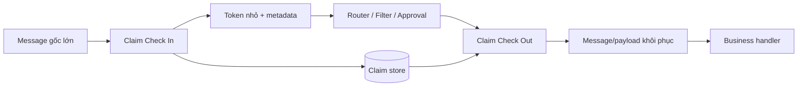
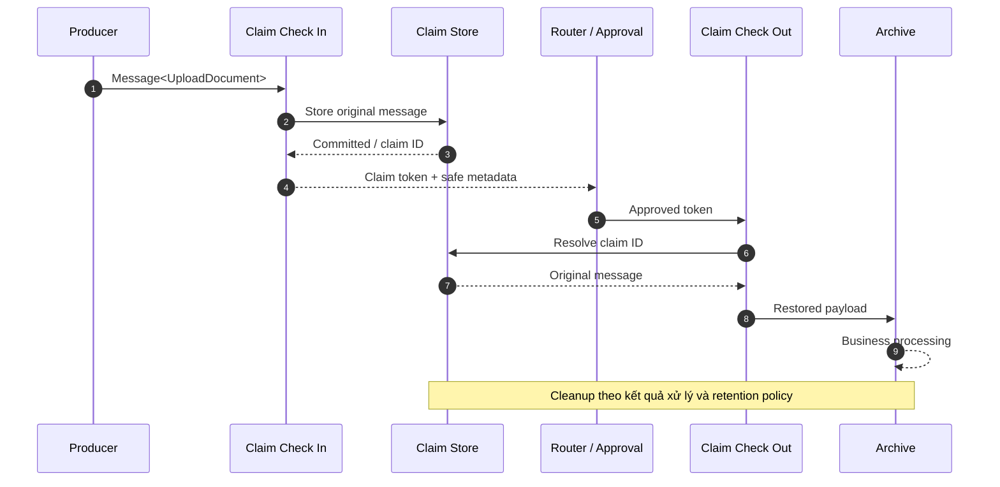
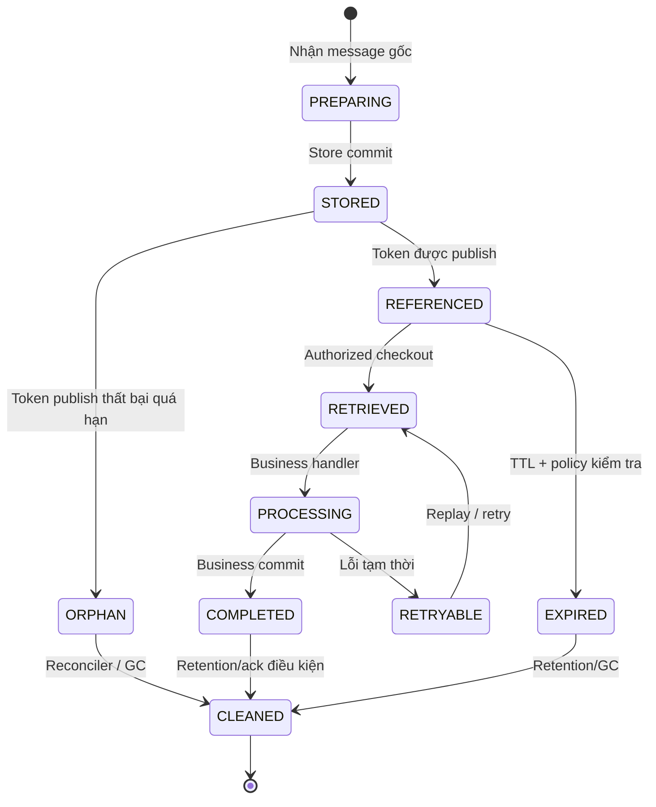
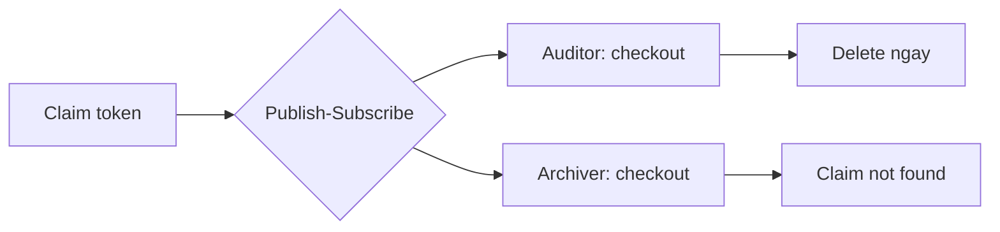
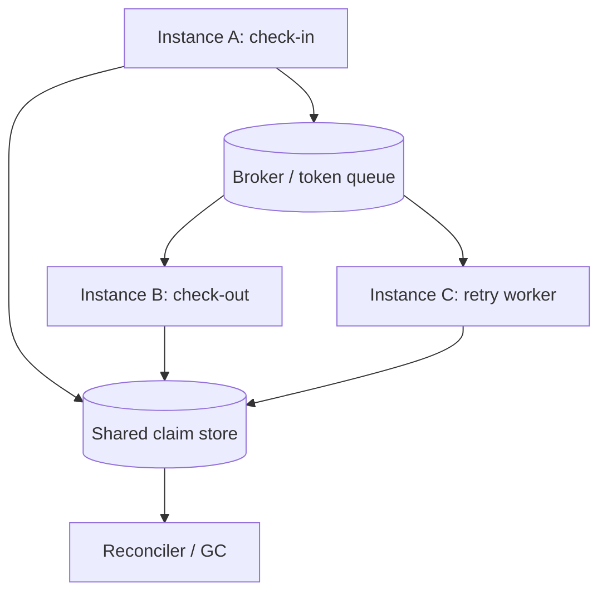
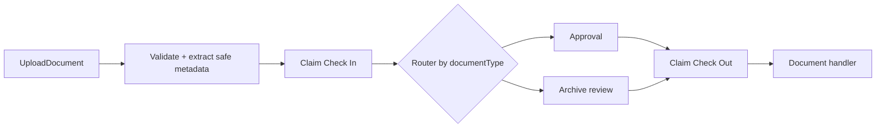

# Kho claim và vòng đời dữ liệu

Một hệ thống tiếp nhận hồ sơ yêu cầu xử lý có tệp đính kèm lớn, nhiều trường dữ liệu nhạy cảm và metadata nghiệp vụ. Một vài bước phía sau chỉ cần `requestId`, `documentType` và kết quả phê duyệt, nhưng mỗi lần chuyển message qua Router, Filter, queue hoặc Gateway lại phải mang toàn bộ dữ liệu gốc. Điều này làm tăng chi phí truyền tải, bộ nhớ, log và rủi ro lộ thông tin.

**Claim Check** là một mẫu trong **Enterprise Integration Patterns (EIP)** để giải quyết vấn đề đó: **cất message hoặc payload gốc vào một kho lưu trữ**, phát ra một **claim check/token** nhỏ đại diện cho dữ liệu đã cất, rồi dùng token để **lấy lại** dữ liệu khi cần. Trong Spring Integration, khái niệm này gắn với **Claim Check In/Out Transformer** và hạ tầng **`MessageStore`**. Điểm khó nhất trong production không phải tạo token, mà là **kho claim và vòng đời dữ liệu**: lưu ở đâu, giữ bao lâu, ai được khôi phục, khi nào xóa, phục hồi ra sao nếu một bước hoặc một instance bị lỗi?

Bài **“Kho claim và vòng đời dữ liệu”** thuộc chương **Claim check** của module `SPRING_INTEGRATION_PATTERN`, phục vụ mục tiêu học các mẫu thông điệp ít phụ thuộc, dễ mở rộng và kiểm thử được bằng Spring Integration. Chúng ta sẽ thiết kế kho lưu trữ và lifecycle rõ ràng; phân biệt retrieval với consumption, TTL với nghiệp vụ đã hoàn tất; xử lý retry, error channel, Router, Filter, Transformer, Splitter, Aggregator, Gateway và correlation; xây ví dụ Java DSL và JUnit 5; kiểm tra bảo mật, tính nhất quán và khả năng quan sát.

> **Nguyên tắc:** **Claim check là tham chiếu đến một bản dữ liệu đã lưu, không tự là bằng chứng được phép đọc dữ liệu.** Cất thành công chưa có nghĩa token đã được giao bền vững; lấy lại thành công chưa có nghĩa nghiệp vụ đã xử lý xong; xóa token quá sớm có thể khiến retry thất bại, còn không xóa bao giờ có thể gây tồn đọng và vi phạm chính sách lưu giữ.

## 1. Claim Check giải quyết bài toán nào?

Xét luồng xử lý hồ sơ:

```text
Message gốc:
  requestId = DOC-101
  tenantId = ACME
  payload = PDF lớn + biểu mẫu + dữ liệu nhạy cảm

Các bước trung gian:
  kiểm tra quyền → phân loại → phê duyệt → chọn nơi lưu

Bước cuối:
  lấy lại PDF/biểu mẫu để lưu tài liệu hoặc xuất bản kết quả
```

Nếu toàn bộ PDF đi theo message trong mọi bước, mỗi endpoint phải gánh dữ liệu không cần thiết. Với Claim Check:



**Lợi ích có thể đạt được:**

- **Giảm kích thước message** đi qua những kênh chỉ xử lý metadata.
- **Tách dữ liệu lớn/nhạy cảm** khỏi các nhánh không cần xem toàn bộ nội dung.
- **Tránh serialize payload nhiều lần** trên đường message nếu thiết kế store/transport phù hợp.
- **Lấy lại dữ liệu có chủ đích** tại bước thực sự cần nó.
- **Tập trung chính sách lưu giữ và kiểm soát truy cập** vào một hạ tầng xác định.

**Chi phí phải trả:** một kho trạng thái mới, lookup I/O, rủi ro token mất/không tìm thấy, transaction boundaries và công việc cleanup/retention. Claim Check **không làm hệ thống tự có durability, exactly-once hay authorization**.

### 1.1. Khi nào không nên dùng Claim Check?

Không nhất thiết dùng nếu:

- Payload nhỏ, ít nhánh và mọi handler đều cần toàn bộ dữ liệu.
- Lookup từ kho tốn nhiều chi phí hơn việc chuyển payload trực tiếp.
- Dữ liệu có thể đi qua broker một cách an toàn với giới hạn kích thước phù hợp.
- Thực chất chỉ cần **projection/Transformer** giảm bớt field, không cần giữ bản gốc để truy hồi.
- Không có cơ chế vận hành store, backup, TTL, xử lý orphan hoặc phân quyền.

**Không biến mọi message thành tham chiếu** nếu việc đó chỉ thêm round trip và phụ thuộc vào database cho mỗi bước.

## 2. Các thuật ngữ phải phân biệt

| Khái niệm | Ví dụ | Trách nhiệm |
| --- | --- | --- |
| **Original message** | `Message<UploadDocument>` với metadata. | Dữ liệu cần khôi phục hoặc sử dụng về sau. |
| **Claim store** | `MessageStore`, JDBC store hoặc blob storage có index. | Lưu và truy hồi bản gốc theo khóa. |
| **Claim ID / token** | Một UUID ngẫu nhiên. | Tham chiếu đến bản ghi đã lưu. |
| **Claim metadata** | `tenantId`, `createdAt`, `expiresAt`, `schemaVersion`. | Giúp xác thực, quản lý TTL và vận hành. |
| **Check-in** | `store.addMessage(original)`. | Ghi dữ liệu và phát token theo hợp đồng. |
| **Check-out / restore** | Tra cứu message theo ID. | Khôi phục nội dung đã được cất. |
| **Consume / finalize** | Nghiệp vụ xử lý xong và ghi nhận kết quả. | Chứng minh có thể cleanup theo chính sách. |
| **Cleanup / expiration** | Xóa dữ liệu hết hạn hoặc không còn tham chiếu. | Quản lý vòng đời, chi phí và quyền riêng tư. |
| **Correlation ID** | `requestId` của luồng request–reply. | Nối các bước/traces, không mặc nhiên chính là claim ID. |
| **Idempotency key** | `(requestId, operation)`. | Chống thực hiện side effect trùng, khác claim token. |

### 2.1. Claim ID không phải business ID

```text
requestId       = DOC-101
originalMessageId = 99d8... (UUID)
claimId         = 99d8... hoặc một key do store/ứng dụng cấp
correlationId   = corr-abc
idempotencyKey  = DOC-101:ARCHIVE
```

Trong một thiết kế dùng `MessageStore`, **UUID của original message** có thể chính là khóa truy hồi. Nhưng **claim ID không tự mang nghĩa `requestId`, tenant hay quyền truy cập**. Nếu nhiều lần retry tạo lại message với ID mới, có thể phát sinh **nhiều claim khác nhau cho cùng một business request**.

### 2.2. Claim token không phải payload đã được mã hóa

Token chỉ là **tham chiếu**. Nó không khiến payload an toàn nếu bất kỳ ai cầm token đều có thể truy hồi. Ngay cả token khó đoán cũng không thay thế:

- xác thực caller;
- phân quyền theo tenant/owner/purpose;
- giới hạn thời hạn;
- audit truy cập;
- mã hóa dữ liệu khi lưu và khi truyền.

Đừng nhầm **không mang dữ liệu nhạy cảm trong message nhỏ** với **không còn dữ liệu nhạy cảm trong hệ thống**: dữ liệu vẫn nằm trong claim store.

## 3. Kiến trúc hai đường: metadata đi tiếp, payload nằm trong kho

Một request chỉ cần đưa **documentType** và **riskScore** qua các bước phân loại, nhưng cuối cùng service Archive cần đọc tài liệu gốc.



Tại mỗi ranh giới, phải định nghĩa **điều gì đã thành công**:

1. Check-in đã lưu bản gốc **thành công và có thể đọc lại** chưa?
2. Token đã được **gửi bền vững** tới kênh tiếp theo chưa?
3. Đích token có đúng **tenant/route** không?
4. Check-out đã trả bản gốc **hợp lệ, đúng version** chưa?
5. Business handler đã **commit** hay chỉ bắt đầu xử lý?
6. Có thể xóa claim theo **retention, replay và audit policy** chưa?

Đừng kết luận bước (6) chỉ vì bước (4) thành công.

### 3.1. Hai kiểu thiết kế

**Lưu toàn bộ `Message<?>`:** thích hợp khi cần khôi phục payload cùng các header cần thiết; Spring Integration `MessageStore` hỗ trợ mô hình này.

**Lưu riêng blob/payload và metadata:** thích hợp với file lớn hoặc dữ liệu cần streaming. Token có thể trỏ tới object key ở object storage và một bản record ở database. Đây là **thiết kế ứng dụng theo Claim Check**, không có nghĩa mọi `MessageStore` tự hỗ trợ streaming blob cực lớn.

| Hướng lưu | Ưu điểm | Đánh đổi |
| --- | --- | --- |
| `MessageStore` chứa message | Tích hợp tự nhiên với Spring Integration, truy hồi theo message ID. | Có thể serialize payload/header, giới hạn kích thước/serializer và chi phí DB. |
| Database metadata + object storage | Phù hợp payload lớn, có thể mã hóa/streaming và TTL theo object. | Cần giao dịch bù, integrity hash, orphan cleanup, mapping token→object. |
| Cache in-memory | Đơn giản, nhanh trong test. | Không bền qua restart, không tự chia sẻ nhiều JVM. |

## 4. Kho claim trong Spring Integration

**`MessageStore`** là abstraction để lưu, truy xuất và xóa **`Message<?>`**. Các triển khai có thể khác nhau về độ bền, transaction, serialization và khả năng dùng chung giữa nhiều instance.

### 4.1. `MessageStore` khác `MessageGroupStore`

| Abstraction | Dùng để | Ví dụ |
| --- | --- | --- |
| **`MessageStore`** | Lưu/lấy **một message theo ID**. | Claim Check In/Out. |
| **`MessageGroupStore`** | Quản lý **nhóm message** có correlation và lifecycle nhóm. | Aggregator, Resequencer. |

Một implementation cụ thể có thể hỗ trợ nhiều vai trò, nhưng hai **hợp đồng** không đồng nghĩa. Claim Check thường cần **lookup theo khóa**; Aggregator cần **group membership, release, expire và locking**.

### 4.2. Những câu hỏi khi chọn implementation

1. Dữ liệu có cần tồn tại sau **JVM restart** không?
2. Có **nhiều instance** cùng check-in/check-out không?
3. Payload có cần **serialize** qua JDBC/Redis/Mongo/object storage không?
4. Một claim có thể được **đọc nhiều lần** không?
5. Có yêu cầu **transaction** với broker và database không?
6. Có retention/TTL và cleanup job phù hợp không?
7. Hệ thống cần **backup/restore**, mã hóa và audit ở mức nào?
8. Khi repository tạm unavailable, flow nên **fail closed**, retry hay đưa token vào DLQ?

### 4.3. `SimpleMessageStore` chỉ thích hợp cho ví dụ local

```java
import org.springframework.context.annotation.Bean;
import org.springframework.integration.store.MessageStore;
import org.springframework.integration.store.SimpleMessageStore;

@Bean
MessageStore claimMessageStore() {
    return new SimpleMessageStore();
}
```

`SimpleMessageStore` lưu state **trong bộ nhớ của JVM** và giúp kiểm thử luồng local. Nó không tự có:

- persistence qua restart;
- replication giữa các pod;
- transactional cleanup với broker;
- TTL nghiệp vụ và dọn orphan;
- audit truy cập hoặc authorization theo tenant.

Nếu token được chuyển sang một consumer **ở JVM khác**, kho in-memory tại producer **không phải một nguồn dữ liệu dùng chung**. Consumer có thể tìm claim ID nhưng không có message gốc.

### 4.4. Kho bền vững

Với triển khai nhiều instance, có thể chọn một implementation `MessageStore` bền vững được Spring Integration hỗ trợ trong stack đang dùng, chẳng hạn store dựa trên JDBC hoặc một hệ thống dữ liệu khác, **sau khi kiểm tra phiên bản, schema và đặc tính giao dịch**.

```text
Instance A: Claim Check In  ──┐
                            ├── Shared persistent claim store
Instance B: Claim Check Out ──┘
```

**Shared store là điều kiện cần, chưa phải điều kiện đủ.** Cần kiểm soát việc read/write đồng thời, migration payload, schema serialization, quyền truy cập và thời gian lưu trữ. Không coi một database có replication tự động biến mọi thao tác check-in → publish token → checkout → xóa thành một transaction end-to-end.

## 5. Vòng đời Claim Check: từ lưu đến dọn dẹp

Một thiết kế nghiệp vụ nên thể hiện **vòng đời rõ ràng**. Các trạng thái dưới đây là **mô hình do ứng dụng tự định nghĩa**, không phải enum mặc định do `MessageStore` cung cấp:



**Điểm quan trọng:** `RETRIEVED` không nên tự được coi là `COMPLETED`. Handler nhận lại payload nhưng có thể thất bại trước khi ghi DB, reply cho Gateway hoặc ack broker.

### 5.1. Lifecycle dưới dạng bảng quyết định

| Trạng thái logic | Điều có thể chứng minh | Điều chưa được bảo đảm |
| --- | --- | --- |
| **PREPARING** | Đang chuẩn bị payload/token. | Dữ liệu đã lưu bền. |
| **STORED** | Store đã xác nhận ghi. | Token đã tới downstream. |
| **REFERENCED** | Đã phát tham chiếu theo transport contract. | Consumer đã xử lý. |
| **RETRIEVED** | Bản gốc đã được đọc lại. | Nghiệp vụ đã commit. |
| **PROCESSING** | Handler đang thực hiện công việc. | Thành công, idempotent hoặc đã ack. |
| **COMPLETED** | Business outcome được xác nhận. | Dữ liệu có thể xóa ngay nếu còn quy định retention. |
| **EXPIRED** | Đã vượt TTL hoặc deadline đã định. | Không còn consumer cần replay. |
| **CLEANED** | Nội dung claim đã được xóa/không thể truy hồi theo chính sách. | Mọi hệ thống cache/backup đã purge tức thì. |

Nếu dùng đúng `MessageStore` thuần túy, các trạng thái nghiệp vụ này phải được **lưu ở metadata/repository ứng dụng hoặc workflow store** riêng; đừng suy rằng một message đã biến mất khỏi store là chứng cứ nó đã xử lý thành công.

## 6. Check-in, check-out và quyết định xóa

### 6.1. Check-in

Luồng vào:

```text
Original Message<UploadDocument>
        |
        v
  Claim Check In
        |
        +--> lưu Message theo key
        |
        +--> phát Claim ID nhỏ
```

Để token không trỏ tới dữ liệu chưa lưu, thứ tự logic phải là **store successfully → expose token**. Tuy nhiên, crash vẫn có thể xảy ra sau store nhưng trước token publish, sinh **orphan**.

### 6.2. Check-out không nhất thiết là consume

Khi Consumer A đọc claim và vẫn có Consumer B cần cùng dữ liệu:

```text
token T -> Auditor đọc
        -> Archiver đọc
        -> Retry handler cần đọc lại khi lỗi
```

Nếu lần đọc đầu **đồng thời xóa** bản gốc, các reader còn lại và retry sẽ gặp `claim not found`. Cần lựa chọn một trong các hợp đồng:

- **Read many / delete later:** nhiều reader được ủy quyền có thể truy hồi, cleanup theo trạng thái/TTL.
- **One-time claim:** chỉ một consumer được nhận quyền xử lý; lần lấy đầu tiên có semantics tiêu thụ. Cần thiết kế **atomicity** và failure recovery.
- **Reference counting / leases:** chỉ xóa khi mọi consumer cần thiết đã hoàn tất; phải quản lý lease hết hạn và consumer chết.

Trong Spring Integration, Claim Check Out có thể được cấu hình theo semantics **giữ hoặc xóa message khỏi store** tùy API/phiên bản. **Không mặc định việc check-out luôn xóa hoặc luôn giữ**; hãy xác minh `remove-message`/tùy chọn tương ứng của phiên bản được dùng và kiểm thử hành vi muốn có.

### 6.3. Khi nào xóa?

Việc xóa nên phụ thuộc **business completion và retention policy**, ví dụ:

```text
Store original
    → publish token
    → downstream restore
    → validate / archive / commit business record
    → confirm success / ack
    → mark claim complete
    → cleanup after retention window
```

Nếu consumer crash **sau khi lấy nhưng trước commit**, một cơ chế xóa-ngay-khi-lấy có thể làm lần retry **không thể đọc lại** bản gốc. Vì vậy, read-then-delete không phải lựa chọn an toàn mặc định cho mọi luồng có retry.

## 7. Ví dụ Java: thao tác `MessageStore` theo từng bước

Trước khi tích hợp DSL, hãy hiểu rõ thao tác lưu–lấy–xóa ở lớp store. Ví dụ dùng `SimpleMessageStore` **chỉ để minh họa và test**, không có authorization, TTL hay persistence.

### 7.1. Facade tối giản cho claim nội bộ

```java
// LocalClaimService.java
import java.util.UUID;
import org.springframework.integration.store.MessageStore;
import org.springframework.messaging.Message;

public final class LocalClaimService {

    private final MessageStore store;

    public LocalClaimService(MessageStore store) {
        this.store = store;
    }

    public UUID checkIn(Message<?> original) {
        UUID id = original.getHeaders().getId();
        if (id == null) {
            throw new IllegalArgumentException("Message ID is required");
        }
        store.addMessage(original);
        return id;
    }

    public Message<?> restore(UUID id) {
        Message<?> original = store.getMessage(id);
        if (original == null) {
            throw new IllegalStateException("Claim not found: " + id);
        }
        return original;
    }

    // Chỉ được gọi khi caller đã kiểm tra business completion
    // và retention policy trong hệ thống thực.
    public void cleanupAfterCompletion(UUID id) {
        store.removeMessage(id);
    }
}
```

Giải thích:

1. `checkIn(...)` nhận một original message có ID, đưa nó vào `MessageStore` và trả ID làm claim.
2. `restore(...)` **không xóa** message; nó chỉ đọc bản đã lưu.
3. `cleanupAfterCompletion(...)` là bước riêng và được gọi **sau khi ứng dụng xác định đã đủ điều kiện cleanup**.
4. Lỗi `not found` được phân biệt với dữ liệu gốc trả về `null`; payload message hợp lệ không nên bị suy ra từ null.

**Đây là facade local, không phải security boundary.** Khi sử dụng qua API hoặc nhiều tenant, không đưa trực tiếp UUID từ request vào `restore` mà chưa kiểm tra **claim ownership, purpose, expiry, status** ở record đáng tin. Cũng cần thiết kế cạnh tranh giữa cleanup và restore.

### 7.2. JUnit 5: đọc nhiều lần rồi mới xóa

```java
import static org.junit.jupiter.api.Assertions.*;

import java.util.UUID;
import org.junit.jupiter.api.Test;
import org.springframework.integration.store.SimpleMessageStore;
import org.springframework.messaging.Message;
import org.springframework.messaging.support.MessageBuilder;

class LocalClaimServiceTest {

    @Test
    void keepsMessageUntilExplicitCleanup() {
        LocalClaimService claims =
            new LocalClaimService(new SimpleMessageStore());

        byte[] document = new byte[] {1, 2, 3, 4};
        Message<byte[]> original = MessageBuilder
            .withPayload(document)
            .setHeader("documentType", "PDF")
            .build();

        UUID token = claims.checkIn(original);

        Message<?> first = claims.restore(token);
        Message<?> second = claims.restore(token);

        assertEquals(original.getHeaders().getId(), token);
        assertArrayEquals(document, (byte[]) first.getPayload());
        assertArrayEquals(document, (byte[]) second.getPayload());
        assertEquals("PDF", first.getHeaders().get("documentType"));

        claims.cleanupAfterCompletion(token);
        assertThrows(IllegalStateException.class,
            () -> claims.restore(token));
    }

    @Test
    void unknownClaimIsNotAnEmptyDocument() {
        LocalClaimService claims =
            new LocalClaimService(new SimpleMessageStore());

        UUID missing = UUID.randomUUID();
        assertThrows(IllegalStateException.class,
            () -> claims.restore(missing));
    }
}
```

Các test trên chỉ kiểm tra **behavior local của store**: có thể truy hồi nhiều lần và không còn dữ liệu sau cleanup. Chúng **không chứng minh** JDBC transaction, crash/restart, TTL, bảo mật đa tenant hoặc idempotency của business handler.

### 7.3. Một dữ liệu có thể được kiểm tra mà chưa được xử lý

Trong thực tế, test nên thêm tình huống:

```text
restore(token) → handler bắt đầu archive
handler ném IOException → không mark completed
retry(token) → vẫn restore được original
handler archive thành công → mark completed → cleanup
```

Nếu xóa token ở bước restore đầu tiên, kịch bản retry trên sẽ không hoạt động.

## 8. Ví dụ Spring Integration Java DSL với Claim Check Transformer

Spring Integration có các endpoint/transformer dành riêng cho **Claim Check In** và **Claim Check Out**. Có thể hình dung hai flow độc lập dùng **cùng `MessageStore`**:

```java
// ClaimCheckFlowConfiguration.java
import org.springframework.context.annotation.Bean;
import org.springframework.context.annotation.Configuration;
import org.springframework.integration.channel.QueueChannel;
import org.springframework.integration.config.EnableIntegration;
import org.springframework.integration.dsl.IntegrationFlow;
import org.springframework.integration.store.MessageStore;
import org.springframework.integration.store.SimpleMessageStore;
import org.springframework.integration.transformer.ClaimCheckInTransformer;
import org.springframework.integration.transformer.ClaimCheckOutTransformer;

@Configuration
@EnableIntegration
public class ClaimCheckFlowConfiguration {

    @Bean
    MessageStore claimMessageStore() {
        return new SimpleMessageStore(); // CHỈ dùng cho demo/test local.
    }

    @Bean("claims.tokens")
    QueueChannel claimTokens() {
        return new QueueChannel(16);
    }

    @Bean("claims.restored")
    QueueChannel restoredClaims() {
        return new QueueChannel(16);
    }

    @Bean
    IntegrationFlow checkInFlow(MessageStore store) {
        return IntegrationFlow.from("documents.in")
            .transform(new ClaimCheckInTransformer(store))
            .channel("claims.tokens")
            .get();
    }

    @Bean
    IntegrationFlow checkOutFlow(MessageStore store) {
        return IntegrationFlow.from("claims.restore.in")
            .transform(new ClaimCheckOutTransformer(store))
            .channel("claims.restored")
            .get();
    }
}
```

**Ý định của ví dụ:**

- `ClaimCheckInTransformer` lưu original message và tạo representation nhỏ mang claim reference.
- `ClaimCheckOutTransformer` giải quyết reference từ **cùng store** để khôi phục dữ liệu.
- `claims.tokens` và `claims.restored` là các `QueueChannel` phục vụ kiểm thử; chúng không tự có consumer, durability hoặc cleanup.
- Hai flow tách input riêng để người học quan sát thời điểm check-in và check-out.

**Lưu ý về API và lifecycle:** Chữ ký constructor, overload DSL và cài đặt semantics `removeMessage` của transformer có thể khác giữa các phiên bản Spring Integration. Hãy đối chiếu API và test với dependency thực tế trước khi đưa vào module chạy. Ví dụ chủ ý **không giả định một mặc định xóa sau check-out**; nếu nghiệp vụ cần cleanup, cấu hình rõ và kiểm tra trường hợp retry.

### 8.1. Không đưa token vào một store khác không chia sẻ state

```text
Instance A:
   checkIn → SimpleMessageStore A → token X

Instance B:
   token X → checkOut → SimpleMessageStore B → NOT FOUND
```

Hai store nằm trong hai JVM khác nhau **không tự chia sẻ message** dù có cùng bean name. Muốn nhiều instance, cần **shared durable store** hoặc đảm bảo token chỉ quay về đúng owner node theo kiến trúc đã được kiểm soát. Dùng sticky session thường không đủ cho hệ thống có retry/restart và không thay thế persistence.

### 8.2. Claim Check không tự xây record quản lý vòng đời

Transformer dành riêng cho Claim Check cung cấp thao tác lưu–tham chiếu–khôi phục. Nếu cần `tenantId`, `expiresAt`, `status`, `referenceCount`, `lastAccessAt` hoặc audit, ứng dụng phải triển khai **metadata/index riêng** hoặc sử dụng store có cơ chế phù hợp. Đừng kỳ vọng transformer tự tạo một hệ thống workflow approval, token authorization hay retention policy hoàn chỉnh.

## 9. Metadata của token và khả năng truy hồi an toàn

Một token production thường không nên chỉ là một chuỗi rời rạc không ngữ cảnh. Có thể dùng một record do ứng dụng định nghĩa:

```java
import java.time.Instant;
import java.util.UUID;

// DTO minh họa cho một claim reference nội bộ.
public record ClaimReference(
    UUID claimId,
    String tenantId,
    String purpose,
    Instant expiresAt,
    String schemaVersion
) {}
```

**Đây không phải kiểu dữ liệu mặc định của ClaimCheckInTransformer.** Muốn phát một record như vậy, cần service/Transformer ứng dụng tương ứng và lưu bản metadata có thẩm quyền ở phía server.

### 9.1. Trường nào không được tin từ token?

Nếu caller có thể sửa payload/token, các trường `tenantId`, `purpose` và `expiresAt` do caller cung cấp **không thể tự làm bằng chứng cấp quyền**. Khi check-out:

1. Xác thực identity hiện tại.
2. Tìm **server-side claim record** theo ID đã được validate.
3. Kiểm tra owner/tenant/purpose/expiry/status từ record **được bảo vệ**.
4. Kiểm tra request đang ở **generation/version** hợp lệ nếu có replay.
5. Lấy nội dung từ store theo key đã được phép.
6. Ghi audit/metrics theo chính sách dữ liệu.

Nếu token đi qua broker công khai, có thể dùng opaque random token/hashed lookup, chữ ký hoặc capability token được thiết kế đúng; nhưng **token có chữ ký vẫn phải chịu hạn sử dụng, quyền và khả năng thu hồi**.

### 9.2. Bảo mật truyền dữ liệu

| Ranh giới | Cần bảo vệ |
| --- | --- |
| Token trong broker/header | Tránh lộ claim ID, giới hạn producer/consumer ACL, mã hóa đường truyền. |
| Claim store | Mã hóa at rest, phân quyền truy cập, audit, backup/retention. |
| Check-out API | AuthN/AuthZ, giới hạn tốc độ, xác minh tenant/purpose. |
| Error channel/DLQ | Không dump nguyên nội dung nhạy cảm, retention và quyền đọc. |
| Log/trace | Chỉ metadata tối thiểu, ID mờ; không in token dùng được để truy hồi nếu rủi ro cao. |

**Không ghi raw claim ID trong log công khai** nếu hệ thống sử dụng chính ID như một tham chiếu có khả năng truy cập; nên dùng một **opaque correlation ref riêng** cho điều tra.

## 10. TTL, hết hạn và xóa dữ liệu

Một câu hỏi thường bị bỏ qua: **“Claim sẽ tồn tại trong kho bao lâu nếu không ai check-out?”**

### 10.1. TTL không đồng nghĩa đã hoàn tất nghiệp vụ

```text
Claim stored at 10:00
expiresAt = 11:00
Consumer chưa xử lý vì broker backlog
11:01 token mới được deliver
→ claim có thể đã bị cleanup, consumer không thể restore
```

Nếu đặt TTL quá ngắn so với thời gian trễ/retry/backlog của transport, sẽ xuất hiện **dangling token**. Nếu giữ vô hạn, có thể phát sinh **orphan, chi phí lưu trữ và vi phạm yêu cầu xóa dữ liệu**.

Nên đặt retention từ:

- thời gian **queue/broker backlog** có thể chấp nhận;
- deadline thực hiện nghiệp vụ;
- số lần retry và độ trễ backoff;
- cửa sổ replay/đối soát;
- thời gian audit và pháp lý (nếu áp dụng);
- chính sách xóa dữ liệu theo yêu cầu người dùng.

Không có một TTL mặc định đúng cho tất cả service.

### 10.2. Cleanup phải có guard

Không nên triển khai cron chỉ làm:

```text
DELETE every claim older than 1 hour
```

mà không xét claim đang xử lý, pending retry hoặc retention theo yêu cầu. Một chính sách hợp lý hơn:

```text
eligibleForCleanup =
    state in {COMPLETED, EXPIRED, ORPHAN}
    AND retentionWindowElapsed
    AND noActiveLease
    AND noRequiredConsumerRemaining
    AND noLegalHold
```

Đây là **pseudocode nghiệp vụ**, không phải một method `MessageStore` có sẵn. Ứng dụng phải hiện thực metadata, scan/reconcile và các guard tương ứng.

### 10.3. Một claim có nhiều reader

Nếu Claim Check được dùng trước **Publish–Subscribe** hoặc Recipient List, một token có thể tới nhiều consumer. Nếu consumer A xóa dữ liệu sau khi đọc, consumer B có thể thất bại:



Giải pháp có thể là **read-many** với cleanup sau khi hai outcome hoàn tất; hoặc **đếm tham chiếu/leases** có giới hạn; hoặc **tạo claim riêng cho từng recipient** nếu cần isolation. Đây là lựa chọn **vòng đời dữ liệu**, không phải tùy chọn định tuyến thuần túy.

## 11. Orphan và dangling reference

Có hai lỗi đối xứng:

- **Orphan claim:** dữ liệu đã lưu nhưng **không còn token hợp lệ** nào sẽ trỏ tới nó.
- **Dangling token:** token đã phát nhưng dữ liệu **không tồn tại/đã hết hạn/chưa commit** ở kho.

### 11.1. Những cửa sổ lỗi

| Thời điểm sự cố | Tình trạng | Hậu quả |
| --- | --- | --- |
| Crash **trước store commit** | Chưa có claim. | Cần retry request/check-in từ nguồn. |
| Crash **sau store commit, trước publish token** | Có data, chưa token. | **Orphan claim** nếu không có cơ chế reconcile. |
| Token publish **trước khi store commit** | Token có thể tới sớm. | **Dangling token** hoặc read-before-commit. |
| Crash **sau token publish, trước ack input** | Source có thể redeliver original. | Tạo thêm claim trùng hoặc phát lại token. |
| Check-out thành công rồi xóa, handler chưa commit | Data mất với retry. | Không thể khôi phục lần xử lý sau. |
| Handler commit rồi crash trước ghi completed | Claim còn và source retry. | Nguy cơ **side effect lặp**. |
| Cleanup chạy đồng thời check-out | Reader có thể nhận not found. | Cần lease/transaction/locking policy. |

### 11.2. Transactional outbox và reconcile

Nếu check-in và publish token nằm ở **hai hệ thống** (ví dụ JDBC + Kafka/RabbitMQ), không nên hứa một transaction atomic end-to-end chỉ vì mỗi thao tác riêng thành công.

Một kiến trúc có thể:

1. Trong cùng database transaction, lưu **claim metadata** và **outbox event** tham chiếu đến claim đã sẵn sàng.
2. Một publisher độc lập đọc outbox và phát token tới broker.
3. Chỉ đánh dấu outbox đã publish khi có xác nhận phù hợp, chấp nhận khả năng phát lặp.
4. Consumer xử lý **idempotent** theo business/request/generation key.
5. Một reconciler phát hiện claim đã lưu quá lâu chưa publish hoặc token chưa hoàn tất.

Nếu dữ liệu blob nằm ở object storage, store metadata/outbox trong DB **không tự biến upload blob thành một phần của DB transaction**. Có thể cần state `PENDING_UPLOAD`/`READY`, integrity check, staged object và cleanup khi upload thất bại.

### 11.3. Đừng xóa orphan quá sớm

Một claim chưa có token sau 30 giây có thể chỉ là **publisher đang retry**, không hẳn orphan vĩnh viễn. Reconciler nên dựa trên **state, retry window, lastAttempt và owner/lease**; không chỉ một timestamp đơn giản.

## 12. Nhiều instance và shared store

Trong Kubernetes hoặc môi trường có nhiều JVM:



Cần giải quyết:

1. **Consistency/visibility:** B phải đọc thấy bản đã commit từ A.
2. **Serialization compatibility:** A/B có thể đang chạy hai phiên bản code khác nhau.
3. **Concurrency:** B và C cùng check-out, chỉ một bên được finalize nếu nghiệp vụ yêu cầu.
4. **Durable lifecycle metadata:** status, owner, expiry, generation và lease sống qua restart.
5. **Capacity:** store đáp ứng peak number of claims và payload size.
6. **Partition/network failure:** token tới nhưng store tạm unavailable phải retry phù hợp, không tự coi dữ liệu đã mất.
7. **Permission isolation:** một consumer không được truy hồi claim của tenant khác.

### 12.1. Tính sẵn sàng của token và dữ liệu

Với hạ tầng eventually consistent, **đã nhận ack ghi không phải lúc nào replica đọc cũng nhìn thấy ngay**. Nếu consumer đọc từ replica chưa đồng bộ có thể gặp `not found` tạm thời. Thiết kế cần read consistency phù hợp hoặc retry giới hạn khi vừa check-in; nhưng **không retry vô hạn** với token thực sự không tồn tại.

### 12.2. Đọc một lần và cạnh tranh

Một API **get rồi remove** trong hai thao tác độc lập có thể có race:

```text
B: get(token) -> payload
C: get(token) -> payload
B: remove(token)
C: remove(token) -> no-op/not found
B và C đều đã có payload và đều có thể làm side effect
```

Nếu yêu cầu **chỉ một worker xử lý**, phải dùng **atomic claim/lease/compare-and-set trạng thái** ở repository, transaction hoặc locking đáng tin, cộng idempotency ở service đích. Chỉ xóa `MessageStore` không đủ để đảm bảo one-time execution.

## 13. Schema, serialization và kích thước dữ liệu

### 13.1. Lưu Java object có thể khiến nâng phiên bản khó

```text
Version A lưu Message<OldDocumentDto>
Version B đọc và deserialize thành NewDocumentDto
```

Nếu dùng serialization phụ thuộc class Java, sau deploy, consumer B có thể không giải mã được message của A. Nên:

- Có **schema version** rõ.
- Cân nhắc format bền vững, có hợp đồng (JSON/Avro/Protobuf hoặc kiểu phù hợp).
- Giữ compatibility/migration window.
- Kiểm thử read **old claims** sau rolling deployment.
- Định nghĩa xử lý không tương thích: quarantine/migration, không xóa ngay.

**Spring Integration không tự làm các DTO của bạn tương thích qua mọi phiên bản** chỉ vì được lưu trong `MessageStore`.

### 13.2. Không gửi blob lớn bằng cách giữ byte[] trong mọi header

Một Claim Check hữu ích khi **token là thông tin nhỏ**, còn payload lớn được cất ngoài đường message. Đừng vô tình sao chép cùng blob vào một header như `originalPayload` hoặc error metadata, khiến token message vẫn lớn.

### 13.3. Integrity và object storage

Khi claim trỏ tới file/blob ngoài:

```text
Claim record:
  id = UUID
  objectKey = safe internal key
  expectedSize = 16 MB
  checksum = SHA-256(...)
  schemaVersion = 2
  tenantId = internal owner ID
```

Đây là **schema minh họa**. Khi restore, cần xác minh **object tồn tại, đúng kích thước/hash khi hợp đồng yêu cầu**, không tin object key do caller nhập để đọc tùy ý. Không dùng raw object path làm token nếu sẽ làm lộ cấu trúc bucket hoặc dữ liệu tenant.

## 14. Gateway request–reply và timeout

Một `@MessagingGateway` có thể cung cấp facade Java cho quá trình xử lý hồ sơ:

```java
import org.springframework.integration.annotation.MessagingGateway;

@MessagingGateway(defaultRequestChannel = "documents.in")
interface DocumentGateway {
    DocumentReceipt submit(UploadDocument document);
}

// DocumentReceipt và UploadDocument là DTO ứng dụng định nghĩa.
// Flow thực tế phải tạo reply đúng contract.
```

**Ví dụ ở mục 8 chưa tạo `DocumentReceipt`.** Nó chỉ demo lưu token vào queue và khôi phục từ queue khác. Để Gateway trả kết quả, phải thiết kế **reply path**, handler xử lý nghiệp vụ sau restore và trạng thái khi timeout.

### 14.1. Ba timeout khác nhau

| Timeout | Ranh giới |
| --- | --- |
| **Claim store I/O timeout** | Lưu, đọc hoặc xóa claim trong database/object storage. |
| **Channel send timeout** | Bàn giao token/message tới channel với capacity/semantics phù hợp. |
| **Gateway reply timeout** | Caller ngừng chờ kết quả nghiệp vụ. |

Caller hết hạn không chứng minh claim đã được cleanup hoặc business handler chưa làm gì. Nếu sau timeout caller retry, hệ thống có thể tạo **hai claim cho cùng một business request**. Cần idempotency và một API tra cứu trạng thái thay vì chỉ thực hiện lại toàn bộ yêu cầu.

### 14.2. Token bị chậm trên broker

Nếu claim hết hạn trước khi token được consumer nhận, check-out thất bại. Khi vận hành cần đo:

```text
claimAgeAtCheckout
brokerQueueLag
claimRetentionWindow
retryWindow
gatewayDeadline
```

Từng khoảng có vai trò khác nhau. Tăng Gateway timeout không kéo dài thời hạn dữ liệu trong store nếu TTL/GC vẫn xóa sớm.

## 15. Tác động đến Router, Filter, Transformer, Splitter/Aggregator

### 15.1. Router chỉ nên định tuyến dựa trên metadata đã xác thực

Sau check-in, payload có thể chỉ còn claim ID. Nếu Router trước đây dùng `payload.documentType`, biểu thức đó **không còn đúng** với token message. Cần:

- Tính routing metadata **trước check-in** và đưa metadata an toàn cần thiết đi cùng token.
- Hoặc dùng một service tra cứu metadata nhỏ theo claim ID.
- Không làm Router phải restore **toàn bộ blob** nếu nó chỉ cần một thuộc tính.



### 15.2. Filter loại token có thể tạo orphan claim

```text
Check-in đã lưu original
      |
      v
Filter: eligible?
  true  → token tiếp tục
  false → drop
```

Nếu Filter drop token mà không có cleanup flow, **payload vẫn tồn tại trong store**. Chọn một chính sách:

1. **Filter trước check-in** nếu chỉ cần metadata có sẵn và không cần lưu bản bị từ chối.
2. Khi `false`, gửi token tới **discard channel có handler release claim** theo retention.
3. Giữ claim trong quarantine nếu cần điều tra, nhưng với TTL/audit rõ.

**Filter `false` không tự xóa `MessageStore`** và không đồng nghĩa lỗi. Cần kiểm thử đường discard để không tạo orphan.

### 15.3. Transformer có thể làm mất claim ID hoặc metadata

Nếu một Transformer biến token thành DTO mới mà không giữ claim ID, downstream không thể khôi phục original. Đừng dựa vào **header propagation ngầm** qua mọi adapter. Thiết kế field rõ, validate schema và copy **chỉ metadata cần thiết/được phép**.

### 15.4. Splitter và Aggregator

Với một tài liệu lớn chứa nhiều phần, có hai kiến trúc khác nhau:

**A. Split trước, claim từng part:**

```text
Large batch → Splitter → Claim Check In each part
           → parallel handlers → restore each part
           → Aggregator
```

Mỗi part có claim riêng, cần correlation/sequence và cleanup cho từng claim. Aggregator cần **đủ outcome kể cả part REJECTED**, không chỉ biết một số token đã được phát.

**B. Claim toàn batch, truyền các tham chiếu phần tử:**

```text
Large batch → Claim Check In whole batch
            → emit (claimId, partIndex) references
            → handlers restore/read required sections
            → Aggregator
```

Các handler có thể đọc cùng bản gốc; cần **read-many**, range access nếu storage hỗ trợ và cleanup chỉ khi **tất cả phần cần thiết đã hoàn tất**.

**Lưu ý:** `sequenceNumber`, `sequenceSize`, `correlationId` phục vụ vòng đời nhóm của Splitter/Aggregator, **không thay thế claim ID**. Một claim có thể đại diện cả batch trong khi nhiều part mang cùng claim ID và sequence khác nhau.

### 15.5. Recipient List và Publish–Subscribe

Một token được broadcast cho nhiều recipient không tự đảm bảo các recipient đều đã check-out xong. Nếu một reader xóa claim ngay, reader khác thất bại. Cần cơ chế **completed recipients/leases/reference count** hoặc copy claim có kiểm soát nếu đọc một lần là yêu cầu bắt buộc.

### 15.6. Scatter–Gather và Resequencer

Scatter–Gather phát token tới nhiều service, thu những outcome khác nhau. Gather nên release theo **tập role/recipient bắt buộc**, không chỉ đếm token; Resequencer dùng sequence metadata để phát **các part đúng thứ tự**. Claim Store chỉ giữ dữ liệu gốc, **không quyết định khi nào group hoàn tất hoặc thứ tự output**.

## 16. Retry, error channel và vấn đề claim bị thiếu

| Tình huống | Phân loại | Hành động |
| --- | --- | --- |
| Store write thất bại | Check-in technical error. | Retry có giới hạn, không phát token chưa lưu. |
| Token publish thất bại sau write | Orphan candidate. | Outbox/reconcile, tránh xóa khi còn retry. |
| Check-out không thấy ID | Missing/expired claim. | Phân biệt eventual visibility, expiration, invalid token và dữ liệu mất. |
| Store read timeout | Transient infrastructure error. | Retry/backoff theo deadline, không tự báo dữ liệu đã xóa. |
| Token không thuộc tenant hiện tại | Authorization violation. | Từ chối, audit; không trả payload. |
| Schema cũ không deserialize được | Compatibility error. | Quarantine/migration, giữ dữ liệu theo retention. |
| Business handler lỗi sau restore | Processing failure. | Retry bằng token nếu claim còn, bảo vệ idempotency. |
| Cleanup thất bại | Retention/GC issue. | Reconcile/alert, không che business outcome. |
| Xóa claim trước khi consumer thứ hai đọc | Lifecycle race. | Điều chỉnh read-many/lease/reference count. |

### 16.1. Error channel không phải claim store

Một `ErrorMessage` có thể chứa failed message và exception, nhưng **không phải hệ thống lưu bản gốc thay thế `MessageStore`**. Với flow đồng bộ, exception có thể truyền ngược caller; với poller/async adapter, lỗi có thể được chuyển tới `errorChannel` theo cấu hình.

Không đặt raw document lớn hoặc sensitive profile trực tiếp vào error channel/DLQ chỉ để debug claim ID. Một error event tối thiểu nên mô tả:

```text
event=claim_checkout_failed
reason=CLAIM_NOT_FOUND
claim_ref=<masked-reference>
tenant_ref=<opaque-tenant-ref>
stage=CHECKOUT
retryable=false
correlation_ref=<opaque-trace-ref>
```

Đây là **format minh họa**, không phải log mặc định của framework. Giá trị `retryable` cần được quyết định sau khi phân biệt lỗi thực sự (ví dụ read replica lag hoặc store timeout thì có thể retry).

### 16.2. Retry đúng ranh giới

Nếu check-out lỗi do database timeout, có thể retry **lookup**; không cần mặc nhiên tạo lại claim từ original (vì original có thể không còn trong context). Nếu archive đã commit nhưng trả reply lỗi, retry **toàn flow** có thể archive trùng; cần idempotency theo business ID.

**Không coi check-in, restore và business handling là một thao tác atomic** trừ khi có giao dịch thật sự bao trùm các ranh giới tương ứng.

## 17. Kiểm thử vòng đời dữ liệu vượt ngoài happy path

### 17.1. Ma trận test bắt buộc

| Kịch bản | Điều phải chứng minh |
| --- | --- |
| Check-in thành công | Claim ID trỏ tới đúng original payload và header cần thiết. |
| Token qua Router/Filter | Metadata cần định tuyến vẫn có, không mang bản gốc ngoài ý muốn. |
| Check-out thành công | Dữ liệu khôi phục đúng format/schema/tenant. |
| Hai lần restore trước cleanup | Read-many được phép và nhất quán nếu thiết kế chọn như vậy. |
| Check-out sau cleanup | Trả missing/expired theo contract, không phát dữ liệu giả. |
| Unknown claim ID | Không lấy nhầm dữ liệu hoặc mặc định là empty payload. |
| Check-in thành công, publish token thất bại | Orphan được phát hiện và xử lý an toàn. |
| Token tới trước store visible | Consumer retry có giới hạn, không mất message. |
| Crash sau restore, trước business commit | Retry còn đọc được claim khi policy yêu cầu. |
| Crash sau business commit, trước ack | Không thực hiện side effect trùng. |
| Hai consumer checkout đồng thời | Read-many/one-time semantics đúng hợp đồng. |
| TTL hết khi broker backlog | Không có xóa quá sớm hoặc có pending/failure path rõ. |
| Rolling deployment | Dữ liệu schema cũ vẫn đọc được hoặc được quarantine. |
| Một instance chết | Shared store và metadata vẫn phục hồi được. |
| Consumer không có quyền | Không truy hồi được claim khác tenant. |
| GC chạy đồng thời check-out | Không có race làm mất claim đang sử dụng hợp lệ. |
| Claim lớn và peak load | Store có quota, backpressure, latency và khả năng phục hồi. |

### 17.2. Test đúng hai contract: keep và delete

Trong unit test, đừng chỉ xác minh `store.getMessage(id) != null` ngay sau check-in. Cần test:

```text
Given: claim đã lưu, retention cho phép đọc lặp.
When:  restore lần 1 rồi restore lần 2.
Then:  cả hai lần đều trả original.
When:  mark completed và cleanup.
Then:  restore tiếp theo trả lỗi not found/expired theo contract.
```

Với one-time claim, hãy thêm test **hai consumer cạnh tranh** và failure injection giữa “claim ownership” và “business commit”. Một unit test gọi `getMessage()` rồi `removeMessage()` tuần tự **không chứng minh one-time atomicity**.

### 17.3. Integration test nhiều instance và store bền

Một bài lab thực tế nên dựng:

1. Hai application context/process độc lập cùng kết nối shared store.
2. Instance A check-in và publish token.
3. Instance B check-out, verify payload và header hợp lệ.
4. Restart A/B, verify claim còn nếu chưa cleanup.
5. Giả lập token bị redeliver cùng `requestId`.
6. Kiểm tra business handler không tạo side effect trùng.
7. Giả lập GC/expiry khi một consumer đang giữ lease.
8. Kiểm tra audit/metrics không lộ dữ liệu.

**Không dùng hai bean `SimpleMessageStore` trong cùng JVM để giả lập shared durability**: hai bean đó chỉ chứng minh local API behavior và có thể hoàn toàn độc lập.

## 18. Observability: đo dữ liệu nằm trong kho và tình trạng token

Một hệ thống chỉ đo message throughput sẽ không biết **claim đã lưu nhưng không còn được dùng** đang tích tụ. Nên đo cả lifecycle:

| Chỉ số gợi ý | Ý nghĩa |
| --- | --- |
| `claim_checkin_total` | Số lần lưu original. |
| `claim_checkout_total` | Số lần truy hồi. |
| `claim_checkout_not_found_total` | Missing/expired/dangling claim. |
| `claim_store_write_failures_total` | Lỗi lưu dữ liệu. |
| `claim_store_read_failures_total` | Lỗi đọc dữ liệu. |
| `claim_store_latency` theo thao tác | p95/p99 của write/read/delete. |
| `claim_store_bytes` và `claim_store_records` | Dung lượng và số claim tồn đọng. |
| `claim_age_seconds` | Tuổi claim còn sống. |
| `claim_orphans_detected_total` | Số claim không còn token hợp lệ. |
| `claim_reconciliation_failures_total` | Lỗi đối soát/GC. |
| `claim_expired_total` | Số dữ liệu hết hạn theo policy. |
| `claim_cleanup_total` | Số lần cleanup hoàn thành. |
| `claim_active_leases` | Claim đang được consumer giữ hợp lệ. |
| `claim_access_denied_total` | Check-out bị từ chối do policy/quyền. |
| `claim_schema_failures_total` | Deserialization/compatibility errors. |

Đây là **tên metric đề xuất**, không tự có khi khai báo Claim Check Transformer. Không dùng `claimId` hoặc `requestId` riêng từng message làm **metric label** có cardinality cao. Logs/traces có thể dùng ID mờ với phân quyền.

### 18.1. Ví dụ log lifecycle

```text
event=claim_checked_in
claim_ref=opaque-claim-reference
storage_tier=shared-store
payload_bytes=1048576
outcome=STORED
```

```text
event=claim_cleanup
claim_ref=opaque-claim-reference
reason=BUSINESS_COMPLETED
retention_elapsed=true
outcome=DELETED
```

Không log nội dung PDF, token truy hồi raw hoặc headers chứa secrets. Với các sự kiện bảo mật, cần audit record tách khỏi application logs công khai và retention tương ứng.

### 18.2. Chẩn đoán token không restore được

1. Token có đúng format/type và thuộc đúng generation không?
2. Check-in trước đó **đã commit** hay chỉ bắt đầu ghi?
3. Consumer có đang đọc **cùng shared store** không?
4. Store/read replica có visibility lag hay lỗi network không?
5. Claim đã **expired hoặc bị GC** chưa?
6. Có một consumer khác dùng **remove-on-read** trước không?
7. Token bị sửa hoặc bị rơi metadata ở Transformer/adapter không?
8. Caller có quyền tenant/purpose phù hợp không?
9. Payload/schema có deserialize được ở phiên bản mới không?
10. Có orphan/dangling do crash giữa store và publish token không?

**Không retry mãi một claim bị xóa hợp lệ do hết retention**, và cũng không đánh dấu “expired” một claim chỉ tạm unreadable vì database đang outage.

## 19. Những sai lầm thường gặp

### Sai lầm 1 — “Claim Check là nén payload”

**Sai.** Nó chuyển **bản gốc vào store** và truyền **tham chiếu nhỏ**, không mặc nhiên nén hay mã hóa dữ liệu.

### Sai lầm 2 — “Token UUID có nghĩa ai giữ nó cũng được phép đọc”

**Sai.** Token là tham chiếu, không phải bằng chứng authorization. Cần owner/tenant/purpose/expiry kiểm tra từ nguồn đáng tin.

### Sai lầm 3 — “Dùng `SimpleMessageStore` thì nhiều pod đọc chung”

**Sai.** Store in-memory chỉ nằm trong JVM. Cần shared/persistent store nếu token đi qua process.

### Sai lầm 4 — “Lấy lại message là có thể xóa ngay”

**Không phải luôn đúng.** Business handler có thể chưa commit; caller retry hoặc recipient thứ hai có thể cần đọc lại.

### Sai lầm 5 — “Kho tự dọn mọi orphan”

**Không mặc nhiên.** Claim Check Transformer không cung cấp một workflow GC đầy đủ theo TTL/lease/retention nghiệp vụ.

### Sai lầm 6 — “TTL một giờ là đủ vì Gateway timeout 30 giây”

**Sai.** Broker backlog, retry, replay, workflow pending và audit có thể lâu hơn Gateway timeout.

### Sai lầm 7 — “Persistent broker thì không cần persistent claim store”

**Sai.** Broker chỉ giữ token; nếu bản gốc mất sau restart thì token trở thành dangling reference.

### Sai lầm 8 — “Xóa sau lần check-out đầu phù hợp cả fan-out”

**Sai.** Nhiều recipient có thể cùng cần truy hồi. Cần read-many, lease/reference count hoặc claim per recipient.

### Sai lầm 9 — “Có claim ID là có correlation/idempotency”

**Sai.** Claim ID nhận diện dữ liệu lưu; correlation theo request/group và idempotency theo operation là các hợp đồng riêng.

### Sai lầm 10 — “Nếu lookup lỗi thì message gốc chắc đã mất”

**Không hẳn.** Store/read replica có thể tạm unavailable. Phải phân biệt not found thực sự với timeout/visibility lag.

### Sai lầm 11 — “Schema dữ liệu lưu không thay đổi qua deploy”

**Sai.** Rolling deployment có thể thay DTO/serializer. Cần versioning và migration.

### Sai lầm 12 — “Dữ liệu đã xóa khỏi store là đã xóa mọi backup”

**Không tự động.** Backup, replication, audit, object versioning và legal holds có retention riêng. Cần chính sách xóa và xác minh trên từng hệ thống.

## 20. Bài tập thực hành

**Bài 1 — Thiết kế kho claim.** Cho payload trung bình 16 MB, ba pod và broker queue. So sánh `SimpleMessageStore`, shared JDBC store và object storage + metadata DB; nêu throughput, chi phí, bảo mật và khả năng crash recovery.

**Bài 2 — Thực hành Java.** Chạy `LocalClaimServiceTest`. Thêm test restore nhiều lần, cleanup sau completion và not-found. Giải thích vì sao chưa chứng minh quyền truy cập.

**Bài 3 — Truy hồi liên JVM.** Dùng một shared persistent store phù hợp trong lab, A check-in và B check-out. Restart A trước B; kiểm chứng bản gốc còn khả dụng.

**Bài 4 — Orphan.** Giả lập store write thành công nhưng publish token thất bại. Thiết kế outbox/reconciler để phát hiện, retry và cleanup đúng hạn.

**Bài 5 — Dangling token.** Giả lập token đến consumer khi bản ghi chưa visible hoặc đã expired. Định nghĩa phân biệt transient error, invalid claim và expired claim.

**Bài 6 — Xóa quá sớm.** Consumer restore xong nhưng archive thất bại. So sánh xóa ngay khi đọc và xóa sau business completion; đề xuất retry/idempotency.

**Bài 7 — Fan-out.** Auditor và Archiver cùng nhận một claim token. Thiết kế reference count/lease hoặc retention để không consumer nào làm mất dữ liệu của consumer còn lại.

**Bài 8 — Filter tạo orphan.** Đặt Filter sau Claim Check In và cho `eligible=false`. Viết discard handler có cleanup/quarantine theo policy, kiểm tra claim không tồn tại vô hạn.

**Bài 9 — Splitter/Aggregator.** Một batch năm dòng có một claim tổng và năm part references. Định nghĩa correlation, expected results và thời điểm cleanup claim khi batch hoàn tất/partial.

**Bài 10 — Schema evolution.** Lưu claim bằng version DTO cũ; mô phỏng deploy mới. Đưa ra quy tắc deserialize, migration hoặc quarantine để không mất dữ liệu.

**Bài 11 — Tenant isolation.** Một client gửi claim ID thuộc tenant khác. Thiết kế check-out API kiểm tra owner/purpose từ server-side metadata và audit khi bị từ chối.

**Bài 12 — Cleanup race.** Cho GC và consumer đọc cùng claim đồng thời. Đề xuất lease/locking/transaction, test không xóa claim còn sử dụng hợp lệ.

**Bài 13 — Dashboard.** Xây các metric claim age, records/bytes, orphan detection, not-found, cleanup failure và access denied; đề xuất cảnh báo khi tuổi claim tăng bất thường.

## 21. Checklist triển khai kho claim và lifecycle

| Câu hỏi | Tiêu chí đạt |
| --- | --- |
| Có thật cần Claim Check không? | Payload lớn/nhạy cảm và có bước không cần bản gốc. |
| Check-in lưu những gì? | Rõ payload hay `Message<?>`, các header được phép và schema version. |
| Token được cấp thế nào? | Opaque, đủ entropy, ổn định theo contract, không dùng làm auth. |
| Kho có bền vững theo yêu cầu không? | Shared/persistent nếu nhiều JVM/restart, có backup/recovery. |
| Token đã publish sau store commit chưa? | Có thứ tự ghi và failure policy; outbox/reconcile khi cần. |
| Có metadata lifecycle ở server không? | Có owner, purpose, status, createdAt, expiresAt, generation. |
| Check-out có kiểm soát quyền không? | AuthN/AuthZ, tenant/purpose/status/expiry validation. |
| Có read-many/one-time semantics rõ không? | Biết khi nào được xóa, đã test concurrent readers. |
| Xóa có dựa business completion không? | Không tự xóa khi restore nếu retry/fan-out còn cần dữ liệu. |
| Có TTL/retention và GC guard không? | Xét backlog, retry, replay, lease, legal hold và orphan. |
| Có cơ chế xử lý orphan/dangling token không? | Có outbox, reconcile, error/quarantine và metrics. |
| Có idempotency sau restore không? | Không lặp side effect khi source redelivery hoặc Gateway retry. |
| Có test rolling deployment không? | Schema/serializer version tương thích hoặc migration. |
| Có kiểm tra integrity của blob không? | Hash/size, đường dẫn và ACL đúng theo contract. |
| Có tương tác Filter/Router/Transformer không? | Không mất token/header, Filter discard không để orphan. |
| Có Splitter/Aggregator/Scatter-Gather không? | Correlation và số recipient/part cần xong trước cleanup. |
| Có timeout/error flow không? | Phân biệt store I/O, token send, Gateway reply, business handler. |
| Có bảo vệ PII và secrets không? | Mã hóa, masking, data minimization, audit, quyền đọc DLQ. |
| Có observability về dung lượng và tuổi claim không? | Có records/bytes/age, not-found, orphan, delete, failures. |
| Có test failure injection không? | Crash, retry, racing readers/GC, expired, wrong tenant và outage. |

## Kết luận

**Kho claim và vòng đời dữ liệu** quyết định Claim Check có thực sự giúp hệ thống tích hợp **nhẹ hơn, an toàn hơn và dễ phục hồi hơn** hay không. Với Spring Integration, Claim Check In lưu message/payload gốc rồi phát tham chiếu nhỏ; Claim Check Out dùng tham chiếu để khôi phục dữ liệu. Nhưng **`MessageStore` chỉ là một phần của giải pháp**: ứng dụng còn phải xác định **ownership, độ bền, serialization, trạng thái nghiệp vụ, TTL, read-many/one-time semantics và cleanup**.

Thiết kế đáng tin cần **lưu thành công trước khi phát token**, giữ đủ thời gian cho retry/replay, **không đồng nhất restore với completion**, phát hiện orphan/dangling reference, bảo vệ token bằng quyền truy cập thực sự và kiểm thử crash/race giữa các bước. Khi kết hợp đúng Router, Filter, Transformer, Splitter, Aggregator, Gateway, retry, error channel và correlation, Claim Check sẽ giúp **truyền một tham chiếu nhỏ qua những nhánh không cần dữ liệu gốc mà vẫn quản lý được trọn vòng đời của bản dữ liệu đang được tham chiếu**.
