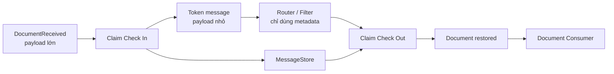
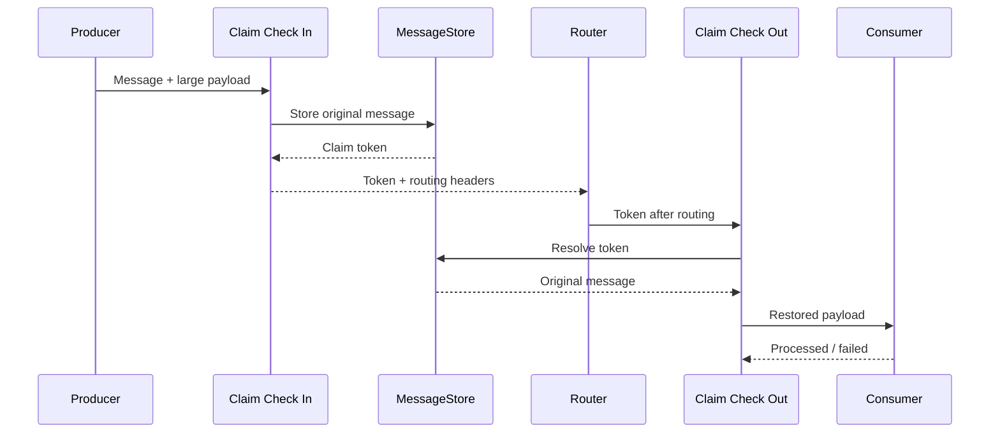
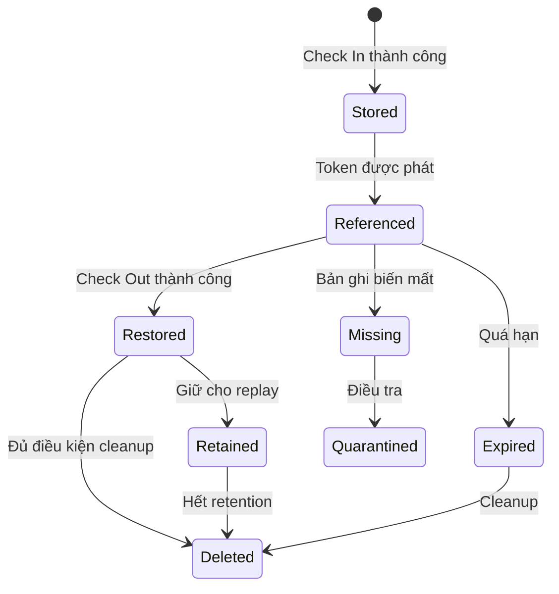
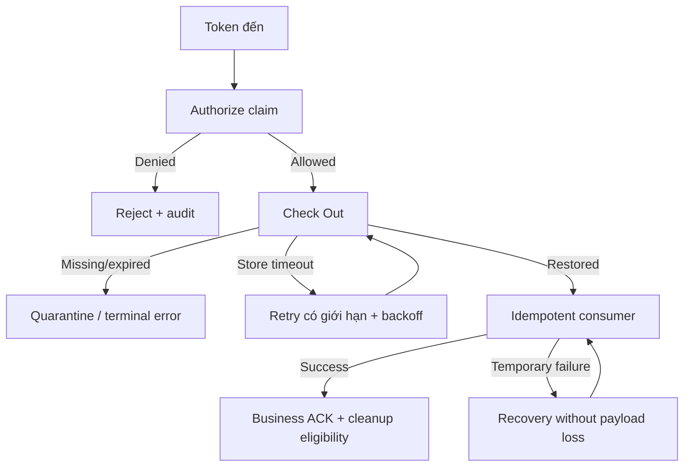
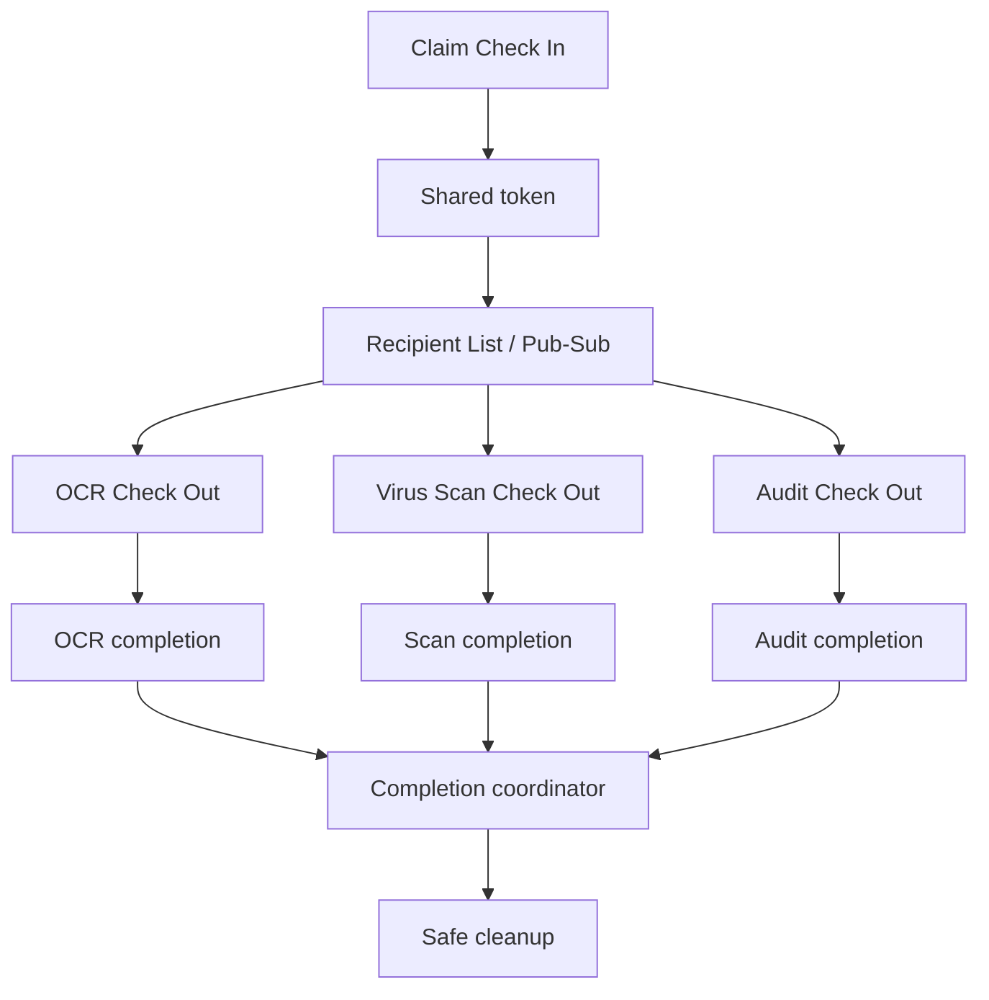

# Check in và check out payload

## 1. Bối cảnh: message quá lớn đi qua một luồng tích hợp

Một hệ thống xử lý chứng từ nhận tài liệu dài hàng chục MB. Quy trình yêu cầu kiểm tra thông tin khách hàng, duyệt metadata, định tuyến tới bộ phận phù hợp, rồi cuối cùng đưa nội dung tài liệu cho một consumer để phân tích. Nếu **toàn bộ payload lớn** được truyền qua mọi channel, queue, broker, Gateway và bước xử lý trung gian, hệ thống có thể gặp:

- Tốn bộ nhớ và tăng áp lực garbage collector khi nhiều message cùng lúc nằm trong queue.
- Độ trễ và chi phí mạng cao khi serialize hoặc chuyển payload qua nhiều hop.
- Vượt giới hạn kích thước message của một broker/transport.
- Rò dữ liệu nếu logging, tracing hoặc audit ghi lại body nhạy cảm ở những nơi chỉ cần metadata.
- Khó điều phối vì các Router, Filter thường chỉ cần ID, trạng thái, loại tài liệu, không cần toàn bộ nội dung.

**Claim Check** là một *Enterprise Integration Pattern (EIP)* xử lý vấn đề bằng cách tách **payload lớn** khỏi luồng thông điệp đang điều phối. Bước **Check In** lưu message hoặc payload cần giữ tại một kho đáng tin và thay thế bằng **claim check token** nhỏ. Những bước trung gian chuyển token. Khi một consumer thực sự cần nội dung, bước **Check Out** dùng token để lấy lại payload.

Trong chương **Claim check** của module **SPRING_INTEGRATION_PATTERN**, người học triển khai Enterprise Integration Patterns bằng Spring Integration nhằm xây dựng các luồng message ít phụ thuộc, dễ mở rộng; thực hành Router, Filter, Transformer, Splitter, Aggregator, Gateway, retry, error channel và correlation, đồng thời kiểm thử/quan sát những nhánh xử lý. Claim Check đặc biệt có ích khi các bước điều phối không cần dữ liệu nặng.



> **Trọng tâm bài học:** Check In và Check Out là hai thao tác có trạng thái, liên quan tới **lifecycle dữ liệu, lưu trữ, định danh, quyền truy cập và xử lý lỗi**. Chúng không chỉ là thay payload bằng một String rồi lấy String ấy để query database.

## 2. Thuật ngữ và hợp đồng của Claim Check

| Khái niệm | Ý nghĩa |
| --- | --- |
| **Original message** | Message ban đầu, gồm payload nghiệp vụ và metadata cần giữ |
| **Check In** | Đưa message/payload vào store và nhận một khóa tra cứu |
| **Claim check token** | Giá trị nhỏ đại diện cho nội dung đã lưu; dùng làm payload của message điều phối |
| **MessageStore** | Kho lưu message theo ID, có thể ở memory hoặc bền vững tùy implementation |
| **Check Out** | Dùng token để lấy lại message/payload ban đầu |
| **Restore point** | Vị trí trong flow mà một bước downstream thật sự cần nội dung gốc |
| **Claim lifecycle** | Các trạng thái tạo, sử dụng, có thể xóa, hết hạn, phục hồi và dọn dẹp |
| **Stale / missing token** | Token không còn trỏ tới dữ liệu khả dụng hoặc không hợp lệ |
| **Token authorization** | Kiểm tra caller được phép lấy nội dung tương ứng, không chỉ biết token |

### 2.1. Hai thế giới: message nghiệp vụ và message tham chiếu

Ví dụ message gốc:

```text
Message<DocumentPayload>
  payload:
    tenantId   = tenant-hcm
    documentId = DOC-105
    content    = "<tài liệu dài hàng MB>"
  headers:
    eventId    = evt-doc-105
    traceId    = trace-105
    documentType = INVOICE
```

Sau Check In, về mặt **mô hình khái niệm**:

```text
Message<ClaimToken>
  payload:
    token = "<opaque-id>"
  headers:
    eventId    = evt-doc-105
    traceId    = trace-105
    documentType = INVOICE

MessageStore[opaque-id] -> original message / original data
```

Sau Check Out:

```text
Message<DocumentPayload>
  payload:
    tenantId   = tenant-hcm
    documentId = DOC-105
    content    = "<tài liệu ban đầu>"
  headers:
    metadata khôi phục / truyền tiếp theo contract thực tế
```

Đây là sơ đồ tư duy, **không phải cam kết mọi header sẽ luôn được khôi phục y hệt** ở mọi cấu hình và mọi protocol adapter. Spring Integration có các transformer Claim Check và cơ chế xử lý message headers; phải kiểm thử trên chính flow đang dùng, đặc biệt khi có một bước trung gian sửa header, tự tạo message hoặc truyền qua broker.

### 2.2. Token không phải nội dung đã mã hóa

Claim check token thường là ID hoặc key để tra cứu. Nó:

- Không chứa nguyên nội dung tài liệu.
- Không mặc định được mã hóa như một blob ciphertext.
- Không tự chứng minh người sở hữu token có quyền đọc tài liệu.
- Có thể bị lộ qua log, trace, URL hoặc queue nếu không có kiểm soát.
- Có thể đã hết hạn hoặc bị xóa trước khi Check Out.

**Phải coi token là thông tin có khả năng cấp quyền truy xuất dữ liệu.** Trong hệ thống có nhiều tenant, cần gắn tenant, kiểm tra authorization trước restore, giới hạn lifetime và tránh dùng ID dự đoán được khi token được đưa ra biên không tin cậy.

## 3. Luồng Check In → điều phối → Check Out chi tiết

Một quy trình điển hình:

1. **Ingress nhận message gốc.** Message có document ID, event ID và payload nặng.
2. **Check In vào store.** Kho lưu phải xác nhận ghi thành công theo durability contract.
3. **Phát claim check token.** Chỉ khi dữ liệu đã lưu đúng và còn khả dụng mới chuyển token downstream.
4. **Route/Filter/Gateway trên token.** Các bước nhẹ đọc metadata cần thiết để ra quyết định; không đòi body lớn.
5. **Check Out tại consumer cần body.** Dùng token để lấy message/payload.
6. **Consumer xử lý nội dung.** Cần idempotency, retry và transaction theo hành vi nghiệp vụ.
7. **Dọn dẹp store.** Xóa hoặc giữ dữ liệu theo policy, không xóa sớm chỉ vì đã nhìn thấy token.



**Check In** nên được đặt **trước** các hop gây tốn chi phí cho payload lớn. **Check Out** nên đặt **ngay trước** bước đầu tiên thật sự cần body; nếu khôi phục ngay sau Check In thì gần như không giảm tải được phần giữa.

### 3.1. Khi nào Router và Filter hoạt động mà không cần khôi phục?

Router chọn nhánh theo `documentType`, tenant hoặc priority từ metadata. Filter bỏ một yêu cầu do trạng thái nghiệp vụ hoặc thiếu quyền. Cả hai có thể không cần nội dung tài liệu đầy đủ.

Nhưng đừng đưa quá nhiều metadata vào headers: nếu header chứa một Map lớn hoặc object mutable, token nhỏ nhưng toàn message vẫn nặng. Chỉ giữ thông tin tối thiểu phục vụ điều phối, và phải bảo đảm metadata đó đã được xác thực hoặc được tạo bởi một thành phần đáng tin.

### 3.2. Phân biệt Check Out và tải lại từ nguồn ngẫu nhiên

Claim Check không nhất thiết có nghĩa luôn tải lại **phiên bản hiện tại** của document từ một API bất kỳ. Nếu check-in đã lưu snapshot để replay chính xác, check-out phải trả **đúng nội dung gắn với token**. Nếu lưu chỉ document ID rồi gọi hệ thống nguồn ở thời điểm khác, nội dung có thể đã thay đổi hoặc bị xóa: đó là một thiết kế *reference lookup* có semantics khác.

Chính sách phải trả lời: token trỏ tới **snapshot bất biến**, tới **version cụ thể** hay tới **bản ghi mới nhất**? Với tài liệu đã ký hoặc giao dịch cần audit, nên có version/checksum và khả năng giải thích nội dung nào đã được xử lý.

## 4. Check In/Check Out nên dùng trong trường hợp nào?

| Tình huống | Claim Check phù hợp? | Lý do |
| --- | --- | --- |
| PDF/ảnh/binary lớn qua nhiều bước điều phối | Thường có | Giảm dữ liệu được chuyển giữa các hop |
| Header-only routing trước khâu đọc body | Có | Router không phải xử lý payload nặng |
| Một tài liệu cần nhiều consumer đọc | Có thể | Cần quy tắc đọc nhiều lần/retention và reference counting |
| Dữ liệu nhỏ, ít hop, xử lý ngay | Thường không cần | Store I/O/cleanup làm tăng độ phức tạp |
| Hệ thống yêu cầu tốc độ rất thấp latency | Tùy | Mỗi Check In/Out thêm store I/O |
| Blob vài GB | Có thể dùng biến thể | Nên cân nhắc object storage thay vì MessageStore lưu object lớn |
| Yêu cầu transaction nguyên tử qua DB, broker, object storage | Không tự giải quyết | Cần outbox/inbox, transaction hoặc saga |
| Nhiều tenant với dữ liệu bí mật | Có thể, cần thiết kế an toàn | Token authorization, encryption, isolation |
| Đầu vào là stream một lần đọc | Cần cân nhắc | Check In phải ghi đầy đủ nội dung trước khi phát token |

Claim Check tiết kiệm chi phí vận chuyển payload trên các hop, **không tự làm dữ liệu nhẹ hơn ở nguồn**. Nó chuyển chi phí từ network/message broker sang storage: cần đo throughput, latency, disk I/O và khả năng dọn dẹp.

## 5. MessageStore của Spring Integration và hai loại token

Spring Integration cung cấp EIP Claim Check với một cặp transformer: **Claim Check-In Transformer** và **Claim Check-Out Transformer**. Chúng có thể sử dụng một `MessageStore` để lưu message gốc và truy xuất bằng ID. Trong Java DSL, pattern này thường được nối bằng các phương thức `claimCheckIn(...)` và `claimCheckOut(...)`.

Cần phân biệt:

1. **Token nội bộ của framework:** khóa lưu/truy xuất message mà Claim Check transformers và MessageStore hiểu. Không giả định kiểu Java luôn là `String` hoặc `UUID` nếu chưa kiểm tra API/phiên bản.
2. **Token public của hệ thống:** nếu đưa qua web API, email, tenant boundary hoặc client không tin cậy, thường cần thêm một lớp opaque token đã ký/mã hóa hoặc bảng ánh xạ cùng authorization; không nhất thiết dùng thẳng ID của MessageStore.

Không nên tự ép kiểu payload token hoặc đưa nó thẳng vào URL mà không xác định yêu cầu bảo mật và format. Ví dụ Java bên dưới chủ động dùng `Message<?>` để minh họa vòng đời mà không dựa vào kiểu cụ thể của token.

### 5.1. Store memory chỉ dùng cho bài tập

`SimpleMessageStore` tiện để chạy ví dụ ngay trong một Spring context. Nó giữ message trong memory, do đó:

- Restart làm mất nội dung chưa được lưu bền vững.
- Check Out ở một JVM khác không nhìn thấy kho memory của JVM đầu.
- Payload lớn và nhiều group có thể khiến heap tăng mạnh.
- Nó không tự đáp ứng retention, auditing, encryption hoặc backup.
- Các queue channel bộ nhớ có thể khiến token chưa xử lý bị mất khi restart.

Với hệ thống production, chọn persistent store có khả năng lưu payload/headers, hoặc dùng object/blob storage và cơ chế mapping token phù hợp. Nếu hai instance cần check-in/check-out cho cùng token, chúng phải dùng **một vùng lưu trữ có thể truy cập chung** với durability và quyền truy cập đã định nghĩa.

### 5.2. MessageStore không đồng nghĩa object storage

Một `MessageStore` theo mô hình Spring Integration lưu các đối tượng `Message`. Một object store có thể lưu binary lớn và metadata trong bảng riêng. Tùy dữ liệu và provider, giải pháp dùng blob storage với signed/reference key có thể có throughput và chi phí tốt hơn cho file cực lớn. **Claim Check là pattern, không bắt buộc mọi sản phẩm dùng cùng một công nghệ lưu trữ.**

Đối với một implementation persistent, phải tính tới:

- Serialization/deserialization của payload và header values.
- Version schema của các class Java khi deploy mới.
- Kích thước lưu trữ, transaction, encryption-at-rest, backup.
- Khả năng migrate và đối soát orphan records.
- Quyền truy cập giữa các service và tenant.
- Thời gian tra cứu token, high availability và tỷ lệ lỗi store.

## 6. Mô hình tài liệu đầu vào cho ví dụ Java

Ta dùng Java 17+ và một payload dạng text bất biến để minh họa. Nội dung thật có thể là hàng MB; trong code test chỉ cần chuỗi nhỏ để kiểm chứng logic.

```java
record DocumentPayload(
        String tenantId,
        String documentId,
        String content) {
    DocumentPayload {
        if (tenantId == null || tenantId.isBlank()
                || documentId == null || documentId.isBlank()
                || content == null || content.isEmpty()) {
            throw new IllegalArgumentException("Invalid document payload");
        }
    }
}
```

`String` là value type bất biến. Nếu đổi `content` sang `byte[]`, record **không tự bảo vệ mảng**: cần clone khi xây dựng và clone ở accessor, hoặc dùng một immutable binary abstraction. Nếu không, một caller có thể sửa bytes của message đang nằm trong store, khiến khôi phục ra nội dung khác lúc check-in.

Một producer có thể chuẩn bị message gốc:

```java
import org.springframework.messaging.Message;
import org.springframework.messaging.support.MessageBuilder;

var doc = new DocumentPayload(
        "tenant-hcm", "DOC-105", "Nội dung chứng từ ví dụ");

Message<DocumentPayload> original =
        MessageBuilder.withPayload(doc)
                .setHeader("eventId", "evt-doc-105")
                .setHeader("traceId", "trace-105")
                .setHeader("documentType", "INVOICE")
                .setHeader("tenantId", "tenant-hcm")
                .build();
```

**Quan trọng:** `tenantId` trong header phải lấy từ ingress đã xác thực/validated, không được tin vào một chuỗi bất kỳ do client tự khai nếu token có thể dẫn tới dữ liệu của tenant khác.

## 7. Java DSL: Check In và Check Out thành hai giai đoạn rõ ràng

Ta tạo hai flow độc lập để quan sát token:

- `documents.in → Claim Check In → documents.tokens`.
- `documents.checkout → Claim Check Out → documents.restored`.

Trong bài tập, `documents.tokens` và `documents.restored` là `QueueChannel` trong memory để unit/integration test dễ đọc. Đây **không phải** một thiết kế durable broker hay môi trường production.

### 7.1. Cấu hình đầy đủ Spring Integration

```java
import org.springframework.context.annotation.Bean;
import org.springframework.context.annotation.Configuration;
import org.springframework.integration.channel.DirectChannel;
import org.springframework.integration.channel.QueueChannel;
import org.springframework.integration.config.EnableIntegration;
import org.springframework.integration.dsl.IntegrationFlow;
import org.springframework.integration.store.MessageStore;
import org.springframework.integration.store.SimpleMessageStore;
import org.springframework.messaging.MessageChannel;
import org.springframework.messaging.PollableChannel;

@Configuration
@EnableIntegration
class ClaimCheckFlowConfiguration {

    @Bean("claimCheck.store")
    MessageStore claimCheckMessageStore() {
        // Demo only: dữ liệu chỉ ở heap của JVM.
        return new SimpleMessageStore();
    }

    @Bean("documents.in")
    MessageChannel documentIngress() {
        return new DirectChannel();
    }

    @Bean("documents.tokens")
    PollableChannel tokenQueue() {
        return new QueueChannel();
    }

    @Bean("documents.checkout")
    MessageChannel checkoutRequests() {
        return new DirectChannel();
    }

    @Bean("documents.restored")
    PollableChannel restoredQueue() {
        return new QueueChannel();
    }

    @Bean
    IntegrationFlow checkInDocuments(MessageStore claimCheckMessageStore) {
        return IntegrationFlow.from("documents.in")
                .claimCheckIn(claimCheckMessageStore)
                .channel("documents.tokens")
                .get();
    }

    @Bean
    IntegrationFlow checkOutDocuments(MessageStore claimCheckMessageStore) {
        return IntegrationFlow.from("documents.checkout")
                .claimCheckOut(claimCheckMessageStore)
                .channel("documents.restored")
                .get();
    }
}
```

**Cách đọc flow:**

1. Producer gửi `Message<DocumentPayload>` vào `documents.in`.
2. `claimCheckIn(store)` lưu message gốc, phát message có payload là claim token.
3. Test hoặc một bước điều phối lấy message token từ `documents.tokens`.
4. Khi cần khôi phục, nó gửi message có token vào `documents.checkout`.
5. `claimCheckOut(store)` tra MessageStore, phát payload đã khôi phục tới `documents.restored`.
6. Test/consumer nhận message chứa nội dung tài liệu.

Ví dụ sử dụng API Java DSL của Spring Integration; tên overload và tùy chọn trong từng phiên bản cần được đối chiếu với dependency của dự án tại vòng Content QA/compile sau này. Điểm mấu chốt là **cả Check In và Check Out phải dùng cùng một logical store**, dù trong production hai giai đoạn có thể ở các process khác nhau.

### 7.2. Vì sao cần hai input channel khác nhau?

Nếu nối trực tiếp `documents.tokens` sang Check Out, token sẽ được khôi phục ngay lập tức. Trong nhiều tình huống có thể dùng flow như vậy để test end-to-end, nhưng nó không minh họa được lợi ích **gửi token qua những bước trung gian**.

Ở bài tập này, ta cố ý tách channel nhận token và channel yêu cầu restore, để có thể đặt Router/Filter/Gateway/audit ở khoảng giữa hoặc mô phỏng truyền token qua broker.

### 7.3. Giới hạn của QueueChannel trong ví dụ

`QueueChannel` chứa message trong queue memory; `receive(0)` đọc không chờ. Khi JVM dừng, message chưa xử lý có thể mất. Điều này tương tự `SimpleMessageStore`: thuận tiện cho demo, **không bảo đảm durable delivery**.

Nếu production yêu cầu lưu token khi service khởi động lại, cần một nguồn message bền vững với ACK/retry rõ ràng. Nếu token được giữ nhưng payload trong MessageStore không bền vững, sẽ xuất hiện **orphan token**: downstream có ID hợp lệ nhưng không còn dữ liệu để khôi phục.

## 8. Test end-to-end: gửi payload lớn, nhận token, khôi phục payload

Ví dụ JUnit 5 + Spring Test sử dụng đúng configuration mục 7. Test không giả định claim token là `String` hay `UUID`; nó kiểm tra payload đã được thay thế bằng reference rồi quay lại đúng nội dung.

```java
import org.junit.jupiter.api.Test;
import org.springframework.beans.factory.annotation.Autowired;
import org.springframework.beans.factory.annotation.Qualifier;
import org.springframework.messaging.Message;
import org.springframework.messaging.MessageChannel;
import org.springframework.messaging.PollableChannel;
import org.springframework.messaging.support.MessageBuilder;
import org.springframework.test.context.junit.jupiter.SpringJUnitConfig;

import static org.junit.jupiter.api.Assertions.*;

@SpringJUnitConfig(classes = ClaimCheckFlowConfiguration.class)
class ClaimCheckFlowTest {

    @Autowired
    @Qualifier("documents.in")
    MessageChannel ingress;

    @Autowired
    @Qualifier("documents.tokens")
    PollableChannel tokenQueue;

    @Autowired
    @Qualifier("documents.checkout")
    MessageChannel checkout;

    @Autowired
    @Qualifier("documents.restored")
    PollableChannel restoredQueue;

    @Test
    void checkInCreatesTokenAndCheckOutRestoresPayload() {
        var payload = new DocumentPayload(
                "tenant-hcm", "DOC-105", "Nội dung chứng từ ví dụ");

        var original = MessageBuilder.withPayload(payload)
                .setHeader("eventId", "evt-doc-105")
                .setHeader("tenantId", "tenant-hcm")
                .setHeader("traceId", "trace-105")
                .build();

        assertTrue(ingress.send(original));

        Message<?> claim = tokenQueue.receive(0);
        assertNotNull(claim);

        Object token = claim.getPayload();
        assertNotNull(token);
        assertNotEquals(payload, token);

        // Từ đây token có thể qua Router/Filter,
        // nhưng không biến token thành document payload.
        assertTrue(checkout.send(claim));

        Message<?> restored = restoredQueue.receive(0);
        assertNotNull(restored);
        assertEquals(payload, restored.getPayload());

        // Đây là hợp đồng cần xác minh tại output thực tế;
        // nếu adapter/transformer đổi headers, sửa flow có chủ đích.
        assertEquals("evt-doc-105",
                restored.getHeaders().get("eventId"));
        assertEquals("tenant-hcm",
                restored.getHeaders().get("tenantId"));
    }
}
```

Vì `DirectChannel` xử lý đồng bộ và `QueueChannel` lưu trong cùng context, có thể gọi `receive(0)` ngay trong ví dụ. Với executor/broker, test cần await/latch có timeout. **`send()==true` không luôn chứng minh business processing thành công** khi một đoạn downstream bất đồng bộ.

### 8.1. Một test xanh chưa chứng minh flow production an toàn

Test trên chỉ xác minh round trip trong cùng JVM, chưa chứng minh:

- MessageStore bền vững qua restart.
- Token không bị mất khi broker retry/ACK.
- Check Out đúng tenant, đúng authorization.
- Dữ liệu lớn thực sự giảm số byte trên đường truyền giữa hai service.
- Hai consumer cùng dùng token có thể khôi phục theo semantics đã chọn.
- Payload/header serialize được với provider persistent.
- Dữ liệu gốc được dọn đúng retention policy.

Đó là các tầng kiểm thử riêng, không thể suy ra từ một unit test chức năng.

## 9. Vòng đời token và thời điểm xóa dữ liệu

Một claim check nên được quản lý như một **tham chiếu có vòng đời**. Về mặt thiết kế ứng dụng, có thể mô hình hóa:



Sơ đồ là **mô hình do ứng dụng thiết kế**, không khẳng định mọi trạng thái trên có sẵn trong Spring Integration. Chế độ Check Out **đọc rồi xóa** hay **đọc nhưng giữ lại** phải được xác định theo transformer, cấu hình và phiên bản API đang sử dụng. Không suy luận rằng lấy được payload đồng nghĩa người xử lý đã hoàn thành nghiệp vụ.

### 9.1. Xóa claim quá sớm làm hỏng retry

```text
t0: Check In lưu DOC-105 -> token T105
t1: Broker chuyển T105 đến consumer
t2: Check Out lấy payload và xóa khỏi store
t3: Consumer gọi OCR -> timeout/crash
t4: Broker redeliver T105
t5: Check Out thất bại vì dữ liệu đã bị xóa
```

Với thiết kế **one-shot/destructive retrieval**, Check Out có thể thành công nhưng consumer vẫn thất bại. Nếu cần retry sau lỗi downstream, có thể:

- Dùng **non-destructive retrieval** nếu framework/store hỗ trợ trong thời gian retry window.
- Chỉ xóa claim sau khi có xác nhận nghiệp vụ đáng tin và các consumer liên quan hoàn tất.
- Cho phép replay trong một retention window có giới hạn.
- Tách **trạng thái lưu payload** khỏi **trạng thái đã xử lý** ở inbox/idempotency store.
- Với fan-out, không để một consumer đầu tiên dọn dữ liệu mà các consumer sau vẫn cần.

Giữ claim lâu cũng có chi phí: storage tăng, dữ liệu nhạy cảm tồn tại quá hạn, token bị lộ có thể tiếp tục truy xuất. Vì vậy chính sách cleanup phải cân bằng **khả năng retry** và **giới hạn lưu dữ liệu**.

### 9.2. Metadata vòng đời nên quản lý

| Thông tin | Câu hỏi cần trả lời |
| --- | --- |
| `createdAt` / `expiresAt` | Khi nào claim được tạo/hết hạn? |
| `tenantId` / `owner` | Claim thuộc ai? |
| `documentId` / `revision` | Nội dung cụ thể là phiên bản nào? |
| `checksum` | Dữ liệu có bị hỏng hoặc thay thế? |
| `claimStatus` | Active, consumed, expired hay revoked? |
| `lastReadAt` | Ai đã truy xuất và khi nào? |
| `processingStatus` | Consumer nào đã xử lý thành công? |
| `deletionStatus` | Dữ liệu ở store và bản sao đã xóa thật chưa? |

Đây là các trường **của claim registry ở tầng ứng dụng**, không phải hợp đồng mặc định của `MessageStore`.

### 9.3. Single-use và multi-use khác nhau

| Kiểu sử dụng | Ưu điểm | Rủi ro cần xử lý |
| --- | --- | --- |
| Single-use token | Giảm thời gian token còn hữu dụng | Consumer lỗi sau read có thể không retry |
| Multi-read trong TTL | Nhiều consumer/replay đọc cùng snapshot | ACL, audit, xóa đúng thời điểm |
| Shared payload + reference count | Chia sẻ file giữa nhiều nhánh | Đồng bộ completion từng nhánh |
| Replay từ claim version cũ | Dễ điều tra/đối soát | Retention, compliance, revision policy |

Claim Check không quyết định giùm nghiệp vụ có nên **cho đọc lần hai**. Việc cho đọc lại khác với **cho thực hiện side effect lần hai**.

## 10. Lỗi Check In/Check Out và cách phân loại

Một pipeline có ít nhất ba trạng thái độc lập: record payload trong store, token đang đi qua messaging và kết quả xử lý của consumer.

| Tình huống | Hậu quả | Hành động |
| --- | --- | --- |
| Check In store timeout, chưa ghi | Không có claim | Retry giới hạn, không phát token trước khi lưu thành công |
| Store đã ghi, publish token thất bại | **Orphan payload** | Reconciliation, cleanup hoặc outbox |
| Token đến trước khi store record visible | Check Out tạm không thấy | Bảo đảm commit/visibility; retry nếu thật sự do consistency lag |
| Token không hợp lệ/giả | Không xác định được claim | Reject, security audit |
| Token đã hết hạn/bị xóa | Claim không còn | Terminal failure/quarantine tùy policy |
| Store tạm offline | Check Out lỗi hạ tầng | Timeout, backoff, circuit breaker |
| Payload thiếu bytes hoặc checksum sai | Nội dung không đáng tin | Reject, đối soát, không trả nội dung lỗi |
| Check Out xong, consumer lỗi | Redelivery có thể xảy ra | Giữ khả năng restore hoặc recovery khác |
| Consumer commit thành công nhưng ACK mất | Duplicate delivery | Idempotent consumer |
| Hai consumer đọc cùng token | Xóa sớm/tranh chấp | Chính sách multi-read hoặc completion coordinator |
| Token còn ở DLQ nhưng TTL hết | Replay không phục hồi được | TTL phù hợp retry/retention window |
| Header định tuyến mất qua adapter | Sai tenant/route | Validation và test header propagation |

**Phân biệt lỗi thiếu claim với lỗi store không thể truy cập.** Với ID hoàn toàn không tồn tại vì giả mạo, retry vô hạn không làm dữ liệu xuất hiện. Nhưng với read-after-write lag ở storage phân tán, một retry ngắn có thể hữu ích nếu policy cho phép.

### 10.1. Retry đặt đúng tầng



Retry của HTTP client, check-out transformer, broker adapter và consumer business có **phạm vi khác nhau**. Nếu mỗi tầng thử lại nhiều lần, tải lên store có thể tăng đột biến. Nên chọn một chiến lược chủ đạo, kiểm soát tổng số attempts, backoff và deadline.

### 10.2. Error channel không phải payload store

Với `DirectChannel`, lỗi đồng bộ có thể truyền ngược về sender. Với poller/executor/broker, lỗi có thể đi qua error handler hoặc `errorChannel` theo cấu hình. Nhưng:

- `ErrorMessage` không biến channel thành một kho bền vững.
- Không log original body vào error handler nếu dữ liệu nhạy cảm.
- Dead-letter queue chỉ chứa token thì **không giữ được payload** nếu MessageStore đã cleanup.
- Lỗi authorization không được che thành “không tìm thấy” mà không có audit phù hợp.
- Phải tách lỗi dữ liệu/cấu hình không phục hồi được khỏi lỗi transient có thể retry.

## 11. MessageStore, broker và transaction boundary

Ba thao tác trong workflow thường không nằm trong một transaction duy nhất:

```text
A. Save original message
B. Publish claim token
C. Read payload and commit business side effect
```

Một số khoảng hở:

1. **A commit, B fail:** dữ liệu đã lưu nhưng không có token chuyển tiếp.
2. **B visible trước A commit:** consumer nhận token nhưng chưa tra được payload.
3. **C commit, ACK fail:** broker phát lại token dù consumer đã xử lý thành công.
4. **Check Out xóa claim, C fail:** payload không còn để retry.
5. **Cleanup và replay cạnh tranh:** một worker xóa claim ngay lúc worker khác khôi phục.

Không thể kết luận exactly-once end-to-end chỉ vì đã dùng `MessageStore` hoặc `@Transactional` trên một service. Nếu store, broker và database nghiệp vụ độc lập, cần phối hợp **durability, transaction/outbox, idempotency và recovery**.

### 11.1. Chọn mức bảo đảm

| Nhu cầu | Giải pháp |
| --- | --- |
| Demo một JVM | SimpleMessageStore và QueueChannel |
| Sống qua restart | Persistent store + durable token delivery |
| Tránh orphan record | Reconciliation/cleanup, outbox nếu phù hợp |
| Chạy nhiều instance | Shared storage, namespace, locking/visibility |
| Chống side effect trùng | Inbox/idempotency key + transaction |
| Replay đúng dữ liệu | Immutable snapshot + version/checksum |
| File vài GB | Object storage + reference registry |
| Store outage | Circuit breaker, backpressure, bounded retry |

Transactional outbox có thể giúp phối hợp ghi yêu cầu publish cùng dữ liệu nghiệp vụ **khi cùng một database transaction khả thi**. Nó không tự mở rộng thành distributed transaction giữa object storage, broker và API bên ngoài. Outbox publisher cũng có thể phát lại, nên downstream vẫn cần idempotency.

### 11.2. Business ID không giống storage token

```text
eventId      = evt-doc-105
documentId   = DOC-105
claimToken   = opaque-reference-T105
messageId    = framework-generated-message-id
```

Cùng một `eventId` có thể bị broker giao lại rồi đi qua Check In lần thứ hai, sinh **hai claim tokens khác nhau** cho cùng một event. Nếu muốn tránh lưu trùng, cần stable business key, fingerprint/checksum và chính sách reuse có chủ đích.

Không dùng `MessageHeaders.ID` làm idempotency key nghiệp vụ, và không dùng token như bằng chứng rằng OCR/luồng thanh toán đã hoàn tất.

## 12. Nhiều consumer dùng chung một claim

Một tài liệu có thể phải qua OCR, virus scanning và audit. Ba nhánh đều cần body, nhưng ta muốn chỉ lưu một snapshot.



Nếu Check Out của OCR đã xóa payload, Scan/Audit sẽ thất bại. Hợp đồng multi-consumer có thể chọn:

- **Shared read** trong retention window: tất cả đọc cùng immutable snapshot.
- **Separate claims** cho từng nhánh khi phân quyền hoặc revision khác nhau.
- **Completion coordinator / reference counting:** biết chính xác nhánh nào đã hoàn tất, rồi mới cleanup.
- **Status events bền vững:** sau mỗi nhánh gửi completion event, không coi một lần lookup là đã hoàn thành nghiệp vụ.

### 12.1. Tránh đọc những revision khác nhau

Nếu token trỏ tới *snapshot v7*, mọi nhánh nên đọc v7. Nếu token chỉ trỏ tới `documentId` rồi tải bản “latest” ở nguồn, một nhánh có thể đọc v7 còn nhánh khác đọc v8. Khi cần audit, lưu `revision` và `checksum`, không lấy bản hiện tại một cách âm thầm.

Nếu document được sửa có chủ đích, hãy tạo claim/version mới với quan hệ tới bản trước. Đừng dùng một token cũ để che nội dung mới mà không có sự kiện cập nhật rõ.

## 13. Token authorization và tenant isolation

Claim Check giúp **giảm việc phát tán payload**, nhưng token không tự cung cấp xác thực hay phân quyền. Nếu token được gửi tới một frontend hoặc API public, backend restore phải kiểm tra **người yêu cầu có được phép đọc chính claim đó hay không**.

| Lớp bảo vệ | Việc cần thực hiện |
| --- | --- |
| Ingress | Xác thực producer và tenant gốc |
| Token | Opaque, không dễ đoán, có lifetime rõ |
| Claim registry | Gắn tenant, owner, scope, revision, trạng thái |
| Check Out | Kiểm tra principal/tenant/permission trước restore |
| Storage | Encryption at rest, transport encryption, ACL |
| Logs | Không ghi body/token bí mật vào logs tùy tiện |
| Retention | Dọn dữ liệu, bản sao và backup theo policy |
| Replay | Quyền replay, rate limit, audit |
| Monitoring | Cảnh báo access denied, enumeration và lookup bất thường |

### 13.1. Phản mẫu: token là toàn bộ quyền truy cập

```text
GET /restore?token=T105
  -> store.get(T105)
  -> return original document
```

Nếu API không xác thực caller, kẻ có token có thể truy xuất nội dung. Một contract an toàn hơn:

```text
Principal:       authenticated tenant-hcm + document scopes
Request:         external claim reference
Claim registry:  tenant-hcm, DOC-105, revision=7, active
Authorization:   principal may read this revision
Internal token:  resolve only after authorization
Audit:           who, when, purpose, result
```

Không mặc định công khai internal MessageStore key như một bearer credential. Một lớp ánh xạ token public → claim record → store key cho phép quản lý scope, rotation, expiration và quyền truy cập độc lập với implementation của Spring Integration.

### 13.2. Token message vẫn có thể chứa thông tin nhạy cảm

Các headers còn lại có thể chứa PII, credential hoặc Java object không serializable. Check In không tự bảo vệ chúng. Cần rà soát:

- `tenantId` có được xác thực từ ingress hay do client tự đặt?
- `eventId`/`traceId` có lộ thông tin cá nhân không?
- Header có chứa raw document fragment, access token hoặc claim token bí mật không?
- Có header object như `replyChannel` phụ thuộc JVM được gửi qua broker không?
- Có đang đưa token hoặc document ID vào metric label cardinality cao không?

Nên dùng các metadata nhỏ, bất biến, đã chuẩn hóa, và giới hạn những header được phép đi qua transport boundary.

## 14. Hiệu năng và trade-off của Claim Check

Claim Check giảm tải trên các hop trung gian, nhưng tăng thao tác lưu/đọc dữ liệu.

```text
Không Claim Check:
  ingress -> hop1(body) -> hop2(body) -> hop3(body) -> consumer

Có Claim Check:
  ingress -> store(body)
          -> hop1(token) -> hop2(token) -> hop3(token)
          -> checkout reads body -> consumer
```

Nếu body kích thước `S` và có `N` network hops, gửi body qua mọi hop có chi phí truyền tăng theo `N × S` (mô hình đơn giản hóa), trong khi token thường nhỏ hơn nhiều. Tuy nhiên store cần ghi ít nhất một lần và đọc lại ít nhất một lần; nếu storage chậm, latency tổng thể có thể **tăng**.

### 14.1. Những chỉ số nên benchmark

- P50/P95/P99 thời gian Check In và Check Out.
- Tổng bytes lưu/đọc, token bytes trên broker.
- Số claims active, orphan, expired và cleanup backlog.
- Store heap/disk/connection pool, queue depth.
- Số lỗi missing claim, store timeout và retry.
- Thời gian từ Check In tới consumer business completion.
- Chi phí serialize/deserialize theo schema và phiên bản.
- Hiệu năng khi payload 1 MB, 10 MB, 100 MB dưới concurrency thực.

Những metric trên là **gợi ý instrument của ứng dụng**, không mặc định được Spring Integration tự xuất với tên cụ thể.

### 14.2. File rất lớn nên cân nhắc object storage

Với PDF/ảnh/binary vài trăm MB đến GB, có thể:
1. Upload nội dung lên object storage theo stream/chunk.
2. Lưu claim registry gồm object key, revision, checksum, tenant, expiry.
3. Gửi token nhỏ qua flow EIP.
4. Consumer được phân quyền truy xuất object theo key/version.
5. Dọn object orphan và expired theo lifecycle policy.

Pattern vẫn là Check In/Check Out. Nhưng khi dùng object store, không được mặc định rằng Java `MessageStore` của framework là nơi tối ưu để giữ toàn bộ BLOB. Đồng thời nên tránh materialize tất cả bytes vào heap nếu có thể dùng streaming.

## 15. Kết hợp Claim Check với các pattern khác

### 15.1. Router và Filter

Một Router chỉ cần `documentType` có thể điều phối token mà không tải body. Nhưng nếu Filter bỏ token, dữ liệu trong store có thể còn mãi:

```text
Original -> Check In -> Filter rejects token
                              |
                              +-> token discarded
                              +-> stored payload still exists?
```

Cần policy cleanup cho nhánh rejected, quarantine và dead-letter. Không xóa claim ngay nếu nhiều nhánh khác vẫn dùng token.

### 15.2. Splitter và Aggregator

- **Check In trước Splitter:** thích hợp khi các subtask chỉ cần metadata/tham chiếu và tải body lúc cần.
- **Splitter trước Check In:** mỗi chunk có claim riêng, phù hợp xử lý độc lập nội dung lớn.
- **Aggregator gom trạng thái:** không cần khôi phục body nếu chỉ tổng hợp trạng thái OCR/scan/approval.
- **Aggregator gom nội dung:** phải thực hiện restore/merge có kiểm soát, thứ tự, version và checksum; không chỉ gộp token.

Correlation nên theo `batchId` hoặc business workflow identity, không nhầm claim token với group key.

### 15.3. Gateway và luồng dài

Gateway có timeout request-reply hữu hạn. Nếu Check Out đọc storage chậm, caller có thể timeout dù backend còn xử lý. Với workflow dài:
- Trả tracking/workflow ID và xử lý async.
- Phân biệt timeout restore và timeout business consumer.
- Giữ token còn hợp lệ trong toàn retry/DLQ window.
- Có endpoint/trạng thái truy vấn completion, không buộc client chờ body khổng lồ.

## 16. Kiểm thử ngoài happy path

| Kịch bản | Kiểm tra |
| --- | --- |
| Check In/Out trong JVM | Payload khôi phục chính xác |
| Token message nhỏ | Body không đi qua middle hop |
| Hai claims đồng thời | Không tráo document |
| Token chưa từng tồn tại | Error được phân loại đúng |
| Token đã expired | Không dùng lại; có recovery policy |
| Store timeout | Bounded retry + backoff |
| Store commit, token publish fail | Reconciliation/orphan cleanup |
| Token publish trước store visible | Không tạo race |
| Consumer lỗi sau Check Out | Có thể restore/retry theo policy |
| Consumer commit nhưng ACK mất | Idempotency tránh side effect lặp |
| Một token, nhiều consumers | Không xóa quá sớm |
| Token sai tenant | Authorization denied |
| Restart sau Check In | Persistent store vẫn tra được |
| DLQ chờ lâu quá TTL | Có chính sách replay/expire rõ |
| Thay đổi schema Java | Payload persistent vẫn đọc được hoặc migration được |
| Payload bytes bị mutate | Stored snapshot được bảo vệ |
| Revision thay đổi | Check Out đúng snapshot/version |
| Dữ liệu nhạy cảm | Không lộ body/token trong logs |
| Load 1–100 MB | Memory/latency/backpressure đo được |

### 16.1. Lỗi ứng dụng nên có mã dễ điều tra

Ví dụ code lỗi nghiệp vụ (không phải tên exception mặc định của framework):

```text
CLAIM_NOT_FOUND
CLAIM_EXPIRED
CLAIM_ACCESS_DENIED
CLAIM_STORE_UNAVAILABLE
CLAIM_CORRUPTED
CLAIM_VERSION_UNSUPPORTED
CLAIM_ALREADY_CONSUMED
```

Map các lỗi store/transformer vào chính sách retry/quarantine. Một `CLAIM_NOT_FOUND` không nhất thiết retry; một `CLAIM_STORE_UNAVAILABLE` có thể retry theo deadline.

### 16.2. Test persistence qua restart

1. Khởi tạo context A với persistent store và Check In.
2. Ghi nhận token và commit record.
3. Dừng context A.
4. Tạo context B kết nối **cùng store bền vững**.
5. Check Out bằng token trước restart.
6. Kiểm tra payload, checksum, version và headers cần thiết.
7. Thử store unavailable và expiration.
8. Không dùng `SimpleMessageStore` để chứng minh khôi phục sau restart.

Với kiểm thử tải, dùng dữ liệu synthetic thay vì tài liệu thật, so sánh hash thay vì log toàn bộ bytes.

## 17. Những lỗi thiết kế thường gặp

1. **Coi claim token là payload được mã hóa** thay vì storage reference.
2. **Dùng SimpleMessageStore giữa nhiều JVM** rồi kỳ vọng chia sẻ dữ liệu.
3. **Phát token trước khi store ghi xong**, gây missing claim.
4. **Xóa claim sau Check Out trước khi consumer hoàn tất**, làm hỏng retry.
5. **Không dọn dữ liệu khi token bị Filter loại hoặc publish lỗi**, tạo orphan.
6. **Dùng token để quyết định event đã xử lý**, nhầm caching/storage với idempotency.
7. **Không kiểm tra tenant/authorization** trước restore.
8. **Đưa body hoặc bí mật vào headers** rồi tin rằng payload đã bị giấu.
9. **TTL ngắn hơn thời gian retry/DLQ**, khiến replay thất bại.
10. **Không version hóa snapshot**, retry đọc bản tài liệu mới.
11. **Tin rằng mọi MessageStore là durable/encrypted/audited**.
12. **One-shot token nhưng broadcast cho nhiều consumer**.
13. **Không có storage quota/cleanup**, tăng bộ nhớ hoặc disk vô hạn.
14. **Lưu `byte[]` mutable và chia sẻ reference** khiến body thay đổi.
15. **Chỉ test Check In/Out thành công**, không test restart/missing/store outage.
16. **Tưởng Claim Check luôn giảm latency**; thực tế còn tùy storage/transport.
17. **Lộ token trong logs/URLs không có scope và expiry**.
18. **Nhầm event ID, message ID, document ID và claim token**.

## 18. Bài tập thực hành và tự đánh giá

**Bài tập:** Một hệ thống xử lý `ContractSubmitted` mang `tenantId`, `contractId`, `eventId`, `documentBytes` và `documentType`. Bộ phận pháp chế chỉ cần metadata để route; dịch vụ phân tích sau phê duyệt mới cần body.

1. Tạo payload dùng defensive copy cho `byte[]` hoặc immutable binary type.
2. Cấu hình Check In flow lưu message, phát token vào channel riêng.
3. Dùng Router/Filter theo metadata đã xác thực mà không check-out body.
4. Cấu hình Check Out flow chỉ tại consumer cần document.
5. Test checksum trước Check In và sau Check Out phải giống nhau.
6. Thử một token giả hoặc đã expired, nêu error policy.
7. Cho consumer crash sau Check Out; thiết kế phương án retry không mất payload.
8. Thay SimpleMessageStore bằng persistent store và test restart.
9. Cho OCR, virus scanner cùng dùng claim; định nghĩa lúc nào được cleanup.
10. Mô phỏng Filter bỏ token, xây cơ chế dọn orphan record.
11. Thiết kế token authorization theo tenant/contract scope.
12. Mô phỏng ACK loss sau consumer success; bảo đảm idempotency theo `(tenantId,eventId,consumerName)`.
13. Thiết kế TTL bao trùm retry, DLQ, manual replay window.
14. Gắn metric check-in/out latency, active claims, orphan count và cleanup lag.
15. So sánh MessageStore và object storage cho file 100 MB.
16. Viết integration test chứng minh Router chỉ nhận token và Check Out phục hồi đúng payload.

**Tự đánh giá:** Check In lưu gì? Token đại diện cho điều gì? Check Out có nên xóa claim ngay không? Khi hai consumer cùng dùng token, làm sao tránh consumer đầu xóa dữ liệu của consumer sau? Token hợp lệ có chứng minh quyền truy cập không? Vì sao token còn trong DLQ mà payload có thể đã mất? Claim Check có tự bảo đảm exactly-once không?

**Check in và check out payload** là hai thao tác cốt lõi của Claim Check, cho phép những bước điều phối mang tham chiếu nhỏ thay vì payload lớn. Trong Spring Integration, Claim Check transformers và MessageStore hỗ trợ cơ chế ấy; tính đúng đắn trong môi trường thực còn phụ thuộc **durability, transaction boundary, token authorization, thời điểm xóa, retry, idempotency và cleanup**. Hãy kiểm thử toàn bộ vòng đời token, đặc biệt khi có restart, thất bại sau Check Out và nhiều consumer, để tối ưu lưu lượng không biến thành nguy cơ mất tài liệu hoặc rò thông tin.

