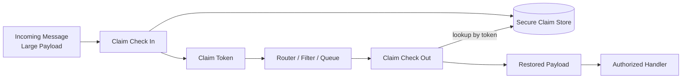
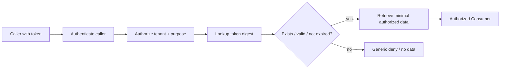
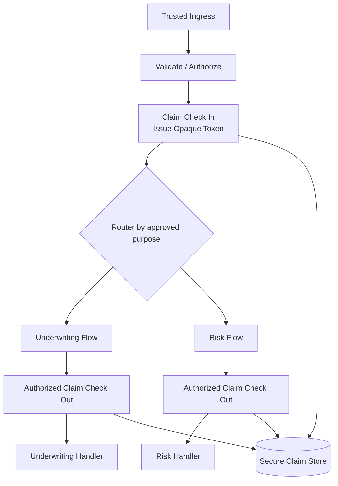
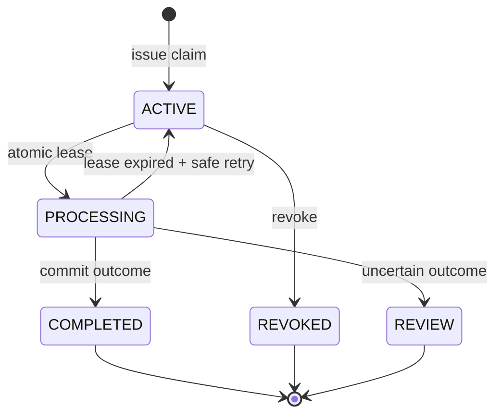
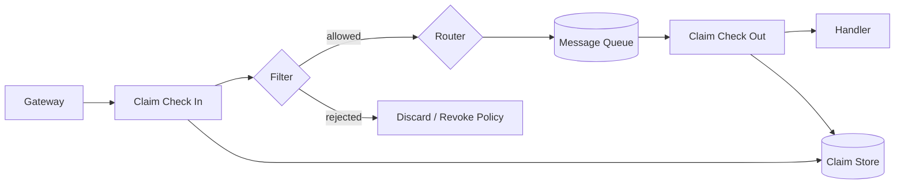
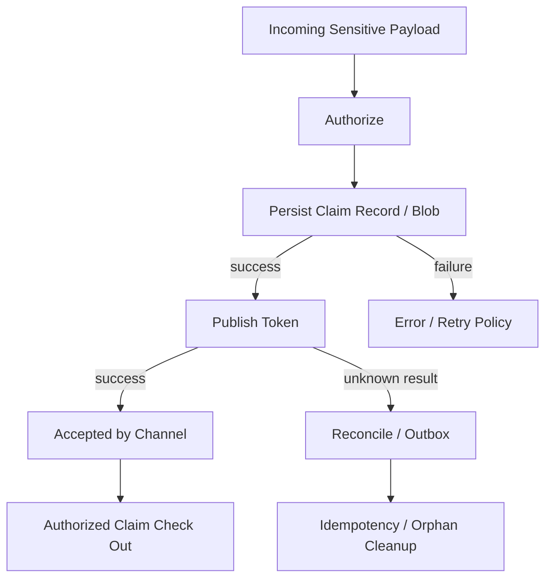
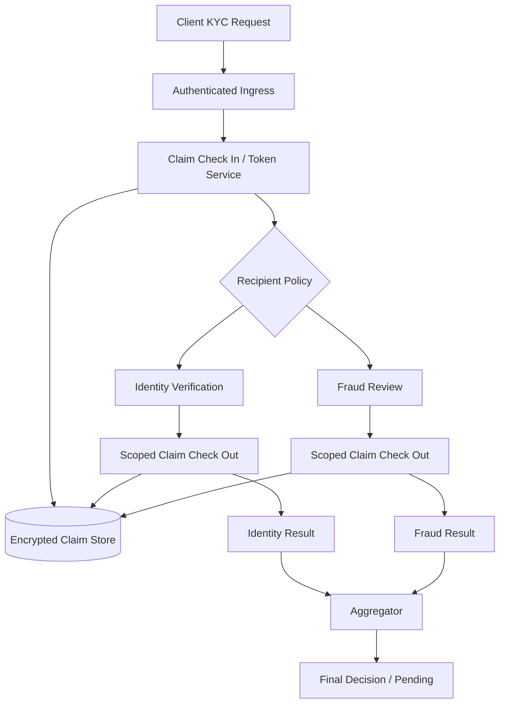

# Claim token không đoán được

Trong Enterprise Integration Patterns (EIP), **Claim Check** giúp giảm tải cho luồng message bằng cách **đưa phần dữ liệu lớn hoặc nhạy cảm vào một kho lưu trữ riêng**, rồi chuyển tiếp một giá trị tham chiếu ngắn gọn. Thành phần nhận ở bước sau dùng tham chiếu đó để lấy lại dữ liệu khi thật sự cần.

Ví dụ, một yêu cầu xử lý hồ sơ bảo hiểm có payload vài megabyte: ảnh chứng từ, thông tin cá nhân và các thuộc tính đã kiểm tra. Không phải Router, Filter hay mỗi subscriber đều cần toàn bộ nội dung. Hệ thống có thể lưu hồ sơ tại một kho an toàn, sau đó chuyển qua các channel một **claim token**. Khi đến nhánh có quyền xử lý, thành phần đó đổi token để khôi phục dữ liệu cần thiết.

Nhưng nếu token là số tăng dần, tên file, `orderId` hoặc một giá trị dễ suy ra, kẻ tấn công có thể thử token khác để truy xuất dữ liệu của người khác. **Claim token phải khó đoán về mặt mật mã**, đồng thời phải có phạm vi quyền, thời hạn sử dụng, cơ chế thu hồi, quan sát và xử lý retry rõ ràng.

Bài học **“Claim token không đoán được”** thuộc chương **Claim check**, module **SPRING_INTEGRATION_PATTERN**. Mục tiêu module là học triển khai Enterprise Integration Patterns với Spring Integration để xây dựng luồng thông điệp ít phụ thuộc, dễ mở rộng; thực hành Router, Filter, Transformer, Splitter, Aggregator, Gateway, retry, error channel, correlation và kiểm thử.

Sau bài học, bạn sẽ có thể giải thích vì sao một tham chiếu Claim Check phải có entropy đủ cao, tạo token bằng `SecureRandom`, phân biệt token với định danh nghiệp vụ, thiết kế lưu trữ và xác minh quyền, triển khai luồng mẫu bằng Spring Integration Java DSL và kiểm thử chống đoán token, dùng chéo tenant, hết hạn, sử dụng lại hoặc replay.

## 1. Claim Check hoạt động theo những bước nào?

Ý tưởng của Claim Check: giữ payload lớn hoặc không cần thiết ở một nơi an toàn, còn luồng integration chỉ truyền **dấu nhận hàng** (*claim check*) để lấy dữ liệu về sau.



Diễn biến điển hình:

1. **Nhận dữ liệu gốc.** Inbound adapter hoặc Gateway nhận message có payload cần bảo vệ hoặc quá lớn để phát qua mọi channel.
2. **Kiểm tra và phân quyền.** Xác minh tenant, loại dữ liệu, kích thước, schema và quyền lưu/khôi phục.
3. **Claim Check In.** Ghi payload hoặc tài liệu vào kho đáng tin cậy, tạo một token khó đoán và lưu quan hệ token → dữ liệu.
4. **Chuyển token.** Các bước Router/Filter/transport chỉ mang tham chiếu cùng metadata tối thiểu đã được chấp thuận.
5. **Claim Check Out.** Một consumer có quyền nhận token, tra kho, kiểm tra policy/hạn sử dụng và lấy dữ liệu.
6. **Hoàn tất/thu hồi.** Ghi nhận trạng thái xử lý và xóa/thu hồi claim theo vòng đời được định nghĩa.

Điểm quan trọng: **Claim Check là một pattern điều phối dữ liệu**, không tự có bảo đảm bảo mật chỉ vì đã thay payload thành một chuỗi ngắn. Thiết kế token, nơi lưu, phân quyền và thời hạn mới quyết định dữ liệu có bị truy xuất trái phép hay không.

### Ví dụ trước và sau khi Claim Check In

Message gốc:

```json
{
  "requestId": "req-101",
  "tenantId": "tenant-a",
  "document": {
    "type": "INSURANCE_CLAIM",
    "attachments": ["...large binary data..."],
    "personalData": "...sensitive data..."
  }
}
```

Message sau khi phát claim:

```json
{
  "requestId": "req-101",
  "tenantId": "tenant-a",
  "claimType": "INSURANCE_CLAIM",
  "claimToken": "<opaque-secret-token>",
  "expiresAt": "2026-11-21T05:30:00Z"
}
```

Đây là **hợp đồng dữ liệu minh họa**, không phải cấu trúc output mặc định của Spring Integration. Token phải được tạo an toàn; `expiresAt` trên message chỉ giúp người nhận biết hạn kỳ vọng, còn **server/kho claim phải tự kiểm tra hạn thật**, không tin hạn do client gửi.

## 2. Vì sao token khó đoán là một yêu cầu bảo mật?

Giả sử hệ thống cấp token bằng sequence của database:

```text
claimToken=1000001
claimToken=1000002
claimToken=1000003
```

Một người lấy được token `1000002` có thể đoán `1000001` và `1000003`. Nếu Claim Check Out chỉ kiểm tra token có tồn tại, đó là lỗ hổng **truy cập trực tiếp đối tượng không an toàn** (*IDOR*).

Một biến thể khác:

```text
claimToken="tenant-a/ORD-101/document.pdf"
```

Token chứa tên tenant, order, đường dẫn hoặc quy tắc tạo ID. Kẻ tấn công có thể khám phá cấu trúc lưu trữ và thử biến thể.

**Token không đoán được** có nghĩa người chưa nhìn thấy token không thể thực tế tính ra một token hợp lệ khác chỉ từ các token đã quan sát hoặc từ dữ liệu nghiệp vụ công khai.

Tuy vậy, điều này **không có nghĩa** token sẽ an toàn khi bị lộ. Một token dạng bearer cho phép ai sở hữu nó sử dụng theo quyền được cấp nếu hệ thống không có thêm kiểm tra khác.

### Một số nguồn token không nên dùng trực tiếp

| Cách tạo | Vấn đề |
| --- | --- |
| Database auto-increment ID | Có thể đoán giá trị tiếp theo |
| `orderId`, `customerId` hoặc `filePath` | Là định danh nghiệp vụ, có thể bị lộ hoặc suy ra |
| `System.currentTimeMillis()` | Có tính dự đoán cao |
| `Math.random()` hoặc `java.util.Random` | Không phải bộ sinh ngẫu nhiên mật mã |
| Hash SHA-256 của `orderId` không có secret | Đầu vào có thể đoán rồi hash lại |
| UUID phiên bản dựa trên thời gian/tên | Không được coi tương đương token bí mật ngẫu nhiên |
| JWT chỉ **ký**, nội dung có thể đọc | Chữ ký không tự làm token khó đoán hoặc bí mật |
| Token sinh ngẫu nhiên nhưng bị log công khai | Rò rỉ khiến entropy không còn bảo vệ |
| Token đủ ngẫu nhiên nhưng tra cứu không cần quyền | Người cầm token có thể đọc dữ liệu ngoài phạm vi |

Một ID có thứ tự **vẫn có thể được dùng làm khóa nội bộ database**, nhưng không nên phát ID đó ra ngoài như **bí mật cho phép khôi phục dữ liệu**. Có thể lưu record với khóa nội bộ tuần tự và ánh xạ riêng qua token bí mật ngẫu nhiên.

## 3. Entropy: đo khả năng không thể đoán token

**Entropy** của token ngẫu nhiên cho biết độ lớn không gian các giá trị có thể xuất hiện, nếu bộ sinh và cách phân phối thực sự phù hợp.

Nếu token gồm `b` bit ngẫu nhiên độc lập, số giá trị khả dĩ là:

\[
2^b
\]

Ví dụ:

| Token | Entropy lý thuyết | Nhận xét |
| --- | ---: | --- |
| Mã sáu chữ số | Dưới 20 bit | Không phù hợp làm bearer claim token truy cập dữ liệu quan trọng nếu không có cơ chế bảo vệ đặc biệt |
| 16 byte ngẫu nhiên mật mã | 128 bit | Mức cơ sở mạnh khi tạo và sử dụng đúng |
| 24 byte ngẫu nhiên mật mã | 192 bit | Biên an toàn rộng |
| 32 byte ngẫu nhiên mật mã | 256 bit | Phù hợp cho token opaque có tính nhạy cảm cao |
| Hash của ID tuần tự | Không tự tăng entropy | Hash không tạo ngẫu nhiên từ đầu vào dễ đoán |
| UUID v4 chuẩn | Khoảng 122 bit ngẫu nhiên | Có thể phù hợp trong một số ngữ cảnh; không phải mọi UUID đều là v4 |

**Độ dài của chuỗi hiển thị không đồng nghĩa số bit entropy.** Chuỗi 64 ký tự hex tạo từ counter vẫn đoán được. Ngược lại, 32 byte từ CSPRNG được mã hóa Base64URL không padding thành chuỗi 43 ký tự vẫn mang 256 bit ngẫu nhiên.

Lựa chọn độ dài cần dựa trên threat model, vòng đời token, số token phát hành, giới hạn vận hành và chính sách bảo mật. Với ví dụ trong bài, dùng **32 byte từ `SecureRandom`** để dễ nêu ra một hợp đồng rõ ràng.

### Token phải được tạo bởi CSPRNG

**CSPRNG** (*cryptographically secure pseudorandom number generator*) được thiết kế để kẻ quan sát không thể suy đoán đầu ra tiếp theo từ những đầu ra đã thấy, trong điều kiện vận hành đúng.

Với Java, `java.security.SecureRandom` là API thích hợp để sinh byte ngẫu nhiên mật mã. Không dùng `Math.random()`, `Random` hoặc tự trộn timestamp và PID rồi xem đó là token bảo mật.

**Không cần** tự viết thuật toán sinh số ngẫu nhiên. Việc dùng API chuẩn và giữ lifecycle an toàn quan trọng hơn phát minh một sơ đồ token.

## 4. Tạo claim token opaque bằng Java SecureRandom

Ví dụ triển khai một token URL-safe, không chứa tenant ID, số đơn hoặc thông tin có thể suy đoán.

```java
import java.security.SecureRandom;
import java.util.Base64;
import java.util.Objects;

final class SecureClaimTokenGenerator {
    private static final int TOKEN_BYTES = 32;

    private final SecureRandom random;

    SecureClaimTokenGenerator() {
        this(new SecureRandom());
    }

    SecureClaimTokenGenerator(SecureRandom random) {
        this.random = Objects.requireNonNull(random);
    }

    String generate() {
        byte[] raw = new byte[TOKEN_BYTES];
        random.nextBytes(raw);

        return Base64.getUrlEncoder()
            .withoutPadding()
            .encodeToString(raw);
    }
}
```

Với 32 byte ngẫu nhiên, token Base64URL không padding thường có **43 ký tự** thuộc tập chữ cái, chữ số, dấu `-` và `_`. Ví dụ:

```text
PJuP4tZZ5nZQmdYmeU_4QNPwzN_ydqRzJU0X3OeP3Js
```

Chuỗi trên **chỉ để minh họa hình thức**, không được dùng làm secret thật; token thật phải được sinh khi chạy.

### Tại sao cần Base64URL?

Base64URL dùng ký tự phù hợp hơn cho header, JSON và nhiều kênh truyền. Nó **chỉ là encoding**, không mã hóa bí mật. Người nhìn thấy token Base64URL đã biết toàn bộ giá trị dùng để tra cứu.

**Không nhầm**:

- Encoding: đổi dạng biểu diễn byte thành ký tự.
- Hash: tạo giá trị một chiều để làm chỉ mục/so sánh.
- Encryption: bảo vệ nội dung bằng khóa bí mật.
- Randomness: làm token không đoán được.
- Authorization: quyết định actor có quyền sử dụng token không.

Mỗi cơ chế giải quyết một yêu cầu khác nhau.

### Nếu phát hành token trong hệ thống phân tán

CSPRNG ở mỗi instance có thể tạo token độc lập. Xác suất trùng với token đủ entropy rất nhỏ, nhưng code production vẫn nên **xử lý trường hợp insert trùng** nhờ unique constraint ở kho claim và thử sinh lại, không mặc định rằng database không bao giờ từ chối trùng khóa.

Không dùng một seed cố định để “đồng bộ” token giữa các instance. Token của mỗi yêu cầu phải là dữ liệu bí mật mới, được sinh độc lập bởi nguồn ngẫu nhiên an toàn.

## 5. Token là tham chiếu, không phải quyền truy cập tự động

Ngay cả khi token có 256 bit ngẫu nhiên, kiến trúc vẫn phải quyết định **ai được quyền claim**.

Có hai mô hình thường gặp:

1. **Bearer capability:** ai giữ token hợp lệ có thể sử dụng nó theo phạm vi mà token được cấp.
2. **Opaque reference + authorization:** token là tham chiếu; Claim Check Out còn kiểm tra tenant, principal, role, purpose và workflow state.

Với dữ liệu cá nhân, tài chính hoặc đa tenant, **opaque reference + authorization rõ ràng** thường phù hợp hơn. Nếu dùng bearer capability, cần hiểu rõ tác động khi token bị lộ và giới hạn quyền của nó nghiêm ngặt.



Các bước trong sơ đồ có thể đổi thứ tự nội bộ để giảm rò rỉ, nhưng **không được phát nội dung claim trước khi kiểm tra quyền**. Phản hồi không tồn tại/hết hạn/sai tenant nên được thiết kế để không giúp bên ngoài enumerate dữ liệu.

### Token không phải identity của người dùng

Một token có thể được forward qua nhiều endpoint. Không dùng sự hiện diện của token để mặc định user đã được xác thực hoặc tenant đã được chọn đúng.

Nếu token nằm trong một message nội bộ do một Gateway đáng tin cậy phát, hãy bảo vệ **kênh truy cập message ấy**. Nếu token lộ qua API, cần xác thực actor và giới hạn quyền redeem.

### Phải gắn token với một mục đích

Một token cấp để **phân tích hồ sơ** không nên dùng để **xóa hồ sơ**. Kho claim có thể lưu metadata:

```text
tokenDigest
tenantId
claimType
purpose
subject/businessKey
createdAt
expiresAt
state = ACTIVE / REVOKED / CONSUMED / EXPIRED
payloadReference
```

Những trường này là **hợp đồng nghiệp vụ đề xuất**, không phải schema Spring Integration mặc định. Các thao tác `resolve`, `consume`, `revoke` và `purge` có ngữ nghĩa khác nhau, cần được thiết kế riêng.

## 6. Threat model: đoán token chỉ là một đường tấn công

Để thiết kế Claim Check an toàn, hãy đặt câu hỏi kẻ tấn công có thể làm gì:

| Đường tấn công | Điều có thể xảy ra | Biện pháp phòng vệ |
| --- | --- | --- |
| **Enumeration** | Thử token `1001,1002...` để xem dữ liệu | CSPRNG và opaque token, generic error, rate limit |
| **IDOR** | Lấy claim của tenant khác bằng token hợp lệ | Kiểm tra tenant/actor/purpose ở Claim Check Out |
| **Token leakage** | Token xuất hiện trong log, URL, trace, ticket | Không log token thô, giảm truyền và hạn thời gian |
| **Replay** | Token dùng lại sau khi công việc đã hoàn tất | Policy consume/revoke, idempotency, terminal state |
| **Brute force online** | Gửi rất nhiều token ngẫu nhiên đến endpoint | Rate limit, quota, anomaly detection, generic response |
| **Cache poisoning** | Mapping token hoặc payload bị thay sai | Ghi vào store đáng tin cậy, integrity/ownership checks |
| **Cross-tenant collision** | Khóa nội bộ không tách tenant, truy xuất lẫn dữ liệu | Scope/index/policy theo tenant |
| **Stale claim** | Token còn hợp lệ nhưng dữ liệu đã bị thu hồi quyền | TTL, revocation và kiểm tra trạng thái nguồn |
| **TOCTOU** | Quyền/hạn thay đổi giữa lookup và sử dụng | Kiểm tra tại side-effect boundary, transaction/lease phù hợp |
| **Exfiltration via route** | Token được gửi tới channel/recipient không có quyền | Router allowlist, quyền trên từng consumer |
| **Oversized object** | Claim Out lấy payload quá lớn gây cạn bộ nhớ | Size caps, streaming và backpressure |
| **Storage compromise** | Kẻ tấn công đọc database chứa token/payload | Hash token, mã hóa dữ liệu, khóa và phân quyền store |

**Token khó đoán là một lớp phòng thủ, không phải toàn bộ kiến trúc bảo mật.** Nếu có lỗi SSRF, SQL injection hoặc phân quyền sai tại endpoint đọc claim, entropy cao không tự cứu được dữ liệu.

## 7. Không lưu plaintext token nếu có thể tránh

Nếu kho claim bị lộ và lưu token nguyên văn, kẻ tấn công có thể lấy các token chưa hết hạn rồi redeem. Một cách giảm rủi ro là chỉ lưu **digest của token** để tra cứu.

Ví dụ:

```text
Client/internal message sees:
  claimToken = 32 random bytes encoded as Base64URL

Claim store key:
  tokenDigest = SHA-256(claimToken in its canonical representation)

Claim store value:
  tenant, purpose, expiry, payload reference, status
```

Chính token gốc vẫn được phát cho recipient được phép; kho không cần lưu lại plaintext token dưới dạng cột có thể dùng trực tiếp.

### 7.1. Hàm băm tạo key tra cứu

```java
import java.nio.charset.StandardCharsets;
import java.security.MessageDigest;
import java.security.NoSuchAlgorithmException;
import java.util.HexFormat;

final class ClaimTokenDigest {

    static String sha256Hex(String token) {
        try {
            MessageDigest sha =
                MessageDigest.getInstance("SHA-256");

            byte[] digest = sha.digest(
                token.getBytes(StandardCharsets.US_ASCII));

            return HexFormat.of().formatHex(digest);
        } catch (NoSuchAlgorithmException e) {
            throw new IllegalStateException(
                "SHA-256 unavailable", e);
        }
    }
}
```

Trong ví dụ, token được tạo bằng một encoding canonical duy nhất; nếu endpoint chấp nhận nhiều cách viết tương đương, hãy **normalize/validate trước khi hash** để tránh hành vi bất nhất.

### Vì sao hash token ngẫu nhiên khác hash mật khẩu?

Token có entropy cao và được tạo ngẫu nhiên, nên dùng hash mật mã nhanh làm chỉ mục có thể phù hợp trong threat model đã xác định. Mật khẩu do con người chọn có entropy thấp hơn nhiều, vì vậy cần các thuật toán hash mật khẩu chuyên dụng như Argon2/bcrypt/scrypt.

Nếu yêu cầu không để lộ khả năng kiểm tra token khi database bị xâm nhập, có thể cân nhắc **HMAC với server secret** làm lookup key, nhưng phải quản lý key rotation, quyền truy cập và xử lý khôi phục. **HMAC không thay thế việc tạo token ngẫu nhiên.**

### Hash token không mã hóa payload

Nếu claim payload chứa tài liệu nhạy cảm, lưu digest của token **không bảo vệ nội dung payload** khi kẻ tấn công có quyền đọc bảng tài liệu. Cần mã hóa ở mức phù hợp, database/storage ACL, key management, phân vùng tenant và chính sách retention.

## 8. Cấu trúc Claim Store có thể kiểm tra được

Một kho claim tối thiểu có thể lưu:

| Trường | Chức năng |
| --- | --- |
| `tokenDigest` | Khóa tìm kiếm opaque, có unique constraint |
| `tenantId` | Phạm vi sở hữu dữ liệu |
| `purpose` | Quyền sử dụng claim đã phê duyệt |
| `claimType` | Kiểu payload/schema được lưu |
| `payloadReference` hoặc blob | Vị trí dữ liệu thật |
| `schemaVersion` | Contract khi phục hồi |
| `createdAt` | Thời điểm phát claim |
| `expiresAt` | Deadline có hiệu lực |
| `state` | ACTIVE/REVOKED/CONSUMED/EXPIRED |
| `businessEventId` | Correlation và idempotency |
| `version` | Kiểm soát cập nhật đồng thời |
| `lastAccessAt`/audit metadata | Quan sát truy cập theo retention policy |

Ví dụ dữ liệu bản ghi:

```json
{
  "tokenDigest": "sha256:<hex-digest>",
  "tenantId": "tenant-a",
  "purpose": "PROCESS_INSURANCE_DOCUMENT",
  "claimType": "INSURANCE_CLAIM",
  "payloadReference": "private-store://document/record-101",
  "schemaVersion": 2,
  "createdAt": "2026-11-21T05:00:00Z",
  "expiresAt": "2026-11-21T05:30:00Z",
  "state": "ACTIVE",
  "businessEventId": "evt-101"
}
```

Đây là **dạng minh họa**: không lưu URI kiểu này trong log công khai hoặc phát chúng như token cho client. `payloadReference` cần trỏ đến nơi chỉ tầng Claim Store có quyền đọc.

### Phân biệt khóa nội bộ và token phát ra

Một record có thể có `claimId` tuần tự trong database. Điều đó **không ảnh hưởng tính bí mật** nếu claim ID không được dùng như bearer token và hệ thống chỉ truy xuất qua token digest cộng kiểm tra quyền. Tách biệt identity nội bộ và secret token làm mô hình dễ quản lý hơn.

## 9. Mẫu Java: phát claim với token không đoán được

Ta xây một ví dụ thuần Java để minh họa **hợp đồng claim/check-out an toàn**. Đây là lớp ứng dụng đặt bên dưới các endpoint Spring Integration, không giả định các transformer tích hợp sẵn tự cung cấp entropy hoặc authorization theo đúng chính sách này.

### 9.1. Payload, principal tin cậy và claim record

```java
import java.time.Instant;
import java.util.Arrays;

record SensitiveDocument(
    String documentId,
    String schemaVersion,
    byte[] content
) {
    SensitiveDocument {
        if (documentId == null || documentId.isBlank()
                || content == null || content.length == 0) {
            throw new IllegalArgumentException(
                "Invalid document");
        }
        content = Arrays.copyOf(content, content.length);
    }

    @Override
    public byte[] content() {
        return Arrays.copyOf(content, content.length);
    }
}

record VerifiedActor(
    String actorId,
    String tenantId,
    boolean canProcessDocuments
) {}

record ClaimTicket(
    String token,
    String claimType,
    Instant expiresAt
) {}

record StoredClaim(
    String tokenDigest,
    String tenantId,
    String purpose,
    String businessEventId,
    SensitiveDocument payload,
    Instant expiresAt,
    String state
) {}
```

`VerifiedActor` phải được dựng từ **security context đã xác thực**, không phải chỉ từ chuỗi tenant mà client tự gửi. Bản thân `record` không tự xác minh danh tính; tầng ingress/Gateway phải làm việc đó.

Trong production, payload thường được lưu ở object store/database thay vì giữ byte array ngay trong row. Ví dụ sử dụng byte array để thấy ranh giới giữa dữ liệu nhạy cảm và token.

### 9.2. Repository API với unique insert

```java
import java.util.Optional;

interface SecureClaimRepository {

    // Atomic insert-if-absent trên tokenDigest,
    // thường dựa trên UNIQUE INDEX/constraint.
    boolean insertIfAbsent(StoredClaim claim);

    Optional<StoredClaim> findByDigest(String tokenDigest);

    // Thu hồi token và thay đổi state có cơ chế concurrency
    // ở tầng triển khai database/transaction.
    boolean revoke(String tokenDigest, String tenantId);
}
```

Interface là hợp đồng; phải có bean triển khai bằng storage thực. Một `ConcurrentHashMap` có thể dùng trong test nhưng **không được coi là kho bền vững hoặc đủ cho multi-instance**.

Đối với ứng dụng đa instance, insert-if-absent cần **atomic ở kho chung**, không phải logic `if (!exists) insert` tách thành hai thao tác dễ race.

### 9.3. Claim service sinh token, ghi kho, rồi mới trả cho caller

```java
import java.time.Clock;
import java.time.Duration;
import java.time.Instant;
import java.util.Objects;

final class SecureClaimService {
    private static final Duration TTL =
        Duration.ofMinutes(30);

    private final SecureClaimRepository repository;
    private final SecureClaimTokenGenerator generator;
    private final Clock clock;

    SecureClaimService(
            SecureClaimRepository repository,
            SecureClaimTokenGenerator generator,
            Clock clock) {
        this.repository = Objects.requireNonNull(repository);
        this.generator = Objects.requireNonNull(generator);
        this.clock = Objects.requireNonNull(clock);
    }

    ClaimTicket issue(
            SensitiveDocument document,
            VerifiedActor actor,
            String businessEventId) {
        requireAuthorized(actor);

        if (document == null
                || businessEventId == null
                || businessEventId.isBlank()) {
            throw new IllegalArgumentException(
                "Invalid claim request");
        }

        Instant expiresAt = Instant.now(clock).plus(TTL);

        // Ràng buộc số lần thử trong trường hợp collision.
        for (int attempt = 0; attempt < 4; attempt++) {
            String token = generator.generate();
            String digest =
                ClaimTokenDigest.sha256Hex(token);

            StoredClaim claim = new StoredClaim(
                digest,
                actor.tenantId(),
                "PROCESS_INSURANCE_DOCUMENT",
                businessEventId,
                document,
                expiresAt,
                "ACTIVE"
            );

            if (repository.insertIfAbsent(claim)) {
                // Chỉ phát token sau khi store xác nhận ghi.
                return new ClaimTicket(
                    token, "INSURANCE_CLAIM", expiresAt);
            }
        }

        throw new IllegalStateException(
            "Could not issue unique claim token");
    }

    SensitiveDocument resolve(
            String token,
            VerifiedActor actor) {
        requireAuthorized(actor);
        validateTokenFormat(token);

        String digest =
            ClaimTokenDigest.sha256Hex(token);

        StoredClaim claim = repository
            .findByDigest(digest)
            .orElseThrow(ClaimDeniedException::new);

        // Không tiết lộ liệu lỗi do token sai, tenant khác,
        // hết hạn hay đã revoke.
        if (!actor.tenantId().equals(claim.tenantId())
                || !"PROCESS_INSURANCE_DOCUMENT"
                        .equals(claim.purpose())
                || !"ACTIVE".equals(claim.state())
                || !Instant.now(clock).isBefore(
                    claim.expiresAt())) {
            throw new ClaimDeniedException();
        }

        return claim.payload();
    }

    private static void requireAuthorized(
            VerifiedActor actor) {
        if (actor == null
                || actor.actorId() == null
                || actor.actorId().isBlank()
                || actor.tenantId() == null
                || actor.tenantId().isBlank()
                || !actor.canProcessDocuments()) {
            throw new ClaimDeniedException();
        }
    }

    private static void validateTokenFormat(String token) {
        // 32 bytes CSPRNG -> 43 ký tự Base64URL không padding.
        if (token == null
                || !token.matches("[A-Za-z0-9_-]{43}")) {
            throw new ClaimDeniedException();
        }
    }
}

final class ClaimDeniedException extends RuntimeException {
    ClaimDeniedException() {
        super("Claim unavailable");
    }
}
```

Các bảo đảm có thể thấy từ code:

1. `SecureRandom` tạo token không đoán được.
2. Kho nhận **digest** của token, không cần lưu token nguyên văn.
3. `insertIfAbsent` tránh trả token chưa được ghi hoặc đè bản ghi của người khác.
4. `tenantId` và quyền xử lý được xác minh khi **issue lẫn resolve**.
5. Kho kiểm tra `expiresAt` khi resolve; không tin thời gian do caller cung cấp.
6. `ClaimDeniedException` giữ thông điệp chung, không tiết lộ một token có thuộc tenant khác hay không.
7. `Clock` được inject để có thể test thời gian hết hạn mà không dùng `Thread.sleep`.

### Những giới hạn phải nói rõ

Đây **chưa phải một Claim Service production hoàn chỉnh**:

- `SecureClaimRepository` chưa có triển khai database/transaction.
- `VerifiedActor` phải đến từ security context thực; truyền một record giả không tạo ra authentication.
- `resolve` minh họa **read nhiều lần trong TTL**, chưa thực thi one-time claim hoặc atomic consume.
- Chưa có giới hạn payload, encryption, rate limiting, monitoring, key rotation hay quyền theo từng document.
- Không có cơ chế thu hồi tự động khi quyền actor bị thay đổi, ngoài việc chính sách xác thực hiện tại phải phản ánh quyền đúng.
- Nếu token được cấp hai lần cho cùng business event vì retry, service có thể tạo **hai claim record hợp lệ**, nên cần thêm idempotent issuance nếu workflow đòi một claim duy nhất.
- Khi một record vẫn ở ACTIVE tới khi TTL hết, cần job purge; **hết hạn logic không tự xóa dữ liệu vật lý**.
- `document.content()` có thể là dữ liệu nhạy cảm còn nằm trong bộ nhớ trong thời gian xử lý; hệ thống thực phải kiểm soát vòng đời và tránh log.

Đừng sao chép ví dụ này vào hệ thống thật rồi tuyên bố đã có bảo đảm exactly-once hoặc bảo vệ dữ liệu end-to-end.

## 10. Tại sao không nên lấy token từ ID message của framework?

Spring Integration có pattern **Claim Check In/Out** và Message Store để lưu/khôi phục message. Khi dùng các transformer/endpoint có sẵn, claim check thường đại diện cho **tham chiếu tới message đã được lưu**. Tuy nhiên, **không nên mặc định rằng mọi tham chiếu/ID do framework tạo ra là một bearer secret đáp ứng chính sách entropy, TTL, tenant isolation và one-time use của ứng dụng**.

Nếu claim token phải sử dụng ở boundary có nguy cơ bị tấn công, cần đánh giá:

- ID phát hành có **được thiết kế làm secret không**, hay chỉ là khóa nhận diện?
- Cơ chế tạo ID có được kiểm chứng là **không đoán được** không?
- Tầng Claim Check Out có xác thực/ủy quyền và kiểm tra mục đích không?
- Token có **hết hạn/thu hồi** được không?
- Kho có lưu token nguyên văn hay chỉ có digest/index?
- Token có bị phát sang log, trace, queue ngoài quyền không?
- Nếu message được replay, các bản ghi Claim Check In có nhân lên không?

**Giải pháp an toàn không phải tự ý sửa behavior nội bộ của `MessageStore`**. Có thể bọc pattern Claim Check với một lớp claim service/token opaque và một repository do ứng dụng kiểm soát, hoặc chứng minh framework/component được chọn đã đáp ứng đầy đủ các ràng buộc với cấu hình cụ thể.

### Claim Check In và Out không phải encrypt/decrypt

- **Claim Check In:** lưu message/payload và phát tham chiếu.
- **Claim Check Out:** lấy message/payload từ kho bằng tham chiếu.
- **Encryption:** bảo vệ nội dung khi lưu hoặc truyền.
- **Authentication/authorization:** xác minh ai được sử dụng tham chiếu.
- **Retention:** xác định khi nào dữ liệu phải được xóa.

Một component Claim Check In có thể được triển khai đúng về mặt messaging mà vẫn **thiếu các biện pháp bảo mật ở tầng ứng dụng**. Không đánh đồng tính đúng đắn của pattern với một hệ thống lưu hồ sơ an toàn.

## 11. Spring Integration Java DSL: tích hợp Claim Service với flow

Ta tích hợp `SecureClaimService` thành hai bước xử lý:

- **Issue flow:** nhận dữ liệu nhạy cảm từ một caller đã xác thực, lưu kho, trả `ClaimTicket`.
- **Resolve flow:** nhận token cùng context đã xác thực, trả lại `SensitiveDocument` nếu đủ quyền và chưa hết hạn.

Ví dụ dùng `transform` để hiện thực Claim Check pattern bằng service. Đó là **cách triển khai ứng dụng với Spring Integration**, không phải tuyên bố `transform` tự sinh token hay tự bảo vệ quyền. Các component Claim Check In/Out chuyên dụng của framework có thể được dùng khi contract và chính sách bảo mật của chúng phù hợp.

### 11.1. Request contract cho Gateway

```java
record IssueClaimCommand(
    SensitiveDocument document,
    VerifiedActor verifiedActor,
    String businessEventId
) {}

record ResolveClaimCommand(
    String claimToken,
    VerifiedActor verifiedActor
) {}
```

Các command này được thiết kế cho **luồng nội bộ sau xác thực**. Trong REST controller thật, không nhận `verifiedActor` do client tự gửi trong JSON rồi coi là đã xác thực. Controller phải lấy identity/tenant/permission từ hệ thống security đáng tin cậy, sau đó mới tạo command.

### 11.2. Gateway và flow

```java
import org.springframework.context.annotation.Bean;
import org.springframework.context.annotation.Configuration;
import org.springframework.integration.annotation.Gateway;
import org.springframework.integration.annotation.IntegrationComponentScan;
import org.springframework.integration.annotation.MessagingGateway;
import org.springframework.integration.channel.DirectChannel;
import org.springframework.integration.config.EnableIntegration;
import org.springframework.integration.dsl.IntegrationFlow;
import org.springframework.messaging.MessageChannel;

@MessagingGateway
interface SecureClaimGateway {
    @Gateway(requestChannel = "claims.issue")
    ClaimTicket issue(IssueClaimCommand command);

    @Gateway(requestChannel = "claims.resolve")
    SensitiveDocument resolve(ResolveClaimCommand command);
}

@Configuration
@EnableIntegration
@IntegrationComponentScan
class SecureClaimIntegrationConfiguration {

    @Bean("claims.issue")
    MessageChannel issueChannel() {
        return new DirectChannel();
    }

    @Bean("claims.resolve")
    MessageChannel resolveChannel() {
        return new DirectChannel();
    }

    @Bean
    SecureClaimTokenGenerator secureClaimTokenGenerator() {
        return new SecureClaimTokenGenerator();
    }

    @Bean
    SecureClaimService secureClaimService(
            SecureClaimRepository repository,
            SecureClaimTokenGenerator generator) {
        return new SecureClaimService(
            repository, generator, java.time.Clock.systemUTC());
    }

    @Bean
    IntegrationFlow issueClaimFlow(SecureClaimService claims) {
        return IntegrationFlow.from("claims.issue")
            .transform(IssueClaimCommand.class, command ->
                claims.issue(
                    command.document(),
                    command.verifiedActor(),
                    command.businessEventId()))
            .get();
    }

    @Bean
    IntegrationFlow resolveClaimFlow(SecureClaimService claims) {
        return IntegrationFlow.from("claims.resolve")
            .transform(ResolveClaimCommand.class, command ->
                claims.resolve(
                    command.claimToken(),
                    command.verifiedActor()))
            .get();
    }
}
```

Cấu hình giả định có dependency Spring Integration DSL, một bean `SecureClaimRepository` triển khai thật, các DTO/service đã định nghĩa và Gateway được `@IntegrationComponentScan` đăng ký.

Với channel `DirectChannel`, exception thường có thể truyền về Gateway caller. Để tránh lộ thông tin, tầng API phải map `ClaimDeniedException` thành phản hồi chung theo chính sách; không trả stack trace hoặc chi tiết “token thuộc tenant nào”.

**Quan trọng:** Nếu ứng dụng cần chuyển token qua Router/Queue/broker giữa hai flow, cần một thành phần trung gian phát `ClaimTicket` hoặc một envelope chứa token vào channel được ủy quyền. Ví dụ trên minh họa hai Gateway request-reply nội bộ độc lập để tập trung vào bảo mật và độ đúng của token.

### 11.3. Kết hợp Router và Filter

Một luồng thực tế có thể là:



Nếu hai nhánh cùng cần lấy dữ liệu, **one-time consume** không thể áp dụng một cách ngây thơ: nhánh đầu redeem thành công sẽ khiến nhánh thứ hai thất bại. Khi đó cần hợp đồng **multi-use có scope riêng**, hoặc cấp token riêng cho từng recipient, hoặc để một bước đã xác thực đọc rồi phân phối dữ liệu tối thiểu cần thiết.

### 11.4. Header propagation qua Claim Check

Khi thay payload bằng token và sau đó khôi phục payload, những header như `businessEventId`, `correlationId`, `replyChannel` và `errorChannel` có thể liên quan tới downstream.

Không copy tất cả header qua trust boundary. Cần giữ những metadata **đúng và được phép**, đồng thời hiểu component framework có thể tự tạo/ghép header theo cấu hình. Nếu tự tạo `Message<?>`, hãy kiểm thử propagation và không tin header điều khiển do client gửi.

## 12. TTL, expiration và thu hồi claim

Token không đoán được nhưng **tồn tại vĩnh viễn** vẫn làm tăng rủi ro nếu bị lộ trong tương lai. Thời gian sống nên dựa trên **vòng đời công việc**.

Ví dụ:

| Trạng thái công việc | Claim token | Chính sách |
| --- | --- | --- |
| Đang chờ xử lý | ACTIVE | Chỉ recipient được phép mới resolve |
| Đã hoàn tất | CONSUMED/REVOKED hoặc hết quyền dùng | Không tiếp tục phát token |
| Đã quá deadline | EXPIRED | Từ chối resolve; purge dữ liệu theo retention |
| Khách thu hồi quyền | REVOKED | Không cần đợi tới TTL |
| Có yêu cầu điều tra hợp lệ | Không phát lại token cũ công khai | Truy cập bằng workflow audit riêng có phân quyền |
| Broker redelivery | Có thể nhận lại token cũ | Policy retry/idempotency phải được xác định |

**TTL là một lựa chọn bảo mật và vận hành**, không có một thời hạn chuẩn cho mọi claim. Một hồ sơ dùng trong 30 phút có thể chọn TTL ngắn hơn một workflow xử lý tài liệu mất nhiều giờ.

### Hết hạn logic và xóa vật lý

Lúc `now >= expiresAt`, Claim Check Out phải từ chối truy cập theo policy. Nhưng dữ liệu đã lưu có thể còn tồn tại đến khi purge job chạy. Cần phân biệt:

1. **Access expiry:** không được redeem nữa.
2. **Record purge:** xóa mapping token → payload.
3. **Payload deletion:** xóa blob thực tế và bản sao/backup theo retention hợp lệ.
4. **Audit retention:** có thể giữ metadata tối thiểu mà không giữ token/raw payload.

Không nên tự xóa bằng cách cho người dùng biết đường dẫn payload rồi thực hiện DELETE trực tiếp. Việc purge phải được quyền hạn server kiểm soát và có khả năng phục hồi nếu một bước thất bại.

## 13. Consume-once: tránh replay nhưng phải xử lý crash

Nhiều hệ thống muốn token chỉ được dùng **một lần**. Mục tiêu là chặn replay sau khi claim đã thành công.

Một cách dễ sai:

```text
1. SELECT claim WHERE tokenDigest = X AND state = ACTIVE
2. Trả payload
3. UPDATE claim SET state = CONSUMED
```

Hai request đồng thời có thể cùng đọc `ACTIVE` trước khi request nào cập nhật. Cả hai đều được trả dữ liệu.

Cần một thao tác **atomic claim/lease/transition** ở kho, ví dụ compare-and-set/trạng thái transaction:

```sql
UPDATE claims
SET state = 'CONSUMED'
WHERE token_digest = :digest
  AND tenant_id = :tenant
  AND purpose = :purpose
  AND state = 'ACTIVE'
  AND expires_at > :now;
```

Chỉ cho tiếp tục nếu số row cập nhật đúng như kỳ vọng và quyền đã được kiểm tra. SQL trên **chỉ minh họa điều kiện transition**; nó không trả payload, không chứng minh tenant/actor đã được xác thực, và cần kết hợp transaction/locking hoặc một cách lấy dữ liệu có tính nhất quán.

### Tiêu thụ trước hay sau side effect?

Có hai vấn đề đối lập:

- **Consume trước khi gọi downstream:** chặn replay, nhưng nếu tiến trình chết trước khi xử lý, token đã mất quyền sử dụng và công việc có thể bị kẹt.
- **Consume sau khi downstream thành công:** dễ retry hơn, nhưng nếu downstream tạo side effect rồi mất ack, token vẫn còn ACTIVE và có nguy cơ xử lý lại.

Với workflow quan trọng, dùng mô hình **lease/processing state + idempotency key + outcome store/outbox**, thay vì xem consume-once là phép màu exactly-once.



Đây là **state machine minh họa của ứng dụng**. Spring Integration Claim Check không tự có toàn bộ các trạng thái ấy.

## 14. Retry, redelivery và idempotent issuance

Một message đi qua broker có thể được xử lý lại vì mất ack hoặc restart. Nếu mỗi lần chạy Claim Check In đều tạo token mới, một business event có thể sinh nhiều bản ghi claim:

```text
evt-101 attempt 1 -> claimToken A -> broker publish timeout
evt-101 attempt 2 -> claimToken B -> event duplicated
```

Cả token A và B đều có thể hợp lệ trong TTL. Điều đó gây khó đối soát và tăng số bản dữ liệu nhạy cảm được lưu.

### Khi nào cần phát lại cùng token?

Không nên mặc định “cùng event thì luôn trả về token cũ” vì việc giữ token plaintext để trả lại có thể mâu thuẫn với chính sách chỉ lưu digest. Có thể chọn một trong các hướng:

- **Idempotent command/outbox:** ghi cùng một kết quả claim issuance đã được xác nhận trong kho an toàn, kết quả chuyển đến recipient bằng một workflow transaction phù hợp.
- **Durable token envelope có phân quyền:** lưu token ở nơi có encryption và quyền chặt chẽ cho tới khi publish chắc chắn; không đưa plaintext token vào log.
- **Mỗi attempt có claim riêng nhưng phiên bản/generation rõ:** thu hồi claim cũ khi đã xác định sự kiện mới được chấp nhận.
- **Không lặp Claim Check In:** lưu một claim trước chặng retry và retry **các bước downstream** sử dụng đúng claim ticket đã có.

Không có một lựa chọn đúng cho mọi hệ thống. Điều cần bảo đảm là retry không làm **đọc/sửa tài liệu trái quyền**, không tạo nhiều side effect nghiệp vụ và có thể truy vết mối quan hệ giữa các token đã phát cho cùng event.

### Correlation không thay thế claim token

`businessEventId` hoặc `correlationId` là metadata để liên kết công việc và dedup. Chúng có thể được log/hiển thị. **Claim token là secret/capability** không được dùng như ID trong metrics hoặc log thông thường.

Phân biệt rõ:

| Giá trị | Vai trò | Có thể log? |
| --- | --- | --- |
| `businessEventId` | Correlation và idempotency | Có kiểm soát |
| `correlationId`/`traceId` | Truy vết qua các endpoint | Có kiểm soát |
| `claimId` nội bộ | Khóa record ở store | Chỉ theo chính sách nội bộ |
| `claimToken` | Bí mật cho phép tra cứu claim | **Không log nguyên văn** |
| `tokenDigest` | Chỉ mục tra cứu token | Hạn chế; tránh làm khóa tra cứu công khai |
| `payloadReference` | Định vị dữ liệu trong kho | Chỉ chia sẻ cho thành phần cần quyền |

## 15. Token qua Gateway, Router, Filter và các channel

Trong Spring Integration, luồng có thể đi qua nhiều thành phần:



Vì token là secret, phải thiết kế từng chặng:

- **Gateway:** caller đã xác thực, không nhận `VerifiedActor` từ JSON client.
- **Claim Check In:** kiểm tra quyền lưu, phát token sau khi kho xác nhận insert.
- **Filter:** bỏ/reject token không thuộc policy, nhưng không log token khi discard.
- **Router:** chọn destination bằng dữ liệu đáng tin cậy, không để token chứa tên channel nội bộ.
- **Queue/broker:** bảo vệ quyền đọc topic/queue, TLS, encryption, retention và visibility cho subscriber.
- **Claim Check Out:** kiểm tra token format, tenant, purpose, expiry, state và quyền actor.
- **Handler:** kiểm tra lại domain authorization tại side-effect boundary khi cần.
- **Error channel:** xử lý exception theo cấu hình, không đưa plaintext token vào thông báo lỗi công khai.

### Nếu Filter discard claim token thì payload sẽ ra sao?

Filter discard không tự revoke token hoặc xóa payload đã lưu. Nếu discard nghĩa là “không cần xử lý nữa”, cần một nhánh recovery/cleanup được phân quyền để thu hồi claim. Nếu còn các recipient khác sử dụng cùng token, revoke ngay có thể khiến họ thất bại: **lifecycle của token phải phù hợp mô hình fan-out**.

### Nếu Router dùng token làm route key?

Token ngẫu nhiên không mang ý nghĩa nghiệp vụ; không nên parse hoặc phân loại route dựa trên chuỗi token. Dùng `claimType`, `purpose` hoặc metadata đã được cấp từ server để route, còn token chỉ là tham chiếu. Đừng đặt dữ liệu nhạy cảm bên trong token để Router “đọc cho tiện”.

## 16. Không để token lộ qua URL, log, metrics hay trace

Một token 256 bit vẫn không an toàn nếu nó đi vào hệ thống thu thập log không được phân quyền.

### Những nơi dễ bị lộ

- **URL query parameter**, ví dụ `?claimToken=...`: có thể đi vào access log, browser history, Referer hoặc analytics.
- **HTTP access logs**: middleware ghi request headers/body.
- **Exception messages**: `throw new RuntimeException("Invalid " + token)`.
- **Distributed tracing**: span attributes chứa token thô.
- **Message broker monitoring UI**: dashboard hiển thị payload của queue.
- **Support ticket/chat**: người dùng dán toàn bộ token vào phản hồi hỗ trợ.
- **Metric labels**: `claimToken` có cardinality cực cao và gây rò rỉ dữ liệu.
- **Debug dumps**: `toString()` của DTO có trường token.
- **Client storage**: local storage không phù hợp với dữ liệu nhạy cảm trong một số threat model.

**Không có cách nào “hash token trong log” rồi coi toàn bộ vấn đề đã hết.** Một digest ổn định vẫn có thể cho phép correlation ngoài ý muốn và làm lộ metadata. Chỉ log những trường cần thiết theo chính sách.

### Mẫu log an toàn hơn

```json
{
  "event": "claim_resolve_denied",
  "claimType": "INSURANCE_CLAIM",
  "reasonCategory": "INVALID_OR_UNAVAILABLE",
  "tenantScope": "tenant-a",
  "requestId": "req-101",
  "outcome": "DENIED"
}
```

Không đưa `claimToken` hoặc payload/document content vào log. Nếu cần điều tra một claim, có thể dùng **audit ID độc lập** do hệ thống cấp và kho audit có phân quyền, không biến token thành công cụ tra cứu công khai.

### Truyền token qua mạng

Dùng TLS và các header/body phù hợp với hợp đồng; hạn chế lifetime và recipient. Nếu token đi giữa các service, mTLS hoặc service authentication giúp xác định service nào có quyền redeem. Tuy vậy **TLS chỉ bảo vệ đường truyền**, không ngăn một service nhận token rồi ghi nó vào log.

## 17. Tránh lộ thông tin qua phản hồi lỗi và timing

Nếu endpoint trả:

```text
token does not exist
token exists but belongs to tenant-b
token belongs to tenant-a but expired
```

một kẻ tấn công có thể dùng các phản hồi khác nhau để thăm dò record hợp lệ. Nên dùng một lỗi công khai thống nhất, ví dụ `Claim unavailable` hoặc HTTP status phù hợp với API contract, nhưng audit nội bộ vẫn có thể phân loại nguyên nhân với quyền hạn thích hợp.

**Không nên hứa rằng chỉ đổi error text là loại bỏ mọi side channel.** Thời gian đáp ứng, kích thước body và rate limit cũng có thể cung cấp thông tin. Khi threat model yêu cầu, cân nhắc kiểm soát timing/response và giám sát truy vấn bất thường. Để chống brute force online, luôn phải giới hạn tốc độ và số lần thử ở API boundary.

### Không suy luận “token sai” từ mọi lỗi store

Nếu database đang down, trả thông điệp “claim không tồn tại” có thể che giấu sự cố vận hành. Tầng API có thể giữ **thông tin công khai giới hạn** nhưng nội bộ phải phân biệt:

- Invalid/expired/revoked token.
- Unauthorized actor.
- Store timeout/unavailable.
- Corrupt payload/schema mismatch.
- Processing outcome unknown.

**Một lỗi hạ tầng không nên biến thành yêu cầu token mới một cách tự động.** Điều đó có thể tạo nhiều claim dư thừa trong lúc source đang lỗi.

## 18. Security test: token không thể đoán chỉ là một tiêu chí

Một test chỉ assert token “trông dài và lạ” là chưa đủ. Cần xác minh **nguồn tạo**, format, uniqueness trong phạm vi test và các chính sách sử dụng.

### 18.1. Unit test generator với Java/JUnit 5

```java
import static org.junit.jupiter.api.Assertions.*;
import java.util.HashSet;
import java.util.Set;
import org.junit.jupiter.api.Test;

class SecureClaimTokenGeneratorTest {

    @Test
    void tokenHasExpectedOpaqueUrlSafeFormat() {
        SecureClaimTokenGenerator generator =
            new SecureClaimTokenGenerator();

        String token = generator.generate();

        assertEquals(43, token.length());
        assertTrue(token.matches("[A-Za-z0-9_-]{43}"));
        assertFalse(token.contains("tenant-a"));
    }

    @Test
    void generatedTokensAreDistinctInSmallSample() {
        SecureClaimTokenGenerator generator =
            new SecureClaimTokenGenerator();
        Set<String> tokens = new HashSet<>();

        for (int i = 0; i < 1_000; i++) {
            assertTrue(tokens.add(generator.generate()));
        }
    }
}
```

**Giới hạn của test:** 1.000 token khác nhau không phải chứng minh mật mã về entropy. Bảo đảm thiết kế đến từ việc dùng `SecureRandom` và số byte ngẫu nhiên đã định nghĩa; test chỉ phát hiện các lỗi triển khai rõ ràng như trả một giá trị cố định, format sai hoặc reuse token vô ý.

**Không dùng `new SecureRandom(seedFixed)` trong production** để làm test deterministic rồi giữ lại cấu hình ấy. Nếu cần test xử lý collision, có thể inject một generator giả trong test riêng, không thay thế nguồn ngẫu nhiên production.

### 18.2. Ma trận kiểm thử Claim Check Out

| Tình huống | Kết quả |
| --- | --- |
| Token hợp lệ, đúng tenant, đúng purpose, chưa hết hạn | Trả đúng tài liệu |
| Token bị sửa một ký tự | Từ chối, không trả payload |
| Token không tồn tại | Từ chối bằng phản hồi chung |
| Token thuộc tenant khác | Từ chối, không rò rỉ nội dung |
| Actor thiếu quyền | Từ chối ngay cả khi token hợp lệ |
| Token hết hạn | Từ chối dù row chưa được purge |
| Token đã revoke | Từ chối |
| Store unavailable | Lỗi hạ tầng/retry policy, không giả làm token sai |
| Payload corrupt | Không trả nội dung lỗi; audit/repair policy |
| Hai request redeem đồng thời với one-time policy | Chỉ một transition atomic được phép |
| Broker replay issuance | Không tạo token/side effect trùng ngoài ý muốn |
| Token bị log bởi exception | Test/inspection phải phát hiện và chặn |
| Token trên metric label | Không được phép |
| Claim fan-out tới hai subscriber | Mỗi nhánh chỉ redeem theo quyền/cơ chế đã thiết kế |
| Token hết hạn giữa lookup và xử lý | Policy xử lý TOCTOU rõ ràng |
| Claim rất lớn | Giới hạn kích thước, streaming/backpressure |
| Claim đã hoàn thành nhưng message đến muộn | Terminal state và audit phù hợp |

### 18.3. Test thời gian bằng Clock

```java
import static org.junit.jupiter.api.Assertions.*;
import java.time.Clock;
import java.time.Duration;
import java.time.Instant;
import java.time.ZoneOffset;
import org.junit.jupiter.api.Test;

class ClaimExpiryPolicyTest {

    @Test
    void expiryDecisionUsesServerTime() {
        Instant issuedAt =
            Instant.parse("2026-11-21T05:00:00Z");
        Instant expiresAt =
            issuedAt.plus(Duration.ofMinutes(30));

        Clock validTime = Clock.fixed(
            issuedAt.plusSeconds(60), ZoneOffset.UTC);
        Clock expiredTime = Clock.fixed(
            issuedAt.plus(Duration.ofMinutes(31)),
            ZoneOffset.UTC);

        assertTrue(Instant.now(validTime).isBefore(expiresAt));
        assertFalse(Instant.now(expiredTime).isBefore(expiresAt));
    }
}
```

Đây là **test minh họa điều kiện thời gian**, không phải integration test đầy đủ của repository/service. Để kiểm tra `SecureClaimService` thật, cần fake/in-memory repository chỉ trong test, inject clock và gọi `resolve` trước/sau hạn rồi assert đúng behavior.

### 18.4. Integration test Spring Integration

Với `SecureClaimGateway` và một repository test:

1. Gọi `issue` bằng actor đã xác thực trong fixture.
2. Assert token đúng định dạng và record được lưu bằng digest.
3. Assert record **không chứa plaintext token** theo thiết kế repository.
4. Gọi `resolve` với cùng actor/tenant, assert dữ liệu gốc.
5. Gọi `resolve` với tenant khác, assert bị từ chối.
6. Thay token một ký tự, assert bị từ chối.
7. Dịch `Clock` qua deadline, assert bị từ chối.
8. Mô phỏng repository lỗi, assert error path phân biệt lỗi hạ tầng với claim deny.
9. Nếu có one-time policy, chạy hai lời gọi đồng thời và kiểm tra transition atomic.
10. Kiểm tra log, error channel và broker transport không phát token ra nơi không được phép.

**Không chỉ test service thuần Java rồi suy ra Gateway, headers và error channel hoạt động đúng.** Cần test tại ranh giới Spring Integration khi hệ thống thực sự dùng request-reply hoặc async channel.

## 19. Quan sát Claim Check mà không lộ secret

Một thiết kế tốt vẫn cần metrics và audit để biết claim có được issue, resolve, expire hay revoke.

Các metric đề xuất:

```text
claim_issue_total{claim_type="insurance",result="success"}
claim_issue_total{claim_type="insurance",result="store_error"}
claim_resolve_total{claim_type="insurance",result="success"}
claim_resolve_total{claim_type="insurance",result="denied"}
claim_resolve_total{claim_type="insurance",result="store_error"}
claim_expire_total{claim_type="insurance"}
claim_revoke_total{claim_type="insurance"}
claim_store_bytes{claim_type="insurance"}
claim_resolve_duration_seconds{claim_type="insurance"}
```

Đây là **tên metric minh họa** do ứng dụng có thể instrument, không phải metric Spring Integration mặc định đầy đủ. Không dùng token, digest, document ID hoặc request ID làm metric label vì cardinality và tính nhạy cảm.

Một audit record có thể chứa:

```json
{
  "auditId": "audit-9088",
  "event": "claim_resolved",
  "businessEventId": "evt-101",
  "claimType": "INSURANCE_CLAIM",
  "actorId": "processor-7",
  "tenantId": "tenant-a",
  "result": "SUCCESS",
  "timestamp": "2026-11-21T05:05:00Z"
}
```

Mẫu trên không chứa token hay dữ liệu nhạy cảm gốc. `actorId`/`tenantId` vẫn có thể là dữ liệu cần bảo vệ; áp dụng masking/retention và phân quyền theo chính sách.

### Cảnh báo

Theo dõi:

- Tăng đột ngột các lần resolve bị từ chối.
- Một actor/service liên tục gửi token sai format.
- Lượng claim ACTIVE tồn đọng lâu.
- Tỷ lệ store error hoặc độ trễ resolve tăng.
- Purge backlog và chênh lệch giữa expired metadata và payload chưa bị xóa.
- Tỷ lệ một business event phát nhiều claim bất thường.
- Truy cập không đúng purpose hoặc cross-tenant.
- Kích thước tổng các blob được lưu và thời gian giữ dữ liệu.

Không dựa vào một số liệu `claim_issue_success` để kết luận dữ liệu đã được xử lý downstream: issue thành công chỉ nói **claim được tạo và lưu**.

## 20. Claim token qua message broker và hệ thống ngoài

Nếu token đi qua Kafka, JMS, AMQP hoặc HTTP, nó trở thành **secret đang di chuyển qua transport**. Dù payload chính nằm ở Claim Store, token có thể bị lộ nếu queue/topic có quá nhiều người đọc.

Cần kiểm tra:

- TLS/mTLS và quyền truy cập giữa producer, broker, consumer.
- Topic/queue ACL theo service/tenant hoặc phạm vi nghiệp vụ.
- Retention của broker: token hết hạn có thể vẫn còn trong retained messages.
- DLQ và replay: token có thể hết hạn khi reprocess; cần recovery flow hợp lệ.
- Message headers: không đưa token vào header bị log công khai hoặc map ra HTTP ngoài ý muốn.
- Schema/version: consumer biết token thuộc loại claim nào và thời hạn ra sao.
- Điều kiện fan-out: mỗi subscriber có quyền đọc claim nào?
- Correlation và idempotency: dùng ID riêng, không coi token là business key.

**Không nên đưa token vào URL** nếu giao thức cho phép truyền qua header hoặc body được bảo vệ tốt hơn. Nếu một hệ thống bắt buộc sử dụng URL dạng link, cần đánh giá nguy cơ lịch sử trình duyệt, Referer, access log, token lifetime và phạm vi quyền thật sự.

### Claim Check không phải chỉ dành cho payload lớn

Nó còn có thể giảm việc phát tán dữ liệu nhạy cảm tới các nhánh không cần truy cập. Nhưng **không tự làm hệ thống tuân thủ privacy/compliance**: một service có token và quyền rộng vẫn có thể đọc dữ liệu nếu authorization không đủ chặt.

## 21. Tương tác với Splitter, Aggregator và Scatter-Gather

### 21.1. Splitter

Nếu một message lớn có 20 phần nhưng mỗi worker chỉ cần một đoạn, có thể cân nhắc **mỗi part một claim riêng** hoặc một claim chung có khả năng đọc một phần theo quyền. Một token chung cho toàn bộ payload có thể mở quyền quá rộng cho từng worker.

Nếu Splitter diễn ra sau Claim Check In, message mang token không tự sinh ra 20 part trừ khi thiết kế thêm manifest/index. Nếu Splitter diễn ra trước Claim Check In, có thể tạo 20 token và tăng số record đáng kể. Hãy chọn theo dữ liệu cần dùng, độ lớn và quyền riêng của từng recipient.

### 21.2. Aggregator

Aggregator có thể gom các **kết quả xử lý** của nhiều part mà không cần lấy toàn bộ payload gốc. Nhưng nếu Aggregator phải phục hồi dữ liệu từ các claim, cần bảo đảm token chưa bị revoke/expire trước khi release group.

Nếu group timeout nhưng còn part chưa xử lý, cần chính sách token retention hoặc reissue hợp pháp để retry. **Group timeout không tự kéo dài TTL claim**.

### 21.3. Scatter-Gather và Publish-Subscribe

Khi một token được phát tới nhiều subscriber, mỗi nhánh có thể cần claim dữ liệu. Điều đó ảnh hưởng:

- **One-time vs multi-use:** một token one-time có thể không phù hợp nếu ba subscriber đều cần đọc.
- **Least privilege:** subscriber A có thể chỉ cần một field; cấp token cho toàn bộ tài liệu là quá rộng.
- **Independent failures:** một subscriber không nên revoke token chung khi nhánh khác chưa xong.
- **Late replies:** khi gatherer timeout, claim có thể vẫn cần tồn tại để xử lý result đến muộn.
- **Observability:** theo dõi per-subscriber claim access mà không log token.

Nếu các nhánh cần tập dữ liệu khác nhau, có thể tạo **token theo recipient/scope** thay vì phát cùng bearer token quá rộng.

## 22. Error channel, retry và sự nhất quán với kho claim

Một Claim Check In gồm ít nhất hai hành động: **ghi dữ liệu** và **phát token**. Nếu ghi thành công nhưng publish token thất bại, có thể sinh **orphan claim**. Nếu token được publish trước khi dữ liệu ghi bền, consumer có thể không resolve được.



Một số chiến lược:

- **Lưu trước, phát sau**, không phát token chưa có dữ liệu.
- Với database và broker riêng, dùng **transactional outbox** hoặc một workflow recovery phù hợp, không tự hứa atomic xuyên hai hệ thống.
- Có **orphan cleanup** cho claim đã lưu nhưng không bao giờ được tham chiếu.
- Retry publish theo idempotency, không cấp token mới bừa bãi.
- Với error channel, giữ business event ID và reason code, **không đưa plaintext token vào exception/log**.
- Nếu Claim Check Out thấy token hợp lệ nhưng blob chưa sẵn sàng, phân loại lỗi hạ tầng/consistency thay vì tuyên bố token sai.
- Khi một side effect đã thực hiện nhưng ack mất, dùng idempotency/đối soát trước khi gọi lại downstream.

### Phân biệt error và rejection

| Tình huống | Phân loại | Xử lý |
| --- | --- | --- |
| Token sai format | Invalid token | Từ chối, rate limit |
| Actor không được phép | Authorization denied | Từ chối, audit |
| Token hết hạn | Expired | Từ chối, có thể yêu cầu workflow hợp lệ cấp lại |
| Record không tồn tại | Unknown token | Từ chối chung |
| Claim Store không kết nối | Infrastructure failure | Retry/backoff/error path |
| Payload sai schema | Data contract failure | Quarantine/repair theo policy |
| Downstream timeout sau side effect | Outcome unknown | Đối soát/idempotency |
| Claim bị Filter discard | Business/process decision | Thu hồi/giữ theo lifecycle, không tự coi là lỗi store |

**Error channel** nhận `ErrorMessage` khi cơ chế bắt lỗi của endpoint công bố nó theo cấu hình. Với `DirectChannel`, exception có thể truyền về caller. Chỉ có `errorChannel` không tự bảo đảm mọi lỗi của claim service sẽ tới đó.

## 23. Khi nào nên dùng Claim Check, khi nào không?

Claim Check hữu ích khi:

- Payload lớn và nhiều bước chỉ cần metadata.
- Dữ liệu nhạy cảm không nên đi qua toàn bộ pipeline.
- Nhiều worker có thể lấy dữ liệu theo quyền ở thời điểm cần thiết.
- Cần tách data store có lifecycle/retention riêng khỏi message transport.
- Quota/kích thước message trên broker không phù hợp cho payload trực tiếp.

Nhưng nó tạo thêm chi phí:

- Thêm một lần ghi và ít nhất một lần đọc kho.
- Claim Store trở thành dependency quan trọng.
- Cần quản lý token secret, TTL, revocation, concurrency và privacy.
- Retry/redelivery phức tạp hơn.
- Nếu store unavailable, workflow có thể không khôi phục dữ liệu.
- Phải kiểm tra quyền tại cả issue và resolve.

Nếu payload rất nhỏ, mọi recipient đều có quyền đọc và số lượng message không lớn, việc chuyển sang Claim Check có thể không mang lại lợi ích đáng kể. Nếu payload cần streaming, cân nhắc khả năng đọc từng đoạn với range/stream API thay vì nạp toàn bộ object vào RAM.

**Đừng áp dụng Claim Check chỉ vì token có vẻ “an toàn hơn” payload.** Cần một threat model và lý do kiến trúc cụ thể.

## 24. Bài tập: claim token cho hồ sơ định danh khách hàng

Một hệ thống xử lý hồ sơ KYC của nhiều tenant. Client gửi ảnh giấy tờ và thông tin nhận dạng. Dữ liệu phải được xử lý qua hai nhánh: **Identity Verification** và **Fraud Review**. Mỗi nhánh chỉ cần một tập thuộc tính; hệ thống cần audit mọi lần truy xuất và hỗ trợ retry nếu một nhánh chậm.

Yêu cầu:

1. Token không chứa customer ID, tenant ID, tên file hoặc thời gian có thể suy ra.
2. Token phải khó đoán dù attacker đã thấy vài token khác.
3. Chỉ service có quyền đúng tenant và purpose mới redeem được.
4. Client không được truyền `VerifiedActor` tự khai để có quyền.
5. Token có thời hạn và có thể thu hồi khi hồ sơ bị xóa.
6. Không được log token trong Gateway, Router, error channel hoặc tracing.
7. Broker redelivery không được vô tình tạo nhiều bản claim trái mong muốn.
8. Nhánh Identity Verification chậm không được khiến nhánh Fraud Review mất quyền truy xuất claim chung mà chưa có policy.
9. Nếu Claim Store lỗi, hệ thống không được thay bằng thông báo “token không tồn tại” gây khó điều tra.
10. Cần metrics/audit theo request ID và outcome, không dùng token làm metric label.



Hãy giải đáp:

1. Sinh token bằng API Java nào và nên dùng encoding nào?
2. Lưu khóa tra cứu là token plaintext, SHA-256 digest hay HMAC? Chọn theo threat model.
3. Nếu service A giữ token hợp lệ của tenant B, điều gì ngăn truy xuất?
4. Nếu dùng one-time token chung cho hai subscriber, chuyện gì xảy ra? Có giải pháp nào phù hợp hơn?
5. Một token hết hạn khi Fraud Review vẫn đang xử lý: nên kéo dài TTL tự động hay dùng workflow renew/lease có phân quyền?
6. Nếu hai lần redeem cạnh tranh, làm sao bảo đảm state transition atomic?
7. Nếu record được ghi nhưng token publish lỗi, tìm orphan claim và recover ra sao?
8. Nếu hệ thống restart giữa hai bước, những trạng thái nào cần lưu bền?
9. Làm sao chống token xuất hiện trong access log, DLQ hoặc metrics?
10. Nếu client cần theo dõi tiến độ, nên dùng token bí mật hay một public request ID riêng?
11. Test nào chứng minh cross-tenant access bị từ chối dù token thực sự tồn tại?
12. Khi token bị lộ, bạn có thể thu hồi và xác định phạm vi tác động bằng audit nào?

**Tiêu chí hoàn thành:** thiết kế có CSPRNG, opaque token, tenant/purpose authorization, expiry/revocation, lưu kho bền và an toàn, idempotency/recovery, test chống enumeration/IDOR/replay và khả năng quan sát mà không tiết lộ token.

## 25. Checklist trước khi đưa claim token vào production

- [ ] Token được sinh từ **CSPRNG**, không từ counter, timestamp hoặc định danh nghiệp vụ.
- [ ] Độ dài và entropy được chọn theo threat model; 32 byte ngẫu nhiên là lựa chọn minh họa mạnh.
- [ ] Token được mã hóa Base64URL/encoding phù hợp nhưng không nhầm encoding với encryption.
- [ ] Claim Store có unique constraint và xử lý token collision.
- [ ] Không lưu hoặc ghi log plaintext token khi không thật sự cần.
- [ ] Token digest/HMAC và payload encryption được lựa chọn riêng theo mục tiêu bảo vệ.
- [ ] Caller được xác thực; quyền tenant/purpose/actor được kiểm tra khi issue và resolve.
- [ ] Không tin tenant/role do client tự đưa trong payload/header.
- [ ] Có TTL, access expiry, revoke, purge và retention rõ ràng.
- [ ] Nếu cần one-time use, state transition atomic và có recovery khi crash.
- [ ] Broker retry/redelivery và issuance idempotency đã được thiết kế.
- [ ] Token không bị truyền vào URL/log/error/metric/trace một cách vô ý.
- [ ] Claim Store và blob store được phân quyền và mã hóa phù hợp.
- [ ] Claim token không bị nhầm với business event ID/correlation ID.
- [ ] Router/Filter/fan-out chỉ chia sẻ token trong phạm vi được phép.
- [ ] Error handling phân biệt invalid claim với store outage và downstream unknown outcome.
- [ ] Có timeout, rate limit, quota, payload size limit và backpressure.
- [ ] Có audit/metrics cho issue/resolve/revoke/expire mà không lộ secret.
- [ ] Đã test cross-tenant, altered token, expiry, revoke, concurrent consume và replay.
- [ ] Đã kiểm tra implementation framework/DSL theo đúng version Spring Integration sử dụng.

## Ghi nhớ

**Claim token không đoán được** là một thành phần quan trọng của Claim Check an toàn. Trong Java, hãy dùng `SecureRandom` để tạo token opaque có entropy cao, như 32 byte ngẫu nhiên được biểu diễn Base64URL, thay vì dùng ID tuần tự, tên file, timestamp hoặc hash của một ID dễ đoán.

Nhưng **khó đoán không đồng nghĩa có quyền**. Claim Check Out phải kiểm tra tenant, actor, purpose, state và thời hạn; kho phải có lưu trữ an toàn, revoke/purge, retry/idempotency, cũng như cách xử lý one-time và fan-out phù hợp. Khi gắn token vào Spring Integration Gateway, Router, Filter, Splitter/Aggregator hoặc broker, cần bảo vệ token khỏi log, tracing và phát tán ngoài phạm vi, rồi kiểm thử thật cả đường lỗi.

Một hệ thống Claim Check tốt không chỉ truyền được message nhẹ hơn: nó **cho phép khôi phục đúng dữ liệu, cho đúng thành phần, đúng thời điểm, bằng một tham chiếu khó đoán nhưng có thể kiểm soát và thu hồi**.

