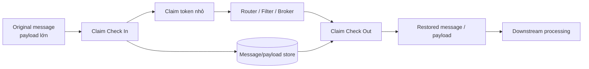
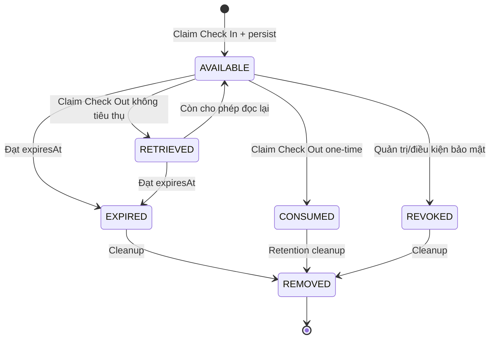
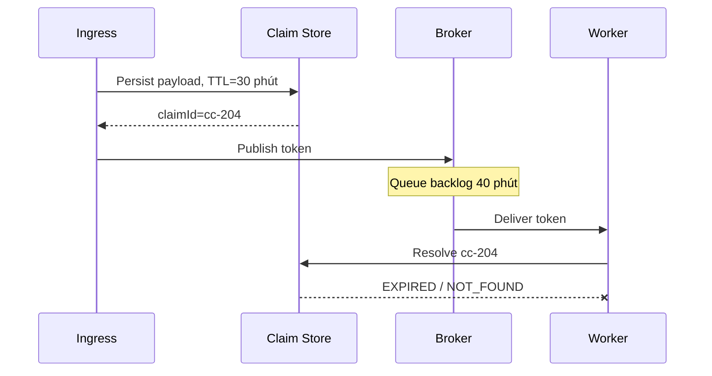
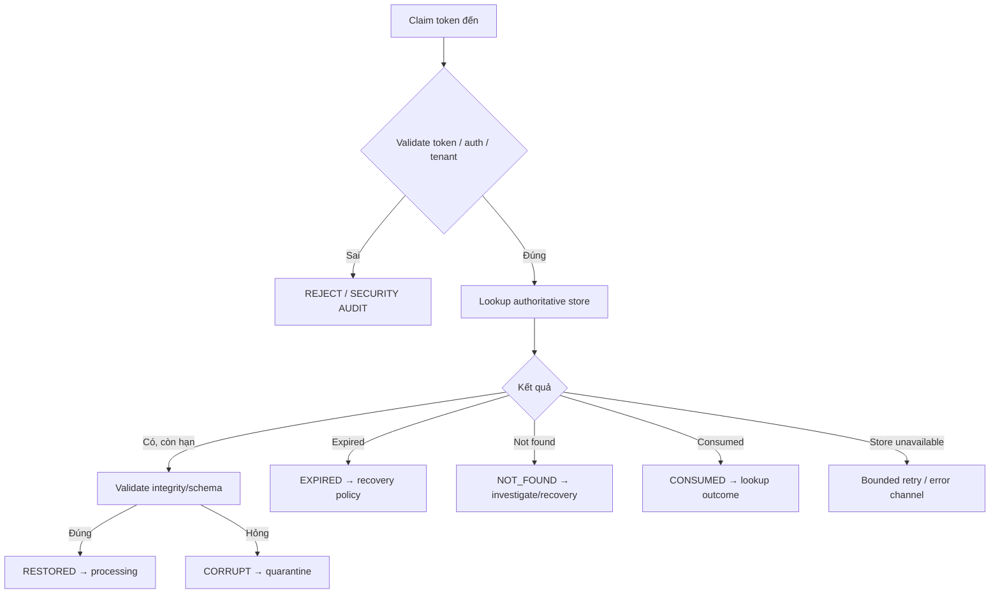
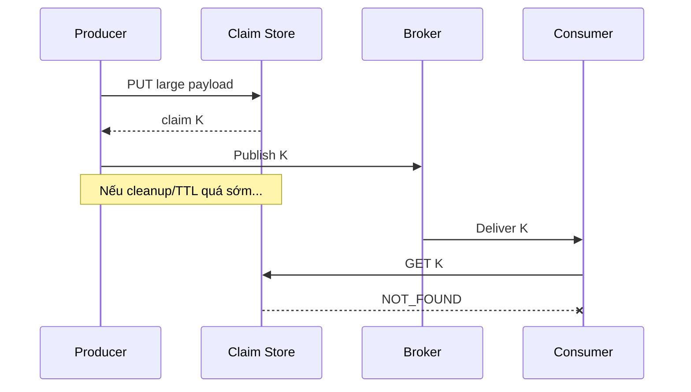
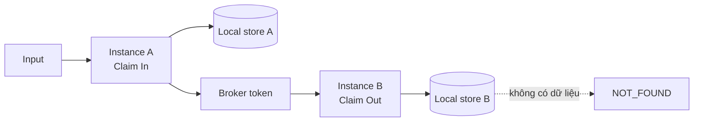
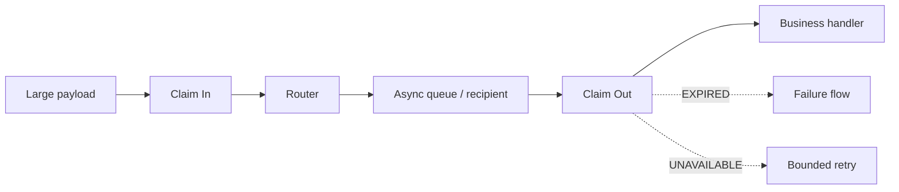

# Claim hết hạn hoặc không tìm thấy

## 1. Bài toán: có phiếu nhận nhưng không còn dữ liệu

Một hệ thống xử lý hồ sơ đơn hàng nhận message chứa tài liệu lớn. Thay vì chuyển toàn bộ payload qua nhiều channel và adapter, ứng dụng lưu payload vào kho rồi truyền **claim check** — một tham chiếu nhỏ để lấy lại dữ liệu ở bước sau.

Ví dụ:

```text
09:00  Nhận OrderDocument(orderId=O-204, 12 MB)
09:00  Claim Check In:
       lưu nội dung vào kho với claimId=cc-204
       expiresAt=09:30
09:01  Chuyển claimId tới các bước Router/Filter/queue
09:31  Claim Check Out:
       lấy nội dung bằng claimId=cc-204
       → thất bại: claim đã hết hạn hoặc không tồn tại
```

Thất bại này không giống lỗi parse JSON hay lỗi gửi channel: message vẫn chứa một claim check có vẻ hợp lệ, nhưng **tham chiếu không thể khôi phục thành dữ liệu ban đầu**.

Trong thực tế, cùng biểu hiện “không tìm được claim” có thể đến từ những nguyên nhân rất khác nhau:

- Claim **hết hạn về mặt nghiệp vụ** nhưng vẫn còn trong kho.
- Claim đã hết hạn và bị tiến trình cleanup **xóa vật lý**.
- Claim chưa từng được tạo hoặc ID bị truyền sai.
- Claim đã được **consume/remove** ở một lần Claim Check Out trước.
- Claim được lưu trong memory của instance A, nhưng request đi vào instance B.
- Kho lưu tạm thời không khả dụng, timeout hoặc lỗi truy vấn.
- Consumer dùng sai tenant/namespace, không đủ quyền lấy dữ liệu.
- Token bị giả mạo, sai phiên bản hoặc tham chiếu đến bản ghi bị hỏng.

Một giải pháp đúng phải **phân loại nguyên nhân, định nghĩa hành vi phục hồi và không làm mất dữ liệu khi retry**. Chỉ viết `if (value == null) return null` sẽ che giấu rất nhiều lỗi.

Bài **“Claim hết hạn hoặc không tìm thấy”** thuộc chương **Claim check**, module **SPRING_INTEGRATION_PATTERN**. Module này dạy triển khai Enterprise Integration Patterns với Spring Integration để xây dựng các luồng message ít phụ thuộc và dễ mở rộng; thực hành Router, Filter, Transformer, Splitter, Aggregator, Gateway, retry, error channel, correlation và kiểm thử/quan sát các nhánh.

Sau bài học, bạn có thể:

1. Giải thích lifecycle của một claim và ý nghĩa của expiration.
2. Phân biệt `EXPIRED`, `NOT_FOUND`, `CONSUMED`, `UNAVAILABLE` và `ACCESS_DENIED`.
3. Thiết kế TTL, retention, backup và recovery theo thời gian sống của message.
4. Viết ví dụ Spring Integration Java DSL cho luồng lưu và khôi phục claim, xử lý lỗi rõ ràng.
5. Dùng JUnit kiểm thử hết hạn bằng đồng hồ giả, không dùng `Thread.sleep()`.
6. Bảo vệ claim theo tenant, không nhầm claim ID với chứng thực hay idempotency key.
7. Phân tích crash window, retry, replay, shared storage và cơ chế one-time claim.

## 2. Nhắc lại EIP Claim Check

Trong Enterprise Integration Patterns, **Claim Check** cho phép gửi một message nhỏ mang *phiếu tham chiếu* thay vì tiếp tục truyền phần dữ liệu lớn hoặc nhạy cảm qua toàn bộ quy trình.



**Claim Check In** lưu bản gốc vào một kho và phát ra tham chiếu. **Claim Check Out** dùng tham chiếu đó để đọc bản gốc, hoặc khôi phục nội dung cần thiết theo hợp đồng.

Spring Integration có các thành phần liên quan như `ClaimCheckInTransformer`, `ClaimCheckOutTransformer` và `MessageStore`. Cơ chế sử dụng kho lưu cụ thể, hành vi có xóa message sau khi lấy hay không và các tùy chọn DSL/XML phải được đối chiếu với phiên bản Spring Integration đang dùng.

**Không được mặc định:**

- Claim Check tự cấp TTL cho mọi kho lưu.
- Bộ nhớ trong một JVM có thể được truy cập từ instance khác.
- Claim Check Out luôn trả dữ liệu khi token có định dạng hợp lệ.
- Claim Check Out thành công đồng nghĩa downstream đã commit nghiệp vụ.
- Chỉ cần lưu token là có thể khôi phục bản gốc sau khi store đã mất.
- Cấu hình MessageStore tự giải quyết toàn bộ quyền tenant và idempotency.

Claim Check làm nhẹ **đường truyền message**, nhưng chuyển trách nhiệm bền vững từ message transport sang **kho tham chiếu**.

## 3. Một claim có vòng đời riêng với message

Thay vì chỉ nghĩ “đã lưu” hoặc “chưa lưu”, hãy mô hình hóa vòng đời:



Đây là **mô hình nghiệp vụ đề xuất**, không phải state machine được Spring Integration tự tạo. Một `MessageStore` đơn giản có thể chỉ lưu hoặc không lưu record, không biết `EXPIRED` và `CONSUMED` là gì.

Cần phân biệt bốn thời điểm:

| Thời điểm | Ví dụ | Ý nghĩa |
| --- | --- | --- |
| `createdAt` | 09:00 | Kho chấp nhận bản dữ liệu |
| `expiresAt` | 09:30 | Sau thời điểm này không còn **được phép** lấy claim theo hợp đồng |
| `consumedAt` | 09:05 | Đã lấy/tiêu thụ theo semantics one-time nếu có |
| `deletedAt` | 10:00 | Bản ghi bị xóa **vật lý** khỏi kho |

Một claim có thể **đã hết hạn nhưng chưa bị xóa** nếu tiến trình cleanup chạy theo lô. Ngược lại, nếu cleanup xóa record, lần lookup sau chỉ thấy không tồn tại. Không thể xác định chắc chắn lịch sử “đã hết hạn hay chưa từng có” nếu không giữ metadata/tombstone phù hợp.

### Quy tắc ranh giới expiry

Nếu hợp đồng quy định `expiresAt` là giới hạn *exclusive*, thì:

\[
\text{active} \iff now < expiresAt
\]

Ở đúng `now=expiresAt`, claim đã hết hạn. Đừng để một API dùng `now > expiresAt` trong khi API khác dùng `now >= expiresAt`; điều đó tạo ra kết quả khác nhau ở biên.

## 4. Năm trường hợp trông giống “không lấy được claim”

| Trạng thái nội bộ | Nguyên nhân | Có nên retry cùng token? | Đường xử lý phù hợp |
| --- | --- | --- | --- |
| **EXPIRED** | Hết hạn theo TTL/policy, record có thể còn | Thường không; trừ khi có cơ chế gia hạn/reissue được ủy quyền | Failure/recovery workflow, không tự bypass TTL |
| **NOT_FOUND** | Chưa có ID, bị xóa, sai namespace, mất state | Chỉ retry nếu có bằng chứng put chưa visible hoặc đồng bộ tạm thời; nếu không cần điều tra | Kiểm tra correlation, store, backup và retry budget |
| **ALREADY_CONSUMED** | One-time claim đã được lấy | Không nên lấy lại mặc định | Trả kết quả đã ghi hoặc dùng recovery theo operation ID |
| **STORE_UNAVAILABLE** | DB/Redis/store timeout, kết nối lỗi | Có thể retry bounded với backoff và deadline | Error flow, alert, circuit breaker, không gán NOT_FOUND |
| **ACCESS_DENIED** | Sai tenant/quyền, token không hợp lệ | Không retry mù; cần xác thực lại quyền | Từ chối truy cập, security audit, không lộ dữ liệu |

Ngoài ra:

- **CORRUPT/SCHEMA_MISMATCH:** record có tồn tại nhưng bytes không giải mã được, checksum sai hoặc schema quá cũ.
- **REVOKED:** quyền truy cập bị thu hồi dù chưa tới hạn.
- **IN_PROGRESS:** một worker khác đang claim/restore; chưa thể kết luận đã tiêu thụ.

**Quan trọng:** với caller không được tin cậy, có thể cần trả cùng một response tổng quát cho `NOT_FOUND` và `ACCESS_DENIED` để tránh **tiết lộ claim tồn tại ở tenant khác**. Nội bộ vẫn phải audit nguyên nhân thật với quyền truy cập giới hạn.

### Không coi store timeout là null

Một lỗi nguy hiểm:

```java
// Anti-pattern: lỗi hạ tầng bị biến thành "không có dữ liệu".
try {
    return store.get(claimId);
} catch (Exception ex) {
    return null;
}
```

Khi kho tạm thời không hoạt động, flow nhận `null` và có thể tự sinh dữ liệu mặc định hoặc loại message. Điều đó biến một sự cố có thể phục hồi thành **mất message âm thầm**.

Nên phân biệt **not found thực sự** với **không thể thực hiện lookup** qua exception/error result có kiểu.

## 5. Các câu hỏi phải trả lời trước khi thiết kế TTL

Một TTL 30 phút nghe có vẻ đủ khi processing bình thường chỉ mất 10 giây. Nhưng message có thể bị:

- Queue backlog trong giờ cao điểm.
- Broker redeliver sau mất ACK.
- Worker nghỉ hoặc deployment đang rolling.
- Chờ manual approval.
- Đưa vào DLQ, rồi operator replay sau vài ngày.
- Chờ Aggregator/Saga hoàn tất một nhánh khác.
- Một Gateway timeout nhưng công việc phía xa vẫn chạy.

Ví dụ:



Đường xử lý broker vẫn đúng: token không mất. Nhưng **dữ liệu gốc đã hết khả năng phục hồi** vì lifecycle của kho ngắn hơn lifecycle của message.

### Công thức tư duy về tuổi thọ claim

Một mức giữ dữ liệu đủ an toàn cần được thiết kế theo:

\[
T_{\text{claim-retention}} \ge
T_{\text{queue-delay}} + T_{\text{processing}} +
T_{\text{retry/recovery-margin}}
\]

Đây chỉ là **mô hình dự trù**, không phải công thức SLA cố định. Nếu retry có thể kéo dài sau xử lý bình thường hoặc DLQ được replay sau 30 ngày, phải tính cả quyền replay đó. Trong một số hệ thống, chỉ giải pháp **persist đến khi có xác nhận hoàn tất nghiệp vụ + retention audit** mới phù hợp; một TTL ngắn độc lập là sai.

| Hạng mục cần tính | Câu hỏi |
| --- | --- |
| Độ trễ hàng đợi | Queue có thể tồn đọng lâu nhất bao nhiêu? |
| Deadline workflow | Nhánh chậm nhất/Saga/Gateway có thể chờ tới khi nào? |
| Retry | Số lần, backoff, khoảng cách giữa các lần thử? |
| DLQ | Operator được replay sau bao lâu? |
| Bảo đảm phục hồi | Có thể khôi phục payload từ nguồn gốc hay snapshot khác không? |
| Dung lượng/chi phí | Có chịu được lưu lâu hơn không? |
| Quyền riêng tư | Có thời hạn xóa dữ liệu hoặc hạn chế lưu trữ không? |
| Chính sách consume | Claim dùng một lần hay nhiều lần, được chia sẻ cho mấy recipient? |

Đừng gia hạn tất cả claim vô hạn chỉ để tránh lỗi expiry. Cần kết hợp **retention hữu hạn + recovery rõ + kiểm soát quyền**.

## 6. TTL logic khác cleanup vật lý

Có hai lớp:

1. **Logical expiration:** đọc claim phải kiểm tra hạn dùng; nếu đã quá `expiresAt` thì trả `EXPIRED` ngay cả khi data còn nằm trong database.
2. **Physical cleanup:** job xóa bytes/row/file hoặc object sau khi đủ điều kiện, để thu hồi dung lượng.

Nếu chỉ dựa vào cleanup chạy mỗi giờ, một claim đã hết hạn có thể vẫn được đọc trong tối đa một giờ tiếp theo. Nếu chỉ kiểm tra hạn logic mà không cleanup, kho sẽ phình mãi.

Bảng trạng thái:

| Metadata | Data còn? | Lookup an toàn |
| --- | --- | --- |
| `ACTIVE, expiresAt > now` | Có | Cho phép nếu được ủy quyền |
| `ACTIVE, expiresAt <= now` | Có | Từ chối `EXPIRED` |
| Hết hạn và đã cleanup | Không | `NOT_FOUND` hoặc `EXPIRED` nếu có tombstone |
| `CONSUMED` | Có/không | Không cho đọc lại trong one-time mode |
| `REVOKED` | Có/không | Từ chối truy cập |
| Row tồn tại, bytes mất | Không đầy đủ | `CORRUPT/MISSING_BLOB`, không tự coi đã xử lý |

**Tombstone** là một record metadata không còn payload nhưng giữ được lý do/định danh để nhận ra claim đã từng tồn tại và đã bị tiêu thụ/hết hạn. Nó hữu ích cho dedup/audit nhưng cũng có retention, bảo mật và chi phí riêng.

### TTL của Redis/Cache khác TTL của nghiệp vụ

Một Redis key có thể tự bị xóa khi TTL hết. Từ phía client, GET trả null sẽ không chứng minh:

- Key chưa từng tồn tại.
- Key đã hết hạn.
- Key bị quản trị xóa.
- Key bị thay namespace.
- Store có state khác do failover hoặc eviction.

Nếu cần phân biệt trạng thái, lưu metadata/tombstone phù hợp ở store có độ bền cần thiết hoặc có event audit riêng. **Đừng suy diễn nguyên nhân chỉ từ null.**

## 7. One-time claim và multi-read claim là hai hợp đồng khác nhau

**Multi-read claim** cho phép khôi phục lại payload nhiều lần trong một cửa sổ hiệu lực. Phù hợp khi:

- Nhiều recipient được phép đọc cùng dữ liệu.
- Worker có thể retry việc xử lý sau khi lookup.
- Downstream cần tải dữ liệu lại để đối chiếu.

**One-time claim** chỉ cho phép claim bị tiêu thụ một lần. Phù hợp khi có yêu cầu phát hành dữ liệu một lượt hoặc muốn hạn chế việc sử dụng lại, nhưng phải cẩn thận với crash/retry.

```text
Claim Check In → token K

Worker A lấy token K, rồi crash trước khi commit nghiệp vụ.
Worker B retry token K.

Multi-read: có thể đọc K lại nếu chưa hết hạn.
One-time: K có thể đã CONSUMED → không đọc lại được.
```

Một implementation kiểu “GET rồi DELETE ngay” chưa bảo đảm an toàn end-to-end. Nó có thể tạo tình huống **payload bị xóa trước khi side effect cần payload được commit**.

### One-time consumption cần gắn với điểm commit

Nếu yêu cầu đúng một lần, nên mô hình hóa:

```text
AVAILABLE → CLAIMED/LEASED → COMPLETED
                       └── timeout/recovery → AVAILABLE hoặc RETRYABLE
```

Hoặc dùng một transaction chứa **đánh dấu consumed và business update** khi cùng database hỗ trợ. Nếu phía sau là HTTP API ở hệ thống khác, transaction cục bộ không bao trùm remote side effect; cần **idempotency key, outbox và quy trình tra cứu/compensation**.

**Đừng mặc định Claim Check Out xóa bản ghi ở mọi cấu hình.** Việc giữ hay loại dữ liệu sau retrieval phụ thuộc transformer option, store và kiến trúc. Hãy xem cấu hình đang dùng và kiểm thử cụ thể.

## 8. Thiết kế token và metadata

Một claim ID chỉ nên là **opaque reference**; không tự chứa toàn payload. Nhưng để kiểm soát expiration và audit, nên có metadata được lưu ở server.

Ví dụ bản ghi:

```json
{
  "claimId": "cc8e1059-55d5-4f3d-88ec-222223818252",
  "tenantId": "tenant-A",
  "documentType": "ORDER_ATTACHMENT",
  "schemaVersion": "attachment-v2",
  "createdAt": "2026-11-21T09:00:00Z",
  "expiresAt": "2026-11-21T09:30:00Z",
  "state": "AVAILABLE",
  "payloadLocation": "private://claim-store/...",
  "payloadChecksum": "sha256:<hash>",
  "storageVersion": 4
}
```

Dữ liệu trên là **schema minh họa ở tầng ứng dụng**, không phải bản ghi có sẵn của Spring Integration.

Các thuộc tính quan trọng:

| Thuộc tính | Tại sao cần |
| --- | --- |
| `claimId` | Truy cập bản ghi một cách không đoán trước được |
| `tenantId` | Ngăn truy cập chéo tenant |
| `createdAt/expiresAt` | Thực thi retention/expiry |
| `state` | Phân biệt available, consumed, revoked |
| `schemaVersion` | Giải mã payload đúng phiên bản |
| `checksum` | Kiểm tra toàn vẹn bytes nếu cần |
| `payloadLocation` | Tách metadata với blob lớn |
| `storageVersion` | Optimistic locking/CAS khi nhiều worker |
| `claimPolicyVersion` | Giải thích tại sao TTL/consume policy được chọn |

### Claim ID không phải giấy phép truy cập

UUID ngẫu nhiên khó đoán giúp giảm xác suất va chạm/guessing, nhưng **không thể thay thế authentication và authorization**. Một người có token không mặc nhiên được phép lấy dữ liệu của tenant khác.

Tại boundary, cần lấy tenant từ identity đã xác thực, kiểm tra scope và quyền rồi mới đọc payload. Khi trả lỗi ra bên ngoài, có thể gộp `NOT_FOUND`/`ACCESS_DENIED` để tránh enumeration; audit nội bộ phải phân biệt.

**Không đưa claim ID vào URL công khai hoặc log theo cách làm lộ quyền truy cập**. Một token có thể trở thành *bearer reference* nếu service kiểm tra quyền không chặt chẽ.

## 9. Kiến trúc xử lý Claim Check Out lỗi



Một luồng tốt không chỉ có một `catch(Exception)`. Nó trả lời được:

1. Claim có được tạo thành công trước khi token được phát ra không?
2. Token đúng namespace/store và thuộc tenant đã xác thực không?
3. Lookup failure là **permanent** hay **transient**?
4. Có bản sao/snapshot dữ liệu có thể khôi phục hợp lệ không?
5. Nếu đã tiêu thụ, **kết quả xử lý trước đó** đã commit chưa?
6. Caller sẽ nhận lỗi, HOLD, DLQ hay một reference mới?
7. Cơ chế quan sát có lưu được sự kiện gì mà không làm lộ payload?

## 10. Ví dụ Java: kho claim in-memory có TTL rõ ràng

Để minh họa semantics một cách kiểm thử được, ta triển khai **một repository ứng dụng tối giản** rồi kết nối nó với Spring Integration Java DSL ở mục 11.

Ví dụ không thay thế API built-in `ClaimCheckInTransformer`/`ClaimCheckOutTransformer`; nó làm rõ phần mà một MessageStore thông thường không tự cung cấp: **phân loại lỗi, kiểm tra TTL theo clock, tenant isolation và chính sách token**.

### 10.1. Model

```java
import java.time.Instant;
import java.util.UUID;

record OrderDocument(
        String tenantId,
        String orderId,
        String content) {}

record ClaimTicket(
        UUID claimId,
        String tenantId,
        Instant expiresAt) {}

enum ClaimFailure {
    INVALID_INPUT,
    NOT_FOUND,
    EXPIRED,
    ACCESS_DENIED,
    STORE_UNAVAILABLE
}

final class ClaimLookupException extends RuntimeException {

    private final ClaimFailure reason;

    ClaimLookupException(ClaimFailure reason) {
        super("Claim lookup failed: " + reason);
        this.reason = reason;
    }

    ClaimFailure reason() {
        return reason;
    }
}
```

**Lưu ý:** đây là error taxonomy minh họa; trong API công khai có thể cần ánh xạ thông báo `ACCESS_DENIED` thành phản hồi chung `not available`. Không gửi thông tin về sự tồn tại của claim khác tenant cho caller không có quyền.

### 10.2. Repository

```java
import java.time.Duration;
import java.time.Instant;
import java.util.Objects;
import java.util.UUID;
import java.util.concurrent.ConcurrentHashMap;
import java.util.concurrent.ConcurrentMap;
import java.util.function.Supplier;

record SavedClaim(
        OrderDocument body,
        String ownerTenant,
        Instant expiresAt) {}

final class InMemoryClaimRepository {

    private final ConcurrentMap<UUID, SavedClaim> records =
        new ConcurrentHashMap<>();

    private final Supplier<Instant> now;

    InMemoryClaimRepository(Supplier<Instant> now) {
        this.now = Objects.requireNonNull(now);
    }

    ClaimTicket put(
            OrderDocument document,
            String authenticatedTenant,
            Duration ttl) {

        if (document == null
                || blank(document.tenantId())
                || blank(document.orderId())
                || document.content() == null
                || blank(authenticatedTenant)
                || ttl == null
                || ttl.isZero()
                || ttl.isNegative()) {
            throw new ClaimLookupException(
                ClaimFailure.INVALID_INPUT);
        }

        if (!authenticatedTenant.equals(document.tenantId())) {
            throw new ClaimLookupException(
                ClaimFailure.ACCESS_DENIED);
        }

        Instant expiresAt = now.get().plus(ttl);
        UUID claimId = UUID.randomUUID();

        records.put(
            claimId,
            new SavedClaim(
                document, authenticatedTenant, expiresAt));

        return new ClaimTicket(
            claimId, authenticatedTenant, expiresAt);
    }

    OrderDocument restore(
            ClaimTicket ticket,
            String authenticatedTenant) {

        if (ticket == null
                || ticket.claimId() == null
                || ticket.expiresAt() == null
                || blank(authenticatedTenant)) {
            throw new ClaimLookupException(
                ClaimFailure.INVALID_INPUT);
        }

        SavedClaim saved = records.get(ticket.claimId());

        // Lỗi bên ngoài có thể gộp NOT_FOUND/ACCESS_DENIED.
        // Đừng lộ thông tin về claim của tenant khác.
        if (saved == null) {
            throw new ClaimLookupException(
                ClaimFailure.NOT_FOUND);
        }

        if (!authenticatedTenant.equals(saved.ownerTenant())
                || !authenticatedTenant.equals(ticket.tenantId())) {
            throw new ClaimLookupException(
                ClaimFailure.ACCESS_DENIED);
        }

        // ExpiresAt trong token không phải authority:
        // lấy thời hạn thật từ store.
        if (!ticket.expiresAt().equals(saved.expiresAt())) {
            throw new ClaimLookupException(
                ClaimFailure.INVALID_INPUT);
        }

        if (!now.get().isBefore(saved.expiresAt())) {
            throw new ClaimLookupException(
                ClaimFailure.EXPIRED);
        }

        return saved.body(); // MULTI-READ; không xóa claim.
    }

    // Job cleanup chỉ là minh họa:
    // sau khi xóa record, lookup chỉ còn NOT_FOUND.
    void purgeExpired() {
        Instant instant = now.get();
        records.entrySet().removeIf(entry ->
            !instant.isBefore(entry.getValue().expiresAt()));
    }

    private static boolean blank(String value) {
        return value == null || value.isBlank();
    }
}
```

**Code này đảm bảo điều gì?**

- Ticket chỉ chứa ID, tenant và thời hạn, không mang nội dung lớn.
- Lúc `put()`, repository kiểm tra tenant trong payload có khớp tenant đã xác thực.
- Lúc `restore()`, repository lấy payload bằng ID, kiểm tra owner và hạn thật trong store.
- Claim đúng thời điểm `expiresAt` bị từ chối.
- Nếu record chưa bị purge, repository phân biệt `EXPIRED` với `NOT_FOUND`.
- Nếu đã purge, không thể biết tại chỗ rằng ID đó từng tồn tại.
- Cùng một ticket có thể restore nhiều lần trước hạn vì đây là **multi-read**.

**Code này không đảm bảo điều gì?**

- Không bền vững qua restart; Map mất dữ liệu.
- Không chia sẻ state giữa nhiều instance.
- Không thực hiện encryption, checksum, schema migration hay audit.
- Không có authentication thật: `authenticatedTenant` phải do caller nội bộ đã xác thực truyền vào.
- Không có transaction với việc publish claim token.
- Không có one-time consumption hay khóa chống ghi trùng.
- Không triển khai `STORE_UNAVAILABLE` vì Map local không có kết nối remote; khi thay bằng JDBC/Redis phải phân loại lỗi hạ tầng.
- Không nên dùng cho dữ liệu cá nhân/tài chính hoặc flow bắt buộc không mất message.

Trong một ứng dụng thực, có thể giữ interface `ClaimRepository` để adapter thay bằng database/object storage có metadata bền vững. **Business policy về expiry phải ở một nơi rõ ràng**, không nằm rải rác trong Router/Gateway.

## 11. Spring Integration Java DSL: Claim In và Claim Out có xử lý lỗi

Để người học thấy điểm nối với Spring Integration, cấu hình sau dùng **Service Activator** làm hai endpoint claim và restore, cùng một repository. Nó minh họa hoạt động của pattern; với nhu cầu chuẩn có thể dùng các transformer Claim Check mà framework cung cấp.

```java
import java.time.Duration;
import java.time.Instant;
import java.util.Map;

import org.springframework.context.annotation.Bean;
import org.springframework.context.annotation.Configuration;
import org.springframework.integration.channel.DirectChannel;
import org.springframework.integration.channel.QueueChannel;
import org.springframework.integration.config.EnableIntegration;
import org.springframework.integration.dsl.IntegrationFlow;

@Configuration
@EnableIntegration
public class ClaimExpiryFlowConfig {

    @Bean
    InMemoryClaimRepository claimRepository() {
        return new InMemoryClaimRepository(Instant::now);
    }

    @Bean("claim.original.in")
    DirectChannel claimOriginalInput() {
        return new DirectChannel();
    }

    @Bean("claim.ticket.out")
    QueueChannel claimTicketOutput() {
        return new QueueChannel();
    }

    @Bean("claim.restore.in")
    DirectChannel claimRestoreInput() {
        return new DirectChannel();
    }

    @Bean("claim.restored.out")
    QueueChannel claimRestoredOutput() {
        return new QueueChannel();
    }

    @Bean
    IntegrationFlow createClaim(InMemoryClaimRepository repo) {
        return IntegrationFlow.from("claim.original.in")
            .handle(OrderDocument.class,
                (document, headers) -> repo.put(
                    document,
                    trustedTenant(headers),
                    Duration.ofMinutes(30)))
            .channel("claim.ticket.out")
            .get();
    }

    @Bean
    IntegrationFlow restoreClaim(InMemoryClaimRepository repo) {
        return IntegrationFlow.from("claim.restore.in")
            .handle(ClaimTicket.class,
                (ticket, headers) -> repo.restore(
                    ticket,
                    trustedTenant(headers)))
            .channel("claim.restored.out")
            .get();
    }

    static String trustedTenant(Map<String, Object> headers) {
        Object tenant = headers.get("verifiedTenantId");

        if (!(tenant instanceof String value)
                || value.isBlank()) {
            throw new ClaimLookupException(
                ClaimFailure.ACCESS_DENIED);
        }

        return value;
    }
}
```

**Giải thích:**

1. Flow `createClaim` nhận `OrderDocument`, yêu cầu header server-side `verifiedTenantId`, lưu dữ liệu và trả `ClaimTicket`.
2. Ticket đi qua output `claim.ticket.out`. Trong hệ thống thật, token có thể tiếp tục tới Router, Filter hoặc broker.
3. Flow `restoreClaim` nhận ticket, kiểm tra tenant được xác thực rồi gọi repository.
4. Nếu lookup hợp lệ, payload gốc đi vào `claim.restored.out`.
5. Nếu claim không tồn tại, hết hạn hoặc sai quyền, repository ném exception; với `DirectChannel` đồng bộ, lỗi có thể lan về sender.
6. `QueueChannel` chỉ giúp kiểm thử kết quả; nó không phải durable broker.

**Tuyệt đối không xem `verifiedTenantId` là an toàn chỉ vì có tên như vậy.** Ví dụ giả định header đã được đặt bởi **trusted ingress** sau xác thực, không cho client tự khai hoặc ghi đè. Production phải thực thi điều này ở adapter/security boundary và có test giả mạo header.

### Nếu dùng Claim Check Transformer built-in

Spring Integration có các thành phần Claim Check In/Out làm việc với `MessageStore`. Ở hình thức đó, token và message được framework chuyển đổi, thay vì dùng `ClaimTicket` do ứng dụng định nghĩa.

Dù chọn built-in hay custom:

- Nếu store trả thiếu message, phải có policy `NOT_FOUND`.
- Nếu muốn TTL, phải biết kho nào chịu trách nhiệm hết hạn, nơi giữ metadata và cách cleanup.
- Nếu retrieval có thể xóa record, phải hiểu chính xác semantics với retry và duplicate.
- Khi xóa token/message, phải biết producer/consumer nào đã ACK hoặc commit.
- Phải kiểm tra header nghiệp vụ, correlation và quyền tenant qua ranh giới Claim In/Out.

**Không nên giả định MessageStore có mọi API/semantics của một claim ledger có expiry, consumed state và authorization.** Nếu cần những trạng thái đó, triển khai bổ sung ở tầng ứng dụng hoặc chọn storage phù hợp.

## 12. JUnit: kiểm thử hết hạn bằng đồng hồ giả

Các test không cần Spring context để kiểm chứng logic TTL. Dùng `AtomicReference<Instant>` làm clock có thể thay đổi xác định trong unit test.

```java
import static org.assertj.core.api.Assertions.assertThat;
import static org.assertj.core.api.Assertions.assertThatThrownBy;

import java.time.Duration;
import java.time.Instant;
import java.util.UUID;
import java.util.concurrent.atomic.AtomicReference;

import org.junit.jupiter.api.Test;

class InMemoryClaimRepositoryTest {

    private final AtomicReference<Instant> clock =
        new AtomicReference<>(
            Instant.parse("2026-11-21T09:00:00Z"));

    private final InMemoryClaimRepository repo =
        new InMemoryClaimRepository(clock::get);

    private OrderDocument document() {
        return new OrderDocument(
            "tenant-A", "O-204", "large document data");
    }

    @Test
    void activeClaimRestoresOriginalDocument() {
        ClaimTicket ticket = repo.put(
            document(), "tenant-A", Duration.ofMinutes(30));

        assertThat(repo.restore(ticket, "tenant-A"))
            .isEqualTo(document());

        // Đây là multi-read: lần đọc thứ hai vẫn hợp lệ.
        assertThat(repo.restore(ticket, "tenant-A"))
            .isEqualTo(document());
    }

    @Test
    void claimExpiresAtExactBoundaryWithoutSleeping() {
        ClaimTicket ticket = repo.put(
            document(), "tenant-A", Duration.ofMinutes(30));

        clock.set(Instant.parse("2026-11-21T09:30:00Z"));

        assertThatThrownBy(() ->
            repo.restore(ticket, "tenant-A"))
            .isInstanceOf(ClaimLookupException.class)
            .satisfies(ex -> assertThat(
                ((ClaimLookupException) ex).reason())
                    .isEqualTo(ClaimFailure.EXPIRED));
    }

    @Test
    void purgedExpiredClaimBecomesNotFound() {
        ClaimTicket ticket = repo.put(
            document(), "tenant-A", Duration.ofSeconds(10));

        clock.set(Instant.parse("2026-11-21T09:00:11Z"));
        repo.purgeExpired();

        assertThatThrownBy(() ->
            repo.restore(ticket, "tenant-A"))
            .isInstanceOf(ClaimLookupException.class)
            .satisfies(ex -> assertThat(
                ((ClaimLookupException) ex).reason())
                    .isEqualTo(ClaimFailure.NOT_FOUND));
    }

    @Test
    void neverStoredClaimIsNotFound() {
        ClaimTicket ticket = new ClaimTicket(
            UUID.randomUUID(),
            "tenant-A",
            Instant.parse("2026-11-21T09:30:00Z"));

        assertThatThrownBy(() ->
            repo.restore(ticket, "tenant-A"))
            .isInstanceOf(ClaimLookupException.class)
            .satisfies(ex -> assertThat(
                ((ClaimLookupException) ex).reason())
                    .isEqualTo(ClaimFailure.NOT_FOUND));
    }

    @Test
    void cannotRestoreClaimForAnotherTenant() {
        ClaimTicket ticket = repo.put(
            document(), "tenant-A", Duration.ofMinutes(30));

        assertThatThrownBy(() ->
            repo.restore(ticket, "tenant-B"))
            .isInstanceOf(ClaimLookupException.class)
            .satisfies(ex -> assertThat(
                ((ClaimLookupException) ex).reason())
                    .isEqualTo(ClaimFailure.ACCESS_DENIED));
    }

    @Test
    void forgedExpiryDoesNotExtendStoredClaim() {
        ClaimTicket original = repo.put(
            document(), "tenant-A", Duration.ofMinutes(30));

        ClaimTicket forged = new ClaimTicket(
            original.claimId(),
            original.tenantId(),
            original.expiresAt().plus(Duration.ofDays(1)));

        assertThatThrownBy(() ->
            repo.restore(forged, "tenant-A"))
            .isInstanceOf(ClaimLookupException.class)
            .satisfies(ex -> assertThat(
                ((ClaimLookupException) ex).reason())
                    .isEqualTo(ClaimFailure.INVALID_INPUT));
    }
}
```

**Những gì test chứng minh:**

- Còn hạn: có thể khôi phục payload.
- Tại đúng thời điểm hết hạn: `EXPIRED`.
- Sau cleanup: không còn metadata, `NOT_FOUND`.
- ID chưa lưu: `NOT_FOUND`.
- Tenant sai: access bị từ chối.
- Không thể gia hạn chỉ bằng cách sửa timestamp trong token.

Các test này **không** mô phỏng Redis/JDBC thực, transaction, transport hay crash. Khi dùng store thật, cần thêm integration tests cho lỗi kết nối, failover, cleanup race và retention.

## 13. Integration test: Claim In → Claim Out

Để kiểm tra wiring trong Spring Integration, dùng `MessageChannel` và `QueueChannel` theo cấu hình mục 11.

```java
import static org.assertj.core.api.Assertions.assertThat;
import static org.assertj.core.api.Assertions.assertThatThrownBy;

import java.time.Instant;
import java.util.UUID;

import org.junit.jupiter.api.Test;
import org.springframework.beans.factory.annotation.Autowired;
import org.springframework.beans.factory.annotation.Qualifier;
import org.springframework.integration.channel.QueueChannel;
import org.springframework.messaging.Message;
import org.springframework.messaging.MessageChannel;
import org.springframework.messaging.support.MessageBuilder;
import org.springframework.test.context.junit.jupiter.SpringJUnitConfig;

@SpringJUnitConfig(ClaimExpiryFlowConfig.class)
class ClaimExpiryFlowTest {

    @Autowired
    @Qualifier("claim.original.in")
    MessageChannel originalInput;

    @Autowired
    @Qualifier("claim.ticket.out")
    QueueChannel tickets;

    @Autowired
    @Qualifier("claim.restore.in")
    MessageChannel restoreInput;

    @Autowired
    @Qualifier("claim.restored.out")
    QueueChannel restored;

    @Test
    void storesTokenThenRestoresPayloadWithinSameTenant() {
        OrderDocument original = new OrderDocument(
            "tenant-A", "O-204", "large payload");

        assertThat(originalInput.send(
            MessageBuilder.withPayload(original)
                .setHeader("verifiedTenantId", "tenant-A")
                .setHeader("requestId", "req-204")
                .build())).isTrue();

        Message<?> tokenMessage = tickets.receive(1_000);
        assertThat(tokenMessage).isNotNull();
        assertThat(tokenMessage.getPayload())
            .isInstanceOf(ClaimTicket.class);
        ClaimTicket token =
            (ClaimTicket) tokenMessage.getPayload();

        assertThat(restoreInput.send(
            MessageBuilder.withPayload(token)
                .setHeader("verifiedTenantId", "tenant-A")
                .setHeader("requestId", "req-204")
                .build())).isTrue();

        Message<?> result = restored.receive(1_000);
        assertThat(result).isNotNull();
        assertThat(result.getPayload()).isEqualTo(original);
        assertThat(result.getHeaders().get("requestId"))
            .isEqualTo("req-204");
        assertThat(restored.receive(0)).isNull();
    }

    @Test
    void missingTokenDoesNotProduceFakePayload() {
        ClaimTicket unknown = new ClaimTicket(
            UUID.randomUUID(), "tenant-A",
            Instant.now().plusSeconds(600));

        assertThatThrownBy(() -> restoreInput.send(
            MessageBuilder.withPayload(unknown)
                .setHeader("verifiedTenantId", "tenant-A")
                .build()))
            .isInstanceOf(RuntimeException.class);

        assertThat(restored.receive(0)).isNull();
    }
}
```

**Giới hạn:** Test Spring context giả định message đi qua `DirectChannel` đồng bộ và repository dùng Map. Khi thay bằng poller, executor hoặc broker, exception thường không trở về sender theo cùng cách; hãy kiểm tra error flow, deadline và trạng thái message store cụ thể. Test cũng chưa mô phỏng claim đã expired trong context; unit test với đồng hồ giả đã kiểm tra ranh giới logic đó.

### Một lỗi thường gặp khi test queue

Nếu context hoặc output queue được dùng chung giữa nhiều test và chưa được đọc hết, test sau có thể nhìn thấy message cũ. Dùng token ID riêng, tiêu thụ hết output và cô lập fixture nếu cần; đừng dựa vào thứ tự chạy test.

## 14. Khôi phục claim đã hết hạn: nên làm gì?

Khi nhận `EXPIRED`, không có một hành động đúng cho mọi hệ thống. Policy phụ thuộc nguồn gốc dữ liệu và trạng thái side effect.

### Phương án A — Từ chối và ghi failure có thể tra cứu

Nếu payload là dữ liệu nhạy cảm chỉ được truy cập trong 30 phút, sau khi hết hạn không được đọc lại. Flow nên:

1. Từ chối restore.
2. Ghi failure event có requestId/claimId đã được che/mã hóa an toàn và reason.
3. Thông báo caller hoặc đưa vào manual review.
4. Không tạo một payload rỗng/mặc định rồi gửi tiếp downstream.

**Quan trọng:** không tự động gia hạn token chỉ vì message bị retry. Gia hạn phải được cho phép theo policy và quyền.

### Phương án B — Tái tạo từ nguồn có thẩm quyền

Nếu dữ liệu gốc được giữ bền vững ở một hệ thống khác và việc tái tạo là hợp lệ:

1. Xác minh request/order ID và quyền tenant.
2. Kiểm tra **đúng phiên bản dữ liệu cần dùng**.
3. Tạo một claim mới với ID mới; ghi liên kết `previousClaimId → newClaimId`.
4. Replay workflow dựa trên checkpoint/decision đã lưu, không tự ý chạy lại side effect đã commit.
5. Audit thao tác reissue và lý do.

Ví dụ dữ liệu giá **đã chốt** không được thay bằng giá hiện hành chỉ vì claim hết hạn. Một bản refetch phải đáp ứng semantics “as-of” nếu workflow yêu cầu.

### Phương án C — Retry restore khi lỗi thật là store unavailable

Nếu database lookup timeout, không phải `EXPIRED`, có thể dùng **bounded retry với backoff/jitter và deadline**. Giới hạn số lần, không để retry storm lên store đang quá tải.

Nếu lookup đã xác nhận claim hết hạn, lặp lại cùng token với cùng thời gian thực **không làm nó tự hoạt động trở lại**. Retry vô hạn chỉ tăng tải.

### Phương án D — Reconcile một claim đã bị consume

Nếu one-time claim trả `ALREADY_CONSUMED`, việc đầu tiên không phải tạo claim mới. Phải kiểm tra **outcome của lần consume trước**:

- Consumer đã commit nghiệp vụ chưa?
- Có persisted result/outbox/idempotency key không?
- Có thể trả lại kết quả cũ cho caller không?
- Nếu đã claim nhưng chưa commit, có lease timeout/recovery hợp lệ không?

Một lần reissue không có kiểm tra side effect có thể khiến thanh toán hoặc ghi dữ liệu xảy ra lần hai.

## 15. Khi claim mất trước khi token được xử lý

Một workflow có thể tạo token và publish sang broker như sau:



Có các khoảng lỗi khác nhau:

**Crash window 1 — store chưa commit nhưng token đã publish.** Consumer có token nhưng claim chưa tồn tại bền vững. Không được thiết kế publish-before-commit nếu không có cơ chế đảm bảo visibility/retry phù hợp.

**Crash window 2 — store đã commit, publish token thất bại.** Payload trở thành **orphan claim**, chiếm dung lượng nhưng không có consumer. Cần cleanup/orphan detection.

**Crash window 3 — claim vừa expire giữa validate và restore.** Nếu check timestamp ở một bước và lấy payload ở bước khác không nguyên tử, có race với cleanup. Đảm bảo lookup cùng kiểm tra hiệu lực được thực hiện đúng transaction/operation boundary.

**Crash window 4 — restore thành công nhưng downstream lỗi.** Với one-time claim đã bị xóa, retry không còn payload. Với multi-read claim, có thể lấy lại nếu còn hạn, nhưng vẫn phải có idempotency của downstream.

### Durable handoff và outbox

Một hướng thiết kế là ghi **claim metadata + outbox task** trong cùng transaction nếu cả hai dùng chung database. Outbox publisher gửi token tới broker sau commit, và retry publish nếu thất bại.

**Transactional outbox không tạo exactly-once end-to-end:** publisher có thể gửi token nhiều lần, consumer vẫn cần idempotency. Nếu payload lưu ở object storage còn metadata/outbox nằm DB khác, cần cơ chế staging/compensation, không giả định một transaction bao trùm tất cả.

## 16. Multi-instance: claim không được “nằm ở máy khác”

Một lỗi hay gặp trong môi trường scale ngang:

```text
Node A: Claim Check In → SimpleMessageStore trong RAM A.
Node B: Claim Check Out → SimpleMessageStore trong RAM B.
Token cùng UUID nhưng B không có dữ liệu.

Kết quả: NOT_FOUND, dù A đã PUT thành công.
```



Có ba chiến lược chính:

1. **Shared durable store:** các instance cùng truy cập một kho được bảo vệ/transactionally consistent.
2. **Co-location/affinity:** token và restore được buộc đến cùng worker có state, với phương án khôi phục nếu worker chết.
3. **External claim service:** một service sở hữu lifecycle/store, các worker khác chỉ sử dụng API có hợp đồng rõ.

Với dữ liệu quan trọng và có retry/restart, shared durable store hoặc claim service có tính bền vững thường thích hợp hơn local memory.

**Đừng dùng Redis như một giải pháp mặc định không cần phân tích.** Redis có eviction, TTL, failover/durability semantics, và thường không chia sẻ transaction với database nghiệp vụ; phải biết rủi ro của chúng với yêu cầu không mất claim.

## 17. Claim Check và MessageStore của Spring Integration

Spring Integration có API `MessageStore` để lưu/truy xuất `Message<?>`. Các thành phần Claim Check In/Out phối hợp với store đó. Nhưng cần phân biệt:

| Khái niệm | Vai trò | Lỗi thường gặp |
| --- | --- | --- |
| `MessageStore` | Lưu/truy xuất message theo ID | Chọn store in-memory cho workflow cần restart |
| `ClaimCheckInTransformer` | Lưu message và phát claim reference | Cho rằng token được publish nguyên tử với store |
| `ClaimCheckOutTransformer` | Khôi phục message từ reference | Không định nghĩa khi reference không tồn tại |
| Claim metadata/ledger ứng dụng | Quản lý TTL, tenant, consumed/revoked/recovery | Cho rằng built-in store tự cấp các trạng thái |
| MessageGroupStore | Lưu các message thuộc nhóm cho Aggregator/Resequencer | Nhầm timeout nhóm với expiry của claim riêng |

**Lưu ý:** tùy implementation, một kho có thể vừa hỗ trợ message store vừa hỗ trợ group store, nhưng **semantics của message riêng và nhóm là khác nhau**. Không áp dụng group timeout/reaper rồi mặc định tất cả claim check sẽ có TTL tương ứng.

### Cần kiểm tra gì trong cấu hình thực tế?

- Claim ID được tạo từ đâu và có ổn định qua retry không?
- Store là in-memory, JDBC, Redis hay hệ thống khác?
- Retrieve có xóa message (one-time) hay không?
- Khi không có message, transformer/endpoint báo lỗi gì theo phiên bản?
- Có TTL ở store hay cleanup job ngoài?
- Claim đã được ghi bền vững trước khi gửi token chưa?
- ID/header/tenant có được giữ qua Router, Transformer, broker/adapter không?
- Nếu payload lớn, có serialize tất cả header không? Header nào không serializable hoặc không được phép lưu?
- Ai có quyền đọc một claim của tenant cụ thể?
- Có giới hạn kích thước payload, dung lượng kho và số claims đang sống không?

Các câu trả lời phải được xác minh bằng cấu hình và integration tests trong codebase thật; không suy từ tên pattern.

## 18. Retry, Gateway, Router và error channel

Claim Check có thể được đặt ở nhiều vị trí:



Tại mỗi vị trí:

- **Router** có thể chọn nhánh chỉ từ metadata nhỏ trên claim, nhưng không được cần các trường chỉ có trong payload nếu chưa restore.
- **Filter** có thể lọc theo claim metadata hoặc cần lấy payload tùy hợp đồng; không nên tự restore nhiều lần mà không kiểm soát one-time semantics.
- **Recipient List** có thể phát cùng token đến nhiều recipient; nếu claim bị consume khi recipient đầu restore, recipient sau nhận `NOT_FOUND`. Khi fan-out, cân nhắc multi-read, copy/token per recipient hoặc reference-counting.
- **Splitter** có thể tách payload trước Claim In hoặc giữ một claim cho toàn bộ object; tùy mục đích. Khi chia nhiều part, đừng dùng cùng một one-time token cho mọi part nếu mỗi part đều phải restore.
- **Aggregator** có thể chờ nhiều claim tokens; TTL phải dài hơn thời gian group có thể chờ. Group timeout không tự gia hạn claim.
- **Gateway** có thể hết reply timeout trong khi token đang chờ; cần deadline và recovery rõ.
- **Retry/Error Channel** phải phân loại `EXPIRED` và `STORE_UNAVAILABLE`. Retry lỗi vĩnh viễn là vô ích; lỗi transient có thể retry bounded.

### Không phải mọi exception đều đi tới global errorChannel

Trên `DirectChannel` đồng bộ, exception restore có thể lan về sender và được Spring Integration wrap thành exception framework. Với poller/executor/broker adapter, lỗi có thể được xử lý ở worker thread, error channel hoặc adapter-specific recovery theo cấu hình.

Trong code thật, cần test **nơi phát lỗi** và giữ thông tin request ID/claim ID an toàn để điều tra. Không giả định mọi lỗi tự động xuất hiện trong cùng một channel.

## 19. Phân loại retryable và permanent

| Trường hợp | Retry cùng token? | Ghi chú |
| --- | --- | --- |
| Store network timeout | Có, bounded | Kiểm tra deadline và circuit breaker |
| Database pool tạm cạn | Có, bounded | Tránh retry storm |
| Read replica chưa thấy bản ghi mới | Có thể, ngắn và có điều kiện | Cần contract consistency |
| Token sai định dạng | Không | Invalid input/security event |
| Wrong tenant | Không | Deny, audit bảo mật |
| TTL đã hết | Không, trừ workflow reissue | Retry không đảo ngược thời gian |
| Đã consume một lần | Không theo mode one-time | Kiểm tra outcome/checkpoint |
| Chưa từng có ID | Thường không | Điều tra publish/store atomicity |
| Object bytes bị mất | Không retry vô hạn | Backup/recovery hoặc failure |
| Schema cũ không decode được | Không như network retry | Migration/compatibility path |
| Record bị admin revoke | Không | Quyết định quyền |
| Cleanup cạnh tranh với restore | Có thể cần reconcile | Phải sửa atomicity/race |

**Nguyên tắc:** chỉ retry khi lần thử sau có **căn cứ hợp lý** dẫn đến kết quả khác và không vi phạm quyền/TTL. Một policy fail-closed có thể HOLD message thay vì cho chạy với dữ liệu giả.

### Tại sao không tạo payload mặc định?

Một sai lầm:

```java
// Đừng biến một claim thiếu thành business data "hợp lệ".
OrderDocument doc = store.get(id);
if (doc == null) {
    doc = new OrderDocument("tenant-A", "unknown", "");
}
sendToPayment(doc);
```

Với nghiệp vụ tài chính, danh tính khách hàng, đối soát hoặc dữ liệu kiểm soát, **absence là một trạng thái lỗi**, không phải giá trị mặc định. Chỉ khi trường bổ sung thật sự tùy chọn, có thể bỏ qua nó, nhưng Claim Check thường chứa **payload cốt lõi**, không phải một thuộc tính hiển thị có thể thiếu.

## 20. Phân biệt claim expired với request deadline

Một request có thể có nhiều mốc thời gian:

| Thời hạn | Ý nghĩa |
| --- | --- |
| `claim.expiresAt` | Khi nào không còn được restore dữ liệu |
| `gateway.replyTimeout` | Caller sẽ chờ response bao lâu |
| `broker.visibilityTimeout/ackDeadline` | Khi nào transport có thể redeliver |
| `worker.processingDeadline` | Worker còn được phép tiếp tục nghiệp vụ bao lâu |
| `workflow.deadline` | Toàn bộ quy trình còn giá trị đến lúc nào |
| `DLQ.retention` | Message lỗi có thể được giữ để replay bao lâu |

Các deadline **không tự đồng bộ**. Ví dụ Gateway timeout ở 10 giây không có nghĩa Claim được phép xóa sau 10 giây. Ngược lại, workflow hết hạn có thể yêu cầu revoke claim dù TTL lưu trữ vẫn còn dài.

Một thiết kế tốt gắn `claimPolicyVersion` và `workflowId` vào metadata, rồi quy định rõ ai có quyền gia hạn, revoke hoặc cleanup.

## 21. Gia hạn claim: hợp lệ khi nào?

Có thể có nhu cầu gia hạn khi queue backlog tăng. Nhưng việc gia hạn token phải được thiết kế thận trọng:

- Chỉ một service/role có quyền gia hạn.
- Chỉ gia hạn claim chưa hết hạn hay có cho phép phục hồi từ trạng thái expired?
- Có giới hạn tổng thời gian sống không?
- Có giữ history `oldExpiresAt/newExpiresAt` và lý do không?
- Nếu có nhiều instance đang restore, update hạn có cần CAS/version không?
- Nếu token chứa expiry, việc cập nhật store có làm token cũ không hợp lệ?
- Có cấm gia hạn cho dữ liệu nhạy cảm sau thời hạn pháp lý không?
- Nếu workflow đã complete, có nên tiếp tục giữ data không?

Trong ví dụ repository, `expiresAt` trên token phải khớp metadata store. Vì vậy **không thể chỉ sửa timestamp trong ticket để gia hạn**. Một API gia hạn thật cần cập nhật metadata theo quyền/version và có thể phát một ticket mới, audit việc thay đổi.

Một hướng khác là **không dùng TTL cố định làm nguồn quyết định duy nhất**, mà chỉ cleanup khi workflow đã xác nhận complete, hết thời gian retry và đủ retention. Cách này có thể hợp lý khi dữ liệu cần độ bền cao nhưng chi phí lưu trữ lớn hơn.

## 22. Bảo mật claim: ID tồn tại không có nghĩa được đọc

Trong nhiều hệ thống, claim token trông như một UUID. Nhưng nếu API cho phép GET nội dung chỉ dựa vào UUID, token trở thành một **bearer capability**: ai có token có thể lấy payload.

Để tránh lộ dữ liệu:

1. **Xác thực** actor/service ở mỗi Claim Check Out.
2. **Ủy quyền** theo tenant, resource, purpose, thời hạn và loại dữ liệu.
3. Không tin `tenantId` trong token/header do client tự sửa; đối chiếu với server-side record và identity.
4. Dùng token không đoán được; không lấy orderId tuần tự làm claim ID.
5. Tránh ghi token nguyên văn vào log, URL hoặc dashboard mở rộng.
6. Giới hạn số lần lookup và giám sát enumeration/forbidden attempts.
7. Mã hóa payload lúc lưu và khi truyền; giới hạn quyền kho.
8. Kiểm tra checksum/schema/version trước khi tin dữ liệu restore.
9. Dùng audit và retention tương ứng mức nhạy cảm; xóa đúng thời hạn.
10. Với multi-tenant, không dùng local cache chung mà khóa không bao gồm tenant.
11. Khi token không hợp lệ, không tiết lộ có một claim cùng ID thuộc tenant khác hay không.

**Không lưu dữ liệu nhạy cảm trong payload gốc của claim nếu kho được dùng chung bởi các service không có quyền đọc.** Chọn kiến trúc ACL/tenant isolation ngay từ khi tạo claim.

## 23. Observability: đừng chỉ log “claim not found”

Gợi ý structured event:

```text
event=claim_restore_failed
requestId=req-204
workflow=order-processing
claimRefHash=<redacted-or-hash>
tenantScope=tenant-A
failureType=EXPIRED
claimAgeSeconds=1860
storeType=jdbc
lookupLatencyMs=12
retryable=false
```

Đây là schema **đề xuất của ứng dụng**, không phải log Spring Integration tự sinh. Không dùng raw payload, token bí mật, email, số thẻ hoặc dữ liệu cá nhân làm metric label.

Metrics:

| Metric gợi ý | Ý nghĩa |
| --- | --- |
| `claim.created.total` | Số claim mới |
| `claim.restore.success.total` | Restore thành công |
| `claim.restore.failed.total{reason}` | Phân loại EXPIRED/NOT_FOUND/CONSUMED/UNAVAILABLE |
| `claim.active.count` | Số claim còn hiệu lực |
| `claim.expired.count` | Số claim quá hạn chưa cleanup |
| `claim.storage.bytes` | Dung lượng payload đang lưu |
| `claim.lookup.duration` | Latency lookup |
| `claim.cleanup.deleted.total` | Số claim được dọn |
| `claim.orphan.count` | Số claim không có workflow/token được dùng |
| `claim.reissue.total{reason}` | Số claim được phát lại hợp lệ |
| `claim.restore.unauthorized.total` | Truy cập trái quyền |
| `claim.downstream.redelivery.total` | Sự kiện xử lý lại sau restore |

Những metric trên chỉ là tên gợi ý. Tránh dùng `claimId`/`orderId` làm metric label không giới hạn cardinality. Nếu cần tra một claim cụ thể, sử dụng log/tracing có kiểm soát truy cập.

### Triệu chứng và nguyên nhân

| Triệu chứng | Nguyên nhân có thể | Điều tra |
| --- | --- | --- |
| Claim hết hạn trong khi broker vẫn có token | TTL ngắn hơn queue backlog/retry | So thời gian created/expire với queue age |
| NOT_FOUND chỉ xuất hiện trên một instance | In-memory store cục bộ | Kiểm tra store scope và routing |
| Nhiều NOT_FOUND sau deployment | Restart làm mất local store hoặc namespace/schema thay đổi | Kiểm tra persistence/migration |
| Token restore hai lần nhưng lần hai fail | One-time consume/remove | Xác minh consume config và idempotency |
| Claim còn record nhưng restore trả EXPIRED | Logical expiry đúng hạn | Kiểm tra `expiresAt` và clock |
| Một claim hết hạn nhưng vẫn restore được | Chỉ cleanup vật lý, không check TTL | Thêm logical expiry guard |
| Store timeout bị báo NOT_FOUND | Lỗi bị swallow/convert null | Phân biệt exception và result |
| Retry không giải quyết expired | Retry cùng token không reissue | Recovery/reissue workflow |
| Redis key bị mất trước TTL | Eviction/failover/durability | Kiểm tra policy vận hành store |
| Consume thành công nhưng nghiệp vụ chưa commit | One-time delete trước business transaction | Lease/checkpoint/recovery |
| Dữ liệu restore sai tenant | Tenant từ header không xác thực hoặc key scope thiếu | Kiểm tra authorization và namespace |
| Object có metadata nhưng không có bytes | Cleanup/replication race hoặc corrupt blob | Kiểm tra consistency, checksum, backup |
| Gateway timeout nhưng claim vẫn tồn tại | Hai deadline độc lập | Chọn chính sách cleanup sau workflow completion |

## 24. Xử lý an toàn khi cần replay

Một message trong DLQ có thể chỉ chứa claim ID:

```text
DLQ record:
  requestId=req-204
  payload=ClaimTicket(claimId=K, expiresAt=09:30)
```

Operator replay sau vài ngày. Nếu claim đã bị purge, **DLQ không có dữ liệu gốc**. Vì vậy trước khi triển khai Claim Check ở luồng có DLQ, cần quyết định:

- DLQ có giữ bản tham chiếu hay một bản snapshot được mã hóa?
- Nguồn gốc có cho phép tải lại **đúng phiên bản** hay không?
- Retention claim có bao phủ DLQ replay window không?
- Nếu không thể khôi phục, recovery policy là gì?
- Có audit ai reissue/replay và lúc nào không?
- Replay có thể kích hoạt lại một side effect đã commit hay không?

**Một claim hết hạn không phải lý do hợp lệ để tự tạo token mới trỏ tới dữ liệu hiện hành.** Nếu business event yêu cầu trạng thái tại thời điểm cũ, phải giữ snapshot/version hoặc rõ ràng chuyển sang một workflow re-evaluation có audit.

### Khi dữ liệu lớn và chi phí lưu trữ cao

Có thể dùng two-tier storage:

1. **Hot store:** dữ liệu sẵn sàng với latency thấp trong thời gian xử lý nhanh.
2. **Durable archive:** bản lưu mã hóa có quyền truy cập chặt cho phục hồi dài hạn.

Token/metadata cần biết nơi nào là authoritative cho từng trạng thái và cách restore khi hot store thiếu. Không fallback sang archive nếu quyền/pháp lý không cho phép hoặc dữ liệu đã yêu cầu xóa.

## 25. Kiểm thử lỗi thường bị bỏ qua

| Test case | Expected |
| --- | --- |
| Claim tồn tại, chưa hết hạn | Restore đúng payload |
| Đúng `expiresAt` | Từ chối EXPIRED |
| Một nano-giây trước expiry | Vẫn active theo contract |
| Hết hạn nhưng chưa cleanup | EXPIRED |
| Hết hạn và đã cleanup | NOT_FOUND nếu không có tombstone |
| Claim ID chưa từng có | NOT_FOUND |
| Claim thuộc tenant khác | ACCESS_DENIED nội bộ, response ngoài được che |
| Ticket bị sửa `expiresAt` | Reject, không gia hạn |
| Store timeout | STORE_UNAVAILABLE, không chuyển NOT_FOUND |
| Payload hỏng/checksum sai | CORRUPT và quarantine |
| Claim revoked | Không cho restore |
| Claim one-time đã consume | ALREADY_CONSUMED hoặc existing result |
| Retry sau consume nhưng trước commit | Recovery/lease theo contract |
| Publish token trước store commit | Consumer có thể not found; phải bảo vệ atomicity |
| Store in-memory restart | Mất claim; mô phỏng và đánh giá SLA |
| Two instances dùng local stores | Lookup ở instance khác thất bại |
| Multi-read với Recipient List | Mọi recipient được cấp quyền có thể restore |
| One-time token bị fan-out | Phải reject thiết kế hoặc cấp token per recipient |
| DLQ replay sau expiry | Failure/reissue policy; không âm thầm mất dữ liệu |
| Cleanup chạy đồng thời restore | Atomicity/locking đúng |
| Schema version cũ | Decode/migrate có kiểm soát |
| Gateway timeout và claim vẫn còn | Lifecycle không bị nhầm |
| Claim store đầy quota | Từ chối claim-in có thể phục hồi; không phát token giả |

### Kiểm thử lỗi hạ tầng

Nếu dùng JDBC/Redis/object store thật, nên fault-inject:

- Kết nối bị ngắt ngay khi write.
- Write đã commit nhưng response về client bị mất.
- Lookup timeout trong khi record tồn tại.
- Read replica lag.
- Cleanup chạy khi worker đang restore.
- Failover giữa claim-in và claim-out.
- Token được gửi hai lần.
- Downstream commit rồi crash trước ack.

Mục tiêu không phải đảm bảo **không bao giờ xảy ra duplicate**, mà bảo đảm **recovery không làm mất payload hoặc nhân đôi side effect** theo SLA đã chọn.

## 26. Bài thực hành

### Bài 1 — TTL logic và cleanup

Dùng `InMemoryClaimRepository` và đồng hồ giả. Tạo claim TTL 30 phút, restore tại phút 29:59, tại đúng phút 30:00, sau cleanup. Ghi lại ba kết quả và giải thích vì sao `EXPIRED` có thể biến thành `NOT_FOUND` sau khi xóa vật lý.

### Bài 2 — Claim In/Out bằng Java DSL

Chạy `ClaimExpiryFlowConfig` với header `verifiedTenantId` do test/trusted adapter cấp. Gửi `OrderDocument`, nhận `ClaimTicket`, rồi restore. Assert payload và `requestId`. Thử token chưa từng tạo và xác minh không có payload mặc định đi downstream.

### Bài 3 — Phân biệt lỗi permanent và transient

Thiết kế error flow với các nhánh `EXPIRED`, `NOT_FOUND`, `STORE_UNAVAILABLE`, `ACCESS_DENIED`. Với store timeout, thực hiện retry bounded; với expired, chuyển recovery/manual review. Viết test chứng minh expired không gây retry loop.

### Bài 4 — One-time claim sau crash

Một worker restore one-time, xóa claim, rồi crash trước commit database. Broker redeliver token. Phân tích vì sao mất dữ liệu và thiết kế lease/transaction/checkpoint hoặc kết quả được lưu để phục hồi.

### Bài 5 — Recipient List và multi-read

Một token được gửi tới Audit, CRM và Notification. Giả sử mỗi recipient đều cần payload. Giải thích vì sao Claim Check Out xóa token ở recipient đầu là sai; đề xuất multi-read với quyền per recipient hoặc lưu token riêng từng đích. Bổ sung idempotency theo `(eventId, recipientId)`.

### Bài 6 — Khôi phục sau khi mất store local

Chạy hai instance, mỗi instance dùng Map riêng. Claim-in trên instance A rồi claim-out trên B. Quan sát NOT_FOUND. Chuyển sang shared durable store hoặc một claim service, kiểm thử retry/restart và quyền tenant.

### Bài 7 — DLQ replay sau nhiều ngày

Broker giữ message lỗi 7 ngày, operator có thể replay sau 30 ngày, nhưng claim TTL chỉ 30 phút. Thiết kế retention, archive hoặc recovery phù hợp. Giải thích trade-off về dung lượng, bảo mật và quyền xóa dữ liệu.

### Bài 8 — Token bị giả mạo

Một client thay `tenantId` và `expiresAt` trong ClaimTicket. Viết negative tests bảo đảm không đọc được dữ liệu tenant khác và không được tự gia hạn. Thiết kế boundary nhận identity đáng tin thay vì tin header từ client.

### Bài 9 — Outbox và orphan claims

Mô phỏng hai crash window: (a) payload store thành công nhưng broker publish thất bại; (b) broker publish thành công nhưng store chưa commit. Đề xuất outbox/cleanup hoặc staging state và theo dõi claims không được sử dụng.

### Bài 10 — Dashboard và runbook

Định nghĩa metric theo reason, tuổi claim, queue age, tỉ lệ lookup, lỗi store và orphan count. Tạo runbook cho tình huống NOT_FOUND tăng sau deployment; kiểm tra store scope, migration, cleanup, token namespace và tenant mapping.

**Tiêu chí hoàn thành:** người học phân biệt được **không tồn tại**, **hết hạn**, **đã tiêu thụ** và **kho lỗi**; biết chính xác **khi nào được retry, khi nào phải reissue có kiểm soát**, và chứng minh rằng Claim Check không làm payload mất khả năng phục hồi do TTL/cleanup sai.

## 27. Checklist trước production

- [ ] Đã xác định dữ liệu nào đi vào Claim Check và vì sao không truyền trực tiếp.
- [ ] Claim ID đủ ngẫu nhiên/opaque và không thay thế authentication.
- [ ] Token và metadata được tạo theo một transaction/visibility contract rõ.
- [ ] Quyền tenant/resource được kiểm tra tại Claim In và Claim Out.
- [ ] Đã chọn multi-read hoặc one-time semantics; có test retry/crash tương ứng.
- [ ] Store dùng chung/bền vững khi có nhiều instance hoặc restart.
- [ ] TTL/retention tương thích queue, backoff, workflow và DLQ replay.
- [ ] Logical expiration được kiểm tra, không chỉ dựa vào cleanup job.
- [ ] Cleanup không xóa claim còn cần để phục hồi.
- [ ] Có phân loại NOT_FOUND, EXPIRED, CONSUMED, UNAVAILABLE, DENIED và CORRUPT.
- [ ] Store timeout không bị swallow thành null hoặc NOT_FOUND.
- [ ] Có bounded retry/backoff cho lỗi transient, không retry expiry vô hạn.
- [ ] Có recovery/reissue được ủy quyền và audit khi claim thực sự mất/hết hạn.
- [ ] Có idempotency và checkpoint/outbox cho downstream side effect.
- [ ] Có chính sách late restore/replay, tombstone và cleanup metadata.
- [ ] Có test multi-tenant, forged token, concurrency và schema migration.
- [ ] Có alert cho tỉ lệ expired/not found, queue lag và dung lượng store.
- [ ] Không log raw payload/token nhạy cảm, ACL/encryption/retention phù hợp.
- [ ] Không nhầm group timeout của Aggregator với TTL của claim.
- [ ] Đã kiểm chứng API/semantics thực tế của Spring Integration và store.

## 28. Tổng kết

**Claim hết hạn hoặc không tìm thấy** là lỗi đặc thù của Claim Check: message chứa token vẫn đi qua hệ thống nhưng payload mà token đại diện có thể không còn được phép hoặc không còn khả năng khôi phục.

Để xử lý đúng, cần tách:

- **EXPIRED:** hết hạn theo hợp đồng, dù record có thể vẫn tồn tại.
- **NOT_FOUND:** không có bản ghi ở nơi đang lookup; nguyên nhân có thể là chưa lưu, đã xóa, sai namespace hoặc mất state.
- **ALREADY_CONSUMED:** claim one-time đã được dùng; cần kiểm tra business outcome.
- **STORE_UNAVAILABLE:** kho đang lỗi; retry có giới hạn, không đánh đồng với dữ liệu vắng mặt.
- **ACCESS_DENIED:** không được đọc; xử lý theo bảo mật, không tiết lộ sự tồn tại của claim.

Một kiến trúc tốt có **TTL gắn với toàn bộ lifecycle message**, **kho lưu bền vững**, **logical expiration**, **authorization**, **recovery có kiểm soát** và **idempotent downstream**. Claim Check giúp giảm tải payload trên đường truyền, nhưng nếu thiếu các hợp đồng này, nó chỉ chuyển nguy cơ mất dữ liệu từ broker sang kho claim.

**Không phát một token sống lâu hơn khả năng giữ dữ liệu mà nó trỏ tới — và không xóa dữ liệu trước khi workflow thật sự không còn cần nó.**

## Tài liệu tham khảo

- [Spring Integration Reference — Claim Check](https://docs.spring.io/spring-integration/reference/claim-check.html)
- [Spring Integration Reference — Message Store](https://docs.spring.io/spring-integration/reference/message-store.html)
- [Spring Integration Reference — Message Transformation](https://docs.spring.io/spring-integration/reference/transformer.html)
- [Spring Integration Reference — Java DSL](https://docs.spring.io/spring-integration/reference/dsl.html)
- [Spring Integration Reference — Error Handling](https://docs.spring.io/spring-integration/reference/error-handling.html)
- [Spring Integration Reference — Message Channels](https://docs.spring.io/spring-integration/reference/channel.html)
- [Spring Integration Reference — Idempotent Receiver](https://docs.spring.io/spring-integration/reference/handler-advice/idempotent-receiver.html)
- [Enterprise Integration Patterns — Claim Check](https://www.enterpriseintegrationpatterns.com/patterns/messaging/StoreInLibrary.html)
- [Enterprise Integration Patterns — Idempotent Receiver](https://www.enterpriseintegrationpatterns.com/patterns/messaging/IdempotentReceiver.html)

Ví dụ dùng Java 17+ (records), Spring Integration Java DSL và JUnit 5 để minh họa khái niệm. Khi tích hợp vào dự án thật, cần xác minh API/overload framework, storage semantics, transaction, TTL, authorization và transport/ACK theo dependency thực tế. Bài thuộc STEP 4 NEW; biên dịch, chạy test hệ thống và Content QA chuyên môn là giai đoạn riêng.
