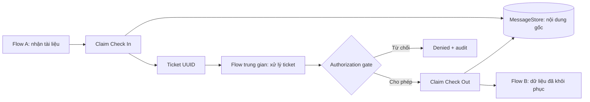
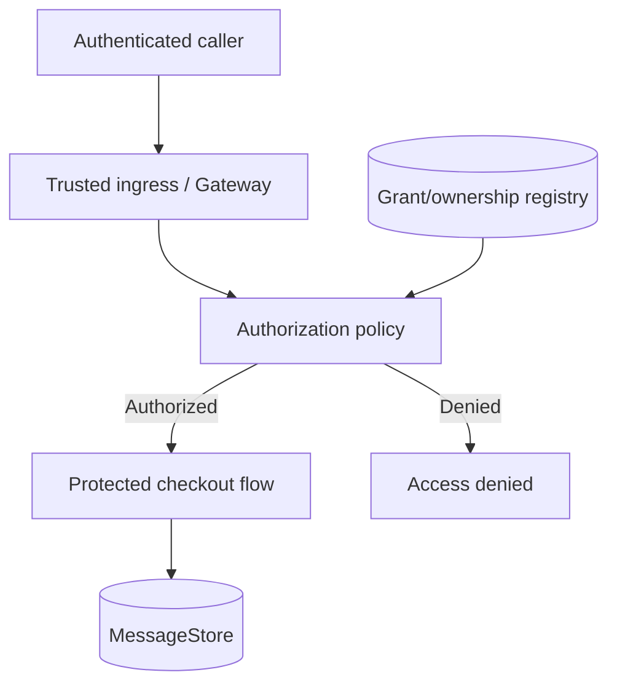
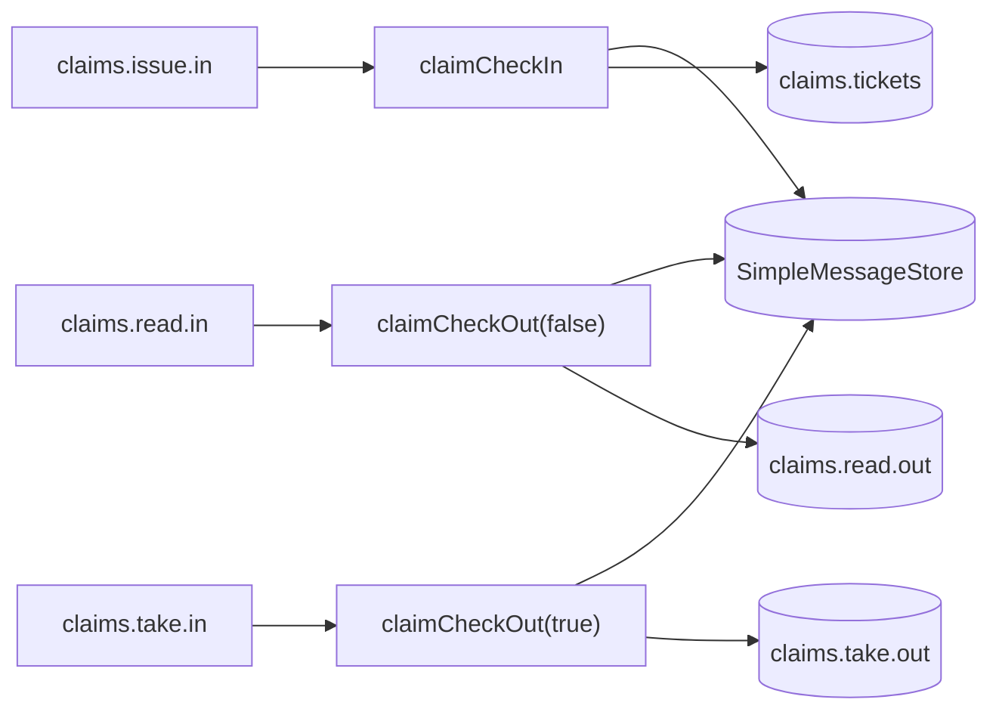
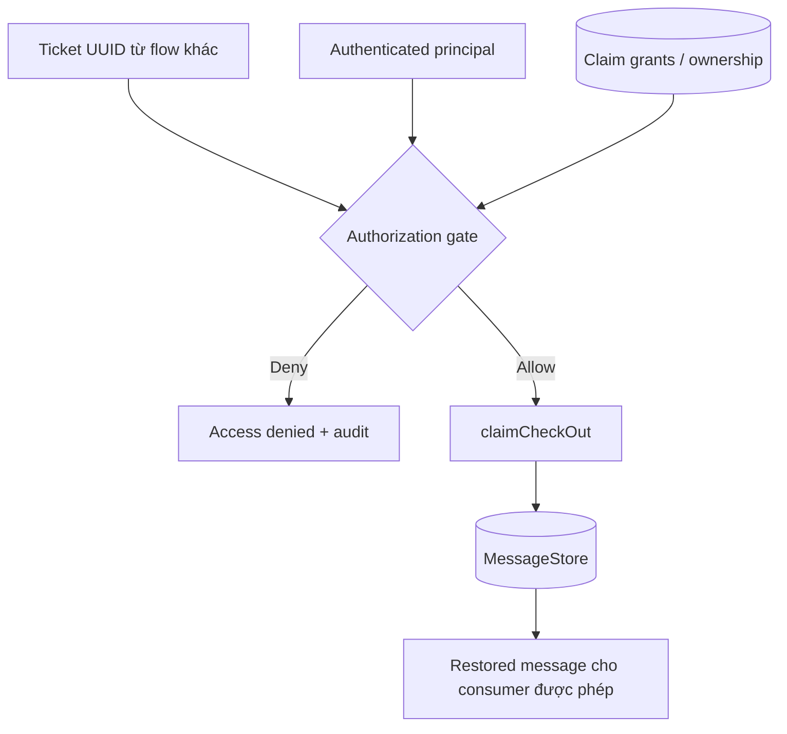
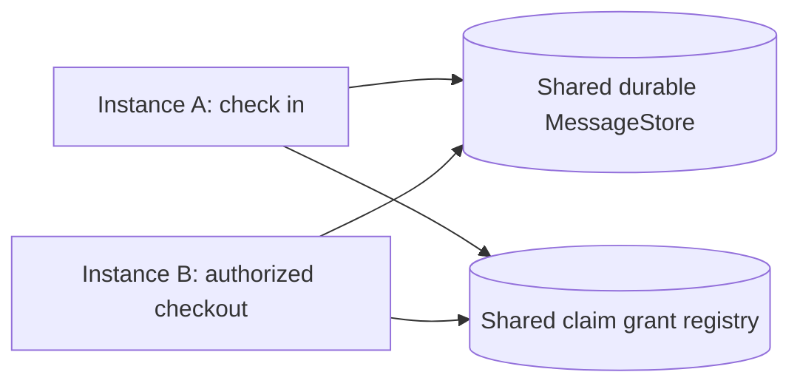
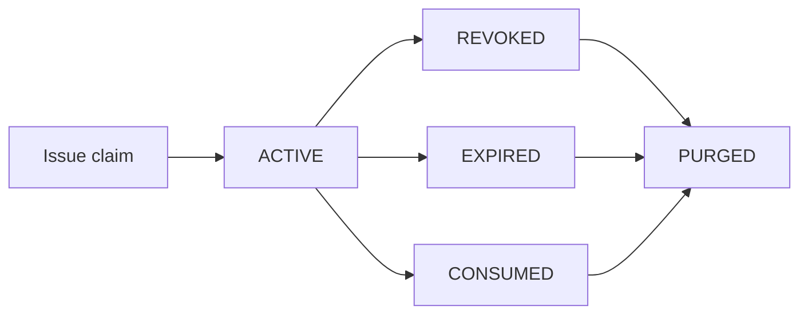
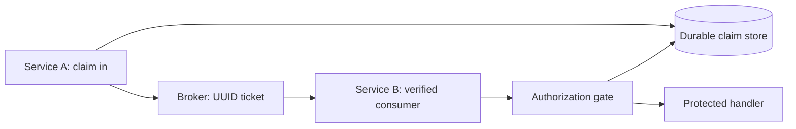

# Quyền truy cập claim giữa các flow trong Spring Integration

## Mục tiêu bài học

Một hệ thống nhận hồ sơ đặt hàng kèm tài liệu nhạy cảm. Flow tiếp nhận cần kiểm tra mã đơn, định tuyến sang nhiều bước xử lý, ghi log nghiệp vụ và gửi trạng thái; các bước trung gian **không cần đọc toàn bộ tài liệu**. Chỉ flow xét duyệt được cấp quyền mới cần khôi phục dữ liệu gốc.

Nếu giữ nguyên payload nhạy cảm trên mọi message, một handler không liên quan, một log debug hoặc một outbound adapter có thể vô tình tiếp cận và phát tán dữ liệu. Mẫu **Claim Check** giải quyết phần **di chuyển dữ liệu**: lưu message gốc trong một `MessageStore` và truyền một mã tham chiếu thay cho payload lớn/nhạy cảm.

Tuy nhiên, câu hỏi quan trọng của bài này là: **flow nào được phép dùng mã tham chiếu đó để lấy lại message gốc?** Trong Spring Integration, `ClaimCheckInTransformer` và `ClaimCheckOutTransformer` cung cấp thao tác lưu/khôi phục; chúng **không tự tạo mô hình phân quyền theo tenant, actor, business purpose hoặc tên flow**. Quyền truy cập phải được kiểm soát tại các ranh giới gọi checkout và truy cập `MessageStore`.

Bài thuộc chương **Claim check**, module **SPRING_INTEGRATION_PATTERN**, nơi thực hành Enterprise Integration Patterns bằng Spring Integration: Router, Filter, Transformer, Splitter, Aggregator, Gateway, retry, error channel, correlation và quan sát các nhánh xử lý để xây luồng message ít phụ thuộc, dễ mở rộng.

Sau bài học, bạn có thể:

1. Giải thích luồng `claim-check-in → ticket → claim-check-out` và điều được lưu trong `MessageStore`.
2. Phân biệt **có ticket** với **được phép lấy dữ liệu**, tránh xem UUID là cơ chế xác thực.
3. Thiết kế quyền truy cập theo **tenant, actor, mục đích, tên flow, workflow/generation, thời hạn**.
4. Cấu hình hai flow Java DSL cùng dùng một `MessageStore` và hiểu `removeMessage=false/true`.
5. Đặt **authorization gate trước checkout**, không tin `tenantId`, `role` hoặc `allowedFlow` do client tự gửi.
6. Viết JUnit cho việc lưu/khôi phục giữa flow và unit test từ chối truy cập chéo tenant, sai mục đích hoặc quá hạn.
7. Thiết kế quyền dùng claim một lần/nhiều lần, revoke, TTL, retention, audit, retry và bảo vệ dữ liệu.
8. Nhận diện rủi ro concurrency, nhiều instance, crash giữa bước checkout và commit, lộ token qua log và serialization qua broker.

---

## 1. Claim Check được dùng để làm gì?

Giả sử producer gửi:

```text
Message<Document>
  payload:
    documentId = DOC-42
    tenantId   = tenant-a
    rawContent = [nội dung lớn/nhạy cảm]
  headers:
    traceId    = trace-42
```

Sau khi **check in**:

```text
MessageStore:
  UUID id-123 -> Message<Document> gốc

Message đi tiếp:
  payload = UUID id-123
  headers = metadata cần thiết theo flow
```

Sau khi một flow có quyền **check out**:

```text
payload UUID id-123
    |
    v
MessageStore.getMessage(id-123)
    |
    v
Message<Document> được khôi phục
```



**Lợi ích chính:** các bước chỉ cần biết rằng có một tài liệu và một mã tham chiếu thì không phải mang payload lớn/nhạy cảm qua tất cả endpoint.

**Giới hạn bảo mật:** nếu một flow chưa được bảo vệ có thể đọc `MessageStore` trực tiếp hoặc gọi `claimCheckOut` với ticket hợp lệ, việc thay payload bằng UUID **không ngăn được truy cập trái phép**.

### Các thành phần chính

| Thành phần | Vai trò | Không tự bảo đảm |
| --- | --- | --- |
| `ClaimCheckInTransformer` | Lưu message gốc, phát ID dạng claim ticket | Quyền đọc theo người dùng/flow |
| `ClaimCheckOutTransformer` | Dùng ticket lấy message từ store | Tenant isolation, purpose binding, authorization |
| `MessageStore` | Lưu và tra cứu message bằng ID | Chính sách RBAC/ABAC theo business context |
| `Claim ticket` | Mã tham chiếu đến message đã lưu | Định danh người sở hữu hoặc quyền được cấp |
| Authorization gate | Kiểm tra actor, tenant, flow, purpose, expiry | Độ bền store và transaction end-to-end |
| Audit/claim ledger | Ghi ai cấp quyền, ai đọc, khi nào thu hồi | Không thay thế xác thực/ủy quyền tại runtime |

## 2. “Quyền truy cập giữa các flow” có nghĩa gì?

Hãy đặt tên ba flow:

- `ingress-flow`: nhận tài liệu và phát claim ticket.
- `metadata-flow`: xử lý metadata/trạng thái đơn; **không được đọc payload gốc**.
- `settlement-flow`: đối chiếu đơn, được phép đọc tài liệu trong thời hạn nhất định.
- `analytics-flow`: chỉ được dùng mã đơn và trạng thái tổng hợp; **không được checkout nội dung nhạy cảm**.

### Ma trận quyền tối thiểu

| Flow | Nhận ticket | Đọc message gốc | Cập nhật claim metadata | Xóa claim |
| --- | --- | --- | --- | --- |
| `ingress-flow` | Có, sau khi check in | Chỉ khi nghiệp vụ cần | Đăng ký ownership/ACL | Theo lifecycle có kiểm soát |
| `metadata-flow` | Có | **Không** | Không | Không |
| `settlement-flow` | Có, với request được cấp | **Có**, nếu cùng tenant/workflow và còn hạn | Có thể ghi trạng thái đã dùng | Chỉ nếu chính sách cho phép |
| `analytics-flow` | Có thể nhận ID đã giảm lộ thông tin | **Không** | Không | Không |
| Admin retention job | Không cần payload nghiệp vụ | Không theo đường thông thường | Quản lý retention | Có, theo policy/audit |

Quyền trên chỉ là **mẫu chính sách của ứng dụng**, không phải cơ chế mặc định do Spring Integration cung cấp.

### Tách hai ranh giới

**Data plane**: nơi message nghiệp vụ đi qua `MessageChannel`, Router, Transformer và các handler.

**Control/security plane**: nơi actor được xác thực, grant được cấp/thu hồi, ticket được kiểm tra quyền, lưu audit và hết hạn.



Quyền truy cập nên gắn với **ngữ cảnh đã xác thực** của người hoặc service gọi, không gắn với một header tùy ý của message.

## 3. Claim ticket có phải access token không?

Spring Integration dùng ID của message đã lưu (hiện được biểu diễn bằng UUID) làm **claim check**. Cơ chế cơ bản cho phép tra cứu theo ID.

Đừng đồng nhất ba khái niệm:

| Khái niệm | Câu hỏi được trả lời | Ví dụ |
| --- | --- | --- |
| **Lookup key** | Dữ liệu được lưu ở vị trí nào? | Claim UUID |
| **Authentication** | Ai đang thực hiện thao tác? | Service principal đã xác thực |
| **Authorization** | Principal có được đọc claim này không? | Tenant, permission, flow/purpose, expiry |

UUID có tính khó đoán trong điều kiện phù hợp nhưng **không thay thế authentication và authorization**. Một ticket rò rỉ vào log, URL, queue, email hoặc trace có thể bị dùng để checkout nếu endpoint không có gate.

### Nguyên tắc thiết kế

1. **Ticket là dữ liệu nhạy cảm theo ngữ cảnh.** Không phát công khai khi không cần.
2. **Tất cả lối vào checkout phải được kiểm soát.** Một channel nội bộ không phải lúc nào cũng có ranh giới bảo mật nếu nhiều adapter/bean có thể gửi vào.
3. **Không cho client tự khai flow được phép.** Flow identity/purpose phải đến từ server-side route hoặc thành phần đã được cấp quyền.
4. **Không coi message header tự khai là principal.** `headers['tenantId']` hoặc `headers['role']` là dữ liệu, không tự là chứng nhận.
5. **Không cấp quyền bằng cách so sánh UUID với một chuỗi danh sách đơn giản.** Cần kiểm tra cả ownership, tenant, phạm vi, thời hạn và trạng thái.
6. **Không đặt raw `MessageStore` vào một dịch vụ dùng chung không có policy.** Bất kỳ code nào có reference đến store có thể thực hiện `getMessage(UUID)`.

## 4. Cách Spring Integration lưu và khôi phục claim

Theo tài liệu chính thức:

- Incoming Claim Check Transformer nhận `Message<?>`, lưu nó vào `MessageStore` rồi phát một message có **payload là ID**.
- Outgoing Claim Check Transformer nhận ticket, tra cứu bằng ID và khôi phục nội dung đã lưu.
- Khi `removeMessage=false` (mặc định), thông điệp được giữ trong store sau checkout.
- Khi `removeMessage=true`, việc checkout đồng thời loại message khỏi store để ticket không thể claim lại theo cơ chế này.

Các API Java DSL gồm:

```java
.claimCheckIn(messageStore)

.claimCheckOut(messageStore)

.claimCheckOut(messageStore, false) // Có thể đọc nhiều lần.

.claimCheckOut(messageStore, true)  // Lấy và xóa khi checkout.
```

`MessageStore` cung cấp các thao tác:

```java
Message<?> stored = messageStore.getMessage(ticket);
Message<?> removed = messageStore.removeMessage(ticket);
```

Kiểu `ticket` ở đây là `java.util.UUID`.

**Cảnh báo:** `MessageStore` không yêu cầu truyền principal hay tenant khi gọi `getMessage(UUID)`. Một checkout được thực hiện trong flow không bảo vệ có thể lấy message đã lưu **chỉ bằng ticket**.

### Tại sao cần cùng store?

Flow A check in vào `storeA` nhưng Flow B check out từ `storeB` sẽ không thể khôi phục claim nếu hai store không chia sẻ dữ liệu và ID tương ứng.

Có ba trường hợp:

| Triển khai | Kết quả |
| --- | --- |
| Hai flow cùng Spring context, cùng bean `MessageStore` | Có thể check in rồi check out |
| Hai app instance khác nhau, store in-memory riêng | **Không** thấy claim của nhau |
| Hai instance cùng dùng persistent/shared store tương thích | Có thể khôi phục, **nếu** mapping quyền, serializer và transaction đúng |

**Cùng store giúp khả năng tra cứu; không tự tạo quyền truy cập.** Nếu nhiều flow tin cậy không đồng nghĩa nhiều flow có cùng quyền, vẫn phải dùng authorization gate.

## 5. Demo Java DSL: hai flow chia sẻ MessageStore

Bắt đầu bằng ví dụ kỹ thuật tách flow check-in và check-out để quan sát semantics của framework. Ví dụ này **không tự bảo vệ quyền truy cập**; chỉ được dùng trong bài test hoặc vùng nội bộ đã được bảo vệ.

### Sơ đồ



### Cấu hình đầy đủ

```java
import org.springframework.context.annotation.Bean;
import org.springframework.context.annotation.Configuration;
import org.springframework.integration.channel.DirectChannel;
import org.springframework.integration.channel.QueueChannel;
import org.springframework.integration.config.EnableIntegration;
import org.springframework.integration.dsl.IntegrationFlow;
import org.springframework.integration.store.MessageStore;
import org.springframework.integration.store.SimpleMessageStore;
import org.springframework.messaging.MessageChannel;
import org.springframework.messaging.PollableChannel;

@Configuration
@EnableIntegration
public class CrossFlowClaimCheckConfig {

    public record SensitiveDocument(
        String documentId,
        String tenantId,
        String content
    ) {}

    @Bean("claimStore")
    MessageStore claimStore() {
        // Chỉ dùng in-memory trong demo/test.
        return new SimpleMessageStore();
    }

    @Bean("claims.issue.in")
    MessageChannel issueInput() {
        return new DirectChannel();
    }

    @Bean("claims.tickets")
    PollableChannel ticketOutput() {
        return new QueueChannel();
    }

    @Bean("claims.read.in")
    MessageChannel readInput() {
        return new DirectChannel();
    }

    @Bean("claims.read.out")
    PollableChannel readOutput() {
        return new QueueChannel();
    }

    @Bean("claims.take.in")
    MessageChannel takeInput() {
        return new DirectChannel();
    }

    @Bean("claims.take.out")
    PollableChannel takeOutput() {
        return new QueueChannel();
    }

    @Bean
    IntegrationFlow checkInFlow(MessageStore claimStore) {
        return IntegrationFlow.from("claims.issue.in")
            .claimCheckIn(claimStore)
            .channel("claims.tickets")
            .get();
    }

    @Bean
    IntegrationFlow repeatableReadFlow(MessageStore claimStore) {
        return IntegrationFlow.from("claims.read.in")
            .claimCheckOut(claimStore, false)
            .channel("claims.read.out")
            .get();
    }

    @Bean
    IntegrationFlow claimOnceFlow(MessageStore claimStore) {
        return IntegrationFlow.from("claims.take.in")
            .claimCheckOut(claimStore, true)
            .channel("claims.take.out")
            .get();
    }
}
```

### Từng flow có quyền gì trong bản demo?

- `checkInFlow` lưu message và phát ticket.
- `repeatableReadFlow` khôi phục message bằng ticket mà **không xóa**.
- `claimOnceFlow` khôi phục message bằng ticket và **xóa** khỏi store.
- **Không flow nào ở bản demo kiểm tra quyền.** Đây là điểm cần bổ sung trước khi sử dụng trong môi trường có nhiều tenant, service hoặc vùng tin cậy.

Trong một ứng dụng thực, không nên expose trực tiếp `claims.read.in` hoặc `claims.take.in` qua HTTP, broker inbound adapter hay control bus nếu chưa có authorization gate. Việc một channel không public không tự chứng minh rằng mọi handler/service có thể gửi vào đều đáng tin.

## 6. Kiểm thử kỹ thuật: lưu ở flow A, đọc ở flow B

Dùng JUnit 5, Spring Test và AssertJ để kiểm tra **khả năng truy xuất qua hai flow khác nhau** cùng dùng `MessageStore`.

```java
import static org.assertj.core.api.Assertions.assertThat;

import java.util.UUID;

import org.junit.jupiter.api.Test;
import org.springframework.beans.factory.annotation.Autowired;
import org.springframework.beans.factory.annotation.Qualifier;
import org.springframework.integration.store.MessageStore;
import org.springframework.messaging.Message;
import org.springframework.messaging.MessageChannel;
import org.springframework.messaging.PollableChannel;
import org.springframework.messaging.support.MessageBuilder;
import org.springframework.test.context.junit.jupiter.SpringJUnitConfig;

@SpringJUnitConfig(CrossFlowClaimCheckConfig.class)
class CrossFlowClaimCheckTest {

    @Autowired
    @Qualifier("claims.issue.in")
    MessageChannel issueInput;

    @Autowired
    @Qualifier("claims.tickets")
    PollableChannel tickets;

    @Autowired
    @Qualifier("claims.read.in")
    MessageChannel readInput;

    @Autowired
    @Qualifier("claims.read.out")
    PollableChannel readOutput;

    @Autowired
    @Qualifier("claims.take.in")
    MessageChannel takeInput;

    @Autowired
    @Qualifier("claims.take.out")
    PollableChannel takeOutput;

    @Autowired
    @Qualifier("claimStore")
    MessageStore claimStore;

    private UUID issue(String documentId) {
        var payload =
            new CrossFlowClaimCheckConfig.SensitiveDocument(
                documentId, "tenant-a", "private-" + documentId);

        assertThat(issueInput.send(
            MessageBuilder.withPayload(payload)
                .setHeader("traceId", "trace-" + documentId)
                .build()
        )).isTrue();

        Message<?> ticketMessage = tickets.receive(2_000);
        assertThat(ticketMessage).isNotNull();
        assertThat(ticketMessage.getPayload())
            .isInstanceOf(UUID.class);
        return (UUID) ticketMessage.getPayload();
    }

    @Test
    void claimCanTravelBetweenFlowsUsingSharedStore() {
        UUID ticket = issue("DOC-A");

        assertThat(claimStore.getMessage(ticket)).isNotNull();

        assertThat(readInput.send(
            MessageBuilder.withPayload(ticket).build()
        )).isTrue();

        Message<?> restored = readOutput.receive(2_000);
        assertThat(restored).isNotNull();
        assertThat(restored.getPayload())
            .isEqualTo(
                new CrossFlowClaimCheckConfig.SensitiveDocument(
                    "DOC-A", "tenant-a", "private-DOC-A"));

        // removeMessage=false: dữ liệu vẫn trong MessageStore.
        assertThat(claimStore.getMessage(ticket)).isNotNull();
        assertThat(readOutput.receive(0)).isNull();
    }

    @Test
    void readWithoutRemovalCanBeRepeated() {
        UUID ticket = issue("DOC-B");

        for (int i = 0; i < 2; i++) {
            assertThat(readInput.send(
                MessageBuilder.withPayload(ticket).build()
            )).isTrue();
            assertThat(readOutput.receive(2_000)).isNotNull();
        }

        assertThat(claimStore.getMessage(ticket)).isNotNull();
        assertThat(readOutput.receive(0)).isNull();
    }

    @Test
    void claimOnceRemovesStoredMessage() {
        UUID ticket = issue("DOC-C");

        assertThat(takeInput.send(
            MessageBuilder.withPayload(ticket).build()
        )).isTrue();

        Message<?> restored = takeOutput.receive(2_000);
        assertThat(restored).isNotNull();
        assertThat(restored.getPayload())
            .isInstanceOf(
                CrossFlowClaimCheckConfig.SensitiveDocument.class);

        assertThat(claimStore.getMessage(ticket)).isNull();
        assertThat(takeOutput.receive(0)).isNull();
    }
}
```

**Phạm vi kiểm thử:** những test này chứng minh check-in/check-out dùng cùng store và sự khác nhau giữa đọc nhiều lần với đọc rồi xóa. Chúng **chưa chứng minh authorization**. Test bảo mật ở mục sau sẽ có một gate riêng.

**Đường chạy:** `DirectChannel` xử lý đồng bộ rồi ghi kết quả vào `QueueChannel` không có consumer nền. `receive(0)` phù hợp trong test này; với executor/broker, phải chờ có điều kiện. Các test phát ticket mới cho từng trường hợp để tránh phụ thuộc trạng thái claim đã bị xóa.

## 7. Bổ sung authorization: chính sách quyền phải nằm trước checkout

Một flow an toàn cần xác minh các thông tin sau **trước khi gọi** `MessageStore.getMessage` hoặc `claimCheckOut`:

- **Actor:** ai hoặc service principal nào đang xin lấy claim?
- **Tenant:** claim thuộc tenant nào? Actor có thuộc tenant tương ứng?
- **Purpose/consumer flow:** flow này có được phép dùng claim để làm việc đã khai báo?
- **Workflow/generation:** claim có thuộc đúng phiên giao dịch đang xử lý?
- **Expiry/revocation:** claim còn hạn, chưa bị thu hồi?
- **Permission:** actor có quyền đọc nội dung nhạy cảm thuộc loại đó?
- **Replay policy:** ticket dùng nhiều lần hay một lần? Số lần đọc có giới hạn?



**Nguyên tắc quan trọng:** không tra payload nhạy cảm trước rồi mới quyết định actor có quyền hay không. Cách “get rồi filter” làm rộng phạm vi những component có thể tiếp cận dữ liệu.

### Grant là dữ liệu nghiệp vụ của ứng dụng

Spring Integration không tự thêm bảng `claim_acl` hay định nghĩa `allowedFlows`. Ứng dụng có thể lưu metadata:

```text
claimId = <UUID>
tenantId = tenant-a
workflowId = WORK-42
allowedConsumers = {settlement}
expiresAt = 2026-12-01T00:00:00Z
state = ACTIVE
```

Grant phải được tạo từ **nguồn đã được xác thực** vào thời điểm check-in và chỉ publish ticket sau khi lưu thành công metadata/ownership. Nếu lưu claim thành công nhưng cấp grant thất bại, phải cleanup hoặc retry có điều phối để không có dữ liệu mồ côi.

## 8. Ví dụ một gate thuần Java có thể kiểm thử

Để tập trung vào quyền, ta viết một gate riêng. Ví dụ này giữ grant trong `ConcurrentHashMap` **chỉ để học và unit test**; production phải dùng registry bền, có transaction/locking và phục hồi sau restart.

```java
import java.time.Clock;
import java.time.Instant;
import java.util.Map;
import java.util.Set;
import java.util.UUID;
import java.util.concurrent.ConcurrentHashMap;

public final class ClaimAccessGate {

    public record VerifiedActor(
        String subject,
        String tenantId,
        Set<String> permissions
    ) {
        public VerifiedActor {
            permissions = Set.copyOf(permissions);
        }
    }

    public record ClaimGrant(
        UUID claimId,
        String tenantId,
        String workflowId,
        Set<String> allowedConsumers,
        Instant expiresAt
    ) {
        public ClaimGrant {
            allowedConsumers = Set.copyOf(allowedConsumers);
        }
    }

    private final Map<UUID, ClaimGrant> grants =
        new ConcurrentHashMap<>();

    private final Clock clock;

    public ClaimAccessGate(Clock clock) {
        this.clock = clock;
    }

    // Chỉ trusted issuer được gọi hàm này.
    public void register(ClaimGrant grant) {
        grants.put(grant.claimId(), grant);
    }

    public UUID requireAllowed(
        UUID ticket,
        VerifiedActor actor,
        String consumerFlow,
        String workflowId
    ) {
        ClaimGrant grant =
            ticket == null ? null : grants.get(ticket);

        boolean allowed = actor != null
            && grant != null
            && actor.permissions().contains("claim:read")
            && actor.tenantId() != null
            && actor.tenantId().equals(grant.tenantId())
            && consumerFlow != null
            && grant.allowedConsumers().contains(consumerFlow)
            && workflowId != null
            && workflowId.equals(grant.workflowId())
            && clock.instant().isBefore(grant.expiresAt());

        if (!allowed) {
            // Cùng lỗi chung để tránh lộ claim có tồn tại không.
            throw new SecurityException("CLAIM_ACCESS_DENIED");
        }

        return ticket;
    }

    public void revoke(UUID ticket) {
        grants.remove(ticket);
    }
}
```

Giải thích:

1. `VerifiedActor` là đối tượng **đã được tạo sau xác thực**, không phải DTO client tùy ý gửi.
2. `ClaimGrant` quy định tenant, workflow, tập consumer được phép và hạn.
3. `requireAllowed` trả **ticket gốc**, giúp một flow dùng ticket đó để gọi built-in checkout **sau** gate.
4. Một thông điệp lỗi chung tránh tiết lộ “ticket có tồn tại nhưng thuộc tenant khác” cho actor bị từ chối.
5. `revoke` khiến gate từ chối các lần truy cập tương lai **khi chúng còn đi qua gate**; không thu hồi được bản sao payload đã được consumer hợp lệ lấy trước đó.

**Các giới hạn của demo:** `ConcurrentHashMap` không bền sau restart, không hỗ trợ atomic consume one-time, không log audit và không bảo vệ khỏi component đọc trực tiếp `MessageStore`. Production cần enforce quyền ở tất cả lối vào, đặc biệt lối đọc store và kênh checkout.

### Đừng tin actor từ header đầu vào

Đoạn mã sau là **phản ví dụ**:

```java
// KHÔNG áp dụng ở boundary không đáng tin:
String tenant = (String) message.getHeaders().get("tenantId");
String role = (String) message.getHeaders().get("role");

// Sai: client có thể tự gửi tenantId/role như mong muốn.
```

Tại API Gateway hoặc inbound adapter, ứng dụng cần xác thực client rồi **tạo `VerifiedActor` từ principal đáng tin**. Ví dụ khi dùng Spring Security, service ở boundary có thể đọc `Authentication` từ security context đã xác thực (nếu context được truyền đúng qua thread/async boundary). Không được tự suy `ROLE_ADMIN` từ header JSON.

### Identity qua async boundary

`SecurityContextHolder` dạng thread-local **không tự đi theo** Kafka consumer thread, poller hoặc executor trong mọi cấu hình. Với processing bất đồng bộ, hãy xác thực **service identity** ở điểm nhận hoặc truyền một **ngữ cảnh đã ký/xác minh** theo giao thức, có mục đích, hạn và chính sách replay. Không lấy principal của producer ở thread cũ bằng một giả định không được kiểm chứng.

## 9. Nối gate vào Java DSL trước `claimCheckOut`

Cách tích hợp có chủ đích là:

```text
Input ticket
  -> resolve authenticated actor từ trusted identity provider
  -> requireAllowed(ticket, actor, "settlement", workflowId)
  -> ClaimCheckOutTransformer
  -> settlement-only handler
```

Java DSL **trích đoạn**, giả định tồn tại các bean channel, `ClaimAccessGate`, `VerifiedIdentityProvider` và `MessageStore`:

```java
import java.util.UUID;

import org.springframework.context.annotation.Configuration;
import org.springframework.context.annotation.Bean;
import org.springframework.integration.dsl.IntegrationFlow;
import org.springframework.integration.store.MessageStore;

interface VerifiedIdentityProvider {
    ClaimAccessGate.VerifiedActor currentActor();
}

@Configuration
class SecureClaimFlowExcerpt {

    @Bean
    IntegrationFlow settlementClaimRestoreFlow(
        MessageStore claimStore,
        ClaimAccessGate gate,
        VerifiedIdentityProvider identities
    ) {
        return IntegrationFlow.from("claims.secure.read.in")
            .handle(UUID.class, (ticket, headers) -> {
                // Actor từ trusted context/server, không từ payload.
                var actor = identities.currentActor();

                // workflowId do request cung cấp được đối chiếu
                // với grant được lưu ở phía server.
                String workflowId =
                    (String) headers.get("workflowId");

                return gate.requireAllowed(
                    ticket, actor, "settlement", workflowId);
            })
            .claimCheckOut(claimStore, false)
            .channel("claims.secure.read.out")
            .get();
    }
}
```

`"settlement"` là **hằng phía server** đại diện consumer đang dùng, không phải giá trị do client đặt `headers['allowedFlow']`. Nếu có một flow analytics dùng ticket này, gate phải chạy lại với `consumerFlow="analytics"` và thường phải từ chối.

**Không chỉ gắn gate vào một flow mà để mở thêm một flow `claims.read.in` không được bảo vệ.** Phải đóng hoặc hạn chế tất cả đường bypass như ví dụ kỹ thuật ở mục 5; raw store cũng cần chỉ có service được phép giữ reference.

### Lưu ý về `workflowId`

Trong snippet, `workflowId` có thể tới từ header do ingress đưa vào. Việc so sánh với grant giúp ngăn nhầm workflow, nhưng **không chứng minh người gửi header là chủ sở hữu workflow**. Chính actor từ nguồn xác thực và chính sách grant server-side mới cấp quyền; nếu hợp đồng yêu cầu thêm ownership theo actor, phải lưu và so sánh `subject`/service principal được phép.

### Chiến lược production an toàn hơn

Với hệ thống đa tenant, có thể bọc `MessageStore` sau một service chỉ xuất phương thức:

```java
Message<?> readAuthorized(
    UUID ticket,
    VerifiedActor actor,
    String consumer,
    String workflow
);
```

Service đó kiểm tra quyền, TTL, revocation và đọc message trong một transaction/snapshot có kiểm soát. Các flow **không được tự inject raw store**. Nếu dùng built-in `claimCheckOut`, cổng điều khiển phải bảo đảm không có lối đi vòng qua gate; với yêu cầu nghiêm ngặt hơn, custom checkout service có thể thuận lợi cho atomic authorization.

## 10. Unit test: cùng ticket, quyền khác nhau

Các test phải chứng minh gate từ chối **dù actor biết ticket thật**.

```java
import static org.assertj.core.api.Assertions.assertThat;
import static org.assertj.core.api.Assertions.assertThatThrownBy;

import java.time.Clock;
import java.time.Instant;
import java.time.ZoneOffset;
import java.util.Set;
import java.util.UUID;

import org.junit.jupiter.api.Test;

class ClaimAccessGateTest {

    private static final Instant NOW =
        Instant.parse("2026-11-21T05:00:00Z");

    private final ClaimAccessGate gate =
        new ClaimAccessGate(
            Clock.fixed(NOW, ZoneOffset.UTC));

    private final UUID ticket = UUID.randomUUID();

    private void grantUntil(Instant expiry) {
        gate.register(new ClaimAccessGate.ClaimGrant(
            ticket, "tenant-a", "WORK-42",
            Set.of("settlement"), expiry));
    }

    private ClaimAccessGate.VerifiedActor actor(
        String tenant,
        String... permissions
    ) {
        return new ClaimAccessGate.VerifiedActor(
            "service-123", tenant, Set.of(permissions));
    }

    @Test
    void sameTenantAuthorizedFlowMayRead() {
        grantUntil(NOW.plusSeconds(300));

        UUID result = gate.requireAllowed(
            ticket,
            actor("tenant-a", "claim:read"),
            "settlement",
            "WORK-42");

        assertThat(result).isEqualTo(ticket);
    }

    @Test
    void leakedTicketDoesNotGrantOtherTenant() {
        grantUntil(NOW.plusSeconds(300));

        assertThatThrownBy(() ->
            gate.requireAllowed(
                ticket,
                actor("tenant-b", "claim:read"),
                "settlement", "WORK-42"))
            .isInstanceOf(SecurityException.class)
            .hasMessage("CLAIM_ACCESS_DENIED");
    }

    @Test
    void analyticsCannotReadSettlementClaim() {
        grantUntil(NOW.plusSeconds(300));

        assertThatThrownBy(() ->
            gate.requireAllowed(
                ticket,
                actor("tenant-a", "claim:read"),
                "analytics", "WORK-42"))
            .isInstanceOf(SecurityException.class);
    }

    @Test
    void missingPermissionIsDenied() {
        grantUntil(NOW.plusSeconds(300));

        assertThatThrownBy(() ->
            gate.requireAllowed(
                ticket,
                actor("tenant-a"), // Không có claim:read.
                "settlement", "WORK-42"))
            .isInstanceOf(SecurityException.class);
    }

    @Test
    void wrongWorkflowAndExpiredGrantAreDenied() {
        grantUntil(NOW.plusSeconds(300));

        assertThatThrownBy(() ->
            gate.requireAllowed(
                ticket,
                actor("tenant-a", "claim:read"),
                "settlement", "WORK-99"))
            .isInstanceOf(SecurityException.class);

        grantUntil(NOW.minusSeconds(1));

        assertThatThrownBy(() ->
            gate.requireAllowed(
                ticket,
                actor("tenant-a", "claim:read"),
                "settlement", "WORK-42"))
            .isInstanceOf(SecurityException.class);
    }

    @Test
    void revokedTicketIsDeniedEvenBeforeExpiry() {
        grantUntil(NOW.plusSeconds(300));
        gate.revoke(ticket);

        assertThatThrownBy(() ->
            gate.requireAllowed(
                ticket,
                actor("tenant-a", "claim:read"),
                "settlement", "WORK-42"))
            .isInstanceOf(SecurityException.class);
    }
}
```

**Phạm vi:** unit test xác nhận logic allow/deny của gate. Để chứng minh flow thực sự an toàn, cần **integration/security test** tại cổng nhận message: xác nhận unauthenticated request bị chặn trước khi tạo ticket, request denied không chạm tới store, và không có checkout endpoint không bảo vệ.

## 11. Kiểm thử “không chạm store nếu bị từ chối”

Chỉ kiểm tra “client không nhận payload” là chưa đủ. Một flow không an toàn có thể đã đọc tài liệu nhạy cảm, log nó, rồi mới từ chối response.

Một test tốt xác minh thứ tự:

```text
Unauthorized ticket
  -> gate DENY
  -> không gọi MessageStore.getMessage
  -> không gọi MessageStore.removeMessage
  -> không phát restored message
```

Với một `MessageStore` mock (Mockito, nếu dự án có dependency), ta có thể kiểm tra logic của một **service bọc store**:

```java
import static org.assertj.core.api.Assertions.assertThatThrownBy;
import static org.mockito.Mockito.*;

import java.time.Clock;
import java.util.UUID;

import org.junit.jupiter.api.Test;
import org.springframework.integration.store.MessageStore;

class AuthorizedClaimReaderTest {

    @Test
    void denialHappensBeforeStoreLookup() {
        MessageStore store = mock(MessageStore.class);
        ClaimAccessGate gate =
            new ClaimAccessGate(Clock.systemUTC());

        UUID ticket = UUID.randomUUID();
        var actor = new ClaimAccessGate.VerifiedActor(
            "actor-x", "tenant-b",
            java.util.Set.of("claim:read"));

        // Không đăng ký grant nào cho ticket: gate phải deny.

        AuthorizedClaimReader reader =
            new AuthorizedClaimReader(store, gate);

        assertThatThrownBy(() ->
            reader.read(ticket, actor, "settlement", "WORK-42"))
            .isInstanceOf(SecurityException.class);

        verifyNoInteractions(store);
    }
}

// Mẫu service đọc claim có kiểm tra trước.
final class AuthorizedClaimReader {

    private final MessageStore store;
    private final ClaimAccessGate gate;

    AuthorizedClaimReader(
        MessageStore store, ClaimAccessGate gate
    ) {
        this.store = store;
        this.gate = gate;
    }

    org.springframework.messaging.Message<?> read(
        UUID ticket,
        ClaimAccessGate.VerifiedActor actor,
        String flow,
        String workflow
    ) {
        UUID allowed = gate.requireAllowed(
            ticket, actor, flow, workflow);

        var message = store.getMessage(allowed);
        if (message == null) {
            // Không tiết lộ ID có tồn tại ngoài store hay không.
            throw new IllegalStateException(
                "CLAIM_UNAVAILABLE");
        }
        return message;
    }
}
```

**Đây là ví dụ bổ trợ**, không phải flow tự đăng ký bằng `@Bean`. Cần Mockito nếu muốn chạy test. Khi yêu cầu bảo mật mạnh, authorization và store access cần được thiết kế transactionally/atomically để xử lý race với revoke và expiry, không chỉ gọi hai hàm liên tiếp rồi khẳng định chúng là một giao dịch.

## 12. Check out một lần hay nhiều lần: quyền đọc không phải số lần đọc

Spring Integration hỗ trợ:

```java
.claimCheckOut(store, false) // giữ message sau checkout
.claimCheckOut(store, true)  // xóa message khi checkout
```

### Mô hình nhiều lần đọc

```text
Ticket T -> settlement-flow đọc (được phép)
Ticket T -> settlement-flow đọc lại (được phép)
Ticket T -> analytics-flow bị từ chối (không được phép)
```

`removeMessage=false` cho phép dữ liệu còn trong store, nhưng **quyền đọc từng lần vẫn phải được kiểm tra**. Không phải “đọc được một lần” thì mãi mãi được đọc, vì grant có thể hết hạn hoặc bị revoke.

### Mô hình claim once

```text
Ticket T -> settlement-flow checkout(remove=true)
         -> message bị xóa khỏi MessageStore

Ticket T -> checkout lần sau -> không còn message
```

`removeMessage=true` hữu ích để giảm retention và tránh claim lại qua built-in transform. Nhưng:

- **Không có nghĩa** đã xử lý nghiệp vụ đúng một lần.
- **Không có nghĩa** chỉ actor hợp lệ có thể claim; vẫn cần gate.
- Nếu checkout xóa message **trước khi handler downstream commit**, crash có thể khiến tài liệu bị mất khỏi store mà công việc chưa hoàn tất.
- Nếu nhiều flow cần cùng nội dung, flow đầu checkout và xóa sẽ khiến các flow còn lại không thể lấy được.

Do đó, với giao dịch quan trọng, có thể dùng **read không xóa → xử lý có idempotency → acknowledge/cleanup riêng** thay vì xóa khi checkout. Phải thiết kế retention và transaction để không giữ dữ liệu nhạy cảm vĩnh viễn.

### Claim once khác “exclusive lease”

Một lease thường gồm owner, thời hạn, token và khả năng gia hạn/release. Built-in `removeMessage=true` chỉ nêu hành vi **xóa message khi checkout**, không tạo một distributed lease hay quyền sở hữu độc quyền có thể khôi phục tự động.

Nếu flow A và B cùng có ticket, muốn bảo đảm **chỉ một worker được xử lý** trong cụm, cần cơ chế claim/lease/lock hoặc transaction ở storage phù hợp và idempotency tại nơi có side effect.

## 13. Nhiều flow được phép dùng chung claim

Có trường hợp cả `settlement-flow` và `fraud-review-flow` đều cần đọc cùng một tài liệu, nhưng `analytics-flow` vẫn không được phép.

Grant minh họa:

```text
Claim T:
  allowedConsumers = {settlement, fraud-review}
  allowedPurposes  = {reconcile, investigate}
  tenantId         = tenant-a
  expiresAt        = ...
```

Mỗi lần khôi phục phải được kiểm tra theo **consumer và purpose**. Nếu không muốn hai flow giữ hai bản sao nội dung, hãy cân nhắc:

- `removeMessage=false` cho phép nhiều lần checkout hợp lệ.
- Quy định số lần đọc tối đa hoặc thời hạn cho từng consumer.
- Ghi audit mỗi lần lấy dữ liệu.
- Không để một flow có quyền đọc tự động cấp lại ticket cho flow khác.
- Nếu cần kiểm soát mạnh, dùng grant riêng cho từng consumer hoặc token dẫn xuất có scope/TTL riêng do server cấp.

Không thể dùng `removeMessage=true` với một ticket chung rồi kỳ vọng tất cả consumer lấy được nó; lượt đầu tiên xóa dữ liệu dùng chung.

### Quyền không chỉ nằm ở tên channel

Một handler có thể được đăng ký dưới channel `claims.secure.read.in`; một bean khác trong cùng process vẫn có thể tham chiếu channel đó nếu được cấp quyền kỹ thuật. **Tên bean/channel không phải security boundary**.

Khi nhiều team/app có mức tin cậy khác nhau, ưu tiên tách quyền ở service API/repository/DB và chỉ cho adapter đã xác thực gọi chức năng checkout. Với cùng process, kiểm soát bằng kiến trúc module và không expose raw store, nhưng phải nhìn nhận giới hạn: code được chạy với cùng quyền process thường có thể bypass policy ứng dụng nếu nó có thể lấy bean store.

## 14. Phân tách tenant và nhiều instance

### Multi-tenant isolation

Một ticket `UUID` không cho biết tenant nào sở hữu nó theo API `MessageStore.getMessage(UUID)`. Nếu hệ thống đa tenant dùng chung store, cần một trong những mô hình:

1. **Shared store + grant registry** có kiểm tra tenant ở mọi lần đọc.
2. **Store/namespace tách theo tenant** và routing tới store từ trusted tenant identity.
3. **Claim access service** sở hữu toàn bộ store, nhận ticket và principal, kiểm tra policy rồi mới trả dữ liệu.

Trong cả ba, không cho client chọn tenant đích chỉ bằng query parameter hoặc header.

### Nhiều instance



Nếu instance A dùng `SimpleMessageStore` nội bộ, instance B có store khác sẽ không tìm thấy ticket. Dùng `JdbcMessageStore` hoặc store bền/phân tán phù hợp khi flow chạy ở nhiều process; đồng thời cần shared grant registry, serializer tương thích, encryption, transaction và quyền DB.

**Không có ý nghĩa bảo vệ nếu MessageStore shared nhưng ACL registry local ở một JVM.** Khi restart hoặc chuyển traffic giữa replica, metadata quyền có thể mất hoặc không đồng nhất.

### Truy cập trực tiếp database

Ngay cả khi ứng dụng có gate, một service có quyền đọc bảng MessageStore trực tiếp ở DB có thể vượt qua authorization ở tầng flow. Cần kiểm soát DB/service account, network ACL, encryption và quyền truy cập backup/observability.

## 15. Revoke, expiry và cleanup

Một claim nên có vòng đời rõ ràng:

```text
ISSUED
   |
   +--> ACTIVE (được phép tra cứu theo grant)
   |
   +--> REVOKED (gate từ chối)
   |
   +--> EXPIRED (hết hạn)
   |
   +--> CONSUMED (nếu one-time)
   |
   +--> PURGED (xóa payload/metadata theo retention)
```



Các chuyển trạng thái **do ứng dụng định nghĩa**; Spring Integration không tự tạo `ClaimGrant.state` hay quản lý đầy đủ lifecycle ở trên.

### Hai nơi cần dọn

1. **MessageStore:** message gốc chứa dữ liệu nhạy cảm.
2. **Grant/metadata store:** quyền, ownership, expiry, audit, trạng thái consumed/revoked.

Nếu chỉ xóa grant mà không xóa message, dữ liệu vẫn tồn tại trong MessageStore và có thể bị đọc bởi component bypass gate. Nếu chỉ xóa message mà không dọn grant, checkout sẽ luôn thất bại và metadata có thể tích tụ.

### TTL có tự bật không?

`SimpleMessageStore` không phải một TTL store dành riêng cho claim. Không nên mặc định ID tự hết hạn hoặc message tự được xóa theo `expiresAt` trong registry. Phải thiết kế một job có scope, chỉ xóa claim đủ điều kiện, kiểm soát active workflow và audit việc dọn.

Khi dùng persistent store, retention phải tính tới backup, replica, transaction log và quy định bảo vệ dữ liệu. Xóa ở ứng dụng không mặc định đồng nghĩa xóa vật lý ngay lập tức khỏi mọi bản sao.

### Revoke sau khi đã đọc

Revoke ngăn **lần đọc mới** nếu mọi luồng đều qua gate. Nó không rút lại nội dung đã được một flow hợp lệ copy vào memory, cache hoặc hệ thống downstream. Đó là lý do cần data minimization, TTL, audit và chính sách xóa lan truyền khi có yêu cầu pháp lý/nghiệp vụ.

## 16. Concurrency, race và khoảng trống giữa authorization và checkout

Ví dụ hai actor đọc gần nhau:

```text
T1 actor A được gate cho phép
T2 admin revoke claim T
T3 actor A gọi MessageStore.getMessage(T)
```

Nếu kiểm tra quyền và đọc message là **hai thao tác không có transaction/lock chung**, actor A có thể đọc sau khi revoke đã được lưu. Có nhiều cách xử lý:

- **Snapshot semantics:** cho phép những request đã qua gate hoàn tất; ghi audit chính sách này.
- **Strict revocation:** kiểm tra và đọc dưới cùng transaction/lock hoặc cơ chế version/fencing phù hợp.
- **Short-lived authorization grants:** giảm cửa sổ rủi ro, nhưng không thay thế transaction nếu yêu cầu tuyệt đối.

Với quyền truy cập dữ liệu nhạy cảm, **cần nói rõ contract của revoke**, không chỉ có một nút “Revoke” trong UI.

### Xóa cùng lúc

Hai worker có thể cùng thực hiện `claimCheckOut(store, true)` với một ticket. Việc một worker nhận được dữ liệu, cả hai nhận hay một worker thất bại phụ thuộc store implementation, serialization và concurrency. Không được coi câu “remove=true” là **transactional distributed lock** có bảo đảm mạnh nếu chưa xác minh chính xác cơ chế của store đang dùng.

Nếu yêu cầu exactly-one claimant, hãy triển khai atomic consume ở database hoặc một claim lease/claim table chuyên biệt, kèm idempotency của bước xử lý nghiệp vụ.

## 17. Retry và idempotency

Giả sử:

```text
T1 check out tài liệu, remove=true
T2 settlement handler ghi DB thành công
T3 response bị mất do network
T4 caller retry cùng ticket
T5 dữ liệu không còn trong MessageStore
```

Caller có thể nhận lỗi ở lượt retry dù nghiệp vụ đã commit. Ngược lại, với `remove=false`, retry có thể lấy cùng tài liệu và thực hiện side effect một lần nữa.

Giải pháp cần giải quyết **quy trình nghiệp vụ**, không chỉ trạng thái ticket:

- Gắn `workflowId`/`documentId`/`commandId` ổn định.
- Consumer kiểm tra idempotency key trước khi ghi DB/gọi service.
- Ghi trạng thái `PROCESSING/SUCCEEDED/FAILED` vào store nghiệp vụ.
- Khi retry, trả kết quả đã commit nếu cùng command ID.
- Dùng transactional outbox nếu vừa cập nhật DB vừa phải phát event.
- Chọn thời điểm cleanup claim sau khi workflow đạt trạng thái terminal.

### Ví dụ mô hình trạng thái

```text
claimId = T
workflowId = WORK-42
processedResultId = RES-42

Business ledger:
  WORK-42 -> SUCCEEDED / RES-42

Retry WORK-42:
  -> trả RES-42, không thực thi settlement lần hai
```

Đây là mô hình **effectively-once business effect** dựa trên lưu trạng thái/idempotency, không phải bảo đảm exactly-once do ClaimCheckOutTransformer tự cung cấp.

## 18. Claim Check với Router, Filter, Gateway và Aggregator

### Filter trước checkout

```text
Incoming ticket
  -> Authenticate actor
  -> Authorize ticket + purpose + tenant
  -> ClaimCheckOut
  -> Handler
```

**Không làm ngược**:

```text
Incoming ticket
  -> ClaimCheckOut
  -> Filter unauthorized payload
```

Bởi vì việc đọc dữ liệu đã xảy ra trước khi xác thực quyền.

### Router quyết định flow nhưng không cấp quyền

Router có thể chọn `settlement-flow` hoặc `analytics-flow` từ header. Điều đó **không tự cấp quyền** cho flow được chọn. Nếu header do client đặt, attacker có thể chọn nhánh có quyền cao hơn. Cần policy để quyết định nhánh được phép gọi checkout.

### Gateway request-reply

Gateway có thể gọi protected checkout rồi handler trả kết quả nghiệp vụ. Nếu claim bị deny, nên trả lỗi/response theo hợp đồng, không để request chờ vô hạn. Nếu claim hết hạn hoặc bị xóa, phân biệt lỗi nội bộ để quan sát, nhưng tránh tiết lộ cho người ngoài rằng claim tồn tại ở tenant khác.

### Splitter/Aggregator

Khi một batch được chia thành nhiều phần, có thể phát một claim cho từng phần hoặc một claim cho toàn bộ batch. Quyết định phụ thuộc ai cần đọc dữ liệu gốc và bao nhiêu lần:

- **Một claim cho cả batch:** giảm số entry nhưng không giới hạn quyền theo từng phần một cách tự nhiên.
- **Mỗi phần một claim:** dễ cấp quyền tối thiểu theo line/branch nhưng tăng storage/cleanup.
- **Multi-reader claim:** nếu nhiều nhánh cùng đọc dữ liệu, không dùng `remove=true` trước khi mọi nhánh hợp lệ hoàn tất.
- **Correlated outcomes:** giữ `correlationId`/`sequenceNumber` nơi cần Aggregator; không coi claim UUID là correlation ID chung của cả batch.

### Transformer và header propagation

Check-in/out là những Transformer đặc biệt. Tuy nhiên, đừng giả định “nội dung đã ẩn” thì mọi header cũng an toàn:

- Ticket message vẫn có thể mang một số header của message đầu vào tùy cách tạo message/adapter.
- Header có PII, token, `replyChannel` hoặc `errorChannel` cần chính sách giảm lộ thông tin.
- Khi khôi phục, xử lý rõ metadata nào thuộc message gốc và metadata nào thuộc request checkout hiện tại.
- Nếu cần log, chỉ log business status, trace và fingerprint/ticket được che một phần, không log payload nhạy cảm.

## 19. Biên giới broker và hệ thống từ xa

Một ticket UUID có thể đi qua Kafka/AMQP/JMS/HTTP, nhưng flow ở đầu kia chỉ checkout được nếu:

1. Có cách tiếp cận **được cấp quyền** tới store chứa message.
2. Có grant/ownership metadata tương ứng.
3. Dùng định dạng ticket tương thích.
4. Có xác thực service-to-service và phân quyền theo mục đích.
5. Có chính sách expiry/retry khi message bị delay.
6. Có serializer/header mapper phù hợp.
7. Có cách xử lý khi claim bị xóa trước khi message tới.



Nếu flow bên B **không có quyền đọc store**, việc chuyển ticket qua broker không giúp gì và đó có thể là **thiết kế đúng**: broker chỉ cần chuyển metadata, không cần đọc nội dung.

### Không truyền object Channel ra broker

`replyChannel` và `errorChannel` trong flow nội bộ có thể là object không serializable. Dùng cơ chế reply destination, header mapping và correlation phù hợp với broker. Đừng copy mọi header chỉ vì payload đã được rút xuống một UUID.

### Chống lộ ticket

- Tránh đưa ticket vào query string URL nếu server, proxy hoặc analytics có thể log query.
- Không coi UUID là bí mật đủ mạnh để bỏ qua authentication.
- Giới hạn thời hạn và số lần sử dụng khi cần.
- Dùng TLS giữa các service.
- Có rate limit và audit các checkout thất bại.
- Không ghi raw ticket vào metric tag; cardinality cao và rò rỉ ID.

## 20. MessageStore, dữ liệu nhạy cảm và chi phí vận hành

### Chọn store

| Store | Phù hợp | Rủi ro/việc phải làm |
| --- | --- | --- |
| `SimpleMessageStore` | Demo/test trong một JVM | Mất dữ liệu khi restart; RAM/retention |
| `JdbcMessageStore` | Cần lưu qua restart và share giữa instance | Schema, serializer, transaction, encryption, backups |
| Store ngoài hỗ trợ MessageStore | Kiến trúc phân tán phù hợp | Network, consistency, permission, cleanup, migration |
| Encrypted object storage + claim metadata service | Payload lớn đặc biệt | Đây là **thiết kế riêng**, không phải built-in MessageStore tự động |

`MessageStore` mặc định lưu **message**, không chỉ byte array payload. Vì thế, serialization/khả năng lưu header và loại dữ liệu chứa trong message phải được kiểm soát.

### Đừng biến claim thành “bãi chứa mãi mãi”

Nếu mỗi check-in giữ dữ liệu 10 MB và ứng dụng check in nhiều lần nhưng không cleanup, storage/RAM tăng nhanh. Phải có:

- Giới hạn kích thước payload.
- TTL/retention và lịch dọn có audit.
- Metric số claim còn active và dung lượng.
- Alert khi lookup lỗi hoặc cleanup thất bại.
- Policy cho backup, encryption at rest và key rotation.
- Kiểm soát ai có quyền xem payload trong dashboard/logging.

### Mất store hoặc hỏng serializer

Nếu claim ID tồn tại trong queue nhưng message gốc bị mất khi restart, checkout không thể khôi phục dữ liệu. Nếu payload có kiểu Java không còn tương thích khi deploy, đọc từ store bền có thể lỗi deserialize. Cần versioning, migration hoặc định dạng serializer được hỗ trợ lâu dài.

Không đánh đồng việc nhận ticket thành công với bảo đảm có thể checkout vô thời hạn.

## 21. Security checklist cụ thể cho cross-flow claim

| Câu hỏi | Bằng chứng cần có |
| --- | --- |
| Ticket do ai phát? | Issuer service/identity đã xác thực |
| Owner của claim? | Tenant/workflow/actor hoặc service owner trong grant ledger |
| Flow được phép? | Allowlist consumer flow phía server |
| Mục đích truy cập? | Purpose không đến từ claim của client |
| Claim hết hạn? | Check clock, expiry và revoke tại mỗi access |
| Checkout có bị bypass? | Không còn endpoint/store path không bảo vệ |
| Có truy cập trái tenant? | Integration test negative chéo tenant |
| Có claim một lần? | Policy atomic consume, không chỉ bool remove |
| Dữ liệu sau đọc đi đâu? | Downstream permissions và data minimization |
| Có audit? | Actor, purpose, thời điểm, result mà không log payload |
| Multi-instance? | Shared grant/store, consistency, lock và transaction |
| Crash/retry? | Idempotency, khôi phục trạng thái, cleanup đúng thời điểm |
| Có TTL/retention? | Job dọn payload lẫn grant, backup policy |
| Có bảo mật hạ tầng? | TLS, DB access, encryption, least privilege |

## 22. Quan sát và kiểm toán

Nên phân biệt **claim operations** và **authorization outcomes**.

| Metric gợi ý | Ý nghĩa |
| --- | --- |
| `claim_issued_total{source}` | Số claim đã tạo |
| `claim_checkout_attempt_total{consumer}` | Lượt yêu cầu lấy claim |
| `claim_checkout_allowed_total{consumer}` | Lượt được gate cho phép |
| `claim_checkout_denied_total{reason}` | Lượt bị từ chối theo lý do nội bộ |
| `claim_checkout_not_found_total` | Ticket đã bị xóa/hết hạn hoặc store thiếu |
| `claim_checkout_removed_total` | Số message bị xóa qua claim once |
| `claim_revoked_total` | Số claim bị thu hồi |
| `claim_expired_total` | Số claim hết hạn |
| `claim_store_size_bytes` | Dung lượng lưu trữ (nếu đo được) |
| `claim_active_count` | Số claim còn hoạt động |
| `claim_restore_latency` | Thời gian đọc từ store |
| `claim_orphan_cleanup_total` | Số claim không còn grant/workflow và được xử lý dọn |

Đây là **tên metric do ứng dụng có thể tự định nghĩa**, không phải tên mặc định được Spring Integration bảo đảm xuất. Không dùng raw ticket, documentId hoặc userId làm metric label cardinality cao.

### Audit log gợi ý

```text
traceId=trace-42 event=claim_issued
actor=ingress-service tenant=tenant-a
workflow=WORK-42 claimRef=<redacted>

traceId=trace-43 event=claim_access_denied
actor=analytics-service consumer=analytics
reason=NOT_ALLOWED claimRef=<redacted>

traceId=trace-44 event=claim_retrieved
actor=settlement-service consumer=settlement
workflow=WORK-42 result=SUCCESS claimRef=<redacted>
```

Trong log external trả về cho client, có thể dùng một mã lỗi chung `CLAIM_ACCESS_DENIED` để giảm lộ thông tin. Lý do chi tiết như `TENANT_MISMATCH`, `EXPIRED` hoặc `REVOKED` chỉ nên ghi vào audit channel có quyền truy cập thích hợp.

## 23. Bảng chẩn đoán sự cố

| Triệu chứng | Nguyên nhân cần kiểm tra | Hướng xử lý |
| --- | --- | --- |
| Flow B không khôi phục được claim | Store khác, message bị xóa, ticket sai kiểu | Kiểm tra cùng store, UUID, retention |
| Tenant B lấy được dữ liệu tenant A | Checkout không gate hoặc tin header giả | Chặn mọi lối đọc raw store, auth server-side |
| Claim ticket có trong log | Logging payload sau check-in | Redact ticket và giảm dữ liệu log |
| Checkout một lần rồi không còn dữ liệu | `removeMessage=true` | Dùng multi-read hoặc cleanup sau commit |
| Analytics biết ticket và lấy được payload | Ticket bị dùng như “mật khẩu” không cần principal | AuthN/AuthZ + allowlist consumer |
| Revoke không ngăn request đang chạy | Check quyền và đọc store không atomic | Transaction/lock/fencing hoặc định nghĩa snapshot semantics |
| Service B không tìm thấy claim sau deploy | In-memory store trên instance khác hoặc restart | Persistent/shared store và grant registry |
| Claim còn trong store sau expiry | Chỉ hết hạn grant, không dọn payload | Cleanup cả dữ liệu lẫn metadata |
| Claim read thất bại ngẫu nhiên | Race với cleanup/claim once hoặc store lỗi | Transaction, retry phân loại, audit |
| Cùng ticket gây side effect hai lần | `remove=false` và consumer thiếu idempotency | Business command ID + unique constraint |
| Đọc xong rồi crash mất dữ liệu | `remove=true` trước downstream commit | Claim/read-ack pattern và replay ledger |
| Payload nhạy cảm hiện trong header | Claim Check chỉ giảm payload, header vẫn mang dữ liệu | Header allowlist/filter ở boundary |
| Header replyChannel không serialize | Message chứa object channel qua broker | Header mapper/reply destination |
| Không thể migrate store | Serializer/schema Java thay đổi | Versioning và migration |
| Khó biết ai đọc claim | Thiếu audit actor/purpose | Access log có kiểm soát, không log content |

## 24. Bài tập thực hành

### Bài 1 — Hai flow cùng MessageStore

Dùng `CrossFlowClaimCheckConfig`, check in một `SensitiveDocument` rồi gửi ticket sang flow đọc. Xác nhận nội dung được khôi phục mà ticket vẫn còn trong store khi `removeMessage=false`.

### Bài 2 — Claim once

Tạo ticket mới, gửi tới `claimCheckOut(store, true)`. Kiểm tra message có thể nhận ở lần đầu và `store.getMessage(ticket)==null` sau đó. Giải thích vì sao đây không phải bảo đảm exactly-once business processing.

### Bài 3 — Phân quyền theo tenant

Tạo grant của `tenant-a` cho ticket T và actor đã xác thực thuộc `tenant-b`. Assert gate từ chối dù actor biết ticket chính xác. Không cho trường hợp reject đi tới store.

### Bài 4 — Flow được phép và flow bị cấm

Grant `allowedConsumers={settlement}`. Gọi cùng ticket từ `settlement-flow` và `analytics-flow`. Kiểm tra chỉ flow có quyền được phép đọc và cùng error message chung cho các trường hợp bị từ chối.

### Bài 5 — Revoke/expiry

Đặt grant hết hạn sau 5 phút bằng `Clock.fixed` hoặc `Clock.offset` trong test. Kiểm tra trước hạn có thể đọc, đúng thời điểm hết hạn bị deny và revoke có hiệu lực ở các request kế tiếp.

### Bài 6 — Không chạm MessageStore khi deny

Dùng mock `MessageStore`, gửi một request không hợp lệ. Verify `getMessage/removeMessage` không được gọi khi gate trả deny. Tách test gate thuần khỏi integration test channel.

### Bài 7 — Nhiều flow được phép đọc

Cho `settlement` và `fraud-review` cùng quyền đọc T, `analytics` không có quyền. Sử dụng `removeMessage=false` và ghi audit. Sau đó thử `remove=true` để thấy vấn đề tranh chấp và mất khả năng đọc lần hai.

### Bài 8 — Giữ quyền qua broker

Giả lập flow A phát ticket qua Kafka/AMQP, flow B dùng shared store. Xác định chỗ xác thực service identity và cách đảm bảo requestId, claimId, tenant/grant không thể bị client giả mạo.

### Bài 9 — Retry sau khi checkout

Giả lập crash giữa checkout và downstream commit. So sánh `removeMessage=true` với `false`; thiết kế read-ack, idempotency key và cleanup sau khi business ledger ghi `SUCCEEDED`.

### Bài 10 — Nhiều instance và cleanup

Hai instance chia sẻ `JdbcMessageStore` và grant ledger. Viết test/review cho scenario đọc claim, revoke đồng thời, restart và retention job. Mô tả transaction/consistency mong muốn.

### Bài 11 — Header an toàn

Gửi input có `traceId`, `tenantId` và một header chứa dữ liệu bí mật. So sánh message sau check-in, sau checkout và khi đi qua outbound adapter. Định nghĩa allowlist headers ở từng boundary để không rò rỉ metadata.

### Bài 12 — Security observability

Tạo metric cho issued/allowed/denied/expired/not-found; ghi audit nhưng che ticket. Kiểm thử dashboard không chứa raw UUID, nội dung tài liệu, token hoặc thông tin cá nhân.

## 25. Checklist trước khi đưa vào production

1. Claim check đang che giấu **payload**, hay ứng dụng đã thực sự thiết kế bảo vệ **quyền đọc**?
2. Ticket có được xem là thông tin nhạy cảm trong log, HTTP, broker và trace?
3. Có rõ **flow nào** có quyền checkout và vì **mục đích** gì?
4. Mỗi request đã lấy **principal đáng tin** thay vì tin header do client gửi?
5. Grant đã gắn tenant, workflow/generation, consumer, expiry và trạng thái?
6. Flow có gate trước checkout và có chặn **mọi lối bypass** raw store không?
7. Sau checkout, chỉ những handler phù hợp mới được tiếp cận payload?
8. Nếu nhiều flow cùng cần nội dung, chính sách `removeMessage` có phù hợp?
9. Nếu claim một lần, có giải quyết race và crash trước commit?
10. Nếu có revoke, contract xử lý request đồng thời đã được định nghĩa?
11. Nếu có expiry, payload và grant có được cleanup tương ứng?
12. Multi-instance có shared durable MessageStore và shared grant registry?
13. DB/backup/serializer có encryption, retention và quyền truy cập tối thiểu?
14. Có audit từng lần đọc/deny mà không lộ payload, ticket, token?
15. Có integration test unauthorized cross-tenant, wrong flow, expiry, missing ID và rollback?
16. Retry và side effect downstream có business idempotency key không?
17. Gateway có error response rõ khi claim bị deny hoặc không còn trong store?
18. Header mapper đã tránh lộ `replyChannel`, `errorChannel` và metadata nhạy cảm?
19. Có giới hạn kích thước, quota và cảnh báo dung lượng store?
20. Có kế hoạch migration và xử lý claim còn tồn tại sau deploy/restart?

### Ghi nhớ

**Claim Check tách việc vận chuyển message khỏi việc mang toàn bộ nội dung.** `ClaimCheckInTransformer` lưu message trong `MessageStore`, tạo ticket ID; `ClaimCheckOutTransformer` dùng ID để khôi phục dữ liệu. Nhưng **biết ticket không đồng nghĩa được phép đọc**. Spring Integration không tự tạo ACL/tenant isolation cho mọi flow; ứng dụng phải đặt authorization gate trước checkout và giới hạn quyền truy cập trực tiếp vào store.

Một thiết kế đúng cho **quyền truy cập claim giữa các flow** cần đồng thời: **principal đáng tin, tenant/workflow ownership, mục đích được cấp quyền, thời hạn và revoke, cách thức dùng claim một/nhiều lần, audit và retention**. Khi có retry, crash, broker hoặc nhiều instance, phải bổ sung **transaction/idempotency**; `removeMessage=true` không thay thế những cơ chế đó.

### Tài liệu tham khảo

- [Spring Integration Reference — Claim Check](https://docs.spring.io/spring-integration/reference/claim-check.html)
- [Spring Integration API — BaseIntegrationFlowDefinition (claimCheckIn/Out)](https://docs.spring.io/spring-integration/api/org/springframework/integration/dsl/BaseIntegrationFlowDefinition.html)
- [Spring Integration API — MessageStore](https://docs.spring.io/spring-integration/api/org/springframework/integration/store/MessageStore.html)
- [Spring Integration API — ClaimCheckInTransformer](https://docs.spring.io/spring-integration/api/org/springframework/integration/transformer/ClaimCheckInTransformer.html)
- [Spring Integration API — ClaimCheckOutTransformer](https://docs.spring.io/spring-integration/api/org/springframework/integration/transformer/ClaimCheckOutTransformer.html)
