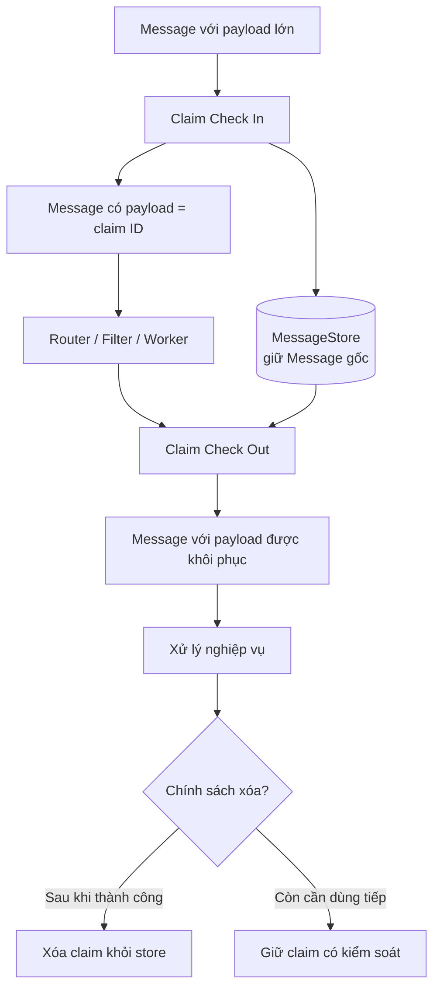
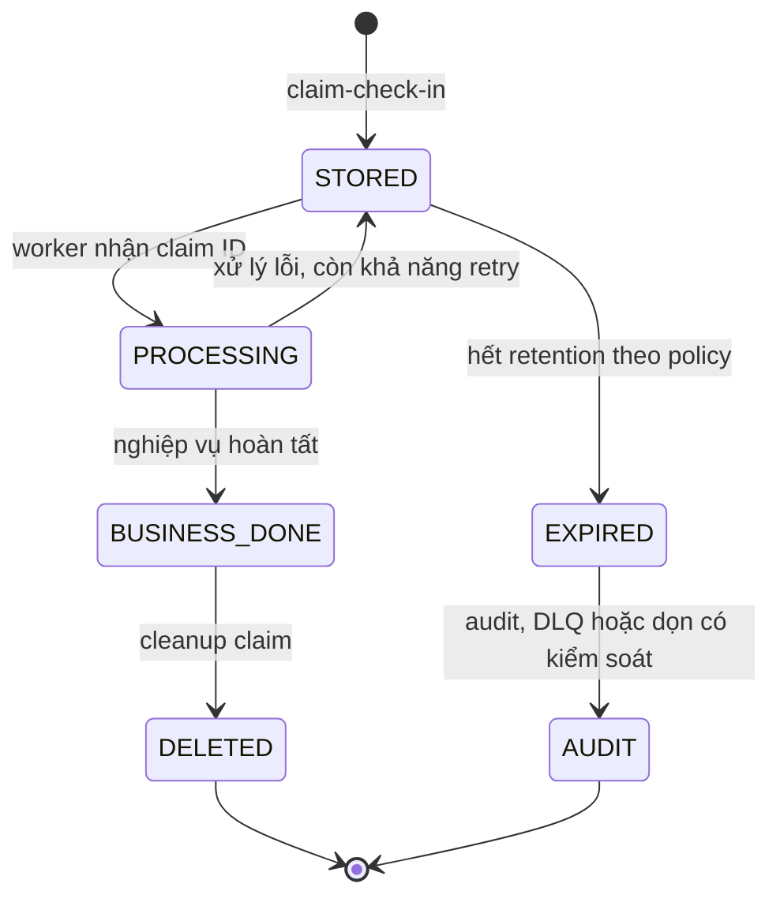
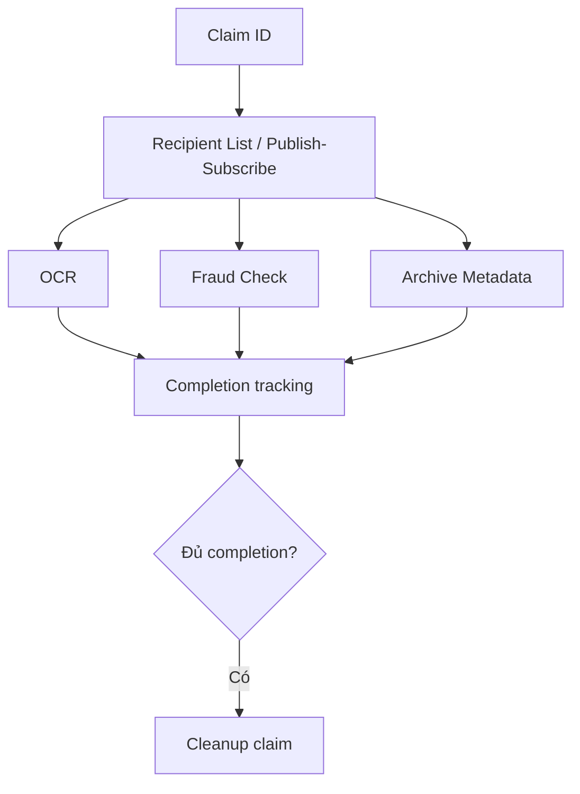

# Xóa claim sau khi xử lý

Một Message có payload lớn có thể chứa tài liệu PDF, dữ liệu ảnh, một batch nhiều bản ghi hoặc thông tin nghiệp vụ nhạy cảm. Trong khi đó, những bước trung gian như Router, Filter hoặc Service Activator đôi khi chỉ cần mã tham chiếu, không cần mang toàn bộ payload. **Claim Check** là mẫu Enterprise Integration Patterns (EIP) cất Message vào một `MessageStore`, thay payload trên đường đi bằng **claim check** (mã tham chiếu), rồi khôi phục Message khi cần.

Sau khi dữ liệu đã được sử dụng, hệ thống phải giải quyết một câu hỏi quan trọng: **khi nào được xóa claim khỏi store?** Xóa quá sớm khiến retry hoặc consumer khác không thể lấy lại payload; xóa quá muộn gây tăng bộ nhớ, chi phí lưu trữ, kéo dài thời gian giữ dữ liệu và rủi ro lộ dữ liệu. Chính sách đúng phụ thuộc vào việc claim được dùng một lần hay nhiều lần, “xử lý xong” nghĩa là gì, transaction bao phủ những thao tác nào và liệu Message có thể được phát lại hay không.

Bài thuộc chương **Claim check** của module `SPRING_INTEGRATION_PATTERN`. Module hướng đến thực hành Spring Integration với Router, Filter, Transformer, Splitter, Aggregator, Gateway, retry, error channel và correlation để tạo flow ít phụ thuộc, dễ mở rộng, có khả năng kiểm thử và theo dõi. Trọng tâm của bài này là **xóa claim an toàn sau sử dụng, phân biệt cấu hình mặc định với claim-once, thiết kế retry/cleanup và quan sát vòng đời của dữ liệu trong MessageStore**.

## 1. Vòng đời Claim Check: cất, trao vé, nhận lại và dọn dẹp

Xét một Message chứa payload 5 MiB. Flow chỉ cần metadata để chọn đường xử lý; không cần chuyển 5 MiB qua mọi chặng.



Một Claim Check gồm hai phía:

1. **Incoming Claim Check Transformer**: nhận Message gốc, lưu Message vào store và tạo Message mới có payload là ID tham chiếu.
2. **Outgoing Claim Check Transformer**: nhận ID đó, tìm Message được lưu, khôi phục payload để bước sau sử dụng. Tùy cấu hình, nó **giữ lại hoặc xóa** Message đang lưu.

`MessageStore` là chiến lược lưu Message, không phải nơi lưu một bản sao payload bất kỳ theo định dạng luôn giống nhau. Spring Integration hỗ trợ các implementation như `SimpleMessageStore` (RAM) và `JdbcMessageStore` (JDBC) phù hợp các mức độ bền vững khác nhau.

### 1.1. Claim ID không phải payload gốc

Ví dụ:

```text
Message gốc:
  payload     = byte[5 MiB]
  eventId     = evt-1001
  documentId  = DOC-1001

Sau claim-check-in:
  payload     = UUID tham chiếu, ví dụ 8a4f...
  store[UUID] = Message gốc

Sau claim-check-out:
  payload     = byte[5 MiB] được khôi phục
```

ID này **không phải đường dẫn file tùy ý**, không phải mã đơn hàng và cũng không tự mang dữ liệu gốc. Nó là một khóa tra cứu trong store tương ứng. Spring Integration hiện sử dụng định danh dạng UUID cho claim check; không nên tự phụ thuộc vào cách in một UUID như một hợp đồng transport lâu dài nếu chưa chuẩn hóa.

### 1.2. Không có claim vĩnh viễn miễn phí

Nếu mỗi ngày lưu 100.000 Message, kích thước trung bình 200 KiB, mà không xóa hoặc đặt retention, chỉ phần payload đã xấp xỉ 19 GiB/ngày (chưa tính headers, serialization và metadata). Với `SimpleMessageStore`, dữ liệu tồn đọng trong heap có thể gây `OutOfMemoryError`; với JDBC, nó có thể làm bảng, index và chi phí backup tăng không giới hạn.

## 2. Chính sách mặc định: checkout không tự xóa

Trong Spring Integration, tùy chọn `removeMessage` của **Claim Check Out** có ý nghĩa:

| Cấu hình | Hành vi | Trường hợp phù hợp |
| --- | --- | --- |
| `claimCheckOut(store)` | Khôi phục Message nhưng **không xóa** khỏi store theo mặc định | Có thể cần lấy lại nhiều lần hoặc muốn xóa sau business success |
| `claimCheckOut(store, false)` | Tường minh giữ claim sau checkout | Retry, inspection hoặc nhiều lần đọc có kiểm soát |
| `claimCheckOut(store, true)` | **Xóa Message khỏi store trong bước checkout** | Claim-once, chỉ cần dùng một lần và chấp nhận thời điểm xóa này |

Trong cấu hình XML, tùy chọn tương ứng là `remove-message="true"` hoặc `remove-message="false"` (mặc định false). Với Java DSL, overload `claimCheckOut(MessageStore, boolean)` truyền chính sách trực tiếp vào transformer.

**Điểm đặc biệt quan trọng:** `removeMessage=true` có nghĩa **xóa trong quá trình claim-check-out**, **không có nghĩa chờ toàn bộ handler nghiệp vụ phía sau chạy xong, commit database rồi mới xóa**. Nếu luồng còn bước xử lý có thể thất bại, `removeMessage=true` có thể quá sớm.

### 2.1. “Claim once” khác “processed exactly once”

“Chỉ được claim một lần” là chính sách của **kho Message**. Nó không chứng minh:

- Business handler đã thực hiện side effect thành công.
- Database nghiệp vụ đã commit.
- Downstream consumer đã ACK.
- Broker đầu vào sẽ không redeliver.
- Hai instance không có cạnh tranh đọc/xóa theo cấu hình của store.

Vì vậy, đừng dùng `removeMessage=true` như bằng chứng hệ thống có bảo đảm exactly-once end-to-end.

## 3. “Sau khi xử lý” phải có mốc hoàn tất rõ ràng

Hãy phân biệt các mốc sau:

```text
t0: Claim Check In lưu Message
t1: Worker nhận claim ID
t2: Claim Check Out khôi phục dữ liệu
t3: Business handler bắt đầu xử lý
t4: Giao dịch database nghiệp vụ COMMIT
t5: Kết quả được ghi bền vững / downstream nhận được
t6: Claim được xóa khỏi MessageStore
t7: Input broker ACK
```

Các mốc này **không tự nằm trong cùng một transaction**; thứ tự hợp lý có thể thay đổi tùy kiến trúc. Xóa tại `t2` là claim-once; xóa sau `t4` hoặc sau `t5` là một chính sách nghiệp vụ **khác**.

| Hệ thống đang làm gì? | Khi nào nên cân nhắc xóa? |
| --- | --- |
| Chỉ đọc dữ liệu và trả kết quả đồng bộ một lần | Sau checkout, nếu không cần retry và việc dùng lại không quan trọng |
| Cập nhật database nghiệp vụ | Sau commit thành công hoặc cùng transaction thật sự bao phủ cả state và xóa |
| Gửi lệnh tới broker khác | Sau khi có bằng chứng durable dispatch, hoặc qua outbox phù hợp |
| Nhiều consumer độc lập cần cùng payload | Khi tất cả consumer bắt buộc đã hoàn tất hoặc retention kết thúc |
| Workflow bất đồng bộ có thể chạy nhiều giờ | Sau workflow completion cùng chính sách deadline/retention |
| Xử lý có thể thất bại và retry bằng claim ID | Giữ claim cho đến lúc thành công hoặc chuyển sang quy trình lỗi có thể phục hồi |

**Không lấy `input.send()` trả `true` làm bằng chứng nghiệp vụ hoàn tất.** Với nhiều loại channel, kết quả đó chỉ xác nhận Message được nhận/chuyển giao trong phạm vi hiện tại.

## 4. Trình tự xóa an toàn trong trường hợp một consumer

Một quy trình có thể mô tả như sau:



Đây là **state machine nghiệp vụ minh họa**, không phải một enum lifecycle có sẵn trong Spring Integration. Điểm mấu chốt là không chuyển sang `DELETED` khi business operation vẫn có thể rollback.

### 4.1. Đường thành công

```text
claim ID -> lấy payload -> xử lý nghiệp vụ
         -> xác nhận completion/commit
         -> xóa claim
```

### 4.2. Đường lỗi có thể retry

```text
claim ID -> lấy payload -> xử lý thất bại
         -> rollback/ghi failure
         -> KHÔNG xóa claim
         -> retry với cùng claim ID (có giới hạn)
```

### 4.3. Đường lỗi vĩnh viễn

```text
claim ID -> dữ liệu sai hợp đồng, không thể xử lý
         -> ghi nhận nguyên nhân + bản ghi có thể điều tra
         -> quyết định DLQ/quarantine/retention
         -> xóa claim khi không còn nhu cầu truy xuất
```

Không nên giữ dữ liệu sai mãi trong RAM; cũng không nên xóa dữ liệu duy nhất trước khi ghi đủ thông tin để điều tra nếu nghiệp vụ hoặc quy định lưu trữ yêu cầu.

## 5. Cấu hình Java DSL: Claim Check In và hai chế độ Checkout

Ví dụ Java 17+ sử dụng Spring Integration DSL và `SimpleMessageStore`. Ta tạo **một đường check-in** và hai đường check-out riêng để minh họa:

- `inspectClaimInput`: khôi phục payload nhưng **giữ lại claim**.
- `claimOnceInput`: khôi phục payload và **xóa claim ngay lúc checkout**.

```java
package example.integration;

import org.springframework.beans.factory.annotation.Qualifier;
import org.springframework.context.annotation.Bean;
import org.springframework.context.annotation.Configuration;
import org.springframework.integration.channel.DirectChannel;
import org.springframework.integration.channel.QueueChannel;
import org.springframework.integration.config.EnableIntegration;
import org.springframework.integration.dsl.IntegrationFlow;
import org.springframework.integration.store.MessageStore;
import org.springframework.integration.store.SimpleMessageStore;
import org.springframework.messaging.MessageChannel;
import org.springframework.messaging.PollableChannel;

@Configuration
@EnableIntegration
public class ClaimCleanupConfiguration {

    @Bean
    public MessageStore claimStore() {
        // Demo: lưu RAM, không sống qua restart của JVM.
        return new SimpleMessageStore();
    }

    @Bean
    public MessageChannel incomingDocuments() {
        return new DirectChannel();
    }

    @Bean
    public PollableChannel claimTickets() {
        return new QueueChannel(20);
    }

    @Bean
    public MessageChannel inspectClaimInput() {
        return new DirectChannel();
    }

    @Bean
    public PollableChannel inspectedDocuments() {
        return new QueueChannel(20);
    }

    @Bean
    public MessageChannel claimOnceInput() {
        return new DirectChannel();
    }

    @Bean
    public PollableChannel claimedOnceDocuments() {
        return new QueueChannel(20);
    }

    @Bean
    public IntegrationFlow checkIn(
            @Qualifier("claimStore") MessageStore store) {
        return IntegrationFlow.from("incomingDocuments")
                .claimCheckIn(store)
                .channel("claimTickets")
                .get();
    }

    @Bean
    public IntegrationFlow inspectWithoutRemoval(
            @Qualifier("claimStore") MessageStore store) {
        return IntegrationFlow.from("inspectClaimInput")
                .claimCheckOut(store, false)
                .channel("inspectedDocuments")
                .get();
    }

    @Bean
    public IntegrationFlow checkoutAndRemove(
            @Qualifier("claimStore") MessageStore store) {
        return IntegrationFlow.from("claimOnceInput")
                .claimCheckOut(store, true)
                .channel("claimedOnceDocuments")
                .get();
    }
}
```

### Giải thích từng tuyến

1. `incomingDocuments` nhận Message gốc.
2. `.claimCheckIn(store)` lưu Message trong `claimStore` và đưa claim ID làm payload của Message tới `claimTickets`.
3. `.claimCheckOut(store, false)` lấy lại payload nhưng không làm mất claim khỏi store.
4. `.claimCheckOut(store, true)` lấy lại payload và xóa claim khỏi store theo ngữ nghĩa **claim-once**.
5. `QueueChannel(20)` chỉ là queue đầu ra trong RAM. Nó **không giới hạn số claim trong `SimpleMessageStore`** và không làm dữ liệu bền vững.

Hai đường checkout được tách biệt để người học có thể so sánh; một hệ thống thật cần **một chính sách rõ cho từng loại claim**, tránh để nhiều endpoint tự xóa một claim đang được sử dụng nơi khác.

### 5.1. Khi nào dùng đường `claimOnceInput`?

Phù hợp khi **chỉ việc nhận lại dữ liệu đã là bước sử dụng hoàn tất** hoặc downstream chấp nhận mất khả năng lấy lại claim sau checkout. Không phù hợp nếu phía sau còn cập nhật database có thể rollback mà việc retry chỉ có claim ID.

### 5.2. Tại sao không thêm `removeMessage=true` vào mọi flow?

`removeMessage=true` giải phóng storage đúng thời điểm **checkout** nhưng không hiểu nghiệp vụ sau đó. Với Message đi qua Router, Gateway hoặc broker, callback/ACK/commit của các hệ thống khác không tự động điều khiển thời điểm xóa trong Transformer.

## 6. Demo: tạo claim, đọc nhiều lần rồi xóa

Đoạn code sau dùng cấu hình ở mục 5 để quan sát tính chất giữ và xóa:

```java
package example.integration;

import java.nio.charset.StandardCharsets;
import java.util.UUID;

import org.springframework.context.annotation.AnnotationConfigApplicationContext;
import org.springframework.messaging.Message;
import org.springframework.messaging.MessageChannel;
import org.springframework.messaging.PollableChannel;
import org.springframework.messaging.support.MessageBuilder;
import org.springframework.integration.store.MessageStore;

public class ClaimCleanupDemo {

    public static void main(String[] args) {
        try (var context = new AnnotationConfigApplicationContext(
                ClaimCleanupConfiguration.class)) {

            MessageChannel input =
                    context.getBean("incomingDocuments", MessageChannel.class);
            PollableChannel tickets =
                    context.getBean("claimTickets", PollableChannel.class);
            MessageChannel inspect =
                    context.getBean("inspectClaimInput", MessageChannel.class);
            PollableChannel inspected =
                    context.getBean("inspectedDocuments", PollableChannel.class);
            MessageChannel takeOnce =
                    context.getBean("claimOnceInput", MessageChannel.class);
            PollableChannel taken =
                    context.getBean("claimedOnceDocuments", PollableChannel.class);
            MessageStore store =
                    context.getBean("claimStore", MessageStore.class);

            byte[] document =
                    "DOCUMENT CONTENT".getBytes(StandardCharsets.UTF_8);
            input.send(MessageBuilder.withPayload(document)
                    .setHeader("documentId", "DOC-1001")
                    .setHeader("eventId", "evt-1001")
                    .build());

            Message<?> ticket = tickets.receive(0);
            if (ticket == null) {
                throw new IllegalStateException("No claim ticket");
            }
            UUID claimId = (UUID) ticket.getPayload();
            System.out.println(store.getMessage(claimId) != null); // true

            // Đọc mà không xóa.
            inspect.send(MessageBuilder.withPayload(claimId).build());
            Message<?> firstRead = inspected.receive(0);
            if (firstRead == null) {
                throw new IllegalStateException("No retrieved document");
            }
            System.out.println(new String(
                    (byte[]) firstRead.getPayload(),
                    StandardCharsets.UTF_8));
            System.out.println(store.getMessage(claimId) != null); // true

            // Claim once: sau checkout, entry không còn ở store.
            takeOnce.send(MessageBuilder.withPayload(claimId).build());
            Message<?> claimed = taken.receive(0);
            if (claimed == null) {
                throw new IllegalStateException("No claimed document");
            }
            System.out.println(new String(
                    (byte[]) claimed.getPayload(),
                    StandardCharsets.UTF_8));
            System.out.println(store.getMessage(claimId) == null); // true
        }
    }
}
```

Đây là **minh họa trực tiếp tính chất store**, không phải bằng chứng rằng xử lý downstream đã commit. `Claim Check Out` ở đường thứ hai xóa entry ngay trong bước lấy dữ liệu; nếu một handler chạy sau đó thất bại thì mã claim không còn dùng để lấy lại dữ liệu gốc.

Hơn nữa, việc checkout thành công không nhất thiết bảo toàn mọi header đã tồn tại ở một transport khác. Nếu downstream cần `eventId`, `tenantId` hoặc `correlationId`, hãy kiểm thử metadata thực sự đi qua các endpoint/adapter trong kiến trúc của bạn.

## 7. Xóa thật sự sau business success: tự kiểm soát vòng đời

Khi yêu cầu là **xử lý thành công rồi mới xóa**, ta có thể tách bước đọc khỏi bước cleanup:

```text
Lấy Message gốc bằng claim ID (không xóa)
    ↓
Thực hiện nghiệp vụ có idempotency
    ↓
Xác nhận completion/commit
    ↓
Xóa Message khỏi store
```

Ví dụ sau mô tả một service chạy đồng bộ với `MessageStore`. Nó không sử dụng `claimCheckOut(store, true)` vì tùy chọn đó xóa **trước khi service biết nghiệp vụ phía sau thành công hay chưa**.

```java
package example.integration;

import java.util.UUID;

import org.springframework.integration.store.MessageStore;
import org.springframework.messaging.Message;

public final class ProcessThenDeleteClaim {

    @FunctionalInterface
    public interface DocumentProcessor {
        void process(byte[] document);
    }

    private final MessageStore store;
    private final DocumentProcessor processor;

    public ProcessThenDeleteClaim(
            MessageStore store, DocumentProcessor processor) {
        this.store = store;
        this.processor = processor;
    }

    public void handle(UUID claimId) {
        Message<?> stored = store.getMessage(claimId);
        if (stored == null) {
            throw new IllegalArgumentException(
                    "Unknown or already removed claim");
        }
        if (!(stored.getPayload() instanceof byte[] document)) {
            throw new IllegalArgumentException(
                    "Claim payload is not a document");
        }

        // Nếu ném exception: không đi đến removeMessage().
        // Nếu có DB transaction: success ở đây phải tương ứng
        // với một mốc durable completion có thể kiểm chứng.
        processor.process(document);

        // Chỉ xóa sau khi processor trả về thành công theo hợp đồng.
        store.removeMessage(claimId);
    }
}
```

**Cảnh báo quan trọng:** đoạn service này minh họa **thứ tự thao tác**, không phải một giao thức exactly-once hay distributed lock:

- Nếu `processor.process()` chỉ *enqueue* một công việc bất đồng bộ rồi trả về, chưa thể coi nghiệp vụ đã hoàn tất.
- Nếu processor tham gia một transaction đang mở, phương thức trả về chưa chắc nghĩa là transaction đã **commit**.
- Nếu hai consumer gọi `handle()` đồng thời với cùng claim, cả hai có thể đã đọc payload trước khi bên thứ nhất xóa. Cần lock/claim ownership/idempotency theo thiết kế.
- Nếu tiến trình crash **sau business commit nhưng trước remove**, claim vẫn tồn tại và một retry có thể chạy nghiệp vụ lần nữa. Consumer phải idempotent hoặc có bảng completion.

### 7.1. Khi nào dùng `claimCheckOut(store, false)`?

Nó là lựa chọn phù hợp nếu cần sử dụng transformer tiêu chuẩn để khôi phục Message trong flow, nhưng muốn **giữ claim** cho đến khi một service phía sau xác nhận hoàn tất. Khi đó phải bảo toàn claim ID qua bước checkout, ví dụ bằng một header nghiệp vụ hoặc một bản ghi state riêng, để cleanup đúng entry.

**Không giả định ID còn nằm trong payload sau checkout.** Payload đã trở về dữ liệu gốc; nếu cần xóa thủ công, phải có cách liên hệ với claim ID đã nhận.

## 8. Xóa cùng transaction hay sau commit?

Tùy trường hợp, có hai hướng thiết kế thường gặp.

### 8.1. Cùng transaction database

Nếu nghiệp vụ và `JdbcMessageStore` thực sự dùng **cùng DataSource và transaction manager**, có thể thiết kế xử lý nghiệp vụ và xóa claim trong **một transaction DB**:

```text
BEGIN JDBC transaction
  SELECT/validate claim
  UPDATE business records
  DELETE claim entry
COMMIT
```

Lúc rollback, các thay đổi DB cùng tham gia transaction có thể được hoàn tác. Đây là một bảo đảm **trong phạm vi database transaction**, không tự bao gồm Kafka offset, HTTP call, email hay một broker khác.

Điều kiện để tuyên bố cách này đúng:

1. Business records và Message Store thực sự nằm trong tài nguyên DB được cùng transaction manager quản lý.
2. Mọi thao tác đọc/sửa/xóa đi qua connection tham gia transaction đó.
3. Không có async boundary làm mất transaction context.
4. Concurrency được kiểm soát để hai consumer không cùng xử lý một claim.
5. Kết quả ra ngoài database được xử lý riêng, ví dụ transactional outbox khi cần.

### 8.2. Xóa sau khi transaction commit

Một số hệ thống chọn **đợi DB commit rồi mới xóa**. Cách này tránh xóa claim khi DB rollback, nhưng tạo cửa sổ:

```text
Business DB COMMIT thành công
           ↓
Ứng dụng crash
           ↓
Claim vẫn còn, có thể được retry
```

Do đó, xóa sau commit cần **idempotency theo business event/operation** hoặc một completion marker để lần chạy lại nhận ra công việc đã hoàn tất. “Xóa sau commit” và “không bao giờ xử lý trùng” là hai yêu cầu khác nhau.

### 8.3. Transaction không trải tự động qua thread hay broker

Nếu flow chuyển từ `DirectChannel` sang `ExecutorChannel`, phần xử lý ở worker thread không đương nhiên nằm trong transaction đã bắt đầu ở thread producer. Tương tự, `@Transactional` trên một service không tự rollback được yêu cầu HTTP đã gửi hoặc một lệnh đã được broker khác xác nhận.

Muốn xóa đúng sau *durable completion*, trước tiên cần xác định **chính xác nguồn nào xác nhận completion**.

## 9. Ma trận failure window khi xóa claim

Giả sử original Message đã được lưu trong `JdbcMessageStore`, consumer nhận một claim ID từ broker:

| Điểm sự cố | Claim còn không? | Nghiệp vụ có thể đã hoàn tất? | Rủi ro/chính sách |
| --- | --- | --- | --- |
| Crash trước khi checkout | Thường còn nếu đã commit | Chưa | Broker redelivery và xử lý lại |
| Checkout với `remove=false`, rồi lỗi trước xử lý | Còn | Chưa | Có thể retry an toàn hơn |
| Checkout với `remove=true`, rồi handler lỗi | Đã bị xóa theo thao tác checkout (nếu commit) | Chưa | Retry chỉ có claim ID có thể thất bại |
| Business commit xong, crash trước cleanup | Còn | Có | Có thể xử lý trùng; cần idempotency |
| Xóa claim xong, crash trước broker ACK | Không còn | Có thể có hoặc không, tùy transaction | Broker redelivery không thể chỉ dựa vào claim ID |
| ACK broker trước business commit/xóa | Có thể còn | Chưa chắc | Có nguy cơ mất công việc nếu commit thất bại |
| Cleanup thành công, output broker chưa xác nhận | Không còn | Không chắc downstream đã nhận | Cần durable output hoặc outbox |

Ma trận là **phân tích kiến trúc**, không tuyên bố mọi adapter đều có cùng cơ chế ACK và transaction. Tùy broker, MessageStore và transaction manager, một thao tác “đã xóa” nhưng chưa commit còn có thể rollback.

**Nguyên tắc:** đừng xóa tài liệu duy nhất mà một lượt retry có thể cần, trước khi có nguồn dữ liệu khác đủ để phục hồi công việc đó.

## 10. Idempotency và redelivery: xóa claim chưa đủ

At-least-once delivery nghĩa là cùng một công việc có thể được thực hiện nhiều hơn một lần. Ví dụ:

```text
claimId      = 2ca7...
eventId      = evt-1001
operation    = IMPORT_DOCUMENT

Lần 1: import hoàn tất, chưa kịp xóa claim
Lần 2: broker redeliver claimId
```

Nếu handler chỉ kiểm tra claim còn tồn tại, nó có thể import lần hai. Hãy dùng một **khóa idempotency theo nghiệp vụ**, chẳng hạn:

```text
idempotencyKey = tenantId + ":" + eventId + ":" + operation
```

Một cách tiếp cận:

1. Khi nhận claim ID, kiểm tra completion record theo idempotency key.
2. Nếu đã hoàn tất, không chạy side effect lần nữa; thực hiện cleanup còn thiếu nếu được phép.
3. Nếu chưa hoàn tất, claim ownership/lock theo thiết kế và thực hiện nghiệp vụ.
4. Ghi kết quả hoàn tất bền vững.
5. Xóa claim khi đã đủ điều kiện.
6. Xác nhận input theo chính sách transport.

`MessageHeaders.ID` hoặc claim ID có thể hữu ích khi truy vết một Message, nhưng ID của một Message mới được tạo khi retry có thể khác. Khóa idempotency cần dựa trên **ý nghĩa công việc**, không phải chỉ dựa vào object identity của Message.

## 11. Nhiều consumer cùng cần payload: không nên xóa theo lần đọc đầu

Giả sử cùng claim được chia tới ba nhánh:



Nếu nhánh OCR dùng `claimCheckOut(store, true)` trước, hai nhánh còn lại có thể không lấy được payload. Với nhiều consumer:

- Dùng chế độ **không xóa khi đọc** hoặc mỗi nhánh có bản sao/claim riêng theo thiết kế.
- Định nghĩa tập consumer bắt buộc và deadline.
- Theo dõi completion theo `claimId + consumerType` hoặc một workflow ID ổn định.
- Xử lý duplicate completion/consumer restart.
- Chỉ xóa khi các nhánh cần thiết không còn phụ thuộc vào claim.

### 11.1. Reference counting không đơn giản là đếm callback

Ba callback “done” không chứng minh ba nhánh khác nhau đã hoàn tất: một nhánh có thể retry và gửi callback hai lần. Completion tracking nên dựa trên **tập tên nhánh đã hoàn tất** và khóa yêu cầu, không chỉ một bộ đếm tăng không kiểm soát.

### 11.2. Fan-out thay đổi sau khi phát

Nếu Recipient List chọn động số consumer, điều kiện cleanup phải biết **những recipient nào thực sự được chọn**. Không cố định chờ 3 nhánh nếu request này chỉ đi tới 2 nhánh; không xóa ở 2 nếu request khác cần 4.

## 12. Cleanup khi claim không bao giờ được checkout

Không phải mọi claim đều đi đến business success. Một số ID trở nên **orphan** khi:

- Producer lưu Message nhưng lỗi trước khi gửi claim ID.
- Router/Filter bỏ claim ID mà không có quy trình cleanup.
- Consumer chết và nguồn retry không còn.
- Gateway timeout, caller bỏ yêu cầu nhưng data vẫn nằm trong store.
- Một nhánh chờ điều kiện không bao giờ hoàn tất.
- Người dùng hủy tác vụ.

Vì vậy cần một chính sách **retention/expiration** cho những claim không được lấy lại.

| Loại claim | Chính sách gợi ý | Điều kiện cần xem xét |
| --- | --- | --- |
| Đang xử lý | Giữ cho tới khi hoàn tất hoặc deadline | Tránh xóa khi worker đang active |
| Đã hoàn tất | Xóa sớm theo completion marker | Không còn consumer khác cần payload |
| Lỗi có thể retry | Giữ đến khi hết retry budget | Có dữ liệu phục hồi và lịch thử lại |
| Lỗi không thể phục hồi | Quarantine/DLQ/audit rồi dọn | Tuân thủ hợp đồng điều tra |
| Không có người nhận | TTL + cleanup định kỳ | Phân biệt orphan với công việc chờ lâu hợp lệ |
| Dữ liệu pháp lý cần retention | Lưu đúng thời hạn/bản ghi có quyền truy cập | Không cho cleanup thông thường xóa sớm |

**TTL không tự động được áp dụng cho mọi `MessageStore`.** `SimpleMessageStore` và JDBC store không nên được coi là có chính sách expiration hoàn chỉnh chỉ vì ứng dụng lưu timestamp trong header. Cần một cơ chế cleanup được cấu hình/triển khai và kiểm thử.

### 12.1. Thuật toán cleanup có thể bắt đầu như sau

```text
for each claim with lifecycle state and timestamp:
    if completed AND no required consumer pending:
        delete claim
    else if expired AND not active AND recovery record exists:
        move to audit/quarantine as required
        delete claim according to retention policy
    else:
        retain
```

Đây là **pseudocode chính sách**, không phải API enumeration có sẵn của `MessageStore`. Để triển khai, thường cần một **bảng metadata nghiệp vụ** hoặc tracking store có thể truy vấn theo trạng thái và tuổi claim; không nên dựa vào quét mọi key của MessageStore nếu triển khai đó không hỗ trợ.

## 13. Xóa thủ công bằng `MessageStore.removeMessage(...)`

Spring Integration cung cấp thao tác lấy/xóa Message thông qua abstraction `MessageStore`. Khi đã có ID và đủ điều kiện cleanup, một service có thể gọi:

```java
Message<?> original = store.getMessage(claimId);
if (original == null) {
    // Có thể chưa bao giờ tồn tại, đã xóa hoặc dùng sai store.
    // Quyết định xử lý dựa trên completion/audit record.
    return;
}

// Chỉ khi chính sách cho phép xóa:
store.removeMessage(claimId);
```

Đoạn này giả định biến `claimId` có kiểu UUID, `store` có kiểu `MessageStore`, cùng `Message<?>` từ Spring Messaging. Nó **không** chứng minh việc kiểm tra rồi xóa là một thao tác nguyên tử trong nhiều consumer.

### 13.1. Xóa lặp (idempotent cleanup)

Cleanup có thể được gọi lại do scheduler retry. Nếu claim đã biến mất, đó có thể là trạng thái **đã cleanup thành công** hoặc một lỗi tham chiếu; nên phân biệt bằng completion record:

```text
Claim không có trong store + completion record tồn tại
    -> cleanup đã xong, không cần xóa tiếp

Claim không có trong store + completion record không tồn tại
    -> điều tra missing claim / wrong store / retention race
```

Không trả “đã xử lý thành công” chỉ vì không tìm thấy claim. Thiếu Message gốc không chứng minh nghiệp vụ đã được thực hiện.

### 13.2. Xóa cạnh tranh với việc đọc

Nếu worker A đang đọc và worker B dọn claim dựa trên TTL, cả hai có thể chạy đồng thời. Trong hệ thống thực cần một cơ chế **claim ownership/lease**, trạng thái `PROCESSING`, transactional lock hoặc phối hợp tương đương để tránh xóa khi công việc vẫn active.

Lease hết hạn không nhất thiết chứng minh worker đã dừng; nếu worker chỉ bị chậm, việc cho worker khác xử lý lại có thể tạo side effect trùng. Cần token/version/fencing hoặc idempotency khi mức độ tin cậy yêu cầu.

## 14. `SimpleMessageStore` so với `JdbcMessageStore`

| Đặc tính | `SimpleMessageStore` | `JdbcMessageStore` |
| --- | --- | --- |
| Nơi lưu | RAM của JVM | Database quan hệ |
| Qua restart | Không, nếu chỉ là store trong tiến trình | Có thể, với dữ liệu đã commit và schema tương thích |
| Cleanup | Giảm heap/đối tượng được giữ | Giảm số bản ghi/dung lượng DB và thời gian retention |
| Transaction database | Không tự tạo DB transaction | Có thể tham gia transaction phù hợp |
| Nhiều replica | Mỗi JVM có state riêng nếu không phối hợp | Có thể chia sẻ một database với khóa/transaction đúng |
| Dữ liệu lớn | Tăng heap nhanh | Phụ thuộc DB/I/O, serialization và storage |
| Chính sách TTL mặc định | Không tự coi là hoàn chỉnh | Không tự coi là hoàn chỉnh |

Ví dụ **cấu hình thay thế** cho bean `claimStore()` ở mục 5:

```java
package example.integration;

import javax.sql.DataSource;

import org.springframework.context.annotation.Bean;
import org.springframework.context.annotation.Configuration;
import org.springframework.integration.jdbc.store.JdbcMessageStore;
import org.springframework.integration.store.MessageStore;

@Configuration
public class JdbcClaimStoreConfiguration {

    // Dùng thay bean claimStore() in-memory,
    // không đăng ký cả hai cùng tên trong một context.
    @Bean
    public MessageStore claimStore(DataSource dataSource) {
        return new JdbcMessageStore(dataSource);
    }
}
```

Cần module Spring Integration JDBC, schema Message Store tương thích với phiên bản dependency, cấu hình `DataSource`, transaction manager, serialization và database migration. Đoạn này **không tạo database hoặc tự cung cấp TTL/cleanup**.

### 14.1. Persistence bảo vệ claim đã commit, không bảo đảm end-to-end

Một claim được lưu bền vững có thể vẫn bị thất lạc từ góc nhìn workflow nếu:

- Claim ID chưa được chuyển đến consumer trước khi producer crash.
- Claim ID bị gửi vào queue trong bộ nhớ không có khả năng phục hồi.
- Claim bị xóa trước khi business output bền vững.
- Serialization không còn tương thích sau một lần deploy.
- Consumer gọi sang wrong database/namespace/region.

Do đó, phải thiết kế **durable reference path** và **cleanup policy** cùng nhau; chỉ thay `SimpleMessageStore` bằng JDBC không giải quyết hết vấn đề.

## 15. Security và quyền xóa claim

Claim ID là một **pointer đến dữ liệu**. Nếu bất kỳ bên nào biết ID đều có thể lấy payload từ store mà không qua kiểm soát, claim check có thể trở thành một capability token dễ bị lạm dụng.

Các biện pháp:

1. **Phân quyền theo tenant/người dùng/operation** ở boundary tra cứu, không chỉ dựa vào tính khó đoán của UUID.
2. **Không log claim ID cùng dữ liệu nhạy cảm** trong kênh log công khai.
3. **Mã hóa dữ liệu lưu trữ và đường truyền** nếu payload yêu cầu.
4. **Giới hạn quyền delete**: chỉ worker/cleanup service được ủy quyền mới xóa.
5. **Audit truy xuất/xóa** với ID nghiệp vụ, người thực hiện, lý do và trạng thái.
6. **Giữ retention tối thiểu cần thiết**, đặc biệt cho dữ liệu cá nhân.
7. **Không tái sử dụng claim ID** cho những dữ liệu khác sau khi xóa.

Xóa record khỏi JDBC hoặc object khỏi RAM **không đồng nghĩa xóa vật lý ngay lập tức khỏi backup, snapshot, replica, log hoặc thiết bị lưu trữ**. Nếu có yêu cầu xóa dữ liệu theo chính sách pháp lý, cần quy trình riêng cho backup/retention và kiểm tra kết quả xóa theo khả năng của hạ tầng.

## 16. JUnit 5: xác minh giữ claim và xóa khi checkout

Để kiểm tra đúng cơ chế Spring Integration, test nên đi qua **channel thật**, thay vì chỉ gọi trực tiếp `store.removeMessage(...)`.

```java
package example.integration;

import static org.junit.jupiter.api.Assertions.*;

import java.nio.charset.StandardCharsets;
import java.util.UUID;

import org.junit.jupiter.api.Test;
import org.springframework.context.annotation.AnnotationConfigApplicationContext;
import org.springframework.integration.store.MessageStore;
import org.springframework.messaging.Message;
import org.springframework.messaging.MessageChannel;
import org.springframework.messaging.PollableChannel;
import org.springframework.messaging.support.MessageBuilder;

class ClaimCleanupIntegrationTest {

    @Test
    void checkoutWithRemoveFalseKeepsClaimThenRemoveTrueDeletesIt() {
        try (var context = new AnnotationConfigApplicationContext(
                ClaimCleanupConfiguration.class)) {

            MessageChannel input =
                    context.getBean("incomingDocuments", MessageChannel.class);
            PollableChannel tickets =
                    context.getBean("claimTickets", PollableChannel.class);
            MessageChannel inspect =
                    context.getBean("inspectClaimInput", MessageChannel.class);
            PollableChannel inspected =
                    context.getBean("inspectedDocuments", PollableChannel.class);
            MessageChannel takeOnce =
                    context.getBean("claimOnceInput", MessageChannel.class);
            PollableChannel taken =
                    context.getBean("claimedOnceDocuments", PollableChannel.class);
            MessageStore store =
                    context.getBean("claimStore", MessageStore.class);

            byte[] content =
                    "some document".getBytes(StandardCharsets.UTF_8);
            assertTrue(input.send(
                    MessageBuilder.withPayload(content).build()));

            Message<?> ticket = tickets.receive(0);
            assertNotNull(ticket);
            UUID claimId = (UUID) ticket.getPayload();
            assertNotNull(store.getMessage(claimId));

            assertTrue(inspect.send(
                    MessageBuilder.withPayload(claimId).build()));
            Message<?> readOnly = inspected.receive(0);
            assertNotNull(readOnly);
            assertArrayEquals(content, (byte[]) readOnly.getPayload());
            assertNotNull(store.getMessage(claimId));

            assertTrue(takeOnce.send(
                    MessageBuilder.withPayload(claimId).build()));
            Message<?> restored = taken.receive(0);
            assertNotNull(restored);
            assertArrayEquals(content, (byte[]) restored.getPayload());
            assertNull(store.getMessage(claimId));
            assertNull(taken.receive(0));
        }
    }
}
```

**Test này kiểm chứng hành vi checkout và store**, không kiểm chứng downstream commit. Cấu hình dùng `DirectChannel` và queue không có consumer khác nên `receive(0)` có thể quan sát ngay sau `send()`. Với async flow, cần timeout hữu hạn và kiểm tra error channel hoặc durable destination phù hợp.

### 16.1. Sau khi xóa, gọi checkout cùng ID lần nữa

Hành vi cần kiểm thử là **không có Message gốc hợp lệ được khôi phục lần thứ hai**. Tùy phiên bản và endpoint, claim thiếu có thể dẫn đến exception hoặc lỗi chuyển đổi; không khóa cứng một loại exception nếu chưa xác minh chính dependency đang dùng.

Không diễn giải “claim không còn” thành “business side effect đã chạy đúng một lần”. Đó là một assertion khác.

## 17. JUnit 5: lỗi nghiệp vụ không được xóa claim

Test thứ hai tập trung vào `ProcessThenDeleteClaim` ở mục 7. Nó kiểm chứng rằng processor thất bại thì claim vẫn còn để retry; processor thành công thì claim được dọn.

```java
package example.integration;

import static org.junit.jupiter.api.Assertions.*;

import java.nio.charset.StandardCharsets;
import java.util.UUID;
import java.util.concurrent.atomic.AtomicInteger;

import org.junit.jupiter.api.Test;
import org.springframework.context.annotation.AnnotationConfigApplicationContext;
import org.springframework.integration.store.MessageStore;
import org.springframework.messaging.Message;
import org.springframework.messaging.MessageChannel;
import org.springframework.messaging.PollableChannel;
import org.springframework.messaging.support.MessageBuilder;

class ProcessThenDeleteClaimTest {

    @Test
    void failedProcessingKeepsClaimForRetryAndSuccessRemovesIt() {
        try (var context = new AnnotationConfigApplicationContext(
                ClaimCleanupConfiguration.class)) {

            MessageChannel input =
                    context.getBean("incomingDocuments", MessageChannel.class);
            PollableChannel tickets =
                    context.getBean("claimTickets", PollableChannel.class);
            MessageStore store =
                    context.getBean("claimStore", MessageStore.class);

            byte[] content = "payload".getBytes(StandardCharsets.UTF_8);
            input.send(MessageBuilder.withPayload(content).build());
            Message<?> ticket = tickets.receive(0);
            assertNotNull(ticket);
            UUID claimId = (UUID) ticket.getPayload();

            AtomicInteger attempts = new AtomicInteger();
            ProcessThenDeleteClaim service = new ProcessThenDeleteClaim(
                    store,
                    document -> {
                        assertArrayEquals(content, document);
                        if (attempts.incrementAndGet() == 1) {
                            throw new IllegalStateException("transient failure");
                        }
                    });

            assertThrows(
                    IllegalStateException.class,
                    () -> service.handle(claimId));
            assertNotNull(store.getMessage(claimId));

            assertDoesNotThrow(() -> service.handle(claimId));
            assertNull(store.getMessage(claimId));
            assertEquals(2, attempts.get());
        }
    }
}
```

Test chứng minh **chỉ xóa sau khi callback của demo trả về không lỗi**. Nó không mô phỏng database transaction, crash, HTTP/broker ACK hoặc nhiều consumer; các bảo đảm đó cần test riêng trên hạ tầng thật hoặc môi trường tích hợp tương đương.

## 18. Test transaction, restart và cạnh tranh

Một bộ test bổ sung nên bao phủ:

| Trường hợp | Cách tạo tình huống | Kỳ vọng |
| --- | --- | --- |
| **Checkout one-time** | Gửi claim ID vào đường `remove=true` | Store không còn entry sau checkout thành công |
| **Checkout giữ lại** | Gửi claim ID vào đường `remove=false` | Store vẫn còn entry |
| **Business handler lỗi** | Processor ném exception trước completion | Claim vẫn còn nếu policy yêu cầu retry |
| **DB rollback** | Cùng JDBC transaction: xử lý và xóa rồi ném lỗi | Cả hai thao tác DB tham gia transaction cùng rollback |
| **Crash sau commit trước delete** | Kill consumer đúng failure window | Claim còn, nhưng idempotency ngăn side effect trùng |
| **Crash sau delete trước broker ACK** | Broker redelivery ID cũ | Phân loại missing claim bằng completion record |
| **Hai consumer cùng ID** | Cho chạy đồng thời | Không có side effect kép ngoài hợp đồng |
| **Claim dùng chung ba nhánh** | Một nhánh xong trước | Không xóa khi nhánh còn lại cần payload |
| **Orphan claim** | Check-in nhưng không checkout | TTL/quarantine/cleanup theo chính sách |
| **Restart với JDBC store** | Dùng cùng DB qua hai application context | Claim đã commit còn truy xuất được trước cleanup |
| **Payload schema đổi** | Lưu ở version cũ, đọc ở version mới | Serializer/compatibility hoặc lỗi có thể phục hồi |
| **Tenant mismatch** | Consumer tenant B thử claim của A | Bị từ chối theo access-control policy |

### 18.1. Restart test phải giữ nguyên database

Nếu Context #1 lưu claim vào JDBC rồi dừng, Context #2 phải dùng **cùng database và schema** mới chứng minh persistence qua restart. Chỉ tạo lại `SimpleMessageStore` mới rồi thấy claim mất không phải test JDBC persistence.

### 18.2. Kiểm chứng đúng transaction

Muốn chứng minh rollback, thao tác business update và claim delete phải thật sự tham gia cùng DB transaction. Một test ném exception **sau khi transaction đã commit** không thể chứng minh transaction rollback.

## 19. Quan sát việc dọn claim trong production

Trong vận hành, hai tình huống cần phát hiện sớm:

1. **Claim leakage:** số claim tăng mãi vì không được cleanup.
2. **Premature deletion:** claim biến mất trước khi consumer có thể phục hồi hoặc hoàn tất nghiệp vụ.

### 19.1. Metric gợi ý

| Metric | Ý nghĩa |
| --- | --- |
| `claim_check.in.count` | Số Message đã check-in |
| `claim_check.out.count` | Số lượt checkout |
| `claim_check.store.entries` | Số entry còn trong store |
| `claim_check.store.estimated_bytes` | Dung lượng còn lưu |
| `claim_check.removed.count` | Số claim đã xóa |
| `claim_check.remove.failure` | Số lần cleanup lỗi |
| `claim_check.oldest_age` | Tuổi claim còn tồn tại lâu nhất |
| `claim_check.orphan.count` | Số claim không có consumer/completion hợp lệ |
| `claim_check.missing.lookup` | Số lần checkout không tìm thấy claim |
| `claim_check.retry.count` | Số retry xử lý claim |
| `claim_check.cleanup.lag` | Độ trễ từ completion đến deletion |
| `claim_check.active.consumers` | Số consumer/branch còn phụ thuộc claim |

Đây là **tên metric ứng dụng có thể tự instrument**, không phải tên mặc định chắc chắn có sẵn trong Micrometer/Actuator. Đừng gắn `claimId`, `eventId`, `documentId` làm metric labels vì cardinality rất lớn; đặt chúng trong logs/traces có kiểm soát.

### 19.2. Log có cấu trúc

```json
{
  "stage": "claim-cleanup",
  "eventId": "evt-1001",
  "documentId": "DOC-1001",
  "claimReference": "redacted",
  "claimState": "COMPLETED",
  "businessCommitted": true,
  "requiredConsumersRemaining": 0,
  "action": "REMOVE",
  "result": "SUCCESS"
}
```

Đây là **schema log minh họa**; Spring Integration không tự thêm các field `businessCommitted` hoặc `requiredConsumersRemaining`. Chỉ ghi `businessCommitted=true` khi thực sự có bằng chứng transaction đã commit, không chỉ vì một phương thức handler không ném lỗi.

### 19.3. Cảnh báo quan trọng

- Tốc độ check-in lớn hơn checkout/cleanup liên tục.
- Dung lượng store tăng nhanh hơn khối lượng nghiệp vụ.
- Nhiều claim có tuổi vượt SLA.
- Tỉ lệ `missing.lookup` tăng sau deploy.
- Retry thất bại vì claim đã bị xóa.
- Cleanup liên tục lỗi do DB, lock hoặc serializer.
- Một nhánh còn active nhưng claim bị xóa.

## 20. Những lỗi triển khai thường gặp

| Biểu hiện | Nguyên nhân | Cách khắc phục |
| --- | --- | --- |
| Claim cứ tăng, RAM đầy | Checkout mặc định không xóa hoặc thiếu cleanup | Chọn `remove=true` khi đúng policy, hoặc cleanup có điều kiện |
| Consumer retry không lấy được payload | `remove=true` xóa quá sớm | Giữ claim đến business completion |
| Xóa claim rồi nghiệp vụ rollback | Store không cùng transaction hoặc xóa tại checkout | Thiết kế DB transaction/after-commit phù hợp |
| Xử lý nghiệp vụ lặp lại | Crash sau commit trước delete/ACK | Idempotency theo business key |
| Một nhánh đọc được, nhánh sau bị lỗi | Các nhánh dùng chung claim nhưng một nhánh xóa | Completion tracking hoặc claim riêng |
| Xóa lặp báo lỗi không rõ | Không phân biệt absent với completed | Completion record và cleanup idempotent |
| Dùng JDBC nhưng claim vẫn mất | Sai database/region, chưa commit hoặc cleanup sớm | Kiểm tra config và transaction |
| Orphan tồn tại lâu | Không có TTL/scheduler | Lifecycle metadata và retention job |
| Cleanup xóa khi worker đang chạy | Không có lease/ownership | Lock, lease, completion trạng thái rõ |
| Bản ghi đã xóa vẫn trong backup | Chưa có data-retention toàn hạ tầng | Quy trình backup/retention/privacy riêng |
| Claim ID lộ qua log | Ghi toàn header/payload | Redact/mask và kiểm soát quyền truy cập |
| Xóa entry làm mất dấu nghiệp vụ | Chỉ lưu dữ liệu trong claim store | Completion/audit record riêng với retention phù hợp |
| Không biết claim nào kẹt | Chỉ đo output queue, không đo store | Metrics entries/bytes/age và cảnh báo |

## 21. Checklist trước khi bật xóa claim

- **Biết claim dùng để làm gì:** giảm payload, tách hệ thống hay giới hạn quyền truy cập.
- **Biết thời điểm xóa:** checkout hay *sau khi nghiệp vụ đã hoàn tất*; hai mốc khác nhau.
- **Xác định số lần đọc:** claim một lần hay nhiều consumer phải đọc.
- **Kiểm tra cấu hình mặc định:** `claimCheckOut(store)` giữ lại claim; `claimCheckOut(store, true)` xóa khi checkout.
- **Bảo toàn claim ID cho cleanup thủ công:** payload sau checkout đã được khôi phục.
- **Chỉ xóa sau durable completion nếu cần retry:** không dựa vào một lời gọi `send()` hoặc callback async.
- **Vẽ transaction boundary:** MessageStore, business DB, input ACK và output broker.
- **Bảo vệ trước redelivery:** idempotency theo event/operation, không chỉ claim ID.
- **Kiểm soát concurrency:** nhiều consumer không được xóa claim của nhau quá sớm.
- **Có retention/TTL/quarantine:** claim lỗi hoặc mồ côi không được tồn tại mãi.
- **Chọn store đúng yêu cầu:** RAM cho demo, JDBC khi cần bền vững qua restart.
- **Đảm bảo security:** quyền đọc/xóa, tenant isolation, encryption và audit.
- **Kiểm thử failure windows:** commit trước delete, delete trước ACK, rollback và restart.
- **Đo được cleanup:** entries, bytes, age, missing lookup, deletion failures và lag.

## 22. Bài tập vận dụng

Một hệ thống gửi tài liệu lớn qua ba nhánh:

```text
Claim Check In: lưu hợp đồng PDF, trả claimId=C-01

Nhánh A: OCR, thành công sau 5 giây
Nhánh B: Compliance Check, tạm lỗi rồi retry
Nhánh C: Archive Metadata, thành công sau 2 giây

Sau 6 giây:
  A = SUCCESS
  B = RETRYING
  C = SUCCESS
```

Hãy trả lời:

1. Nếu nhánh C dùng `claimCheckOut(store, true)` ở giây thứ 2, điều gì xảy ra khi A/B cần tài liệu?
2. Nên định nghĩa completion theo **số callback** hay theo **tập nhánh bắt buộc**?
3. Nếu B retry ở giây thứ 20, claim ID còn phải truy xuất được hay không?
4. Nếu B thất bại vĩnh viễn, khi nào được phép xóa và cần giữ lại dữ liệu audit gì?
5. Nếu business DB đã commit kết quả nhưng cleanup bị lỗi, lần chạy lại cần dựa vào khóa nào để tránh xử lý trùng?

Một hướng thiết kế hợp lý: checkout **không xóa**, tracking completion theo các nhánh `OCR`, `COMPLIANCE`, `ARCHIVE`, retry có giới hạn cho B, cleanup sau khi các nhánh bắt buộc hoàn tất hoặc đã chuyển sang quy trình lỗi/retention được duyệt. Dùng **completion record và idempotency key ổn định** để xử lý trường hợp nghiệp vụ hoàn tất nhưng claim vẫn còn.

## 23. Tài liệu tham khảo và giới hạn của ví dụ

Các API và ngữ nghĩa `claim-check-in`, `claim-check-out`, `remove-message`/`removeMessage` được mô tả trong tài liệu chính thức:

- [Spring Integration Reference — Claim Check](https://docs.spring.io/spring-integration/reference/claim-check.html)
- [Spring Integration API — BaseIntegrationFlowDefinition, claimCheckIn/claimCheckOut](https://docs.spring.io/spring-integration/docs/6.5.1/api/org/springframework/integration/dsl/BaseIntegrationFlowDefinition.html)

Ví dụ sử dụng kiểu API thường gặp của Spring Integration 6.x và Java 17+. Khi đưa vào dự án, cần đối chiếu phiên bản dependency cụ thể, chạy build/JUnit và kiểm thử transaction/adapter thực tế. Các đoạn mô tả outbox, retention, lease và completion tracking là **kiến trúc ứng dụng**; chúng không tự xuất hiện chỉ vì bật Claim Check Transformer.

---

**Xóa claim an toàn không phải là gọi `removeMessage()` càng sớm càng tốt.** Với claim-once, Spring Integration cho phép xóa ngay tại checkout bằng `removeMessage=true`; với luồng cần retry hoặc nhiều consumer, phải giữ dữ liệu đến khi đạt mốc xử lý bền vững, phối hợp transaction/idempotency và có chính sách cleanup cho claim tồn đọng. Một giải pháp tốt vừa **không để MessageStore phình vô hạn**, vừa **không đánh mất khả năng phục hồi trước khi công việc thật sự hoàn tất**.
