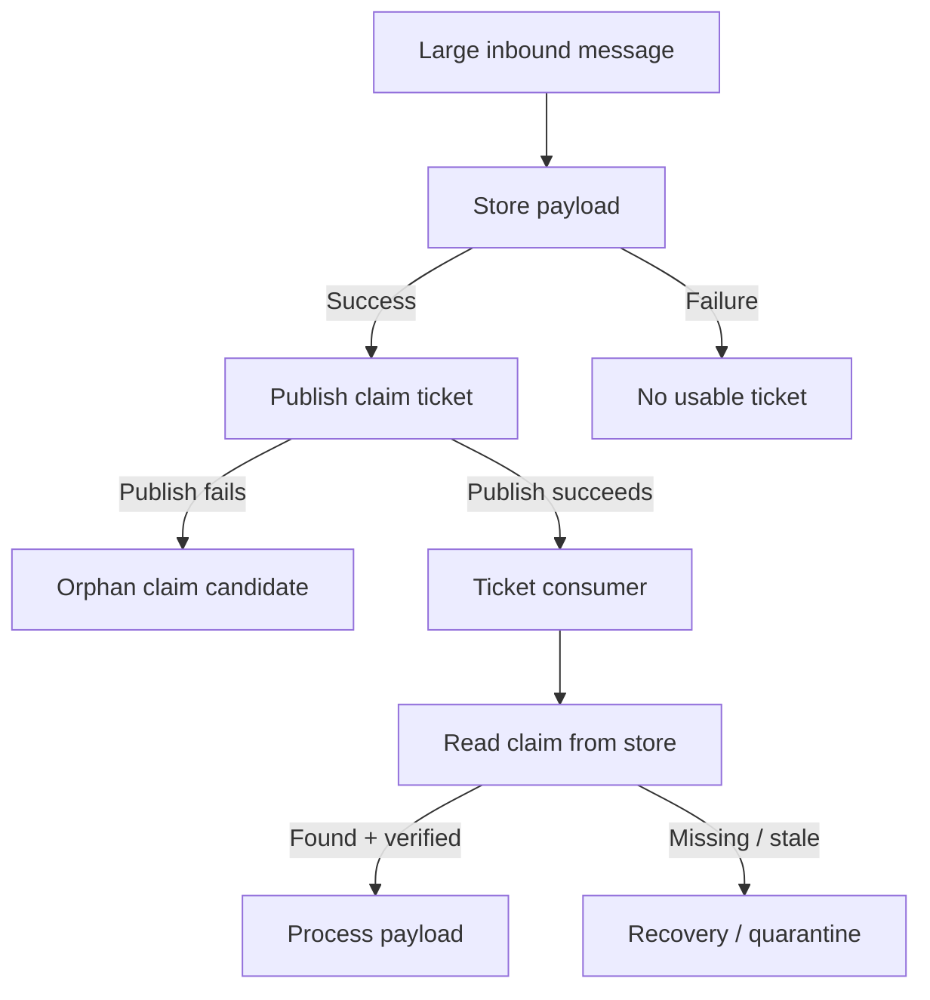
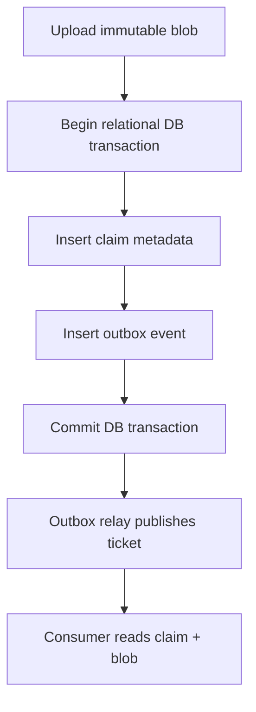
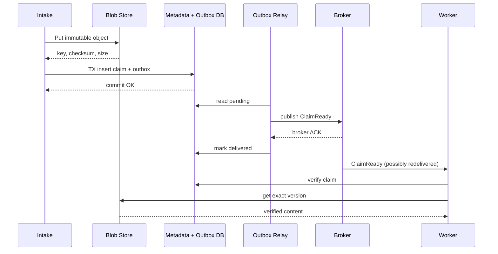
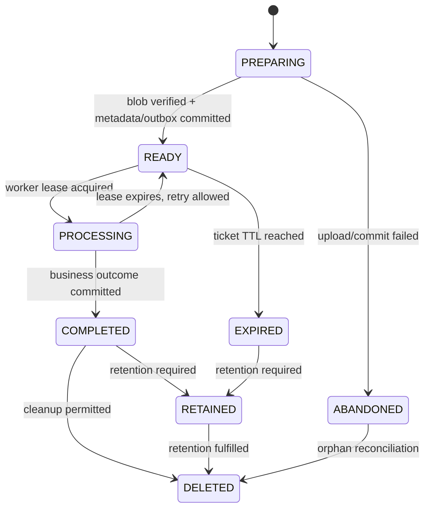
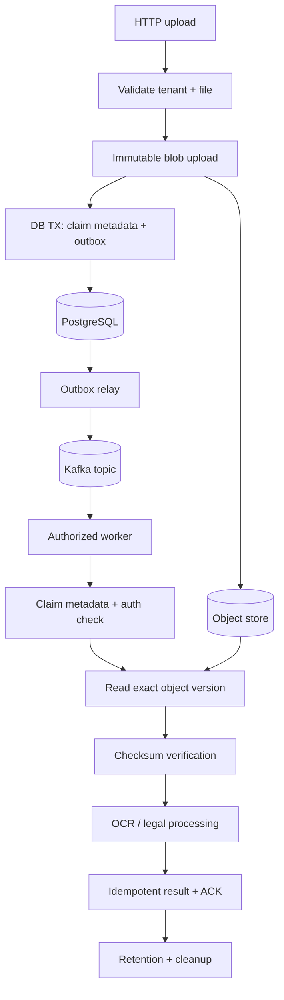

# Tính nhất quán giữa message và kho claim

Một **Claim Check** cho phép ứng dụng cất payload lớn hoặc nhạy cảm vào một kho riêng, rồi chuyển qua Router, Filter, Gateway, broker hoặc worker bằng một **ticket tham chiếu nhẹ**. Tuy nhiên, việc thay một tài liệu 20 MiB bằng `claimId` vài chục byte đưa vào hệ thống một vấn đề mới: **message mang ticket và dữ liệu trong kho claim phải nhất quán với nhau**.

Nếu broker đã nhận ticket nhưng kho chưa lưu xong payload, worker sẽ không lấy được tài liệu. Nếu kho lưu thành công nhưng message ticket không bao giờ được phát, tài liệu trở thành **orphan claim**. Nếu check-out lấy xong xóa ngay rồi downstream lỗi, một lần redelivery có thể mất dữ liệu để retry. Nếu ticket và blob bị đổi phiên bản không đồng bộ, worker có thể đọc sai nội dung dù ID vẫn tồn tại.

Bài **“Tính nhất quán giữa message và kho claim”** thuộc chương **Claim check** của module `SPRING_INTEGRATION_PATTERN`. Phạm vi học tập là triển khai các Enterprise Integration Patterns bằng Spring Integration để tạo các luồng message ít phụ thuộc, dễ mở rộng; phối hợp Router, Filter, Transformer, Splitter, Aggregator, Gateway, retry, error channel và correlation, đồng thời kiểm thử, quan sát những nhánh xử lý.

**Mục tiêu của bài:**

- Định nghĩa các **bất biến (invariants)** về tính nhất quán giữa ticket, metadata, payload và kết quả xử lý.
- Phân biệt lỗi **orphan claim**, **dangling ticket**, dữ liệu stale, duplicate, lost ACK và xóa quá sớm.
- Hiểu giới hạn transaction khi message broker, database và object store là **các hệ thống độc lập**.
- Thiết kế **Transactional Outbox**, idempotent consumer, trạng thái claim, reconciliation và cleanup.
- Viết code Java/Spring Integration thể hiện ranh giới check-in/check-out và nơi cần transaction.
- Kiểm thử các **cửa sổ crash**, retry, timeouts, recovery, TTL, concurrency và nhiều instance.
- Đánh giá độ bền thực tế mà không tuyên bố sai rằng Claim Check tự có **exactly-once end-to-end**.

## 1. Tại sao consistency khó hơn thao tác `put` và `get`?

Trong mô hình đơn giản, ứng dụng thực hiện:

```text
1. store.put(claimId, payload)
2. broker.publish(ClaimReady(claimId))
3. consumer receives ClaimReady
4. payload = store.get(claimId)
5. process(payload)
```

Mỗi bước có thể thành công hoặc thất bại **độc lập**. Việc Java gọi hai hàm liên tiếp không tạo ra một transaction nguyên tử giữa chúng.



Một hệ thống vận hành đúng phải trả lời được những câu hỏi:

1. Sau khi ticket được consumer nhìn thấy, **payload đã thực sự sẵn sàng để đọc chưa**?
2. Nếu ứng dụng crash ngay sau khi lưu payload, **làm sao biết ticket chưa được phát**?
3. Nếu broker nhận message nhưng producer mất ACK, **có thể gửi lại mà không gây xử lý trùng không**?
4. Nếu downstream gặp lỗi sau khi check-out, **claim còn đủ lâu để thử lại không**?
5. Nếu ticket bị replay sau khi claim hết hạn, **kết quả trả về là gì**?
6. Nếu tài liệu được sửa trong kho, **ticket vẫn trỏ đúng phiên bản đã xác nhận không**?

**Tính nhất quán ở đây là một hợp đồng end-to-end**, không chỉ một giá trị cấu hình của Spring Integration.

## 2. Các bất biến phải duy trì

Trước khi chọn database, broker hoặc DSL, hãy viết rõ các điều **luôn cần đúng**.

| Mã | Bất biến | Hệ quả nếu vi phạm |
| --- | --- | --- |
| **I1 — No dangling ticket** | Ticket hợp lệ được phát để xử lý chỉ khi có một claim **đã được ghi bền vững và có thể khôi phục theo contract**. | Consumer nhận ticket nhưng check-out không có payload. |
| **I2 — Immutable content identity** | Một `(claimId, contentVersion)` phải trỏ tới **nội dung bất biến**, có checksum/size xác minh được. | Worker đọc tài liệu khác tài liệu đã được xác nhận. |
| **I3 — Idempotent intake** | Cùng một sự kiện nghiệp vụ được nhận lại không tạo nhiều tác vụ xử lý ngoài ý muốn. | Duplicate claim, duplicate ticket, duplicate side effect. |
| **I4 — Safe retention** | Claim không được xóa khi vẫn có một xử lý/retry/recovery **được phép** cần đọc nó. | Check-out sau redelivery báo missing claim. |
| **I5 — Authorised retrieval** | Check-out phải xác minh người gọi, tenant, operation và trạng thái claim. | Ticket rò rỉ cho phép đọc dữ liệu của tenant khác. |
| **I6 — Observable recovery** | Lỗi ở bất kỳ ranh giới nào đều để lại trạng thái đủ để **retry, reconcile hoặc quarantine**. | Orphan/dangling claim không thể điều tra. |
| **I7 — Versioned decision** | Những dữ liệu cần tái hiện phải gắn với schema/policy/content version tương ứng. | Replay dùng nội dung hoặc mapping mới mà không chủ đích. |

**Không phải hệ thống nào cũng đòi hỏi mức bảo đảm giống nhau.** Một thumbnail tạm thời có thể chấp nhận mất và tạo lại; tài liệu thanh toán hoặc bằng chứng pháp lý thường không. Tuy nhiên, ngay cả khi cho phép mất dữ liệu, **hợp đồng mất dữ liệu** cũng phải được nêu rõ, không được ngầm xảy ra vì race condition.

## 3. Những đối tượng tham gia: message, claim metadata, blob và outbox

Một thiết kế có thể có bốn loại dữ liệu độc lập:

```text
Broker message:
  ClaimReady { claimId, eventId, tenantId, schemaVersion }

Claim metadata row:
  claimId, eventId, tenantId, objectKey, checksum, status, expiresAt

Blob object:
  objectKey -> original bytes

Outbox event:
  outboxId, claimId, eventType=CLAIM_READY, deliveryState
```

- **Broker message**: tín hiệu điều phối để consumer biết có claim cần xử lý.
- **Claim metadata**: sổ cái về quyền sở hữu, trạng thái, object key, content version và retention.
- **Blob/object**: nội dung payload thực tế, có thể là bytes lớn hoặc một Spring `Message<?>` được serialize.
- **Outbox event**: ý định phát thông điệp được ghi **trong cùng transaction với metadata** khi dùng relational database.

Không phải mọi kiến trúc đều dùng đủ bốn thành phần. Ví dụ `SimpleMessageStore` lưu một Spring message trong memory mà không cần outbox cho bài demo; một hệ thống có broker và object storage đa instance lại cần chiến lược chặt chẽ hơn.

### Ticket và metadata không phải cùng một thứ

Một `claimId` là **khóa tra cứu**. Metadata của claim xác định **được phép làm gì với khóa đó** và **nội dung nào thuộc khóa**. Không coi một UUID hợp lệ như quyền vô điều kiện để đọc blob.

### Business ID và technical ID

`eventId`/`commandId` là định danh nghiệp vụ bền vững qua retry. `claimId` là định danh tài nguyên lưu. `MessageHeaders.id` của Spring Messaging là danh tính một **message instance**, có thể được tạo lại khi replay. Không lấy một giá trị thay cho tất cả mục đích.

## 4. Failure matrix: các khoảng hở giữa store và broker

Giả sử ta chỉ gọi `store.put` rồi `broker.publish`.

| Điểm crash/lỗi | Kho claim | Broker ticket | Hệ quả | Hướng phục hồi |
| --- | --- | --- | --- | --- |
| Trước khi ghi store | Chưa có | Chưa có | Chưa tạo claim. | Retry message nguồn. |
| Store write thất bại | Không chắc có | Chưa có | Không được phát ticket dùng được. | Kiểm tra kết quả ghi, retry có giới hạn. |
| Store thành công, crash trước publish | Có | Không | **Orphan claim**. | Outbox/reconciliation, hoặc cleanup sau cửa sổ an toàn. |
| Publish thất bại rõ ràng | Có | Không | Claim chưa được giao. | Retry relay/outbox. |
| Publish thành công nhưng ACK về producer bị mất | Có | Có, producer không biết | Publish lại có thể gây duplicate. | At-least-once + consumer idempotent. |
| Ticket xuất hiện trước khi payload sẵn sàng | Có thể chưa có/không đọc được | Có | **Dangling ticket / visibility gap**. | Chặn phát tới khi ready; retry ngắn cho eventual consistency. |
| Consumer đọc xong, crash trước nghiệp vụ | Có hoặc đã xóa | Có thể redeliver | Nếu đã xóa sẽ không retry được. | Read-without-remove, lease/ack, retention an toàn. |
| Nghiệp vụ xong, crash trước ACK | Có | Có thể redeliver | Side effect có thể chạy lại. | Idempotency ở handler nghiệp vụ. |
| Cleanup trước khi retry kết thúc | Đã xóa | Ticket cũ còn | Check-out không thể khôi phục. | TTL/retention gắn với state, DLQ/recovery. |

**Điểm cần nhớ:** “At-least-once publish” và “at-least-once consumption” làm tăng xác suất eventual delivery nhưng **đồng thời cho phép duplicate**. Thiết kế phải chấp nhận thực tế ấy.

## 5. Orphan claim và dangling ticket khác nhau thế nào?

### Orphan claim

**Orphan** là payload đã lưu nhưng không có ticket còn sống nào dẫn một consumer tới xử lý, hoặc không có business workflow hợp lệ đang tham chiếu.

```text
Object store: claim-101 -> 20 MiB PDF
Broker:       không có ClaimReady(claim-101)
```

Orphan có thể xuất hiện sau crash giữa `put` và `publish`, transaction metadata rollback, workflow bị hủy hoặc event publisher bị dừng.

**Cách xử lý:** lưu trạng thái và thời gian tạo, quét các claim chưa có dấu hiệu được dispatch/processing, đối chiếu outbox/metadata, retry publish nếu còn hợp lệ; chỉ cleanup khi đã chắc chắn không còn tác vụ được phép xử lý. Không xóa ngay chỉ vì không thấy ticket trong một lần truy vấn broker.

### Dangling ticket

**Dangling** là một ticket đang lưu chuyển nhưng tham chiếu tới claim **không tồn tại, không đọc được hoặc đã không còn hợp lệ**.

```text
Broker:       ClaimReady(claim-102)
Object store: không có blob tương ứng
```

Nguyên nhân có thể là ghi payload chưa xong, store không dùng chung giữa instance, expiry quá sớm, sai object key, metadata hỏng, object bị xóa hoặc race giữa cleanup với check-out.

**Cách xử lý:** phân biệt `NOT_YET_VISIBLE`, `EXPIRED`, `DELETED`, `NOT_FOUND`, `FORBIDDEN` và `STORE_UNAVAILABLE`. Một lỗi transient chưa đọc được dữ liệu vừa ghi không nên bị đánh đồng với `PERMANENTLY_MISSING`.

| Tình huống | Có thể retry ngay? | Có nên quarantine? |
| --- | --- | --- |
| Object mới upload, chưa read-visible theo contract | Retry ngắn có giới hạn, deadline. | Khi vượt hạn vẫn không đọc được. |
| Store outage | Retry/backoff/circuit breaker. | Nếu vượt recovery budget. |
| Claim đã `EXPIRED` theo policy | Không tự bỏ qua expiry. | Có thể review/reissue theo quyền. |
| Claim `DELETED` đúng lifecycle | Không retry vô hạn cùng ticket. | Ghi nhận replay muộn hoặc duplicate. |
| Sai tenant/quyền | **Không retry để bypass quyền**. | Security audit. |
| Checksum mismatch | Không đưa payload hỏng downstream. | Quarantine, kiểm tra integrity. |

## 6. Transaction cục bộ khác transaction phân tán

Một transaction database có thể ghi hai bảng **claims** và **outbox** nguyên tử. Nhưng cùng transaction đó **không tự làm atomic** một lệnh upload S3/object store hoặc publish Kafka/RabbitMQ.



Ranh giới:

- **Upload blob trước DB commit:** nếu DB transaction thất bại, một blob có thể **mồ côi**; cần garbage collection/reconciliation.
- **Metadata + outbox trong cùng DB transaction:** một commit thành công có cả **claim ready metadata** và **ý định phát event**.
- **Relay phát ra broker:** có thể gửi lặp khi ACK không chắc chắn; cần event ID ổn định và consumer idempotent.
- **Worker đọc blob:** cần đảm bảo object key/version đã có thể đọc theo contract và nội dung không bị sửa.

Một số hạ tầng có cơ chế transaction riêng, nhưng **không nên mặc định** rằng Spring `@Transactional` bao trùm toàn bộ database, object store và broker.

### Vì sao không publish trực tiếp trong `@Transactional`?

```java
@Transactional
void createClaimAndPublish() {
    claimRepository.save(...);
    kafkaPublisher.publish(...); // side effect khác DB transaction
}
```

Nếu broker nhận event rồi database rollback, ticket tham chiếu metadata chưa commit. Nếu database commit nhưng broker publish fail, metadata không có ticket. Dùng một annotation `@Transactional` trên phương thức **không loại bỏ** những khoảng hở này.

## 7. Transactional Outbox: mô hình an toàn phổ biến

Với DB metadata và outbox cùng một transaction, ta có thể ghi:

```text
TX begin
  INSERT claims(... status='READY', object_key='...')
  INSERT outbox_events(... event_type='CLAIM_READY', claim_id='...')
TX commit

Separate relay:
  SELECT pending outbox events
  publish to broker
  mark as published after broker acknowledgement
```

Outbox không bảo đảm mỗi message được publish **chính xác một lần**; nó giúp **ý định publish không bị mất sau commit**, và relay có thể retry cho đến khi thành công.



### Relay thất bại ở mốc nguy hiểm

Nếu broker ACK thành công nhưng relay crash **trước khi đánh dấu outbox đã gửi**, sau restart relay có thể publish cùng event thêm lần nữa. Đây là hành vi **at-least-once đúng như thiết kế**, không phải một bug cần được “giấu” bằng việc xóa event trước khi publish.

Consumer phải deduplicate theo một khóa ổn định như `outboxEventId`, `claimId + processingVersion` hoặc `eventId + operation`, tùy contract.

## 8. Schema metadata và outbox minh họa

Ví dụ trên relational database, schema khái niệm:

```sql
CREATE TABLE claims (
    claim_id          VARCHAR(64) PRIMARY KEY,
    tenant_id         VARCHAR(80) NOT NULL,
    event_id          VARCHAR(120) NOT NULL,
    operation         VARCHAR(80) NOT NULL,
    object_key        VARCHAR(512) NOT NULL,
    content_version   VARCHAR(80) NOT NULL,
    checksum_sha256   CHAR(64) NOT NULL,
    size_bytes        BIGINT NOT NULL,
    status            VARCHAR(32) NOT NULL,
    created_at        TIMESTAMP NOT NULL,
    expires_at        TIMESTAMP NOT NULL,
    UNIQUE (tenant_id, event_id, operation)
);

CREATE TABLE outbox_events (
    outbox_id         VARCHAR(80) PRIMARY KEY,
    claim_id          VARCHAR(64) NOT NULL,
    event_type        VARCHAR(80) NOT NULL,
    payload_json      TEXT NOT NULL,
    delivery_state    VARCHAR(32) NOT NULL,
    attempts          INTEGER NOT NULL DEFAULT 0,
    next_attempt_at   TIMESTAMP,
    created_at        TIMESTAMP NOT NULL,
    FOREIGN KEY (claim_id) REFERENCES claims(claim_id)
);
```

Đây là **schema mang tính thiết kế**, chưa có index, constraint, charset, timestamp timezone và bảng retry/lease đầy đủ cho một hệ quản trị cụ thể.

Các lựa chọn cần làm rõ:

- `UNIQUE(tenant_id,event_id,operation)` giả định một event chỉ có một claim cho cùng operation. Nếu nghiệp vụ cho phép xử lý lại sau thay đổi thuật toán, cần thêm `runId` hoặc `processingVersion`.
- `content_version` nên gắn với **object immutable version** hoặc revision bền vững; không trỏ tới key có thể bị ghi đè tùy ý.
- `outbox_id` là ID sự kiện phát ra; cùng event được retry nên giữ **cùng ID** để consumer deduplicate.
- `expires_at` mô tả quyền sử dụng/retention của claim, không tự xóa blob đúng thời điểm nếu không có cleanup worker.
- `status` cần có chuyển trạng thái hợp lệ và cơ chế **compare-and-set/optimistic locking** khi nhiều worker cập nhật.

### Tránh race khi insert claim trùng

Hai consumer của cùng `eventId` có thể cùng kiểm tra “chưa tồn tại” rồi cùng insert. `SELECT` trước `INSERT` **không đủ** để chống race. Unique constraint trong DB mới là chốt chặn; khi gặp conflict, reload record trong transaction phù hợp và **so sánh checksum/tenant/operation**. Nếu cùng khóa nghiệp vụ mà nội dung khác, trả `IDEMPOTENCY_CONFLICT`, không âm thầm lấy dữ liệu cũ hoặc ghi đè blob.

## 9. Luồng check-in an toàn khi blob ở ngoài transaction DB

Một cách thực dụng là **upload object trước**, rồi ghi metadata và outbox trong một transaction DB. Hai bước có thể để lại orphan blob, nhưng **không tạo một ticket hợp lệ trỏ tới object chưa ghi xong** nếu hệ thống tuân thủ thứ tự xác nhận.

```text
Validate request and tenant
         |
         v
Upload immutable blob to object store
         |
         +-- failure -> no metadata READY, no outbox
         |
         v
Verify upload success + object version/checksum
         |
         v
DB TX: claim metadata READY + outbox PENDING
         |
         +-- rollback -> orphan blob candidate
         |
         v
Outbox relay -> broker ticket
```

**Chú ý về read-after-write:** điều kiện “upload thành công” phải đi kèm contract về **khả năng đọc lại object**. Nếu kho có eventual visibility hoặc replication delay, có thể dùng trạng thái `UPLOADING`/`VERIFYING` và chỉ tạo event `CLAIM_READY` khi đã xác nhận `GET`/metadata của đúng version thành công. Không đánh đồng một HTTP `202 Accepted` của upload bất đồng bộ với nội dung đã sẵn sàng.

### Vì sao không giữ transaction DB mở trong lúc upload blob lớn?

Một upload 20 MiB qua mạng có thể mất hàng giây hoặc timeout. Giữ DB transaction mở suốt thời gian đó tăng lock contention, giữ connection lâu và làm retry phức tạp. Tách **blob upload** ra khỏi **transaction metadata+outbox ngắn** thường dễ vận hành hơn. Đổi lại phải có orphan reconciliation.

## 10. Mô hình code Java: tách blob upload khỏi DB commit

Ví dụ dùng **Java 17+**. Các interface là hợp đồng ứng dụng, không phải class có sẵn trong Spring Integration. Mục tiêu là làm rõ ranh giới, không gắn mọi service vào một `@Transactional` duy nhất.

### 10.1. Payload, ticket và blob descriptor

```java
record DocumentSubmission(
        String tenantId,
        String eventId,
        String operation,
        byte[] content
) {}

record StoredBlob(
        String objectKey,
        String contentVersion,
        String checksumSha256,
        long sizeBytes
) {}

record ClaimTicket(
        String claimId,
        String tenantId,
        String eventId,
        String contentVersion
) {}

interface ImmutableBlobStore {
    StoredBlob putVerified(String tenantId, byte[] content);
    byte[] getExactVersion(String objectKey, String version);
}
```

`StoredBlob` chỉ được trả khi blob store đã đáp ứng chính sách **đã ghi, immutable và có thể đọc lại** mà ứng dụng yêu cầu. Không phải interface Java tự tạo ra bảo đảm đó. Khi triển khai thực, `putVerified()` phải kiểm soát size limit, checksum, object version, encryption và quy tắc key theo tenant.

### 10.2. Service intake không mở DB transaction qua upload

```java
import org.springframework.stereotype.Service;

@Service
class ClaimIntakeService {
    private final ImmutableBlobStore blobStore;
    private final ClaimRecordWriter writer;

    ClaimIntakeService(
            ImmutableBlobStore blobStore,
            ClaimRecordWriter writer) {
        this.blobStore = blobStore;
        this.writer = writer;
    }

    ClaimTicket accept(DocumentSubmission submission) {
        if (submission.tenantId() == null
                || submission.tenantId().isBlank()
                || submission.eventId() == null
                || submission.eventId().isBlank()
                || submission.operation() == null
                || submission.operation().isBlank()
                || submission.content() == null
                || submission.content().length == 0) {
            throw new IllegalArgumentException("INVALID_SUBMISSION");
        }

        // Trước bước này, ingress phải xác thực nguồn/tenant và áp
        // quota. Không lấy tenantId từ client làm quyền truy cập.
        StoredBlob blob = blobStore.putVerified(
                submission.tenantId(), submission.content());

        // Writer là bean RIÊNG để @Transactional có hiệu lực
        // khi đi qua Spring proxy của nó.
        return writer.commitClaimAndOutbox(submission, blob);
    }
}
```

### 10.3. Ghi metadata và outbox trong cùng DB transaction

```java
import org.springframework.stereotype.Service;
import org.springframework.transaction.annotation.Transactional;

interface ClaimRepository {
    ClaimRow findByBusinessKey(
            String tenantId, String eventId, String operation);
    void insert(ClaimRow row);
}

interface OutboxRepository {
    void insert(OutboxRow event);
}

record ClaimRow(
        String claimId, String tenantId, String eventId,
        String operation, String objectKey, String contentVersion,
        String checksumSha256, long sizeBytes, String status
) {}

record OutboxRow(
        String outboxId, String claimId,
        String eventType, String deliveryState
) {}

@Service
class ClaimRecordWriter {
    private final ClaimRepository claims;
    private final OutboxRepository outbox;

    ClaimRecordWriter(
            ClaimRepository claims, OutboxRepository outbox) {
        this.claims = claims;
        this.outbox = outbox;
    }

    @Transactional
    public ClaimTicket commitClaimAndOutbox(
            DocumentSubmission request, StoredBlob blob) {

        ClaimRow existing = claims.findByBusinessKey(
                request.tenantId(), request.eventId(),
                request.operation());

        if (existing != null) {
            if (!existing.checksumSha256().equals(blob.checksumSha256())
                    || !existing.contentVersion().equals(
                            blob.contentVersion())) {
                throw new IllegalStateException(
                        "IDEMPOTENCY_CONFLICT");
            }
            return new ClaimTicket(
                    existing.claimId(), existing.tenantId(),
                    existing.eventId(), existing.contentVersion());
        }

        String claimId = java.util.UUID.randomUUID().toString();
        ClaimRow row = new ClaimRow(
                claimId,
                request.tenantId(), request.eventId(),
                request.operation(),
                blob.objectKey(), blob.contentVersion(),
                blob.checksumSha256(), blob.sizeBytes(),
                "READY");

        claims.insert(row);
        outbox.insert(new OutboxRow(
                java.util.UUID.randomUUID().toString(),
                claimId, "CLAIM_READY", "PENDING"));

        return new ClaimTicket(
                claimId, request.tenantId(),
                request.eventId(), blob.contentVersion());
    }
}
```

**Đây là khung minh họa, chưa phải giải pháp production hoàn chỉnh.**

- Hai repository phải thật sự dùng **cùng transaction manager/database** để `@Transactional` bao trùm cả hai thao tác.
- Trong outbox thực, cần **payload event đầy đủ**, retry schedule, lease/lock, unique constraint và timestamp; `OutboxRow` rút gọn để tập trung vào ranh giới atomic.
- Lệnh `putVerified` chạy **trước** transaction nên khi phát hiện existing claim, một blob upload mới có thể là orphan; cần dedup/preflight hoặc cleanup. **Không** xóa ngay blob này nếu object key có thể được dùng chung.
- So sánh `contentVersion` khi idempotent chỉ đúng nếu blob store trả **version ổn định cho cùng nội dung**. Với store cấp version ngẫu nhiên cho mỗi lần upload, hãy dùng checksum/size và identity của business request; xem việc upload lại là bản tạm cần reconcile.
- `findByBusinessKey()` rồi `insert()` còn race concurrent; dựa vào **unique constraint và conflict handling** ở transaction thực.
- Với SHA-256, checksum cần được tính/xác minh trong quá trình upload/download. Chỉ có một string `checksumSha256` trong DTO không tự kiểm tra integrity.

### Một cải tiến nhỏ cho idempotent intake

Trước khi upload, có thể tìm claim đã tồn tại rồi **đối chiếu checksum đầu vào** để tái dùng claim cũ. Nhưng bước kiểm tra trước không loại được race; vẫn cần unique constraint và cách xử lý khi hai request đồng thời. Nếu hai luồng upload cùng một blob, dùng **immutable, tenant-scoped content-addressed key** với quy tắc ref-count/retention nếu thật sự cần chia sẻ.

## 11. Outbox relay: phát ticket at-least-once có kiểm soát

Một outbox relay có thể chạy theo scheduler, poller của Spring Integration hoặc một process riêng. Pseudocode:

```java
// Pseudocode: chưa bao gồm claim/lease DB row,
// Kafka/Rabbit connection, retry schedule hay transaction.
void publishPending() {
    for (OutboxEvent event : outboxRepository.claimBatch()) {
        try {
            brokerPublisher.publishAndWaitForAck(
                    event.id(), event.payload());
            outboxRepository.markDelivered(event.id());
        } catch (Exception transientFailure) {
            outboxRepository.scheduleRetry(
                    event.id(), "BROKER_UNAVAILABLE");
        }
    }
}
```

**Thứ tự bắt buộc của relay:** chỉ đánh dấu `DELIVERED` **sau khi có broker acknowledgement** theo contract của producer. Nếu relay crash sau khi ACK từ broker nhưng trước `markDelivered`, event có thể được phát lại: consumer phải hỗ trợ deduplication.

Nếu có nhiều relay instance, `claimBatch()` cần **lease/lock** hoặc cơ chế chọn hàng tránh hai relay xử lý trùng không cần thiết. Dù có lock, publication vẫn có thể lặp vì ACK không chắc chắn.

### Đừng dùng một `QueueChannel` như outbox bền vững

`QueueChannel` giữ message để consumer/poller lấy trong phạm vi cấu hình; một queue in-memory không tự bảo đảm state sống qua crash. Outbox phải dùng kho/transport có **durable semantics** đáp ứng yêu cầu. Có thể dùng Spring Integration poller để điều phối relay, nhưng **poller không biến bộ nhớ thành transaction log**.

### Broker transaction có đủ không?

Ngay cả khi broker hỗ trợ transaction, điều đó không tự đảm bảo atomic commit với relational DB **và** object storage. Hãy định nghĩa ranh giới của từng transaction cụ thể và những trường hợp không chắc chắn cần replay/idempotency.

## 12. Spring Integration: tách flow lưu claim và flow phát ticket

Trong Spring Integration, một inbound flow có thể gọi `ClaimIntakeService`. Tuy nhiên, nếu đã dùng outbox, **không phát ticket trực tiếp từ cùng handler sau khi gọi `writer`** rồi lại publish từ outbox: như vậy một yêu cầu có thể phát hai lần.

Ví dụ wiring minh họa:

```java
import org.springframework.context.annotation.Bean;
import org.springframework.context.annotation.Configuration;
import org.springframework.integration.channel.DirectChannel;
import org.springframework.integration.channel.QueueChannel;
import org.springframework.integration.config.EnableIntegration;
import org.springframework.integration.dsl.IntegrationFlow;

@Configuration
@EnableIntegration
class ClaimIntakeFlowConfiguration {

    @Bean
    DirectChannel documentsInbound() {
        return new DirectChannel();
    }

    @Bean
    QueueChannel intakeAcknowledgements() {
        return new QueueChannel();
    }

    @Bean
    IntegrationFlow claimIntakeFlow(ClaimIntakeService intake) {
        return IntegrationFlow.from("documentsInbound")
                .handle(DocumentSubmission.class,
                        (submission, headers) -> intake.accept(submission))
                .channel("intakeAcknowledgements")
                .get();
    }
}
```

Sau khi handler return, `ClaimTicket` trong **`intakeAcknowledgements`** chỉ xác nhận **metadata + outbox đã commit** theo kết quả `ClaimRecordWriter`; nó **không đồng nghĩa broker đã nhận `ClaimReady` hoặc downstream đã xử lý payload**. Relay của outbox, trong một flow/poller riêng, mới chịu trách nhiệm publish event ra broker.

Đây là **cấu hình minh họa**, không được biên dịch/test tại STEP 4. Khi dùng cùng một Spring transaction cho các endpoint, cần kiểm tra transaction boundary của adapter và cách exception lan qua `DirectChannel` hoặc poller. Nếu inbound là HTTP Gateway cần trả trạng thái ngay, response có thể là `ACCEPTED_FOR_PROCESSING` và `claimId`, nhưng phải phản ánh đúng mức đã xác nhận; không trả `PROCESSED` chỉ vì ghi outbox thành công.

### Nếu chỉ dùng `MessageStore` và Claim Check transformers?

Spring Integration có mẫu Claim Check In/Out dựa trên `MessageStore`, hữu ích khi lưu và khôi phục một message. Nó **không tự tạo outbox transaction** với Kafka/AMQP khi bạn nối `.transform(...)` rồi `.handle(...)` gửi broker. Muốn bảo đảm consistency khi storage và transport độc lập, vẫn cần transaction/outbox/idempotency hoặc một chính sách recovery có mức bảo đảm được chấp nhận.

## 13. Check-out: đọc đúng claim và đúng version

Một consumer nhận `ClaimReady(claimId)` cần làm nhiều việc hơn `store.get(claimId)`:

```text
Ticket received
     |
     v
Authenticate service identity
     |
     v
Load metadata by claimId
     |
     v
Validate tenant, operation, state, expiry
     |
     v
Read exact immutable object version
     |
     v
Verify checksum and size
     |
     v
Create restored payload for worker
```

### Payload/version consistency

Giả sử metadata có:

```text
claimId        = C-123
objectKey      = TENANT-A/contracts/C-123
contentVersion = object-v8
checksumSha256 = <digest-v8>
```

Nếu một writer khác ghi đè `objectKey` bằng version 9 trong lúc check-out, worker có thể nhận nội dung không tương ứng metadata. Giải pháp:

- Chọn **object key/version bất biến** cho một claim.
- Đọc **đúng content version**, không lấy “latest” vô điều kiện.
- Verify checksum và size sau khi tải.
- Không cho update nội dung của claim `READY` mà không tạo một claim/version mới.
- Khi metadata chuyển từ `READY` sang `DELETED`, cần đảm bảo không có read/lease hợp lệ còn hoạt động.

Một checksum hợp lệ chứng minh byte tải về khớp digest đã tin cậy. Nó **không tự chứng minh** dữ liệu đến từ nguồn được phép; provenance và authorization là những kiểm tra riêng.

### Ranh giới read visibility

Không phải mọi hệ lưu trữ đều có cùng read-consistency contract. Cần kiểm tra **khả năng đọc sau khi ghi** của hệ cụ thể, nhất là khi đi qua replica, CDN, cache hoặc một lớp index bất đồng bộ. Nếu object chưa thấy ngay, dùng retry có deadline và phân loại `NOT_YET_VISIBLE` thay vì coi ngay là `NOT_FOUND` vĩnh viễn.

## 14. Trạng thái claim và vòng đời xóa

Một claim có thể có nhiều trạng thái:



Các trạng thái là **một mô hình ứng dụng**, không phải enum Spring Integration tự sinh. Trong thiết kế chỉ có outbox mà upload blob không có metadata row ban đầu, `PREPARING`/`ABANDONED` có thể nằm ở **upload journal/reconciliation log** thay vì bảng claims.

### Dùng trạng thái có version/CAS

Nếu một worker đang xử lý, một cleanup worker không được xóa payload chỉ vì `expiresAt < now` trong khi job vẫn còn quyền retry. Nên sử dụng **state transition có điều kiện**:

```sql
-- Phác thảo: còn cần xét lease, retention và transaction.
UPDATE claims
SET status = 'COMPLETED'
WHERE claim_id = :claim_id
  AND status = 'PROCESSING'
  AND processing_owner = :worker_id;
```

Ví dụ SQL này giả định schema production có thêm `processing_owner`, `lease_until`, `version`, không có trong schema rút gọn ở mục 8. Dùng optimistic locking/version hoặc lease/lock phù hợp để tránh cleanup và consumer đạp trạng thái nhau.

### Chỉ `get` rồi `remove` có đủ không?

Không. Nếu `remove` xảy ra ngay sau check-out nhưng **trước khi downstream side effect được xác nhận**, message redelivery có thể không phục hồi được. Với nghiệp vụ quan trọng, đọc không xóa, hoặc dùng lease → process → durable ACK → cleanup theo retention. Đừng đồng nhất **payload đã được đọc** với **công việc đã hoàn tất**.

## 15. Nguồn có ACK/offset: xác nhận ở mốc nào?

Một pipeline có thể bắt đầu từ HTTP, file poller, Kafka hoặc AMQP. Mỗi nguồn có giao thức tiến độ riêng.

| Nguồn | Mốc tiến độ cần quyết định |
| --- | --- |
| HTTP/Gateway | Khi nào trả `202 Accepted` hay kết quả đồng bộ? |
| Kafka | Khi nào commit offset của message gốc? |
| AMQP/RabbitMQ | Khi nào ACK hoặc requeue message nguồn? |
| JDBC polling | Khi nào đánh dấu row đã nhận/xử lý? |
| File inbound | Khi nào đánh dấu/move file để không bị lấy lại hoặc mất? |

Một lựa chọn hợp lý với **outbox bền vững** là:

```text
Incoming event
    -> upload verified blob
    -> commit metadata + outbox
    -> acknowledge source intake
    -> relay delivers ticket eventually
```

Điều này chỉ đúng nếu **commit metadata+outbox** đã đủ để hệ thống hoàn tất việc phát ticket sau restart, và nguồn có thể redeliver an toàn khi commit thất bại. Nếu outbox bị mất hoặc retention quá ngắn, ACK nguồn ở đây vẫn có thể gây mất việc xử lý.

### Không nhầm source ACK với broker publish ACK

- **Source ACK:** nói với nguồn đầu vào rằng mình đã nhận/trách nhiệm đã được chuyển giao theo contract.
- **Outbox broker ACK:** broker đã nhận event ở ranh giới producer theo semantics xác nhận của broker.
- **Consumer ACK:** worker đã đạt mốc xử lý/ghi trạng thái đủ để xác nhận message ticket.
- **Business completion:** tác vụ nghiệp vụ đã hoàn tất thật.

Các mốc này không thay thế nhau. Một flow có thể phát ticket thành công nhưng worker chưa bao giờ check-out được vì thiếu quyền.

## 16. Retry/redelivery và idempotency: tính đúng thay vì chỉ “thử lại”

Message ticket có thể bị giao lặp vì:

1. Relay không chắc broker đã nhận event.
2. Broker redelivery sau khi consumer crash trước ACK.
3. Operator replay thủ công.
4. Producer gửi lại cùng request khi HTTP timeout.
5. Worker retry sau lỗi lưu kết quả.
6. Một job bị lease expiry và worker mới nhận lại.

Khóa idempotency nên **gắn với đơn vị nghiệp vụ**, ví dụ `(tenantId, eventId, operation, processingVersion)`. Dùng `MessageHeaders.id` hoặc mỗi `claimId` mới tạo làm khóa duy nhất có thể bỏ lọt những request lặp cùng nghiệp vụ.

### Trạng thái inbox/processed event

Một consumer có thể ghi trong DB:

```text
consumer_inbox:
  (consumerName, outboxEventId) -> processedAt, outcome

business_result:
  (tenantId, eventId, operation, version) -> outcome
```

Inbox deduplicate **delivery của event**, còn unique business result ngăn **side effect nghiệp vụ trùng** kể cả khi ticket được phát qua một outbox event khác. Trong hệ thống cần giao dịch chính xác hơn, việc ghi business state và inbox marker nên trong **cùng transaction** khi chúng cùng database; nếu side effect là API bên ngoài, phải dùng idempotency token/đối soát trạng thái ở dịch vụ ngoài.

### Retry an toàn không đồng nghĩa luôn thành công

- `STORE_UNAVAILABLE`: có thể retry với backoff/circuit breaker.
- `BLOB_NOT_YET_VISIBLE`: retry có giới hạn theo visibility SLA.
- `CLAIM_FORBIDDEN`: không retry nhằm vượt quyền.
- `CHECKSUM_MISMATCH`: quarantine, điều tra integrity.
- `CLAIM_EXPIRED`: cần reissue/recovery được cấp quyền, không bỏ qua TTL.
- `DUPLICATE_DONE`: trả kết quả đã có, không thực hiện side effect lại.

Lỗi dữ liệu thường **không hết** chỉ vì gửi lại cùng payload hàng nghìn lần.

## 17. Thử lại khi claim đã hết hạn hoặc bị xóa

Giả sử một broker redeliver ticket sau 26 giờ nhưng TTL claim chỉ 24 giờ:

```text
T0       ClaimReady(C-500)
T0+1h    First worker failed
T0+24h   Cleanup deletes payload
T0+26h   Broker redelivers ticket
```

Nếu hệ thống yêu cầu retry trong 48 giờ, chính sách TTL trên **mâu thuẫn**. Cần ràng buộc:

```text
claim retention >= max(
  broker redelivery window,
  durable retry window,
  manual-review/replay window
) + operational safety margin
```

Đây là **nguyên tắc thiết kế**, không phải công thức đủ cho mọi retention pháp lý. Nếu có quyền xóa dữ liệu theo yêu cầu pháp luật, retention có thể phải bị **rút ngắn**, và hệ thống cần một outcome có chủ đích cho ticket không thể replay.

### Cleanup là một transaction nghiệp vụ riêng

Cleanup có thể gồm:

1. Xác minh claim đã hoàn tất/hết hạn và không có lease hợp lệ.
2. Chuyển trạng thái sang `DELETE_PENDING` hoặc ghi tombstone.
3. Xóa object; retry nếu object store lỗi.
4. Ghi `DELETED`, giữ tombstone tối thiểu đủ để phân biệt late replay với claim chưa từng tồn tại.
5. Xóa metadata/tombstone sau retention khi được phép.

Vì database và object store độc lập, **xóa blob rồi update DB** cũng có cửa sổ crash. Cần cleanup retry có tính idempotent và reconciliation cho cả hai chiều lệch trạng thái.

## 18. Reconciliation: sửa sai lệch sau crash, không dựa vào may mắn

Một **reconciliation job** định kỳ hoặc theo sự kiện đối chiếu claims, outbox và object store để phát hiện trạng thái lệch:

| Phát hiện | Khả năng nguyên nhân | Hướng xử lý |
| --- | --- | --- |
| Object có nhưng không có claim row sau grace period | Upload thành công, DB commit fail. | Xem có upload đang diễn ra; cleanup orphan nếu an toàn. |
| Claim `READY` có outbox `PENDING` quá lâu | Relay lỗi hoặc bị kẹt. | Retry relay, alert, sửa backoff/lock. |
| Outbox `DELIVERED` nhưng chưa có consumer progress | Consumer lỗi, broker backlog, message mất theo contract. | Kiểm tra topic/queue, dead-letter và trạng thái inbox. |
| Claim row có nhưng object key/version không tồn tại | Object bị xóa, upload/visibility lỗi. | Quarantine, restore backup nếu được phép, không phát thêm ticket. |
| Claim `PROCESSING` lease quá hạn | Worker crash hoặc mất heartbeat. | Reassign sau xác minh/idempotency. |
| Claim `COMPLETED` quá retention nhưng object còn | Cleanup lỗi/chưa chạy. | Retry cleanup và audit dữ liệu tồn đọng. |
| Ticket đến với claim đã `DELETED` | Redelivery muộn/replay. | Return `EXPIRED/ALREADY_DONE` đúng contract; không tái tạo ngẫu nhiên. |

**Grace period** phải lớn hơn thời gian upload hợp lệ và khoảng chờ transaction nhất định. Nếu quét và xóa quá sớm, reconciler có thể xóa một upload **đang diễn ra**. Với blob được chia sẻ/deduplicate, phải xét reference count hoặc các claims còn tham chiếu trước khi xóa.

### Không “sửa” sai lệch bằng cách bỏ qua kiểm tra

Nếu claim metadata nói checksum A nhưng blob trả checksum B, không nên chỉ cập nhật metadata sang B để hệ thống chạy tiếp. Đó có thể là corruption hoặc thay đổi trái phép. Hãy cô lập claim, kiểm tra phiên bản và nguồn tin cậy trước khi sửa.

## 19. Security và multi-tenant consistency

Tính nhất quán không chỉ về dữ liệu tồn tại: **đúng claim phải được đọc bởi đúng chủ thể**.

Ví dụ có hai tenant cùng sử dụng `eventId=evt-900`. Nếu unique key chỉ là `eventId`, hệ thống có thể trả claim của tenant A cho tenant B vì lookup idempotency va chạm. Khóa và authorization cần được thiết kế có **tenant scope**.

- `tenantId` phải đến từ **authentication context đáng tin cậy**, không chỉ một header do client tự khai.
- `objectKey` hoặc namespace phải được scoped, có policy truy cập riêng.
- `claimId` cần opaque/khó đoán, nhưng **không là bearer authorization**.
- `requestRunId`, `operation` và content version cần được xác minh khi check-out.
- Metadata đọc từ cache cũng phải tuân theo tenant isolation và trạng thái revoke/deleted.
- Giới hạn size/quota và số claim chưa hoàn tất để chống resource exhaustion.
- Log có thể chứa claim ID ở mức kiểm soát; nếu ID là bearer token, nên chỉ log fingerprint/audit ID riêng.

### Correlation, headers và replay

`correlationId`, `sequenceNumber`, `sequenceSize` giúp Splitter/Aggregator gom đúng các message con. `replyChannel` giúp Gateway nhận kết quả. Claim ticket **không thay thế** những metadata này.

Khi check-out trả một Spring `Message<?>` đã lưu, header propagation phụ thuộc endpoint/adapter. Nếu message đi qua broker hoặc service khác JVM, cần **application envelope** và mapping rõ ràng, thay vì serialize nguyên object `MessageChannel` hoặc `ThreadLocal` context.

### Nội dung nhạy cảm không nên vào outbox event

Outbox chỉ nên chứa **ticket và metadata được phép phát**. Nếu ghi nguyên PDF, PII hay token nhạy cảm vào `payload_json` của outbox, mục tiêu giảm phạm vi lan truyền dữ liệu của Claim Check bị phá vỡ.

## 20. Unit test: chứng minh các bất biến của một bộ điều phối đơn giản

Một unit test không cần Spring context có thể mô hình hóa **blob đã lưu** và **metadata/outbox được commit** bằng hai fake thành phần. Mục tiêu là phát hiện hành vi “phát ticket dù chưa lưu được claim”.

### 20.1. Hợp đồng và fake writer

```java
import java.util.ArrayList;
import java.util.List;

interface ClaimStoragePort {
    String writeVerified(byte[] bytes);
}

interface ClaimMetadataOutboxPort {
    void commitClaimAndEvent(String claimId, String objectKey);
}

final class ClaimInCoordinator {
    private final ClaimStoragePort storage;
    private final ClaimMetadataOutboxPort writer;

    ClaimInCoordinator(
            ClaimStoragePort storage,
            ClaimMetadataOutboxPort writer) {
        this.storage = storage;
        this.writer = writer;
    }

    String saveAndQueue(byte[] bytes) {
        String objectKey = storage.writeVerified(bytes);
        String claimId = java.util.UUID.randomUUID().toString();
        writer.commitClaimAndEvent(claimId, objectKey);
        return claimId; // Chỉ trả sau khi commit hoàn thành.
    }
}

final class RecordingOutbox implements ClaimMetadataOutboxPort {
    final List<String> committedClaimIds = new ArrayList<>();
    boolean fail;

    @Override
    public void commitClaimAndEvent(
            String claimId, String objectKey) {
        if (fail) {
            throw new IllegalStateException("DB_COMMIT_FAILED");
        }
        committedClaimIds.add(claimId);
    }
}
```

`RecordingOutbox` chỉ **ghi trong bộ nhớ** để unit test quan sát; không mô phỏng atomic commit của DB thật. Cần integration test với database khi yêu cầu transaction là bắt buộc.

### 20.2. Test write thất bại không tạo ticket

```java
import static org.junit.jupiter.api.Assertions.*;

import org.junit.jupiter.api.Test;

class ClaimInCoordinatorTest {

    @Test
    void failedBlobWriteMustNotCommitOutboxOrReturnTicket() {
        RecordingOutbox outbox = new RecordingOutbox();

        ClaimStoragePort brokenStore = bytes -> {
            throw new IllegalStateException("STORE_UNAVAILABLE");
        };

        ClaimInCoordinator coordinator =
                new ClaimInCoordinator(brokenStore, outbox);

        assertThrows(IllegalStateException.class,
                () -> coordinator.saveAndQueue(new byte[]{1, 2, 3}));
        assertTrue(outbox.committedClaimIds.isEmpty());
    }

    @Test
    void failedMetadataCommitLeavesNoPublishableOutboxEvent() {
        RecordingOutbox outbox = new RecordingOutbox();
        outbox.fail = true;

        ClaimStoragePort storedBlob = bytes -> "objects/verified-1";
        ClaimInCoordinator coordinator =
                new ClaimInCoordinator(storedBlob, outbox);

        assertThrows(IllegalStateException.class,
                () -> coordinator.saveAndQueue(new byte[]{1, 2, 3}));
        assertTrue(outbox.committedClaimIds.isEmpty());

        // Một blob có thể còn trong store: orphan reconciliation
        // phải xử lý; test này không xóa blob giả theo cảm tính.
    }

    @Test
    void successfulWriteAndCommitReturnClaimReference() {
        RecordingOutbox outbox = new RecordingOutbox();
        ClaimInCoordinator coordinator = new ClaimInCoordinator(
                bytes -> "objects/verified-1", outbox);

        String claimId = coordinator.saveAndQueue(
                new byte[]{1, 2, 3});

        assertNotNull(claimId);
        assertEquals(List.of(claimId), outbox.committedClaimIds);
    }
}
```

Các test này kiểm tra **trình tự và phản ứng với lỗi** của coordinator. Chúng **không** chứng minh outbox durable, commit DB thật atomic hoặc broker đã ACK. Không nhầm một fake in-memory PASS với cam kết end-to-end.

## 21. Integration test với Spring Integration: chứng minh không bypass ranh giới

Với `ClaimIntakeFlowConfiguration` ở mục 12, có thể dùng Spring Test để kiểm tra handler trả `ClaimTicket` **sau khi service accept hoàn tất**, và exception của service không biến thành một ticket thành công.

```java
import static org.junit.jupiter.api.Assertions.*;

import org.junit.jupiter.api.Test;
import org.springframework.beans.factory.annotation.Autowired;
import org.springframework.beans.factory.annotation.Qualifier;
import org.springframework.integration.channel.QueueChannel;
import org.springframework.messaging.Message;
import org.springframework.messaging.MessageChannel;
import org.springframework.messaging.support.MessageBuilder;
import org.springframework.test.context.junit.jupiter.SpringJUnitConfig;

@SpringJUnitConfig({
        ClaimIntakeFlowConfiguration.class,
        ClaimIntakeFlowTest.TestConfig.class
})
class ClaimIntakeFlowTest {

    @org.springframework.context.annotation.Configuration
    static class TestConfig {
        @org.springframework.context.annotation.Bean
        ImmutableBlobStore blobStore() {
            return new ImmutableBlobStore() {
                @Override
                public StoredBlob putVerified(
                        String tenantId, byte[] bytes) {
                    return new StoredBlob(
                            "objects/verified-1", "v1", "demo-digest",
                            bytes.length);
                }

                @Override
                public byte[] getExactVersion(
                        String objectKey, String version) {
                    throw new UnsupportedOperationException();
                }
            };
        }

        @org.springframework.context.annotation.Bean
        ClaimRecordWriter claimRecordWriter(
                ClaimRepository claims, OutboxRepository outbox) {
            return new ClaimRecordWriter(claims, outbox);
        }

        // Thêm bean ClaimRepository/OutboxRepository và transaction
        // manager phù hợp trong test thực; ví dụ này cố ý chỉ nêu
        // phần adapter stub để nhấn mạnh ranh giới dependency.
    }

    @Autowired @Qualifier("documentsInbound")
    MessageChannel input;

    @Autowired @Qualifier("intakeAcknowledgements")
    QueueChannel output;

    @Test
    void validatesAcknowledgementContract() {
        DocumentSubmission doc = new DocumentSubmission(
                "TENANT-A", "evt-100", "OCR", new byte[]{1, 2, 3});

        // Với fixture repository + transaction hoàn chỉnh:
        // input.send(MessageBuilder.withPayload(doc).build());
        // Message<?> ack = output.receive(1000);
        // assertNotNull(ack);
        // assertTrue(ack.getPayload() instanceof ClaimTicket);
        //
        // Và phải assert claims/outbox commit cùng lúc,
        // không có broker publish trực tiếp tại đây.
    }
}
```

**Cảnh báo về đoạn test trên:** đây là **test skeleton**, chưa có repository beans và transaction manager nên **không thể chạy nguyên vẹn**. Nó chỉ chỉ ra vị trí test integration. Trong một dự án thật, hãy dùng `@TestConfiguration`/Testcontainers hoặc test database để dựng đủ dependency, viết assertions thực thi, rồi kiểm tra lỗi/rollback. Không coi skeleton là chứng nhận đã QA hoặc đã biên dịch.

### Một test đúng chuẩn cần xác nhận những gì?

- Message hợp lệ đi vào channel, writer commit metadata/outbox, **chỉ sau đó** mới có acknowledgment payload.
- `blobStore.putVerified()` ném exception → không có metadata READY/outbox event.
- Một insert outbox thất bại → toàn transaction metadata/outbox rollback.
- Một ACK source/reply được phát sau commit → không tuyên bố processing completed.
- Cùng `eventId` nhận lại → có một business claim/outbox duy nhất theo contract.
- Một request khác checksum nhưng cùng business key → `IDEMPOTENCY_CONFLICT`.

Cần **test bằng database transaction thật** để chứng minh atomicity, không chỉ mock `ClaimRepository`.

## 22. Failure injection: test các cửa sổ crash quan trọng

Các test độ tin cậy tốt thường chủ động dừng ứng dụng **đúng tại khoảng hở giữa hai mốc**:

| Điểm tiêm lỗi | Kết quả mong đợi |
| --- | --- |
| Crash trước upload | Không claim READY, input có thể retry. |
| Crash sau upload nhưng trước DB commit | Orphan blob được phát hiện và xử lý theo grace period. |
| DB rollback sau insert metadata nhưng trước insert outbox | Không xuất hiện claim READY không có outbox. |
| Crash ngay sau DB commit | Relay sau restart vẫn tìm outbox PENDING và phát ticket. |
| Broker nhận ticket nhưng publisher mất ACK | Relay có thể phát trùng; consumer idempotent. |
| Consumer nhận ticket trước khi blob read-visible | Bounded retry; không coi luôn là missing vĩnh viễn. |
| Crash ngay sau check-out, trước business commit | Claim vẫn còn để redelivery/lease recovery. |
| Business commit xong nhưng consumer ACK mất | Xử lý lại không tạo side effect trùng. |
| Cleanup object thành công nhưng update metadata lỗi | Reconciler đưa metadata/tombstone về trạng thái nhất quán. |
| TTL hết khi worker còn lease hợp lệ | Cleanup không xóa sai dữ liệu đang cần. |
| Hai worker check-out cùng ticket | Hợp đồng single-use/lease hoặc idempotency được áp dụng đúng. |
| Cross-tenant ticket reuse | Truy xuất bị từ chối, không lộ payload. |

Không thể mô phỏng mọi loại crash chỉ bằng `throw new RuntimeException()` trong một JVM. Với những cam kết phục hồi qua restart, cần test container/process thật và khôi phục state từ persistent store/broker. Trước production, nên có ít nhất một **chaos/restart test** tập trung vào từng transaction boundary.

## 23. Observability và cảnh báo về consistency

Các lỗi consistency thường **không xuất hiện ngay**: broker vẫn chạy, nhưng một số ticket không bao giờ được khôi phục hoặc object store âm thầm tích lũy orphan.

| Metric minh họa | Câu hỏi vận hành |
| --- | --- |
| `claim_ready_total` | Bao nhiêu claims có metadata + outbox commit thành công? |
| `claim_outbox_pending` | Bao nhiêu event chờ phát? Đã chờ bao lâu? |
| `claim_outbox_publish_retry_total` | Broker ACK/publish lỗi có tăng? |
| `claim_blob_orphan_total` | Bao nhiêu blob không có claim metadata hợp lệ? |
| `claim_dangling_ticket_total` | Bao nhiêu ticket không lấy được claim/blob? |
| `claim_checkout_total{outcome}` | Check-out thành công, missing, forbidden, expired? |
| `claim_checksum_failure_total` | Có corruption/incorrect version không? |
| `claim_processing_lease_expired_total` | Bao nhiêu worker mất lease trước ACK? |
| `claim_cleanup_pending` | Bao nhiêu claim đủ điều kiện xóa nhưng chưa cleanup? |
| `claim_oldest_pending_age_seconds` | Claim/outbox đang chờ lâu nhất bao nhiêu? |

Các tên trên là **metric ví dụ do ứng dụng có thể định nghĩa**, không phải Spring Integration tự cam kết xuất đúng tên. Metric labels nên hữu hạn như `outcome`, `errorCode`, `flow`, `storageClass`; không dùng claim ID, event ID, signed URL hoặc nội dung payload làm nhãn vì high cardinality và nguy cơ lộ dữ liệu.

Một chuỗi log/event audit có thể là:

```text
eventId=evt-100 claimAuditId=public-audit-100
stage=BLOB_STORED status=OK checksum=verified

eventId=evt-100 claimAuditId=public-audit-100
stage=METADATA_OUTBOX_COMMITTED status=READY

eventId=evt-100 claimAuditId=public-audit-100
stage=TICKET_PUBLISHED status=ACKED

eventId=evt-100 claimAuditId=public-audit-100
stage=PROCESSING status=COMPLETED
```

Nếu `claimId` được thiết kế như bearer capability token, **đừng log trực tiếp**. Dùng một audit ID không có quyền truy xuất, checksum digest rút gọn đúng policy, và trace context được bảo vệ.

### Hai bất biến để giám sát

```text
READY claims without a publishable outbox event
    -> should be zero under the chosen DB transaction design

DELIVERED ticket references whose verified blob is unavailable
    -> should be investigated; not silently accepted
```

Cách đo phải phù hợp tính nhất quán, độ trễ outbox và những state hợp lệ. Đừng tự cảnh báo nhầm một upload chưa commit là “dangling” khi nó đang ở trạng thái `PREPARING` được thiết kế đúng.

## 24. Tình huống thực hành: xử lý hợp đồng lớn qua Kafka

**Bối cảnh:** Một nền tảng nhận PDF hợp đồng từ nhiều tenant. Dịch vụ intake upload payload vào object store, ghi claim metadata vào PostgreSQL và phát `ClaimReady` qua Kafka. Worker OCR và kiểm tra pháp lý chạy nhiều replica, cần khôi phục sau crash. File chứa thông tin cá nhân, nên chỉ worker có quyền mới được check-out.



### Yêu cầu thiết kế

1. **Business contract:** chọn `eventId`, `documentId`, `tenantId`, `processingVersion`; định nghĩa khi nào hai upload là cùng một nghiệp vụ.
2. **Object identity:** lưu object key bất biến, checksum SHA-256, size, content version; quy định chuyện update/reissue nội dung.
3. **Commit boundary:** giải thích vì sao metadata và outbox phải trong cùng DB transaction, còn upload blob trước transaction có thể tạo orphan.
4. **Outbox relay:** thiết kế poller, claim batch, retry/backoff, broker ACK, crash sau publish, event ID ổn định.
5. **Source acknowledgment:** quyết định mốc HTTP `202`/Kafka source offset theo mức đã được ghi bền vững.
6. **Check-out:** xác thực principal/tenant, validate claim state, TTL, content version, checksum; phân biệt missing và temporarily unavailable.
7. **Idempotency:** hai ticket trùng không tạo hai OCR charge hoặc hai kết quả ký kết.
8. **Recovery:** xác định khi worker chết sau check-out và sau business commit nhưng trước ACK.
9. **Cleanup:** TTL phải bao trùm thời gian recovery hợp lệ; có tombstone, lease, legal hold và orphan reconciliation.
10. **Split/Aggregate:** nếu PDF được Splitter tách trang, duy trì document ID, processing run, correlation và sequence; không dùng claim ID của từng trang làm group ID.
11. **Monitoring:** thiết kế dashboard cho pending outbox, oldest claim, dangling ticket, orphan blob, checksum failure, expiry backlog.
12. **Security:** kiểm tra quyền của worker, encryption at rest/in transit, audit access, revoke claim, scan file độc hại.

### Câu hỏi tự đánh giá

**Câu 1:** Blob đã upload thành công nhưng DB commit metadata/outbox lỗi. Có nên xóa blob ngay mà không kiểm tra? **Không.** Có thể có race hoặc object dùng chung; cần reconciliation/cleanup sau grace period và xác minh reference.

**Câu 2:** Outbox relay nhận broker ACK rồi crash trước khi đánh dấu `DELIVERED`. Có thể message bị gửi lại không? **Có.** Đây là trường hợp at-least-once; consumer cần deduplicate.

**Câu 3:** `@Transactional` bao quanh lệnh ghi PostgreSQL và `kafka.send()` có tự làm hai hệ thống commit nguyên tử không? **Không.** Transaction manager của DB không tự quản lý mọi side effect bên ngoài.

**Câu 4:** Check-out thành công rồi xóa claim ngay, worker crash trước khi lưu kết quả. Redelivery có thể phục hồi không? **Có thể không.** Vì vậy cần retention/lease/ACK policy.

**Câu 5:** Cùng `eventId` nhưng khác tenant có nên dùng chung claim metadata? **Không**, trừ khi có một hợp đồng chia sẻ được phép rất rõ; unique key, authorization và object access phải tenant-scoped.

**Câu 6:** Claim Check có giải quyết exactly-once end-to-end chỉ bằng message ID không? **Không.** Cần idempotency, transaction/outbox, xác nhận tại từng ranh giới và recovery.

**Câu 7:** Ticket trỏ tới object `latest` nhưng blob đã được cập nhật. Có còn bảo đảm cùng nội dung đã check-in không? **Không.** Cần immutable object key/version và checksum.

## Tổng kết

- **Tính nhất quán giữa message và kho claim** là việc bảo đảm một ticket hợp lệ trỏ tới **đúng payload đã lưu, đúng version, đúng quyền và còn trong vòng đời được phép**; đồng thời không làm mất công việc ở các cửa sổ crash.
- **Orphan claim** là dữ liệu lưu không được workflow tham chiếu; **dangling ticket** là message tham chiếu dữ liệu không tồn tại/không khả dụng. Hai lỗi đòi hỏi recovery khác nhau.
- **Database, object store và broker là các ranh giới transaction độc lập**. `@Transactional` không tự biến chúng thành một transaction phân tán.
- **Transactional Outbox** giúp ghi nguyên tử claim metadata và ý định publish; relay có thể **phát trùng** khi ACK không chắc chắn, nên consumer và handler cần idempotency.
- **Check-out phải kiểm tra metadata, quyền, state, TTL, object version, checksum** trước khi xử lý; không dùng ticket như chứng cứ quyền và không xóa payload ngay sau khi đọc nếu còn retry hợp lệ.
- **Source ACK, broker ACK, consumer ACK và business completion** là các mốc độc lập. Thiết kế retention, lease, tombstone, retry và reconciliation để có thể phục hồi sau restart, redelivery và cleanup thất bại.
- Kiểm thử **write failure, DB rollback, crash sau commit, mất publish ACK, visibility gap, duplicate, late retry, cross-tenant access và persistent recovery**; giám sát orphan, dangling, outbox backlog và độ tuổi claims để phát hiện sai lệch trước khi mất dữ liệu.
