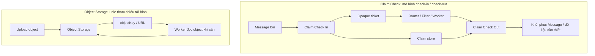
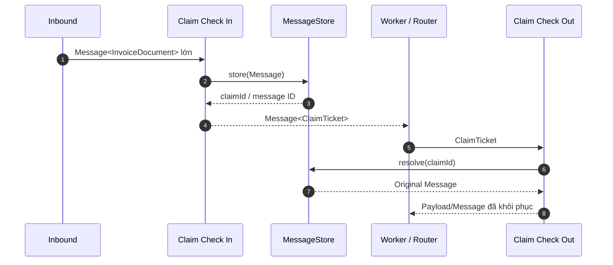
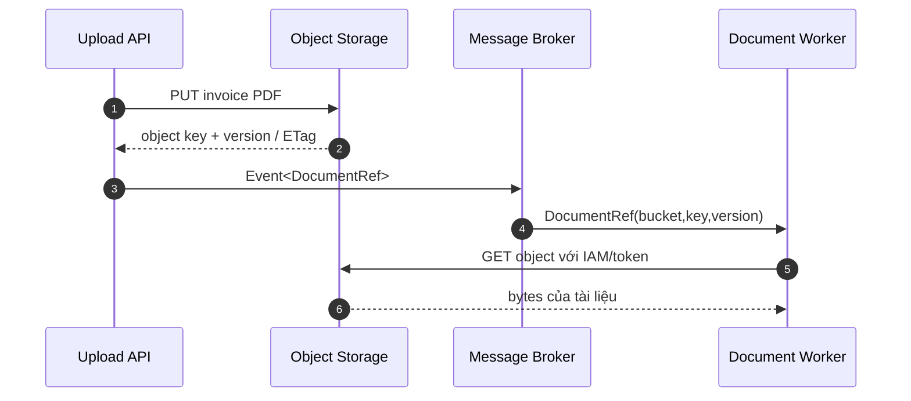
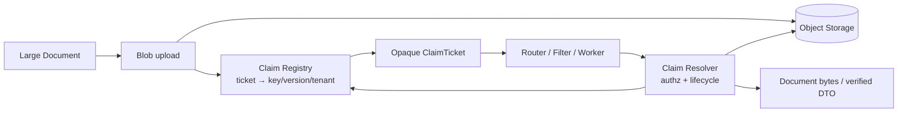
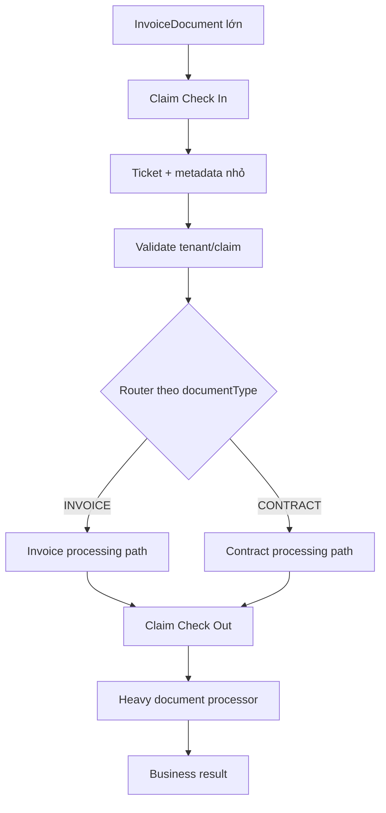
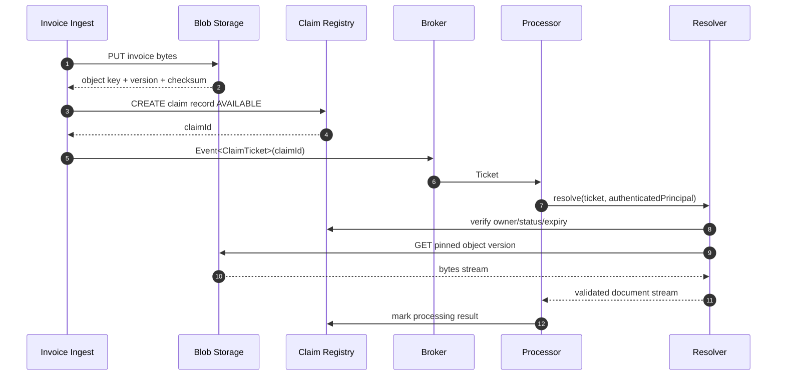
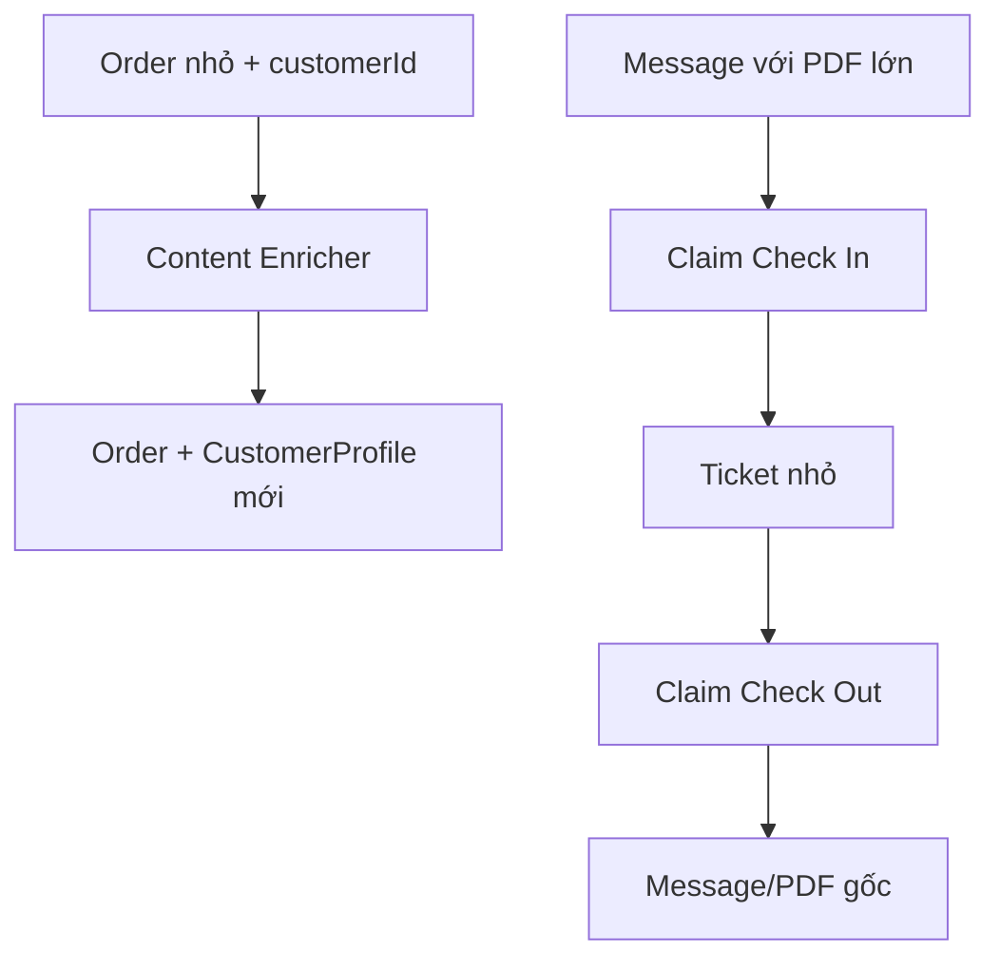
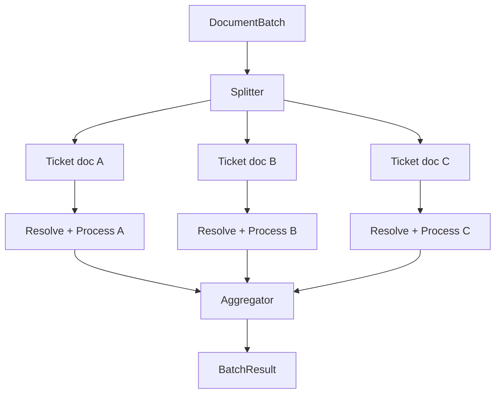
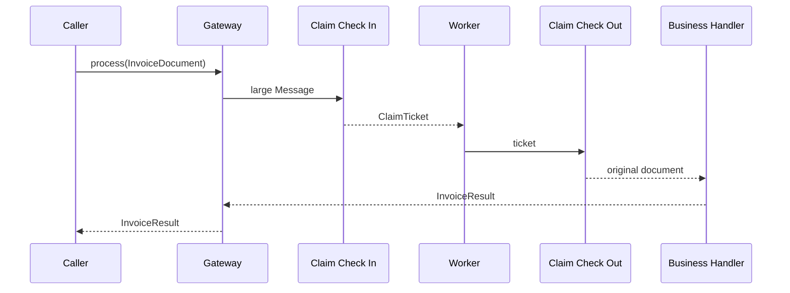

# Phân biệt Claim Check với Object Storage Link trong Spring Integration

> **Chương:** Claim check  
> **Bài học:** Phân biệt claim check với object storage link  
> **Phạm vi:** Enterprise Integration Patterns (EIP) trong Spring Integration: tách dữ liệu lớn khỏi message, giữ context khi đi qua Router/Filter/Transformer, phục hồi payload, correlation, retry, error channel và kiểm thử.

## 1. Tình huống thực tế: không nên gửi cả tài liệu lớn qua mọi channel

Một hệ thống xử lý hóa đơn nhận tài liệu PDF dung lượng 30 MB. Tài liệu phải đi qua các bước kiểm tra định dạng, nhận diện loại hóa đơn, phân tuyến tới dịch vụ OCR và lưu kết quả. Nếu mỗi message mang trực tiếp toàn bộ 30 MB:

- Broker và network chịu chi phí truyền payload lớn nhiều lần.
- Router, Filter, Metrics và Audit nhận dữ liệu không cần thiết.
- Retry có thể gửi lại 30 MB dù chỉ metadata thay đổi.
- Log/debug vô tình phơi bày thông tin nhạy cảm trong tài liệu.
- Các giới hạn kích thước message, queue memory và latency trở nên khó kiểm soát.

Hai giải pháp thường được nhắc tới là **Claim Check** và **Object Storage Link**. Cả hai đều có thể khiến message nhỏ đi, nhưng chúng **không đồng nghĩa**:

- **Claim Check** là một **Enterprise Integration Pattern**: *cất dữ liệu/Message vào kho lưu trữ, phát một token đại diện, sau đó dùng token để lấy lại dữ liệu khi cần*.
- **Object Storage Link** là một **cách tham chiếu tới một object cụ thể** trong S3, GCS, Azure Blob hoặc một kho tương đương: có thể là object key, URI hoặc URL tải xuống; chỉ có địa chỉ không tự tạo ra quy trình check-in/check-out.



**Ý chính:** Claim Check trả lời câu hỏi **“Ai cất, ai giữ token, ai có quyền lấy lại, dữ liệu được giải phóng lúc nào?”**. Object storage link chủ yếu trả lời **“Object nằm ở đâu và có thể truy cập bằng cách nào?”**.

### Mục tiêu học tập

Sau bài này, bạn có thể:

1. Giải thích rành mạch Claim Check Pattern và object storage reference.
2. Phân biệt **opaque claim ticket**, object key, URI, signed URL và business ID.
3. Mô tả check-in, message store, check-out, recover, expiry và cleanup.
4. Biết khi nào nên dùng Spring Integration `MessageStore`, khi nào dùng object storage, và khi nào kết hợp cả hai.
5. Xây ví dụ Java/Spring Integration giảm kích thước message nhưng vẫn giữ correlation.
6. Viết kiểm thử cho ticket hợp lệ, ticket không tồn tại, tenant sai, retry và một lần truy xuất.
7. Nhận diện rủi ro SSRF, rò rỉ signed URL, mất metadata, stale/expired object, và cross-tenant access.
8. Thiết kế retry, idempotency, transaction, cleanup và observability cho luồng doanh nghiệp.

## 2. Định nghĩa chính xác hai khái niệm

### 2.1. Claim Check là một pattern có hai điểm kiểm soát

Trong EIP, **Claim Check** mượn hình ảnh gửi đồ tại quầy: khách gửi một món đồ, nhận một phiếu; về sau dùng phiếu để nhận lại đồ.

Đối với message:

```text
Check-in:
  Message<LargePayload>
      |
      +--> lưu Message trong Claim Store
      |
      v
  Message<ClaimTicket>

Process:
  Message<ClaimTicket> -> Router -> Filter -> small workflow

Check-out:
  Message<ClaimTicket>
      |
      +--> resolve ticket từ Claim Store
      |
      v
  Message<LargePayload> được khôi phục hoặc merge vào context
```

Những điểm đặc trưng:

- Có **hành động check-in** chủ đích.
- Có một **claim store** chịu trách nhiệm giữ dữ liệu được cất.
- Có **claim ticket**, thường là khóa mờ/opaque không chứa nội dung.
- Có **hành động check-out/resolve** rõ ràng.
- Có **chính sách vòng đời**: khi nào xóa, giữ bao lâu, ticket được dùng bao nhiêu lần.
- Khi cất nguyên Spring Message, có thể bảo toàn payload và nhiều headers — nhưng cần quản lý headers nội bộ khi khôi phục.

### 2.2. Object Storage Link là một tham chiếu tới đối tượng

Một ứng dụng có thể upload PDF lên object storage và gửi:

```json
{
  "documentId": "DOC-701",
  "bucket": "invoice-documents",
  "objectKey": "tenant-42/invoices/DOC-701/v3.pdf",
  "versionId": "version-3",
  "sha256": "6f4a...example..."
}
```

Worker dùng object key để đọc dữ liệu tại thời điểm cần. Đây là **claim-to-location** hoặc **payload offloading** bằng object storage, chưa nhất thiết là Claim Check đầy đủ:

- Không bắt buộc có check-in transformer.
- Không mặc định có kho mapping ticket → Message.
- Không mặc định lưu và khôi phục original headers.
- Không mặc định có “claim out” hay thao tác thu hồi.
- Không mặc định có transaction giữa message broker và blob upload.
- Không mặc định xác định ai có quyền đọc; điều đó phụ thuộc IAM, URL token và ứng dụng.

**Cần hiểu đúng:** Một thiết kế dùng object storage **vẫn có thể triển khai Claim Check** nếu ứng dụng quản lý ticket, quyền resolve, retrieval contract và lifecycle. Không được kết luận “lưu ở S3 thì không còn là Claim Check”. Điểm phân biệt là **pattern hành vi**, không phải loại đĩa/kho được sử dụng.

## 3. Bảng so sánh: pattern và cơ chế tham chiếu

| Tiêu chí | Claim Check | Object Storage Link |
| --- | --- | --- |
| Bản chất | EIP / quy trình check-in, ticket, check-out | Địa chỉ hoặc tham chiếu tới blob |
| Điều trọng tâm | Bảo quản và khôi phục message/nội dung | Xác định object cần đọc |
| Token | Claim ID opaque, do ứng dụng/kho tạo | Bucket + key + version, URI hoặc signed URL |
| Check-in | Có, là bước của pattern | Upload có thể diễn ra trước/bên ngoài flow |
| Check-out | Có bước resolve được kiểm soát | Consumer dùng SDK/HTTP tải object |
| Lưu headers gốc | Có thể có nếu lưu Spring Message | Không có mặc định, phải quản lý metadata riêng |
| Expiry | Do chính sách claim store/ticket quyết định | Do lifecycle object và/hoặc URL expiration |
| Quyền truy cập | Resolver phải kiểm tra authorization | IAM, bucket policy, signed URL, ứng dụng |
| Dùng một lần | Có thể cấu hình bằng chính sách remove/consume | Link không tự có one-time semantics |
| Truy xuất lại | Tùy ticket và retention | Tùy object còn tồn tại và còn quyền |
| Độ bền | Tùy claim store: RAM, JDBC, Redis,... | Tùy provider/object lifecycle/versioning |
| Số byte trên message bus | Ticket thường nhỏ | Link hoặc object reference thường nhỏ |
| Lỗi điển hình | Missing/expired/consumed claim | Not found, access denied, URL expired |
| Hợp đồng đa tiến trình | Cần shared/persistent resolver/store | Worker có thể truy cập chung object storage |
| Thích hợp | Tạm cất payload/message giữa nhiều endpoint | Lưu file/blob lớn hoặc trao đổi giữa dịch vụ |

### Quy tắc chọn nhanh

- **Cần tạm giấu toàn bộ Message khi đi qua nhiều bước EIP, rồi khôi phục tại điểm xác định?** Claim Check là mô hình tự nhiên.
- **Cần lưu file rất lớn lâu dài và nhiều hệ thống đọc bằng quyền riêng?** Object storage reference thường phù hợp hơn.
- **Cần cả token opaque, quyền resolve chặt chẽ và blob rất lớn?** Dùng **Claim Check trên object storage**: claim resolver quản lý mapping từ ticket tới object, metadata và lifecycle.

## 4. Bốn loại định danh không được đánh đồng

Một thiết kế an toàn cần phân biệt:

| Loại | Ví dụ | Vai trò |
| --- | --- | --- |
| Business ID | `documentId=DOC-701` | Định danh tài liệu nghiệp vụ |
| Claim ticket | `claimId=cc_73b...` | Quyền/khóa tra cứu claim trong kho |
| Object key | `tenant-42/invoices/DOC-701/v3.pdf` | Địa chỉ logic của blob trong bucket |
| Signed URL | `https://...?...signature=...` | URL truy cập tạm thời theo quyền/thời hạn |
| Message ID | UUID trong Spring `MessageHeaders.id` | Định danh một message |
| Correlation ID | `businessCorrelationId=invoice:DOC-701` | Truy vết workflow/request |

**Không dùng `documentId` làm claim secret** nếu người khác có thể đoán document ID. Một claim ID opaque giúp giảm rò rỉ thông tin, nhưng bản thân token không thay thế authorization.

### Signed URL không giống object key

Một object key thường là địa chỉ **ổn định về mặt logic**, còn signed URL là một URL chứa thông tin cấp quyền có hạn dùng. Ví dụ:

```text
objectKey:
  tenant-42/invoices/DOC-701/v3.pdf

signedUrl:
  https://storage.example/.../v3.pdf?signature=...&expires=...
```

Hai URL signed khác nhau có thể trỏ tới **cùng một object**. URL hết hạn không nhất thiết nghĩa object đã bị xóa. Ngược lại, object bị xóa/permission thay đổi có thể làm một URL chưa hết hạn không còn sử dụng được.

Không nên lưu signed URL làm business ID bền vững, cũng không nên log nguyên URL có token truy cập.

## 5. Hai sequence diagram: giống đầu ra nhỏ, khác quy trình

### 5.1. Claim Check



**Quan sát:** token tham chiếu **kho claim có kiểm soát**. Có thể giải quyết quyền, retention, single-use và provenance trong cùng service.

### 5.2. Object Storage Link



**Quan sát:** worker có thể lấy blob trực tiếp bằng SDK; không có bước resolve claim ticket riêng. Nếu ứng dụng xây thêm resolver/check-in/check-out, kiến trúc trở thành một **biến thể Claim Check** dùng object storage làm backing store.

## 6. Khi nào object storage link vẫn là Claim Check?

Một thiết kế lai điển hình:



Nó là Claim Check bởi vì:

1. Ứng dụng thực hiện check-in trước khi phát ticket.
2. Ticket là giao diện duy nhất cho downstream, không phải object key công khai.
3. Resolver kiểm tra tenant, claim status và quyền truy cập.
4. Resolver chọn object key/version đã được lưu tại check-in.
5. Có quy tắc check-out, expiry, retry và cleanup.

**Object storage là một implementation detail của claim store**, không làm thay đổi bản chất EIP.

### Lợi ích của lớp resolver

- Có thể đổi bucket/provider mà không cần đổi message contract.
- Thu hồi claim bằng trạng thái trong registry thay vì cố thu hồi một URL đã phát tán.
- Cô lập quyền IAM: worker không cần truy cập mọi bucket.
- Ghi audit mỗi lần resolve, kiểm tra tenant/subject/operation.
- Dùng hash, version ID, content type và size để xác nhận dữ liệu khi lấy về.

Đổi lại, resolver/registry là một thành phần vận hành thêm: cần HA, bảo mật, backup và quy trình lỗi.

## 7. Claim Check trong Spring Integration: kho nào và lưu cái gì?

Spring Integration có các thành phần phục vụ Claim Check Pattern như `ClaimCheckInTransformer`, `ClaimCheckOutTransformer` và khái niệm `MessageStore`. Chúng giúp tách việc cất/khôi phục message khỏi business handler.

Ở mức khái niệm:

```text
ClaimCheckInTransformer:
  original Message -> store original Message -> claim ticket

ClaimCheckOutTransformer:
  claim ticket -> read MessageStore -> original Message
```

Một `MessageStore` có thể lưu **Spring Message** (payload và headers), khác với object storage thường chỉ lưu raw bytes của một blob.

### MessageStore không mặc định là object storage

Ví dụ các khả năng lưu:

| Store | Ưu điểm | Giới hạn cần kiểm soát |
| --- | --- | --- |
| `SimpleMessageStore` | Dễ học/test trong JVM | Mất state khi restart, không chia sẻ giữa process |
| JDBC-backed MessageStore | Có persistence và truy cập chung khi cấu hình đúng | Serialization, transaction, cleanup và DB load |
| Redis-backed MessageStore | Truy cập nhanh, hỗ trợ nhiều node theo cấu hình | TTL, memory pressure, security/serialization |
| Custom claim registry + object storage | Phù hợp blob rất lớn | Cần code check-in/check-out và transaction/recovery |
| Document database / custom store | Có thể lưu envelope và metadata linh hoạt | Cần bảo đảm đúng semantics của claim retrieval |

**Không coi `SimpleMessageStore` là persistent storage**, và không coi database storing Spring Message là nơi phù hợp cho file PDF hàng trăm MB mà không phân tích chi phí.

### Điểm cần đặc biệt lưu ý khi cất cả Message

Spring Message headers có thể chứa `replyChannel`, `errorChannel` hoặc các đối tượng nội bộ JVM. Các giá trị này có thể không serialize được, hoặc sau restart không còn hợp lệ. Khi cất để khôi phục qua process/transport boundary:

- Tách business metadata cần giữ lâu dài khỏi infrastructure headers mang tính tạm thời.
- Dùng serializer/header mapper có allowlist.
- Không tái sử dụng stale reply channels khi tái nhập message vào một Gateway mới.
- Kiểm thử sau restart, không chỉ trong cùng JVM.

## 8. Check-in/check-out có thể một lần hoặc nhiều lần

Có hai chính sách phổ biến:

### 8.1. Ticket dùng lại nhiều lần

```text
Ticket T được tạo
  -> Worker A resolve T
  -> Worker B resolve T
  -> T còn hiệu lực đến expiry
```

Thích hợp khi nhiều hệ thống cần đọc cùng tài liệu và payload bất biến. Cần versioning và quyền đọc trên từng lần resolve.

### 8.2. Ticket tiêu thụ một lần

```text
Ticket T được tạo
  -> Worker A consume T
  -> claim bị đánh dấu consumed/xóa
  -> Worker B resolve T -> không còn claim
```

Thích hợp khi muốn giới hạn số lần dùng, nhưng rất dễ gây lỗi khi transport có **at-least-once delivery**:

1. Worker đọc ticket và claim bị xóa.
2. Worker xử lý xong nhưng ack broker thất bại.
3. Broker gửi lại ticket.
4. Worker không còn dữ liệu để recover.

Vì vậy, không mặc định “delete at checkout” là phương án an toàn nhất. Với nghiệp vụ cần replay, dùng **read-only resolve + completion/retention policy**, hoặc thiết kế **consume atomically với transactional processing** theo khả năng hạ tầng.

### Không nhầm one-time ticket với một HTTP signed URL

Một signed URL có expiry không tự có semantics chỉ dùng đúng một lần. Người nắm URL có thể truy cập nhiều lần trong thời gian URL còn hợp lệ, tùy provider/cấu hình. Nếu cần single-use, phải bổ sung server-side authorization/token state hoặc một proxy/resolver có kiểm soát.

## 9. Hợp đồng của một ClaimTicket tốt

Thay vì phát raw blob hoặc URL, downstream có thể nhận DTO nhỏ:

```java
package example.integration;

import java.time.Instant;
import java.util.UUID;

public record ClaimTicket(
    UUID claimId,
    String tenantId,
    String businessCorrelationId,
    Instant createdAt,
    Instant expiresAt
) {}
```

Hợp đồng:

- `claimId` là khóa opaque định danh record trong claim registry/store.
- `tenantId` cho phép kiểm tra cô lập tenant **sau khi xác thực principal**, không phải bằng cách tin mỗi field trong ticket.
- `businessCorrelationId` phục vụ truy vết workflow, không phải bằng chứng quyền truy cập.
- `createdAt`, `expiresAt` hỗ trợ auditing/lifecycle.
- Payload ticket không cần chứa raw object key, signed URL hoặc dữ liệu tài liệu.

**Điểm quan trọng:** phát một ticket do hệ thống tạo không bảo đảm nó là một **bearer token được phép truy cập vô điều kiện**. Resolve phải xác minh caller/tenant/operation, trạng thái và thời hạn. Nếu ticket có thể bị gửi tới bên thứ ba, dùng ID khó đoán hoặc token ký có audience/scope phù hợp.

### Trạng thái claim

Một claim record có thể có các trạng thái:

```text
CREATED -> AVAILABLE -> CLAIMED/PROCESSING -> COMPLETED
                      \-> EXPIRED
                      \-> REVOKED
                      \-> FAILED
```

Đây là một state machine **do ứng dụng thiết kế**. Spring Integration không tự cung cấp đầy đủ domain statuses đó chỉ vì ta gọi Claim Check transformer.

## 10. Ví dụ Java: lưu và lấy lại Message bằng MessageStore

Để hiểu bản chất Claim Check, ta bắt đầu từ hai thao tác lõi:

- `checkIn` nhận một `Message<InvoiceDocument>`, lưu message bằng `MessageStore` rồi trả ticket nhỏ.
- `checkOut` xác minh quyền/TTL rồi lấy lại message bằng claim ID.

Đây là **triển khai học tập** dựa trên API `MessageStore` của Spring Integration, không phải một cơ chế xác thực production hoàn chỉnh. Spring Integration còn cung cấp các Claim Check transformer chuyên dụng; ví dụ tự viết giúp minh họa nơi cần gắn authorization và lifecycle.

### 10.1. Payload tài liệu

```java
package example.integration;

import java.util.Objects;

public record InvoiceDocument(
    String documentId,
    byte[] pdfBytes
) {
    public InvoiceDocument {
        Objects.requireNonNull(documentId, "documentId");
        Objects.requireNonNull(pdfBytes, "pdfBytes");
        pdfBytes = pdfBytes.clone();
    }

    @Override
    public byte[] pdfBytes() {
        return pdfBytes.clone();
    }

    public int sizeBytes() {
        return pdfBytes.length;
    }
}
```

Việc clone `byte[]` hạn chế thay đổi payload ngoài ý muốn sau khi lưu. Với tài liệu thực rất lớn, không nhất thiết giữ toàn bộ bytes trong heap: có thể dùng stream/buffer có kiểm soát hoặc lưu blob ở object storage rồi chuyển reference vào workflow.

### 10.2. Claim metadata nằm trong registry

```java
package example.integration;

import java.time.Instant;

public record StoredClaimMetadata(
    String tenantId,
    String businessCorrelationId,
    Instant createdAt,
    Instant expiresAt
) {}
```

Metadata này là **record do server quản lý**, không lấy các giá trị authorization trực tiếp từ ticket mà caller tự tạo.

### 10.3. Service check-in/check-out

```java
package example.integration;

import java.time.Clock;
import java.time.Duration;
import java.time.Instant;
import java.util.Map;
import java.util.Objects;
import java.util.UUID;
import java.util.concurrent.ConcurrentHashMap;

import org.springframework.integration.store.MessageStore;
import org.springframework.messaging.Message;

public final class ClaimCheckService {

    private final MessageStore store;
    private final Clock clock;
    private final Duration ttl;

    // Demo: registry trong RAM, không chia sẻ giữa nhiều JVM.
    private final Map<UUID, StoredClaimMetadata> metadata =
        new ConcurrentHashMap<>();

    public ClaimCheckService(
            MessageStore store,
            Clock clock,
            Duration ttl) {

        this.store = Objects.requireNonNull(store);
        this.clock = Objects.requireNonNull(clock);
        this.ttl = Objects.requireNonNull(ttl);

        if (ttl.isZero() || ttl.isNegative()) {
            throw new IllegalArgumentException(
                "Claim TTL phải dương");
        }
    }

    public ClaimTicket checkIn(
            Message<InvoiceDocument> original,
            String authenticatedTenantId) {

        requireTenant(authenticatedTenantId);

        UUID claimId = original.getHeaders().getId();
        if (claimId == null) {
            throw new IllegalArgumentException(
                "Message thiếu ID");
        }

        // Cất nguyên Message để giữ payload và các header phù hợp.
        store.addMessage(original);

        Instant now = clock.instant();
        String businessId = String.valueOf(
            original.getHeaders()
                .get("businessCorrelationId"));

        StoredClaimMetadata record = new StoredClaimMetadata(
            authenticatedTenantId,
            businessId,
            now,
            now.plus(ttl));

        metadata.put(claimId, record);

        return new ClaimTicket(
            claimId,
            authenticatedTenantId,
            businessId,
            now,
            record.expiresAt());
    }

    public Message<?> checkOut(
            ClaimTicket ticket,
            String authenticatedTenantId) {

        requireTenant(authenticatedTenantId);

        StoredClaimMetadata record =
            metadata.get(ticket.claimId());

        if (record == null) {
            throw new IllegalStateException(
                "Claim không tồn tại hoặc đã được thu hồi");
        }

        // Quyền được quyết định bởi record và principal đã xác thực,
        // không phải chỉ bởi tenantId trong payload của ticket.
        if (!record.tenantId().equals(authenticatedTenantId)) {
            throw new SecurityException(
                "Không có quyền truy cập claim");
        }

        if (!clock.instant().isBefore(record.expiresAt())) {
            throw new IllegalStateException("Claim đã hết hạn");
        }

        Message<?> restored = store.getMessage(ticket.claimId());
        if (restored == null) {
            throw new IllegalStateException(
                "Claim metadata tồn tại nhưng payload đã mất");
        }

        return restored;
    }

    private static void requireTenant(String tenantId) {
        if (tenantId == null || tenantId.isBlank()) {
            throw new SecurityException(
                "Thiếu tenant đã xác thực");
        }
    }
}
```

### Vì sao dùng ID của original Message làm claim ID?

`MessageStore` có thể lưu và lấy message theo ID của Spring Message. Demo dùng `original.getHeaders().getId()` để minh họa một khóa tra cứu thống nhất.

Đây **không phải** hợp đồng bắt buộc cho mọi Claim Check implementation. Một claim registry production có thể tạo ticket ngẫu nhiên riêng, map nó sang một hoặc nhiều message/blob IDs và lưu metadata riêng. Nếu muốn giấu tuyệt đối ID nội bộ của Spring Message, không phát thẳng giá trị đó ra một trust boundary.

### Những giới hạn cố ý của demo

1. `metadata` dùng `ConcurrentHashMap` trong RAM. Nó **không** có durability/multi-node coordination.
2. Hai thao tác `store.addMessage` và `metadata.put` **không atomic**. Một crash ở giữa có thể tạo message mồ côi không có record.
3. Dữ liệu payload trong `MessageStore` cũng không được đảm bảo persistent nếu dùng `SimpleMessageStore`.
4. Method `checkOut` dùng **read-only semantics**; không xóa claim sau khi đọc.
5. Chưa có cleanup scheduler, audit store, quota, encryption key rotation hoặc retention policy.
6. ClaimTicket có thể bị giả mạo từ bên ngoài. Resolver vẫn kiểm tra record/tenant, nhưng hệ thống thật còn cần principal, permission scope và rate limit.
7. Không coi `ticket.tenantId()` là nguồn quyền; quyền phải đến từ security context/identity đã xác thực.
8. Không cho phép vô số claims lớn vào RAM trong production.

**Bài học ở đây là trách nhiệm thiết kế**, không phải khuyến nghị triển khai map trong RAM cho tài liệu thật.

## 11. JUnit 5: kiểm thử check-in, check-out, tenant và TTL

Một test chỉ thấy ticket được trả về chưa chứng minh claim thực sự được lưu. Ta cần kiểm tra cả retrieval và các nhánh thất bại.

### 11.1. Test với SimpleMessageStore

```java
package example.integration;

import static org.junit.jupiter.api.Assertions.*;

import java.time.Clock;
import java.time.Duration;
import java.time.Instant;
import java.time.ZoneOffset;
import java.util.UUID;

import org.junit.jupiter.api.Test;
import org.springframework.integration.store.SimpleMessageStore;
import org.springframework.messaging.Message;
import org.springframework.messaging.support.MessageBuilder;

class ClaimCheckServiceTest {

    private final Clock fixedClock = Clock.fixed(
        Instant.parse("2026-11-21T02:00:00Z"),
        ZoneOffset.UTC);

    private final SimpleMessageStore store =
        new SimpleMessageStore();

    private final ClaimCheckService claims =
        new ClaimCheckService(
            store, fixedClock, Duration.ofHours(1));

    private Message<InvoiceDocument> invoice() {
        return MessageBuilder.withPayload(
                new InvoiceDocument(
                    "DOC-701", new byte[] {1, 2, 3, 4}))
            .setHeader(
                "businessCorrelationId", "invoice:DOC-701")
            .setHeader("sourceSystem", "billing-api")
            .build();
    }

    @Test
    void restoresOriginalMessageWithTicket() {
        Message<InvoiceDocument> original = invoice();

        ClaimTicket ticket =
            claims.checkIn(original, "tenant-42");

        assertNotNull(ticket.claimId());
        assertEquals("tenant-42", ticket.tenantId());
        assertEquals(
            original.getHeaders().getId(), ticket.claimId());

        Message<?> restored =
            claims.checkOut(ticket, "tenant-42");

        assertInstanceOf(
            InvoiceDocument.class, restored.getPayload());

        InvoiceDocument document =
            (InvoiceDocument) restored.getPayload();

        assertEquals("DOC-701", document.documentId());
        assertArrayEquals(
            new byte[] {1, 2, 3, 4},
            document.pdfBytes());

        assertEquals("invoice:DOC-701",
            restored.getHeaders()
                .get("businessCorrelationId"));
    }

    @Test
    void rejectsCrossTenantResolve() {
        ClaimTicket ticket =
            claims.checkIn(invoice(), "tenant-42");

        assertThrows(SecurityException.class, () ->
            claims.checkOut(ticket, "tenant-99"));
    }

    @Test
    void rejectsUnknownTicket() {
        ClaimTicket fake = new ClaimTicket(
            UUID.randomUUID(),
            "tenant-42",
            "invoice:UNKNOWN",
            fixedClock.instant(),
            fixedClock.instant().plusSeconds(3600));

        assertThrows(IllegalStateException.class, () ->
            claims.checkOut(fake, "tenant-42"));
    }

    @Test
    void repeatedReadWorksWithReadOnlyPolicy() {
        ClaimTicket ticket =
            claims.checkIn(invoice(), "tenant-42");

        assertNotNull(
            claims.checkOut(ticket, "tenant-42"));
        assertNotNull(
            claims.checkOut(ticket, "tenant-42"));
    }
}
```

Test trên cho thấy:

- Message gốc được giữ trong `MessageStore`.
- Ticket là một tham chiếu nhỏ, không chứa PDF bytes.
- Resolver không cho tenant khác đọc claim.
- Ticket giả không có record không được resolve.
- Một read-only claim có thể dùng lại nhiều lần theo policy đã chọn.

### 11.2. Kiểm thử hết hạn không cần Thread.sleep

Để test TTL, dùng một `Clock` điều khiển được trong test hoặc tạo service với clock đã tiến vượt expiry:

```java
// Ý tưởng test: dùng Clock có thể thay đổi qua constructor.
// Clock tại check-in: 10:00, TTL=1h.
// Clock tại check-out: 11:01.
// Kỳ vọng checkOut từ chối với lý do CLAIM_EXPIRED.
```

Trong demo `ClaimCheckService` nhận một `Clock` ở constructor nên có thể cấp implementation controllable. Không nên cho unit test chờ thực 1 giờ hoặc dùng `Thread.sleep(...)` để đo thời hạn.

### 11.3. Kiểm thử persistence khác với unit test trong RAM

Test dùng `SimpleMessageStore` **không chứng minh**:

- Claim sống qua restart.
- Có thể check-out từ một pod khác.
- Có transaction giữa message store và claim registry.
- Payload lớn thực sự được đọc/ghi hiệu quả.
- Claim được dọn khi hết hạn.
- Một ID có thể được resolve an toàn sau khi ticket bị revoke.

Những yêu cầu đó cần integration test với JDBC/Redis/object storage backing store và service authz thật.

## 12. Spring Integration Java DSL: dùng Claim Check trong luồng

Spring Integration có các transformer chuyên dụng cho Claim Check. Mô hình DSL thường có hai điểm rõ:

```text
largeInput
  -> ClaimCheckIn
  -> lightweight processing (route/filter)
  -> ClaimCheckOut
  -> restoredOutput
```

Một cấu hình trình bày ý tưởng:

```java
import org.springframework.integration.dsl.IntegrationFlow;
import org.springframework.integration.store.MessageStore;

// API/overload cụ thể cần đối chiếu phiên bản Spring Integration.
// Minh họa vị trí check-in và check-out trong cùng flow.

@Bean
IntegrationFlow compactWorkflow(MessageStore messageStore) {
    return IntegrationFlow.from("largeInput")
        .claimCheckIn(messageStore)
        .channel("ticketProcessing")
        .claimCheckOut(messageStore)
        .channel("restoredOutput")
        .get();
}
```

**Đây là phác họa DSL theo pattern**, không phải một cấu hình hoàn chỉnh để copy chạy độc lập: các channel phải được định nghĩa, và chính xác DSL overload/option như remove-on-checkout phụ thuộc phiên bản Spring Integration đang dùng. Có thể thay bằng các transformer chuyên dụng hoặc service adapter triển khai cùng hợp đồng; cần kiểm tra và chạy test với dependency thực tế tại bước QA chuyên môn.

### Bản chất của hai transformer

- **Claim Check In:** cất message trong `MessageStore` và phát payload/ticket đại diện thay vì message lớn.
- **Ticket processing:** những bước chỉ cần ID có thể chạy mà không đọc lại toàn payload.
- **Claim Check Out:** tra cứu ticket trong kho và khôi phục nội dung để business handler tiếp tục.

Không nhất thiết phải check-out ngay sau khi check-in. Nếu làm vậy mà không có bước xử lý nhẹ ở giữa, Claim Check chỉ thêm I/O và độ phức tạp mà không tiết kiệm điều gì đáng kể.

### Không khôi phục sai replyChannel

Ở flow request-reply, một message gốc có thể chứa header `replyChannel` của Gateway tại thời điểm check-in. Nếu check-out sau nhiều giờ hoặc trên pod khác, reference đó có thể stale hoặc không serialize được.

Phải xác định **reply contract của workflow hiện tại**. Trong một số luồng, nên khôi phục payload và business headers rồi tạo Spring Message mới mang reply channel thích hợp ở thời điểm xử lý, thay vì tái sử dụng toàn bộ infrastructure headers cũ.

## 13. Ví dụ flow thực tế: check-in trước routing, check-out sau routing

### Mô hình



**Tại sao tiết kiệm?**

Router chỉ cần `documentType`/`documentId` (trong ticket hoặc headers đã được xác minh). Nó không cần đọc toàn bộ PDF. Chỉ nhánh thực sự xử lý nội dung mới check-out.

### Nhưng filter/routing metadata lấy từ đâu?

Nếu `documentType` chỉ có bên trong PDF, phải có một bước trích metadata trước check-in (hoặc metadata đáng tin đi cùng upload). Không thể route theo một field không tồn tại trên ticket mà không phải resolve lại blob.

```text
Tốt:
  Validate metadata -> Check-in -> Router(metadata) -> Check-out

Không hiệu quả:
  Check-in -> Router phải tải blob để biết documentType
           -> Check-out lại tải blob
```

Nên tách **routing metadata nhẹ** khỏi **payload nặng**, nhưng không tin hoàn toàn metadata do client khai báo nếu nó ảnh hưởng quyền hoặc nhánh rủi ro cao.

## 14. Object storage link: ba cách biểu diễn phổ biến

Một object trong storage có thể được tham chiếu bằng nhiều dạng:

### 14.1. Object key + bucket

```java
public record ObjectRef(
    String provider,
    String bucket,
    String objectKey,
    String versionId,
    String sha256,
    long sizeBytes,
    String mediaType
) {}
```

Ví dụ:

```json
{
  "provider": "S3",
  "bucket": "invoice-documents",
  "objectKey": "tenant-42/invoices/DOC-701/v3.pdf",
  "versionId": "ver-003",
  "sha256": "sha256-hex-value-from-upload",
  "sizeBytes": 31457280,
  "mediaType": "application/pdf"
}
```

Đây là một **reference ổn định hơn URL ký ngắn hạn**, nếu có bucket/key/version phù hợp. Worker dùng IAM/SDK hoặc một proxy được cấp quyền để tải. Giá trị `sha256` trong ví dụ là placeholder, không phải checksum thực.

### 14.2. URI dành cho storage SDK

```text
s3://invoice-documents/tenant-42/invoices/DOC-701/v3.pdf
gs://invoice-documents/tenant-42/invoices/DOC-701/v3.pdf
```

URI thể hiện provider/địa chỉ, **không mặc định có quyền đọc**. Consumer vẫn cần authentication, authorization, network connectivity và có thể cần version ID riêng.

### 14.3. Pre-signed HTTPS URL

```text
https://storage.example.com/.../v3.pdf
  ?X-Signature=...
  &X-Expires=...
```

Loại này tiện cho browser hoặc bên ngoài tải trong thời gian ngắn, nhưng có nhiều giới hạn:

- URL chứa token nhạy cảm và có thể được chuyển tiếp.
- TTL của URL không phải TTL của object.
- URL phải được phát đúng scope/method/content constraints.
- Không nên để nó xuất hiện trong access logs, traces, analytics hay error messages.
- Không phù hợp làm dữ liệu tham chiếu bền vững cho workflow kéo dài nhiều ngày.
- Nếu thực sự cần tải lại sau expiry, phải tạo URL mới từ một object reference được ủy quyền.

**Không đồng nhất signed URL và ClaimTicket.** Một signed URL thường trao quyền truy cập trực tiếp vào object theo điều kiện chữ ký; claim ticket là một khóa resolve ở tầng ứng dụng và có thể được xác minh lại mỗi lần.

## 15. Khác biệt bảo mật: object link có thể trở thành bearer credential

Một trong những rủi ro lớn nhất là coi object URL như “chỉ một chuỗi đường dẫn”.

Nếu URL đã ký cho phép ai có URL cũng đọc file trước khi hết hạn, thì việc lộ URL tương tự lộ một **bearer credential có scope hạn chế**.

### Các tình huống dễ lộ

- Log toàn bộ payload `DocumentRef` có chứa signed URL.
- Gửi URL vào message bus có nhiều subscriber không cần quyền đọc.
- Gắn URL vào exception message rồi đưa tới hệ thống giám sát.
- Đưa URL vào browser analytics hoặc Referer header không được kiểm soát.
- Copy URL từ ticket hỗ trợ khách hàng rồi gửi ngoài tổ chức.
- Retain URL trong DB/log lâu hơn thời gian nghiệp vụ cần.

### Quy tắc tốt

1. Không dùng signed URL làm identity trong domain.
2. Ưu tiên lưu `bucket + key + version` hoặc opaque ticket.
3. Chỉ tạo signed URL **ngay trước khi dùng**, với TTL ngắn và permission hạn chế.
4. Không log URL có chữ ký; log claim ID/hash hoặc sanitized object identifier.
5. Kiểm tra authorization trước khi phát signed URL.
6. Chọn đúng HTTP method; một URL đọc không được dùng để cấp quyền upload/xóa.
7. Có cơ chế rotate/revoke credentials và incident response.

### SSRF và URL do người dùng tự đưa vào

Nếu worker nhận một URL tùy ý rồi tải bằng HTTP client, attacker có thể hướng worker tới endpoint nội bộ hoặc cloud metadata service (SSRF).

Ví dụ phản mẫu:

```java
// Không dùng trực tiếp URL do client tự gửi:
byte[] pdf = httpClient.get(userProvidedUrl);
```

Hướng an toàn hơn:

- Không cho client tự định nghĩa URL truy xuất tùy ý.
- Dùng object reference từ registry do hệ thống tạo.
- Nếu bắt buộc tải URL ngoài, allowlist domain/scheme/port, chặn địa chỉ private/link-local và kiểm soát redirect/DNS resolution.
- Giới hạn kích thước, timeout, content type; validate tài liệu sau khi tải.
- Tách quyền network của worker để không truy cập hệ thống nội bộ không cần thiết.

### Tenant isolation

`objectKey="tenant-42/..."` không phải chính sách bảo mật chỉ vì có prefix tenant. Worker phải xác minh principal được phép đọc đúng object, ở cả API/resolver và chính sách storage IAM/bucket nếu khả thi.

Trong Claim Check, authorization nên dựa trên record sở hữu trong registry và principal đã xác thực, không dựa vào `ticket.tenantId` tự khai.

## 16. Tính toàn vẹn và versioning: lấy đúng object ban đầu

Giả sử một object key bị overwrite sau khi message được phát:

```text
T0: upload DOC-701/v3.pdf, checksum=A
T1: gửi ObjectRef(key=DOC-701/v3.pdf)
T2: object key bị overwrite, checksum=B
T3: worker tải key và xử lý nội dung B
```

Worker có thể xử lý tài liệu khác với tài liệu đã được duyệt ở T0.

### Hợp đồng để ngăn TOCTOU

Một reference mạnh thường mang:

- Provider/bucket.
- Object key hoặc immutable object ID.
- Object version ID/generation khi provider hỗ trợ.
- Checksum nội dung như SHA-256.
- Kích thước kỳ vọng.
- Media type đã xác nhận, không chỉ do client khai.
- Tenant/owner và provenance trong registry.
- Retention/expiry policy.

Sau khi tải, worker xác minh:

```text
downloaded.length == expectedSize
SHA256(downloaded) == expectedHash
downloaded is a valid document of expected type
version/generation matches claim manifest
```

**ETag không luôn tương đương SHA-256** hoặc một hash nội dung độc lập; hành vi ETag có thể tùy provider, multipart upload và encryption mode. Nếu nghiệp vụ cần integrity mạnh, dùng checksum được tính/xác minh theo một thuật toán đã xác định.

### Immutable object key hoặc version pinning

Với dữ liệu quan trọng, nên tránh overwrite trực tiếp key đang được tham chiếu. Có thể:

- Dùng key chứa content hash/version.
- Bật object versioning và pin generation/version.
- Chỉ publish message sau khi xác nhận upload thành công.
- Kiểm tra object metadata/checksum tại check-in và check-out.

Object storage link giúp tìm object, nhưng **tự bản thân link không chứng minh object là bản đúng và chưa bị sửa**.

## 17. Vì sao “Claim Check = lưu PDF trong MessageStore” không phải lựa chọn duy nhất?

Một nhầm lẫn khác là cho rằng Claim Check luôn phải lưu **toàn bộ PDF bytes trực tiếp** vào `MessageStore` của Spring Integration.

Thực tế có ba thiết kế:

| Thiết kế | Claim store chứa gì? | Ưu điểm / hạn chế |
| --- | --- | --- |
| **A. MessageStore nguyên Message** | Spring Message gồm payload và headers | Dễ tích hợp EIP nhưng lưu payload cực lớn có thể tốn DB/heap |
| **B. Object storage ref đơn thuần** | Message chỉ chứa `ObjectRef`, không có claim resolver riêng | Đơn giản và scalable; không có Claim Check lifecycle tự động |
| **C. Claim registry + blob** | Ticket → object key/version/metadata/quyền | Claim Check đúng pattern, tận dụng object storage cho blob lớn; thêm registry và resolver |

Không có phương án nào tối ưu cho mọi hệ thống. Dựa trên payload size, number of consumers, retention, replay SLA, authorization, versioning và yêu cầu giữ headers để chọn.

## 18. Thiết kế lai: Claim Check registry trỏ tới object storage

Đối với PDF 30 MB, lưu bytes vào một DB MessageStore có thể tạo áp lực không cần thiết. Một giải pháp thực tế là:

1. Upload blob vào object storage.
2. Tạo claim record lưu ticket, tenant, object key/version/checksum và trạng thái.
3. Publish ticket nhỏ tới broker.
4. Worker dùng resolver được xác thực để đổi ticket thành blob stream.
5. Worker xử lý và ghi trạng thái hoàn tất.
6. Cleanup claim và blob theo retention policy; không xóa blob trước khi mọi retry cần thiết kết thúc.



### Hợp đồng registry gợi ý

```java
public record ClaimRecord(
    UUID claimId,
    String tenantId,
    String documentId,
    String bucket,
    String objectKey,
    String objectVersion,
    String sha256,
    long sizeBytes,
    String state,
    Instant expiresAt
) {}
```

Một kho claim production cần thêm audit/provenance, timestamp, worker lease, retry attempts, policy version và các trường có ích cho lifecycle theo nghiệp vụ.

### Phân biệt hai điểm check-out

**Resolver trả bytes:** nếu business handler thật sự cần đọc PDF, resolver cấp stream/bytes đã được kiểm tra.

**Resolver trả reference có quyền:** nếu downstream đã có quyền đọc object riêng, resolver có thể cấp một **object reference hoặc signed URL ngắn hạn** sau khi kiểm tra quyền. Như vậy Claim Check vẫn có bước resolve, nhưng dữ liệu lớn có thể được tải trực tiếp từ object storage.

Điều quan trọng là **một ticket không tự có nghĩa mọi worker được phép đọc dữ liệu**. Resolver quyết định dựa trên principal, tenant, operation, claim status và deadline.

### Đừng mở rộng quyền trong bước resolve

Nếu worker chỉ được phép “đọc hóa đơn của tenant-42”, nó không nên nhận signed URL cho mọi object trong bucket. Least privilege có thể được áp dụng ở resolver, storage policy và IAM role của worker.

## 19. Cần phân biệt durability, availability và retention

Một hệ thống có thể dùng object storage bền vững nhưng claim registry chỉ ở RAM. Khi ứng dụng restart:

```text
Blob:            còn trong object storage
Claim registry:  mất
Ticket in broker: còn
Worker:          không resolve được ticket
```

Dữ liệu bytes vẫn tồn tại, nhưng **workflow không còn khả năng tìm hoặc xác thực nó**. Ngược lại, registry có thể còn trong DB nhưng blob đã bị lifecycle rule xóa:

```text
Claim registry: AVAILABLE
Blob storage:   object not found
Worker:         check-out thất bại
```

Vì vậy, kiểm tra độ bền phải bao phủ **cả claim record, blob và message delivery**, không chỉ chọn một provider được quảng cáo là durable.

### Bốn vòng đời có thể khác nhau

| Thành phần | Vòng đời | Rủi ro |
| --- | --- | --- |
| Broker message chứa ticket | Đến khi ack/retention | Ticket bị giao lại sau khi claim hết hạn |
| Claim record | Cho tới complete/revoke/expiry/cleanup | Registry mất trước khi workflow hoàn tất |
| Object blob | Theo object lifecycle/retention | Blob bị xóa trong khi ticket còn dùng được |
| Signed URL | Theo hạn chữ ký và quyền | URL hết hạn dù claim/blob còn hợp lệ |

**Hợp đồng an toàn:** thời gian có thể retry hoặc redeliver phải được xét khi quyết định retention của claim và blob. Đừng có job xóa object sau 1 giờ nếu broker có thể retry trong 24 giờ, trừ khi nghiệp vụ chủ động chấp nhận fail và có recovery phù hợp.

## 20. Lỗi giữa upload, claim creation và publish message

Trong thực tế, ba thao tác này hiếm khi cùng nằm trong một transaction ACID:

```text
1. PUT blob
2. INSERT claim record
3. PUBLISH message<ClaimTicket>
```

Có thể crash tại từng điểm.

### Ma trận lỗi

| Điểm lỗi | Trạng thái có thể còn | Recovery cần thiết |
| --- | --- | --- |
| Upload fail | Chưa có blob | Retry upload hoặc trả lỗi ingress |
| Upload thành công, tạo claim fail | Blob mồ côi | Cleanup orphan sau grace period |
| Claim thành công, publish fail | Blob + claim nhưng chưa có ticket ở broker | Outbox/retry publish |
| Publish thành công, ack thất bại | Ticket có thể được gửi lại | Idempotent consumer, dedup |
| Ticket nhận được nhưng blob chưa sẵn | Consumer không tìm thấy object | Publish sau confirm, retry có giới hạn |
| Worker resolve thành công rồi crash | Claim chưa complete | Redelivery + idempotent processing |
| Worker complete nhưng cleanup fail | Blob/claim còn lưu | Cleanup retry; không gây business side effect trùng |

### Transactional Outbox cho event chứa ticket

Nếu hệ thống dùng database cho claim registry, có thể lưu **claim record và outbox event trong cùng transaction DB** sau khi upload blob thành công:

```text
Step A: Upload blob -> nhận key/version/checksum
Step B: DB transaction:
          INSERT ClaimRecord(status=AVAILABLE)
          INSERT OutboxEvent(type=CLAIM_CREATED, claimId=...)
        COMMIT
Step C: Outbox Publisher -> Broker (có retry)
Step D: Consumer xử lý ticket idempotently
```

Transaction DB không rollback được upload blob. Vì vậy vẫn cần cleanup orphan/compensation khi Step B thất bại. Nhưng outbox giúp tránh trường hợp claim đã được ghi bền mà event bị mất vĩnh viễn vì một lần publish lỗi.

### Bảo đảm không phải exactly-once toàn hệ thống

Ngay cả khi DB có outbox, broker vẫn có thể redeliver và consumer có thể crash sau khi side effect commit. Cần idempotency ở consumer và ghi trạng thái completion có transaction phù hợp. Claim Check không tự mang đến exactly-once execution.

## 21. Check-out: lựa chọn đọc mà không xóa hay tiêu thụ atomically?

### Đọc không xóa

```text
get(claimId) -> payload/reference
claim status vẫn AVAILABLE/PROCESSING
```

Ưu điểm: phù hợp retry/redelivery; nhiều worker được ủy quyền có thể đọc.

Rủi ro: cần chính sách completion/cleanup riêng, nếu không dữ liệu sẽ tồn tại lâu hơn dự kiến.

### Đọc và xóa ngay

```text
remove(claimId) -> payload
ticket không còn resolve được
```

Ưu điểm: đơn giản nếu mỗi claim chỉ có đúng một lượt xử lý đồng bộ, không retry.

Rủi ro lớn: nếu worker crash sau khi xóa nhưng trước khi hoàn tất business handler, không còn cách lấy lại payload bằng ticket đó.

### Claim lease và mark complete

Một hướng nâng cao:

```text
AVAILABLE
   |
   v
PROCESSING(workerId, leaseUntil)
   |
   +--> COMPLETED (business commit thành công)
   |
   +--> AVAILABLE (lease expired/retry)
   |
   +--> FAILED/QUARANTINED
```

Điểm cần bảo đảm:

- Lease ownership được cập nhật atomically trong registry.
- Worker cũ không được ghi đè kết quả sau khi lease hết hạn.
- Đọc blob nhiều lần có thể chấp nhận, nhưng side effect phải idempotent.
- Cleanup chỉ chạy sau khi không còn quyền retry hoặc đã complete theo chính sách.

Cơ chế lease này là **thiết kế ứng dụng**, không phải API mặc định của Claim Check transformer.

## 22. Claim Check và Content Enricher: cùng truy xuất dữ liệu nhưng mục đích khác

Hai pattern đôi khi đều gọi vào một kho dữ liệu, nhưng nhiệm vụ khác.



| Tiêu chí | Claim Check | Content Enricher |
| --- | --- | --- |
| Trọng tâm | Cất nội dung ban đầu và lấy lại | Bổ sung thông tin còn thiếu |
| Dữ liệu nguồn | Message/payload gốc | Service/database phụ trợ |
| Output của truy xuất | Khôi phục payload/context cũ | Payload được enrich bằng dữ liệu mới |
| Ví dụ | Cất file PDF, trả ticket | Tra customer tier từ customer ID |
| Rủi ro | Ticket mất/hết hạn, store cleanup | Lookup timeout, stale data, reply không đủ |

Một workflow có thể kết hợp cả hai:

```text
Large Invoice
   -> Claim Check In
   -> Ticket + extracted metadata
   -> Content Enricher: lookup customer policy
   -> Router / Filter
   -> Claim Check Out (nếu cần)
   -> PDF processing
```

Tuy nhiên, nếu Enricher phải tải toàn PDF để biết customer ID mỗi lần, thiết kế đã bỏ lỡ lợi ích của việc giữ metadata nhỏ. Nên trích những field phục vụ routing/enrichment trước khi cất hoặc tại ingest đáng tin.

## 23. Claim Check và Header Enricher: lưu ID ở đâu?

Trong Spring Integration, một claim ticket có thể xuất hiện trong payload hoặc header, tùy cấu hình/pattern cụ thể.

### Ticket là payload

```text
Message<ClaimTicket>
  payload.claimId = cc-...
  headers.businessCorrelationId = invoice:DOC-701
```

Ưu điểm:

- Contract downstream rất rõ: không còn PDF bytes.
- Có thể serialize như một event DTO.
- Worker không dễ vô tình giữ cả payload lớn ở memory nếu đã cất nó.

### Ticket là header

```text
Message<SmallInvoiceMetadata>
  payload.documentType = INVOICE
  headers.claimId = cc-...
```

Ưu điểm: Router/Filter có metadata nhỏ để quyết định; khi cần nội dung gốc, downstream resolve bằng `claimId`.

Rủi ro: nếu qua adapter mất header `claimId`, check-out thất bại. Với liên kết quan trọng qua nhiều process, có thể đưa claim ID vào payload envelope hoặc schema bền thay vì dựa hoàn toàn vào một custom header không được map.

**Header Enricher không tự biến một ID thành Claim Check.** Nó chỉ thêm/sửa metadata; để có Claim Check vẫn cần check-in/store/check-out contract.

## 24. Correlation khi message lớn bị thay bằng ticket

Một nguyên tắc quan trọng: **claim ID không phải business correlation ID**.

Ví dụ:

```text
Original Message:
  businessCorrelationId = invoice:DOC-701
  eventId               = EV-701
  payload               = PDF bytes

After Claim Check In:
  claimId               = 0f5d...
  businessCorrelationId = invoice:DOC-701
  eventId               = EV-701
  payload               = ClaimTicket

After Check Out:
  businessCorrelationId = invoice:DOC-701
  payload               = original PDF/document
```

| ID | Mục đích |
| --- | --- |
| `claimId` | Resolve nội dung đã cất |
| `eventId` | Idempotency/dedup của logical event |
| `businessCorrelationId` | Truy vết hành trình nghiệp vụ |
| `correlationId` | Có thể là group key của Splitter/Aggregator |
| `MessageHeaders.id` | Định danh một Spring message |
| `traceId` | Distributed tracing |

Nếu một tài liệu được cất nhiều lần, có thể tạo nhiều claim IDs cho cùng `documentId`. Nếu một claim được dùng trong hai workflow, hai business correlation IDs khác nhau có thể cùng truy cập object nội dung. Không đồng nhất các định danh chỉ vì chúng cùng có dạng UUID.

### Cẩn thận khi check-out khôi phục toàn bộ headers

Nếu message gốc được tạo trước khi Splitter gán `correlationId` và sequence, check-out khôi phục original message có thể làm mất group headers mới của workflow hiện tại.

Do đó cần quyết định merge semantics:

- Payload từ claim store.
- Những business headers từ original record mà vẫn hợp lệ.
- Correlation/sequence headers hiện tại của flow đang chạy.
- Reply/error channel theo context request hiện tại, không nhất thiết lấy từ message cũ.

Một bước check-out triển khai tùy chỉnh nên có quy tắc header precedence rõ và test nested group/request-reply. Không dùng `copyHeaders(...)` vô điều kiện khi header gốc và header hiện tại có nghĩa khác nhau.

## 25. Splitter/Aggregator và Claim Check

Giả sử một hồ sơ gồm nhiều tài liệu, mỗi tài liệu được lưu object storage và có ClaimTicket riêng:



Các child messages có thể mang `correlationId`, `sequenceNumber`, `sequenceSize`. Nếu custom check-out tạo message mới mà làm mất chúng, Aggregator có thể không nhận đủ nhóm.

### Khi một claim không resolve được

Nếu ticket của doc B hết hạn, không nên lặng lẽ drop child B. Aggregator có thể chờ đủ ba kết quả và không bao giờ release.

Có hai lựa chọn đúng tùy contract:

1. Recovery tạo `DocumentResult(docB, FAILED, CLAIM_EXPIRED)` với metadata nhóm để Aggregator nhận đủ một kết quả từ mỗi child.
2. Thiết kế timeout/partial result rõ ràng cho nhóm, báo missing items.

Đừng tự giảm `sequenceSize` xuống 2 chỉ vì một claim lỗi; các child khác vẫn chờ 3 và metadata sẽ mâu thuẫn.

### Resequencer có yêu cầu tương tự

Nếu một flow phải resequence các kết quả theo `sequenceNumber`, ticket/check-out logic không được ghi đè sequence headers bằng các header của document gốc. Cần test output thứ tự, không chỉ test PDF được tải thành công.

## 26. Gateway request-reply: Claim Check không tự trả kết quả cho caller

Một `@MessagingGateway` có thể gửi một yêu cầu xử lý hóa đơn và chờ `InvoiceResult`.



Điểm cần thiết kế:

- ClaimTicket không tự là business reply.
- Check-out khôi phục nội dung, không tự hoàn tất xử lý hóa đơn.
- Business Handler tạo kết quả có nghĩa nghiệp vụ.
- Nếu claim hết hạn/không tồn tại, Gateway cần lỗi phù hợp hoặc trạng thái review.
- Không lưu `replyChannel` JVM cũ làm hợp đồng cho workflow chạy sau nhiều giờ.
- Nếu xử lý dài, trả `ACCEPTED/PENDING` với request ID, không giữ HTTP/Gateway đồng bộ vô hạn.

### Khi Gateway timeout

Claim vẫn có thể còn trong store sau khi caller timeout. Cần quy tắc cleanup và xử lý late result. Không mặc định timeout caller tự xóa dữ liệu — điều đó có thể làm hỏng retry đang chạy ở worker.

## 27. Hiệu năng và chi phí: ticket nhỏ không có nghĩa tổng chi phí nhỏ

Claim Check giúp **đường xử lý trung gian** mang payload nhẹ hơn nhưng thêm thao tác ghi/đọc storage.

Giả sử:

- PDF: 30 MB.
- Ticket: khoảng vài trăm byte.
- Message đi qua 5 endpoint/network hops.
- Chỉ 1 endpoint thực sự cần đọc PDF.

Với message mang bytes mọi chặng, về lý thuyết có thể phát sinh nhiều lần truyền/ghi buffer 30 MB. Với claim ticket, các bước trung gian chỉ xử lý metadata; PDF được lưu một lần rồi đọc tại điểm cần thiết.

Nhưng chi phí thực gồm:

- Upload/PUT bytes.
- Registry write, lookup, replication, logging.
- Download/GET khi check-out.
- Storage retention và lifecycle.
- Network egress nếu xử lý khác region/account.
- Retry có thể tải blob nhiều lần.
- Kích thước cache và concurrency của worker.
- Chi phí encryption/KMS, checksum và audit.

### Bảng quyết định hiệu năng

| Tình huống | Hướng nên cân nhắc |
| --- | --- |
| Payload vài KB, chỉ qua 1–2 endpoint | Giữ payload trực tiếp thường đơn giản hơn |
| Payload hàng chục MB qua nhiều hop | Claim Check hoặc ObjectRef có lợi hơn |
| File đã nằm trong object storage | Dùng ObjectRef; không upload lại không cần thiết |
| Cần khôi phục full Spring Message sau một đoạn flow nội bộ | Claim Check với MessageStore |
| Nhiều worker phải đọc chung một blob | Object storage + immutable ref/cache, access control |
| Chỉ 1 worker cần PDF sau khi router đã quyết định | Check-out muộn (late materialization) |
| Data phải sống nhiều ngày qua nhiều pod | Persistent registry/blob; không dùng SimpleMessageStore trong RAM |
| Có nhiều lần đọc cùng file | Cân nhắc cache có giới hạn và kiểm soát integrity |

**Không nên áp dụng Claim Check cho mọi message nhỏ theo quán tính**; nó tăng latency, trạng thái và failure modes nếu không đem lại lợi ích đáng kể.

## 28. Test end-to-end cho thiết kế hybrid

Với object storage backing store, nên kiểm thử ngoài unit test đã có.

### Nhóm kiểm thử functional

| Case | Kết quả mong đợi |
| --- | --- |
| Upload thành công, claim AVAILABLE, publish ticket | Consumer resolve đúng file/version |
| Ticket không tồn tại | Not found có mã lỗi rõ |
| Ticket hết hạn | Claim expired, không cấp link |
| Ticket thuộc tenant A, caller tenant B | Access denied, không tiết lộ object location |
| Blob bị xóa sớm | Recoverable failure/quarantine với correlation |
| Blob bị overwrite sau upload | Version pin/hash kiểm tra mismatch |
| Signed URL đã hết hạn | Tạo link mới sau authorization hoặc trả lỗi |
| Worker nhận ticket hai lần | Idempotent processing |
| Worker crash sau resolve trước ack | Redelivery có thể recover |
| Claim record ghi xong nhưng publish fail | Outbox phát lại message |
| Upload thành công nhưng registry fail | Orphan cleanup có kiểm soát |
| Hai pod cùng resolve | Store/registry không dựa vào RAM của một pod |
| Xử lý Splitter/Aggregator | Không mất group/sequence headers |
| Gateway caller timeout | Claim không bị xóa tùy tiện khi worker còn chạy |

### Ví dụ assertion cấp integration

Giả sử đã có các adapter giả cho registry và object storage:

```java
@Test
void ticketResolvesPinnedObjectForCorrectTenant() {
    // Given: upload có checksum và object version.
    ClaimTicket ticket =
        ingestAndCreateClaim("tenant-42", pdfBytes);

    // When: worker của đúng tenant resolve.
    byte[] restored = claimResolver
        .readBytes(ticket, principalFor("tenant-42"));

    // Then: bytes đúng, claim được ghi audit.
    assertArrayEquals(pdfBytes, restored);
    assertTrue(auditRepository.wasResolved(ticket.claimId()));
}
```

Đây là **test fragment mô tả contract**, không phải một class tự chạy: `ingestAndCreateClaim`, `claimResolver` và các test fixtures phụ thuộc triển khai thực.

### Kiểm thử security thực

- Cùng ticket nhưng khác tenant/principal.
- Ticket bị revoke trong khi worker chuẩn bị đọc.
- Signed URL bị ghi nhầm vào log hoặc response.
- Object key chứa giá trị bất thường, traversal-like strings.
- URL ngoài được đưa vào thay vì object ref được cấp phép.
- Metadata version/hash bị giả mạo.
- Tệp nén hoặc PDF độc hại gây zip bomb/DoS khi parser hoạt động.

Không chỉ test “đọc được file” mà bỏ qua ownership, quota và data retention.

## 29. Bài thực hành: hóa đơn lớn, hai giải pháp, một hợp đồng nghiệp vụ

**Bối cảnh:** module `SPRING_INTEGRATION_PATTERN` tiếp nhận hóa đơn điện tử, phân loại và chạy OCR. Tài liệu PDF 30 MB; các bước Router, Filter, Transformer và Audit chỉ cần metadata nhỏ. Worker OCR mới cần đọc bytes.

### Phần A — Claim Check bằng MessageStore

1. Tạo `InvoiceDocument(documentId, pdfBytes)` và message có `businessCorrelationId`.
2. Cấu hình `SimpleMessageStore` cho demo nội bộ.
3. Thực hiện check-in, trả ClaimTicket.
4. Route ticket theo metadata đã xác minh.
5. Check-out để khôi phục `InvoiceDocument` trước OCR.
6. Test round-trip của payload và business headers.
7. Test ticket unknown, tenant khác, TTL, repeated read.
8. Mô tả giới hạn của SimpleMessageStore khi restart và nhiều node.
9. Thử một workflow có Splitter; đảm bảo check-out không mất correlation/sequence.
10. Giải thích vì sao không xóa claim trước khi downstream commit.

### Phần B — Object storage reference

1. Upload tài liệu vào object storage giả/test container hoặc service đã cấp phép.
2. Gửi `ObjectRef(bucket,key,version,sha256,sizeBytes)` thay raw PDF.
3. Worker xác thực quyền và tải object.
4. Kiểm tra hash, size, type và version.
5. Test URL hết hạn nhưng object vẫn còn; phát lại URL đúng quyền.
6. Test object bị overwrite hoặc key sai.
7. Test lỗi upload/registry/publish và cleanup blob mồ côi.
8. Đảm bảo không log signed URL hoặc thông tin nhạy cảm.

### Phần C — Hybrid Claim Check

1. Tạo claim registry map `claimId → ObjectRef + tenant + status`.
2. Chỉ gửi opaque ticket cho các downstream systems.
3. Resolver xác thực principal và claim status trước khi đọc object.
4. Khi xử lý thành công, cập nhật claim completion riêng với retention policy.
5. Dùng outbox cho việc publish ticket event.
6. Test redelivery, replay, cleanup và late resolve.
7. So sánh latency, chi phí, độ bền và mức độ ràng buộc với provider.

### Bảng kiểm tra kết quả

| Tình huống | MessageStore Claim Check | ObjectRef thuần | Hybrid Claim Check |
| --- | --- | --- | --- |
| Payload nhỏ trên message bus | Có | Có | Có |
| Khôi phục nguyên Spring Message | Có thể | Không mặc định | Cần lưu envelope/metadata |
| Blob 30 MB lưu hiệu quả | Phụ thuộc store | Có lợi thế rõ | Có lợi thế rõ |
| Tenant authorization ở resolver | Cần bổ sung | IAM/app layer | Phần quan trọng của design |
| Object version/hash | Phải thiết kế nếu payload ngoài | Cần thiết | Registry lưu và xác minh |
| Ticket chỉ dùng một lần | Có thể định nghĩa | Không tự có | Có thể định nghĩa |
| Dùng nhiều pod | Cần shared/persistent store | Worker cùng truy cập storage | Cần shared registry + storage |
| URL hết hạn | Không phải bản chất | Có thể xảy ra | Resolver có thể cấp lại sau authz |
| Retry sau consumer crash | Theo claim retention | Theo object retention | Theo registry + blob lifecycle |
| Cleanup orphan | Tùy storage implementation | Cần có | Cần cho cả registry/blob |

### Câu hỏi tự đánh giá

**Câu 1.** Lưu file vào S3 và phát object key có tự động là Claim Check không?

*Không nhất thiết. Đây là payload offloading bằng object reference. Nó trở thành Claim Check theo nghĩa EIP khi có check-in, ticket, resolve/check-out và lifecycle được định nghĩa rõ.*

**Câu 2.** ClaimTicket và signed URL giống nhau không?

*Không. Ticket thường là token opaque để resolve qua ứng dụng; signed URL thường là quyền truy cập trực tiếp có hạn thời gian đối với object theo điều kiện chữ ký.*

**Câu 3.** Tại sao xóa claim ngay sau lần read đầu có thể nguy hiểm?

*Vì worker có thể crash trước khi ack/commit; redelivery sẽ không còn dữ liệu để khôi phục.*

**Câu 4.** Object bị xóa còn ticket thì sao?

*Claim metadata tồn tại nhưng check-out thất bại. Cần lifecycle phối hợp giữa registry, blob và broker.*

**Câu 5.** Vì sao chỉ giữ `documentId` không thay thế được kiểm soát truy cập?

*Business ID có thể đoán được hoặc dùng bởi nhiều actor. Resolver phải kiểm tra principal, tenant, operation và trạng thái claim.*

**Câu 6.** Nếu check-out khôi phục header `replyChannel` cũ, có nguy cơ gì?

*Reply có thể tới một Gateway/session đã hết hạn hoặc object channel không còn hợp lệ. Cần hợp đồng headers hiện tại thay vì copy mù quáng.*

## 30. Checklist vận hành

- **Pattern:** phân biệt Claim Check hành vi với ObjectRef/URL là cơ chế định vị.
- **Check-in:** dữ liệu được lưu/xác nhận thành công trước khi publish ticket.
- **Claim ticket:** opaque, không dùng URL ký dài hạn làm định danh.
- **Storage:** chọn MessageStore hoặc object storage theo size/durability.
- **Registry:** nếu hybrid, map ticket tới key/version, tenant, checksum, trạng thái.
- **Authn/authz:** xác thực caller, kiểm tra ownership và operation khi resolve.
- **Signed URL:** TTL ngắn, scope hẹp, không log token.
- **SSRF:** không tải URL tùy ý từ user; dùng allowlist/registry.
- **Integrity:** pin version/generation và kiểm tra size/checksum/type.
- **Headers:** bảo toàn business correlation, không giữ stale reply/error channel.
- **Idempotency:** consumer và business handler chịu được redelivery.
- **Single-use:** chỉ dùng khi có atomic consume/retry strategy an toàn.
- **Transactions:** outbox cho claim+publish, cleanup orphan cho blob.
- **Retention:** claim, blob và broker redelivery window tương thích.
- **Cleanup:** có owner, grace period, audit và cơ chế không xóa claim còn active.
- **Multi-node:** registry/store dùng chung; không phụ thuộc RAM một instance.
- **Async:** không giữ Gateway chờ lâu; dùng status PENDING nếu workflow kéo dài.
- **Error handling:** phân biệt unknown/expired/revoked, not found, access denied, corruption và timeout.
- **Correlation:** claimId khác business ID, event ID và group correlation.
- **Performance:** đo PUT/GET latency, object egress, store pressure và cache.
- **Testing:** round-trip, tenant, expiry, retry, crash, version mismatch và cross-process.
- **Observability:** metrics claims created/resolved/expired, failures, orphan cleanup, bytes offloaded.

## 31. Kết luận

**Claim Check và Object Storage Link không phải hai tên gọi thay thế nhau.** Claim Check là một Enterprise Integration Pattern: tạm cất dữ liệu, phát ticket đại diện và khôi phục nó theo một hợp đồng check-out. Object storage link là một dạng tham chiếu tới file/blob; nó giúp giảm payload trên đường truyền nhưng không tự mang theo quyền truy cập, lifecycle, correlation hay recovery logic của Claim Check.

Trong Spring Integration, `MessageStore` và các Claim Check transformer giúp triển khai pattern cho message. Với tệp rất lớn hoặc các flow nhiều tiến trình, object storage là backing store phù hợp; có thể xây **hybrid Claim Check** dùng opaque ticket, claim registry và resolver có authorization.

Để triển khai an toàn, cần nhìn toàn bộ hành trình: **check-in trước publish, quyền resolve, integrity của object, versioning, retention, retry, cleanup, idempotency và headers khi khôi phục**. Khi những hợp đồng đó được kiểm thử, hệ thống EIP vừa tránh truyền dữ liệu lớn qua mọi endpoint, vừa có khả năng truy vết, phục hồi và kiểm soát truy cập rõ ràng.
