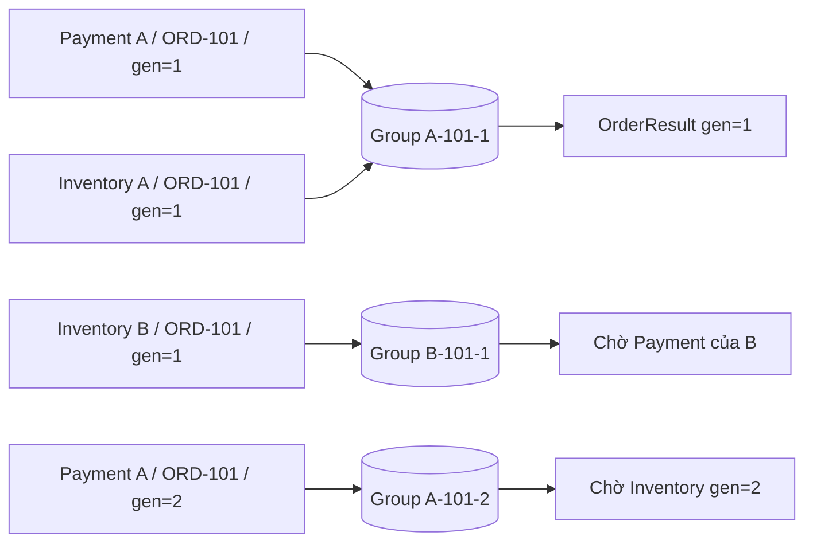
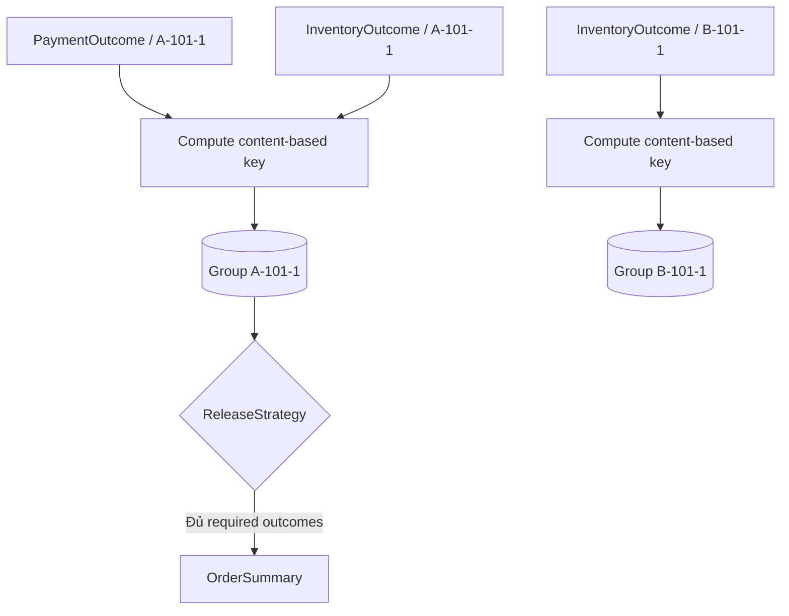
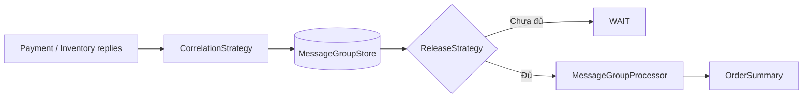
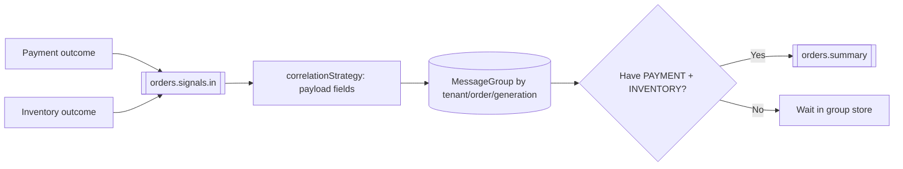
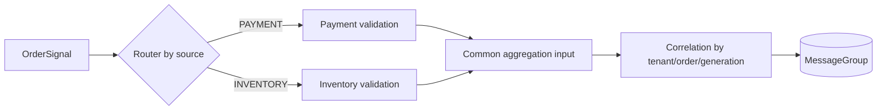
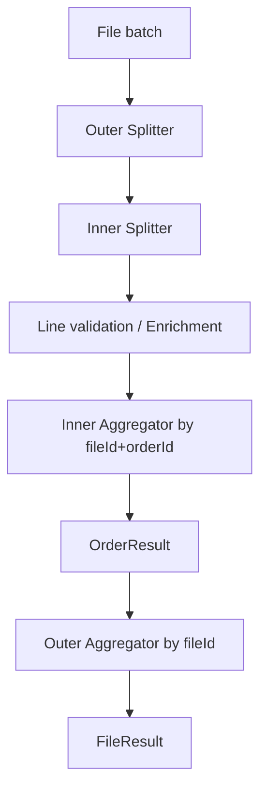
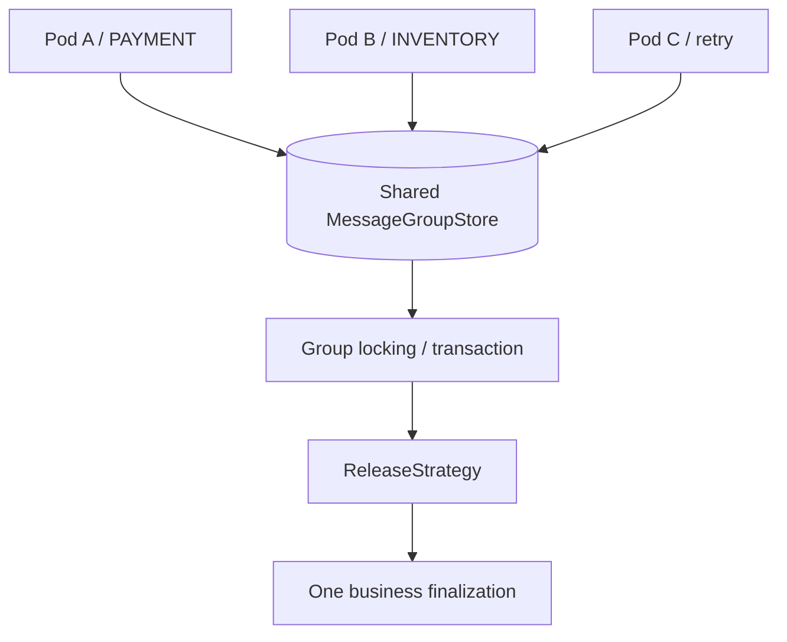

# Correlation Identifier xác định cùng một luồng

Trong một hệ thống thương mại điện tử, sau khi tiếp nhận một đơn hàng, dịch vụ phát yêu cầu tới hai nhánh: **Payment** kiểm tra thanh toán và **Inventory** kiểm tra tồn kho. Cả hai nhánh có thể hoạt động bất đồng bộ, trả kết quả ở thời điểm khác nhau và đi qua các instance khác nhau. Khi nhận về một kết quả `PAYMENT=APPROVED` và một kết quả `INVENTORY=AVAILABLE`, làm sao hệ thống biết **hai message đó thuộc cùng một lần xử lý đơn hàng**, chứ không phải hai đơn trùng mã ở hai tenant hoặc hai lần đặt hàng khác nhau?

Đó là bài toán **Content-Based Correlation** trong nhóm **Enterprise Integration Patterns (EIP)**. Một **Correlation Identifier** giúp xác định các message cùng liên quan tới một request, workflow, transaction nghiệp vụ hoặc một **message group**. Thay vì phụ thuộc vào thời điểm đến hay ID kỹ thuật của từng message, hệ thống có thể tính **khóa tương quan** từ những trường nội dung có ý nghĩa và được kiểm soát.

Bài **“Correlation Identifier xác định cùng một luồng”** thuộc chương **Content-based correlation** của module `SPRING_INTEGRATION_PATTERN`. Trong quá trình học Spring Integration để xây dựng luồng thông điệp ít phụ thuộc, dễ mở rộng, ta sẽ làm rõ **correlation key**, cách tạo từ payload/header, mối liên hệ với Router, Filter, Transformer, Splitter, Aggregator, Gateway, retry, error channel và tracing; sau đó triển khai Java DSL, kiểm thử JUnit 5, xử lý message lặp, đến muộn, sai nhóm, nhiều instance và bảo mật.

> **Ý chính:** **Correlation Identifier trả lời “message này thuộc cuộc hội thoại/nhóm xử lý nào?”**. Nó **không trả lời** message đi tới channel nào, đã được xử lý thành công chưa, có bị trùng hay không, hoặc là phần thứ mấy trong nhóm. Những câu hỏi đó lần lượt thuộc trách nhiệm của **Router, business state, idempotency và sequence metadata**.

## 1. Vấn đề khi các message đến không theo thứ tự

Giả sử ứng dụng có hai đơn cùng mã hiển thị `ORD-101` nhưng ở hai tenant độc lập:

| Tenant | Order | Lần xử lý | Nhánh | Kết quả |
| --- | --- | --- | --- | --- |
| `TENANT-A` | `ORD-101` | `1` | `PAYMENT` | `APPROVED` |
| `TENANT-B` | `ORD-101` | `1` | `INVENTORY` | `AVAILABLE` |
| `TENANT-A` | `ORD-101` | `1` | `INVENTORY` | `AVAILABLE` |
| `TENANT-A` | `ORD-101` | `2` | `PAYMENT` | `DECLINED` |

Nếu Aggregator chỉ lấy `payload.orderId` làm khóa, cả bốn kết quả có thể bị trộn. Kết quả tưởng như đơn `TENANT-A` đã thanh toán thành công và có hàng, trong khi thông tin lấy từ **hai tenant hoặc hai thế hệ xử lý**.

Một khóa tốt trong ví dụ phải phân biệt ít nhất:

```text
(tenantId, orderId, generation)
```

**Generation** hoặc `workflowAttemptId` ở đây biểu diễn **một lần thực thi nghiệp vụ có thể được phân biệt**. Nó không nhất thiết tăng theo số lần retry kỹ thuật: retry cùng một bước trong cùng workflow thường giữ **cùng generation**, còn bắt đầu một workflow mới có thể dùng generation khác.



**Một khóa tương quan sai có thể nguy hiểm hơn không có khóa:** hệ thống có thể tạo kết quả nghiệp vụ sai một cách hợp lệ về mặt kỹ thuật, khó phát hiện bằng việc chỉ kiểm tra exception.

## 2. “Cùng một luồng” nghĩa là gì?

Trong EIP, “cùng một luồng” ở đây là một **phạm vi hội thoại hoặc nhóm nghiệp vụ** do ứng dụng định nghĩa, không nhất thiết là một thread, một bean `IntegrationFlow` hay một TCP connection.

Ví dụ:

- Cùng một **đơn hàng và lần xác minh**.
- Cùng một **yêu cầu báo giá** được gửi cho Pricing, Inventory và Promotions.
- Cùng một **batch** được Splitter tách thành nhiều phần.
- Cùng một **workflow thanh toán** gồm yêu cầu, kết quả ngân hàng và thông báo.
- Cùng một **đợt đồng bộ** có thể diễn ra trên nhiều pod.

Hai message **có thể thuộc cùng một luồng** dù đi qua hai topic, hai channel, hai service hoặc đến cách nhau nhiều phút. Ngược lại, hai message tới **cùng một channel** chưa chắc thuộc cùng một luồng.

### 2.1. Scope phải được viết thành hợp đồng

| Câu hỏi | Ví dụ cần quyết định |
| --- | --- |
| Một nhóm tương ứng với điều gì? | Một lần xác minh đơn hàng. |
| Ai cấp ID? | Ingress/workflow service được tin cậy. |
| Những trường nào tạo khóa? | `tenantId, orderId, generation`. |
| Khóa có ổn định qua retry không? | Có, nếu vẫn là cùng workflow generation. |
| Khi nào tạo khóa mới? | Khi nghiệp vụ bắt đầu vòng xác minh mới. |
| Khi nào group hoàn tất/hết hạn? | Đủ outcomes bắt buộc hoặc deadline. |
| Message đến sau completion đi đâu? | Ignore/quarantine/reconcile theo policy. |
| Key có thể bị client giả mạo không? | Không chấp nhận tenant/group ID chưa được xác thực. |

Không có một **correlation scope mặc định** phù hợp mọi hệ thống. Cần định nghĩa nó trước khi viết biểu thức SpEL hoặc cấu hình Aggregator.

## 3. Correlation Identifier khác những ID nào?

| Định danh | Mục đích | Có thể giống Correlation ID không? |
| --- | --- | --- |
| **Message ID** | Nhận diện **một message cụ thể** trong tầng messaging. | Có thể được dùng để khởi tạo correlation cho các part, nhưng không ổn định mặc định qua message mới/replay. |
| **Correlation Identifier** | Nhận diện **một hội thoại/message group**. | Là khái niệm chính của bài. |
| **Business ID** | Nhận diện đối tượng nghiệp vụ, như `orderId`. | Có thể là **một thành phần** của khóa, thường chưa đủ một mình. |
| **Causation ID** | Cho biết event được gây ra trực tiếp bởi message/event nào trước đó. | Khác: một causal chain có thể gồm nhiều group. |
| **Trace ID / span ID** | Theo dõi thực thi và độ trễ qua các service. | Có liên quan khi quan sát, nhưng không mặc nhiên là group identity. |
| **Idempotency key** | Ngăn thực thi side effect trùng khi retry/redelivery. | Có thể dùng một phần business key, nhưng phải gắn với thao tác cần chống trùng. |
| **Routing key** | Chọn channel, partition hoặc consumer đích. | Không đồng nghĩa correlation. |
| **`sequenceNumber`** | Xác định thứ tự của một part **trong nhóm**. | Không thể tự nhận diện nhóm. |
| **`sequenceSize`** | Số part dự kiến của nhóm khi biết trước. | Không nhận diện nhóm hoặc số phần đã xử lý thành công. |
| **Claim Check token** | Tham chiếu dữ liệu đã cất trong store. | Không tự là correlation hoặc authorization. |

### 3.1. Ví dụ các ID cùng tồn tại

```text
messageId       = UUID-8921
tenantId        = TENANT-A
orderId         = ORD-101
generation      = 1
correlationKey  = (TENANT-A, ORD-101, 1)
causationId     = UUID-7100
traceId         = trace-abc
idempotencyKey  = TENANT-A:ORD-101:CAPTURE_PAYMENT
routingKey      = PAYMENT
```

Không bắt buộc tất cả hệ thống dùng chính xác những trường trên. Điểm quan trọng là **mỗi giá trị có hợp đồng khác nhau**, không tái sử dụng một ID vì “trong log trông chúng giống nhau”.

### 3.2. Vì sao dùng `MessageHeaders.ID` có thể sai?

Trong Spring Messaging, `MessageHeaders.ID` nhận diện một message. Nếu cùng đơn được gửi dưới dạng hai event mới, chúng có thể có **hai message ID khác nhau**. Nếu Aggregator dùng message ID làm group key cho các event độc lập, nó sẽ **không bao giờ nhóm chúng** dù `orderId` giống nhau.

Mặt khác, sau một Splitter tiêu chuẩn, các part có thể được gắn correlation dựa trên **ID message gốc**. Điều này hữu ích trong **một lần split**, nhưng không tự giải quyết nhu cầu gom các reply **từ các message gốc khác nhau** theo business workflow.

## 4. Content-Based Correlation hoạt động thế nào?

**Content-Based** nghĩa là **xác định correlation từ nội dung có ý nghĩa**, thường là field trong payload hoặc metadata nghiệp vụ đã được chuẩn hóa. Ví dụ:

```json
{
  "tenantId": "TENANT-A",
  "orderId": "ORD-101",
  "generation": 1,
  "source": "PAYMENT",
  "status": "APPROVED",
  "eventId": "EVT-0101"
}
```

Ta tính:

```text
groupKey(message) =
    CorrelationKey(
        message.payload.tenantId,
        message.payload.orderId,
        message.payload.generation
    )
```

Hai message có cùng `groupKey` sẽ được đưa vào **cùng logical group**, bất kể:

- Chúng đến theo thứ tự Payment–Inventory hay Inventory–Payment.
- Chúng đi qua các Router/Transformer khác nhau.
- Chúng được xử lý bởi các worker ở JVM khác nhau, **nếu** hạ tầng group store hỗ trợ.
- Chúng được gửi lại trong cùng generation theo chính sách replay.

Nhưng tính khóa giống nhau **chưa đủ để khẳng định chúng có quyền ở cùng nhóm**. Cần xác thực tenant, nguồn phát và schema trước khi correlation.



### 4.1. Trích correlation ở ingress hay khi Aggregator nhận?

Có hai hướng:

**A. Tính trực tiếp từ payload khi vào Aggregator.** `correlationStrategy` đọc những field đã validate trong message. Cách này phù hợp nếu mọi reply đều giữ cùng schema.

**B. Tính một correlation key từ sớm và đưa vào header đã kiểm soát.** Hữu ích khi downstream Transformer đổi kiểu payload hoặc khi broker adapter cần metadata chung. Tuy nhiên, phải giữ header qua các ranh giới và không tin giá trị caller tự khai.

| Cách | Lợi ích | Rủi ro |
| --- | --- | --- |
| Payload-based | Dựa vào hợp đồng dữ liệu nghiệp vụ, không phụ thuộc header kỹ thuật bị mapper loại. | Payload có thể thay đổi schema; cần type validation. |
| Header-based | Nhanh và thống nhất giữa các loại payload. | Header mất hoặc bị giả mạo; dễ xung đột với sequence header do EIP khác sinh. |
| Typed group key ở ứng dụng | Rõ tenant/order/generation, tránh ghép chuỗi mơ hồ. | Phải đảm bảo serialization và compatibility khi dùng persistent store. |

## 5. Thiết kế Correlation Key an toàn

### 5.1. Tránh ghép chuỗi dễ va chạm

Ví dụ kém an toàn:

```java
String key = tenantId + orderId;
```

Hai cặp `("AB","C")` và `("A","BC")` đều cho `"ABC"`. Ngay cả dùng dấu phân cách `tenantId + ":" + orderId`, nếu ID có thể chứa dấu hai chấm thì phải escape hoặc dùng canonical encoding.

Một lựa chọn ở lớp ứng dụng là **typed key**:

```java
// CorrelationKey.java
import java.io.Serializable;

public record CorrelationKey(
    String tenantId,
    String orderId,
    long generation
) implements Serializable {
    public CorrelationKey {
        if (tenantId == null || tenantId.isBlank()
                || orderId == null || orderId.isBlank()
                || generation < 1) {
            throw new IllegalArgumentException(
                "Invalid correlation identity");
        }
    }
}
```

`record` mang theo `equals()`/`hashCode()` theo giá trị, thuận tiện làm group key **trong JVM**. Với persistent `MessageGroupStore`, phải xác minh cách backend serialize/index key, các hạn chế về class version và tính nhất quán khi deploy nhiều instance. Có thể chọn **canonical String/UUID được cấp và lưu bền** làm group ID nếu phù hợp hơn.

### 5.2. Chuẩn hóa field trước khi tạo khóa

Những giá trị có thể gây lệch nhóm:

```text
orderId = "ORD-101"
orderId = "ord-101"
orderId = " ORD-101 "
```

Nếu domain quy định các chuỗi này cùng một order, hãy **chuẩn hóa tại trusted ingress** và duy trì một representation thống nhất. Nhưng **không tự lowercase mọi ID** nếu hệ thống nguồn coi chữ hoa/chữ thường là hai ID khác nhau.

Nên xác định:

- Field nào là bắt buộc, có giá trị null/rỗng không?
- Business ID có **duy nhất trong tenant** hay chỉ trong một cửa sổ thời gian?
- ID có phân biệt hoa/thường hoặc khoảng trắng không?
- Khi có migration, hai phiên bản schema có tạo **cùng group key** hay không?
- Có yêu cầu chống trộn **tenant, region hoặc environment** không?

### 5.3. Retry và generation

`generation` không phải số lần thử network:

```text
Workflow gen=1:
  Payment attempt 1 → timeout
  Payment attempt 2 → APPROVED
  Inventory attempt 1 → AVAILABLE
  → cùng correlation group gen=1

Workflow gen=2:
  Người dùng yêu cầu xác minh lại đơn sau khi sửa thông tin
  → group mới gen=2
```

Nếu tăng `generation` mỗi lần retry, reply của attempt 1 và attempt 2 có thể bị chia thành **hai nhóm không bao giờ đủ**. Ngược lại, nếu dùng mã đơn thuần mà không phân biệt lần xử lý mới, **reply đến muộn của gen=1 có thể gây ô nhiễm gen=2**.

## 6. Từ Correlation Identifier đến Message Group

**Correlation Strategy** của Aggregator quyết định message thuộc **group nào**. **Release Strategy** trả lời nhóm đã có **đủ message/outcome cần chờ** hay chưa. **MessageGroupProcessor** dựng output sau khi được release.



| Thành phần | Câu hỏi nó giải quyết | Nếu sai |
| --- | --- | --- |
| **CorrelationStrategy** | Reply này thuộc group nào? | Trộn đơn, chia một đơn thành nhiều nhóm. |
| **MessageGroupStore** | Nhóm đã nhận những message nào? | Mất dữ liệu khi restart/concurrency. |
| **ReleaseStrategy** | Đủ những outcome bắt buộc chưa? | Release sớm hoặc chờ vô hạn. |
| **MessageGroupProcessor** | Output đầy đủ, thành công hay thất bại? | Trả READY dù có outcome REJECTED. |
| **Expiry/late policy** | Nhóm thiếu/hết hạn/trả lời muộn xử lý sao? | Memory leak, duplicate finalization, trạng thái sai. |

**Một correlation key đúng không tự quyết định khi nào xong.** Hai message cùng nhóm có thể chỉ là hai reply Payment do retry; nếu cần Inventory mà nó chưa tới, nhóm **chưa đủ**.

## 7. Ví dụ Java: dữ liệu và khóa correlation

Ví dụ dùng Java có hỗ trợ `record`, Spring Integration Java DSL và JUnit 5. Hai role bắt buộc là `PAYMENT` và `INVENTORY`. Ta giả định các event đã được xác thực và có nội dung canonical tại ingress.

### 7.1. DTO của outcome

```java
// OrderSignal.java
public record OrderSignal(
    String tenantId,
    String orderId,
    long generation,
    String source,
    String status,
    String eventId
) {
    public OrderSignal {
        if (tenantId == null || tenantId.isBlank()
                || orderId == null || orderId.isBlank()
                || generation < 1
                || source == null || source.isBlank()
                || status == null || status.isBlank()
                || eventId == null || eventId.isBlank()) {
            throw new IllegalArgumentException("Invalid OrderSignal");
        }
    }

    public CorrelationKey groupKey() {
        return new CorrelationKey(tenantId, orderId, generation);
    }
}
```

Hai event độc lập có thể cùng key:

```java
OrderSignal payment = new OrderSignal(
    "TENANT-A", "ORD-101", 1,
    "PAYMENT", "APPROVED", "EVT-P1");

OrderSignal inventory = new OrderSignal(
    "TENANT-A", "ORD-101", 1,
    "INVENTORY", "AVAILABLE", "EVT-I1");

assert payment.groupKey().equals(inventory.groupKey());
```

Trong một dự án production, có thể dùng `enum` cho source/status thay vì String. Ví dụ này dùng String để người học dễ thấy dữ liệu trên broker, nhưng vẫn phải **validate allowlist** trước khi tin một role.

### 7.2. Output cho một nhóm đã hoàn tất

```java
// OrderSummary.java
import java.util.Map;

public record OrderSummary(
    CorrelationKey group,
    String overallStatus,
    Map<String, String> outcomeBySource
) {}
```

Trong thực tế, summary cần các trường nguồn, version, timestamp, error reason và business state hợp đồng quy định. Bài minh họa **cơ chế nhóm**, không đặt `APPROVED` và `AVAILABLE` là đủ cho thanh toán/fulfillment ngoài đời.

## 8. Release Strategy chỉ khi có hai outcome riêng biệt

Không dùng `group.size() >= 2`, vì có thể nhận hai lần cùng Payment. Chọn một strategy **theo tập source**:

```java
// RequiredSourcesReleaseStrategy.java
import java.util.HashSet;
import java.util.Set;
import org.springframework.integration.aggregator.ReleaseStrategy;
import org.springframework.integration.store.MessageGroup;
import org.springframework.messaging.Message;

public final class RequiredSourcesReleaseStrategy
        implements ReleaseStrategy {
    private static final Set<String> REQUIRED =
        Set.of("PAYMENT", "INVENTORY");

    @Override
    public boolean canRelease(MessageGroup group) {
        if (group.getMessages().isEmpty()) {
            return false;
        }

        Set<String> sources = new HashSet<>();
        CorrelationKey expectedKey = null;

        for (Message<?> m : group.getMessages()) {
            if (!(m.getPayload() instanceof OrderSignal signal)) {
                return false;
            }
            if (!REQUIRED.contains(signal.source())) {
                return false;
            }
            if (expectedKey == null) {
                expectedKey = signal.groupKey();
            } else if (!expectedKey.equals(signal.groupKey())) {
                return false;
            }
            sources.add(signal.source());
        }
        return sources.containsAll(REQUIRED);
    }
}
```

**Điều kiện này kiểm tra “đã có outcome terminal của từng nguồn cần thiết”**, không có nghĩa tất cả đều thành công. Message `PAYMENT=DECLINED` vẫn có thể là một kết quả terminal; nhóm có thể release khi Inventory cũng gửi outcome, sau đó processor tạo trạng thái `REJECTED`.

**Giới hạn quan trọng:**

- Hai Payment reply có cùng `eventId` hoặc cùng source không làm release.
- Strategy **không tự loại duplicate** khỏi group và chưa kiểm tra conflict giữa hai outcome cùng source.
- Nếu payload/schema không hợp lệ, việc trả `false` mãi có thể làm group kẹt. **Validate và quarantine trước Aggregator**, kèm timeout/expiry.
- Không nên cho producer không tin cậy tự khai `source=INVENTORY`. Role phải được ràng buộc với nguồn đã xác thực.

## 9. Group Processor tạo kết quả, không đếm tùy tiện

Khi strategy đã cho phép release, processor cần xử lý duplicate cùng source và phát hiện dữ liệu mâu thuẫn:

```java
// OrderSummaryProcessor.java
import java.util.HashMap;
import java.util.Map;
import java.util.Set;
import org.springframework.integration.store.MessageGroup;
import org.springframework.messaging.Message;

public final class OrderSummaryProcessor {
    private OrderSummaryProcessor() {}

    public static OrderSummary build(MessageGroup group) {
        Map<String, OrderSignal> bySource = new HashMap<>();
        CorrelationKey key = null;

        for (Message<?> message : group.getMessages()) {
            if (!(message.getPayload() instanceof OrderSignal signal)) {
                throw new IllegalArgumentException("Unexpected payload");
            }
            if (key == null) {
                key = signal.groupKey();
            }
            if (!key.equals(signal.groupKey())) {
                throw new IllegalStateException("Mixed correlation group");
            }

            OrderSignal previous =
                bySource.putIfAbsent(signal.source(), signal);
            if (previous != null
                    && !previous.status().equals(signal.status())) {
                throw new IllegalStateException(
                    "Conflicting outcomes for " + signal.source());
            }
        }

        if (!bySource.keySet().containsAll(
                Set.of("PAYMENT", "INVENTORY"))) {
            throw new IllegalStateException("Missing required outcome");
        }

        String payment = bySource.get("PAYMENT").status();
        String inventory = bySource.get("INVENTORY").status();
        String overall = "APPROVED".equals(payment)
                && "AVAILABLE".equals(inventory)
                    ? "READY" : "REJECTED";

        return new OrderSummary(key, overall, Map.of(
            "PAYMENT", payment,
            "INVENTORY", inventory));
    }
}
```

Trong một workflow thật, **hai reply khác `eventId` nhưng cùng status** có thể là **hai lần tính hợp lệ** chứ không phải duplicate vô hại. Cần hợp đồng **generation/version**, chính sách chọn outcome cuối và dedup theo `eventId` hoặc `operationId` đã được xác thực. Processor minh họa chỉ coi **status mâu thuẫn** là conflict; validation sâu hơn thuộc nghiệp vụ.

### 9.1. Correlation đúng và business outcome đúng là hai lớp khác nhau

| Nhóm có | Release? | Kết quả ví dụ |
| --- | --- | --- |
| Payment APPROVED | Chưa | Chờ Inventory. |
| Payment APPROVED + Payment APPROVED | Chưa | Cùng một required source. |
| Payment APPROVED + Inventory AVAILABLE | Có | `READY`. |
| Payment DECLINED + Inventory AVAILABLE | Có | `REJECTED`. |
| Payment APPROVED + Inventory OUT_OF_STOCK | Có | `REJECTED`. |
| Payment từ Tenant A + Inventory từ Tenant B | **Không cùng group** | Chờ từng group riêng biệt. |

Một hệ thống chỉ đếm reply sẽ dễ trả kết quả sai khi nhận duplicate. Một hệ thống chỉ nhóm theo `orderId` lại dễ trộn dữ liệu giữa tenant. **Cần cả correlation và release strategy đúng.**

## 10. Tích hợp vào Spring Integration Java DSL

Flow tiếp nhận hai loại `OrderSignal` qua một channel, nhóm theo **khóa tính từ payload**, đợi đủ hai nguồn và tạo một `OrderSummary`. Trong demo, output là `QueueChannel` để dễ test.

```java
// ContentCorrelationConfiguration.java
import org.springframework.context.annotation.Bean;
import org.springframework.context.annotation.Configuration;
import org.springframework.integration.channel.QueueChannel;
import org.springframework.integration.config.EnableIntegration;
import org.springframework.integration.dsl.IntegrationFlow;

@Configuration
@EnableIntegration
public class ContentCorrelationConfiguration {

    @Bean("orders.summary")
    QueueChannel orderSummaries() {
        return new QueueChannel(16);
    }

    @Bean
    IntegrationFlow correlateOrderOutcomes() {
        return IntegrationFlow.from("orders.signals.in")
            .aggregate(spec -> spec
                .correlationStrategy(message ->
                    ((OrderSignal) message.getPayload()).groupKey())
                .releaseStrategy(new RequiredSourcesReleaseStrategy())
                .outputProcessor(OrderSummaryProcessor::build))
            .channel("orders.summary")
            .get();
    }
}
```

**Cách đọc cấu hình:**

1. `orders.signals.in` nhận từng `Message<OrderSignal>`.
2. `correlationStrategy` **đọc nội dung message** để tạo `CorrelationKey(tenantId, orderId, generation)`.
3. Các message có key bằng nhau được lưu trong cùng `MessageGroup`.
4. `RequiredSourcesReleaseStrategy` chờ hai nguồn `PAYMENT` và `INVENTORY`.
5. `OrderSummaryProcessor` phát ra một `OrderSummary` khi nhóm đủ điều kiện.
6. `orders.summary` giữ kết quả trong `QueueChannel` để test; trong production cần consumer/adapter và chính sách persistence/expiry.

**Lưu ý API:** Đoạn DSL sử dụng các API thường gặp của Spring Integration cho `aggregate(spec -> ...)`, `correlationStrategy`, `releaseStrategy` và `outputProcessor`. Khi gắn vào dự án thật, cần xác minh dependency/version và kiểm thử đúng runtime. Bài học chỉ minh họa correlation logic, **không tuyên bố đã chạy Gradle hay database**.

### 10.1. Đây là content-based correlation chứ không phải Header-Based Router

`correlationStrategy` trả về **group ID**, không trả tên channel. Nếu Router dùng `payload.source` để chọn `payment.in` hay `inventory.in`, đó là **routing**. Khi cả hai trả về `orders.signals.in` và Aggregator gom theo `payload.orderId` + các field liên quan, đó là **correlation**.



### 10.2. Nếu dùng header `correlationId`?

Spring Integration có thể dùng header tương quan được tạo bởi Splitter hoặc những endpoint có apply-sequence phù hợp. Nhưng trong ví dụ **chúng ta chủ ý cấu hình correlationStrategy từ payload**, nên không phụ thuộc vào giá trị của header `correlationId`.

Nếu hệ thống vừa có header kỹ thuật do Splitter sinh, vừa có business key trong payload, hãy **quyết định strategy nào là thẩm quyền**. Không để một chỗ gom theo message ID gốc và chỗ khác lại gom theo `orderId` mà không có tài liệu về hai nhóm khác nhau.

## 11. JUnit 5: hai message độc lập vào đúng một nhóm

### 11.1. Test happy path

```java
import static org.junit.jupiter.api.Assertions.*;

import org.junit.jupiter.api.Test;
import org.springframework.beans.factory.annotation.Autowired;
import org.springframework.context.ApplicationContext;
import org.springframework.integration.channel.QueueChannel;
import org.springframework.messaging.Message;
import org.springframework.messaging.MessageChannel;
import org.springframework.messaging.support.MessageBuilder;
import org.springframework.test.context.junit.jupiter.SpringJUnitConfig;

@SpringJUnitConfig(ContentCorrelationConfiguration.class)
class ContentCorrelationTest {

    @Autowired ApplicationContext context;

    private void send(OrderSignal signal) {
        MessageChannel input =
            context.getBean("orders.signals.in", MessageChannel.class);
        assertTrue(input.send(
            MessageBuilder.withPayload(signal).build()));
    }

    private QueueChannel output() {
        return context.getBean("orders.summary", QueueChannel.class);
    }

    @Test
    void correlatesPaymentAndInventoryByBusinessContent() {
        send(new OrderSignal(
            "TENANT-A", "ORD-201", 1,
            "INVENTORY", "AVAILABLE", "EVT-I-201"));
        assertNull(output().receive(0));

        send(new OrderSignal(
            "TENANT-A", "ORD-201", 1,
            "PAYMENT", "APPROVED", "EVT-P-201"));

        Message<?> result = output().receive(0);
        assertNotNull(result);
        assertInstanceOf(OrderSummary.class, result.getPayload());

        OrderSummary summary = (OrderSummary) result.getPayload();
        assertEquals(new CorrelationKey(
            "TENANT-A", "ORD-201", 1), summary.group());
        assertEquals("READY", summary.overallStatus());
        assertEquals("APPROVED",
            summary.outcomeBySource().get("PAYMENT"));
        assertEquals("AVAILABLE",
            summary.outcomeBySource().get("INVENTORY"));
        assertNull(output().receive(0));
    }
}
```

**Quan sát:** Inventory đến **trước** Payment nhưng Aggregator vẫn nhóm đúng. Một event `PAYMENT` riêng lẻ **chưa đủ**, và message ID kỹ thuật của hai event có thể khác nhau mà kết quả vẫn ghép được nhờ khóa nội dung.

### 11.2. Test không trộn tenant hoặc generation

Mở rộng trong cùng test class:

```java
@Test
void tenantAndGenerationArePartOfCorrelationScope() {
    send(new OrderSignal(
        "TENANT-A", "ORD-202", 1,
        "PAYMENT", "APPROVED", "EVT-PA-1"));
    send(new OrderSignal(
        "TENANT-B", "ORD-202", 1,
        "INVENTORY", "AVAILABLE", "EVT-IB-1"));
    send(new OrderSignal(
        "TENANT-A", "ORD-202", 2,
        "INVENTORY", "AVAILABLE", "EVT-IA-2"));

    // Cả ba message thuộc ba group khác nhau.
    assertNull(output().receive(0));

    send(new OrderSignal(
        "TENANT-A", "ORD-202", 1,
        "INVENTORY", "AVAILABLE", "EVT-IA-1"));

    Message<?> result = output().receive(0);
    assertNotNull(result);
    OrderSummary summary = (OrderSummary) result.getPayload();
    assertEquals(new CorrelationKey(
        "TENANT-A", "ORD-202", 1), summary.group());
    assertNull(output().receive(0));
}
```

Test kiểm chứng **tenant A generation 1** chỉ hoàn thành khi nhận Inventory tương ứng; Inventory của tenant B và generation 2 không được lấy nhầm để đủ nhóm. Khi viết thêm test, dùng **business key riêng từng test** hoặc cô lập context/group store để tránh state tồn từ những test trước.

### 11.3. Test duplicate trước khi đủ source

```java
@Test
void twoPaymentRepliesDoNotReplaceInventory() {
    send(new OrderSignal(
        "TENANT-A", "ORD-203", 1,
        "PAYMENT", "APPROVED", "EVT-P203-1"));
    send(new OrderSignal(
        "TENANT-A", "ORD-203", 1,
        "PAYMENT", "APPROVED", "EVT-P203-1"));
    assertNull(output().receive(0));

    send(new OrderSignal(
        "TENANT-A", "ORD-203", 1,
        "INVENTORY", "AVAILABLE", "EVT-I203-1"));
    Message<?> result = output().receive(0);
    assertNotNull(result);
    assertEquals("READY",
        ((OrderSummary) result.getPayload()).overallStatus());
    assertNull(output().receive(0));
}
```

Đây là **kiểm thử không release nhầm khi chỉ có duplicate Payment**. Nó không chứng minh consumer idempotency khi gọi API/DB ở các handler trước Aggregator. Nếu group store hoặc framework de-duplicate theo ID kỹ thuật ở tầng khác, cần test với cả **hai message khác MessageHeaders.ID** nhưng cùng `eventId`.

### 11.4. Điều test chưa chứng minh

Các test trên dùng `QueueChannel` và store trong JVM:

- Chưa kiểm thử crash/restart hoặc hai JVM cùng cập nhật group.
- Chưa kiểm thử Kafka/RabbitMQ header mapping, redelivery và transaction.
- Chưa kiểm thử timeout/expiry, late reply sau release.
- Chưa kiểm thử error path khi processor gặp reply mâu thuẫn.
- Chưa kiểm thử một producer không có quyền phát role `INVENTORY`.

Đừng dùng việc một unit/integration test local PASS để khẳng định **exactly-once end-to-end**.

## 12. Header-based correlation hay content-based correlation?

Một hệ thống có thể chuẩn hóa `CorrelationKey` từ nội dung rồi gắn vào header:

```java
import org.springframework.integration.IntegrationMessageHeaderAccessor;
import org.springframework.messaging.Message;
import org.springframework.messaging.support.MessageBuilder;

Message<OrderSignal> withInternalCorrelation(OrderSignal signal) {
    return MessageBuilder.withPayload(signal)
        .setHeader(
            IntegrationMessageHeaderAccessor.CORRELATION_ID,
            signal.groupKey())
        .build();
}
```

**Điều kiện:** chỉ ứng dụng/trusted ingress được phép gắn header điều khiển group; giá trị của client phải được xác minh. Nếu một Transformer đổi payload thành DTO không có `tenantId/orderId`, header có thể là cách giữ group identity qua các bước, nhưng cần kiểm thử header propagation.

| Tình huống | Phương án thường phù hợp |
| --- | --- |
| Reply payload luôn có `tenantId/orderId/generation` | Correlate trực tiếp theo payload. |
| Các reply có kiểu payload khác nhau | Chuẩn hóa về một envelope có group key hoặc dùng header đáng tin. |
| Splitter tạo sequence headers cho cùng input message | Có thể dùng correlation header do Splitter sinh nếu **scope đúng**. |
| Workflow kéo dài qua broker/đa service | Dùng business correlation ID có schema/version/tenant rõ. |
| External client tự cung cấp `correlationId` | Không tin trực tiếp; xác minh ownership và không cho trộn tenant. |
| Data enrichment thay đổi `orderId` hoặc identity | Chốt correlation từ ingress, không tính lại trên field đã thay không kiểm soát. |

**Một metadata mang tên “correlation” chưa chắc có đúng nghĩa theo business**. Tên header không thay thế hợp đồng group identity.

## 13. Correlation khi kết hợp Router, Filter và Transformer

### 13.1. Router chọn đường, Correlation chọn nhóm



**Router** có thể trả `payment.validation` hoặc `inventory.validation` làm destination. **Aggregator** sau đó nhóm theo business content. Nếu Router bỏ một nhánh mà không phát terminal outcome, group có thể **chờ vô hạn**.

**Không dùng routing key `PAYMENT` làm correlation key**: mọi đơn của cùng một nhánh sẽ bị gom chung.

### 13.2. Filter loại một outcome

Nếu Filter trả `false` cho Inventory reply “không có hàng”, Aggregator sẽ không nhận được kết quả Inventory. Nhưng “không có hàng” có thể là **outcome terminal** cần đưa vào group để trả `REJECTED`, **không phải message nên biến mất**.

```text
Sai:
  Inventory OUT_OF_STOCK → Filter false → drop
  Payment APPROVED → Aggregator chờ Inventory mãi

Đúng theo hợp đồng cần cả hai outcome:
  Inventory OUT_OF_STOCK → OrderSignal(INVENTORY, OUT_OF_STOCK)
  Payment APPROVED → OrderSignal(PAYMENT, APPROVED)
  → Aggregator release → OrderSummary(REJECTED)
```

Chỉ dùng Filter drop nếu group release/expiry biết rõ expected outcomes đã thay đổi hoặc nghiệp vụ cho phép một kết quả partial.

### 13.3. Transformer làm mất identity

Nếu một handler:

```java
Message<String> badTransform(Message<OrderSignal> input) {
    return MessageBuilder.withPayload(
        input.getPayload().status()).build();
}
```

thì downstream chỉ có String trạng thái, **không còn tenant/order/generation trong payload**, và một số metadata có thể mất. Cần giữ một **envelope**, thêm header đáng tin được xác thực hoặc dùng Transformer/DSL với semantics copy header đã kiểm thử.

Một DTO có chủ đích:

```java
public record GroupedOutcome(
    CorrelationKey group,
    String source,
    String status,
    String eventId
) {}
```

Nếu chuyển sang `GroupedOutcome`, hãy cập nhật correlation strategy và release strategy để đọc **đúng payload mới**, tránh CastException/SpEL lỗi hoặc nhóm sai.

## 14. Splitter, Aggregator và Resequencer

### 14.1. Correlation của một lần split

Ví dụ:

```text
Input Message<List<OrderLine>> ID=UUID-A
    → Splitter:
       line1: correlationId=UUID-A, seq=1/3, size=3
       line2: correlationId=UUID-A, seq=2/3, size=3
       line3: correlationId=UUID-A, seq=3/3, size=3
```

Những header này có thể đủ để **Aggregator gom lại các part trong một lần split**, nhưng nếu input gốc được replay thành một message khác với ID `UUID-B`, nó có thể tạo một nhóm khác. Muốn nối các part của cùng một business batch qua replay, cần thiết kế stable business group ID, dedup và kiểm soát generation.

### 14.2. Correlation không phải sequencing

| Metadata | Ý nghĩa |
| --- | --- |
| `correlationId` | Các message thuộc nhóm nào. |
| `sequenceNumber` | Một message là phần thứ mấy trong nhóm. |
| `sequenceSize` | Nhóm dự kiến có bao nhiêu phần khi biết N. |

**Resequencer** có thể dùng correlation + sequence để phát message **đúng thứ tự**. **Aggregator** dùng correlation + release strategy để **gộp nhiều message thành kết quả**. Cùng group identity **không tự tạo thứ tự**, và đủ sequenceNumber **không tự chống duplicate**.

### 14.3. Splitter lồng nhau

Một file có ba đơn, mỗi đơn hai dòng. Có ít nhất hai scope:

```text
outer group: fileId
inner group: (fileId, orderId)
```

Nếu chỉ dùng `orderId` làm key, hai file khác nhau chứa cùng order ID có thể bị trộn; nếu chỉ dùng `fileId` cho inner Aggregator, các dòng từ những đơn khác nhau sẽ bị gom cùng một group.

Thiết kế **key riêng cho từng tầng**, và giữ outer context qua các bước:



**Một header phẳng tên `correlationId` không tự đại diện cho mọi tầng cùng lúc.** Có thể cần business keys riêng hoặc một typed correlation context.

## 15. Gateway và Scatter–Gather

### 15.1. Request–reply không chỉ là gom theo orderId

Một Java Gateway có thể che một workflow:

```java
import org.springframework.integration.annotation.MessagingGateway;

@MessagingGateway(defaultRequestChannel = "orders.requests.in")
interface OrderGateway {
    OrderReceipt verify(OrderRequest request);
}

// OrderReceipt, OrderRequest do ứng dụng định nghĩa.
// Cần flow thật có reply path và loại kết quả tương ứng.
```

**Ví dụ `ContentCorrelationConfiguration` ở mục 10 chưa trả `OrderReceipt` cho Gateway**. Nó chỉ đưa `OrderSummary` vào `QueueChannel` phục vụ test. Muốn request–reply cần:

1. Request mang một **correlation scope** do ingress cấp.
2. Scatter gửi việc tới những recipient bắt buộc.
3. Mỗi reply mang lại cùng business key và source đã xác thực.
4. Gather/Aggregator nhóm đúng, release đúng và tạo `OrderReceipt`.
5. Reply được chuyển về caller theo **reply channel/request–reply contract**.
6. Timeout/late reply được xử lý, không gửi hai response cho một request đã hoàn tất.

**Correlation key không tự thay thế replyChannel của Gateway.** Một reply có đúng business key nhưng không có reply path hoặc group processor cần thiết vẫn có thể làm caller timeout.

### 15.2. Scatter–Gather và required recipients

Khi một request được gửi cho Payment, Inventory và tùy chọn Promotions, **requiredSources** có thể là `{PAYMENT, INVENTORY}`, không nhất thiết mọi subscriber đều phải trả reply. Nếu chỉ Pricing và Inventory được chọn với một message, không được chờ Promotions chỉ vì topology có một subscriber như vậy trong cấu hình khác.

Hãy chốt **selected/required recipient set** của từng request và đưa vào **trusted workflow metadata** nếu policy động. Release strategy phải dựa vào tập thực sự cần, không đoán từ `group.size()` hoặc từ những message đã tới.

## 16. Correlation và idempotency khi retry hoặc redelivery

Giả sử Payment đã ghi nhận thanh toán, nhưng reply bị mất:

```text
T1: Payment xử lý event EVT-P1, commit side effect.
T2: Reply tới Aggregator bị timeout/mất.
T3: Broker retry event EVT-P1.
T4: Payment có nguy cơ commit lần nữa.
T5: Aggregator có thể nhận hai Payment replies.
```

**Correlation** bảo đảm Payment reply cùng nhóm với Inventory. Nó **không ngăn Payment xử lý cùng operation hai lần**. Cần:

- Stable **`eventId`** để phát hiện redelivery của cùng message.
- Stable **`operationId`/idempotencyKey` để bảo vệ nghiệp vụ bên ngoài.
- Consumer/repository có cơ chế concurrent-safe dedup/transaction.
- `RetryAdvice` hoặc retry transport có giới hạn và error policy.
- Release strategy đợi **đủ những source duy nhất**.
- Completed-group state để không phát finalization trùng khi reply cũ tới sau.

### 16.1. Không dùng correlation key làm khóa chống trùng toàn bộ workflow

Nếu idempotency key chỉ là `(tenantId, orderId, generation)`, hai operation khác nhau trong cùng group — ví dụ **reserve inventory** và **capture payment** — có thể bị chặn nhầm như là một operation. Một khóa chống trùng thích hợp hơn thường gồm:

```text
(tenantId, orderId, generation, operationType, operationId)
```

Tùy hệ thống, `eventId` có thể nhận diện message cụ thể, còn `operationId` nhận diện side effect cần chỉ làm một lần. Đây là **hợp đồng riêng** và cần persisted state, không chỉ một header.

### 16.2. Duplicate và outcome mâu thuẫn

```text
Group A-101-1:
  PAYMENT APPROVED (event P1)
  PAYMENT DECLINED (event P2)
  INVENTORY AVAILABLE (event I1)
```

Group đủ hai role nhưng Payment có hai kết quả mâu thuẫn. Processor không nên chọn ngẫu nhiên. Cần:

- xác định hai event có thuộc **cùng operation version** hay không;
- phân loại retry duplicate hay event cập nhật trạng thái hợp lệ;
- dùng revision/sequence theo domain khi có thể;
- quarantine hoặc đối soát nếu không xác định được;
- không phát `READY` chỉ vì một trong hai Payment reply là APPROVED.

## 17. Missing, late và expired groups

Một nhóm không nhận đủ outcome có thể do:

- Filter loại message.
- Router chuyển vào nhánh không quay lại Gather.
- Handler gặp exception và không tạo terminal outcome.
- Network/broker giữ hoặc làm mất reply.
- Message bị gắn sai correlation key.
- Payload/header mất các trường group khi qua Transformer.
- Hai workflow generation bị tạo sai hoặc không nhất quán.

### 17.1. Timeout của nhóm khác timeout của Gateway

| Giới hạn | Ý nghĩa |
| --- | --- |
| **Group timeout/expiry** | Message group chưa hoàn tất theo release strategy trong thời hạn. |
| **Gateway reply timeout** | Caller chờ response quá hạn. |
| **HTTP/DB client timeout** | Một dependency không trả lời đúng hạn. |
| **Broker TTL/retention** | Thời hạn message ở transport. |
| **Business deadline** | Tổng thời gian một workflow được phép chờ. |

Gateway có thể timeout **trước khi nhóm đủ**. Một reply đến muộn vẫn có thể vào group sau đó, trừ khi application có late-result/completed-group policy.

### 17.2. Partial result không được giả thành success

Nếu chỉ nhận Payment outcome, một kết quả partial minh họa:

```json
{
  "tenantId": "TENANT-A",
  "orderId": "ORD-101",
  "generation": 1,
  "status": "PENDING",
  "receivedSources": ["PAYMENT"],
  "missingSources": ["INVENTORY"],
  "final": false
}
```

Đây là **schema do ứng dụng tự thiết kế**, không phải output tự sinh của Aggregator khi group timeout. Nếu dùng `sendPartialResultOnExpiry(true)` trong một configuration tương thích, cần **processor biết thiếu source** để trả trạng thái đúng, cùng với group lifecycle/retention.

### 17.3. Late reply và tái mở group

Ví dụ:

```text
T1: Payment APPROVED → group A-101-1
T2: Group hết hạn → PENDING/FAILED theo policy
T3: Inventory AVAILABLE tới muộn
```

Phải chọn rõ:

1. Ignore late reply vì đã hết hạn xử lý.
2. Quarantine và đối soát.
3. Cập nhật trạng thái từ `PENDING` sang `READY` bằng business event có version.
4. Tạo group mới **chỉ khi** đây là workflow generation mới.

Nếu không có completed-group/tombstone hoặc versioned workflow state, một reply muộn có thể gây **double finalization**. Correlation chính xác chỉ đưa nó về đúng group name, **không tự quyết định nhóm đã đóng có thể mở lại hay không**.

## 18. Nhiều instance và Persistent MessageGroupStore

Một service có ba pod:

```text
Pod A nhận PAYMENT for A-101-1
Pod B nhận INVENTORY for A-101-1
Pod C nhận retry PAYMENT for A-101-1
```

Nếu mỗi pod chỉ dùng **in-memory MessageGroupStore** riêng, có thể có ba nhóm “A-101-1” **không nhìn thấy nhau**, và không pod nào release dù các event đã tới hệ thống.



Trong production cần quyết định:

- **Single-owner theo correlation/partition key** để nhóm được xử lý tại một consumer, hoặc **shared group store** với locking/fencing.
- Persistence qua **restart**, với serializer/schema version tương thích.
- Atomicity của **add part → evaluate release → publish output → commit/ack** ở mức hệ thống có thể bảo đảm.
- Recovery và idempotency khi crash giữa các bước.
- Quota, TTL, cleanup cho group chờ.
- Chính sách khi two pods cùng cố release một group.

**Một shared database không tự biến cả flow thành exactly-once end-to-end**. Cần xét transaction boundary của broker, store, downstream DB và output publish riêng.

### 18.1. Correlation key phải ổn định qua rolling deploy

Nếu version A tính `key = tenantId + ":" + orderId`, còn version B tính `key = tenantId + ":" + orderId + ":" + generation`, cùng message có thể vào hai group khác nhau trong rollout. Đây là lỗi **correlation strategy versioning**.

Khi thay đổi schema/key:

1. Thống nhất canonical format và version.
2. Đánh giá những group đang mở theo key cũ.
3. Có migration/drain hoặc chiến lược song song rõ ràng.
4. Test event do hai phiên bản producer/consumer phát trong thời gian rollout.
5. Không đổi thuật toán hash/serialization mà bỏ qua những group persisted cũ.

## 19. Bảo mật: correlation ID là dữ liệu điều khiển nhóm

Một attacker có thể cố gửi message:

```json
{
  "tenantId": "TENANT-B",
  "orderId": "ORD-101",
  "generation": 1,
  "source": "INVENTORY",
  "status": "AVAILABLE",
  "eventId": "FORGED-001"
}
```

Nếu hệ thống tin hoàn toàn payload từ nguồn chưa xác thực, message giả có thể góp phần làm Aggregator **release một nhóm không thuộc quyền caller**.

Biện pháp:

1. **AuthN/AuthZ ở ingress** trước khi dùng tenant/order/source làm correlation key.
2. Xác định `tenantId` từ authenticated context khi cần; không lấy mù từ request.
3. Giới hạn quyền producer theo topic, channel và loại `source`.
4. Validate `orderId` thuộc tenant, generation còn hiệu lực và event schema hợp lệ.
5. Giới hạn số group đang mở, số event/group, tuổi group và kích thước payload.
6. Không dùng email, số tài khoản, token hoặc PII làm correlation ID nếu có thể dùng opaque ID.
7. Không log toàn bộ payload hoặc failed message chứa secrets.
8. Tách quyền đọc group store/DLQ và audit các request truy hồi nhạy cảm.
9. Khi dùng trace/log, sử dụng định danh mờ, retention phù hợp và masking.

**Một key hợp lệ về cú pháp chưa chắc được phép tham gia một business group**. Group membership phải dựa trên dữ liệu **đúng và đáng tin**.

## 20. Observability: theo dõi cả khóa và trạng thái nhóm

Chỉ đo throughput của `orders.signals.in` không cho biết event có vào **đúng group** hay không. Các chỉ số nên có:

| Metric gợi ý | Mục đích |
| --- | --- |
| `correlation_events_received_total` | Tổng message đã vào ranh giới correlation. |
| `correlation_validation_failures_total` | Bị loại vì thiếu/sai tenant, order, generation, source. |
| `correlation_groups_open` | Số group đang chờ. |
| `correlation_group_age_seconds` | Phát hiện group kẹt/quá deadline. |
| `correlation_group_members_total` | Số message trong group, có thể gồm duplicate. |
| `correlation_distinct_sources` | Số required source đã nhận. |
| `correlation_missing_sources_total` | Số group hết hạn thiếu role bắt buộc. |
| `correlation_duplicate_events_total` | Redelivery/duplicate theo identity đã định. |
| `correlation_conflicts_total` | Reply cùng role nhưng nội dung/version mâu thuẫn. |
| `correlation_completed_groups_total` | Số nhóm release theo policy. |
| `correlation_expired_groups_total` | Số group quá hạn chưa hoàn tất. |
| `correlation_late_events_total` | Event đến sau completion/expiry. |
| `correlation_processing_errors_total` | Lỗi strategy/group store/output processor. |
| `gateway_reply_timeouts_total` | Caller timeout, khác group timeout. |

Đây là **gợi ý tên metric**, không phải toàn bộ được Spring Integration tạo sẵn. Không dùng `orderId` hoặc `correlationId` riêng từng message làm **metric label**, vì cardinality cao và có thể làm lộ dữ liệu. Dùng labels hữu hạn như `source=PAYMENT`, `outcome=WAITING`.

### 20.1. Logs có cấu trúc

```text
event=correlated_signal_received
flow=orderVerification
group_ref=<opaque-reference>
source=PAYMENT
generation=1
event_ref=<opaque-event-reference>
outcome=WAITING_FOR_INVENTORY
```

```text
event=correlation_group_released
flow=orderVerification
group_ref=<opaque-reference>
received_sources=PAYMENT,INVENTORY
release_reason=ALL_REQUIRED_SOURCES
overall_status=READY
```

Đây là format do **ứng dụng tự thiết kế**. Một trace giúp liên kết message theo thời gian, nhưng **traceId không thay `group_ref`** nếu một workflow kéo dài qua retry, batch hoặc nhiều trace riêng.

### 20.2. Chẩn đoán Aggregator bị kẹt

1. Những message cần chờ đã được **producer tạo ra** chưa?
2. Chúng có đi qua **đúng channel/broker topic** không?
3. Có message bị **Filter drop** hoặc Router unmatched không?
4. `tenantId/orderId/generation` có cùng canonical representation không?
5. Có nguồn nào gắn sai `source` hay sai workflow generation không?
6. Một Transformer/adapter có làm mất field/header tương quan không?
7. Có duplicate Payment nhưng vẫn thiếu Inventory không?
8. Group store có bị **chia theo pod**, mất trạng thái sau restart hoặc lỗi locking không?
9. Group timeout/expiry và late-result policy có chạy không?
10. Group đã release nhưng output channel hoặc reply path bị lỗi không?

Không sửa lỗi correlation bằng cách tăng timeout vô hạn: nếu hai message **đã bị chia vào hai group khác nhau**, chờ lâu thêm không làm chúng tự hội tụ.

## 21. Sai lầm thường gặp

### Sai lầm 1 — “Message vào cùng một channel tức là cùng workflow”

**Sai.** Một channel nhận event của nhiều order và tenant. Cần group key.

### Sai lầm 2 — “`orderId` lúc nào cũng là correlation key đủ”

**Sai.** Order ID có thể chỉ duy nhất trong tenant hoặc được dùng lại ở nhiều generation. Phải xét scope.

### Sai lầm 3 — “`MessageHeaders.ID` chính là business correlation ID”

**Không mặc nhiên.** ID từng message có thể khác nhau; Splitter có convention riêng cho một lần split.

### Sai lầm 4 — “Correlation bằng nhau thì mọi event đều hợp lệ”

**Sai.** Còn cần validate source, ownership, generation, event type và schema.

### Sai lầm 5 — “Đủ hai message là Payment + Inventory”

**Sai.** Có thể là hai Payment duplicate. Release theo required sources/unique outcomes.

### Sai lầm 6 — “Correlation có thể chống trùng thanh toán”

**Sai.** Idempotency phải bảo vệ **operation side effect** bằng identity bền vững và transaction/repository phù hợp.

### Sai lầm 7 — “Trace ID chính là group key tốt nhất”

**Không chắc.** Trace có thể thay khi retry hoặc qua process khác; group identity phải theo business contract.

### Sai lầm 8 — “Header correlation luôn được giữ qua mọi adapter”

**Sai.** Serialization/header mapping có thể đổi/loại bỏ field. Cần test đúng đường đi.

### Sai lầm 9 — “Filter bỏ Inventory không ảnh hưởng Aggregator”

**Sai.** Group có thể thiếu required source và chờ mãi; cần terminal outcome hoặc expiry.

### Sai lầm 10 — “Persistent broker tự làm correlation group bền vững”

**Sai.** Broker durability và MessageGroupStore persistence là hai ranh giới riêng.

### Sai lầm 11 — “Gateway timeout nghĩa là group đã bị hủy”

**Sai.** Group/handler có thể tiếp tục; cần late reply và finalization policy.

### Sai lầm 12 — “Ghép chuỗi ID nào cũng thành correlation key duy nhất”

**Sai.** Có thể va chạm khi không escape/canonicalize; typed key hoặc encoding chuẩn sẽ an toàn hơn.

## 22. Bài tập thực hành

**Bài 1 — Chọn scope.** Có hai tenant cùng `orderId` và hai generation xử lý. Thiết kế `CorrelationKey` an toàn, giải thích vì sao chỉ dùng `orderId` là sai.

**Bài 2 — Đọc trace.** Một Payment reply có `messageId=P1`, Inventory reply có `messageId=I1` nhưng cùng business key. Xác định group identity và phân biệt với event/correlation/causation/trace IDs.

**Bài 3 — Java DSL.** Chạy `ContentCorrelationConfiguration` với Payment trước Inventory, rồi đảo thứ tự. Kiểm tra cùng một `OrderSummary` được tạo, không phụ thuộc arrival order.

**Bài 4 — Tenant isolation.** Gửi Payment của tenant A và Inventory của tenant B cùng `orderId`. Kiểm tra group chưa release; thêm Inventory của tenant A và xác minh kết quả đúng.

**Bài 5 — Generation.** Cho Inventory ở generation 2 tới trong khi group generation 1 thiếu Inventory. Chứng minh group 1 không được release nhầm.

**Bài 6 — Duplicate.** Gửi hai Payment cùng eventId rồi Inventory. Release strategy không được coi hai Payment là đủ hai source.

**Bài 7 — Conflicting outcomes.** Gửi Payment APPROVED rồi DECLINED cùng group; thiết kế quarantine/error path và không phát READY sai.

**Bài 8 — Filter và Router.** Dựng hai nhánh từ OrderSignal, một nhánh bị Filter drop. Thiết kế terminal rejected outcome để Aggregator không đợi vô hạn.

**Bài 9 — Transformer.** Thay payload `OrderSignal` bằng DTO khác; thử dùng header correlation nội bộ đã validate và kiểm tra header mapping qua adapter.

**Bài 10 — Nested Splitter.** File chứa ba đơn, mỗi đơn có hai line. Thiết kế outer và inner correlation keys, giải thích tại sao không dùng một header phẳng cho cả hai scope.

**Bài 11 — Scatter–Gather.** Payment, Inventory và Promotions tùy chọn: định nghĩa requiredSources per request, release strategy và output processor để không chờ nhánh chưa được gửi.

**Bài 12 — Gateway timeout.** Caller chỉ chờ hai giây, Inventory về sau năm giây. Thiết kế PENDING/status query, late-result policy và idempotency khi caller retry.

**Bài 13 — Multi-instance.** Hai pod nhận hai outcome cùng key. So sánh store in-memory tách biệt với shared persistent MessageGroupStore, đề xuất partitioning/locking.

**Bài 14 — Security.** Client cố khai tenant khác và giả `source=INVENTORY`. Định nghĩa validation/authorization tại ingress trước khi group.

**Bài 15 — Observability.** Xây dashboard nhận biết group chờ, thiếu source, duplicate, conflicts, group age và late replies mà không đưa business ID vào metric label.

## 23. Checklist trước khi triển khai Content-Based Correlation

| Câu hỏi | Điều cần kiểm chứng |
| --- | --- |
| “Cùng một luồng” có được định nghĩa cụ thể? | Có scope: order, batch, request hay workflow generation. |
| Group key có đủ các thành phần? | Tenant/owner, business ID, generation khi cần. |
| Key có canonical và không va chạm? | Có type/encoding chuẩn, validation và equality nhất quán. |
| Ai tạo/cấp correlation? | Trusted ingress hoặc workflow service. |
| Correlation ổn định qua retry? | Có, nếu cùng logical workflow; generation mới khi thật sự mới. |
| Có phân biệt các loại ID? | Message, event, causation, trace, routing, idempotency và claim token. |
| Payload/header có đáng tin? | Auth, schema, tenant ownership và source allowlist. |
| Có nhiều message type không? | Chuẩn hóa envelope/header, kiểm thử type/serialization. |
| Aggregator có correlationStrategy rõ không? | Không nhầm với routing key hoặc message ID mặc định. |
| ReleaseStrategy có đúng expected sources? | Chống duplicate và phản ánh required outcomes. |
| Processor có phân biệt completion với success? | Có READY/REJECTED/PENDING hoặc domain outcome tương đương. |
| Có Filter/Router làm mất outcome? | Có terminal reject/error outcome hoặc group expiry. |
| Có Splitter/Resequencer không? | Sequence metadata theo đúng scope, không thay business key bừa bãi. |
| Có nested groups hoặc fan-out động? | Mỗi cấp/recipient có correlation và release contract riêng. |
| Có Gateway request–reply không? | Có reply path, deadline và late-result policy. |
| Retry/redelivery có thể gây duplicate? | Có eventId/operationId và idempotent handlers. |
| Có group timeout/expiry không? | Có partial/fail/quarantine/cleanup strategy rõ. |
| Có multi-instance không? | Shared store hoặc single-owner theo key, locking/recovery rõ. |
| Rolling deploy có đổi key format không? | Có versioning, migration/drain cho nhóm đang mở. |
| Có tránh lộ PII/secret qua ID/log? | Có opaque IDs, masking, phân quyền, không high-cardinality labels. |
| Có test negative/failure injection không? | Trộn tenant, sai generation, duplicate, late, restart và malformed payload. |

## Kết luận

**Correlation Identifier xác định cùng một luồng** là nền tảng để các message được xử lý phân tán vẫn có thể được nhận diện là **cùng một nhóm nghiệp vụ**. Với **Content-Based Correlation**, khóa nhóm được suy ra từ những trường nội dung đáng tin như **tenant, business ID và workflow generation**, thay vì từ thứ tự message đến, channel mà chúng đi qua hoặc ID kỹ thuật của riêng từng message.

Trong Spring Integration, **CorrelationStrategy** xác định group, **ReleaseStrategy** quyết định khi nào đủ outcome và **MessageGroupProcessor** tạo kết quả. Ba trách nhiệm phải được thiết kế cùng nhau, song vẫn phân biệt với **Router, Filter, Transformer, Splitter, Resequencer, Gateway, retry, error channel và idempotency**. Một hệ thống có correlation đúng còn cần **validation, authorization, group timeout, durable state, duplicate/late handling và observability** để không trộn đơn giữa các tenant, không kết luận quá sớm và không thực hiện side effect lặp khi message được gửi lại.
