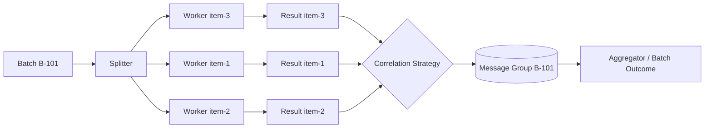
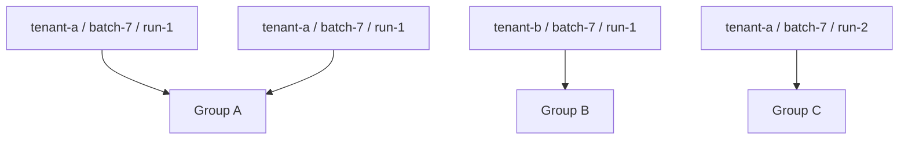
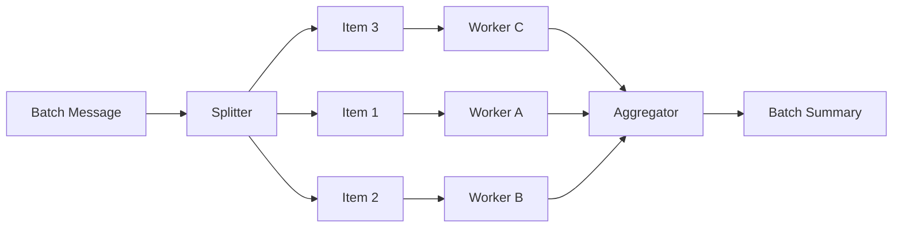
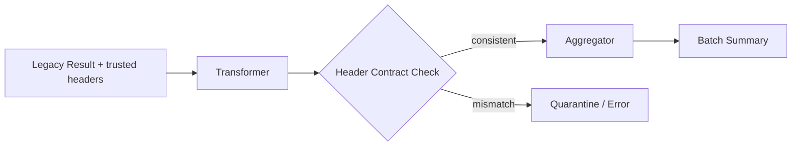
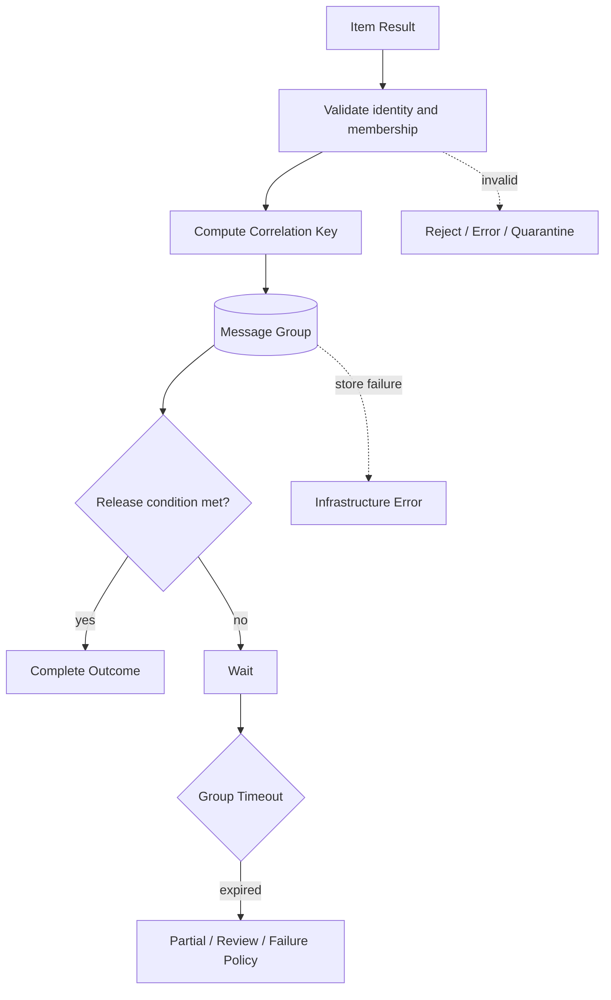
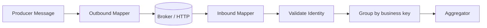
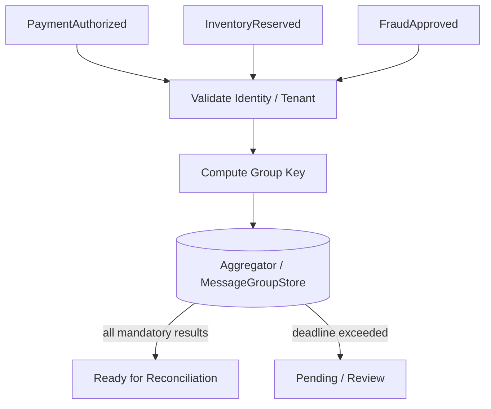

# Correlation key theo payload hoặc header

Trong **Enterprise Integration Patterns (EIP)**, *Correlation Identifier* liên kết các message cùng thuộc một cuộc hội thoại hoặc một đơn vị công việc. **Content-Based Correlation** đi thêm một bước: hệ thống **xác định khóa tương quan từ nội dung nghiệp vụ** thay vì chỉ dựa vào một metadata đã được điền sẵn.

Ví dụ, một đơn hàng có ba dòng được Splitter tách ra, xử lý song song, rồi Aggregator thu các kết quả. Ba reply có thể về không theo thứ tự, mang ba `MessageHeaders.ID` khác nhau, nhưng vẫn cần thuộc **cùng một nhóm**. Ta có thể lấy khóa từ các trường `tenantId`, `batchId`, `generationId` trên payload; hoặc lấy một **header tương quan** đã được upstream đáng tin cậy tạo ra từ đúng các trường đó.

Hai cách có thể cho cùng kết quả nếu hợp đồng được quản lý tốt. Nhưng chúng có những rủi ro khác nhau: payload có thể bị Transformer thay đổi; header có thể bị adapter làm mất, bị ghi đè, hoặc bị client giả mạo. Một khóa tương quan sai có thể làm **ghép dữ liệu của hai tenant**, tạo nhóm không bao giờ release, phát kết quả trùng hoặc khiến Aggregator chờ tới timeout.

Bài **“Correlation key theo payload hoặc header”** thuộc chương **Content-based correlation** của module **SPRING_INTEGRATION_PATTERN**. Trong module này, ta học triển khai Enterprise Integration Patterns với Spring Integration để xây dựng các luồng thông điệp ít phụ thuộc, dễ mở rộng; thực hành Router, Filter, Transformer, Splitter, Aggregator, Gateway, retry, error channel, correlation, cùng kiểm thử và quan sát các nhánh xử lý.

**Mục tiêu:** biết cách thiết kế identity của nhóm, chọn nguồn khóa từ payload hay header, triển khai `correlationStrategy` bằng Spring Integration Java DSL, chống giả mạo/trộn nhóm, quản lý khóa qua transport và retry, cũng như viết integration tests cho nhiều nhóm chạy xen kẽ.

## 1. Correlation key trả lời câu hỏi gì?

Hãy xét một batch `B-101` gồm ba yêu cầu kiểm tra tồn kho. Các worker trả kết quả theo thứ tự `item-3`, `item-1`, `item-2`. Aggregator phải nhận ra chúng đều thuộc cùng batch.



**Correlation strategy** là hàm ánh xạ từ message sang **group key**:

\[
K : Message \rightarrow GroupId
\]

Hai message có cùng `K(message)` thường được đưa vào cùng **message group** trong phạm vi Aggregator/Resequencer và MessageGroupStore tương ứng. Vì vậy, nếu key quá rộng, hai giao dịch khác nhau có thể bị gộp; nếu key quá hẹp hoặc thay đổi theo mỗi lần gửi, những phần của cùng giao dịch bị chia thành nhiều nhóm.

Một khóa đúng cần thỏa ít nhất ba thuộc tính:

1. **Nhất quán:** tất cả message của cùng một đơn vị cần tập hợp sinh ra cùng key.
2. **Phân biệt:** hai đơn vị công việc không được tập hợp cùng nhau phải có key khác.
3. **Ổn định trong vòng đời nhóm:** retry, Transformer, broker redelivery hoặc restart không làm key tự thay đổi.

Correlation không tự trả lời **khi nào nhóm hoàn chỉnh**, **thứ tự phát** hoặc **side effect đã commit chưa**. Các trách nhiệm ấy thuộc release strategy, Resequencer, downstream transaction và idempotency.

## 2. Content-Based Correlation khác một correlation ID có sẵn

Một hệ thống có thể dùng header `correlationId` do upstream cấp. Nhưng nếu header ấy không có hoặc không đáng tin, một thành phần có thể **tính correlation key từ payload**.

```text
Message A payload:
  tenantId     = tenant-a
  batchId      = B-101
  generationId = run-1
  itemId       = item-1

Message B payload:
  tenantId     = tenant-a
  batchId      = B-101
  generationId = run-1
  itemId       = item-2

Derived correlation key for both:
  (tenant-a, B-101, run-1)
```

Lưu ý: `itemId` **không nằm trong group key** vì hai item khác nhau cần vào cùng nhóm. Nhưng `itemId` vẫn cần để chống duplicate và biết đã nhận những phần tử nào.

Với **content-based correlation**, việc lấy key có thể được thực hiện:

- **Trực tiếp:** `correlationStrategy` đọc `tenantId`, `batchId`, `generationId` từ payload.
- **Gián tiếp:** một bước ở ingress đọc payload, xác thực, tạo header `businessGroupKey`, rồi Aggregator dùng header đó.
- **Kết hợp:** strategy đọc header nhưng đối chiếu nó với payload/manifest tin cậy, bảo đảm không bị lệch.

Cách thứ hai **vẫn có thể bắt nguồn từ content**, nhưng sau khi được chốt ở boundary, header trở thành metadata điều phối. Điều này thuận tiện nếu các bước Transformer về sau thay payload mà vẫn cần giữ khóa nhóm.

## 3. Những ID thường bị nhầm với correlation key

| Giá trị | Dùng để làm gì? | Có luôn phù hợp làm group key? |
| --- | --- | --- |
| Spring `MessageHeaders.ID` | Nhận diện một message cụ thể trong framework | **Không**: mỗi phần thường có ID riêng, có thể đổi khi transform |
| `businessEventId` | Idempotency và audit của một sự kiện | Không nếu mỗi item/result có event ID riêng |
| `itemId` / `lineId` | Nhận diện phần tử trong batch | Không, vì tách mỗi item thành nhóm riêng |
| `orderId` | Nhận diện đơn hàng | Chỉ khi không có nhiều lần xử lý/nhóm chồng nhau |
| `batchId` | Nhận diện batch | Có điều kiện: phải đủ scope duy nhất |
| `tenantId` | Cách ly tenant | Chưa đủ; gom tất cả batch cùng tenant thành một |
| `generationId` / `runId` | Phân biệt lần chạy hợp lệ | Thường cần nếu cùng batch được chạy lại |
| `correlationId` header | Khóa điều phối message group theo contract | Phù hợp khi được tạo và bảo toàn đáng tin cậy |
| `traceId` | Nối trace/span quan sát | Không mặc định; một trace có thể chứa nhiều nhóm |
| Kafka partition key | Phân vùng/ordering transport | Không tự đồng nghĩa business group identity |

**Cùng một business request có thể có nhiều event**, và một trace có thể bao gồm nhiều batch. Việc chọn một trường chỉ vì tên nó có chữ “ID” thường là nguyên nhân gây các bug nhóm sai khó tái hiện.

### Ví dụ: dùng order ID quá rộng

```text
tenant-a / order-42 / run-1 / result-item-1
tenant-a / order-42 / run-2 / result-item-1
```

Nếu group key là `order-42`, message của hai lần chạy có thể bị trộn. Nếu run-1 đã hoàn tất nhưng run-2 đang chạy lại, hệ thống có thể đếm đủ dựa trên một phần của run-1 và một phần của run-2.

Một khóa đầy đủ hơn có thể là:

```text
tenant-a / order-42 / run-1
tenant-a / order-42 / run-2
```

Chỉ thêm `runId` khi thật sự có ý nghĩa: nếu một retry của **cùng lần chạy** tự tạo runId mới, những message cần được ghép lại sẽ lại bị chia nhóm.

## 4. Chọn khóa từ payload hay header: bảng so sánh

| Tiêu chí | Key từ payload | Key từ header |
| --- | --- | --- |
| Nguồn dữ liệu | Trường nghiệp vụ của payload | Metadata message do producer/adapter cung cấp |
| Dễ kiểm chứng | Có thể kiểm tra trực tiếp business fields | Cần biết ai tạo header, có bị sửa hay không |
| Sau Transformer đổi payload | Có thể mất các field cần tính key | Có thể giữ được header nếu propagation đúng |
| Khi qua broker | Payload/envelope thường có hợp đồng serialize rõ | Tùy header mapper và schema transport |
| Rủi ro giả mạo | Payload từ client có thể không đáng tin | Raw header từ client cũng có thể bị giả mạo |
| Rủi ro drift | Mapping/schema đổi khiến key đổi | Header cũ không khớp payload mới |
| Tái sử dụng | Mọi endpoint có business payload thích hợp đều tính lại được | Các endpoint không cần hiểu payload vẫn có thể group |
| Test bắt buộc | Trường nguồn, normalize, scope, stability | Header presence/type, provenance, propagation, consistency |

**Không có lựa chọn mặc định đúng trong mọi hệ thống.**

- Nếu payload chứa business identity bất biến, dễ kiểm chứng và ít đổi dạng trước Aggregator, **tính trực tiếp từ payload** thường đơn giản.
- Nếu nhiều Transformer/adapter làm thay đổi payload nhưng tất cả bước vẫn cùng một workflow, **header đã được chốt ở trusted ingress** có thể giảm coupling.
- Nếu một hệ thống tiếp nhận dữ liệu không tin cậy, điều quan trọng nhất là **kiểm tra/chuẩn hóa nguồn identity và ranh giới quyền**, không phải chọn payload hay header cho nhanh.

## 5. Khóa phải gồm đủ phạm vi tenant, batch và lần xử lý

Với ứng dụng đa tenant, một khóa chỉ dựa vào `batchId` thường không an toàn nếu tenant khác có thể sinh cùng batch ID.



Trong ví dụ:

- `tenant-a/batch-7/run-1` chứa nhiều item và là **một group**.
- `tenant-b/batch-7/run-1` là **group khác**, dù trùng batch ID.
- `tenant-a/batch-7/run-2` là **group khác**, vì đây là lần chạy hợp lệ khác.

**Không được chỉ thêm tenant vào log rồi vẫn dùng batch ID đơn lẻ trong correlation strategy.** Khi key thiếu tenant, MessageGroupStore đã trộn dữ liệu ngay từ đầu.

### Những trường nào không nên nằm trong key?

Tránh dùng những giá trị **thay đổi khi xử lý** như:

- `status=SUCCESS/FAILED`: các phần khác nhau có trạng thái khác nhau.
- `attemptNumber` nếu nhiều attempt của **cùng item trong một generation** phải quy về một kết quả cuối.
- `processingTimestamp`: mỗi message có thời điểm riêng.
- `workerId`: cùng batch có thể qua nhiều worker.
- `messageId` của framework: có thể phát sinh lại.

Nếu logic cần phân biệt attempt làm việc với generation của cả batch, hãy định nghĩa hai trường tách biệt. Đặt một trường `runId` mơ hồ cho cả hai mục đích sẽ khiến correlation thay đổi vô tình khi retry.

## 6. Chuẩn hóa khóa trước khi dùng

Các biểu diễn sau **có cùng ý nghĩa hay không** phụ thuộc business contract:

```text
"tenant-A"  vs "tenant-a"
" B-101 "  vs "B-101"
"00123"    vs "123"
"é"        vs "e" + combining accent
```

Tùy hệ thống, có thể trim, chuẩn hóa Unicode, đổi case hoặc **phải giữ nguyên**. Không nên tự áp `toLowerCase()` cho tenant ID nếu ID phân biệt hoa thường. Với mã có leading zero, chuyển sang số nguyên có thể làm hai giá trị khác nhau trùng nhau.

Nên xác định:

1. **Allowed format** và chiều dài tối đa cho mỗi thành phần.
2. **Canonical representation** được áp dụng cùng cách ở mọi instance.
3. **Nguồn cấp**: tenant được rút từ security context, batch/generation từ nguồn đáng tin.
4. **Version của quy tắc tạo key** nếu cần thay đổi format ở hệ thống đã có nhóm đang mở.
5. **Cách ghép các thành phần không va chạm**.

### Tránh nối chuỗi mơ hồ

Nếu dùng:

```text
tenantId + ":" + batchId
```

thì hai bộ `("a:b", "c")` và `("a", "b:c")` có thể cho cùng chuỗi `"a:b:c"`. Nên dùng:

- Một **record/value object** làm khóa trong phạm vi store hỗ trợ kiểu đó.
- Một khóa có **encoding không mơ hồ** (ví dụ length-prefix cho từng thành phần).
- Một **groupId duy nhất** do server cấp, với tenant/batch mapping bền vững.

Ví dụ code trong bài dùng bộ ký tự `[A-Za-z0-9_-]` với dấu phân cách `|` bị cấm để khóa chuỗi không va chạm do delimiter. Production phải đối chiếu quy tắc ID thực tế; đừng “sửa” dữ liệu không hợp lệ thành một khóa khác mà không ghi nhận.

## 7. Dữ liệu ví dụ cho Content-Based Correlation

Giả sử ba worker tạo result cho cùng một batch.

```java
import java.time.Instant;

record ItemResult(
    String tenantId,
    String batchId,
    String generationId,
    String itemId,
    int expectedCount,
    String status,
    Instant finishedAt
) {
    ItemResult {
        if (expectedCount <= 0 || expectedCount > 10_000
                || status == null
                || status.isBlank()
                || finishedAt == null) {
            throw new IllegalArgumentException(
                "Invalid item result");
        }
    }
}

record BatchSummary(
    String tenantId,
    String batchId,
    String generationId,
    int expectedCount,
    int receivedUniqueCount,
    String status,
    java.util.List<ItemResult> items
) {}
```

`expectedCount` biểu thị **số item kết quả kỳ vọng** trong group. Nó phải đến từ batch manifest hoặc bước Splitter đáng tin cậy. Bản thân một payload do client gửi chưa được xem là nguồn đáng tin cho expected count.

Các status minh họa: `SUCCESS`, `FAILED`, `SKIPPED`. Một item `FAILED` **vẫn có thể là một reply đã nhận**, nên release strategy có thể tính nó vào nhóm nếu mục tiêu là đợi kết quả của tất cả item, không chỉ các item thành công.

### Ví dụ hai message cùng group

```json
{
  "tenantId": "tenant-a",
  "batchId": "B-101",
  "generationId": "run-1",
  "itemId": "item-1",
  "expectedCount": 3,
  "status": "SUCCESS"
}
```

```json
{
  "tenantId": "tenant-a",
  "batchId": "B-101",
  "generationId": "run-1",
  "itemId": "item-2",
  "expectedCount": 3,
  "status": "FAILED"
}
```

Hai result được gom với nhau dù status và item ID khác nhau, bởi **tenant, batch và generation** trùng nhau.

## 8. Hàm tạo group key từ payload

Để minh họa, dùng group key là một chuỗi có các thành phần chỉ được chứa ký tự chữ-số, `_` hoặc `-`. Validation từ chối delimiter, null hoặc giá trị quá dài.

```java
import java.util.regex.Pattern;

final class BusinessGroupKey {

    static final String HEADER = "businessGroupKey";

    private static final Pattern PART =
        Pattern.compile("[A-Za-z0-9_-]{1,64}");

    static String fromPayload(ItemResult item) {
        if (item == null) {
            throw new IllegalArgumentException(
                "Missing item payload");
        }

        String tenant = check(item.tenantId(), "tenantId");
        String batch = check(item.batchId(), "batchId");
        String generation =
            check(item.generationId(), "generationId");

        // Không có ký tự '|' trong từng thành phần.
        return tenant + "|" + batch + "|" + generation;
    }

    private static String check(String value, String field) {
        if (value == null
                || !PART.matcher(value).matches()) {
            throw new IllegalArgumentException(
                "Invalid correlation field: " + field);
        }
        return value;
    }

    private BusinessGroupKey() {}
}
```

Ví dụ:

```text
fromPayload(ItemResult("tenant-a","B-101","run-1",...))
  -> "tenant-a|B-101|run-1"
```

Đoạn code không tự tạo `generationId` từ timestamp. **Nguồn tin cậy phải quyết định generation nào thuộc cùng một nhóm**; nếu mỗi worker tự tạo generation ID, các message sẽ bị chia thành nhiều nhóm.

### Tại sao không hash toàn bộ payload?

Có thể hash một **identity tuple** đã được chuẩn hóa để tạo key với kích thước cố định, nhưng **hash toàn bộ payload** là sai cho correlation trong phần lớn trường hợp: các item có payload khác nhau nên hash khác nhau; retry có thể thay timestamp và đổi hash; lỗi serialization có thể làm key không ổn định.

Nếu cần bảo vệ riêng tư trong khóa store, có thể dùng HMAC với secret server trên tuple canonical theo threat model. Nhưng HMAC không thay thế việc xác định đúng **những trường nào tạo nên business group**.

## 9. Lấy key từ header đã có

Một upstream có thể tạo header `businessGroupKey` khi message đi qua ingress tin cậy. Sau đó Aggregator không cần hiểu toàn bộ payload.

```java
import org.springframework.messaging.Message;

final class HeaderGroupKeyStrategy {

    String key(Message<?> message) {
        Object header = message.getHeaders()
            .get(BusinessGroupKey.HEADER);

        if (!(header instanceof String key)
                || key.isBlank()) {
            throw new IllegalArgumentException(
                "Missing trusted businessGroupKey");
        }

        return key;
    }
}
```

Đây là phiên bản **chỉ đọc header**, phù hợp nhất khi toàn bộ đường đi trước Aggregator đã được kiểm soát. Nếu một message từ client/broker có thể tự đặt header tùy ý, strategy trên **chưa đủ an toàn**.

### Đối chiếu header với payload

Khi payload còn mang cùng business identity, có thể dùng một strategy mạnh hơn:

```java
import org.springframework.messaging.Message;

final class VerifiedHeaderGroupKeyStrategy {

    String key(Message<?> message) {
        if (!(message.getPayload() instanceof ItemResult item)) {
            throw new IllegalArgumentException(
                "Unexpected payload type");
        }

        String expected = BusinessGroupKey.fromPayload(item);
        Object actual = message.getHeaders()
            .get(BusinessGroupKey.HEADER);

        if (!(actual instanceof String headerKey)
                || !expected.equals(headerKey)) {
            throw new IllegalArgumentException(
                "Header and payload correlation mismatch");
        }

        return expected;
    }
}
```

Phép đối chiếu này phát hiện header bị mất hoặc sai so với payload. **Nó không tự chứng minh cả payload lẫn header là đáng tin**: nếu attacker có thể sửa cả hai, kết quả vẫn khớp. Cần xác thực tenant/ownership, membership và nguồn phát message ở một ranh giới tin cậy khác.

## 10. Tạo header tương quan một lần ở trusted ingress

Cách đơn giản là tạo một Spring Message từ payload đã được kiểm tra:

```java
import org.springframework.messaging.Message;
import org.springframework.messaging.support.MessageBuilder;

final class TrustedCorrelationMessageFactory {

    Message<ItemResult> wrap(ItemResult item) {
        String groupKey =
            BusinessGroupKey.fromPayload(item);

        return MessageBuilder.withPayload(item)
            .setHeader(BusinessGroupKey.HEADER, groupKey)
            .setHeader("businessEventId",
                item.itemId() + "@" + item.generationId())
            .build();
    }
}
```

Đây là một **factory minh họa**. Trong production:

- `tenantId` phải được kiểm chứng từ nguồn có quyền, không chỉ vì payload có trường ấy.
- `itemId + generationId` chỉ là ví dụ của event identity; thực tế nên có **event ID duy nhất** do nguồn cấp và không mâu thuẫn giữa retry.
- Nếu cần các header của Splitter như `correlationId`/`sequenceNumber`, hãy xác định chúng riêng, không giả định factory đã thêm đủ.
- Khi đi qua Transformer, biết rõ liệu header đang được truyền tiếp, thay đổi hay loại bỏ.

### Header chuẩn của Spring Integration

Các pattern như Splitter/Aggregator thường dùng những header thông dụng, gồm `correlationId`, `sequenceNumber` và `sequenceSize`, với các hằng số trong `IntegrationMessageHeaderAccessor`. Đây là **metadata điều phối** chứ không phải chứng thư rằng actor được phép truy cập nhóm.

Khi có quy ước group key nội bộ, có thể dùng header `businessGroupKey` của ứng dụng để **tách logic business identity khỏi correlation metadata mà framework hoặc các EIP khác có thể thay đổi**.

Không nên ghi đè header chuẩn `correlationId` của một Scatter-Gather đang chạy nếu nó thuộc **một scope điều phối khác**. Khi lồng Splitter/Aggregator, cần phân biệt group ngoài và group trong.

## 11. Spring Integration Java DSL: group theo payload

Ví dụ sau dùng Aggregator nhận các `ItemResult` được phát từ worker. Nó tạo nhóm theo `BusinessGroupKey.fromPayload` và phát một `BatchSummary` khi số **item unique** đạt expected count.

### 11.1. Output processor và release strategy

```java
import java.util.ArrayList;
import java.util.LinkedHashMap;
import java.util.List;
import java.util.Map;
import org.springframework.integration.store.MessageGroup;
import org.springframework.messaging.Message;

final class BatchGroupProcessor {

    static boolean complete(MessageGroup group) {
        List<ItemResult> items = items(group);
        if (items.isEmpty()) {
            return false;
        }

        int expected = validatedExpectedCount(items);
        return unique(items).size() == expected;
    }

    BatchSummary summarize(MessageGroup group) {
        List<ItemResult> items = items(group);
        if (items.isEmpty()) {
            throw new IllegalStateException("Empty group");
        }

        int expected = validatedExpectedCount(items);
        Map<String, ItemResult> unique = unique(items);
        List<ItemResult> results =
            new ArrayList<>(unique.values());

        results.sort(java.util.Comparator.comparing(
            ItemResult::itemId));

        ItemResult first = items.get(0);
        boolean complete = results.size() == expected;
        boolean failed = results.stream()
            .anyMatch(item ->
                !"SUCCESS".equals(item.status()));

        String status = !complete
            ? "PARTIAL_TIMEOUT"
            : failed ? "COMPLETE_WITH_FAILURES" : "COMPLETE";

        return new BatchSummary(
            first.tenantId(),
            first.batchId(),
            first.generationId(),
            expected,
            results.size(),
            status,
            List.copyOf(results)
        );
    }

    private static List<ItemResult> items(MessageGroup group) {
        return group.getMessages().stream()
            .map(Message::getPayload)
            .map(value -> (ItemResult) value)
            .toList();
    }

    private static int validatedExpectedCount(
            List<ItemResult> items) {
        ItemResult first = items.get(0);
        int count = first.expectedCount();
        String groupKey =
            BusinessGroupKey.fromPayload(first);

        if (count <= 0 || items.stream().anyMatch(item ->
                item.expectedCount() != count
                || !groupKey.equals(
                    BusinessGroupKey.fromPayload(item)))) {
            throw new IllegalArgumentException(
                "Inconsistent message group contract");
        }

        return count;
    }

    private static Map<String, ItemResult> unique(
            List<ItemResult> items) {
        Map<String, ItemResult> results =
            new LinkedHashMap<>();

        for (ItemResult item : items) {
            if (item.itemId() == null
                    || item.itemId().isBlank()) {
                throw new IllegalArgumentException(
                    "Missing itemId");
            }

            ItemResult previous =
                results.putIfAbsent(item.itemId(), item);

            if (previous != null
                    && !previous.equals(item)) {
                throw new IllegalStateException(
                    "Conflicting duplicate itemId");
            }
        }

        return results;
    }
}
```

Ví dụ chọn **unique item ID**, không dựa đơn thuần vào `group.size()`, vì một item có thể được broker phát lại. Hai result trùng item ID mà có nội dung khác bị xem là **xung đột cần chính sách**, không chọn bản bất kỳ.

Hạn chế:

- Nếu input chứa một item ID không nằm trong batch manifest nhưng vẫn đạt expected count, ví dụ này chưa phát hiện; cần đối chiếu manifest từ nguồn tin cậy.
- Nếu cùng item có hai attempt hợp lệ khác kết quả, phải định nghĩa policy theo version/attempt, không chỉ so sánh object.
- `PARTIAL_TIMEOUT` trong processor là một đơn giản hóa dựa trên việc processor chỉ được gọi khi group đủ hoặc expiration. Nếu có manual release, cần **release reason** tường minh.
- Nếu `ItemResult` có timestamp khác giữa retry, hai bản business-equivalent có thể `!equals`; idempotency cần key/semantic version, không chỉ equality toàn object.

### 11.2. Flow Aggregator lấy correlation key từ payload

```java
import org.springframework.context.annotation.Bean;
import org.springframework.context.annotation.Configuration;
import org.springframework.integration.channel.DirectChannel;
import org.springframework.integration.channel.QueueChannel;
import org.springframework.integration.config.EnableIntegration;
import org.springframework.integration.dsl.IntegrationFlow;
import org.springframework.messaging.MessageChannel;
import org.springframework.messaging.PollableChannel;

@Configuration
@EnableIntegration
class PayloadCorrelationConfiguration {

    @Bean("items.payload.in")
    MessageChannel inputItems() {
        return new DirectChannel();
    }

    @Bean("items.payload.out")
    PollableChannel outcomes() {
        // Chỉ dùng làm output quan sát trong test.
        return new QueueChannel();
    }

    @Bean
    BatchGroupProcessor batchGroupProcessor() {
        return new BatchGroupProcessor();
    }

    @Bean
    IntegrationFlow aggregateByPayload(
            BatchGroupProcessor processor) {
        return IntegrationFlow.from("items.payload.in")
            .aggregate(spec -> spec
                .correlationStrategy(message ->
                    BusinessGroupKey.fromPayload(
                        (ItemResult) message.getPayload()))
                .releaseStrategy(BatchGroupProcessor::complete)
                .outputProcessor(processor::summarize)
                .groupTimeout(10_000L)
                .sendPartialResultOnExpiry(true))
            .channel("items.payload.out")
            .get();
    }
}
```

Cách đọc flow:

1. `items.payload.in` nhận message có payload `ItemResult`.
2. `correlationStrategy` đọc **payload**, không dùng `MessageHeaders.ID` hoặc một header không liên quan.
3. Các message với cùng tenant/batch/generation được đặt vào một group.
4. `releaseStrategy` kiểm tra số **item ID unique** theo expected count.
5. Khi đủ, `outputProcessor` tạo một `BatchSummary`.
6. `groupTimeout` và `sendPartialResultOnExpiry(true)` minh họa chính sách expiration cho group chưa đủ; **không phải yêu cầu bắt buộc** của correlation theo payload.
7. Output được gửi tới một `QueueChannel` trong RAM chỉ để test.

**Chỉ bật partial result nếu nghiệp vụ cho phép.** Ví dụ đặt `PARTIAL_TIMEOUT` để giải thích; không được coi các item chưa phản hồi là đã thất bại hoặc đã hoàn tất.

Các API Java DSL cần được kiểm tra với phiên bản Spring Integration thực tế. Bài đang ở giai đoạn **soạn tài liệu STEP 4**, chưa chạy build/test theo STEP 6.

## 12. Spring Integration Java DSL: group theo header

Nếu một upstream đã thêm `businessGroupKey` đúng hợp đồng, có thể thay `correlationStrategy` bằng việc đọc/kiểm tra header.

### 12.1. Flow có header đã được xác minh

```java
import org.springframework.context.annotation.Bean;
import org.springframework.context.annotation.Configuration;
import org.springframework.integration.channel.DirectChannel;
import org.springframework.integration.channel.QueueChannel;
import org.springframework.integration.config.EnableIntegration;
import org.springframework.integration.dsl.IntegrationFlow;
import org.springframework.messaging.MessageChannel;
import org.springframework.messaging.PollableChannel;

@Configuration
@EnableIntegration
class HeaderCorrelationConfiguration {

    @Bean("items.header.in")
    MessageChannel inputItemsWithHeader() {
        return new DirectChannel();
    }

    @Bean("items.header.out")
    PollableChannel headerOutcomes() {
        return new QueueChannel();
    }

    @Bean
    IntegrationFlow aggregateByVerifiedHeader(
            BatchGroupProcessor processor) {
        VerifiedHeaderGroupKeyStrategy keyStrategy =
            new VerifiedHeaderGroupKeyStrategy();

        return IntegrationFlow.from("items.header.in")
            .aggregate(spec -> spec
                .correlationStrategy(keyStrategy::key)
                .releaseStrategy(BatchGroupProcessor::complete)
                .outputProcessor(processor::summarize)
                .groupTimeout(10_000L)
                .sendPartialResultOnExpiry(true))
            .channel("items.header.out")
            .get();
    }
}
```

**Hai flow payload/header là hai phương án triển khai độc lập** với input/output khác nhau. Ví dụ trên giả định `BatchGroupProcessor` được đăng ký thành bean trong application context (có thể từ cấu hình mục 11), không đăng ký hai processor khác nhau cạnh tranh.

**Điểm khác:** ở mục 11, mỗi message tự sinh key từ payload; ở mục 12, mỗi message phải mang header `businessGroupKey`, và strategy **xác minh** nó khớp payload. Nhờ thế, nếu Transformer vô tình giữ header của batch cũ, lỗi được phát hiện thay vì tạo một nhóm sai không ai biết.

### 12.2. Khi nào chỉ đọc header mà không đọc payload?

Một service có thể nhận envelope:

```json
{
  "businessGroupKey": "tenant-a|B-101|run-1",
  "payloadType": "COMPACT_RESULT",
  "payload": {
    "itemId": "item-2",
    "status": "SUCCESS"
  }
}
```

Nếu payload đã không còn tenant/batch/generation, strategy đọc header có thể hợp lý, **nhưng boundary nhận phải xác minh header từ nguồn đáng tin cậy** trước khi chấp nhận. Một field tên `businessGroupKey` trong JSON không tự có thẩm quyền. Với hệ thống an toàn, nên có authenticated producer, manifest mapping hoặc event envelope đã được ký/xác minh khi threat model yêu cầu.

Không nên bỏ mọi identity khỏi payload rồi dựa vào một HTTP header client tự gửi khi những thông tin đó quyết định quyền hoặc phân nhóm dữ liệu nhạy cảm.

## 13. Correlation key trong Splitter và Aggregator

Một chuỗi xử lý phổ biến:



Spring Integration Splitter có thể gắn **correlation/sequence metadata** cho các phần tử, tùy cấu hình. Aggregator có thể sử dụng chúng làm input để nhóm và release. Tuy nhiên, **nếu mỗi worker tạo ra payload mới và mất những header ấy**, Aggregator mặc định có thể không còn đủ dữ liệu để group đúng.

Có hai hướng:

**Giữ header điều phối của Splitter.** Khi các message vẫn ở cùng correlation scope, bảo toàn `correlationId`, `sequenceNumber`, `sequenceSize` qua Transformer và adapter. Đặc biệt với Re-sequencer, sequence metadata còn quyết định thứ tự.

**Tạo correlation theo business content.** Khi luồng đi qua nhiều hệ thống hoặc mỗi item có schema riêng, dùng `tenantId + batchId + generationId` làm group key trong Aggregator, và dùng manifest riêng để biết số item dự kiến.

Hai hướng không loại trừ nhau. Có thể dùng business correlation key cho grouping, còn sequence headers cho xử lý thứ tự. Điều quan trọng là **không trộn scope của nhóm ngoài với nhóm trong** khi có Splitter lồng nhau.

### Nếu Filter loại một item sau Splitter

Nếu Splitter phát N item nhưng Filter loại một item mà không tạo result, Aggregator có thể chờ tới timeout. Correlation đúng **không làm xuất hiện phần tử thiếu**.

Nên cân nhắc:

- Filter trước Splitter khi chỉ cần loại dữ liệu rõ ràng từ batch.
- Cho nhánh discard phát `ItemResult(status=SKIPPED)` mang group key/part ID nếu nghiệp vụ muốn batch vẫn có đủ kết quả.
- Thay expected manifest có kiểm soát nếu thay đổi phạm vi batch là hợp lệ.
- Có timeout/partial/review policy khi một nhánh không bao giờ trả lời.

## 14. Correlation header đi qua Transformer, Router và Gateway

Các endpoint thường thao tác cả payload và headers. Một Transformer có thể đổi `LegacyItemResult` thành `ItemResult`; Router có thể phân phối theo loại kết quả; Gateway chờ reply qua channel nội bộ.

### 14.1. Transformer giữ payload khác nhưng correlation vẫn đúng

Nếu transform chỉ đổi đơn vị hoặc chuẩn hóa payload trong cùng batch, `businessGroupKey` thường không nên đổi. Khi payload mang business identity mới, cần **tính lại hoặc xác minh** header thay vì giữ một header lỗi thời.



### 14.2. Router không được phân nhóm theo route bất ổn

Nếu một Router chọn nhánh theo `status`, cùng batch có thể được gửi tới nhiều handler khác nhau. Sau đó các handler cần trả result về group gốc. Không thêm route name vào correlation key nếu nghiệp vụ vẫn yêu cầu một kết quả chung.

Ngược lại, nếu mỗi route là một **tiểu nhóm độc lập** có Aggregator riêng, có thể cần group key gồm thêm `subWorkflowId`. Cần định nghĩa ngay từ design, không để route quyết định ngẫu nhiên danh tính nhóm.

### 14.3. Gateway replyChannel khác business correlation key

`replyChannel` cho biết nơi gửi reply trong một request-reply exchange; nó **không thay thế business group identity**. Một Gateway có thể phục vụ nhiều batch đồng thời và dùng reply routing riêng, trong khi Aggregator vẫn gom theo tenant/batch/generation.

Không để một header `replyChannel` hoặc `errorChannel` từ HTTP client điều khiển routing nội bộ. Khi qua broker, những object channel nội bộ cũng không phải thứ có thể serialize tùy ý.

## 15. Cảnh báo quan trọng: tin cậy vào payload và header

**Một payload business có cấu trúc không tự đồng nghĩa với dữ liệu đáng tin cậy.** Kẻ tấn công có thể gửi:

```json
{
  "tenantId": "tenant-victim",
  "batchId": "B-101",
  "generationId": "run-1",
  "itemId": "item-fake",
  "expectedCount": 1,
  "status": "SUCCESS"
}
```

Nếu hệ thống dùng thẳng payload đó để tạo group và release, attacker có thể tạo một summary sai hoặc tìm cách pha dữ liệu với nhóm hợp lệ.

Tương tự, attacker có thể tự đặt:

```text
businessGroupKey: tenant-victim|B-101|run-1
```

vào HTTP request hoặc broker header mà họ điều khiển. Việc đọc header không làm nó an toàn hơn.

### Ranh giới tin cậy cần làm gì?

1. **Authenticate producer/actor**: caller là ai và được phép phát result loại nào?
2. **Authorize tenant/workflow**: tenant ID đến từ principal/claims/mapping đáng tin, không từ dữ liệu tự khai.
3. **Validate correlation fields**: format, canonicalization, phạm vi ID, generation.
4. **Validate membership**: item ID có thuộc batch manifest đã tạo không?
5. **Validate expected count**: không tin một `expectedCount` tùy ý làm release sớm.
6. **Validate result provenance**: worker/service nào có quyền phát trạng thái cho item này?
7. **Build trusted header**: nếu dùng header, tạo nó từ identity đã xác minh, không copy raw client header.
8. **Bound resources**: giới hạn số group, message, tuổi group và kích thước payload.

Tại các hệ thống nhiều tenant, một lỗi correlation có thể trở thành **lỗi rò rỉ dữ liệu** chứ không chỉ là “bug gom nhầm message”. Không nên chỉ xử lý bằng log cảnh báo sau khi đã ghép group.

## 16. Khi correlation key sai sẽ xảy ra điều gì?

| Sai sót | Ví dụ | Hậu quả |
| --- | --- | --- |
| **Collision** giữa hai group | Chỉ dùng `batchId=B-101` cho hai tenant | Ghép dữ liệu chéo tenant |
| **Fragmentation** của một group | Mỗi worker tự sinh `generationId` mới | Nhiều group thiếu phần tử và timeout |
| **Inconsistent normalization** | Một node trim, node khác giữ khoảng trắng | Cùng batch thành hai key |
| **Header bị mất** | Adapter bỏ `businessGroupKey` | Message không group được, error/reject |
| **Header cũ** | Transformer đổi batch nhưng không đổi key | Result vào nhầm group |
| **Expected count giả** | Message đầu khai count=1 | Release quá sớm |
| **Key có timestamp/attempt** | Retry đổi key | Fragmentation, không idempotent |
| **Key quá rộng** | Dùng `tenantId` đơn lẻ | Tất cả batch của tenant bị nhập lại |
| **Key quá hẹp** | Thêm `itemId` | Mỗi item thành một group |
| **Cardinality vô hạn** | Mỗi message dùng UUID ngẫu nhiên mới | Store đầy group một phần tử |
| **Không có terminal state** | Message muộn sau cleanup | Tạo lại group cũ không kiểm soát |

Một nguyên tắc quan sát rất có ích: nếu sau khi thêm correlation strategy, tỷ lệ group timeout tăng đột biến, hãy kiểm tra **group key có nhất quán không** trước khi tăng timeout.

## 17. Duplicate và late arrival không được giải quyết chỉ bằng key

Hai message có cùng group key **chưa chắc là hai item khác nhau**. Broker redelivery có thể gửi cùng `item-2` nhiều lần.

```text
Group key = tenant-a|B-101|run-1
Expected unique items = 3

Arrivals:
  item-1
  item-2
  item-2 (duplicate)

Raw group size = 3
Unique item IDs = 2
Still missing = item-3
```

Nếu `releaseStrategy` chỉ kiểm tra `group.size() == expectedCount`, nó có thể release sai. Phải có **identity cho từng thành viên**, release theo membership đúng và chống duplicate ở ingress/output.

### Message đến muộn sau group đã đóng

Giả sử group được phát `PARTIAL_TIMEOUT` khi mới nhận hai item. Sau đó `item-3` tới:

- Nếu MessageGroupStore đã xóa group, message muộn có thể mở **group mới cùng key**.
- Nếu group đã complete, duplicate có thể vẫn đến do at-least-once delivery.
- Nếu nghiệp vụ cho phép correction, cần `outcomeVersion`/generation và idempotent upsert.
- Nếu không cho correction, cần terminal-state/tombstone hoặc kiểm tra trước Aggregator để bỏ/quarantine message muộn có audit.

Không tự cho rằng `expireGroupsUponCompletion` hoặc `groupTimeout` sẽ nhận diện hết mọi message muộn. **Group lifecycle và business outcome lifecycle là hai lớp trạng thái khác nhau.**

## 18. Retry, error channel và group timeout

Correlation key phải **ổn định qua các lần xử lý lại hợp lệ**. Nhưng nhóm có thể vẫn không hoàn tất vì worker lỗi, Filter discard hoặc message bị mất.



**Phân biệt:**

- **Correlation error:** thiếu ID, key sai format, key không khớp header/payload, tenant sai.
- **Business rejection:** một item bị Filter loại theo quy tắc nghiệp vụ.
- **Infrastructure error:** MessageGroupStore timeout, queue unavailable.
- **Missing response:** một item chưa có result khi deadline.
- **Unknown outcome:** side effect đã có thể xảy ra nhưng reply thất lạc.

Không ghi mọi trường hợp trên là `INVALID_CORRELATION_ID`. Mỗi nguyên nhân cần hướng retry/recovery khác nhau.

### Error channel có tự nhận mọi lỗi không?

Không. Trong Spring Integration, lỗi ở `DirectChannel` có thể lan về sender đồng bộ; lỗi ở poller/executor/inbound adapter có thể được bắt và công bố thành `ErrorMessage` tùy cấu hình. **Sự tồn tại của bean `errorChannel` không khiến mọi exception tự đi vào đó**.

Khi correlation strategy ném exception do header sai, không nên âm thầm tạo một key dự phòng cố định như `"unknown"`. Làm vậy có thể gom **tất cả message lỗi** vào một group nguy hiểm. Nên reject/quarantine và ghi reason có cấu trúc theo chính sách.

## 19. Correlation qua Kafka, HTTP, AMQP hoặc JMS

Bên trong một JVM, Spring Message mang payload và headers. Qua transport khác, metadata có thể được map/serialize theo quy tắc riêng.



**Đừng mặc định header `businessGroupKey` còn nguyên sau transport.** Khi key thiết yếu cho nghiệp vụ, cần một hợp đồng wire format rõ:

```json
{
  "eventId": "evt-101-2",
  "tenantId": "tenant-a",
  "batchId": "B-101",
  "generationId": "run-1",
  "itemId": "item-2",
  "expectedCount": 3,
  "status": "SUCCESS"
}
```

Consumer có thể **tính lại key từ payload/envelope đã xác minh**. Hoặc producer phát một header group key đã được mapper chuyển đúng và consumer đối chiếu nó với envelope.

Kafka **bảo toàn thứ tự trong một partition** theo mô hình của Kafka, không tự tạo business correlation group xuyên các partition hoặc tự giải quyết group timeout. Nếu producer partition theo business key, đó có thể hỗ trợ locality/ordering, nhưng **Kafka partition key không tự thay thế Aggregator release strategy hay tenant authorization**.

### Khi nào đưa key vào payload, khi nào giữ ở header?

- Nếu key cần tồn tại ổn định qua nhiều hệ thống, **envelope/payload có schema** thường dễ kiểm thử hơn.
- Nếu key chỉ dành cho nội bộ một flow, header có thể thuận tiện.
- Nếu cả hai tồn tại, cần một quy tắc nguồn sự thật và **assert chúng khớp**.
- Không đưa dữ liệu bí mật vào key rồi phát nó như header công khai. Key là metadata định danh nhóm, **không phải token truy cập**.

## 20. Tính ổn định qua thay đổi schema và version policy

Một sai sót khó phát hiện là **đổi công thức tính group key giữa lúc group đang mở**.

Ví dụ:

```text
Old key policy:
  groupKey = tenantId + "|" + batchId

New key policy:
  groupKey = tenantId + "|" + batchId + "|" + generationId
```

Nếu hệ thống rolling deploy, một số instance có thể tính key cũ trong khi instance khác dùng key mới, khiến một batch bị phân thành hai group.

Cách triển khai an toàn hơn:

1. **Version hóa key policy** và wire contract khi cần.
2. Chỉ đổi sau khi xác định các nhóm cũ đã hoàn thành, hoặc có migration/dual-read strategy rõ ràng.
3. Không cho hai instance dùng quy tắc không tương thích cùng xử lý một tập nhóm nếu store chung.
4. Dùng test tương thích giữa version/schema cũ và mới.
5. Nếu cần diễn giải lịch sử, lưu version cùng group/outcome audit.
6. Không tự suy generation bằng timestamp hiện tại khi replay từ event cũ.

**Một key có đúng format nhưng khác semantics vẫn là lỗi tương quan.** Canonicalization và policy version là một phần của hợp đồng dữ liệu.

## 21. MessageGroupStore, concurrency và khả năng phục hồi

Aggregator/Resequencer là thành phần có trạng thái. `MessageGroupStore` giúp lưu message theo group key và các metadata liên quan.

| Lựa chọn | Thuận lợi | Giới hạn |
| --- | --- | --- |
| Store trong bộ nhớ | Đơn giản, nhanh cho test | Mất nhóm khi process restart |
| Persistent MessageGroupStore | Có thể phục hồi state | Cần transaction/locking/reaper/recovery |
| Shared store nhiều instance | Nhiều node cùng nhóm | Cạnh tranh lock, ownership và throughput |
| Event log + rebuild | Tái dựng khi có replay log | Phức tạp về idempotency, generation và checkpoint |

**Không có một group key tốt nào tự làm store bền vững.** Nếu message đang chờ trong RAM và ứng dụng restart, chúng có thể mất. Nếu store là persistent nhưng output publish lỗi sau release, có thể có kết quả không được gửi hoặc bị gửi lại; cần output idempotency/outbox/ack policy.

### Tác động của high-cardinality key

Nếu một attacker hoặc một bug phát mỗi message với `generationId` mới, Aggregator tạo rất nhiều group một phần. Cần:

- Kiểm tra key/manifest trước khi lưu.
- Giới hạn số group mở, tuổi group và kích thước mỗi group.
- Timeout/cleanup và quota trên ingress.
- Metrics cho group cardinality và timeout ratio.
- Không dùng token không giới hạn hoặc toàn bộ payload làm group key.
- Audit các identity lỗi nhưng không log dữ liệu nhạy cảm.

## 22. Observability: thấy được group nào đang chờ gì

Correlation lỗi thường không ném exception. Message vẫn đến channel nhưng **mỗi item vào group khác**, rồi đều timeout. Vì vậy, nên quan sát:

| Tín hiệu | Ý nghĩa |
| --- | --- |
| `group_opened` | Group key đã được tạo theo policy nào |
| `group_item_received` | Message nào đã được nhận vào group |
| `group_item_duplicate` | Một item ID đã có |
| `group_membership_mismatch` | Item không thuộc manifest |
| `group_released` | Hoàn tất/partial theo lý do nào |
| `group_timed_out` | Thiếu item nào, group đã chờ bao lâu |
| `group_late_arrival` | Message về sau khi đã có terminal outcome |
| `correlation_key_mismatch` | Header không khớp business identity |
| `group_store_error` | Lỗi hạ tầng, không phải invalid key |

Một log gợi ý:

```json
{
  "event": "aggregation_group_released",
  "flow": "order-items",
  "tenantScope": "tenant-a",
  "batchId": "B-101",
  "generationId": "run-1",
  "correlationPolicy": "tenant-batch-generation-v1",
  "expectedCount": 3,
  "receivedUniqueCount": 3,
  "releaseReason": "COMPLETE",
  "outcome": "COMPLETE_WITH_FAILURES"
}
```

Đây là **schema logging đề xuất**, không phải log được Spring Integration tự tạo. Không log toàn bộ payload nhạy cảm chỉ để thấy key đã được tính đúng.

### Metrics có nhãn hữu hạn

```text
correlation_messages_total{flow="order-items",result="accepted"}
correlation_messages_total{flow="order-items",result="invalid"}
correlation_key_mismatch_total{flow="order-items"}
correlation_groups_open{flow="order-items"}
correlation_group_releases_total{flow="order-items",reason="complete"}
correlation_group_timeouts_total{flow="order-items"}
correlation_duplicate_items_total{flow="order-items"}
correlation_late_messages_total{flow="order-items"}
```

Đây là metric ví dụ do ứng dụng instrument. **Không đưa `batchId`, `generationId`, `eventId` hoặc group key đầy đủ vào metric labels** vì cardinality cao. Dùng chúng trong log/trace/audit được kiểm soát truy cập.

## 23. Kiểm thử hàm tạo khóa và chiến lược headers

Test cần chứng minh key **trùng khi phải trùng** và **khác khi phải khác**.

### 23.1. Unit test khóa từ payload

```java
import static org.junit.jupiter.api.Assertions.*;
import java.time.Instant;
import org.junit.jupiter.api.Test;

class BusinessGroupKeyTest {

    private ItemResult item(
            String tenant, String batch,
            String generation, String itemId) {
        return new ItemResult(
            tenant, batch, generation, itemId,
            3, "SUCCESS", Instant.now());
    }

    @Test
    void differentItemsOfOneBatchShareGroupKey() {
        String first = BusinessGroupKey.fromPayload(
            item("tenant-a", "B-101", "run-1", "item-1"));

        String second = BusinessGroupKey.fromPayload(
            item("tenant-a", "B-101", "run-1", "item-2"));

        assertEquals(first, second);
    }

    @Test
    void tenantAndGenerationSeparateGroups() {
        String base = BusinessGroupKey.fromPayload(
            item("tenant-a", "B-101", "run-1", "item-1"));

        String otherTenant = BusinessGroupKey.fromPayload(
            item("tenant-b", "B-101", "run-1", "item-1"));

        String otherRun = BusinessGroupKey.fromPayload(
            item("tenant-a", "B-101", "run-2", "item-1"));

        assertNotEquals(base, otherTenant);
        assertNotEquals(base, otherRun);
    }

    @Test
    void rejectsInvalidKeyPart() {
        assertThrows(IllegalArgumentException.class,
            () -> BusinessGroupKey.fromPayload(
                item("tenant|injected", "B-101",
                    "run-1", "item-1")));
    }
}
```

Unit test này kiểm tra logic của `BusinessGroupKey`, **không chứng minh message thực sự được Aggregator gom đúng**, vì còn có channel, MessageGroupStore, release strategy và timeout.

### 23.2. Unit test header trùng và sai payload

```java
import static org.junit.jupiter.api.Assertions.*;
import java.time.Instant;
import org.junit.jupiter.api.Test;
import org.springframework.messaging.Message;
import org.springframework.messaging.support.MessageBuilder;

class VerifiedHeaderGroupKeyStrategyTest {

    private final VerifiedHeaderGroupKeyStrategy strategy =
        new VerifiedHeaderGroupKeyStrategy();

    @Test
    void acceptsTrustedMatchingHeader() {
        ItemResult item = new ItemResult(
            "tenant-a", "B-101", "run-1",
            "item-1", 3, "SUCCESS", Instant.now());

        Message<ItemResult> message =
            new TrustedCorrelationMessageFactory().wrap(item);

        assertEquals("tenant-a|B-101|run-1",
            strategy.key(message));
    }

    @Test
    void rejectsHeaderOfAnotherTenant() {
        ItemResult item = new ItemResult(
            "tenant-a", "B-101", "run-1",
            "item-1", 3, "SUCCESS", Instant.now());

        Message<ItemResult> forged =
            MessageBuilder.withPayload(item)
                .setHeader(BusinessGroupKey.HEADER,
                    "tenant-b|B-101|run-1")
                .build();

        assertThrows(IllegalArgumentException.class,
            () -> strategy.key(forged));
    }

    @Test
    void rejectsMissingHeader() {
        ItemResult item = new ItemResult(
            "tenant-a", "B-101", "run-1",
            "item-1", 3, "SUCCESS", Instant.now());

        assertThrows(IllegalArgumentException.class,
            () -> strategy.key(
                MessageBuilder.withPayload(item).build()));
    }
}
```

Những test này kiểm tra tính nhất quán giữa header và payload. **Chưa xác minh producer đã xác thực**, nên vẫn cần integration test với ingress thực và kiểm tra quyền.

## 24. Integration test: hai group xen kẽ không bị trộn

Dùng cấu hình `PayloadCorrelationConfiguration` ở mục 11. Gửi hai batch khác nhau xen kẽ vào cùng input channel:

```text
arrival:
  tenant-a / B-101 / run-1 / item-2
  tenant-b / B-101 / run-1 / item-1
  tenant-a / B-101 / run-1 / item-1
  tenant-b / B-101 / run-1 / item-2
  tenant-a / B-101 / run-1 / item-3
  tenant-b / B-101 / run-1 / item-3

expected outcomes:
  Group tenant-a -> one BatchSummary with 3 unique items
  Group tenant-b -> one BatchSummary with 3 unique items
```

### Phác thảo Spring/JUnit integration test

```java
import static org.junit.jupiter.api.Assertions.*;
import java.time.Instant;
import org.junit.jupiter.api.Test;
import org.springframework.beans.factory.annotation.Autowired;
import org.springframework.beans.factory.annotation.Qualifier;
import org.springframework.boot.test.context.SpringBootTest;
import org.springframework.messaging.Message;
import org.springframework.messaging.MessageChannel;
import org.springframework.messaging.PollableChannel;
import org.springframework.messaging.support.MessageBuilder;

@SpringBootTest
class PayloadCorrelationIntegrationTest {

    @Autowired
    @Qualifier("items.payload.in")
    MessageChannel input;

    @Autowired
    @Qualifier("items.payload.out")
    PollableChannel output;

    void send(String tenant, String itemId) {
        ItemResult result = new ItemResult(
            tenant, "B-101", "run-1",
            itemId, 3, "SUCCESS", Instant.now());

        input.send(MessageBuilder.withPayload(result).build());
    }

    @Test
    void isolatesBatchesOfDifferentTenants() {
        send("tenant-a", "item-2");
        send("tenant-b", "item-1");
        send("tenant-a", "item-1");
        send("tenant-b", "item-2");

        // Chưa group nào đủ 3 item unique.
        assertNull(output.receive(100));

        send("tenant-a", "item-3");
        Message<?> first = output.receive(1_000);
        assertNotNull(first);

        BatchSummary a = (BatchSummary) first.getPayload();
        assertEquals("tenant-a", a.tenantId());
        assertEquals(3, a.receivedUniqueCount());

        send("tenant-b", "item-3");
        Message<?> second = output.receive(1_000);
        assertNotNull(second);

        BatchSummary b = (BatchSummary) second.getPayload();
        assertEquals("tenant-b", b.tenantId());
        assertEquals(3, b.receivedUniqueCount());
        assertNull(output.receive(50));
    }
}
```

Đây là **phác thảo integration test cần ứng dụng Spring Boot/test context**, bean cấu hình và group store/queue được cô lập giữa các test. Nó chưa kiểm tra persistent store, restart, multi-instance hay header mapping qua broker.

### Test quan trọng khác

- **Cùng tenant, khác generation:** hai group không bị trộn.
- **Cùng group, item retry:** không release chỉ vì có thêm raw message trùng.
- **Header sai tenant:** ingress từ chối trước Aggregator.
- **Header mất sau Transformer:** strategy header phát hiện missing/mismatch.
- **Payload đổi schema:** group key vẫn được tạo đúng theo contract version.
- **Message qua broker:** outbound/inbound mapping giữ hoặc khôi phục key cần thiết.
- **Group timeout:** không được phát `COMPLETE` giả khi thiếu item.
- **Message đến sau timeout:** thực hiện đúng policy terminal-state/late correction.
- **Store lỗi:** không giả định đã hoàn tất nghiệp vụ.
- **Nhiều instance cùng group:** kiểm tra locking/idempotent output.
- **Một client tự khai expectedCount=1:** không được release sai nếu manifest thật là 3.

Không nên chỉ test `String.equals` trên hai key và kết luận bài toán correlation toàn hệ thống đã được giải quyết.

## 25. Bài tập: đối soát thanh toán bằng key từ payload hoặc header

Một dịch vụ đối soát nhận ba tín hiệu cho mỗi giao dịch:

- `PaymentAuthorized` từ cổng thanh toán.
- `InventoryReserved` từ kho.
- `FraudApproved` từ hệ thống chống gian lận.

Mỗi tín hiệu chứa `tenantId`, `orderId`, `paymentAttemptId` và `eventId`. Các message được phát qua broker và có thể đến sai thứ tự, trùng hoặc đến muộn.



**Yêu cầu:**

1. Không ghép message của hai tenant khác nhau.
2. Hai lần thanh toán cùng `orderId` nhưng khác `paymentAttemptId` phải ở hai nhóm.
3. `eventId` khác nhau cho ba nhánh không được khiến chúng thành ba group.
4. Một message từ Kafka bị redelivery không được tính là kết quả thứ tư.
5. Không được công bố thanh toán thành công khi thiếu `FraudApproved`.
6. Nếu Transform sang schema mới, header group key phải được giữ hoặc tính lại đúng.
7. Sau timeout, một reply muộn không được tự mở một group hoàn chỉnh mới không kiểm soát.
8. Thông tin tenant/client phải được xác minh từ producer đáng tin cậy, không chỉ là JSON do caller tự gửi.

**Thực hiện:**

- Thiết kế một `GroupIdentity(tenantId, orderId, paymentAttemptId)` và format không va chạm.
- Viết `correlationStrategy` lấy từ payload.
- Viết lựa chọn khác lấy từ một header `businessGroupKey` do ingress tạo.
- Giải thích cách test hai chiến lược cho cùng kết quả khi header hợp lệ.
- Định nghĩa manifest gồm ba **loại phản hồi bắt buộc**, không chỉ count=3.
- Đề xuất release strategy đếm unique response types, không đếm raw message.
- Thiết kế error/review policy cho token giả, key thiếu, store timeout và kết quả chưa rõ.
- Thiết kế các test với hai paymentAttemptId xen kẽ, duplicate, missing fraud result và late arrival.

**Tiêu chí hoàn thành:** Tạo được key ổn định, không ghép sai tenant/lần thanh toán, bảo vệ header/payload theo ranh giới tin cậy, có idempotency/timeout/late-message policy và kiểm thử thực tế trên message flow.

## 26. Checklist đưa Content-Based Correlation vào production

- [ ] Group identity phản ánh đúng business unit đang được tập hợp.
- [ ] Khóa chứa tenant/workflow/generation khi cần để tránh trộn hai nhóm hợp lệ.
- [ ] Không nhầm message ID, trace ID, item ID hoặc Kafka partition key với group key.
- [ ] Đã chọn payload-based, header-based hoặc verified-header strategy có lý do rõ ràng.
- [ ] Key được chuẩn hóa theo một contract ổn định và không va chạm do delimiter.
- [ ] Raw header từ HTTP/client/broker không được tin vô điều kiện.
- [ ] Payload identity được xác thực/ủy quyền, không chỉ kiểm tra format.
- [ ] Khi cả header và payload đều có key, có test phát hiện mismatch.
- [ ] Transformer/Router/Filter không thay đổi correlation scope ngoài ý muốn.
- [ ] Splitter/Aggregator/Resequencer dùng đúng group và sequence metadata.
- [ ] Expected members và expected count đến từ manifest đáng tin cậy.
- [ ] Release strategy tính unique item/response, không chỉ raw message count.
- [ ] Duplicate, conflict và late arrival được xử lý tường minh.
- [ ] Có group timeout, partial/review/cleanup policy phù hợp.
- [ ] Có terminal outcome/tombstone nếu message sau completion có thể đến.
- [ ] MessageGroupStore và output transport đủ durability theo SLO.
- [ ] Nhiều instance có locking/ownership/idempotent output khi dùng shared store.
- [ ] Key đi qua broker được kiểm tra bằng outbound/inbound mapping thực.
- [ ] Thay đổi key policy/schema được version hóa hoặc migration rõ ràng.
- [ ] Metrics không chứa group key đầy đủ hoặc business IDs cardinality cao.
- [ ] Có test hai tenant cùng batch ID, hai generation, duplicate, header mismatch và timeout.
- [ ] Đã kiểm tra Java DSL với phiên bản Spring Integration của ứng dụng.

## Ghi nhớ

**Correlation key theo payload hoặc header** là một lựa chọn **hợp đồng identity của message group**. Trong Spring Integration, Aggregator hoặc Resequencer có thể sử dụng `correlationStrategy` để quyết định message nào thuộc cùng nhóm. Khi dữ liệu nghiệp vụ còn ổn định, tính key trực tiếp từ payload dễ hiểu và kiểm chứng. Khi các bước xử lý đổi payload, một header đã được tạo ở ranh giới tin cậy có thể giúp duy trì identity xuyên các endpoint.

Dù chọn cách nào, hãy **giữ group key nhất quán trong cùng một lần xử lý, phân biệt tenant và generation, chuẩn hóa không va chạm, không tin metadata do client tự khai và kiểm tra duplicate/membership trước khi release**. Kết hợp MessageGroupStore, timeout, idempotency, correlation/sequence headers, tracing và integration tests để những message thuộc cùng công việc được tập hợp đúng — **không trộn nhầm dữ liệu, không chờ vô hạn và không tuyên bố hoàn tất khi còn thiếu kết quả bắt buộc**.

