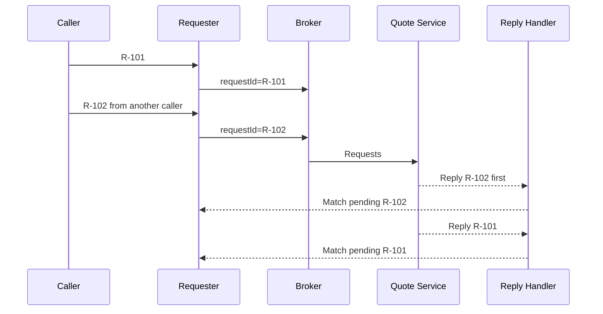
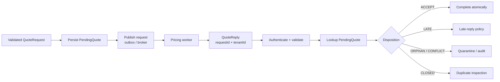
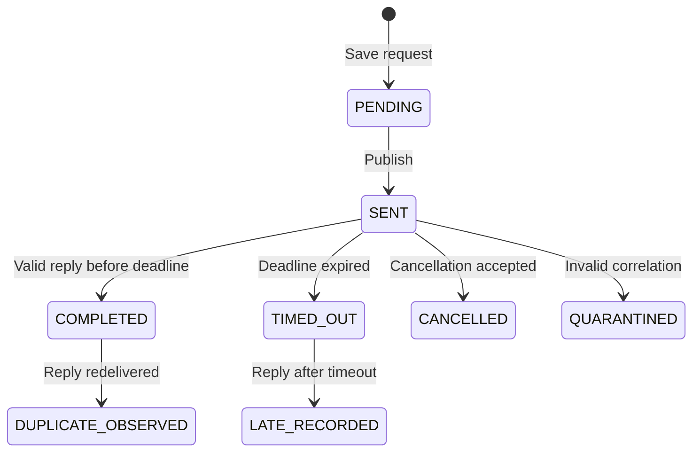
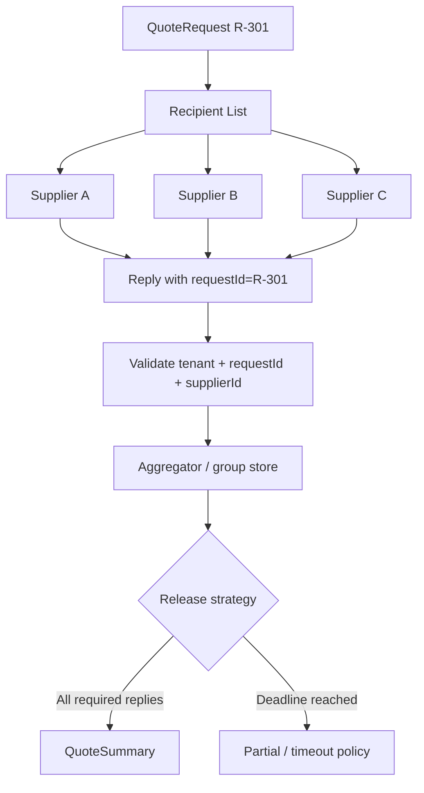

# Correlation giữa request và reply

## 1. Bài toán: reply về không theo thứ tự request

Một hệ thống báo giá gửi ba request đồng thời cho dịch vụ bên ngoài:

```text
Requests:
  R-101: tenant-a, SKU-A, quantity=2
  R-102: tenant-b, SKU-A, quantity=5
  R-103: tenant-a, SKU-B, quantity=1

Replies đến:
  Reply(R-102)
  Reply(R-103)
  Reply(R-101)
```

Nếu ghép theo thứ tự đến, caller của R-101 có thể nhận báo giá của R-102. Nếu ghép theo SKU, hai tenant cùng SKU có thể bị nhầm. **Correlation giữa request và reply** là phép xác định một phản hồi thuộc về yêu cầu nào, ngay cả khi xử lý bất đồng bộ, thứ tự đến thay đổi, request được retry hoặc một reply bị gửi trùng.

Trong chương **Content-based correlation** của module **SPRING_INTEGRATION_PATTERN**, chúng ta học triển khai Enterprise Integration Patterns bằng Spring Integration để xây dựng các luồng message ít phụ thuộc, dễ mở rộng. Chủ đề liên hệ chặt với Gateway, Router, Filter, Transformer, Splitter, Aggregator, retry, error channel và correlation, đồng thời đòi hỏi kiểm thử và quan sát những nhánh xử lý.



Correlation là **ghép và kiểm tra quan hệ request–reply**. Nó không tự bảo đảm reply đến trước deadline, không tạo exactly-once, không làm broker đáng tin tuyệt đối và cũng không thể chứng minh một nguồn gửi reply có quyền gửi chỉ bằng một ID khớp.

## 2. Content-based correlation là gì?

**Content-based correlation** dựa trên **giá trị có nghĩa trong nội dung nghiệp vụ** để nhận diện quan hệ giữa những message. Ví dụ một request:

```json
{
  "tenantId": "tenant-a",
  "requestId": "R-101",
  "sku": "SKU-A",
  "quantity": 2
}
```

Và một reply:

```json
{
  "tenantId": "tenant-a",
  "requestId": "R-101",
  "quotedTotalVnd": 50000,
  "pricingVersion": "pricing-v3"
}
```

Một cặp `(tenantId, requestId)` trong **payload** có thể xác định pending request tương ứng. Sau khi xác thực, một Transformer có thể sao chép khóa đó vào **header** phục vụ routing/correlation; nguồn gốc của khóa vẫn là nội dung nghiệp vụ.

### 2.1. Router, Aggregator và correlation không đồng nghĩa

| Thành phần EIP | Câu hỏi giải quyết |
| --- | --- |
| Content-Based Router | Message cần đi đến nhánh xử lý nào? |
| Content-based correlation | Reply này thuộc logical request nào? |
| Gateway | Caller tương tác với messaging thông qua API nào? |
| Aggregator | Những message nào được gom thành kết quả chung? |
| Filter | Message có thỏa điều kiện đi tiếp? |
| MessageStore / pending registry | Những request còn chờ đang được lưu ở đâu? |

Cùng một flow có thể có cả routing và correlation. Nhưng `productCategory` phù hợp để chọn nhánh báo giá, **không** phù hợp làm khóa để ghép một reply với request: nhiều request có thể cùng category.

### 2.2. Mỗi reply cần có identity ổn định

Một reply nên mang đủ metadata để downstream xác minh quan hệ:
- `tenantId` và `requestId`;
- mã nghiệp vụ như `sku`, `quantity` nếu cần đối chiếu;
- `pricingVersion`, `schemaVersion` hoặc workflow revision nếu kết quả phụ thuộc chính sách;
- một `replyId` ổn định khi cần dedupe các lần broker giao cùng reply;
- nguồn gửi đáng tin, chữ ký/transport identity theo cơ chế bảo mật đã lựa chọn.

Một ID khớp là điều kiện cần, **chưa phải** điều kiện đủ để chấp nhận reply.

## 3. Phân biệt requestId, correlationId, replyChannel và message ID

| Giá trị | Ý nghĩa | Có thể thay cho business requestId? |
| --- | --- | --- |
| `requestId` | Định danh logical request | **Là khóa chính** nếu stable và unique trong scope |
| `tenantId` | Scope và ranh giới quyền truy cập | Cần phối hợp nhưng không dùng một mình |
| `eventId` | Định danh sự kiện nghiệp vụ | Tùy hợp đồng, không mặc nhiên cùng requestId |
| `MessageHeaders.ID` | ID envelope do framework sinh | **Không** làm khóa nghiệp vụ bền vững |
| `IntegrationMessageHeaderAccessor.CORRELATION_ID` | Metadata tương quan, thường dùng nhóm message | Có thể ánh xạ theo policy, không tự bằng requestId |
| `MessageHeaders.REPLY_CHANNEL` | Nơi gửi reply trong tương tác nội bộ | **Không** phải khóa nghiệp vụ |
| `MessageHeaders.ERROR_CHANNEL` | Kênh xử lý lỗi | Không phải pending request registry |
| `traceId` / `spanId` | Distributed tracing | Không đủ để nhận diện một request nghiệp vụ |
| JMS/AMQP correlation metadata | Tương quan tại tầng transport | Dùng theo adapter contract, kiểm tra mapping |

**Đặc biệt:** `MessageHeaders.ID` có thể đổi khi envelope được tạo lại; `traceId` có thể dùng chung cho cả batch; một `replyChannel` nội bộ có thể là object không thể chuyển qua broker hoặc tồn tại sau restart.

### 3.1. Khóa đa tenant

Nếu request ID chỉ unique trong tenant, nên dùng:

```text
CorrelationKey = (tenantId, requestId)
  tenant-a / R-101
  tenant-b / R-101
```

Hai logical requests ở trên **không được trùng khóa**. Có thể bổ sung `workflowVersion`, `replyType` hoặc `requestRevision` nếu một request có nhiều kết quả hay nhiều version. Tránh ghép chuỗi bằng delimiter không được escape hoặc cho caller không tin cậy tự chọn correlation key để tham chiếu tới tenant khác.

### 3.2. Stable ID qua retry

Phân biệt:
- `requestId`: một logical request, giữ ổn định khi delivery attempt được thử lại;
- `deliveryAttempt`: lần thử truyền/nhận;
- `messageId`: envelope riêng;
- `requestRevision`: phiên bản yêu cầu được thay đổi có chủ đích.

Nếu retry cùng yêu cầu bằng một requestId mới mà không có policy, reply cũ dễ bị bỏ thành orphan và side effect có thể lặp. Tuy nhiên giữ requestId ổn định cũng chưa tạo exactly-once: bên nhận vẫn cần idempotency.

## 4. Hai mô hình request–reply

### 4.1. Gateway đồng bộ

Caller gọi một Java method và chờ return value:

```text
Caller -> QuoteGateway.quote(R-101)
           -> request channel
           -> handler
           -> framework-managed reply channel
       <- QuoteReply(R-101)
```

Spring Integration Gateway có thể quản lý reply channel tạm và ghép reply về đúng invocation. Business `requestId` trong payload vẫn có ích cho audit/validation, nhưng không cần tự xây bản đồ pending futures trong JVM để thay thế chức năng cơ bản của Gateway đồng bộ.

### 4.2. Request–reply async qua broker

```text
Requester:
  persist PendingRequest(tenantId, requestId, deadline)
  publish request
  caller có thể đã disconnect

Worker:
  consume request, tính toán
  publish reply có tenantId/requestId

Reply handler:
  authenticate reply
  find PendingRequest theo business key
  validate nội dung và trạng thái
  complete exactly once at application state boundary
```

Ở đây không thể chỉ dựa vào reply channel tạm trong memory. Reply có thể về sau restart hoặc qua một instance khác. Cần **pending registry bền vững**, idempotency, timeout và late-reply policy.

### 4.3. So sánh

| Tiêu chí | Gateway đồng bộ | Async reply |
| --- | --- | --- |
| Caller chờ? | Có, trong timeout | Có thể không |
| Ghép invocation | Framework quản lý | Business correlation registry |
| Requester restart | Lời gọi chờ thường mất | Pending state có thể phục hồi |
| Reply đến muộn | Không còn caller chờ | Có thể ghi nhận xử lý riêng |
| Reply trùng | Vẫn cần chính sách khi side effects | Pending state + dedupe |
| Dùng qua broker | Có adapter/gateway cụ thể | Phù hợp với workflow dài |
| Security | Xác thực input vẫn cần | Kiểm soát source/tenant nghiêm ngặt |

## 5. Hợp đồng QuoteRequest và QuoteReply

Dùng các Java 17 records để tách dữ liệu request và reply. Tổng tiền VND nguyên đơn vị chỉ là ví dụ, không thay thế contract giá/tỷ giá của ứng dụng thật.

```java
record QuoteRequest(
        String tenantId,
        String requestId,
        String sku,
        int quantity) {
    QuoteRequest {
        if (tenantId == null || tenantId.isBlank()
                || requestId == null || requestId.isBlank()
                || sku == null || sku.isBlank()
                || quantity <= 0) {
            throw new IllegalArgumentException("Invalid request");
        }
    }
}

record QuoteReply(
        String tenantId,
        String requestId,
        String sku,
        int quantity,
        long quotedTotalVnd,
        String pricingVersion) {
    QuoteReply {
        if (tenantId == null || tenantId.isBlank()
                || requestId == null || requestId.isBlank()
                || sku == null || sku.isBlank()
                || quantity <= 0
                || quotedTotalVnd < 0
                || pricingVersion == null || pricingVersion.isBlank()) {
            throw new IllegalArgumentException("Invalid reply");
        }
    }
}
```

Các records bất biến không ngăn được sự giả mạo của người gửi, vì vậy tenant/source authentication là trách nhiệm ở ranh giới transport.

### 5.1. Quy tắc xác thực reply

| Điều kiện | Ý nghĩa |
| --- | --- |
| Pending request tồn tại theo tenant và ID | Reply không vô chủ |
| Status cho phép hoàn tất | Không ghi đè request đã đóng/hủy |
| Tenant khớp | Không tiết lộ hoặc cập nhật nhầm tenant |
| SKU/quantity khớp | Reply trả đúng yêu cầu ban đầu |
| Schema/policy version hợp lệ | Tránh gộp kết quả sai version |
| Source service đáng tin | Một ID đúng không chứng minh quyền |
| Deadline phù hợp | Quyết định reply đúng hạn hay đã trễ |
| Reply chưa được áp dụng | Tránh phát completion hai lần |

## 6. Spring Integration Gateway đồng bộ

### 6.1. Service tính giá

```java
import org.springframework.stereotype.Service;

@Service
class QuoteCalculator {
    QuoteReply calculate(QuoteRequest request) {
        long unitPriceVnd = switch (request.sku()) {
            case "SKU-A" -> 25_000L;
            case "SKU-B" -> 10_000L;
            default -> throw new IllegalArgumentException("Unknown SKU");
        };

        return new QuoteReply(
                request.tenantId(),
                request.requestId(),
                request.sku(),
                request.quantity(),
                Math.multiplyExact(unitPriceVnd,
                        (long) request.quantity()),
                "pricing-v3");
    }
}
```

Đây là handler pure về mặt logic demo, không gọi database hay API ngoài. Cùng input và rule tạo cùng output.

### 6.2. Gateway interface

```java
import org.springframework.integration.annotation.Gateway;
import org.springframework.integration.annotation.MessagingGateway;

@MessagingGateway
interface QuoteGateway {
    @Gateway(
            requestChannel = "quotes.requests",
            replyTimeout = 5_000)
    QuoteReply quote(QuoteRequest request);
}
```

Spring tạo Gateway proxy để gửi request và chờ reply theo contract. Reply correlation ở mức invocation là trách nhiệm framework. `requestId` trong payload vẫn giữ ý nghĩa nghiệp vụ và sẵn sàng khi triển khai qua service ngoài.

### 6.3. IntegrationFlow nhận và trả lời request

```java
import org.springframework.context.annotation.Bean;
import org.springframework.context.annotation.Configuration;
import org.springframework.integration.channel.DirectChannel;
import org.springframework.integration.config.EnableIntegration;
import org.springframework.integration.annotation.IntegrationComponentScan;
import org.springframework.integration.dsl.IntegrationFlow;
import org.springframework.messaging.MessageChannel;

@Configuration
@EnableIntegration
@IntegrationComponentScan
class QuoteGatewayFlow {
    @Bean("quotes.requests")
    MessageChannel quoteRequests() {
        return new DirectChannel();
    }

    @Bean
    IntegrationFlow quoteProcessing(QuoteCalculator calculator) {
        return IntegrationFlow.from("quotes.requests")
                .handle(QuoteRequest.class, (request, headers) ->
                        calculator.calculate(request))
                .get();
    }
}
```

Lúc handler trả một `QuoteReply`, message-producing endpoint chuyển kết quả theo reply path do Gateway/framework quản lý. Trong ứng dụng cần cấu hình component scan để `QuoteCalculator` và interface Gateway được tạo. Nếu một handler trả `null` trong đường one-way, không thể kỳ vọng Gateway nhận `QuoteReply`.

### 6.4. Lời gọi minh họa

```java
QuoteRequest request = new QuoteRequest(
        "tenant-hcm", "R-101", "SKU-A", 2);

QuoteReply reply = gateway.quote(request);

if (!request.tenantId().equals(reply.tenantId())
        || !request.requestId().equals(reply.requestId())) {
    throw new IllegalStateException("Unexpected reply");
}
assert reply.quotedTotalVnd() == 50_000L;
```

Đây là contract validation bổ sung. Gateway đã giải quyết việc ghép **lời gọi đang chờ**, nhưng khi service bị thay bằng remote adapter, kiểm tra nội dung giúp tránh chấp nhận phản hồi nhầm ngữ nghĩa.

## 7. Timeout không đồng nghĩa công việc đã bị hủy

```text
t0: send R-101
t1: worker bắt đầu gọi service khác
t5: Gateway timeout
t8: worker trả Reply(R-101)
```

Khi timeout xảy ra, caller có thể đã ngừng chờ, nhưng worker **có thể vẫn tiếp tục chạy**. Cách xử lý reply muộn phụ thuộc endpoint/transport; không mặc định nó được lưu, được hủy, hoặc được trả về caller đã timeout.

Quy tắc cần xác định:
1. Có giữ `requestId` ổn định qua retry không?
2. Operation có side effect? Có idempotency key không?
3. Timeout gửi, xử lý và reply được phân biệt thế nào?
4. Late reply có cần ghi nhận và đối soát không?
5. Nếu có cancellation, nguồn có thực sự dừng việc đang chạy được không?

**Không dùng Gateway timeout làm bằng chứng transaction đã rollback.** Nếu client tạo requestId mới rồi retry, service ngoài có thể xử lý hai requests và trả hai replies.

## 8. Async correlation: lưu pending request bền vững

Khi một request rời JVM qua Kafka, RabbitMQ, JMS hoặc một API bất đồng bộ, phản hồi có thể về sau khi requester restart, được phân phối cho một instance khác, hoặc đến sau thời hạn chờ của client. Lúc này cần lưu **pending state có thể phục hồi**.



### 8.1. Mô hình trạng thái



Các trạng thái này thuộc **ứng dụng**, không phải những state tự động của Spring Integration Gateway. Hãy lưu chúng trong database, workflow state store hoặc cơ chế tương đương nếu muốn restart/recovery.

### 8.2. Record và khóa nghiệp vụ

```java
import java.time.Instant;

enum PendingStatus {
    PENDING, SENT, COMPLETED, TIMED_OUT, CANCELLED, QUARANTINED
}

record QuoteCorrelationKey(
        String tenantId,
        String requestId) {
    QuoteCorrelationKey {
        if (tenantId == null || tenantId.isBlank()
                || requestId == null || requestId.isBlank()) {
            throw new IllegalArgumentException("Invalid correlation key");
        }
    }
}

record PendingQuote(
        QuoteCorrelationKey key,
        String sku,
        int quantity,
        String pricingVersion,
        Instant deadline,
        PendingStatus status) {}
```

Một bảng dữ liệu tối thiểu:

```sql
CREATE TABLE pending_quotes (
    tenant_id       VARCHAR(80) NOT NULL,
    request_id      VARCHAR(120) NOT NULL,
    sku             VARCHAR(64) NOT NULL,
    quantity        INTEGER NOT NULL,
    pricing_version VARCHAR(40) NOT NULL,
    deadline_at     TIMESTAMP NOT NULL,
    status          VARCHAR(24) NOT NULL,
    PRIMARY KEY (tenant_id, request_id)
);
```

Bảng minh họa chưa có các cột response checksum, reply ID, outbox, attempts và audit. Khi triển khai thực, cần thêm những thuộc tính đó theo hợp đồng, chuẩn hóa thời gian UTC và migration schema. Khóa duy nhất trên `(tenant_id, request_id)` giúp tránh tạo **hai pending records** cho cùng logical request nhưng không tự ngăn service báo giá xử lý lặp.

### 8.3. Gửi request và lưu state theo đúng thứ tự

Một tiến trình ổn định thường:

1. Xác thực caller và xác định `tenantId` từ identity đáng tin.
2. Kiểm tra input/schema, cấp hoặc xác thực `requestId` ổn định.
3. Ghi PendingQuote, deadline, request snapshot và **outbox record** trong cùng transaction nếu khả thi.
4. Commit trước khi phát request ra broker (hoặc dùng publisher outbox).
5. Worker nhận request, thực hiện xử lý có idempotency rồi phát reply mang key.
6. Reply handler đối chiếu key + nội dung + source identity và chuyển state sang COMPLETED **một lần**.

Không phát request mà chưa có pending state nếu reply có thể đến rất nhanh. Nếu publish thất bại sau khi pending đã lưu, outbox/reconciliation phải có khả năng gửi lại. Outbox không tự tạo exactly-once: publisher có thể gửi trùng và worker vẫn cần dedupe.

## 9. Kiểm tra reply bằng content một cách có thể test độc lập

Một matcher tách riêng khỏi broker giúp unit test dễ dàng. Nó phân loại reply thành accepted, late, orphan hoặc conflict; **không tự thực hiện UPDATE database**.

### 9.1. Pure matcher theo business key và snapshot

```java
import java.time.Instant;
import java.util.Objects;

enum ReplyDisposition {
    ACCEPT,
    ORPHAN,
    CONFLICT,
    LATE,
    ALREADY_COMPLETED,
    CANCELLED_OR_CLOSED
}

final class QuoteReplyMatcher {

    ReplyDisposition classify(
            QuoteReply reply,
            PendingQuote pending,
            Instant now) {
        Objects.requireNonNull(reply, "reply");
        Objects.requireNonNull(now, "now");

        if (pending == null) {
            return ReplyDisposition.ORPHAN;
        }

        var actualKey = new QuoteCorrelationKey(
                reply.tenantId(), reply.requestId());

        if (!actualKey.equals(pending.key())
                || !reply.sku().equals(pending.sku())
                || reply.quantity() != pending.quantity()
                || !reply.pricingVersion()
                        .equals(pending.pricingVersion())) {
            return ReplyDisposition.CONFLICT;
        }

        if (pending.status() == PendingStatus.COMPLETED) {
            return ReplyDisposition.ALREADY_COMPLETED;
        }
        if (pending.status() == PendingStatus.CANCELLED
                || pending.status() == PendingStatus.QUARANTINED) {
            return ReplyDisposition.CANCELLED_OR_CLOSED;
        }

        if (pending.status() == PendingStatus.TIMED_OUT
                || now.isAfter(pending.deadline())) {
            return ReplyDisposition.LATE;
        }

        return ReplyDisposition.ACCEPT;
    }
}
```

**Thứ tự kiểm tra có chủ đích:** Nếu một reply mang requestId đúng nhưng SKU khác, kết quả là `CONFLICT` ngay cả khi pending đã COMPLETED; đừng chỉ thấy status đã đóng rồi bỏ qua dấu hiệu giả mạo hoặc lỗi producer.

`ALREADY_COMPLETED` nghĩa là **một candidate reply đến sau khi pending đã complete**. Chưa thể kết luận reply là duplicate hoàn toàn giống bản đã lưu nếu không so sánh `replyId`/content hash/kết quả với bản completed trước đó. Một reply khác giá trị nhưng cùng key có thể là lỗi nghiêm trọng cần điều tra.

### 9.2. Unit test matcher với thời gian cố định

```java
import java.time.Instant;
import org.junit.jupiter.api.Test;
import static org.junit.jupiter.api.Assertions.*;

class QuoteReplyMatcherTest {
    private final QuoteReplyMatcher matcher = new QuoteReplyMatcher();
    private final Instant now =
            Instant.parse("2026-11-21T04:00:00Z");

    private PendingQuote pending() {
        return new PendingQuote(
                new QuoteCorrelationKey("tenant-a", "R-101"),
                "SKU-A", 2, "pricing-v3",
                now.plusSeconds(30),
                PendingStatus.SENT);
    }

    private QuoteReply reply() {
        return new QuoteReply(
                "tenant-a", "R-101", "SKU-A",
                2, 50_000L, "pricing-v3");
    }

    @Test
    void matchesValidReply() {
        assertEquals(ReplyDisposition.ACCEPT,
                matcher.classify(reply(), pending(), now));
    }

    @Test
    void rejectsCrossTenantAndWrongPayload() {
        var crossTenant = new QuoteReply(
                "tenant-b", "R-101", "SKU-A",
                2, 50_000L, "pricing-v3");
        var wrongQuantity = new QuoteReply(
                "tenant-a", "R-101", "SKU-A",
                7, 50_000L, "pricing-v3");

        assertEquals(ReplyDisposition.CONFLICT,
                matcher.classify(crossTenant, pending(), now));
        assertEquals(ReplyDisposition.CONFLICT,
                matcher.classify(wrongQuantity, pending(), now));
    }

    @Test
    void classifiesOrphanLateAndCompleted() {
        assertEquals(ReplyDisposition.ORPHAN,
                matcher.classify(reply(), null, now));
        assertEquals(ReplyDisposition.LATE,
                matcher.classify(reply(), pending(),
                        now.plusSeconds(31)));

        var completed = new PendingQuote(
                pending().key(), "SKU-A", 2,
                "pricing-v3", now.plusSeconds(30),
                PendingStatus.COMPLETED);
        assertEquals(ReplyDisposition.ALREADY_COMPLETED,
                matcher.classify(reply(), completed, now));
    }
}
```

Không dùng `Instant.now()` trực tiếp trong unit test logic deadline: một `Clock` được inject hoặc instant cố định tránh test có kết quả tùy tốc độ máy. Ở ứng dụng thật, thời gian phải được chuẩn hóa cho server/database/transport và lưu ý clock skew.

## 10. Ghép reply phải an toàn trước race condition

**Pure matcher chỉ là bước đánh giá; không đủ cho concurrency.** Hai worker có thể đồng thời đọc cùng pending ở trạng thái SENT rồi đều thấy `ACCEPT`. Nếu cả hai cùng gửi completion notification, caller có thể được thông báo hai lần.

Một thao tác database nên có điều kiện nguyên tử:

```sql
UPDATE pending_quotes
SET status = 'COMPLETED'
WHERE tenant_id = :tenantId
  AND request_id = :requestId
  AND status = 'SENT'
  AND deadline_at >= :now;
```

Sau khi đã xác thực source, so khớp nội dung request và lưu reply snapshot, chỉ worker nào **cập nhật đúng một dòng** mới được phát completion. Khi số dòng cập nhật bằng 0, phải tra lại state để phân biệt `ALREADY_COMPLETED`, `TIMED_OUT`, `CANCELLED` và không tìm thấy.

**Lưu ý:** Nếu PENDING cũng được phép hoàn tất vì reply về trước khi trạng thái SENT được commit, policy/trạng thái cần thống nhất. Ví dụ minh họa yêu cầu trạng thái SENT vì bước publish được ghi nhận rõ.

### 10.1. Completion event cũng có thể bị gửi trùng

Ngay cả khi UPDATE trạng thái đúng một lần:
1. Worker commit COMPLETED.
2. Worker phát completion event.
3. Worker crash trước ACK broker.
4. Reply bị giao lại, hoặc completion publisher retry.

Để không mất/nhân đôi notification, cân nhắc ghi **outbox completion event cùng transaction** với việc chuyển pending state sang COMPLETED. Downstream callback/webhook consumer vẫn cần idempotency key ổn định như `(tenantId,requestId,completionType,revision)`.

### 10.2. Timeout và reply chạy đua

```text
t = deadline
  Worker A: timeout scanner -> TIMED_OUT
  Worker B: reply handler   -> COMPLETED
```

Không được để cả hai commit hai trạng thái cuối cùng. Dùng optimistic lock/version hoặc conditional UPDATE với trạng thái/điều kiện deadline, và thống nhất nguồn thời gian. Mọi phương án phải trả lời liệu reply đến **đúng tại deadline** được coi là đúng hạn hay trễ.

Nếu reply đến sau deadline, policy có thể:
- Lưu late reply để đối soát;
- Bỏ khỏi đường trả lời caller nhưng vẫn ghi audit;
- Tạo một event “result available after timeout” nếu hợp đồng cho phép;
- Cho caller chủ động fetch kết quả sau đó.

Không tự hồi sinh một pending request đã CANCELLED hoặc TIMED_OUT nếu business contract chưa cho phép.

## 11. Spring Integration DSL cho đường nhận reply async

Spring Integration có thể dùng Java DSL để nhận reply từ một inbound adapter rồi chuyển tới một handler chịu trách nhiệm correlation.

```java
import org.springframework.context.annotation.Bean;
import org.springframework.context.annotation.Configuration;
import org.springframework.integration.channel.DirectChannel;
import org.springframework.integration.config.EnableIntegration;
import org.springframework.integration.dsl.IntegrationFlow;
import org.springframework.messaging.MessageChannel;

interface QuoteReplyService {
    void onReply(QuoteReply reply);
}

@Configuration
@EnableIntegration
class QuoteReplyInboundFlow {

    @Bean("quotes.replies.in")
    MessageChannel repliesIn() {
        return new DirectChannel();
    }

    @Bean
    IntegrationFlow handleReplies(QuoteReplyService service) {
        return IntegrationFlow.from("quotes.replies.in")
                .handle(QuoteReply.class, (reply, headers) -> {
                    service.onReply(reply);
                    return null; // one-way handler
                })
                .get();
    }
}
```

Đây là topology xử lý **reply bất đồng bộ**, không ghép vào chung `QuoteGatewayFlow` theo cách tạo hai handler cạnh tranh trên một `DirectChannel`. Inbound adapter (Kafka/Rabbit/HTTP callback) phải nhận, xác thực và deserialize đúng `QuoteReply` rồi gửi vào `quotes.replies.in`; ví dụ không giả định có sẵn một adapter cụ thể.

Bên trong `QuoteReplyService.onReply`:
1. Xác minh quyền/source identity ở boundary hoặc qua verified context;
2. Tra pending bằng `(tenantId,requestId)`;
3. Gọi `QuoteReplyMatcher` và phân loại;
4. Với ACCEPT, cập nhật state và tạo completion theo transaction/outbox;
5. Với ORPHAN/CONFLICT/LATE, đưa đến audit/quarantine có kiểm soát;
6. Với ALREADY_COMPLETED, đối soát reply identity/digest và không lặp side effect.

**Không chỉ dùng `MessageHeaders.CORRELATION_ID` làm key nếu payload có một ID khác**; phải quy định tính nhất quán và nguồn đáng tin. Với broker adapter, header mapping có thể đổi tên/loại giá trị; integration test phải chứng minh dữ liệu cần thiết đến được handler.

### 11.1. Cách dùng Router để phân loại reply

Một thiết kế khác là chuyển kết quả đánh giá thành outcome riêng:

```java
sealed interface ReplyOutcome
        permits AcceptedReply, RejectedReply {}

record AcceptedReply(QuoteReply reply) implements ReplyOutcome {}

record RejectedReply(
        QuoteCorrelationKey key,
        String reasonCode) implements ReplyOutcome {}
```

Sau đó Content-Based Router chọn `quotes.accepted` hoặc `quotes.quarantine` theo kiểu outcome. Đây là **một topology bổ sung**, không phải chuyện Router tự tìm pending state và xác minh quyền. Chính sách đối chiếu vẫn phải chạy ở một service có quyền đọc registry; tuyệt đối không đưa raw PII hoặc nội dung nhạy cảm vào reason code/metrics.

## 12. Sử dụng transport correlation và reply-to một cách có kiểm soát

Transport như JMS hoặc AMQP có những khái niệm `correlationId` và `replyTo` riêng. Nhiều framework có thể map một phần chúng sang Spring message headers, nhưng tên header, kiểu giá trị và propagation phụ thuộc adapter/protocol.

| Nội dung | Nội bộ Spring Integration | Broker / remote transport |
| --- | --- | --- |
| Reply destination | `replyChannel` có thể là MessageChannel object | Reply queue/topic/address theo transport |
| Correlation key | Business requestId hoặc framework correlation | Transport correlation ID có mapping |
| Reply timeout | Gateway timeout, handler timeout | Broker/client/app SLA riêng |
| Restart | Reply channel tạm có thể mất | Queue và registry có thể durable |
| Error path | ErrorChannel/exception tùy endpoint | DLQ, retry, NACK/ACK tùy broker |
| Authorization | Bean/application security | Broker auth + application tenant policy |

Không serialize một `MessageChannel` Java object để làm `replyTo` qua Kafka/HTTP. Thay vào đó, dùng tên destination có hợp đồng hoặc một callback URL/service ID đã xác thực và whitelist.

### 12.1. Khi nào có thể dùng replyTo?

Với mô hình giao tiếp request–reply nội bộ, reply-to thường quyết định reply **đi đâu**, còn correlation key quyết định reply **thuộc yêu cầu nào**. Chúng giải quyết hai câu hỏi khác nhau:

```text
replyTo       -> destination/channel for replies
correlationId -> logical request/group identity
```

Có thể nhiều requests cùng dùng một reply queue; khi đó mỗi reply cần correlation key để chọn đúng pending request. Một destination riêng cho từng request có thể đơn giản hóa matching nhưng tăng chi phí và quản lý tài nguyên; không phải lúc nào cũng phù hợp.

### 12.2. Không dùng correlation ID như bằng chứng authorization

Một attacker có thể đoán hoặc lấy được requestId nếu ID lộ qua logs. Vì vậy khi reply về cần cả:
- transport/service authentication;
- tenant isolation;
- validation schema và nội dung;
- trạng thái pending;
- replay/duplicate controls.

Correlation key là **định danh**, không phải token cấp quyền.

## 13. Một request có nhiều reply: correlation và Aggregator

Không phải request nào cũng có đúng một reply. Ví dụ request R-301 cần tính báo giá từ ba nhà cung cấp:

```text
Request R-301 -> Supplier A, Supplier B, Supplier C

Arrivals:
  Reply(B, R-301) at t1
  Reply(A, R-301) at t2
  Reply(C, R-301) at t3

Expected outcome:
  All replies correlate with R-301
  Aggregate according to policy
```

Lúc này cần hai lớp khác nhau:

1. **Correlation**: ba reply cùng `requestId=R-301` thuộc một logical request.
2. **Aggregation**: khi nào đủ reply và tính kết quả nào, chẳng hạn chọn giá thấp nhất trong cùng currency, hoặc báo partial result khi một nhà cung cấp timeout.



### 13.1. Không đếm duplicate thành nhà cung cấp thứ ba

Nếu ba deliveries là:

```text
Supplier A, request R-301
Supplier B, request R-301
Supplier A, request R-301 (duplicate)
```

thì **chưa** có reply của Supplier C. Một release strategy dựa vào `group.size() == 3` có thể kết luận sai. Cần dedupe theo `(tenantId, requestId, supplierId, replyVersion)` và release theo tập supplier/part identities hoặc completion marker đã xác thực.

### 13.2. Correlation key phải bao gồm đúng scope

Nếu cùng requestId được dùng cho nhiều loại kết quả (giá, thuế, vận chuyển), có thể cần group key:

```text
(tenantId, requestId, replyKind)
```

Không ghép reply về thuế vào Aggregator chờ báo giá nếu cả hai chỉ có `requestId` giống nhau. Ngược lại, không tạo requestId mới cho từng nhà cung cấp nếu muốn gom toàn bộ replies về một logical request; dùng `supplierId` hoặc `childRequestId` riêng nhưng giữ parent request identity.

### 13.3. Kết quả partial là một quyết định nghiệp vụ

Khi supplier C timeout:
- Có thể trả quote từ A/B kèm trạng thái PARTIAL nếu người dùng chấp nhận;
- Có thể từ chối toàn bộ request nếu mọi báo giá đều bắt buộc;
- Có thể chờ một retry hữu hạn theo deadline;
- Có thể gửi event kết quả muộn ở một version mới nếu hợp đồng hỗ trợ.

Không tự lấy `sequenceSize` từ một Splitter rồi đợi mãi nếu một Filter/Router đã loại bớt một nhánh. Correlation đúng không giải quyết được liveness và completion policy.

## 14. Kiểm thử Gateway đồng bộ

Test Gateway cần chứng minh một lời gọi tạo reply có đúng requestId và các thông tin nghiệp vụ, xử lý exception/timeout và không biến hai request đồng thời thành một.

### 14.1. Integration test happy path

```java
import org.junit.jupiter.api.Test;
import org.springframework.beans.factory.annotation.Autowired;
import org.springframework.test.context.junit.jupiter.SpringJUnitConfig;

import static org.junit.jupiter.api.Assertions.*;

@SpringJUnitConfig(classes = {
        QuoteGatewayFlow.class,
        QuoteCalculator.class
})
class QuoteGatewayIntegrationTest {

    @Autowired
    QuoteGateway gateway;

    @Test
    void quoteReplyMatchesRequestContent() {
        var request = new QuoteRequest(
                "tenant-a", "R-101", "SKU-A", 2);

        QuoteReply reply = gateway.quote(request);

        assertEquals("tenant-a", reply.tenantId());
        assertEquals("R-101", reply.requestId());
        assertEquals("SKU-A", reply.sku());
        assertEquals(2, reply.quantity());
        assertEquals(50_000L, reply.quotedTotalVnd());
        assertEquals("pricing-v3", reply.pricingVersion());
    }

    @Test
    void separateRequestsDoNotShareTheirIdentity() {
        var a = gateway.quote(new QuoteRequest(
                "tenant-a", "R-201", "SKU-A", 2));
        var b = gateway.quote(new QuoteRequest(
                "tenant-b", "R-201", "SKU-B", 1));

        assertEquals("tenant-a", a.tenantId());
        assertEquals("tenant-b", b.tenantId());
        assertEquals("R-201", a.requestId());
        assertEquals("R-201", b.requestId());
        assertNotEquals(a.quotedTotalVnd(), b.quotedTotalVnd());
    }
}
```

Test giả định `@IntegrationComponentScan` trên `QuoteGatewayFlow` quét đúng package chứa interface Gateway (như các class minh họa đặt chung package). Nếu ứng dụng dùng package khác, điều chỉnh base package/composition của Spring context. Mục tiêu của test là xác minh **Gateway proxy và reply route thật**, không chỉ gọi trực tiếp `QuoteCalculator.calculate`.

### 14.2. Những trường hợp cần kiểm tra thêm

- Handler ném exception do SKU không hợp lệ, caller nhận lỗi đúng contract.
- Handler không trả reply hoặc xử lý chậm, Gateway timeout rõ ràng.
- Hai lời gọi đồng thời, một handler chậm hơn, từng caller nhận reply riêng.
- Một Transformer downstream tạo message mới nhưng vô tình làm mất reply channel: test phải phát hiện Gateway không nhận được reply.
- Một Flow đi qua outbound adapter: test header mapping/reply-to theo transport chứ không dựa vào hành vi DirectChannel.
- Caller retry sau timeout: giữ logical requestId và kiểm tra idempotency nếu có side effect.

Với async channel, dùng latch/Awaitility có timeout thay vì assert ngay sau gửi. Test timeout cần kiểm tra **cả trạng thái backend** nếu operation có side effect: timeout ở caller không chứng minh backend đã dừng.

## 15. Kiểm thử reply bất đồng bộ và hệ thống nhiều instance

Một kiểm thử riêng cần chứng minh registry/matcher thực sự đối chiếu đúng pending và không hoàn tất hai lần.

| Kịch bản | Trạng thái mong đợi |
| --- | --- |
| Reply đúng, pending SENT | ACCEPT rồi COMPLETED đúng một lần |
| Reply đến đảo thứ tự | Mỗi reply ghép đúng requestId |
| Hai tenant có cùng requestId | Không trộn pending |
| Reply sai SKU hoặc quantity | CONFLICT/quarantine |
| Reply sai policy version | CONFLICT |
| Reply source không được xác thực | Reject trước khi lookup/complete |
| Reply không có pending | ORPHAN, ghi dấu vết |
| Reply sau deadline | LATE, không trả cho caller đã timeout |
| Reply sau CANCELLED | CLOSED, không hồi sinh request |
| Reply trùng sau COMPLETED | Dedupe/đối soát content digest |
| Hai reply khác nội dung nhưng cùng key | Conflict, không ghi đè |
| Hai worker đồng thời complete | Conditional update chỉ một worker thành công |
| Requester restart trước reply | Registry bền vững vẫn ghép được |
| Pending persisted nhưng broker publish fail | Outbox/retry publish |
| Completion persisted nhưng callback publish fail | Outbox completion/replay |
| Reply từ broker nhưng header bị mất | Payload business key vẫn đủ để đối chiếu |
| Multi-reply từ ba suppliers | Dedup theo supplier và release đúng |
| Một supplier reply thiếu | Timeout/partial policy |
| Trace ID khác nhau | Dùng business correlation, không ghép theo trace |

### 15.1. Race giữa hai reply handlers

Trong integration test với database thực hoặc transactional test store:

1. Lưu pending trạng thái SENT với deadline ở tương lai.
2. Đồng thời gửi hai bản Reply(R-101) từ hai consumer thread.
3. Cả hai có thể đọc bản pending lúc đầu; matcher đều trả ACCEPT.
4. Chạy conditional update trong transaction.
5. Assert chỉ một UPDATE có affected-row count = 1.
6. Assert đúng một completion/outbox event được ghi.
7. Nếu hai replies có content khác nhau, assert conflict được ghi nhận để điều tra.

Không chỉ dùng `synchronized` trên một bean để giải quyết race nếu nhiều JVM cùng xử lý. Phải đặt điều kiện tại **database/state store có concurrency contract rõ**, hoặc partition replies cùng key về một worker và vẫn bảo vệ ở trạng thái lưu.

### 15.2. Test restart

Một bài test durability thực sự:
- Context A lưu pending và publish request.
- Dừng requester A để giả lập restart.
- Context B kết nối cùng persistent store.
- Broker chuyển Reply(R-101) tới B.
- B xác minh tenant/requestId/version rồi complete.
- Assert completion được ghi một lần, có thể phục hồi từ storage.

Không dùng một `ConcurrentHashMap` nội bộ để chứng minh pending requests bền vững qua restart.

### 15.3. Test nhiều reply và timeout cạnh tranh

Nếu deadline đi qua trong lúc reply đến, test cả hai trường hợp:
- Complete được commit trước deadline theo chính sách;
- Timeout được commit trước, reply trở thành LATE.

Test phải kiểm tra rằng không thể có **cả TIMED_OUT và COMPLETED** ở trạng thái cuối cùng cho cùng một request revision. Dùng một `Clock` kiểm soát được ở unit test, và cơ chế thời gian nhất quán với database khi kiểm tra concurrency.

## 16. Bảo mật, quan sát và xử lý lỗi

### 16.1. Correlation không phải authorization

RequestId trong payload hoặc header **không chứng minh quyền** của bên gửi reply. Một producer giả mạo có thể đoán ID hoặc nhìn thấy nó trong log. Để ngăn cross-tenant reply injection:
- Xác thực service gửi reply bằng broker credentials, mTLS, chữ ký hoặc cơ chế tương ứng;
- Lấy tenant scope từ nguồn đáng tin và đối chiếu với pending record;
- Không cho client thay đổi `tenantId`/`requestId` sau bước xác thực mà không có rule;
- Kiểm tra SKU, quantity, version và content digest như hợp đồng;
- Đảm bảo quarantine không làm lộ full payload/PII;
- Chỉ cấp quyền đọc pending records và completion status trong tenant tương ứng.

### 16.2. Error channel khác pending registry

Với `DirectChannel`, lỗi đồng bộ có thể truyền ngược về sender. Với executor/poller/broker, lỗi có thể đi qua handler và `errorChannel` theo cấu hình. Nhưng `ErrorMessage` không tự:
- Giữ danh sách requests đang chờ;
- Hủy request đã gửi sang hệ thống ngoài;
- Gửi retry theo idempotency policy;
- Phân biệt reply trễ do timeout và reply orphan do ID sai;
- Bảo đảm một completion event được publish đúng một lần.

Cần error policy riêng cho từng giai đoạn.

| Lỗi | Nguyên nhân | Xử lý |
| --- | --- | --- |
| Request invalid | Thiếu tenantId/requestId/schema | Reject tại ingress |
| Pending state store unavailable | Lỗi hạ tầng | Retry có giới hạn/backoff |
| Broker publish fail | Transport | Outbox/retry publish |
| Reply sai key | Contract/cross-tenant | Quarantine/security audit |
| Reply duplicate | Redelivery | Idempotency và đối soát |
| Reply late | SLA hết hạn | Late-reply policy |
| No reply | Worker mất message hoặc quá chậm | Timeout/reconciliation |
| Reply handler timeout | DB/remote lỗi | Retry nhưng giữ state atomic |
| Callback downstream lỗi | Consumer/notification | Outbox và idempotent callback |

### 16.3. Metrics và tracing

Nên ghi nhận:

| Metric ứng dụng | Ý nghĩa |
| --- | --- |
| `request.pending.count` | Số request còn chờ |
| `request.reply.latency` | Thời gian từ tạo request đến reply hợp lệ |
| `request.timeout.count` | Số yêu cầu quá deadline |
| `reply.orphan.count` | Reply không có pending |
| `reply.late.count` | Reply tới sau deadline |
| `reply.conflict.count` | Sai tenant/SKU/version |
| `reply.duplicate.count` | Reply trùng sau completion |
| `reply.correlation.lookup.error` | Lỗi registry |
| `request.outbox.backlog` | Publish requests chưa hoàn tất |
| `completion.outbox.backlog` | Notification chưa phát |
| `callback.retry.count` | Completion callback retry |

Đây là **tên metric gợi ý**, không mặc định Spring Integration tự cung cấp đúng các tên ấy.

Log và tracing nên có requestId/tenant (theo chính sách bảo mật), eventId, source service, reply status, traceId, attempt count, timestamp và reason code. Tránh dùng requestId hoặc eventId làm **metric labels** vì cardinality cao. Một distributed trace có thể chứa nhiều request con, nên không được lấy traceId thay cho business correlation key.

### 16.4. Trace span cho request–reply không đồng bộ

Ở flow dài hạn:
- Lưu business requestId vào event attributes/log context có kiểm soát;
- Truyền context hợp lệ qua broker nếu phù hợp;
- Khi reply tới, tạo một span xử lý reply và liên kết đến parent context phù hợp;
- Không giả mạo spanId của request gốc như span hiện tại;
- Không dựa trên trace continuity để xác định request còn pending hay đã timeout.

## 17. Những lỗi thiết kế thường gặp

1. **Ghép reply theo thứ tự nhận**, mặc dù các worker xử lý song song.
2. **Chỉ dùng SKU hoặc loại message làm key**, khiến nhiều request cùng nội dung bị trộn.
3. **Dùng MessageHeaders.ID làm business requestId**, dễ đổi khi retry.
4. **Dùng traceId làm correlation key**, dù một trace có thể có nhiều requests.
5. **Không scope theo tenant**, tạo nguy cơ cross-tenant reply injection.
6. **Cho rằng replyChannel object có thể truyền qua broker** không cần mapping.
7. **Không lưu pending state bền vững** dù workflow cần sống qua restart.
8. **Tạo requestId mới cho mỗi retry** cùng logical request không có version policy.
9. **Thấy requestId khớp là chấp nhận**, bỏ qua source authentication và payload mismatch.
10. **Timeout rồi kết luận backend đã hủy**, trong khi side effect có thể hoàn tất sau đó.
11. **Coi candidate reply sau COMPLETED luôn là duplicate hợp lệ**, không so nội dung/identity.
12. **Dùng check-then-update không nguyên tử**, hai workers đều phát completion.
13. **Không có outbox cho completion notification**, gây mất hoặc nhân đôi callback.
14. **Coi errorChannel là pending registry hoặc DLQ bền vững**.
15. **Cùng requestId có nhiều reply nhưng release theo số deliveries**, duplicate làm hoàn tất sớm.
16. **Không xử lý late/orphan reply**, dẫn tới queue lỗi và dữ liệu khó đối soát.
17. **Tạo response từ payload đã được xử lý bằng version mới** mà không đánh dấu revision.
18. **Copy headers không kiểm soát** rồi vô tình mang replyTo/tenant sai qua transport boundary.
19. **Không test concurrent requests**, chỉ thử từng request tuần tự.
20. **Không đặt deadline/retention** cho pending state, khiến backlog vô hạn.

## 18. Bài tập thực hành và tự đánh giá

**Bài tập:** Thiết kế một request–reply workflow cho `ShippingRateRequested` gồm `tenantId`, `requestId`, `shipmentId`, `destinationCountry` và `packageWeight`. Ba nhà vận chuyển gửi reply bất đồng bộ với `providerId`, `quotedPrice`, `currency`, `quoteVersion`.

1. Định nghĩa `ShippingRateRequest` và `ShippingRateReply` bằng immutable records.
2. Đặt composite correlation key theo `(tenantId,requestId)` và một `providerId` cho từng reply con.
3. Viết Gateway đồng bộ giả lập báo giá nội bộ, test caller nhận đúng requestId.
4. Chuyển sang broker async, lưu PendingRequest và deadline trong database.
5. Phát request qua outbox hoặc cơ chế đáng tin; không cho reply về trước khi pending visible.
6. Viết matcher xác thực tenant, shipment ID, version và source provider.
7. Tạo integration flow nhận reply, map headers, phân loại accepted/late/orphan/conflict.
8. Dùng Aggregator gom kết quả của ba providers; dedupe theo providerId, không đếm redelivery.
9. Cho một provider timeout, mô tả điều kiện có được trả partial quote hay không.
10. Kiểm tra không cộng hai currency khác nhau nếu chưa có conversion có tỷ giá/version rõ.
11. Mô phỏng hai replies đồng thời hoàn tất cùng pending, dùng conditional UPDATE tránh double completion.
12. Mô phỏng requester restart trước reply; chứng minh state vẫn tra cứu được.
13. Tạo hai tenants cùng requestId, kiểm tra tuyệt đối không ghép nhầm.
14. Mô phỏng reply sau deadline, cancellation và reply giả mạo.
15. Bổ sung idempotency cho callback khi completion event bị publish lại.
16. Gắn metric pending backlog, reply latency, timeout, orphan, conflict, duplicates và outbox backlog.
17. Giải thích vì sao `MessageHeaders.REPLY_CHANNEL` và business `requestId` không tương đương nhau.
18. Viết một test end-to-end phát replies theo thứ tự đảo ngược và xác nhận mọi request vẫn được hoàn tất đúng.

**Tự đánh giá:** Tại sao requestId phải ổn định qua retry? Nếu cùng requestId xuất hiện ở hai tenant thì cần xử lý thế nào? Khi Gateway timeout, worker có chắc đã dừng không? Tại sao so khớp `tenantId`/`requestId` chưa đủ để tin một reply? Vì sao hai worker cùng thấy pending SENT vẫn có thể gây trùng completion? Khi một request cần ba replies, correlation khác aggregation ở điểm nào?

**Correlation giữa request và reply** giúp hệ thống xác định đúng lời gọi hoặc logical request mà một phản hồi thuộc về, bất kể thứ tự đến và số lần truyền. Với Spring Integration, Gateway xử lý request–reply đồng bộ ở tầng messaging; các workflow bất đồng bộ cần thêm business correlation key, pending state bền vững, validation, timeout/late-reply policy và idempotent completion. Phân biệt identity của message, trace, channel và nghiệp vụ sẽ giúp các luồng Gateway, Router, Splitter, Aggregator và broker hoạt động đúng ngay cả khi retry, restart và nhận trùng.
