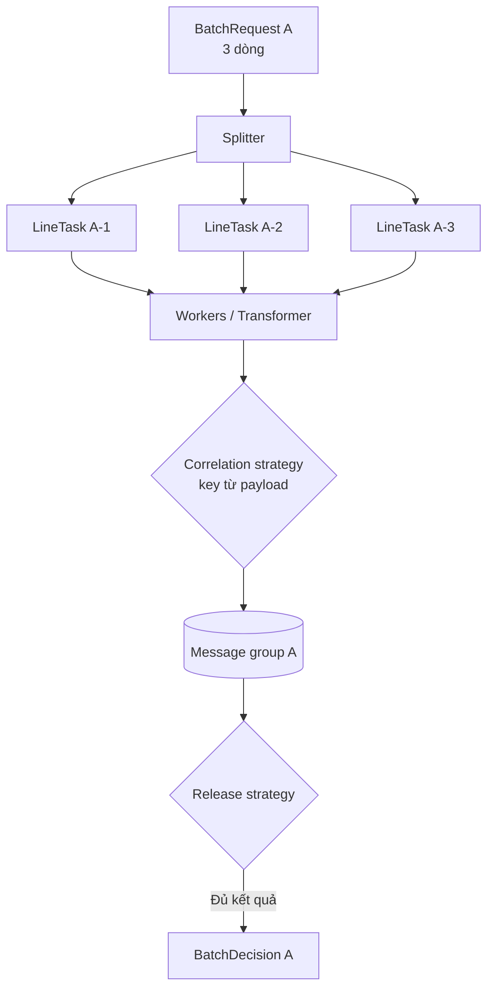
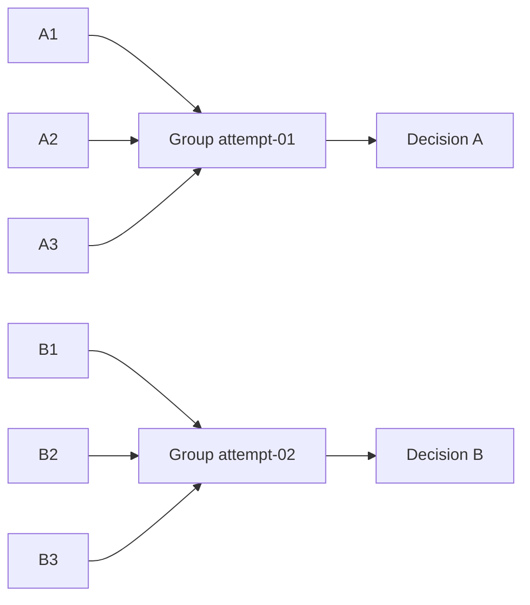
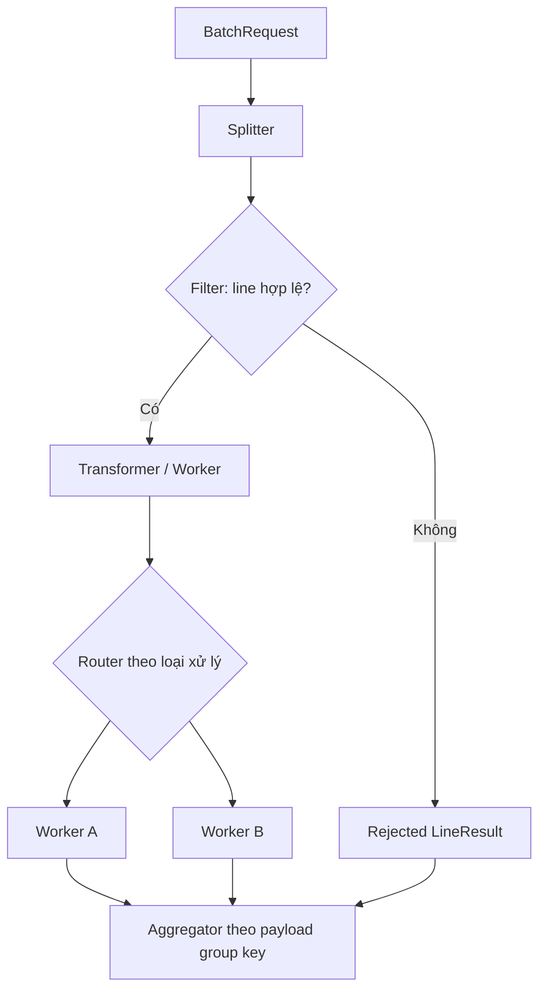
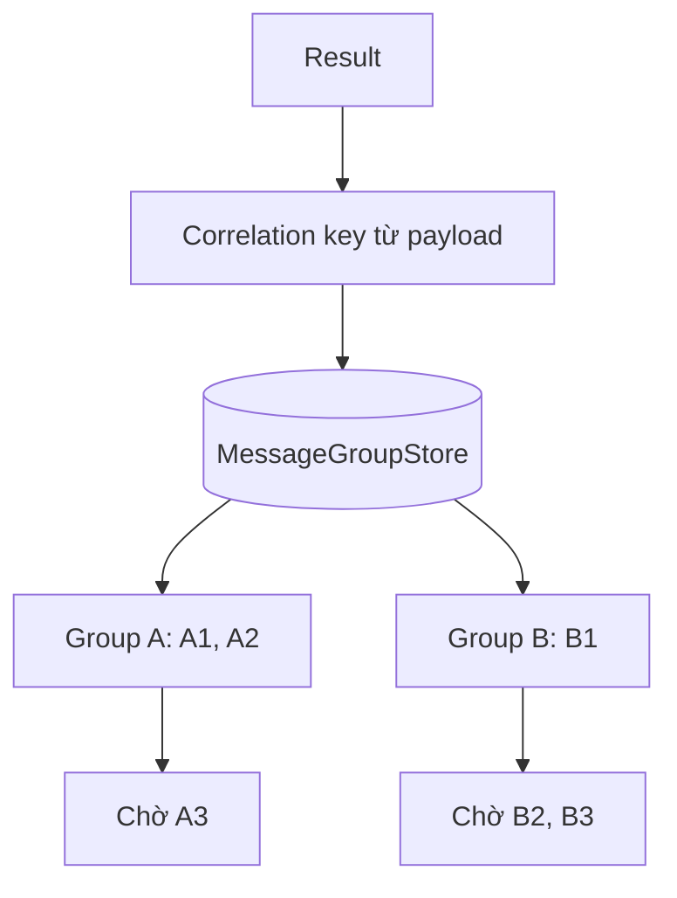
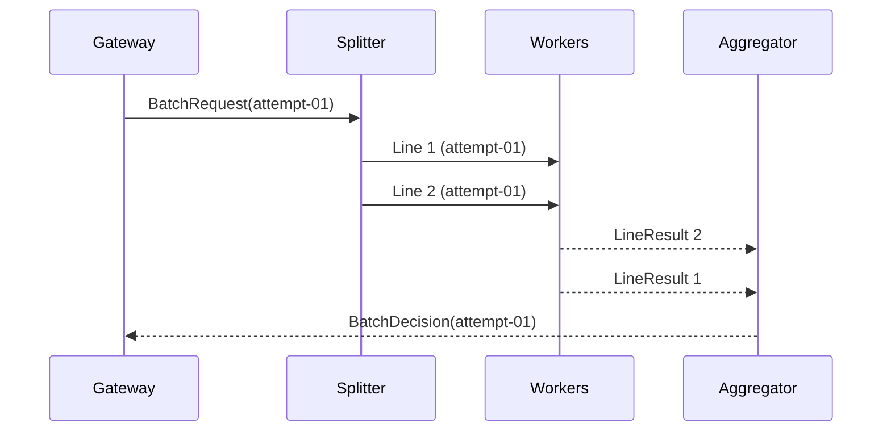

# Correlation group cho splitter và aggregator

Một đơn hàng có nhiều dòng cần được chia ra để kiểm tra độc lập, sau đó tổng hợp kết quả. **Splitter** tạo các Message con; **Aggregator** nhận kết quả của chúng và xác định những Message nào được gom chung. Khó khăn xuất hiện khi các Message đi qua Router, Transformer, hàng đợi hoặc worker bất đồng bộ, rồi đến Aggregator theo thứ tự bất kỳ. Nếu một thông tin tương quan bị mất hoặc chọn khóa nhóm không đúng, hệ thống có thể ghép kết quả của **hai đơn hàng, hai tenant hoặc hai lần xử lý khác nhau**.

**Content-based correlation** là cách xác định nhóm Message dựa trên **nội dung mang ý nghĩa nghiệp vụ**, chẳng hạn `tenantId`, `orderId`, `batchAttemptId`, `documentId` hoặc một định danh phiên làm việc, thay vì chỉ dựa vào header tự động. Nó không phải thao tác “nối chuỗi cho tiện”: một correlation key tốt phải có phạm vi chính xác, ổn định xuyên các bước xử lý và đủ tin cậy để không trộn dữ liệu.

Bài **Correlation group cho splitter và aggregator** thuộc chương **Content-based correlation** trong module `SPRING_INTEGRATION_PATTERN`. Module học thực hành Enterprise Integration Patterns bằng Spring Integration — Router, Filter, Transformer, Splitter, Aggregator, Gateway, retry, error channel và correlation — để xây dựng flow ít phụ thuộc, dễ mở rộng, kiểm thử được và quan sát được. Trọng tâm của bài là **truyền thông tin nhóm qua quá trình split, chọn correlation key từ payload, tổng hợp chính xác các nhóm xen kẽ, và xử lý các trường hợp duplicate, thiếu Message, timeout hoặc chạy nhiều instance**.

## 1. Bài toán: một đơn hàng, nhiều kết quả con

Giả sử một request tạo ba tác vụ:

```json
{
  "tenantId": "tenant-7",
  "orderId": "ORD-1001",
  "attemptId": "attempt-01",
  "items": [
    {"lineNumber": 1, "sku": "BOOK-01", "quantity": 2},
    {"lineNumber": 2, "sku": "PEN-02", "quantity": 5},
    {"lineNumber": 3, "sku": "BAG-03", "quantity": 1}
  ]
}
```

Splitter có thể phát ba Message riêng. Sau khi mỗi dòng được kiểm tra hoặc làm giàu dữ liệu, Aggregator nhận ba kết quả và tạo `BatchDecision`.



Ở đây:

- **Message cha** là một batch gồm ba dòng.
- **Message con** đại diện cho một dòng hoặc một tác vụ phát sinh từ batch.
- **Group** là một lần xử lý batch cụ thể, không phải tất cả Message có cùng kiểu payload.
- **Correlation key** quyết định Message nào thuộc group đó.
- **Release strategy** quyết định group đã có đủ kết quả để tạo một quyết định hay chưa.

Nếu chỉ có một batch và các Message luôn đến theo thứ tự, lỗi nhóm có thể khó nhìn thấy. Ta cần xem thêm **hai batch xử lý xen kẽ**.

## 2. Hai lần xử lý cùng một đơn hàng không phải cùng một group

Giả sử `ORD-1001` được kiểm tra hai lần vì người dùng thay đổi số lượng:

```text
Batch A:
  tenantId  = tenant-7
  orderId   = ORD-1001
  attemptId = attempt-01

Batch B:
  tenantId  = tenant-7
  orderId   = ORD-1001
  attemptId = attempt-02
```

Các kết quả có thể đến như sau:

```text
A1 → B1 → A2 → B2 → B3 → A3
```

Nếu Aggregator dùng **`orderId` làm correlation key**, toàn bộ kết quả có thể vào một group mang khóa `ORD-1001`. Chúng thuộc cùng **thực thể nghiệp vụ**, nhưng **không thuộc cùng lượt xử lý**.

Một khóa có phạm vi phù hợp hơn:

```text
correlationKey = tenantId + "|" + orderId + "|" + attemptId

Group A: tenant-7|ORD-1001|attempt-01
Group B: tenant-7|ORD-1001|attempt-02
```



Phép nối bằng ký tự `|` ở ví dụ chỉ an toàn khi các thành phần **không thể chứa ký tự phân cách** hoặc đã được encode theo một quy tắc không nhập nhằng. Với dữ liệu tùy ý, có thể dùng khóa kiểu record có serialization rõ ràng hoặc encoding có prefix/length. Không được dùng kiểu nối chuỗi không kiểm soát để quyết định group trong hệ thống nhiều tenant.

## 3. Correlation strategy, release strategy và aggregation strategy

Ba việc này cần được tách biệt về mặt tư duy:

| Câu hỏi | Thành phần | Ví dụ |
| --- | --- | --- |
| Message này **thuộc nhóm nào**? | Correlation strategy | `tenantId + orderId + attemptId` |
| Nhóm này **đã đủ dữ liệu chưa**? | Release strategy | Đủ các `lineNumber` từ 1 tới N |
| Khi đủ, **tạo kết quả gì**? | Output processor / aggregation strategy | `BatchDecision` |

Trong Spring Integration, Aggregator thường dùng `MessageGroupStore` để giữ các Message chưa đủ điều kiện release.

```text
Message input
    |
    v
correlationStrategy(message) -> groupKey
    |
    v
MessageGroupStore[groupKey] += message
    |
    v
releaseStrategy(group) -> true/false
    |
    +-- false: giữ group, chờ thêm kết quả
    |
    +-- true: outputProcessor(group) -> BatchDecision
```

**Cùng correlation key không có nghĩa group đã hoàn tất.** Ví dụ nhóm A có ba kết quả `A1`, `A1` trùng và `A2` vẫn **thiếu A3**; nếu release chỉ dựa vào số lượng ba Message thì rất dễ quyết định sai.

Ngược lại, biết `sequenceSize=3` cũng không cho biết **group nào**; hai batch độc lập đều có thể chứa ba phần tử.

## 4. Content-based correlation khác correlation dựa trên header

Spring Integration hỗ trợ metadata thường gặp của một nhóm Message:

| Header | Vai trò |
| --- | --- |
| `correlationId` | Nhận diện một tập Message liên quan |
| `sequenceNumber` | Vị trí của một phần tử trong tập |
| `sequenceSize` | Số phần tử được kỳ vọng khi đã biết kích thước |

Splitter thường có khả năng gắn các **sequence headers** vào Message con. Aggregator có những chiến lược mặc định sử dụng header tương quan; nếu flow bảo toàn chúng đầy đủ thì không nhất thiết phải tự xây content-based strategy.

**Content-based correlation hữu ích khi:**

1. Message được tạo bởi nguồn ngoài mà không có header `correlationId`.
2. Message đi qua broker hoặc adapter không bảo toàn một số header nội bộ.
3. Cần nhóm theo **ngữ nghĩa doanh nghiệp** thay vì ID tự sinh cho từng Message.
4. Cần gom kết quả từ nhiều nhánh có nguồn khác nhau nhưng cùng `attemptId`.
5. Cần kiểm soát phạm vi tenant, workflow, version hoặc cửa sổ thời gian.

**Nó không tự sửa metadata sai.** Nếu producer gán `attemptId` sai trong payload, Aggregator sẽ nhóm sai theo chính giá trị đó. Content-based strategy cần một **hợp đồng dữ liệu đầu vào đáng tin cậy**, validation và kiểm thử.

### 4.1. Không sử dụng Message ID làm group key

Message con thường có `MessageHeaders.ID` khác nhau; nếu mỗi ID là một group key, nhóm không bao giờ nhận đủ phần tử.

### 4.2. Không sử dụng sequence number làm group key

Message `A1` và `B1` đều có `sequenceNumber=1`, nhưng thuộc hai batch khác nhau. Sequence chỉ mô tả **vị trí trong group**, không mô tả **danh tính group**.

### 4.3. Không mặc định `traceId` là group key

Một trace phân tán có thể chứa nhiều request phụ, nhiều batch hoặc nhiều lần retry. Tracing ID phục vụ quan sát; phạm vi của nó có thể khác phạm vi group mà Aggregator cần.

## 5. Xác định nội dung nào được phép tham gia correlation key

Không phải field nào trong payload cũng phù hợp để làm khóa nhóm.

| Field | Có nên dùng? | Lý do |
| --- | --- | --- |
| `tenantId` | Thường cần trong multi-tenant | Ngăn trộn dữ liệu giữa tenant |
| `batchAttemptId` | Rất phù hợp | Xác định một lần xử lý cụ thể |
| `orderId` | Có ích nhưng chưa đủ nếu có retry/reprocess | Cùng order có thể có nhiều attempt |
| `lineNumber` | Không dùng làm **group key** | Mỗi dòng cần thuộc cùng group, không tách group |
| `customerName` | Thường không | Có thể thay đổi, không duy nhất |
| `amount` | Thường không | Không định danh ổn định |
| `timestamp` tự ghi ở từng worker | Nguy hiểm | Khác nhau giữa các Message con |
| `sourceSystem` | Có thể dùng như namespace | Phải biết phạm vi nguồn |

Một correlation key tốt có bốn tính chất:

- **Ổn định:** mọi Message của cùng một attempt cho ra cùng giá trị.
- **Phân biệt:** hai attempt độc lập không có cùng key.
- **Chuẩn hóa:** casing, whitespace, encoding được quy định.
- **Bền qua transport:** có thể tái tạo khi Message được serialize và gửi qua adapter.

### Khóa phải được chốt ở thời điểm đúng

Nếu hệ thống quyết định `attemptId` ở bước đầu, hãy đưa giá trị này vào mỗi Message con. Không để từng worker tự tạo attempt ID mới trong lúc xử lý, vì cùng một batch sẽ bị tách thành nhiều group.

Không nên dùng field **có thể thay đổi sau enrichment** làm key; ví dụ tier khách hàng hoặc địa chỉ giao hàng không phải danh tính ổn định của một batch kiểm tra.

## 6. Thiết kế payload đủ để tái tạo group sau Splitter

Để không phụ thuộc hoàn toàn vào headers, ta thiết kế Message con có đủ ngữ cảnh:

```text
BatchRequest:
  tenantId
  orderId
  attemptId
  items[]

LineTask (sau Splitter):
  tenantId
  orderId
  attemptId
  expectedLines
  lineNumber
  sku
  quantity

LineResult (sau worker):
  tenantId
  orderId
  attemptId
  expectedLines
  lineNumber
  sku
  accepted
```

Mỗi `LineResult` mang các trường cần để tự xác định **group**, **vị trí** và **điều kiện hoàn tất**.

Ví dụ JSON:

```json
{
  "tenantId": "tenant-7",
  "orderId": "ORD-1001",
  "attemptId": "attempt-01",
  "expectedLines": 3,
  "lineNumber": 2,
  "sku": "PEN-02",
  "accepted": true
}
```

Ưu điểm: sau khi đi qua HTTP, Kafka, AMQP hoặc một hệ thống mapping headers khác, consumer vẫn có thể xác định group **nếu payload được chuyển nguyên vẹn theo schema**.

Nhược điểm: payload phải mang metadata nghiệp vụ bổ sung; mọi producer và consumer cần thống nhất phiên bản schema, quyền truy cập và các quy tắc validation.

**Không đưa mọi metadata kỹ thuật vào payload chỉ vì có thể.** Correlation nghiệp vụ nên rõ; tracing, internal reply channel hoặc đối tượng Java trong JVM vẫn nên được xử lý ở envelope/transport phù hợp.

## 7. Mô hình Java 17+: một batch và các phần tử liên quan

Ví dụ dưới đây sử dụng các `record` để thể hiện dữ liệu bất biến. Chúng là DTO thuộc cùng một file Java minh họa.

```java
package example.integration;

import java.util.List;
import java.util.Objects;

public final class CorrelationModel {

    private CorrelationModel() {
    }

    public record LineItem(int lineNumber, String sku, int quantity) {
    }

    public record BatchRequest(
            String tenantId,
            String orderId,
            String attemptId,
            List<LineItem> items) {

        public BatchRequest {
            Objects.requireNonNull(tenantId, "tenantId");
            Objects.requireNonNull(orderId, "orderId");
            Objects.requireNonNull(attemptId, "attemptId");
            items = List.copyOf(items);
            if (items.isEmpty() || items.size() > 100) {
                throw new IllegalArgumentException(
                        "Batch size must be between 1 and 100");
            }
        }
    }

    public record LineTask(
            String tenantId,
            String orderId,
            String attemptId,
            int expectedLines,
            LineItem item) {
    }

    public record LineResult(
            String tenantId,
            String orderId,
            String attemptId,
            int expectedLines,
            int lineNumber,
            String sku,
            boolean accepted) {
    }

    public record BatchDecision(
            String tenantId,
            String orderId,
            String attemptId,
            int receivedLines,
            long acceptedLines,
            List<Integer> orderedLineNumbers) {
    }
}
```

Hợp đồng yêu cầu `LineItem.lineNumber` tạo thành tập **1 đến N**, mỗi số xuất hiện đúng một lần; `tenantId`, `orderId`, `attemptId` đều hợp lệ và không chứa ký tự phân cách của group key. Những validation chi tiết được dùng trong correlation/release và cần được thực hiện **sớm ở ingress** trong ứng dụng thực.

Việc đặt giới hạn batch 100 phần tử là **chính sách minh họa**, không phải một giới hạn mặc định của Spring Integration.

## 8. Spring Integration: Splitter giữ ngữ cảnh, Aggregator nhóm từ payload

Ta dùng ba bước:

1. `@Splitter` tách `BatchRequest` thành các `LineTask` và **sao chép group context vào từng task**.
2. `IntegrationFlow` biến mỗi `LineTask` thành `LineResult`.
3. `Aggregator` lấy correlation key từ chính `LineResult`, không lấy từ Message ID hay `sequenceNumber`.

### 8.1. Cấu hình Java DSL và endpoint Splitter

```java
package example.integration;

import java.util.Comparator;
import java.util.List;
import java.util.Set;
import java.util.stream.Collectors;

import org.springframework.beans.factory.annotation.Qualifier;
import org.springframework.context.annotation.Bean;
import org.springframework.context.annotation.Configuration;
import org.springframework.integration.annotation.Splitter;
import org.springframework.integration.channel.DirectChannel;
import org.springframework.integration.channel.QueueChannel;
import org.springframework.integration.config.EnableIntegration;
import org.springframework.integration.dsl.IntegrationFlow;
import org.springframework.integration.store.MessageGroupStore;
import org.springframework.integration.store.SimpleMessageStore;
import org.springframework.messaging.MessageChannel;
import org.springframework.messaging.PollableChannel;

import example.integration.CorrelationModel.*;

@Configuration
@EnableIntegration
public class ContentCorrelationConfiguration {

    @Bean
    public MessageChannel incomingBatches() {
        return new DirectChannel();
    }

    @Bean
    public MessageChannel splitLineTasks() {
        return new DirectChannel();
    }

    @Bean
    public MessageChannel lineResults() {
        return new DirectChannel();
    }

    @Bean
    public PollableChannel batchDecisions() {
        return new QueueChannel(20);
    }

    @Bean
    public MessageGroupStore correlationGroupStore() {
        // Demo: các group tồn tại trong RAM của JVM.
        return new SimpleMessageStore();
    }

    @Splitter(
            inputChannel = "incomingBatches",
            outputChannel = "splitLineTasks")
    public List<LineTask> split(BatchRequest batch) {
        int expected = batch.items().size();

        return batch.items().stream()
                .map(item -> new LineTask(
                        batch.tenantId(),
                        batch.orderId(),
                        batch.attemptId(),
                        expected,
                        item))
                .toList();
    }

    @Bean
    public IntegrationFlow simulateLineWorker() {
        return IntegrationFlow.from("splitLineTasks")
                .transform(LineTask.class, task -> new LineResult(
                        task.tenantId(),
                        task.orderId(),
                        task.attemptId(),
                        task.expectedLines(),
                        task.item().lineNumber(),
                        task.item().sku(),
                        task.item().quantity() > 0))
                .channel("lineResults")
                .get();
    }

    @Bean
    public IntegrationFlow aggregateByContent(
            @Qualifier("correlationGroupStore")
                    MessageGroupStore store) {

        return IntegrationFlow.from("lineResults")
                .aggregate(spec -> spec
                        .correlationStrategy(message ->
                                groupKey((LineResult) message.getPayload()))
                        .releaseStrategy(group -> {
                            List<LineResult> values =
                                    group.getMessages().stream()
                                            .map(message ->
                                                    (LineResult)
                                                            message.getPayload())
                                            .toList();

                            if (values.isEmpty()) {
                                return false;
                            }

                            int expected = values.get(0).expectedLines();
                            if (expected < 1 || expected > 100) {
                                throw new IllegalArgumentException(
                                        "Invalid expectedLines");
                            }

                            Set<Integer> numbers = values.stream()
                                    .map(LineResult::lineNumber)
                                    .collect(Collectors.toSet());

                            boolean sameSize = values.stream().allMatch(
                                    result ->
                                            result.expectedLines() == expected);

                            return sameSize
                                    && values.size() == expected
                                    && numbers.size() == expected
                                    && numbers.stream().allMatch(
                                            n -> n >= 1 && n <= expected);
                        })
                        .outputProcessor(group -> {
                            List<LineResult> values =
                                    group.getMessages().stream()
                                            .map(message ->
                                                    (LineResult)
                                                            message.getPayload())
                                            .sorted(Comparator.comparingInt(
                                                    LineResult::lineNumber))
                                            .toList();

                            LineResult first = values.get(0);
                            boolean sameIdentity = values.stream().allMatch(
                                    result -> groupKey(result)
                                            .equals(groupKey(first)));
                            if (!sameIdentity) {
                                throw new IllegalStateException(
                                        "Mixed group identities");
                            }

                            long accepted = values.stream()
                                    .filter(LineResult::accepted)
                                    .count();
                            List<Integer> numbers = values.stream()
                                    .map(LineResult::lineNumber)
                                    .toList();

                            return new BatchDecision(
                                    first.tenantId(),
                                    first.orderId(),
                                    first.attemptId(),
                                    values.size(),
                                    accepted,
                                    numbers);
                        })
                        .messageStore(store)
                        .expireGroupsUponCompletion(true))
                .channel("batchDecisions")
                .get();
    }

    private static String groupKey(LineResult value) {
        return part(value.tenantId()) + "|"
                + part(value.orderId()) + "|"
                + part(value.attemptId());
    }

    private static String part(String input) {
        if (input == null
                || !input.matches("[A-Za-z0-9_-]{1,64}")) {
            throw new IllegalArgumentException(
                    "Invalid component of correlation key");
        }
        return input;
    }
}
```

### 8.2. Đọc luồng từ đầu đến cuối

- `@Splitter` nhận `BatchRequest` rồi phát `LineTask`. Mỗi task **được copy** `tenantId`, `orderId`, `attemptId` và `expectedLines`.
- `simulateLineWorker` là một Transformer giản lược dùng `quantity > 0` để minh họa `accepted`; **không gọi service thật** và không tạo concurrency.
- `lineResults` chứa Message có payload `LineResult`.
- `correlationStrategy` dùng **payload**, tạo khóa `tenant|order|attempt`. Nó không phụ thuộc vào header `correlationId` do Splitter có thể đã gắn.
- `releaseStrategy` chỉ cho release khi số Message đúng bằng `expectedLines`, các Message nhất trí về `expectedLines` và có đủ các `lineNumber` khác nhau trong khoảng `1..N`.
- `outputProcessor` sắp xếp theo `lineNumber` rồi tạo `BatchDecision` duy nhất.
- `SimpleMessageStore` lưu group trong RAM; `.expireGroupsUponCompletion(true)` dọn group hoàn tất theo chính sách endpoint của demo.

Những biểu thức này thể hiện ba vai trò **chọn group → kiểm tra đủ kết quả → tạo output**; thay một vai trò không tự thay đổi hai vai trò còn lại.

### 8.3. Các giới hạn của ví dụ

1. Giới hạn N = 100 là quy tắc minh họa, cần validation tại ingress.
2. **Duplicate** hoặc dữ liệu sai có thể khiến `values.size()` vượt N; ví dụ chưa xây cơ chế dedupe hoặc quarantine đầu vào.
3. `DirectChannel` xử lý đồng bộ; flow không chứng minh parallelism, transport correlation hay persistence qua restart.
4. `QueueChannel(20)` giới hạn queue output, **không giới hạn số group đang chờ trong MessageGroupStore**.
5. Tên method/overload của Java DSL và cấu hình cụ thể cần được đối chiếu theo phiên bản Spring Integration của dự án khi biên dịch.

**Đây là ví dụ minh họa luồng và hành vi nghiệp vụ**, chưa phải mẫu production đã giải quyết timeout, idempotency, state store bền vững và error handling end-to-end.

## 9. Đầu vào đầy đủ: từ BatchRequest đến BatchDecision

Một ứng dụng nhỏ có thể gửi batch có hai dòng:

```java
package example.integration;

import java.util.List;

import org.springframework.context.annotation.AnnotationConfigApplicationContext;
import org.springframework.messaging.Message;
import org.springframework.messaging.MessageChannel;
import org.springframework.messaging.PollableChannel;
import org.springframework.messaging.support.MessageBuilder;

import example.integration.CorrelationModel.*;

public class ContentCorrelationDemo {

    public static void main(String[] args) {
        try (var context = new AnnotationConfigApplicationContext(
                ContentCorrelationConfiguration.class)) {

            MessageChannel input = context.getBean(
                    "incomingBatches", MessageChannel.class);
            PollableChannel output = context.getBean(
                    "batchDecisions", PollableChannel.class);

            BatchRequest request = new BatchRequest(
                    "tenant-7",
                    "ORD-1001",
                    "attempt-01",
                    List.of(
                            new LineItem(1, "BOOK-01", 2),
                            new LineItem(2, "PEN-02", 5)));

            input.send(MessageBuilder.withPayload(request)
                    .setHeader("eventId", "evt-1001")
                    .build());

            Message<?> message = output.receive(0);
            if (message == null) {
                throw new IllegalStateException(
                        "Expected a batch decision");
            }
            BatchDecision decision =
                    (BatchDecision) message.getPayload();

            System.out.println(decision.attemptId()); // attempt-01
            System.out.println(decision.receivedLines()); // 2
            System.out.println(decision.acceptedLines()); // 2
            System.out.println(
                    decision.orderedLineNumbers()); // [1, 2]
        }
    }
}
```

Trong demo dùng các `DirectChannel` đồng bộ, hai Message con đi qua Transformer rồi tới Aggregator trước khi `input.send()` trả về. `QueueChannel` đầu ra giữ Message quyết định cho thao tác đọc sau đó.

Nếu thay bằng executor hoặc broker, **không được giả định** kết quả luôn sẵn sàng ngay sau `send()`: cần timeout hữu hạn, correlation qua transport và xử lý exception theo đúng endpoint.

## 10. Kiểm thử quan trọng nhất: hai group đến xen kẽ

Nếu chỉ kiểm tra một batch hoàn tất, khó phát hiện chiến lược correlation quá rộng. Ta cần gửi trực tiếp các `LineResult` vào channel Aggregator để mô phỏng việc các worker trả kết quả xen kẽ.

```text
Gửi kết quả:
  A1, B1, A2, B2

Yêu cầu:
  A = tenant-7|ORD-1001|attempt-01
  B = tenant-7|ORD-1001|attempt-02

Kỳ vọng:
  Sau A1, B1: chưa nhóm nào hoàn tất.
  Sau A2: chỉ A hoàn tất.
  Sau B2: B hoàn tất.
```

### 10.1. JUnit 5 dùng channel thật

```java
package example.integration;

import static org.junit.jupiter.api.Assertions.*;

import org.junit.jupiter.api.Test;
import org.springframework.context.annotation.AnnotationConfigApplicationContext;
import org.springframework.integration.IntegrationMessageHeaderAccessor;
import org.springframework.messaging.Message;
import org.springframework.messaging.MessageChannel;
import org.springframework.messaging.PollableChannel;
import org.springframework.messaging.support.MessageBuilder;

import example.integration.CorrelationModel.*;

class ContentCorrelationIntegrationTest {

    private static void send(
            MessageChannel channel,
            String attempt,
            int number) {
        LineResult result = new LineResult(
                "tenant-7",
                "ORD-1001",
                attempt,
                2,
                number,
                "SKU-" + number,
                true);

        assertTrue(channel.send(MessageBuilder
                .withPayload(result)
                .setHeader(
                        IntegrationMessageHeaderAccessor.CORRELATION_ID,
                        "deliberately-shared-header")
                .build()));
    }

    @Test
    void contentKeySeparatesTwoAttemptsEvenWithSameOrderAndHeader() {
        try (var context = new AnnotationConfigApplicationContext(
                ContentCorrelationConfiguration.class)) {

            MessageChannel input = context.getBean(
                    "lineResults", MessageChannel.class);
            PollableChannel output = context.getBean(
                    "batchDecisions", PollableChannel.class);

            send(input, "attempt-01", 1);
            send(input, "attempt-02", 1);
            assertNull(output.receive(0));

            send(input, "attempt-01", 2);
            Message<?> first = output.receive(0);
            assertNotNull(first);
            BatchDecision a = (BatchDecision) first.getPayload();
            assertEquals("attempt-01", a.attemptId());
            assertEquals("ORD-1001", a.orderId());
            assertEquals(2, a.receivedLines());
            assertEquals(2L, a.acceptedLines());
            assertEquals(java.util.List.of(1, 2),
                    a.orderedLineNumbers());

            // B vẫn chỉ có một phần tử.
            assertNull(output.receive(0));

            send(input, "attempt-02", 2);
            Message<?> second = output.receive(0);
            assertNotNull(second);
            BatchDecision b = (BatchDecision) second.getPayload();
            assertEquals("attempt-02", b.attemptId());
            assertEquals(2, b.receivedLines());
            assertNull(output.receive(0));
        }
    }
}
```

Test cố ý đặt **cùng một header `correlationId`** cho Message của A và B. Nếu Aggregator vô tình dựa vào header đó, chúng có nguy cơ bị gom chung. Khi `correlationStrategy` thực sự đọc payload, hai attempt vẫn tách biệt.

**Không dùng cùng một header sai như thế trong production**: đây là phép thử cho việc strategy dựa trên nội dung. Trong hệ thống thật, nên chuẩn hóa header và payload để không tạo hai định danh nhóm mâu thuẫn ngoài ý muốn.

### 10.2. Những giới hạn của test

Test dùng `DirectChannel` đồng bộ và `SimpleMessageStore`. Nó chứng minh **grouping đúng trong một application context**, chưa kiểm tra restart, giao dịch database, broker redelivery hoặc nhiều instance cập nhật group đồng thời.

## 11. Đầu vào thiếu hoặc sai correlation key

Một chiến lược correlation dựa trên nội dung không nên âm thầm gộp mọi Message không hợp lệ vào nhóm `"UNKNOWN"`.

Ví dụ lỗi:

```text
tenantId = null
orderId = ORD-1001
attemptId = ""
```

Nếu code chuyển các giá trị thiếu thành `""`, nhiều Message không liên quan có thể nhận cùng group key và tạo một nhóm vô nghĩa. Điều này nguy hiểm trong hệ thống multi-tenant.

Một chính sách rõ ràng là:

1. Kiểm tra `tenantId`, `orderId`, `attemptId` ở boundary.
2. Từ chối hoặc đưa vào error flow những Message không hợp lệ.
3. Ghi log định danh sự kiện và reason code có kiểm soát.
4. Không tạo group bằng giá trị mặc định tùy tiện.
5. Không cố truy ngược key từ field không ổn định như tên khách hàng.

Trong ví dụ mục 8, hàm `part(...)` chỉ chấp nhận chữ, số, `_` và `-`, tối đa 64 ký tự. Chính sách này giúp phép nối bằng `|` không bị nhập nhằng. Hệ thống thực có thể cần định danh Unicode hoặc format khác; khi đó phải chọn **encoding có khả năng phân tách và serialize ổn định**.

### Tránh chọn key động theo trạng thái nhánh

Không nên:

```text
if riskApproved:
    groupKey = orderId + "-approved"
else:
    groupKey = orderId + "-rejected"
```

Hai Message cùng attempt nhưng kết quả kiểm tra khác nhau sẽ bị tách thành hai nhóm. Khóa nhóm phải xác định **trước khi biết kết quả xử lý**, còn việc `APPROVED/REJECTED` thuộc về logic tổng hợp.

## 12. Duplicate: cùng group nhưng không phải phần tử mới

Giả sử Aggregator chờ ba dòng `1, 2, 3`:

```text
Line 1: tới lần đầu
Line 2: tới lần đầu
Line 2: bị broker redeliver
Line 3: chưa tới
```

Nếu release strategy chỉ dùng:

```java
.releaseStrategy(group -> group.size() == 3)
```

thì nhóm có thể được release sai. Trong ví dụ mục 8, ta kiểm tra cả **tập lineNumber** và `expectedLines`, nhưng cách này **không phải cơ chế deduplication hoàn chỉnh**:

- Khi nhận hai Message cho cùng line, `group.size()` có thể lớn hơn số phần tử kỳ vọng, khiến group kẹt.
- Một `lineNumber` có thể xuất hiện hai version hợp lệ; cần xác định version nào có quyền thay thế.
- Message lặp có thể gây tăng bộ nhớ, lock contention và thời gian chờ.

### 12.1. Dedupe theo định danh nghiệp vụ

Một khóa nhận diện kết quả có thể là:

```text
dedupeKey =
  tenantId + "|" + orderId + "|" + attemptId
  + "|" + lineNumber
  + "|" + resultVersion
```

Phân biệt:

| Loại ID | Phạm vi |
| --- | --- |
| `groupKey` | Cả batch/attempt |
| `lineNumber` hoặc `lineId` | Một phần tử trong batch |
| `resultVersion` | Phiên bản kết quả của phần tử |
| `eventId` | Sự kiện được phát hoặc lần tạo Message |
| `MessageHeaders.ID` | Message cụ thể trong Spring Messaging |

Nếu một Message bị redeliver, ID ở hạ tầng có thể khác; dedupe phải dựa vào định danh nghiệp vụ **ổn định qua retry**. Đối với dữ liệu quan trọng, trạng thái dedupe cũng cần persistence và chính sách retention.

### 12.2. Đừng chỉ lọc duplicate sau khi Aggregator đã release

Nếu nhóm đã release sai hoặc output đã có side effect, việc phát hiện trùng trong `outputProcessor` có thể quá muộn. Nên loại trùng **trước hoặc trong thao tác cập nhật group**, hoặc dùng chiến lược aggregation đủ mạnh để quản lý từng line/version.

## 13. Filter và Router có thể khiến group không hoàn tất

Flow thường không chỉ có Splitter và Aggregator:



Nếu Splitter tạo `expectedLines=3` mà Filter bỏ dòng số 2 **không tạo kết quả thay thế**, Aggregator sẽ chỉ thấy hai kết quả hợp lệ. Content-based correlation vẫn phân đúng nhóm nhưng **không thể tự tạo phần tử bị thiếu**.

Một giải pháp là tạo `LineResult` có `accepted=false` kèm `reasonCode` cho dòng bị từ chối, vẫn giữ `lineNumber` và group key. Nhờ vậy, Aggregator có đủ dữ liệu để quyết định batch bị từ chối hoặc cần xem xét.

Nếu Router phân một Message con tới **nhiều recipient**, một line có thể sinh nhiều result. Lúc đó cần một mô hình kết quả có `branchType`, `lineNumber` và quy tắc release tương ứng; không còn đơn giản là “mỗi line một kết quả”.

### 13.1. Correlation key không phải routing key

Router chọn **nơi Message đi**. Correlation strategy chọn **nhóm Message thuộc về**. Có thể cùng dựa trên payload nhưng mục tiêu khác nhau:

```text
routingKey     = resultType    // INVENTORY, PRICING, SHIPPING
correlationKey = attemptId     // cùng lượt xử lý
```

Không dùng `resultType` làm correlation key nếu muốn gom kết quả của nhiều loại kiểm tra trong cùng một lần xử lý.

## 14. Transformer, Content Enricher và dữ liệu tương quan

Một Transformer có thể chuyển:

```text
RawLineResponse → CanonicalLineResult
```

Một Content Enricher có thể bổ sung:

```text
LineResult + ProductInfo → EnrichedLineResult
```

Trong cả hai trường hợp, cần **bảo toàn định danh nhóm** đã được tạo lúc bắt đầu workflow. Nếu `tenantId`, `orderId`, `attemptId` bị bỏ khỏi DTO kết quả, Aggregator dùng payload sẽ không còn đủ dữ liệu để tính key.

### 14.1. Không lấy key từ payload đã bị biến đổi không ổn định

Ví dụ chuẩn hóa `orderId`:

```text
Đầu vào A: "ord-1001"
Đầu vào B: "ORD-1001"
```

Nếu một worker tự uppercase và worker khác giữ nguyên, hai kết quả có thể thành **hai group** dù nghiệp vụ coi là một. Cần chuẩn hóa **trước Splitter** hoặc áp dụng một hàm chuẩn hóa thống nhất, có test.

### 14.2. Khi chỉ có headers mà không có business context

Nếu adapter chỉ giữ `correlationId` trong header, vẫn có thể dùng **header-based correlation**. Không bắt buộc nhân đôi mọi dữ liệu vào payload. Content-based strategy hữu ích khi nội dung có một định danh ổn định được truyền qua mọi biên giới và thuộc hợp đồng đã được kiểm chứng.

## 15. Group timeout, expiration và Message đến muộn

Một group có thể không bao giờ đủ kết quả:

```text
Group A:
  line 1 -> OK
  line 2 -> OK
  line 3 -> chưa đến
```

**Persistent MessageGroupStore** có thể giữ trạng thái chờ qua restart, nhưng không giải quyết việc thiếu line 3. Cần chính sách thời gian và lỗi:

| Tình huống | Chính sách cần xác định |
| --- | --- |
| Một worker timeout | Retry hữu hạn hoặc tạo result lỗi |
| Message bị Filter drop | Tạo rejected result hoặc đánh dấu missing |
| Message tới sau deadline | Bỏ qua, audit hoặc tạo attempt/version mới |
| Group chờ vô hạn | Group timeout, expiration và cleanup |
| Group bị release partial | Đánh dấu thiếu dữ liệu; không giả là đủ |
| Retry khiến Message tới sau completion | Completion registry và dedupe |

### 15.1. Vì sao `.expireGroupsUponCompletion(true)` chưa đủ?

Tùy cấu hình store và group lifecycle, sau khi nhóm hoàn tất và bị dọn, một Message đến muộn mang **cùng key** có thể tạo nhóm mới. Chỉ xóa trạng thái nhóm không tự bảo đảm rằng attempt đã hoàn tất sẽ không có kết quả thứ hai.

Muốn chặn việc phát lại quyết định cho cùng attempt, cần **ghi nhận completion/deduplication** đủ lâu, theo khóa nhóm và version phù hợp.

### 15.2. Timeout và release không giống nhau

Timeout có thể kết thúc việc **chờ** nhưng không chứng minh đã đủ các phần tử. Nếu phát partial, output phải nêu rõ trạng thái `INCOMPLETE` và các line thiếu, nếu chính sách ứng dụng cho phép.

## 16. MessageGroupStore: phạm vi lưu state và khóa nhóm

Aggregator cần một nơi giữ Message đã nhận:



Spring Integration có trừu tượng `MessageGroupStore` cùng những implementation lưu trong RAM hoặc bền vững hơn, chẳng hạn JDBC. Ví dụ đã dùng `SimpleMessageStore` để thuận tiện học tập; nó không giữ group qua restart JVM.

### 16.1. Với store trong bộ nhớ

- Ít chi phí I/O và dễ thiết lập.
- Không tự chia sẻ trạng thái giữa hai JVM/replica.
- Nếu group chờ quá nhiều, heap có thể tăng mạnh.
- Restart có thể làm mất tiến độ của nhóm chưa hoàn tất.

### 16.2. Với persistent store

- Có thể giữ group đã commit sau restart.
- Cần schema, serialization, transaction, cleanup và locking.
- Nếu nhiều instance chia sẻ store, phải phối hợp truy cập cùng group.
- Không tự bảo đảm broker ACK hoặc output side effect là exactly-once.

Một thay thế cấu hình có tính định hướng:

```java
// Minh họa bean thay thế SimpleMessageStore trong mục 8.
// Cần spring-integration-jdbc, schema DB và DataSource cấu hình sẵn.
@Bean
public MessageGroupStore correlationGroupStore(DataSource dataSource) {
    return new JdbcMessageStore(dataSource);
}
```

Đoạn mã này cần import `javax.sql.DataSource` và `org.springframework.integration.jdbc.store.JdbcMessageStore`, đồng thời **không đăng ký cùng tên** với bean `correlationGroupStore()` in-memory. Đây chưa phải cấu hình production đầy đủ.

### 16.3. Tải của nhóm chờ là một vấn đề khác với correlation

Khóa đúng giúp group **không trộn**, nhưng vẫn có thể có hàng nghìn group riêng biệt chờ Message cuối. Cần theo dõi số group đang mở, Message/bytes trong store, tuổi nhóm, throughput và chính sách timeout/cleanup.

## 17. Concurrency, partition và nhiều instance

Nếu hai replica cùng nhận Message của group A, hai nguy cơ cần tránh:

1. Replica 1 và 2 dùng **hai in-memory store riêng**, mỗi nơi giữ một nửa group → không bên nào release.
2. Cả hai dùng **một persistent store** nhưng cùng cập nhật hoặc release nhóm mà không có locking/transaction thích hợp → mất update hoặc phát trùng quyết định.

Một số phương án:

| Phương án | Tác dụng | Giới hạn |
| --- | --- | --- |
| Partition Message theo `groupKey` | Đưa các Message cùng group vào cùng phân vùng/consumer | Phụ thuộc cấu hình broker, rebalancing |
| Shared persistent `MessageGroupStore` | Các instance cùng nhìn thấy nhóm | Cần locking và transaction |
| Distributed `LockRegistry` phù hợp | Phối hợp cập nhật/release cùng group | Cần timeout/lease và triển khai đúng |
| Idempotent consumer | Giảm side effect trùng | Không làm group đầy nếu thiếu Message |
| Completion registry | Chặn reply đến muộn làm release lại | Cần retention và state bền vững |

**Chọn cùng `groupKey` không tự bảo đảm các Message thực sự được đưa về cùng một process.** Correlation strategy chỉ quyết định nhóm **khi endpoint nhận Message**. Topology và transport phải hỗ trợ phân phối dữ liệu đúng.

## 18. Gateway, retry và reply correlation

Gateway có thể muốn một kết quả tổng cho một request:



Để lời đáp về đúng Gateway:

- Group key nghiệp vụ chọn đúng các `LineResult` của attempt.
- Flow giữ metadata hoặc địa chỉ reply cần thiết cho request-reply.
- Group timeout và Gateway timeout được đặt có chủ đích.
- Nếu Gateway đã timeout, reply đến muộn có chính sách rõ ràng.
- Nếu các bước có side effect, retry phải có idempotency theo attempt + line/operation.

**Group correlation của Aggregator** và **request/reply correlation của transport** có thể khác nhau. Không giả định việc set `attemptId` trong payload sẽ tự định tuyến reply xuyên Kafka/AMQP tới Gateway.

## 19. Observability và kiểm thử lỗi khó phát hiện

Một log minh họa khi Aggregator nhận Message:

```json
{
  "stage": "content-correlation-aggregator",
  "tenantId": "tenant-7",
  "orderId": "ORD-1001",
  "attemptId": "attempt-01",
  "lineNumber": 2,
  "expectedLines": 3,
  "receivedLineNumbers": [1, 2],
  "groupStatus": "WAITING",
  "missingLineNumbers": [3]
}
```

Đây là **schema log do ứng dụng định nghĩa**, không phải JSON tự động của Spring Integration. Các ID nên được ghi trong log/tracing có quyền truy cập phù hợp; không dùng chúng làm metric tags cardinality cao.

| Metric đề xuất | Ý nghĩa |
| --- | --- |
| `correlation.group.created` | Số group mới |
| `correlation.group.pending` | Số group chưa đủ |
| `correlation.group.released` | Số group đã tạo output |
| `correlation.group.expired` | Số group quá hạn |
| `correlation.key.invalid` | Message có khóa tương quan không hợp lệ |
| `correlation.result.duplicate` | Kết quả trùng theo group/line/version |
| `correlation.result.late` | Kết quả đến sau completion |
| `correlation.group.age` | Thời gian nhóm chờ |
| `correlation.group.member.count` | Số Message đang giữ trong nhóm |
| `correlation.output.failure` | Lỗi chuyển giao kết quả tổng |

Đây là các tên **gợi ý để instrument**, không phải metric mặc định chắc chắn được Spring Integration/Micrometer phát ra.

### 19.1. Bộ kiểm thử nên có

| Tình huống | Kỳ vọng |
| --- | --- |
| Một batch đủ N dòng | Một `BatchDecision` có đủ N line |
| Hai attempt cùng `orderId` | Không trộn kết quả |
| Hai tenant cùng mã order/attempt | Không trộn kết quả |
| Reply đến đảo thứ tự | Không làm đổi group; output được sort khi cần |
| Thiếu một line | Không release sai; có timeout/error policy |
| Duplicate line | Không tính như line mới |
| Thiếu tenant/attempt ID | Không gộp vào group `"UNKNOWN"` |
| Transformer làm mất header | Vẫn có thể group từ payload nếu payload đủ |
| Transformer làm mất payload context | Validation lỗi, không âm thầm gom sai |
| Filter loại một line | Có rejected result hoặc chính sách partial rõ |
| Router fan-out một line | Release phản ánh số kết quả thực cần nhận |
| Restart khi group đang chờ | Persistent store/serialization được kiểm tra thật |
| Hai instance xử lý chung group | Locking/partition và dedupe đúng |
| Kết quả đến muộn | Không phát lại output ngoài hợp đồng |

## 20. Checklist triển khai correlation group

- **Xác định group theo nghĩa nghiệp vụ:** một order, một attempt, một batch hay một cửa sổ?
- **Tạo attempt ID ở ranh giới đầu vào:** mọi Message con phải dùng cùng ID của lượt.
- **Xét phạm vi tenant/source:** không cho hai khách hàng khác nhau bị gom chung.
- **Phân biệt correlation và sequence:** group key không phải lineNumber.
- **Chỉ định một nguồn khóa đáng tin:** payload hoặc header được bảo toàn; tránh hai key mâu thuẫn.
- **Chuẩn hóa key:** casing, delimiter, Unicode, version và serialization.
- **Kiểm tra context sau Splitter:** mỗi LineTask có đủ dữ liệu để tạo LineResult cùng group.
- **Cấu hình Aggregator có chủ đích:** correlation strategy, release strategy, output processor và MessageGroupStore.
- **Không release chỉ vì đủ số lượng:** kiểm tra duplicate, tập line hoặc result type bắt buộc.
- **Xử lý Filter/Router:** không để nhánh bị bỏ tạo group chờ vô hạn.
- **Có timeout và late-arrival policy:** trạng thái đóng nhóm/partial phải rõ.
- **Dedupe theo nghiệp vụ:** group + line + version, không chỉ Message ID.
- **Kiểm thử hai nhóm xen kẽ:** đặc biệt các attempt có cùng order ID.
- **Kiểm tra multi-instance/persistence:** partition, store chung, transaction và lock.
- **Theo dõi group chờ:** số nhóm, tuổi, thiếu phần tử, duplicates, output failures.

## 21. Bài tập: khi cùng order nhưng hai attempt bị gom nhầm

Một hệ thống phân tích giao dịch thực hiện kiểm tra hai lần cho `ORD-9001`:

```text
tenant=shop-A, order=ORD-9001, attempt=run-1
    result INVENTORY: PASS
    result PAYMENT:  REJECT

tenant=shop-A, order=ORD-9001, attempt=run-2
    result INVENTORY: PASS
    result PAYMENT:  PASS
```

Các kết quả đến theo thứ tự:

```text
run-1/INVENTORY
run-2/INVENTORY
run-1/PAYMENT
run-2/PAYMENT
```

Hãy phân tích:

1. Nếu chỉ dùng `orderId` làm correlation key, nhóm nào có thể bị sai?
2. Nếu dùng `tenant|order|attempt`, mỗi Message thuộc group nào?
3. Khi một `run-1/INVENTORY` bị redeliver, release strategy dựa `group.size()==2` có an toàn không?
4. Nếu Filter bỏ `run-1/PAYMENT`, Aggregator phải làm gì khi nhóm không đủ?
5. Nếu Gateway chờ kết quả 2 giây nhưng group timeout là 20 giây, cần thiết kế reply muộn ra sao?

Đáp án định hướng: **correlation key theo từng attempt** giữ hai lần kiểm tra riêng; **release strategy theo tập kết quả bắt buộc** tránh đếm bản lặp; **error/timeout policy** xử lý kết quả không tới; **reply/correlation transport** và **late-arrival policy** phải được xem là phần riêng của thiết kế Gateway. Việc đổi một expression correlation không tự bảo đảm hoàn tất, retry hay exactly-once.

---

**Correlation group là ranh giới phân tách các Message có liên quan, không phải một bộ đếm phần tử.** Khi Splitter sao chép ngữ cảnh nghiệp vụ ổn định vào từng Message con và Aggregator chọn cùng khóa từ nội dung kết quả, các batch có thể được xử lý xen kẽ mà không trộn dữ liệu. Muốn flow đáng tin cậy hơn trong production, vẫn phải giải quyết độc lập **duplicate, release, timeout, persistence, concurrency và reply correlation**.
