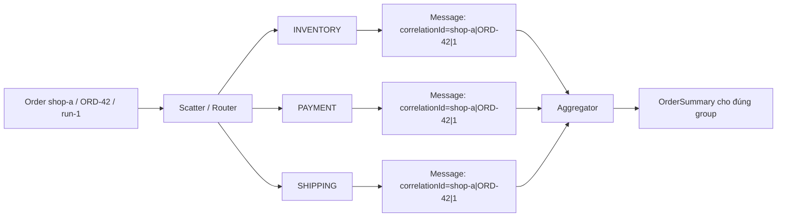
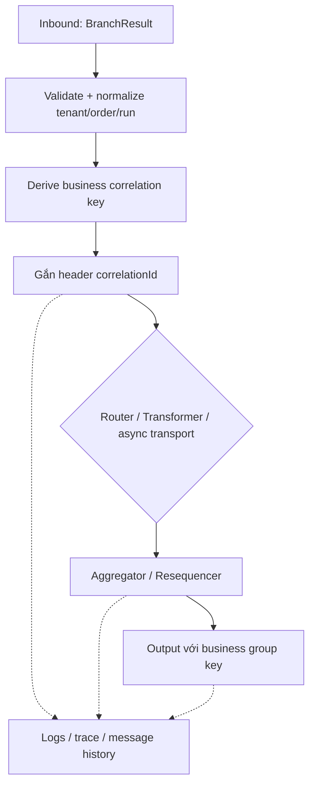
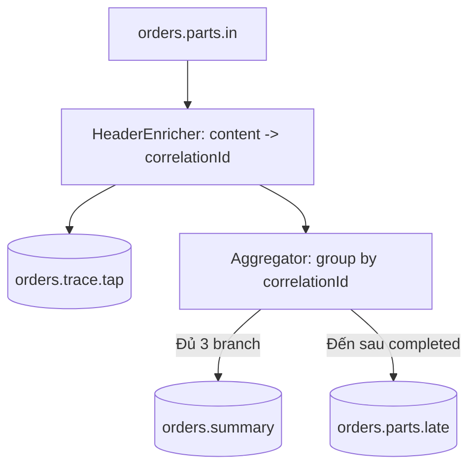
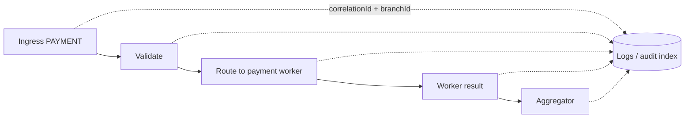
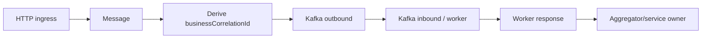

# Truy nguyên message bằng correlation ID trong Spring Integration

## Mục tiêu bài học

Một hệ thống xử lý đơn hàng theo ba nhánh độc lập: **kiểm tra tồn kho (INVENTORY)**, **xác nhận thanh toán (PAYMENT)** và **tính phương án giao hàng (SHIPPING)**. Mỗi nhánh trả một message khi hoàn tất. Vì các nhánh có thể chạy trên các worker khác nhau, phản hồi của nhiều đơn hàng thường **đến xen kẽ**:

```text
Thời điểm   Tenant    Order     Run    Nhánh
T1          shop-a    ORD-42    1      INVENTORY
T2          shop-b    ORD-42    1      SHIPPING
T3          shop-a    ORD-42    1      PAYMENT
T4          shop-b    ORD-42    1      INVENTORY
T5          shop-b    ORD-42    1      PAYMENT
T6          shop-a    ORD-42    1      SHIPPING
```

Nếu chỉ nhìn thứ tự đến hoặc mã đơn `ORD-42`, Aggregator có thể gom nhầm kết quả của **hai tenant**. Nếu mỗi lần retry sinh một correlation key mới, các message của cùng workflow cũng bị tách thành nhiều nhóm và không hoàn tất. Để vừa **gom đúng các phần có liên quan** vừa **truy nguyên luồng xử lý**, ta cần một khóa tương quan (**correlation ID**) ổn định và có phạm vi rõ ràng.

Trong Spring Integration, **content-based correlation** là cách tính khóa nhóm từ **nội dung nghiệp vụ** của message, chẳng hạn `tenantId + orderId + runId`, thay vì chỉ dựa vào một ID kỹ thuật sẵn có. Spring Integration hỗ trợ correlation dựa trên header mặc định và correlation strategy tùy chỉnh dựa trên payload/SpEL; các khóa ấy giúp Aggregator hoặc Resequencer phân nhóm.

Bài thuộc chương **Content-based correlation** của module **SPRING_INTEGRATION_PATTERN**. Lộ trình này thực hành Enterprise Integration Patterns với Spring Integration — Router, Filter, Transformer, Splitter, Aggregator, Gateway, retry, error channel và correlation — nhằm xây dựng các luồng thông điệp ít phụ thuộc, dễ mở rộng, có thể kiểm thử và theo dõi từng nhánh xử lý.

Sau bài học, bạn có thể:

1. Giải thích sự khác nhau giữa **business correlation ID**, **message ID**, **trace ID**, **request ID**, **sequence number** và **idempotency key**.
2. Xây correlation key từ nội dung đã được kiểm tra, tránh trộn tenant, phiên chạy và workflow.
3. Sử dụng Java DSL `enrichHeaders(...correlationIdFunction(...))` và correlation mặc định của Aggregator.
4. Sử dụng `correlationStrategy(...)` hoặc `correlationExpression(...)` để nhóm trực tiếp theo payload.
5. Kiểm thử hai nhóm message xen kẽ, thiếu một nhánh, message đến muộn, correlation sai và duplicate.
6. Truy nguyên message qua Transformer, Router, Gateway, broker và các nhánh bất đồng bộ bằng correlation ID kết hợp log/trace/message history.
7. Hiểu giới hạn về bảo mật, độ bền state, retention, concurrency và khả năng tái lập một quyết định khi retry.

---

## 1. Correlation ID trả lời câu hỏi nào?

Correlation ID trả lời:

> **Những message nào liên quan đến cùng một đơn vị công việc nghiệp vụ?**

Một message có thể là kết quả của riêng nhánh PAYMENT, nhưng thuộc cùng một workflow với các kết quả INVENTORY và SHIPPING.



Ba kết quả **không nhất thiết có cùng `MessageHeaders.ID`**, cũng không nhất thiết được tạo trên cùng thread. Điều liên kết chúng là khóa nhóm được xác định có chủ đích.

### Correlation ID không phải thứ tự

`correlationId` chỉ xác định **nhóm**, còn `sequenceNumber` nói phần nào đứng trước phần nào nếu có thứ tự logic. Với Aggregator nhận kết quả ba nhánh, ta có thể không cần thứ tự; với Resequencer xử lý các phần #1, #2, #3, thứ tự lại rất quan trọng.

### Correlation ID không tự kể lại toàn bộ đường đi

Một header chứa `shop-a|ORD-42|1` giúp tìm các message cùng nhóm. Nhưng để biết message đã đi qua endpoint nào, mất bao lâu, lỗi ở đâu, ta còn cần:

- Structured logging theo bước và quyết định route.
- Distributed tracing/observation cho quan hệ cha–con và thời gian thực thi.
- Message history (nếu bật và phạm vi được kiểm soát).
- Business event/audit log hoặc outcome store khi cần truy nguyên sau nhiều ngày.

Correlation ID là **một khóa liên kết** cho các nguồn dữ liệu đó, không phải bản ghi lịch sử tự động.

## 2. Phân biệt sáu loại ID thường bị nhầm

| ID / header | Mục đích | Mức độ ổn định |
| --- | --- | --- |
| `MessageHeaders.ID` | Nhận diện một instance `Message<?>` cụ thể | Có thể đổi khi dựng message khác |
| `correlationId` | Nhóm các message liên quan trong Aggregator/Resequencer | Ổn định trong **một group** |
| `traceId` | Liên kết các span trong distributed trace | Theo trace context; không đồng nhất với business workflow |
| `requestId` | Nhận diện một request/session API hoặc giao dịch | Theo hợp đồng ingress/API |
| `orderId` / `workflowId` | Nhận diện đối tượng/quy trình nghiệp vụ | Ổn định theo domain, có thể tái sử dụng qua nhiều run |
| `idempotencyKey` | Chống thực hiện cùng một command/side effect nhiều lần | Theo phạm vi của tác động cần bảo vệ |

Ví dụ:

```text
messageId      = 2f3e... (message kỹ thuật của nhánh PAYMENT)
traceId        = 8a21... (một trace quan sát)
orderId        = ORD-42
workflowRun    = 1
correlationId  = shop-a|ORD-42|1
idempotencyKey = shop-a|ORD-42|1|PAYMENT|capture
```

- Một đơn có thể có nhiều workflow run, nhưng mỗi run nên có **group key khác**.
- Một group có thể trải qua nhiều trace (ví dụ retry từ broker sau một giờ); trace mới không làm group đổi.
- Nhiều message trong group có thể có message ID khác nhau.
- Một correlation ID **không tự chặn duplicate side effect**.

Đừng dùng `MessageHeaders.ID` làm business key xuyên retry hoặc dùng `traceId` làm correlation group chỉ vì chúng đều là một chuỗi “giống UUID”.

## 3. Content-based correlation: tính khóa từ dữ liệu nào?

Mô hình bài học:

```java
public record BranchResult(
    String tenantId,
    String orderId,
    int runId,
    String branchId,
    String status
) {}
```

Ba trường đầu xác định **một workflow cụ thể**:

```text
groupKey = tenantId + "|" + orderId + "|" + runId
```

Ví dụ:

```text
shop-a|ORD-42|1
shop-a|ORD-42|2
shop-b|ORD-42|1
```

Dù hai tenant cùng có mã đơn `ORD-42`, chúng **không bị gộp**. Khi chạy lại workflow của `shop-a`, `runId=2` tạo group độc lập với lần 1.

### Phân biệt group key và part key

| Khóa | Ví dụ | Chức năng |
| --- | --- | --- |
| Group key | `shop-a|ORD-42|1` | Tập hợp các kết quả thuộc một workflow |
| Part key | `shop-a|ORD-42|1|PAYMENT` | Xác định duy nhất một kết quả từ nhánh PAYMENT |
| Attempt key | `shop-a|ORD-42|1|PAYMENT|attempt-2` | Truy dấu một lượt retry |
| Output key | `shop-a|ORD-42|1|final` | ID ổn định của summary cuối |
| Trace key | `traceId` | Tìm các span/log của một đường thực thi |

Nếu release strategy chỉ đếm `group.size() >= 3`, hai bản sao PAYMENT có thể khiến nhóm đủ số lượng dù chưa nhận SHIPPING. Khi đó, correlation **đúng** nhưng **quyết định release sai**. Phải chọn thêm release strategy kiểm tra tập branch duy nhất.

### Key phải được chuẩn hóa trước khi tính

Các rủi ro thường gặp:

- `"ord-42"` và `"ORD-42"` vô tình trở thành hai group nếu domain coi chúng giống nhau.
- `tenantId` do client tự khai khiến message được gộp với tenant khác.
- `orderId` có ký tự `|` khiến phép ghép có thể va chạm.
- `runId` không được cập nhật khi workflow bắt đầu một vòng mới.
- Một hệ thống downstream tự xóa prefix tenant khi forward.
- Một phần còn dùng mã đơn legacy, phần khác dùng mã canonical.

Vì vậy, hãy xác định canonicalization ở **ingress có kiểm soát** và dùng **cùng thuật toán tạo key** trong tất cả producer, consumer, replay và hệ thống audit.

## 4. Vòng đời correlation trong một flow



Các ranh giới phải được xem xét riêng:

1. **Ingress:** khóa được tạo từ nguồn dữ liệu đáng tin.
2. **Message envelope:** header có thể đi cùng message trong process.
3. **Các endpoint:** Transformer, Router và handler có thể tạo message mới.
4. **Broker/HTTP boundary:** adapter có thể chỉ truyền một tập header được map.
5. **Aggregator:** tạo group state, release khi đủ dữ liệu.
6. **Output:** summary cần mang group/business key có ý nghĩa ngay cả khi một số header sequence được framework điều chỉnh.
7. **Tracing:** dùng correlation ID trong log/audit để tra lại từng giai đoạn.

**Không coi việc header tồn tại ở đầu vào là bằng chứng nó còn tồn tại ở cuối.** Kiểm thử tại mỗi ranh giới có thể làm mất metadata.

## 5. Hai chiến lược cấu hình trong Spring Integration

### A. Tạo header `correlationId` từ payload rồi dùng correlation mặc định

Đây là lựa chọn dễ quan sát khi nhiều endpoint downstream đều cần correlation key.

```java
.enrichHeaders(h -> h.correlationIdFunction(
    message -> businessKey((BranchResult) message.getPayload()),
    true))
.aggregate(spec -> spec
    .releaseStrategy(ReleasePolicy::ready))
```

- Header Enricher tạo `correlationId` có chủ đích.
- `true` yêu cầu **overwrite** giá trị đã có từ input; điều này chỉ an toàn khi hàm tạo key dựa trên dữ liệu đã được xác thực.
- Aggregator mặc định nhóm theo `IntegrationMessageHeaderAccessor.CORRELATION_ID`.
- Bước logging/wire tap có thể đọc header ở giữa đường đi.

### B. Nhóm trực tiếp từ payload bằng `correlationStrategy`

```java
.aggregate(spec -> spec
    .correlationStrategy(message ->
        businessKey((BranchResult) message.getPayload()))
    .releaseStrategy(ReleasePolicy::ready))
```

Ở đây Aggregator tự tính group key. Message **không nhất thiết đã có header `correlationId`** ở các bước trước đó. Các bước quan sát hoặc Router cần correlation header thì phải gắn riêng.

### C. SpEL cho quy tắc đơn giản

```java
.aggregate(spec -> spec
    .correlationExpression("payload.orderId"))
```

Cách này hợp lệ về ý tưởng cho một domain có `orderId` đủ duy nhất, nhưng **không đủ** trong ví dụ hai tenant/các run của bài học. Có thể dùng SpEL kết hợp trường, song khi logic canonicalization/validation phức tạp, hàm Java có unit tests thường dễ duy trì hơn.

**Không cấu hình đồng thời hai cách A và B với hai thuật toán khác nhau**. Khi header ghi group A nhưng Aggregator tính group B từ payload, log/audit và trạng thái nhóm sẽ mâu thuẫn nhau.

## 6. Demo Java DSL hoàn chỉnh: nhóm theo content và truy nguyên bằng header

Ta chọn chiến lược **A**. Mỗi message là kết quả một trong ba nhánh:

- `INVENTORY`
- `PAYMENT`
- `SHIPPING`

Một group được release khi đã thấy **cả ba branch** với trạng thái terminal. Mỗi group mang khóa:

```text
tenantId | orderId | runId
```

### Sơ đồ



`orders.trace.tap` là **WireTap** để test có thể quan sát header sau enrichment, trước khi Aggregator lưu trạng thái.

### Cấu hình và domain model

```java
import java.util.Map;
import java.util.Set;
import java.util.TreeMap;
import java.util.regex.Pattern;
import java.util.stream.Collectors;

import org.springframework.context.annotation.Bean;
import org.springframework.context.annotation.Configuration;
import org.springframework.integration.channel.DirectChannel;
import org.springframework.integration.channel.QueueChannel;
import org.springframework.integration.config.EnableIntegration;
import org.springframework.integration.dsl.IntegrationFlow;
import org.springframework.integration.store.MessageGroup;
import org.springframework.messaging.Message;
import org.springframework.messaging.MessageChannel;
import org.springframework.messaging.PollableChannel;

@Configuration
@EnableIntegration
public class ContentCorrelationConfig {

    public record BranchResult(
        String tenantId,
        String orderId,
        int runId,
        String branchId,
        String status
    ) {}

    public record OrderSummary(
        String correlationKey,
        Map<String, String> statusByBranch
    ) {}

    private static final Set<String> REQUIRED =
        Set.of("INVENTORY", "PAYMENT", "SHIPPING");

    private static final Set<String> TERMINAL =
        Set.of("SUCCEEDED", "FAILED", "SKIPPED");

    private static final Pattern SAFE_ID =
        Pattern.compile("[A-Za-z0-9_-]+");

    static String businessKey(BranchResult result) {
        if (result == null
                || !validId(result.tenantId())
                || !validId(result.orderId())
                || result.runId() < 1
                || !REQUIRED.contains(result.branchId())
                || !TERMINAL.contains(result.status())) {
            throw new IllegalArgumentException("INVALID_BRANCH_RESULT");
        }

        // IDs đã được giới hạn ký tự nên dấu | không gây va chạm.
        return result.tenantId() + "|" + result.orderId()
            + "|" + result.runId();
    }

    private static boolean validId(String id) {
        return id != null && SAFE_ID.matcher(id).matches();
    }

    static boolean ready(MessageGroup group) {
        Set<String> terminalBranches = group.getMessages().stream()
            .map(m -> (BranchResult) m.getPayload())
            .filter(m -> TERMINAL.contains(m.status()))
            .map(BranchResult::branchId)
            .collect(Collectors.toSet());

        return terminalBranches.containsAll(REQUIRED);
    }

    static OrderSummary summarize(MessageGroup group) {
        String key = String.valueOf(group.getGroupId());
        Map<String, String> outcomes = new TreeMap<>();

        for (Message<?> message : group.getMessages()) {
            BranchResult result = (BranchResult) message.getPayload();

            if (!businessKey(result).equals(key)) {
                throw new IllegalStateException("CORRELATION_MISMATCH");
            }

            String previous = outcomes.putIfAbsent(
                result.branchId(), result.status());

            if (previous != null && !previous.equals(result.status())) {
                // Tránh âm thầm chọn một trạng thái ngẫu nhiên khi
                // cùng branch có hai terminal replies mâu thuẫn.
                throw new IllegalStateException(
                    "CONFLICTING_BRANCH_OUTCOME");
            }
        }

        return new OrderSummary(key, Map.copyOf(outcomes));
    }

    @Bean("orders.parts.in")
    MessageChannel input() {
        return new DirectChannel();
    }

    @Bean("orders.trace.tap")
    PollableChannel traceTap() {
        return new QueueChannel();
    }

    @Bean("orders.summary")
    PollableChannel summaries() {
        return new QueueChannel();
    }

    @Bean("orders.parts.late")
    PollableChannel lateParts() {
        return new QueueChannel();
    }

    @Bean
    IntegrationFlow correlationFlow() {
        return IntegrationFlow.from("orders.parts.in")
            .enrichHeaders(h -> h
                .correlationIdFunction(message ->
                    businessKey(
                        (BranchResult) message.getPayload()),
                    true))
            .wireTap("orders.trace.tap")
            .aggregate(spec -> spec
                .releaseStrategy(ContentCorrelationConfig::ready)
                .outputProcessor(ContentCorrelationConfig::summarize)
                .expireGroupsUponCompletion(false)
                .discardChannel("orders.parts.late"))
            .channel("orders.summary")
            .get();
    }
}
```

### Luồng chạy và sự liên hệ giữa ba loại state

1. `orders.parts.in` nhận kết quả từ một branch.
2. `businessKey(...)` kiểm tra định dạng ID, run, branch và trạng thái; tính key từ payload.
3. `correlationIdFunction(..., true)` đặt header group key **thay** một giá trị do nguồn ngoài có thể khai.
4. `wireTap(...)` chụp message sau khi đã enrich header; trong ví dụ dùng QueueChannel không có consumer nền để test quan sát.
5. Aggregator **mặc định lấy header correlation ID** làm group key.
6. `ready` kiểm tra **tập branch terminal duy nhất**, không chỉ count.
7. `summarize` tạo `OrderSummary` mang key và trạng thái của ba branch; bản sao cùng branch cùng kết quả không làm summary chứa phần lặp.
8. `expireGroupsUponCompletion(false)` giữ dấu vết completed group để nhận diện message đến muộn trong thời gian store còn state.
9. `discardChannel` dành cho late message theo cơ chế của Aggregator; nó **không tự là error channel cho mọi exception**.

Bài dùng `DirectChannel` và `QueueChannel` để kiểm thử không cần worker nền. Trong production, các queue phải có consumer, giới hạn dung lượng và retention rõ ràng.

### Vì sao không cần `sequenceSize` trong flow này?

Release strategy dựa trên **ba branch được yêu cầu**, không đợi một `sequenceSize` mặc định. Mỗi branch có một terminal outcome theo hợp đồng. Nếu upstream Splitter hoặc Router có sequence headers, chúng có thể hữu ích cho logic khác, nhưng **không được xem là nguồn sự thật duy nhất về tập branch**.

### Trường hợp duplicate trước release

Nếu nhận hai message PAYMENT cùng status trước SHIPPING, group có thể chứa hai message. `ready` không release sớm vì tập branch chưa đủ. `summarize` không nhân đôi PAYMENT. Tuy nhiên, ví dụ **chưa làm dedup trước khi lưu group**; với payload lớn hoặc retry liên tục cần một Idempotent Receiver/part ledger phù hợp.

Nếu nhận **hai trạng thái terminal mâu thuẫn của cùng branch** trước release, processor ném exception khi cố tạo summary. Hệ thống thật nên quy định version/attempt và chính sách giải quyết conflict từ trước, không chỉ dựa vào thứ tự message đến.

## 7. Test JUnit: hai group xen kẽ mà không trộn

Bộ test kiểm tra đường đi thực tế qua Spring Integration endpoint. Không chỉ test hàm tạo key mà còn kiểm tra **header enrichment**, trạng thái group và summary.

```java
import static org.assertj.core.api.Assertions.assertThat;
import static org.assertj.core.api.Assertions.assertThatThrownBy;

import java.util.Map;

import org.junit.jupiter.api.Test;
import org.springframework.beans.factory.annotation.Autowired;
import org.springframework.beans.factory.annotation.Qualifier;
import org.springframework.messaging.Message;
import org.springframework.messaging.MessageChannel;
import org.springframework.messaging.PollableChannel;
import org.springframework.messaging.support.MessageBuilder;
import org.springframework.test.context.junit.jupiter.SpringJUnitConfig;

@SpringJUnitConfig(ContentCorrelationConfig.class)
class ContentCorrelationFlowTest {

    @Autowired
    @Qualifier("orders.parts.in")
    MessageChannel input;

    @Autowired
    @Qualifier("orders.trace.tap")
    PollableChannel tap;

    @Autowired
    @Qualifier("orders.summary")
    PollableChannel summaries;

    @Autowired
    @Qualifier("orders.parts.late")
    PollableChannel late;

    private void send(
        String tenant,
        String order,
        int run,
        String branch,
        String status
    ) {
        var part = new ContentCorrelationConfig.BranchResult(
            tenant, order, run, branch, status);

        Message<?> message = MessageBuilder.withPayload(part)
            .setHeader("traceId", "trace-test")
            .setHeader("correlationId", "CLIENT_SPOOFED_KEY")
            .build();

        assertThat(input.send(message)).isTrue();

        // WireTap thấy header đã chuẩn hóa, không tin giá trị giả.
        Message<?> tapped = tap.receive(2_000);
        assertThat(tapped).isNotNull();
        assertThat(tapped.getHeaders().get("correlationId"))
            .isEqualTo(tenant + "|" + order + "|" + run);
        assertThat(tapped.getHeaders().get("traceId"))
            .isEqualTo("trace-test");
    }

    private ContentCorrelationConfig.OrderSummary summary() {
        Message<?> message = summaries.receive(2_000);
        assertThat(message).isNotNull();

        return (ContentCorrelationConfig.OrderSummary)
            message.getPayload();
    }

    @Test
    void interleavedTenantsWithSameOrderIdStaySeparate() {
        send("shop-a", "ORD-42", 1, "INVENTORY", "SUCCEEDED");
        send("shop-b", "ORD-42", 1, "SHIPPING", "SUCCEEDED");
        send("shop-a", "ORD-42", 1, "PAYMENT", "SUCCEEDED");
        assertThat(summaries.receive(0)).isNull();

        send("shop-b", "ORD-42", 1, "INVENTORY", "SUCCEEDED");
        send("shop-b", "ORD-42", 1, "PAYMENT", "SUCCEEDED");

        var b = summary();
        assertThat(b.correlationKey()).isEqualTo("shop-b|ORD-42|1");
        assertThat(b.statusByBranch()).containsAllEntriesOf(
            Map.of(
                "INVENTORY", "SUCCEEDED",
                "PAYMENT", "SUCCEEDED",
                "SHIPPING", "SUCCEEDED"))
            .hasSize(3);

        assertThat(summaries.receive(0)).isNull();

        send("shop-a", "ORD-42", 1, "SHIPPING", "FAILED");
        var a = summary();
        assertThat(a.correlationKey()).isEqualTo("shop-a|ORD-42|1");
        assertThat(a.statusByBranch().get("SHIPPING"))
            .isEqualTo("FAILED");
        assertThat(a.statusByBranch()).hasSize(3);

        assertThat(summaries.receive(0)).isNull();
        assertThat(late.receive(0)).isNull();
    }

    @Test
    void anotherRunMustNotJoinPreviousRun() {
        send("shop-a", "ORD-55", 1, "INVENTORY", "SUCCEEDED");
        send("shop-a", "ORD-55", 2, "INVENTORY", "SUCCEEDED");
        send("shop-a", "ORD-55", 1, "PAYMENT", "SUCCEEDED");
        send("shop-a", "ORD-55", 1, "SHIPPING", "SUCCEEDED");

        var first = summary();
        assertThat(first.correlationKey()).isEqualTo("shop-a|ORD-55|1");
        assertThat(summaries.receive(0)).isNull();

        send("shop-a", "ORD-55", 2, "PAYMENT", "SUCCEEDED");
        send("shop-a", "ORD-55", 2, "SHIPPING", "SUCCEEDED");

        var second = summary();
        assertThat(second.correlationKey())
            .isEqualTo("shop-a|ORD-55|2");
        assertThat(summaries.receive(0)).isNull();
    }

    @Test
    void lateReplyIsNotAnotherSummaryInSameContext() {
        send("shop-a", "ORD-88", 1, "INVENTORY", "SUCCEEDED");
        send("shop-a", "ORD-88", 1, "PAYMENT", "SUCCEEDED");
        send("shop-a", "ORD-88", 1, "SHIPPING", "SUCCEEDED");
        assertThat(summary().correlationKey())
            .isEqualTo("shop-a|ORD-88|1");

        send("shop-a", "ORD-88", 1, "PAYMENT", "SUCCEEDED");

        Message<?> lateMessage = late.receive(2_000);
        assertThat(lateMessage).isNotNull();
        assertThat(summaries.receive(0)).isNull();
    }
}
```

Điều các test chứng minh:

- Cùng `orderId` nhưng **khác tenant** → group khác nhau.
- Cùng `tenantId/orderId` nhưng **khác runId** → group khác nhau.
- Header `correlationId` do client giả lập gửi vào bị thay bằng key đáng tin do flow tính.
- Aggregator chỉ phát summary khi đủ ba branch, không có release sớm.
- Late reply cùng correlation không tạo summary thứ hai trong **cùng context còn giữ completed group state**.

Điều **chưa** được chứng minh: xử lý khi restart mất state, broker redelivery, trace spans phân tán, lỗi serialization, transaction end-to-end hoặc nhiều instance chia sẻ group store. Những nội dung đó cần integration/fault tests riêng.

### Kiểm thử key thuần và input sai

```java
import static org.assertj.core.api.Assertions.assertThat;
import static org.assertj.core.api.Assertions.assertThatThrownBy;

import org.junit.jupiter.api.Test;

class BusinessCorrelationKeyTest {

    @Test
    void sameBusinessScopeYieldsSameKey() {
        var a = new ContentCorrelationConfig.BranchResult(
            "shop-a", "ORD-42", 1, "INVENTORY", "SUCCEEDED");

        var b = new ContentCorrelationConfig.BranchResult(
            "shop-a", "ORD-42", 1, "PAYMENT", "FAILED");

        assertThat(ContentCorrelationConfig.businessKey(a))
            .isEqualTo(ContentCorrelationConfig.businessKey(b));
    }

    @Test
    void tenantAndRunChangeKey() {
        var a = new ContentCorrelationConfig.BranchResult(
            "shop-a", "ORD-42", 1, "INVENTORY", "SUCCEEDED");
        var b = new ContentCorrelationConfig.BranchResult(
            "shop-b", "ORD-42", 1, "INVENTORY", "SUCCEEDED");
        var c = new ContentCorrelationConfig.BranchResult(
            "shop-a", "ORD-42", 2, "INVENTORY", "SUCCEEDED");

        assertThat(ContentCorrelationConfig.businessKey(a))
            .isNotEqualTo(ContentCorrelationConfig.businessKey(b))
            .isNotEqualTo(ContentCorrelationConfig.businessKey(c));
    }

    @Test
    void invalidIdCannotCreateCollidingKey() {
        var bad = new ContentCorrelationConfig.BranchResult(
            "shop-a|shop-b", "ORD-42", 1,
            "INVENTORY", "SUCCEEDED");

        assertThatThrownBy(
            () -> ContentCorrelationConfig.businessKey(bad))
            .isInstanceOf(IllegalArgumentException.class)
            .hasMessage("INVALID_BRANCH_RESULT");
    }
}
```

Việc dùng regex giới hạn ID giúp ví dụ có phép ghép chuỗi không va chạm do dấu `|`. Nếu domain cho phép Unicode, dấu phân cách hoặc business ID dài, hãy dùng encoding có chiều dài rõ, escape chuẩn, value object hoặc HMAC/surrogate ID được thống nhất thay vì copy nguyên code ví dụ.

### Test lưu ý trạng thái và cách ly

Các group đã hoàn tất được giữ metadata để loại late message. Vì vậy, test sử dụng key duy nhất. Trong test có cùng key, có thể dùng `@DirtiesContext` hoặc store riêng/cleanup có kiểm soát. Khi test chạy song song, không được giả định QueueChannel của một Spring context được cô lập cho mỗi test method.

## 8. Phương án nhóm trực tiếp từ payload mà không ghi header

Khi chỉ Aggregator cần correlation key, có thể dùng custom `CorrelationStrategy`:

```java
@Bean
IntegrationFlow directContentCorrelation() {
    return IntegrationFlow.from("orders.parts.in")
        .aggregate(spec -> spec
            .correlationStrategy(message ->
                ContentCorrelationConfig.businessKey(
                    (ContentCorrelationConfig.BranchResult)
                        message.getPayload()))
            .releaseStrategy(ContentCorrelationConfig::ready)
            .outputProcessor(ContentCorrelationConfig::summarize)
            .expireGroupsUponCompletion(false))
        .channel("orders.summary")
        .get();
}
```

**Đây là cấu hình thay thế**, không đăng ký song song với flow chính vào cùng `DirectChannel`. Nếu có hai subscriber cạnh tranh trên một DirectChannel, mỗi message có thể chỉ tới một handler và nhóm không bao giờ đủ.

Ưu điểm: không cần thêm header trước Aggregator. Nhược điểm: những bước **trước** Aggregator không có correlation header do flow này cung cấp, nên log/wire tap muốn dùng key phải tự tính hoặc dùng một enrichment phía ingress.

### Dùng SpEL khi mapping đơn giản

```java
.aggregate(spec -> spec
    .correlationExpression("payload.orderId"))
```

Expression trên chỉ phù hợp khi `orderId` **đã đủ duy nhất** và có dữ liệu đúng kiểu. Với đa tenant, nhiều generation, payload có schema khác nhau hoặc ID phải chuẩn hóa, nên dùng một method được kiểm thử.

Theo Spring Integration, default `CorrelationStrategy` của Aggregator đọc `IntegrationMessageHeaderAccessor.CORRELATION_ID`, còn `correlationExpression(...)` tạo một `ExpressionEvaluatingCorrelationStrategy` theo công thức được cung cấp.

## 9. Truy nguyên một message cụ thể giữa nhiều flow

Một correlation ID thường liên kết **nhiều message**. Muốn điều tra “message PAYMENT của ORD-42 đã đi qua đâu”, ta cần thêm part identity.

Ví dụ message:

```text
payload:
  tenantId = shop-a
  orderId = ORD-42
  runId = 1
  branchId = PAYMENT
  status = SUCCEEDED
headers:
  correlationId = shop-a|ORD-42|1
  traceId = trace-xyz
  messageId = UUID riêng
```

Một truy vấn điều tra tốt:

1. Tìm `correlationId=shop-a|ORD-42|1` trong audit/log.
2. Lọc `branchId=PAYMENT` để tìm một nhánh.
3. Lọc `attempt` hoặc `messageId` để phân biệt các lần nhận/retry.
4. Xem các sự kiện đã ghi: ingress, validation, routed, started, retried, completed, aggregated.
5. Mở trace tương ứng để thấy span timings và error stack.
6. Đối chiếu business ledger để biết side effect đã commit hay chưa.



Nếu các endpoint chỉ log một `messageId` mới sau mỗi Transformer, chuỗi điều tra có thể bị đứt. Correlation key + business part ID giúp liên kết nhiều message instance.

### Đề xuất bộ log field

| Trường | Giá trị mẫu | Vì sao cần |
| --- | --- | --- |
| `correlationId` | `shop-a|ORD-42|1` | Truy vấn cùng workflow |
| `branchId` | `PAYMENT` | Truy vấn nhánh |
| `eventType` | `part_completed` | Biết bước đã đi qua |
| `status` | `SUCCEEDED` | Outcome |
| `attempt` | `2` | Phân biệt retry |
| `traceId` / `spanId` | Do tracing tạo | Xem timing và call chain |
| `handlerId` / `flowStage` | `payment.worker` | Xác định endpoint |
| `policyVersion` | `v3` | Tái lập quyết định |
| `messageId` | ID hiện tại | Chẩn đoán instance message cụ thể |

**Không đưa raw correlation ID vào metric tags khi cardinality lớn**; dùng log/trace, storage truy vấn hoặc mã tham chiếu đã giảm lộ thông tin.

## 10. Correlation ID khác distributed tracing

Một vài tình huống:

```text
Workflow ORD-42 kéo dài 2 ngày.
Ngày 1: trace-a (ingress, payment request).
Ngày 2: trace-b (broker redelivery, result handler).

Business correlation = shop-a|ORD-42|1
Trace IDs = trace-a và trace-b.
```

Đây không phải lỗi. Một workflow dài hơn thời gian tồn tại trace có thể gồm nhiều trace, và một trace có thể chứa nhiều workflow do batch processing.

| Khái niệm | Giải quyết | Giới hạn |
| --- | --- | --- |
| **Business correlation** | Những message nào thuộc cùng công việc? | Không tự đo thời gian xử lý |
| **Distributed trace** | Request đi qua những span/service nào? | Không tự bền vững bằng business ledger |
| **Message history** | Message đi qua các component được track nào? | Không phải audit log bảo đảm lưu lâu dài |
| **Audit log** | Ai/điều gì thay đổi trạng thái nghiệp vụ? | Cần thiết kế transaction, retention và quyền |
| **Idempotency ledger** | Side effect nào đã được thực hiện? | Không tự thể hiện đường đi message |

### Spring Integration Message History

Có thể bật hỗ trợ message history:

```java
import org.springframework.context.annotation.Configuration;
import org.springframework.integration.config.EnableIntegration;
import org.springframework.integration.config.EnableMessageHistory;

@Configuration
@EnableIntegration
@EnableMessageHistory
class MessageHistoryExampleConfig {
    // Các flow được đăng ký riêng trong Spring context.
}
```

Khi bật, Spring Integration theo dõi **những component được cấu hình tracking** trong một header `history`. Đây là công cụ thuận tiện để debug message path, nhưng:

- Không mặc định thay thế distributed tracing qua HTTP/Kafka/JMS.
- Không chứng minh được message đã commit vào DB.
- Không dùng làm audit trail pháp lý chỉ dựa trên một header trong RAM.
- Có overhead và nguy cơ lưu metadata không cần thiết; chỉ track component phù hợp.
- Header có thể bị mất hoặc thay đổi qua serialization, custom Transformer và external protocol.

Thay vì để mỗi handler ghi một format log khác, có thể chuẩn hóa log context: `correlationId`, `branchId`, `traceId`, `flowStage` và `attempt`.

## 11. Giữ correlation xuyên Transformer, Filter và Router

### Transformer tạo message mới

Một Transformer message-to-message nên giữ những metadata cần thiết:

```java
import org.springframework.messaging.Message;
import org.springframework.messaging.support.MessageBuilder;

Message<?> normalizeMessage(Message<?> incoming, Object newPayload) {
    return MessageBuilder.withPayload(newPayload)
        .copyHeaders(incoming.getHeaders())
        .build();
}
```

Đây là **trích đoạn** minh họa: ứng dụng phải kiểm soát header nào được phép copy ở từng trust boundary. Với flow nội bộ cần reply/correlation, copy có chọn lọc có thể cần thiết. Với broker bên ngoài, không copy mù quáng `replyChannel` hoặc `errorChannel` chứa đối tượng channel.

Nếu payload mới không còn chứa `tenantId` và `orderId`, việc **nhóm lại từ payload** ở downstream sẽ không còn khả thi. Khi đó giữ header correlation ID hoặc thêm field mang khóa trong DTO mới trước khi đổi schema.

### Filter reject một phần

Nếu một workflow đòi ba branch terminal replies mà Filter âm thầm loại PAYMENT, Aggregator sẽ chỉ nhận hai branch và **không release**. Giải pháp:

- Reject input trước khi scatter.
- Hoặc chuyển kết quả từ chối thành `BranchResult(status="SKIPPED")` với cùng correlation key.
- Hoặc dùng timeout/partial-release policy được định nghĩa rõ.

Cần phân biệt `SKIPPED` là **kết quả terminal có chủ đích** với message chưa bao giờ tới.

### Router đổi channel nhưng không đổi workflow

Router chọn nơi xử lý; một message đi từ `orders.parts.in` sang `payment.handler` không tự đồng nghĩa thay correlation group. Header `correlationId` nên ổn định cho cùng run qua nhiều channel.

Nếu Router chọn theo header `tenantId` chưa xác thực, attacker có thể gây cross-tenant routing. Correlation header được tính lại từ một payload chưa xác thực cũng chưa đủ để trở thành một security boundary.

## 12. Content-based correlation với Splitter và Resequencer

### Splitter tạo sequence metadata

Một Splitter trên collection thường có thể gắn:

```text
correlationId = id của message gốc (theo cơ chế Splitter)
sequenceNumber = 1..N
sequenceSize = N
```

Trong khi đó, business correlation có thể là:

```text
shop-a|ORD-42|1
```

Hai khóa không nhất thiết giống nhau. Nếu downstream Aggregator dựa vào **default correlationId** do Splitter vừa tạo, nhóm có thể đúng ở phạm vi **một lần split** nhưng không đủ ổn định khi các nhánh tách khỏi flow, đi qua broker và được dựng lại bằng message khác.

### Đừng overwrite correlation khi còn cần nested sequence

Nếu một batch được split thành các file rồi mỗi file split thành dòng, các bước có thể dùng `sequenceDetails` của Spring Integration để quản lý sequence nhiều tầng. Việc tự ghi đè `correlationId` giữa chừng mà không hiểu cấu trúc sequence hiện tại có thể phá vỡ Aggregator/Resequencer của tầng tương ứng.

Thiết kế an toàn hơn:

- Giữ **businessCorrelationId** trong một header riêng hoặc trong payload để truy nguyên.
- Giữ các header sequence nội bộ của Splitter/Aggregator khi còn dùng chúng để nhóm.
- Chọn correlation strategy tại endpoint cụ thể dựa trên key đúng cấp.
- Khi chuyển cấp sequence, định nghĩa rõ group/sequence policy và kiểm thử nested flows.

### Resequencer cần cả key và position

Resequencer có thể sử dụng `correlationId` để biết những message thuộc một sequence group, nhưng **thứ tự** do `sequenceNumber`. Một correlation key chính xác không sửa được position thiếu hoặc trùng.

```text
Group K: seq 3, 1, 2
-> Resequencer phát 1, 2, 3 (theo policy)

Group K: seq 1, 2, 2
-> Có duplicate #2 và thiếu #3
```

Chưa có quy tắc duplicate/missing position thì không nên khẳng định sequence đã đầy đủ.

## 13. Từ Gateway, HTTP đến broker: correlation không tự truyền qua mọi ranh giới

Ở trong process, header `correlationId` thường dễ truyền qua channel. Khi qua HTTP, Kafka, AMQP, JMS hoặc TCP, **header mapper, serializer và adapter** quyết định trường nào được đưa qua giao thức.

### Một ví dụ nhiều service



Một gói dữ liệu gửi tới worker có thể chứa:

```json
{
  "tenantId": "shop-a",
  "orderId": "ORD-42",
  "runId": 1,
  "branchId": "PAYMENT",
  "commandId": "shop-a-ORD-42-1-PAYMENT"
}
```

Business correlation **có thể tính lại** từ payload nếu đã bảo toàn các field, không phụ thuộc một header mapper duy nhất. Tuy nhiên, producer và consumer phải dùng **cùng schema và canonicalization algorithm**.

### Bản thiết kế kiểm soát ranh giới

1. Validate identity và tenant ở ingress.
2. Tạo businessCorrelationId canonical.
3. Đưa vào payload/metadata được hợp đồng hỗ trợ, có version.
4. Map các header phù hợp; không chuyển đối tượng channel nội bộ tùy tiện.
5. Consumer validate dữ liệu và tái tính/đối chiếu key.
6. Dùng structured logging với key đã được xử lý an toàn.
7. Kiểm soát retry, dead-letter, replay và TTL của group store.

**Nếu upstream gửi `correlationId` khác với key tính từ payload**, đó phải là một tình huống có chính sách rõ: reject/quarantine hoặc override rồi audit. Không âm thầm dùng hai key khác nhau ở hai service.

## 14. Xung đột key: khi nào cùng correlation là sai?

Hai trường hợp:

```text
A: tenant=shop-a, order=ORD-42, run=1
B: tenant=shop-b, order=ORD-42, run=1
```

Nếu chỉ dùng `orderId` làm group key, A và B **bị trộn** dù thuộc tenant khác nhau.

Một ví dụ khác:

```text
Run 1: kiểm tra tồn kho/thanh toán/giao hàng cho ORD-42
Run 2: xử lý lại ORD-42 sau khi sửa thông tin giao hàng
```

Nếu dùng `tenantId + orderId` mà không có `runId`, message cũ của run 1 có thể được ghép với kết quả mới của run 2.

### Bảng quyết định

| Tình huống | Có cùng correlation ID không? | Lý do |
| --- | --- | --- |
| Cùng order, tenant, run; khác branch | **Có** | Cùng workflow |
| Cùng order/run; khác tenant | **Không** | Cách ly tenant |
| Cùng tenant/order; khác run | **Không** | Hai vòng xử lý |
| Cùng run/branch nhưng retry | **Có** | Cùng công việc, khác attempt |
| Hai order khác nhau trong cùng HTTP request | Thường **không** | Cùng trace vẫn có thể nhiều workflow |
| Một batch gồm nhiều order cần summary chung | Tùy cấp group | Có thể có batch correlation cấp cao riêng |
| Message thuộc nested Splitter con | Tùy tầng | Inner/outer sequence không nhất thiết chung key |

**Điều kiện “cùng correlation” là định nghĩa nghiệp vụ**, không phải cứ hai message có cùng chuỗi là hệ thống đã xử lý đúng.

## 15. Khi thiếu correlation ID

Một số message từ hệ thống cũ không có header correlation. Có ba cách:

1. **Tính lại từ payload** nếu đủ dữ liệu nghiệp vụ tin cậy.
2. **Tra cứu mapping** từ external transaction ID sang workflow run đã lưu.
3. **Quarantine** nếu không thể xác định chính xác group.

Không nên:

- Đặt mọi message thiếu key vào một giá trị chung như `"UNKNOWN"`.
- Sinh random UUID mới cho từng reply rồi kỳ vọng Aggregator tự ghép nhóm.
- Lấy `traceId` tùy ý thay thế business ID.
- Đẩy vào Aggregator default với correlation ID null và coi lỗi runtime như một release policy.

### Bảng lỗi cần xử lý tại ingress

| Thiếu/sai dữ liệu | Rủi ro | Xử lý gợi ý |
| --- | --- | --- |
| Thiếu `tenantId` | Cross-tenant mixing | Reject/validate identity |
| Thiếu `orderId` | Không xác định workflow | Quarantine hoặc tra cứu từ external reference |
| Thiếu `runId` | Trộn nhiều lần chạy | Tra cứu run ledger, không tự đoán |
| Key chứa delimiter không escape | Collision | Normalize/encode an toàn |
| Header khác payload | Producer/mapper không nhất quán hoặc giả mạo | Reject/override có audit |
| Sequence number thiếu sau Splitter | Resequencer không biết thứ tự | Giữ metadata hoặc thiết kế khác |
| Key đến sau khi group đã expire | Có thể mở group mới | Business ledger chống replay |

## 16. Message trùng và kết quả đến muộn

**Correlation đúng không đồng nghĩa duplicate đã được loại.** Hai message PAYMENT có cùng `correlationId` nhưng khác `MessageHeaders.ID` vẫn có thể là hai bản sao của cùng một kết quả.

```text
Group shop-a|ORD-42|1

PAYMENT attempt 1 -> SUCCEEDED
PAYMENT attempt 1 -> SUCCEEDED (redelivery, new Message ID)
INVENTORY         -> SUCCEEDED
SHIPPING          -> SUCCEEDED
```

Các lớp phòng vệ:

1. **Idempotent Receiver / part ledger:** chặn duplicate theo `(groupKey, branchId, terminalVersion)` nếu chính sách cho phép.
2. **ReleaseStrategy theo tập branch:** không release sớm chỉ vì count đã tăng.
3. **OutputProcessor kiểm tra conflict:** không âm thầm chọn trạng thái ngẫu nhiên.
4. **Completed-group retention:** giữ trạng thái đã release để discard message đến muộn.
5. **Idempotent consumer:** side effect sau summary có key ổn định, ví dụ `groupKey + "|final"`.

Nếu upstream có thể gửi hai status terminal khác nhau cho cùng branch, hãy định nghĩa chính sách version/attempt/fencing hoặc quarantine. “Chọn message cuối cùng đến” có thể sai vì mạng làm đảo thứ tự đến.

### Retention và trạng thái nhóm

Khi `expireGroupsUponCompletion(false)`, Spring Integration giữ completed group metadata để loại late arrivals **khi metadata còn trong MessageGroupStore**. Khi cleanup/reaper xóa state hoặc process dùng in-memory store restart, lớp bảo vệ ấy không còn đầy đủ.

Bởi vậy, khi business yêu cầu một summary duy nhất qua restart và broker redelivery, cần persistent store hoặc business ledger bên ngoài — cùng giao dịch/idempotency thích hợp ở consumer.

## 17. Timeout, incomplete groups và partial decision

Một group có thể nhận INVENTORY và PAYMENT nhưng **không bao giờ nhận SHIPPING**. Nếu chỉ đợi đủ ba branch, nhóm tồn tại không giới hạn trừ khi có timeout/expiry.

### Những lựa chọn

| Chính sách | Kết quả | Tác động tới truy nguyên |
| --- | --- | --- |
| Đợi đủ không timeout | Không phát summary | Tồn đọng group, cần cảnh báo |
| Timeout → discard | Không phát summary nghiệp vụ | Phải lưu event thất bại để điều tra |
| Timeout → partial summary | Phát kết quả thiếu branch | Cần `missingBranches` và status `PARTIAL` |
| Retry supplier thiếu | Có thể nhận kết quả sau | Giữ correlation key ổn định |
| Manual replay | Chạy lại có chủ đích | Dùng runId/generation và replay idempotency |

Ví dụ DSL minh họa **trong cấu hình thay thế**:

```java
.aggregate(spec -> spec
    .releaseStrategy(ContentCorrelationConfig::ready)
    .groupTimeout(5_000L)
    .sendPartialResultOnExpiry(true)
    .discardChannel("orders.parts.late"))
```

Đoạn này **chưa đủ** để có partial summary chính xác: `summarize` của ví dụ ban đầu chỉ trả map những branch đã nhận và chưa có `coverageStatus/missingBranches`. Khi bật partial, cần thiết kế DTO và processor riêng, kèm chính sách final/provisional.

`groupTimeout` không tự có nghĩa deadline tuyệt đối tính từ lúc request khởi tạo. Hãy xác định deadline trong workflow metadata nếu SLA phải tính theo đồng hồ nghiệp vụ.

### Ghi lại trạng thái nhóm

Ví dụ log điều tra:

```text
event=correlation_group_timeout
correlationKey=shop-a|ORD-42|1
expectedBranches=INVENTORY,PAYMENT,SHIPPING
receivedBranches=INVENTORY,PAYMENT
missingBranches=SHIPPING
firstReceivedAt=...
lastReceivedAt=...
policyVersion=v3
```

Một message đã bị Filter loại sau scatter có thể khiến group thiếu phần; cách khắc phục thường là phát `SKIPPED`/`FAILED` outcome **cùng correlation key** hoặc bỏ nhánh ấy khỏi expected set **ngay từ lúc dispatch** theo hợp đồng.

## 18. Truy nguyên lỗi với retry và error channel

Có hai tình huống:

**A. Exception trước khi gắn key**

```text
Inbound payload không có tenantId
  -> businessKey(...) ném INVALID_BRANCH_RESULT
  -> chưa vào Aggregator
```

Lúc này log/error flow không thể dựa vào correlation ID đã chuẩn hóa vì chưa có. Cần thêm `ingressRequestId`/source offset hoặc transport metadata đáng tin để điều tra.

**B. Exception sau khi đã gắn key**

```text
correlationId=shop-a|ORD-42|1
  -> worker xử lý lỗi DB
  -> error flow / retry
```

Error log nên chứa correlation key, branchId, attempt, errorClass và thông tin trace an toàn. Với `DirectChannel`, exception có thể truyền ngược vào sender; với poller/executor/broker adapter, lỗi có thể xuất hiện ở worker/error flow theo cấu hình. Không giả định mọi exception tự động vào một `errorChannel` mà không kiểm tra topology.

### Tái thử cùng group hay mở run mới?

- **Retry cùng một thao tác chưa hoàn tất:** giữ `tenantId/orderId/runId`, tăng `attempt` hoặc ghi retry metadata.
- **Bắt đầu một phiên nghiệp vụ mới:** tăng `runId`/generation nếu chính sách yêu cầu group độc lập.
- **Replay để khắc phục dữ liệu sai:** xác định replay nhằm **hoàn tất run cũ** hay tạo run mới; không trộn hai trường hợp.

Lỗi thường gặp là sinh `runId` mới cho từng retry, khiến mỗi bản retry tạo group riêng và không group nào có đủ branch.

## 19. Bảo mật: correlation ID không phải quyền truy cập

Nhiều hệ thống đặt tenant ID và order ID trong correlation key; điều này có thể hỗ trợ chẩn đoán nhưng cũng tạo rủi ro rò rỉ định danh.

- Đừng tin `tenantId` do client tự khai để quyết định group hoặc routing an toàn.
- Đừng để một service đọc dữ liệu tenant khác chỉ vì biết correlation key của tenant đó.
- Đừng coi correlation ID là bearer token; một ID hợp lệ không tự cấp quyền.
- Nếu log dùng business ID có nhạy cảm, dùng surrogate key hoặc HMAC/fingerprint trong log.
- Tránh đưa raw key vào URL query hoặc metric label.
- Khi copy header qua broker, kiểm soát header mapper, dữ liệu riêng tư và kích thước.
- Có kiểm tra contract và permission tại ingress và ở mọi lối truy cập dữ liệu nhạy cảm.
- Dùng TLS, allowlist channel/route, ACL và encryption phù hợp với môi trường.

### Bẫy multi-tenant

Một attacker đưa:

```text
headers.tenantId = "shop-b"
payload.orderId  = "ORD-42"
```

Nếu application tính correlation key từ header giả và dùng nó để lấy business state, message có thể bị gộp với workflow của tenant khác. **Correlation ID là dữ liệu định tuyến/grouping, không phải cơ chế chứng minh quyền sở hữu.** Tenant identity cần được xác thực từ token/session/service principal đáng tin, rồi mới đi vào key.

## 20. Hiệu năng, store và concurrency

Aggregator lưu message theo group. Khi số lượng workflow mở tăng, cần theo dõi:

- Số group đang chờ.
- Dung lượng message/group state.
- Thời gian từ part đầu đến part cuối.
- Số group timeout hoặc không đủ nhánh.
- Duplicate/late part rate.
- Lỗi store, lock và serialization.
- Chi phí cleanup completed group metadata.

| Cấu hình | Thích hợp | Lưu ý |
| --- | --- | --- |
| In-memory `MessageGroupStore` | Test, demo, workflow ngắn trong một JVM | State mất sau restart |
| Persistent store (ví dụ JDBC) | Workflow cần sống qua restart | Serialization, transaction, cleanup |
| Shared store + distributed lock | Nhiều instance cùng nhận part của group | Lock/transaction phải nhất quán |
| Partition theo business key | Gom part cùng group về một owner | Cần kiểm soát rebalancing/replay |

Một `DefaultLockRegistry` chỉ trong JVM không đồng bộ được hai process. Nếu cả hai instance ghi cùng persistent group store, cần distributed lock hoặc kiến trúc partition ownership tương ứng. Store bền cũng không tự bảo đảm summary được downstream commit exactly once.

### Cleanup completed groups

Giữ trạng thái completed giúp loại late message, nhưng không thể giữ mãi hàng triệu group. Hãy chọn retention dựa trên **cửa sổ late arrival thực tế**, đồng thời dùng **business idempotency ledger** khi cần chống replay sau thời hạn ấy.

### Key có cardinality cao

Correlation keys thường rất nhiều. Truy vấn log theo ID phù hợp; nhưng dùng nguyên key làm label `counter{correlationId=...}` tạo cardinality cao, gây áp lực lên Prometheus/metrics backend. Dùng nhãn ít giá trị (stage, status, tenant tier nếu được phép), và lưu key ở log/trace có quyền truy cập phù hợp.

## 21. Observability: dashboard và truy vấn điều tra

Một số metric do ứng dụng có thể đặt:

| Metric | Ý nghĩa |
| --- | --- |
| `correlation_part_received_total{stage}` | Số part đã đến |
| `correlation_key_invalid_total{reason}` | Số message không tạo được key |
| `correlation_group_open` | Số group chưa hoàn tất |
| `correlation_group_completed_total` | Số group đã đủ terminal branches |
| `correlation_group_wait_seconds` | Thời gian chờ |
| `correlation_duplicate_part_total` | Số part trùng |
| `correlation_late_part_total` | Số part tới muộn |
| `correlation_group_timeout_total` | Số group timeout |
| `correlation_missing_branch_total{branch}` | Nhánh nào thường thiếu |
| `correlation_store_failure_total` | Lỗi MessageGroupStore |
| `correlation_trace_lookup_total` | Số truy vấn điều tra theo correlation |
| `correlation_replay_total` | Số lần replay |

**Đây là tên metric gợi ý của ứng dụng**, không phải Spring Integration tự phát hành tất cả metric đúng tên trên. Tùy dự án, có thể dùng Micrometer, Observation, OpenTelemetry/tracing, logs và một kho audit business.

### Log structure minh họa

```text
time=... event=part_received
correlationId=shop-a|ORD-42|1 branch=INVENTORY
status=SUCCEEDED traceId=trace-1 flowStage=inventory.reply

time=... event=group_completed
correlationId=shop-a|ORD-42|1 receivedUnique=3 expected=3
summaryId=shop-a|ORD-42|1|final

time=... event=late_part_discarded
correlationId=shop-a|ORD-42|1 branch=PAYMENT
attempt=2 reason=COMPLETED_GROUP
```

Không log raw payload, token, thông tin thanh toán hoặc thông tin khách hàng nhạy cảm. Ở ví dụ log trên, business ID được dùng để minh họa; production cần redaction/pseudonymization và quyền truy cập phù hợp.

### Truy vấn sự cố theo correlation

Khi có yêu cầu “Tại sao ORD-42 chưa có summary?”:

1. Tìm `correlationId` đã tính từ tenant/order/run.
2. Liệt kê các event `part_received` theo branch.
3. Đối chiếu expected branches với actual terminal branches.
4. Kiểm tra missing branch có lỗi ở worker hay bị Filter discard.
5. Kiểm tra duplicate part, status conflict, group timeout và store error.
6. Tra traceId của từng branch để thấy network/handler latency.
7. Kiểm tra có một summary final trong business ledger chưa.
8. Nếu muốn replay, dùng cùng business key hoặc tạo run mới **theo policy**, không suy đoán.

## 22. Sai lầm thường gặp

| Triệu chứng | Nguyên nhân | Hướng xử lý |
| --- | --- | --- |
| Group A nhận nhầm part của tenant B | Chỉ dùng `orderId` làm key | Thêm tenant đã xác thực |
| Một order sinh hai summary cho hai lượt xử lý | Không đưa `runId` vào key, hoặc group state bị cleanup | Generation rõ + idempotent summary |
| Không thể tìm log end-to-end | Transformer làm mất header, log chỉ ghi Message ID | Truyền business key, trace/message history |
| Aggregator không release | Thiếu branch hoặc key không thống nhất | Kiểm tra expected/received, normalized key |
| Release sớm dù thiếu SHIPPING | Duplicate PAYMENT làm đủ count | Release theo set branch duy nhất |
| Cùng message bị xử lý hai lần | Correlation không thay thế dedup | Part/summary idempotency key |
| Header từ client thay group | Không overwrite/validate correlation ở ingress | Derive từ trusted business content |
| Key `shop-a|ORD-42` va chạm | Delimiter injection hoặc thiếu run | Validate/encode key thành phần |
| Resequencer phát sai | SequenceNumber/Size bị mất | Giữ sequence headers đúng cấp |
| Tìm trace nhưng không thấy tất cả retry | Retry có traceId mới | Dùng business correlation + log/audit |
| Message đến muộn tạo group mới | Completed state đã hết retention | Durable ledger/retention |
| Metrics quá tốn RAM | Gắn correlation ID làm metric label | Chuyển ID sang log/trace |
| Multi-instance không cùng group | Mỗi node dùng store in-memory | Shared store/partitioning |
| Error channel thiếu correlation | Lỗi trước enrichment hoặc adapter làm mất header | Ghi ingressRequestId/transport metadata |
| Đã có key nhưng không có quyền dữ liệu | Dùng correlation ID như access credential | AuthN/AuthZ ở boundary |

## 23. Bài tập thực hành

### Bài 1 — Nhận diện ID

Với một message PAYMENT, liệt kê `messageId`, `traceId`, `orderId`, `correlationId` và `idempotencyKey`. Giải thích trường nào đổi khi retry hoặc tạo message mới.

### Bài 2 — Tính key từ payload

Viết `businessKey(BranchResult)` cho tenant/order/run. Kiểm thử hai tenant cùng `ORD-42`, hai run của cùng order và ID chứa delimiter.

### Bài 3 — Header enrichment

Tạo flow `enrichHeaders(...correlationIdFunction(..., true))`. Gửi message có header correlation giả do client cung cấp và assert giá trị cuối cùng được tính theo payload canonical.

### Bài 4 — Aggregation xen kẽ

Gửi kết quả shop-a/shop-b cùng order ID theo thứ tự T1–T6 ở đầu bài. Assert mỗi summary chỉ chứa part của đúng tenant và run.

### Bài 5 — Custom CorrelationStrategy

Thay HeaderEnricher bằng `correlationStrategy(message -> businessKey(payload))`. So sánh log trước Aggregator với log khi có header; giải thích khi nào nên chọn mỗi cách.

### Bài 6 — Duplicate trước release

Gửi INVENTORY, PAYMENT, PAYMENT (duplicate), rồi SHIPPING. Kiểm tra summary chỉ có ba branch; bổ sung idempotent receiver hoặc part ledger để duplicate không chiếm chỗ trong store.

### Bài 7 — Group chưa đủ

Không gửi SHIPPING, cấu hình timeout/partial outcome. Tạo `OrderSummary` có `missingBranches={SHIPPING}` và `status=PARTIAL` theo contract.

### Bài 8 — Transformer làm mất correlation

Tạo Transformer mới không copy headers. Kiểm tra các bước sau không tìm được `correlationId`. Sửa bằng chính sách header propagation/DTO contract phù hợp.

### Bài 9 — Cross-broker correlation

Gửi `BranchResult` qua Kafka/AMQP với header mapper. Phía consumer tái tính key từ payload và so sánh header; reject khi hai giá trị không khớp.

### Bài 10 — Message History và tracing

Bật `@EnableMessageHistory` trong test context riêng, quan sát các component được track. Dùng distributed trace nếu có hỗ trợ; chứng minh trace ID không nhất thiết bằng business group key.

### Bài 11 — Multi-instance và restart

Cấu hình persistent `MessageGroupStore`, distributed lock hoặc partition ownership. Gửi hai branch, restart, gửi branch cuối; xác minh group được hoàn tất. Kiểm tra replay sau expiry.

### Bài 12 — Truy vấn điều tra

Dựng log với `correlationId`, `branchId`, `attempt`, `flowStage` và `status`. Viết một truy vấn/đoạn script tìm branch thiếu hoặc duplicate trong group, không log raw payload.

## 24. Checklist triển khai

1. Đã xác định **đơn vị nghiệp vụ cần tương quan**: order, batch, workflow hay session?
2. Group key đã bao gồm tenant/namespace và run/generation khi cần?
3. Key có canonicalization/validation chống ký tự phân cách và null?
4. Key có ổn định trên retry và đủ riêng biệt giữa các run mới?
5. Correlation header có được tính từ nguồn dữ liệu đáng tin, không chỉ từ client?
6. Mọi endpoint có sử dụng **cùng thuật toán** để tạo key?
7. Khi dùng Aggregator, default header hay custom correlation strategy đã được chọn rõ?
8. Release strategy có xử lý **unique branch** thay vì chỉ count nếu có retry?
9. Correlation ID có được truyền qua Transformer, Router, Adapter và broker?
10. Có business part ID/attempt để truy nguyên một message cụ thể trong group?
11. Có traceId/spanId và message history khi cần debug đường đi?
12. Có phân biệt **truy nguyên** với **idempotency** và **authorization**?
13. Nếu dùng Splitter/Resequencer, sequence metadata đúng tầng, không bị overwrite?
14. Khi thiếu branch, timeout/partial strategy và error flow có được xác định?
15. Late arrival và replay sau cleanup có business ledger chống trùng?
16. Có persistent group state/shared lock nếu nhiều instance hoặc cần qua restart?
17. Log/audit có correlation key nhưng không lộ payload, tenant nhạy cảm hoặc token?
18. Metric có tránh label cardinality cao từ business ID?
19. Có test interleaved tenant/run, duplicate, missing key, wrong header, timeout và retry?
20. Khi điều tra lỗi, có đủ expected/received/missing branches và trạng thái outcome?

### Ghi nhớ

**Content-based correlation** xác định quan hệ giữa các message dựa trên **nội dung nghiệp vụ đã chuẩn hóa**, không chỉ dựa trên ID kỹ thuật. Trong Spring Integration, bạn có thể **tạo header `correlationId`** bằng HeaderEnricher rồi dùng correlation mặc định của Aggregator, hoặc cung cấp **`CorrelationStrategy`/`correlationExpression`** để nhóm trực tiếp từ payload.

Một correlation ID tốt giúp trả lời **“message này thuộc workflow nào và kết nối với những message nào?”**. Để trả lời tiếp **“nó đã đi qua đâu, bị lỗi ở đâu, đã được xử lý đúng một lần chưa?”**, cần kết hợp **structured log, tracing, message history, terminal outcome, state store và idempotency ledger**.

Đừng nhầm **cùng correlation** với **cùng quyền truy cập** hoặc **đúng thứ tự xử lý**. Hãy kiểm soát tenant/generation, xác thực dữ liệu đầu vào, giữ metadata xuyên các ranh giới, xử lý duplicate/late arrival và test những group đến xen kẽ. Khi đó, correlation ID trở thành điểm tựa tin cậy cho việc ghép kết quả và truy nguyên message trong kiến trúc tích hợp phân tán.

### Tài liệu tham khảo

- [Spring Integration Reference — Aggregator](https://docs.spring.io/spring-integration/reference/aggregator.html)
- [Spring Integration Reference — Message History](https://docs.spring.io/spring-integration/reference/message-history.html)
- [Spring Integration Reference — Message](https://docs.spring.io/spring-integration/reference/message.html)
- [Spring Integration Reference — Resequencer](https://docs.spring.io/spring-integration/reference/resequencer.html)
- [Spring Integration Reference — TCP Message Correlation](https://docs.spring.io/spring-integration/reference/ip/correlation.html)
- [Spring Integration API — CorrelationHandlerSpec](https://docs.spring.io/spring-integration/api/org/springframework/integration/dsl/CorrelationHandlerSpec.html)
- [Spring Integration API — HeaderEnricherSpec](https://docs.spring.io/spring-integration/api/org/springframework/integration/dsl/HeaderEnricherSpec.html)
