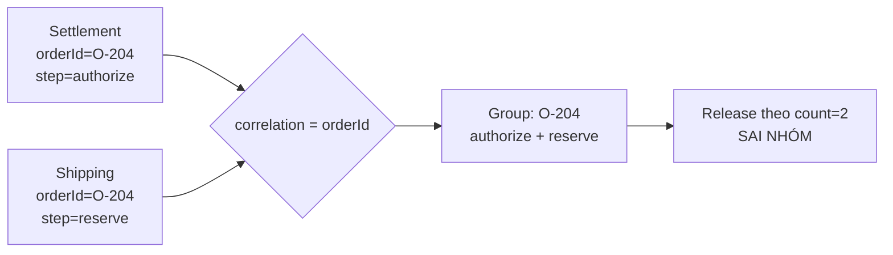
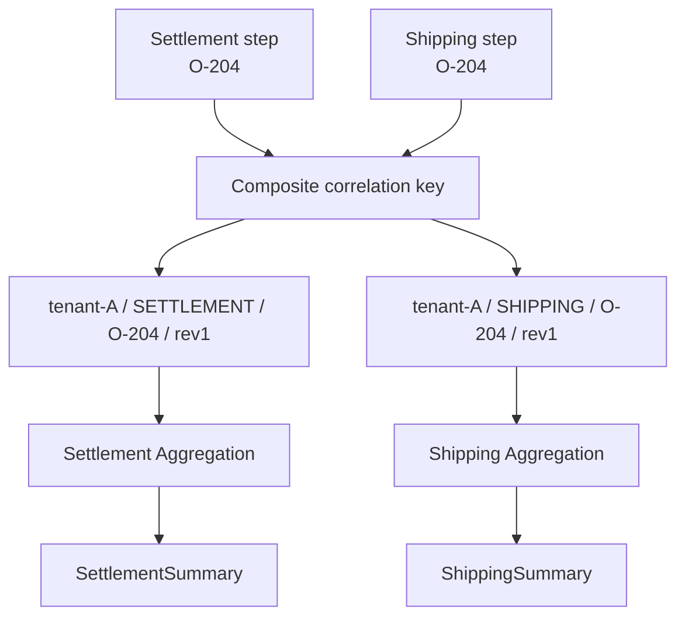
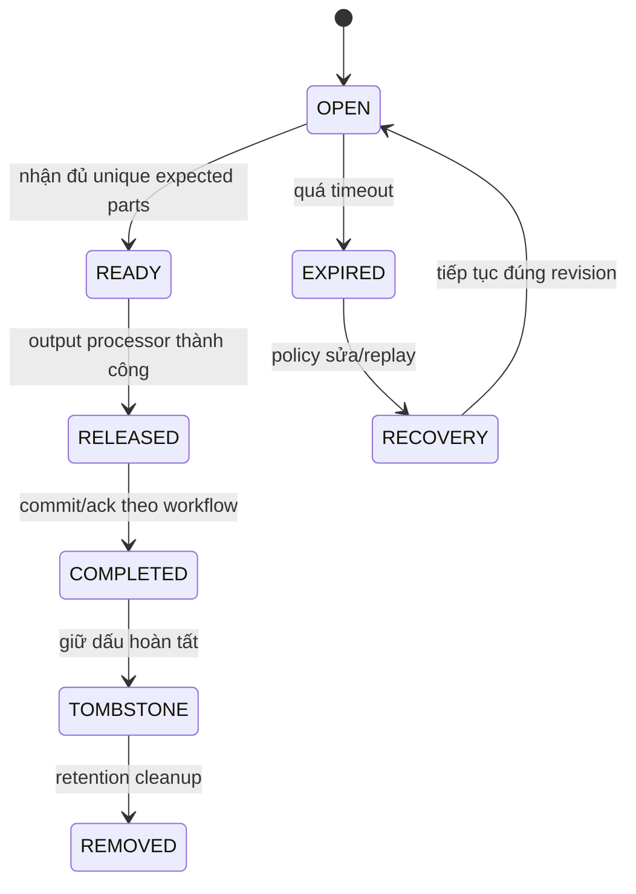

# Xung đột ID giữa nhiều flow

## 1. Khi cùng một ID lại chỉ hai công việc khác nhau

Một nền tảng xử lý đơn hàng có hai luồng tích hợp chạy song song:

- **Settlement flow:** xác minh thanh toán và ghi nhận quyết toán.
- **Shipping flow:** giữ hàng và tạo lệnh giao vận.

Cả hai nhận cùng `orderId=O-204`, nhưng mỗi luồng cần tập kết quả riêng:

```text
Tenant: tenant-A
Order:  O-204

SETTLEMENT:
  authorize → capture → kết quả SettlementSummary

SHIPPING:
  reserve → dispatch → kết quả ShippingSummary
```

Giả sử cả hai flow dùng cùng một Aggregator hoặc cùng một không gian khóa của `MessageGroupStore`, và correlation strategy chỉ trả về:

```java
// Sai khi nhiều workflow dùng chung namespace/group store.
message -> ((WorkflowPart) message.getPayload()).businessId()
```

Khi đó hai phần thuộc hai workflow khác nhau đều được gán `groupId="O-204"`. Nếu release strategy chỉ đếm số message, `authorize` + `reserve` có thể bị coi là đủ hai phần, mặc dù **Settlement còn thiếu capture và Shipping còn thiếu dispatch**.

Đó là **xung đột ID giữa nhiều flow**: hai message có cùng giá trị ID cục bộ nhưng **không cùng một nhóm nghiệp vụ**.

Bài này thuộc chương **Content-based correlation** của module **SPRING_INTEGRATION_PATTERN**. Module hướng dẫn triển khai Enterprise Integration Patterns bằng Spring Integration để xây dựng luồng thông điệp ít phụ thuộc, dễ mở rộng; phối hợp Router, Filter, Transformer, Splitter, Aggregator, Gateway, retry, error channel, correlation và thực hành kiểm thử, theo dõi các nhánh xử lý.

Sau bài này, bạn có thể:

1. Nhận diện xung đột khóa correlation giữa nhiều flow, tenant, request hoặc revision.
2. Thiết kế **composite correlation key** với namespace có ngữ nghĩa.
3. Phân biệt ID nghiệp vụ, `MessageHeaders.ID`, `correlationId`, `replyChannel` và idempotency key.
4. Viết Java DSL gom hai workflow có cùng `businessId` mà không ghép nhầm.
5. Kiểm thử interleaving, multi-tenant, revision, duplicate và conflicting reply.
6. Phân tích khi dùng chung `MessageGroupStore`, broker, scatter-gather và nhiều instance.
7. Xây dựng quy ước correlation, versioning, audit và recovery phù hợp production.

## 2. Content-based correlation là gì?

**Correlation** là việc xác định những message nào liên quan và phải được xử lý cùng nhau. Trong Content-based Correlation, khóa nhóm được **suy ra từ nội dung/thuộc tính nghiệp vụ của message** thay vì chỉ dựa vào một header do upstream tùy ý cung cấp.

Ví dụ:

```text
payment event:
  tenantId   = tenant-A
  orderId    = O-204
  workflow   = SETTLEMENT
  revision   = 1

shipping event:
  tenantId   = tenant-A
  orderId    = O-204
  workflow   = SHIPPING
  revision   = 1
```

Chỉ nhìn `orderId`, hai event có cùng ID. Nhưng chúng đại diện cho **hai nhóm kết quả khác nhau**:

```text
(tenant-A, SETTLEMENT, O-204, 1)
(tenant-A, SHIPPING,   O-204, 1)
```

Spring Integration cho phép cấu hình `CorrelationStrategy` trên Aggregator/Resequencer để tính group ID dựa trên payload, header hoặc logic được ủy quyền. Framework không thể tự biết `orderId` chỉ có ý nghĩa trong phạm vi nào — đó là **hợp đồng nghiệp vụ phải được mô tả và kiểm thử**.

### Correlation khác Router và Filter

| Pattern | Câu hỏi | Ví dụ |
| --- | --- | --- |
| **Content-Based Router** | Message này đi nhánh nào? | `workflow=SHIPPING` → shipping handler |
| **Filter** | Message có được đi tiếp? | Không chấp nhận step ID ngoài plan |
| **Content-based Correlation** | Message này thuộc nhóm nào? | `(tenant,workflow,order,revision)` |
| **Aggregator** | Khi đủ phần, nhóm tạo ra một kết quả gì? | Hai step → WorkflowSummary |
| **Resequencer** | Các phần của cùng nhóm được phát theo thứ tự nào? | sequence 3,1,2 → 1,2,3 |
| **Scatter-Gather** | Những recipient nào cần trả lời để hoàn tất? | Tax + Inventory, không đếm duplicate |
| **Idempotent Receiver** | Cùng thao tác đã được xử lý trước đó chưa? | Một `eventId` không được áp dụng hai lần |

Một Router đúng không tự bảo đảm correlation đúng sau khi nhiều nhánh quay lại cùng một Aggregator. Việc đưa message tới đúng channel chỉ quyết định **đường đi**, không tự tạo **namespace ID** cho group.

## 3. Sơ đồ xung đột: group ID quá hẹp



Thiết kế đúng:



Ở đây sơ đồ mô tả **hai logical groups**, không yêu cầu bắt buộc triển khai hai bean Aggregator. Có thể dùng **một Aggregator nhận nhiều workflow** nếu correlation, release và output processor phân biệt rõ từng loại. Cũng có thể dùng hai Aggregator riêng, với state/namespace riêng.

### Cùng ID không có nghĩa là xung đột trong mọi hoàn cảnh

Nếu mỗi endpoint dùng một **kho nhóm độc lập và không trộn message**, cùng giá trị `groupId="O-204"` có thể không gây lỗi. Rủi ro xuất hiện khi:

- Nhiều loại message vào chung Aggregator.
- Nhiều Aggregator dùng chung `MessageGroupStore` hoặc chung namespace/region không được cách ly.
- Các message được chuyển qua một channel fan-in trước khi correlation.
- Một shared cache/metadata store dùng ID thiếu namespace.
- Reply của nhiều Gateway/Scatter-Gather bị ghép theo request ID cục bộ.
- Replay hoặc revision mới tái dùng group ID trong lúc group cũ chưa hết vòng đời.

**Không kết luận tất cả Aggregator mặc định chia sẻ state.** Cần xem cấu hình MessageGroupStore, region/namespace, group lifecycle và endpoint thực tế.

## 4. Những loại ID thường bị nhầm

| ID | Mục đích | Có thể trùng ở đâu? | Có nên làm group key duy nhất? |
| --- | --- | --- | --- |
| `orderId` | Định danh đơn hàng | Giữa tenant hoặc giữa workflow xử lý đơn | Chỉ khi phạm vi đã đủ hẹp |
| `requestId` | Theo dõi một request | Hai client/connector, retry, request scope | Không, nếu không có namespace |
| `eventId` | Định danh một event logic | Có thể ổn định khi redelivery nhưng không xác định toàn nhóm | Thường dùng dedup, không phải group key |
| `MessageHeaders.ID` | ID message do framework sinh | Có thể thay khi transform/redelivery | Không dùng làm business correlation |
| `correlationId` header | Header giúp ghép message | Có thể do Splitter tạo hoặc do client gán sai | Chỉ tin sau xác thực/chuẩn hóa |
| `replyChannel` | Nơi trả response | Mang ngữ cảnh runtime, không phải business group | Không |
| `workflowId` | Định danh một workflow cụ thể | Có thể duy nhất theo hệ thống thiết kế | Có thể đủ nếu đã kiểm soát toàn phạm vi |
| `processingRevision` | Phân biệt lần xử lý được cho phép tái tạo | Các retry thông thường phải giữ nguyên | Nên thêm nếu group được tái xử lý có chủ đích |
| `tenantId` | Ranh giới dữ liệu và quyền truy cập | Mỗi tenant có ID nghiệp vụ riêng | Cần có khi business ID không global |
| `stepId/partId` | Định danh phần trong nhóm | Lặp giữa các nhóm khác nhau | Dùng dedup trong group |

**Correlation key** giúp tìm **đúng nhóm**. **Idempotency key** giúp quyết định **một kết quả/tác vụ đã được ghi nhận chưa**. Hai key có thể chia sẻ các trường nhưng không nên bị đồng nhất.

Ví dụ:

```text
correlationKey = (tenantId, workflowKind, businessId, revision)
partDedupKey   = (tenantId, workflowKind, businessId, revision, stepId)
outputKey      = (tenantId, workflowKind, businessId, revision, outputVersion)
```

## 5. Các dạng va chạm ID phổ biến

### 5.1. Trùng giữa hai workflow

`SETTLEMENT/order-204` và `SHIPPING/order-204` là hai nhóm. Giải pháp: thêm namespace `workflowKind`.

### 5.2. Trùng giữa tenant

`tenant-A/order-204` và `tenant-B/order-204` không thể ghép. Giải pháp: thêm `tenantId` đã xác thực.

### 5.3. Trùng giữa processing revisions

Một đơn có thể được xử lý lại để sửa dữ liệu. Nếu revision mới dùng cùng key, message cũ đến muộn có thể hòa vào nhóm mới.

```text
tenant-A / SETTLEMENT / O-204 / rev1
tenant-A / SETTLEMENT / O-204 / rev2
```

Giải pháp: thêm revision có nghĩa nghiệp vụ, không tăng revision chỉ vì network retry.

### 5.4. Trùng do định dạng chuỗi không duy nhất

Khóa ghép đơn giản:

```java
return tenantId + "|" + workflow + "|" + businessId;
```

có thể va chạm khi thành phần chứa ký tự phân cách. Chẳng hạn:

```text
["a|b", "c"] → "a|b|c"
["a",   "b|c"] → "a|b|c"
```

Giải pháp: dùng **typed composite key** hoặc một encoding có hợp đồng rõ (length prefix, escaping chuẩn, serialized tuple). Nếu dùng hash, phải giữ thuật toán/canonicalization ổn định và tính đến collision.

### 5.5. Trùng do chuẩn hóa không nhất quán

`O-204`, `o-204` và ` O-204 ` có thể là cùng ID hoặc ba ID khác nhau tùy domain. Không tự trim, lowercase, xóa dấu hoặc chuyển Unicode normalization trước khi biết hợp đồng của source.

### 5.6. Trùng giữa endpoint dùng cùng store

Hai Aggregator tách code nhưng sử dụng một store có group key chung có thể ảnh hưởng nhóm nhau nếu không có namespace. Ngược lại, hai store tách biệt nhưng đầu vào bị gộp nhầm trước Aggregator vẫn nguy hiểm.

### 5.7. Trùng do reuse ID sau completion

Group `O-204` được release, state bị xóa. Một message trễ/replay có cùng ID xuất hiện và mở group mới. Cần completed-group ledger/tombstone, retention, revision hoặc chính sách late arrival có kiểm soát.

## 6. Thiết kế correlation key theo một contract rõ ràng

Một key production nên trả lời được năm câu hỏi:

1. **Thuộc ai?** Tenant hoặc ranh giới bảo mật.
2. **Thuộc luồng nào?** Workflow/flow namespace hoặc loại quá trình.
3. **Thuộc entity/request nào?** Business ID ổn định.
4. **Thuộc lần thực hiện logic nào?** Revision/epoch/plan ID.
5. **Thuộc phiên bản key schema nào?** Khi có migration cross-service.

Gợi ý mô hình có kiểu:

```java
enum WorkflowKind {
    SETTLEMENT,
    SHIPPING
}

record CorrelationScope(
    String tenantId,
    WorkflowKind workflowKind,
    String businessId,
    int revision) {}
```

Dạng record này có equality và hash code rõ theo bốn trường, phù hợp làm key trong **memory map ứng dụng**. Nhưng một số `MessageGroupStore` hoặc transport cần group ID được serialize. Khi đó chuyển `CorrelationScope` thành một chuỗi ổn định theo **encoding có version**.

### Encoding tránh dấu phân cách nhập nhằng

Một ví dụ encode bằng length prefix:

```java
static String encodeComponent(String part) {
    return part.length() + "#" + part;
}

static String encode(CorrelationScope scope) {
    return "cor-v1|"
        + encodeComponent(scope.tenantId())
        + encodeComponent(scope.workflowKind().name())
        + encodeComponent(scope.businessId())
        + encodeComponent(Integer.toString(scope.revision()));
}
```

Ví dụ:

```text
cor-v1|8#tenant-A10#SETTLEMENT5#O-2041#1
cor-v1|8#tenant-A8#SHIPPING5#O-2041#1
```

Các con số minh họa độ dài ký tự Java. Nếu hệ thống **không chỉ có Java**, phải thống nhất cách đo độ dài (UTF-8 byte hay Unicode code point), normalization, escaping và test-vector giữa các ngôn ngữ. Không đưa chuỗi format này trực tiếp ra public API mà chưa xác định contract và version.

**Đừng đổi encoding trong lúc deploy mà không có kế hoạch.** Một consumer mới dùng `cor-v2` có thể tạo group mới cho message đang chờ từ `cor-v1`, khiến cả hai group không release.

## 7. Quy tắc xác thực ID trước khi correlation

Một composite key đủ trường nhưng dựa vào dữ liệu giả mạo vẫn nguy hiểm:

```text
HTTP client gửi:
  tenantId = tenant-B
  orderId = O-204
  workflowKind = SETTLEMENT
```

Nếu application tin các trường trên, một request của tenant A có thể được đưa vào group tenant B.

Hãy thiết lập **trust boundary**:

- Tenant lấy từ identity/token/mTLS được xác minh ở ingress, không tin một header tùy ý.
- Workflow kind lấy từ endpoint/adapter đã cho phép, hoặc được xác minh qua routing/contract.
- Business ID được validate theo miền dữ liệu của tenant.
- Revision phải được đối chiếu với plan/workflow đã được tạo hợp lệ.
- Step ID phải thuộc expected set của workflow cụ thể.
- Correlation header do external producer gửi cần được **kiểm chứng** hoặc tái tạo từ payload trusted.

Nếu cần ghép message từ hai nguồn, cả hai nguồn phải dùng **một quy ước về ID và quyền**, không chỉ cùng một chuỗi `orderId`.

## 8. Ví dụ xuyên suốt: hai flow chung business ID

Chúng ta tạo hai workflow:

| Workflow | Hai step bắt buộc | Ý nghĩa |
| --- | --- | --- |
| `SETTLEMENT` | `authorize`, `capture` | Kết quả thanh toán |
| `SHIPPING` | `reserve`, `dispatch` | Kết quả giao hàng |

Một message con có:

- `tenantId`: tenant đã được xác thực.
- `workflowKind`: SETTLEMENT hoặc SHIPPING.
- `businessId`: mã đơn hàng chung.
- `revision`: lần xử lý có chủ đích, bắt đầu từ 1.
- `stepId`: định danh phần bắt buộc.
- `success`: trạng thái kết quả cuối của step.

**Mục tiêu test:** nếu cả hai workflow dùng `businessId="O-204"`, Aggregator vẫn xuất hai summary đúng loại và không gộp `authorize` với `reserve`.

### Data model

```java
import java.util.List;

enum WorkflowKind {
    SETTLEMENT,
    SHIPPING
}

record WorkflowPart(
        String tenantId,
        WorkflowKind workflowKind,
        String businessId,
        int revision,
        String stepId,
        boolean success) {}

record WorkflowSummary(
        String tenantId,
        WorkflowKind workflowKind,
        String businessId,
        int revision,
        List<WorkflowPart> parts,
        boolean allSucceeded) {}
```

Giả định mỗi step tạo **một terminal result**. Một `RETRYING` attempt chưa hoàn tất không được xem là một phần mới hợp lệ; nếu cần retry/failed-final phức tạp, dùng outcome enum có trạng thái rõ thay cho một boolean.

## 9. Policy Java: namespace, expected set và output

Đặt tất cả quy tắc về key ở một chỗ để các endpoint không tự ghép ID theo cách khác nhau.

```java
import java.util.ArrayList;
import java.util.Comparator;
import java.util.HashMap;
import java.util.HashSet;
import java.util.List;
import java.util.Map;
import java.util.Set;

import org.springframework.integration.store.MessageGroup;
import org.springframework.messaging.Message;

final class WorkflowCorrelationRules {

    private static final Set<String> SETTLEMENT_STEPS =
        Set.of("authorize", "capture");

    private static final Set<String> SHIPPING_STEPS =
        Set.of("reserve", "dispatch");

    private WorkflowCorrelationRules() {}

    static Set<String> expected(WorkflowKind kind) {
        return switch (kind) {
            case SETTLEMENT -> SETTLEMENT_STEPS;
            case SHIPPING -> SHIPPING_STEPS;
        };
    }

    static boolean valid(WorkflowPart part) {
        return part != null
            && nonBlank(part.tenantId())
            && part.workflowKind() != null
            && nonBlank(part.businessId())
            && part.revision() > 0
            && nonBlank(part.stepId())
            && expected(part.workflowKind()).contains(part.stepId());
    }

    private static boolean nonBlank(String s) {
        return s != null && !s.isBlank();
    }

    private static String component(String s) {
        return s.length() + "#" + s;
    }

    static String correlationKey(WorkflowPart part) {
        if (!valid(part)) {
            throw new IllegalArgumentException(
                "Invalid workflow part");
        }

        return "cor-v1|"
            + component(part.tenantId())
            + component(part.workflowKind().name())
            + component(part.businessId())
            + component(Integer.toString(part.revision()));
    }

    static String correlationKey(Message<?> message) {
        return correlationKey((WorkflowPart) message.getPayload());
    }

    static boolean ready(MessageGroup group) {
        if (group.getMessages().isEmpty()) {
            return false;
        }

        WorkflowPart first =
            (WorkflowPart) group.getMessages()
                .iterator().next().getPayload();

        Set<String> seenSteps = new HashSet<>();

        for (Message<?> message : group.getMessages()) {
            WorkflowPart part =
                (WorkflowPart) message.getPayload();

            if (!valid(part)
                    || !correlationKey(part).equals(
                        group.getGroupId())) {
                throw new IllegalStateException(
                    "Correlation group contains invalid/mixed parts");
            }

            // Duplicate cùng step không tăng số distinct step.
            seenSteps.add(part.stepId());
        }

        return seenSteps.equals(expected(first.workflowKind()));
    }

    static WorkflowSummary summarize(MessageGroup group) {
        Map<String, WorkflowPart> uniqueParts = new HashMap<>();
        WorkflowPart first = null;

        for (Message<?> message : group.getMessages()) {
            WorkflowPart part =
                (WorkflowPart) message.getPayload();

            if (!valid(part)
                    || !correlationKey(part).equals(
                        group.getGroupId())) {
                throw new IllegalArgumentException(
                    "Mixed workflow correlation scope");
            }

            if (first == null) {
                first = part;
            }

            WorkflowPart existing =
                uniqueParts.putIfAbsent(part.stepId(), part);

            if (existing != null && !existing.equals(part)) {
                throw new IllegalStateException(
                    "Conflicting terminal reply: "
                        + part.stepId());
            }
        }

        if (first == null
                || !uniqueParts.keySet().equals(
                    expected(first.workflowKind()))) {
            throw new IllegalStateException(
                "Incomplete workflow summary");
        }

        List<WorkflowPart> ordered = uniqueParts.values()
            .stream()
            .sorted(Comparator.comparing(WorkflowPart::stepId))
            .toList();

        boolean success = ordered.stream()
            .allMatch(WorkflowPart::success);

        return new WorkflowSummary(
            first.tenantId(),
            first.workflowKind(),
            first.businessId(),
            first.revision(),
            List.copyOf(ordered),
            success);
    }
}
```

### Ba điều quan trọng

**1. Tạo key theo content thay vì một ID mơ hồ.** `correlationKey(...)` phân biệt tenant, workflow, business ID, revision và phiên bản encoding.

**2. Release theo tập part ID, không theo message count.** Duplicate `authorize,authorize` không thể thay thế `capture`. Nếu chỉ dùng `group.size()==2`, release có thể xảy ra sớm.

**3. Output processor kiểm tra scope trước khi tạo summary.** Nếu một lỗi upstream hoặc store làm lẫn message, processor **ném lỗi thay vì phát summary giả**. Nó còn phát hiện hai terminal reply mâu thuẫn cùng step.

**Giới hạn cố ý:** việc phát hiện conflict ở output processor có thể diễn ra **sau khi group đã đủ tập step**. Production nên có validation/dedup gate ở group admission để phát hiện sớm; nếu conflict phát sinh sau khi output đã được release thì phải dùng completed-group ledger và recovery policy riêng.

## 10. Java DSL: hai input flow, một điểm fan-in

Cấu hình này dùng một Aggregator để cho thấy **content-based key** ngăn hai workflow trộn state ngay cả khi có chung channel nhận kết quả.

```java
import org.springframework.context.annotation.Bean;
import org.springframework.context.annotation.Configuration;
import org.springframework.integration.channel.DirectChannel;
import org.springframework.integration.channel.QueueChannel;
import org.springframework.integration.config.EnableIntegration;
import org.springframework.integration.dsl.IntegrationFlow;

@Configuration
@EnableIntegration
public class WorkflowCorrelationConfig {

    @Bean("workflow.settlement.in")
    DirectChannel settlementInput() {
        return new DirectChannel();
    }

    @Bean("workflow.shipping.in")
    DirectChannel shippingInput() {
        return new DirectChannel();
    }

    @Bean("workflow.parts.in")
    DirectChannel partsInput() {
        return new DirectChannel();
    }

    @Bean("workflow.summary.out")
    QueueChannel summaryOutput() {
        return new QueueChannel();
    }

    @Bean
    IntegrationFlow settlementIngress() {
        return IntegrationFlow.from("workflow.settlement.in")
            .filter(WorkflowPart.class,
                part -> part.workflowKind()
                    == WorkflowKind.SETTLEMENT,
                spec -> spec.throwExceptionOnRejection(true))
            .channel("workflow.parts.in")
            .get();
    }

    @Bean
    IntegrationFlow shippingIngress() {
        return IntegrationFlow.from("workflow.shipping.in")
            .filter(WorkflowPart.class,
                part -> part.workflowKind()
                    == WorkflowKind.SHIPPING,
                spec -> spec.throwExceptionOnRejection(true))
            .channel("workflow.parts.in")
            .get();
    }

    @Bean
    IntegrationFlow gatherWorkflows() {
        return IntegrationFlow.from("workflow.parts.in")
            .filter(WorkflowPart.class,
                WorkflowCorrelationRules::valid,
                spec -> spec.throwExceptionOnRejection(true))
            .aggregate(spec -> spec
                .correlationStrategy(
                    WorkflowCorrelationRules::correlationKey)
                .releaseStrategy(
                    WorkflowCorrelationRules::ready)
                .outputProcessor(
                    WorkflowCorrelationRules::summarize))
            .channel("workflow.summary.out")
            .get();
    }
}
```

**Ý nghĩa từng ranh giới:**

1. `workflow.settlement.in` chỉ nhận phần của SETTLEMENT.
2. `workflow.shipping.in` chỉ nhận phần của SHIPPING.
3. Cả hai chuyển vào `workflow.parts.in`.
4. Filter chung bảo đảm step ID thuộc expected set của loại workflow.
5. Aggregator tính key từ **payload đã được kiểm tra**.
6. MessageGroup lưu state riêng theo composite key.
7. Release khi đủ tập step riêng của workflow.
8. Output processor tạo `WorkflowSummary`, đưa sang `workflow.summary.out`.

**Cảnh báo:** flow demo tin `tenantId` và `workflowKind` trong payload sau khi kiểm tra **định dạng**. Trong hệ thống thật, filter theo enum chưa phải là xác thực nguồn; ingress phải lấy tenant và workflow identity từ **ngữ cảnh đã được ủy quyền**, rồi mới tạo `WorkflowPart` nội bộ.

Ví dụ dùng `DirectChannel` để kiểm thử đồng bộ và `QueueChannel` để đọc kết quả. Nó không cấu hình durable MessageGroupStore, broker hay authentication. Những tính chất đó cần triển khai riêng khi lên production.

### Vì sao không chỉ tạo hai Aggregate endpoint riêng?

Tách Aggregator riêng cho Settlement và Shipping là một lựa chọn hoàn toàn hợp lý. Nó đơn giản hơn khi hai workflow có policy release, timeout hoặc MessageGroupProcessor rất khác nhau.

Tuy nhiên nếu hai endpoint dùng **cùng một group store và không có namespace riêng**, hoặc nếu message từ các flow được gộp trước Aggregator, vấn đề ID vẫn có thể xuất hiện. Dùng composite key tạo một lớp bảo vệ rõ ràng và giúp thống nhất observability.

**Không thêm đồng thời hai Aggregator cùng subscribe một DirectChannel** rồi kỳ vọng mọi message được broadcast: DirectChannel theo semantics point-to-point. Nếu cần fan-out thực sự, dùng PublishSubscribeChannel hoặc Recipient List phù hợp.

## 11. JUnit: hai workflow cùng businessId không bị ghép nhầm

Unit test của policy và integration test của flow nên kiểm tra **interleaving**: hai workflow đến xen kẽ, cùng order ID, cùng tenant.

### 11.1. Kiểm thử tích hợp

```java
import static org.assertj.core.api.Assertions.assertThat;
import static org.assertj.core.api.Assertions.assertThatThrownBy;

import org.junit.jupiter.api.Test;
import org.springframework.beans.factory.annotation.Autowired;
import org.springframework.beans.factory.annotation.Qualifier;
import org.springframework.integration.channel.QueueChannel;
import org.springframework.messaging.Message;
import org.springframework.messaging.MessageChannel;
import org.springframework.messaging.support.MessageBuilder;
import org.springframework.test.context.junit.jupiter.SpringJUnitConfig;

@SpringJUnitConfig(WorkflowCorrelationConfig.class)
class WorkflowCorrelationFlowTest {

    @Autowired
    @Qualifier("workflow.settlement.in")
    MessageChannel settlement;

    @Autowired
    @Qualifier("workflow.shipping.in")
    MessageChannel shipping;

    @Autowired
    @Qualifier("workflow.summary.out")
    QueueChannel summaries;

    private WorkflowPart part(
            String tenant,
            WorkflowKind kind,
            String order,
            int revision,
            String step,
            boolean success) {

        return new WorkflowPart(
            tenant, kind, order, revision, step, success);
    }

    private void send(MessageChannel channel, WorkflowPart part) {
        assertThat(channel.send(
            MessageBuilder.withPayload(part)
                .setHeader("requestId", "request-" + part.businessId())
                .build())).isTrue();
    }

    private WorkflowSummary receiveSummary() {
        Message<?> message = summaries.receive(1_000);
        assertThat(message).isNotNull();
        return (WorkflowSummary) message.getPayload();
    }

    @Test
    void sameOrderIdAcrossTwoWorkflowsCreatesTwoGroups() {
        send(settlement,
            part("tenant-A", WorkflowKind.SETTLEMENT,
                "O-204", 1, "authorize", true));
        send(shipping,
            part("tenant-A", WorkflowKind.SHIPPING,
                "O-204", 1, "reserve", true));

        // Hai message nhưng mỗi workflow mới có một step.
        assertThat(summaries.receive(0)).isNull();

        send(shipping,
            part("tenant-A", WorkflowKind.SHIPPING,
                "O-204", 1, "dispatch", true));

        WorkflowSummary first = receiveSummary();
        assertThat(first.workflowKind())
            .isEqualTo(WorkflowKind.SHIPPING);
        assertThat(first.parts().stream()
            .map(WorkflowPart::stepId).toList())
            .containsExactly("dispatch", "reserve");

        send(settlement,
            part("tenant-A", WorkflowKind.SETTLEMENT,
                "O-204", 1, "capture", true));

        WorkflowSummary second = receiveSummary();
        assertThat(second.workflowKind())
            .isEqualTo(WorkflowKind.SETTLEMENT);
        assertThat(second.parts().stream()
            .map(WorkflowPart::stepId).toList())
            .containsExactly("authorize", "capture");

        assertThat(first.businessId()).isEqualTo("O-204");
        assertThat(second.businessId()).isEqualTo("O-204");
        assertThat(summaries.receive(0)).isNull();
    }

    @Test
    void sameOrderIdAcrossTenantsDoesNotMix() {
        send(settlement,
            part("tenant-A", WorkflowKind.SETTLEMENT,
                "O-same", 1, "authorize", true));
        send(settlement,
            part("tenant-B", WorkflowKind.SETTLEMENT,
                "O-same", 1, "authorize", true));

        assertThat(summaries.receive(0)).isNull();

        send(settlement,
            part("tenant-B", WorkflowKind.SETTLEMENT,
                "O-same", 1, "capture", true));

        assertThat(receiveSummary().tenantId())
            .isEqualTo("tenant-B");

        send(settlement,
            part("tenant-A", WorkflowKind.SETTLEMENT,
                "O-same", 1, "capture", true));

        assertThat(receiveSummary().tenantId())
            .isEqualTo("tenant-A");
    }

    @Test
    void differentRevisionsDoNotMix() {
        send(shipping,
            part("tenant-A", WorkflowKind.SHIPPING,
                "O-reprocess", 1, "reserve", true));
        send(shipping,
            part("tenant-A", WorkflowKind.SHIPPING,
                "O-reprocess", 2, "reserve", true));

        assertThat(summaries.receive(0)).isNull();

        send(shipping,
            part("tenant-A", WorkflowKind.SHIPPING,
                "O-reprocess", 2, "dispatch", true));
        assertThat(receiveSummary().revision()).isEqualTo(2);

        send(shipping,
            part("tenant-A", WorkflowKind.SHIPPING,
                "O-reprocess", 1, "dispatch", true));
        assertThat(receiveSummary().revision()).isEqualTo(1);
    }

    @Test
    void duplicateStepDoesNotFillTheOtherStep() {
        WorkflowPart first = part(
            "tenant-A", WorkflowKind.SETTLEMENT,
            "O-duplicate", 1, "authorize", true);

        send(settlement, first);
        send(settlement, first);

        assertThat(summaries.receive(0)).isNull();

        send(settlement,
            part("tenant-A", WorkflowKind.SETTLEMENT,
                "O-duplicate", 1, "capture", true));

        WorkflowSummary result = receiveSummary();
        assertThat(result.parts()).hasSize(2);
        assertThat(result.allSucceeded()).isTrue();
    }

    @Test
    void wrongWorkflowOnIngressIsRejected() {
        assertThatThrownBy(() -> send(
            shipping,
            part("tenant-A", WorkflowKind.SETTLEMENT,
                "O-invalid", 1, "authorize", true)))
            .isInstanceOf(RuntimeException.class);
        assertThat(summaries.receive(0)).isNull();
    }
}
```

Các bài test cố ý dùng business ID khác nhau khi cần cô lập context. Một group còn dang dở trong store có thể sống qua nhiều test cùng ApplicationContext; cần test fixture/cleanup phù hợp ở dự án thật.

**Đây là test wiring trong Spring context**, không chứng minh store bền vững, concurrency nhiều JVM, transaction hay broker redelivery. Các phần đó thuộc integration/failure tests riêng.

### 11.2. Unit test sự khác nhau của key

```java
import static org.assertj.core.api.Assertions.assertThat;

import org.junit.jupiter.api.Test;

class WorkflowCorrelationRulesTest {

    private WorkflowPart p(
            String tenant,
            WorkflowKind workflow,
            String businessId,
            int revision) {

        return new WorkflowPart(
            tenant, workflow, businessId, revision,
            workflow == WorkflowKind.SETTLEMENT
                ? "authorize" : "reserve",
            true);
    }

    @Test
    void keySeparatesDifferentWorkflowTenantsAndRevisions() {
        WorkflowPart base =
            p("tenant-A", WorkflowKind.SETTLEMENT, "O-204", 1);

        String key = WorkflowCorrelationRules.correlationKey(base);

        assertThat(key)
            .isNotEqualTo(WorkflowCorrelationRules.correlationKey(
                p("tenant-A", WorkflowKind.SHIPPING, "O-204", 1)))
            .isNotEqualTo(WorkflowCorrelationRules.correlationKey(
                p("tenant-B", WorkflowKind.SETTLEMENT, "O-204", 1)))
            .isNotEqualTo(WorkflowCorrelationRules.correlationKey(
                p("tenant-A", WorkflowKind.SETTLEMENT, "O-204", 2)));
    }

    @Test
    void sameLogicalScopeGetsStableKey() {
        WorkflowPart first = p(
            "tenant-A", WorkflowKind.SETTLEMENT, "O-204", 1);

        WorkflowPart second = new WorkflowPart(
            "tenant-A", WorkflowKind.SETTLEMENT,
            "O-204", 1, "capture", true);

        assertThat(WorkflowCorrelationRules.correlationKey(first))
            .isEqualTo(
                WorkflowCorrelationRules.correlationKey(second));
    }

    @Test
    void delimiterInsideIdDoesNotProduceAmbiguousKey() {
        String one = WorkflowCorrelationRules.correlationKey(
            p("tenant|A", WorkflowKind.SETTLEMENT, "O-204", 1));

        String two = WorkflowCorrelationRules.correlationKey(
            p("tenant", WorkflowKind.SETTLEMENT, "A|O-204", 1));

        assertThat(one).isNotEqualTo(two);
    }
}
```

**Điều test chứng minh:** hai message thuộc cùng scope nhận cùng key, hai scope khác nhau nhận key khác. Nhưng test **không chứng minh** key schema tương thích với non-Java producer hoặc implementation persistence. Với nhiều ngôn ngữ, cần thêm test vectors liên ngôn ngữ và round-trip serialization.

## 12. Tại sao đúng key vẫn có thể sai kết quả?

Dù group key đã có tenant/flow/revision, Aggregator vẫn cần:

1. **Expected part set** đáng tin.
2. **Deduplication** theo business part ID.
3. **Release strategy** đúng.
4. **Output processor** kiểm tra dữ liệu cùng scope.
5. **Group lifecycle** rõ khi partial, timeout, complete và replay.

Ví dụ:

```text
Group:
  tenant-A / SETTLEMENT / O-204 / rev1

Đến:
  authorize (event e1)
  authorize (redelivery event e1)
  capture (event e2)
```

Nếu release theo `group.size()==2`, có thể phát sau hai bản `authorize`. Bài dùng `Set<String> seenSteps` nên chỉ release khi nhận cả `authorize` và `capture`.

Tuy nhiên, một **conflicting duplicate** như:

```text
authorize(success=true)
authorize(success=false)
capture(success=true)
```

cần chính sách riêng. Output processor mẫu báo conflict; nếu muốn phát hiện sớm, đặt dedup/consistency gate trước khi lưu message vào group. Không cho quy tắc “first wins” hoặc “last arrives wins” xuất hiện vô tình qua thứ tự xử lý.

### Định nghĩa phần “đã có kết quả”

Nếu worker phát `RETRYING` sau lỗi HTTP, rồi tiếp tục, đó chưa hẳn là terminal outcome. Một boolean `success=false` có thể mang hai nghĩa không tương thích: “thất bại cuối cùng” và “attempt thất bại tạm thời”.

Production nên dùng enum rõ:

```java
enum StepStatus {
    PENDING,
    RETRYING,
    SUCCEEDED,
    FAILED_FINAL
}
```

Chỉ trạng thái terminal theo policy mới được tính vào completeness; nếu một step FAILED_FINAL, tổng hợp vẫn có thể phát với trạng thái lỗi nhóm nếu contract cho phép.

## 13. Shared MessageGroupStore: nơi lỗi namespace dễ bị giấu

Một hệ thống có thể có hai cấu hình:

```text
Aggregator A → JdbcMessageStore
Aggregator B → JdbcMessageStore
```

Nếu A và B chia sẻ các bảng/region/group IDs theo cùng namespace, cùng key cục bộ có thể va chạm. Điều cần xem là **cách store lập chỉ mục group**, phạm vi transaction/lock và cấu hình isolation, chứ không chỉ class name.

Ngược lại:

```text
Aggregator A → store A riêng
Aggregator B → store B riêng
```

thường tránh va chạm state giữa endpoints nếu chúng không vô tình chia sẻ group state; nhưng **message vào sai endpoint** vẫn có thể gây lỗi. Muốn an toàn phải có ingress validation và type contract.

### Nên chọn một trong ba kiến trúc

| Kiến trúc | Ưu điểm | Điều kiện để đúng |
| --- | --- | --- |
| **Một Aggregator đa workflow** | Chung logic fan-in, ít endpoint | Composite key, expected set và processor theo workflow |
| **Mỗi workflow một Aggregator/store riêng** | Tách ownership, release/timeout độc lập | Ranh giới input đúng; không chia sẻ group namespace ngoài ý muốn |
| **Nhiều Aggregator trên shared durable store** | Có thể dùng infrastructure chung | Namespace/region/group ID chắc chắn, transaction và locking phù hợp |

**Không cần ép mọi workflow vào một Aggregator duy nhất**. Tách khi chúng có SLA, error flow, delivery semantics hoặc schema khác nhau. Composite key vẫn là một chuẩn tốt để audit/tracing và tránh trộn dữ liệu khi topology thay đổi.

### Store được chia sẻ nhiều instance

Một JVM có thể thấy đủ message và release. Nhưng nếu nhiều instance dùng in-memory store riêng:

```text
Instance 1: settlement/authorize
Instance 2: settlement/capture
→ Không instance nào thấy đủ cả hai.
```

Giải pháp: partition/co-locate theo composite key, shared/persistent group store có locking đúng hoặc service sở hữu group tập trung. **Shared store không tự đảm bảo exactly-once**, vì broker vẫn có thể redeliver và output có thể gửi lại.

## 14. Content-based correlation có thể đọc payload hoặc header

Spring Integration cho phép tính khóa từ:

- Payload đã được chuẩn hóa.
- Header được tạo bởi trusted ingress hoặc Splitter.
- Kết quả của service/policy xác định workflow scope.
- Metadata đã persist của request/plan.

Một ví dụ expression ngắn (giả sử payload đã được validate và có field tương ứng):

```java
// Ý tưởng biểu thức, phải kiểm tra kiểu payload và API DSL thực tế.
"payload.tenantId + ':' + payload.workflowKind + ':' " +
"+ payload.businessId + ':' + payload.revision"
```

Mẫu này **không an toàn nếu dữ liệu có ký tự phân cách** và chưa được xác thực. Với nhiều trường/namespace phức tạp, Java policy function dễ đọc và dễ unit test hơn một SpEL dài.

### Header nào nên giữ qua các bước?

| Header/metadata | Vai trò | Rủi ro |
| --- | --- | --- |
| `correlationId` | Group identity giữa các phần | Một adapter hoặc Transformer thay/bỏ |
| `sequenceNumber`/`sequenceSize` | Theo dõi thứ tự và số phần từ Splitter | Group không release hoặc release sai khi mất |
| `requestId` | Tracing end-to-end | ID request trùng giữa hệ thống/tenant |
| `eventId` | Dedup/replay | Tạo UUID mới ở retry khiến duplicate lọt |
| `tenantId` đã xác thực | Scope bảo mật | Client giả mạo header |
| `replyChannel` | Gateway request/reply | Mất khi tạo Message mới |
| `errorChannel` | Chỉ dẫn error flow theo endpoint | Không phải mọi exception đi đến đây |
| `schemaVersion`/`planVersion` | Giải mã và xác định expected set | Replay cũ lẫn phiên bản mới |

**MessageHeaders.ID không phải correlation ID nghiệp vụ.** Một Transformer có thể tạo Message mới; framework ID và timestamp có thể thay đổi mà logical workflow vẫn là một.

Nếu một pipeline đi qua HTTP, Kafka hoặc AMQP, cần kiểm tra **header mapping**, type conversion, byte encoding và trusted field propagation. Không tự giả định mọi header Java đều được truyền nguyên vẹn sang transport khác.

## 15. Collision trong Scatter-Gather và Gateway

Một tình huống khác:

```text
Gateway X → requestId=42 → Tax + Inventory
Gateway Y → requestId=42 → Fraud + Customer
```

Hai gateway dùng cùng giá trị `42` (ví dụ ID được sinh cục bộ), nhưng **không cùng yêu cầu**. Nếu tập reply được gom bằng `requestId=42` trong cùng aggregator store, một reply Tax có thể bị ghép với một reply Fraud.

Trong Scatter-Gather cần phân biệt:

- **Scatter request ID**: một lần fan-out logic.
- **Scatter plan ID/version**: tập responder dự kiến cho request.
- **Responder ID**: nguồn trả lời.
- **Reply ID**: một kết quả logic từ responder, để dedup.
- **Gateway/flow namespace**: bối cảnh nào sở hữu request.

Một key tốt có thể là:

```text
(tenantId, gatewayNamespace, scatterRequestId, planRevision)
```

Release strategy phải theo **tập responder bắt buộc** của plan đó, không chỉ `group.size()`. Hai reply từ cùng provider không thay thế hai nguồn khác nhau.

### Reply đến sai Gateway

`replyChannel` giúp route response về caller, nhưng một số transport không bảo toàn object channel nội bộ. Khi đi qua broker/HTTP, cần thiết kế reply routing có định danh request và namespace rõ; tránh lấy một chuỗi response ID cục bộ mà chưa xác minh flow sở hữu.

Một response gửi nhầm request có thể nghiêm trọng hơn timeout, vì caller có thể áp dụng kết quả không thuộc quyền hoặc sai đơn hàng.

## 16. Collision sau Splitter/Resequencer

Một Splitter thường tạo sequence metadata cho nhiều message con:

```text
Order O-204: Line 1, Line 2, Line 3
Order O-205: Line 1, Line 2
```

Nếu cả hai dùng `sequenceNumber=1`, điều đó **không phải xung đột** vì mỗi part thuộc group khác nhau. Nhưng nếu correlation chỉ dựa vào sequence number:

```java
// Sai: mỗi nhóm sẽ trộn mọi part có sequenceNumber=1.
message -> message.getHeaders().get("sequenceNumber")
```

thì message từ hai đơn bị ghép nhầm.

Tương tự, nhiều Splitter flow có thể cùng xử lý `orderId=O-204` nhưng tách dữ liệu khác:

- Splitter A tách `OrderLines` thành 3 phần.
- Splitter B tách `ShipmentPackages` thành 2 phần.

Nếu cả hai trở về cùng resequencer/aggregator với key chỉ gồm order ID, hai sequence có kích thước khác nhau sẽ bị trộn.

Giải pháp: key có thêm **sequence kind / workflow namespace** và revision, cùng expected size/expected parts riêng. Giữ `correlationId` và sequence headers qua Transformer, Filter, recipient routing theo contract.

## 17. Revision và replay: một group cũ không nên nhập nhóm mới

Giả sử:

```text
rev1: Settlement đã release; capture=SUCCESS
rev2: Reconciliation quyết định chạy lại settlement
rev1: một reply đến muộn từ broker
```

Nếu key chỉ có `(tenant,workflow,order)`, reply rev1 có thể xuất hiện trong group rev2.

**Không tạo revision mới chỉ vì một HTTP retry hoặc broker redelivery.** Revision là **một lần thực hiện logic mới được nghiệp vụ cho phép**, có thể có thay đổi policy, source snapshot hoặc kỳ xử lý.

Gợi ý:

- Khi bắt đầu workflow, persist `WorkflowRunId/Revision`.
- Mọi message con mang run ID và expected-part plan của run đó.
- Retry cùng run giữ nguyên run ID.
- Replay để hoàn tất run cũ giữ nguyên run ID và dùng idempotency.
- Re-evaluation có thay đổi kết quả thực hiện bằng run/revision mới và audit.
- Late reply rev1 không được silently cập nhật rev2.

### Schema evolution của correlation key

Nếu `cor-v1` được nâng thành `cor-v2`, cần xác định khả năng hỗ trợ đọc song song hai schema, migration group đang mở và thời điểm chấp nhận message từ producer cũ. Cùng một logical workflow phải không bị chia vào hai group chỉ vì hai phiên bản code áp dụng hai phương pháp encode key.

Các test nên bao gồm phiên bản cũ/mới cùng chạy trong rolling deployment, đặc biệt với MessageGroupStore bền vững.

## 18. Duplicate và conflict giữa nhiều flow

Cùng một `businessId` khác flow **không phải duplicate**.

```text
tenant-A / SETTLEMENT / O-204 / step=authorize
tenant-A / SHIPPING   / O-204 / step=reserve
```

Chúng chỉ cùng entity và thuộc hai workflow độc lập.

Trong cùng một workflow:

```text
tenant-A / SETTLEMENT / O-204 / rev1 / authorize
tenant-A / SETTLEMENT / O-204 / rev1 / authorize
```

đó có thể là duplicate.

Còn:

```text
authorize(success=true)
authorize(success=false)
```

là **conflicting terminal results** nếu cùng revision và không có quy tắc override.

Bảng:

| Tình huống | Có phải cùng group? | Có duplicate/conflict? |
| --- | --- | --- |
| Cùng order ID, khác workflow | Không | Không |
| Cùng order ID, khác tenant | Không | Không |
| Cùng order ID, cùng flow nhưng khác revision | Không | Không, nếu revision mới có chủ đích |
| Cùng group, khác step ID | Có | Không |
| Cùng group, cùng step ID, cùng logical content | Có | Duplicate |
| Cùng group, cùng step ID, khác terminal content | Có | Conflict |
| Cùng group, phần đến sau complete | Thuộc group đã hoàn tất về mặt logic | Late arrival; cần policy |
| Cùng request ID nhưng khác Gateway namespace | Không | Không |

**Dùng composite key không thay thế dedup gate.** Nó chỉ ngăn **trộn các group khác nhau**; vẫn phải ngăn **đếm lặp các phần của cùng group**.

## 19. Group lifecycle: hoàn tất rồi có được dùng lại ID?

Trong Spring Integration, Aggregator/Resequencer giữ state trong `MessageGroupStore`. Một group có thể:

- Đang mở và chờ phần mới.
- Đủ điều kiện release.
- Đã release nhưng downstream chưa xác nhận side effect.
- Đã hoàn tất và giữ metadata/tombstone.
- Bị xóa/expire theo cleanup.
- Nhận message đến muộn hoặc duplicate.



Sơ đồ là **mô hình ứng dụng**, không phải toàn bộ trạng thái nội bộ có sẵn của framework. Semantics của group completion/removal/expiration tùy cấu hình và phiên bản Spring Integration.

**Nếu group bị xóa hoàn toàn**, cùng correlation key có thể mở một nhóm mới khi late message đến. Một hệ thống cần bảo đảm không phát output trùng nên có completed-key ledger/tombstone bền vững đủ lâu và một **output idempotency key** riêng.

## 20. Shared state và transaction: xung đột không chỉ là chuỗi ID

Giả sử hai consumer nhận hai kết quả của cùng workflow:

```text
Worker A nhận authorize
Worker B nhận capture
```

Nếu mỗi worker dùng store trong RAM riêng, cả hai có thể giữ group không đầy đủ dù correlation key giống nhau. Nếu dùng shared store nhưng thiếu locking, hai worker có thể đồng thời thấy group đủ và phát hai summary.

Cần:

1. Một nơi xác định group ownership/partition theo composite key.
2. MessageGroupStore có consistency và locking phù hợp.
3. Atomic claim/unique part ID khi cần chống duplicate.
4. Group completion/idempotency ledger nếu output có side effect.
5. Transaction/outbox hoặc recovery protocol cho publish summary.
6. Chính sách retention của group và idempotency marker phù hợp retry/DLQ.

**Ví dụ crash window:**

```text
1. Group đủ authorize + capture.
2. Summary được gửi tới downstream.
3. Process crash trước khi ghi completion/ACK.
4. Broker hoặc aggregator retry.
5. Summary có thể được gửi lần nữa.
```

Composite key đúng chỉ bảo đảm **nhận diện nhóm đúng**, không chứng minh **downstream chỉ ghi một lần**. Consumer cần idempotency key như:

```text
(tenantId, workflowKind, businessId, revision, summaryVersion)
```

Nếu summary và business update nằm trong cùng database, có thể dùng unique constraint và transaction. Nếu side effect là API bên ngoài, cần idempotency từ API, outbox hoặc trạng thái workflow/reconciliation.

## 21. Timeout và partial result giữa nhiều workflow

Hai workflow dùng chung một Aggregator nhưng có thể có SLA khác nhau:

- Settlement phải hoàn tất nhanh để trả lời khách.
- Shipping có thể chờ fulfillment lâu hơn.
- Một workflow cho phép partial; workflow kia yêu cầu all-or-nothing.

Nếu dùng **một cấu hình group timeout chung**, một trong hai có thể bị expire quá sớm hoặc giữ quá lâu. Khi khác biệt lớn, nên:

- Tách Aggregator/flow theo loại workflow, mỗi flow có timeout và error policy riêng; hoặc
- Lưu deadline/policy theo group và dùng handler phù hợp để xử lý expiration theo content/plan.

**Không đặt một timeout chung tùy tiện chỉ vì hai workflow cùng dùng business ID.** Composite key không giải quyết SLA.

Khi group expired:

1. Xác định thiếu step nào, theo expected set đã lưu.
2. Ghi trạng thái timeout/partial có ý nghĩa.
3. Quy định late arrivals thuộc revision cũ bị reject, reconcile hay tiếp tục.
4. Không tự động tạo revision mới nếu chỉ một step bị trễ.
5. Tránh phát partial summary rồi lại phát full summary trùng key mà không có version.

## 22. Observability: ghi key scope chứ không chỉ orderId

Một log không đủ:

```text
groupId=O-204
status=RELEASED
```

Nó không cho biết tenant, workflow hay revision. Gợi ý log có cấu trúc:

```text
event=correlation_group_released
tenantScope=tenant-A
workflowKind=SETTLEMENT
businessId=O-204
revision=1
correlationSchema=cor-v1
expectedSteps=2
uniqueSteps=2
groupStatus=SUCCESS
outputVersion=1
```

Các trường là **schema ứng dụng gợi ý**, không mặc nhiên do Spring Integration sinh ra. Không ghi payload nhạy cảm, credential hoặc token; một số business ID cần hash/masking theo chính sách.

Metric gợi ý:

| Metric | Ý nghĩa |
| --- | --- |
| `correlation.input.total{workflow}` | Số message vào theo workflow |
| `correlation.scope.mismatch.total` | Số message sai tenant/flow/revision |
| `correlation.key.collision.total` | Số trường hợp khác scope nhưng cùng key |
| `correlation.group.open{workflow}` | Số nhóm còn chờ |
| `correlation.group.wait.duration{workflow}` | Thời gian chờ release |
| `correlation.group.expired.total{workflow}` | Nhóm hết hạn |
| `correlation.duplicate.part.total{workflow}` | Phần bị gửi lặp |
| `correlation.conflict.part.total{workflow}` | Terminal result mâu thuẫn |
| `correlation.summary.dispatched.total{workflow}` | Output đã dispatch |
| `correlation.output.idempotency.hit.total` | Consumer nhận output trùng |
| `correlation.store.error.total` | Lỗi state storage |

Đây là **tên metric minh họa**. Không đưa `businessId`/`requestId` hoặc correlation key đầy đủ làm metric label cardinality cao. Theo dõi một request bằng trace/log có quyền truy cập, còn metrics dùng workflow/result/error code có tập giá trị hữu hạn.

### Tín hiệu quan trọng: trộn workflow trong một group

Nếu output processor thấy một group chứa hai giá trị `workflowKind`, đó là **vi phạm invariant**, không phải dữ liệu “khó tính toán”. Nên ném lỗi có mã `CORRELATION_SCOPE_MISMATCH`, ghi audit và đưa vào quarantine/recovery. Không chọn workflow của message đầu tiên rồi bỏ qua những message còn lại.

## 23. Troubleshooting: triệu chứng và gốc rễ

| Triệu chứng | Nguyên nhân có thể | Cách điều tra |
| --- | --- | --- |
| Settlement summary có step shipping | Correlation chỉ theo orderId | Kiểm tra payload/group key và fan-in topology |
| Hai tenant bị ghép cùng nhóm | Thiếu trusted tenant trong key | Xem identity ingress và tenant isolation |
| Revision mới trộn dữ liệu cũ | Key thiếu revision hoặc replay dùng nhầm run ID | Kiểm tra workflow run/plan |
| Không release dù mọi step đã gửi | Parts bị chia ra nhiều store/instance | Kiểm tra group ownership và state sharing |
| Release sớm khi còn thiếu step | Dùng count thay vì unique expected steps | Kiểm tra release strategy |
| Cùng một step tính hai lần | Không dedup/redelivery | Xem logical part ID và group admission |
| Group có outcome mâu thuẫn | Hai producer/attempt cùng quyền ghi | Quarantine, so event ID/version |
| Output được gửi hai lần | Crash trước ack/cleanup sai | Output idempotency và completed ledger |
| Reply về sai Gateway | Request ID trùng thiếu namespace | Request/reply correlation và channel mapping |
| Resequencer đảo lẫn hai sequence | Key thiếu sequence kind/workflow | So expected plan và metadata |
| Sau deployment đột nhiên nhiều group kẹt | Hai phiên bản encode correlation khác nhau | So `cor-v1/cor-v2`, migration |
| Key vẫn trùng dù có dấu phân cách | ID chứa delimiter, encode không injective | Đổi encoding chuẩn với migration |
| Group ở store nhưng không đọc ra | Namespace/region/schema mismatch | Xem store configuration và version |
| Không thấy lỗi trong global errorChannel | Exception xảy ra trên DirectChannel sync | Kiểm tra thread, adapter và error flow |
| Lỗi chỉ xuất hiện khi chạy nhiều pod | Store/lock/cache cục bộ hoặc race | Kiểm thử multi-instance, partitioning |

## 24. Bảo mật và ranh giới tin cậy

**Correlation quyết định những message nào được phép ảnh hưởng lẫn nhau.** Vì vậy sai correlation có thể làm lộ dữ liệu hoặc trộn tác vụ giữa các tenant.

Checklist:

- Xác thực tenant và nguồn message trước khi tính group key.
- Không cho HTTP client tự chọn một correlation ID đủ để truy cập group của tenant khác.
- Kiểm tra `workflowKind` có phù hợp endpoint/role/producer không.
- Bảo vệ revision và expected-step plan khỏi bị client sửa.
- Không dùng một cache toàn cục key chỉ bằng `orderId`.
- Tách namespace/region của các subsystem sử dụng shared store khi cần.
- Giới hạn số group mở, số phần/group và tổng retention để tránh DoS.
- Không để một message tự khai `expectedCount=1` khiến group release sớm.
- Kiểm tra signature/schema/provenance nếu reply đến từ đối tác bên ngoài.
- Không cho StepResult mâu thuẫn âm thầm thay thế kết quả đã commit.
- Mã hóa/ACL dữ liệu trong MessageGroupStore, DLQ và audit.
- Giới hạn logging của tenant/business ID và dữ liệu cá nhân.
- Xây dựng alert cho mixed-scope groups và cross-tenant access attempts.

**Một composite key có tenant do client nhập không phải cơ chế bảo mật**. Cần xác minh tenant từ nguồn có thẩm quyền trước khi key được dùng.

## 25. Ma trận kiểm thử production

| Kịch bản | Expected |
| --- | --- |
| Cùng tenant/order, khác workflow | Hai group độc lập |
| Cùng workflow/order, khác tenant | Hai group độc lập |
| Cùng tenant/workflow/order, khác revision | Hai group độc lập |
| Hai step của cùng group | Cùng key, release đúng |
| Step đến sai thứ tự | Kết quả không phụ thuộc thứ tự |
| Duplicate một step, thiếu step khác | Không release sớm |
| Hai terminal results khác nhau cùng step | Conflict, không im lặng chọn |
| Unknown step ID | Reject trước group |
| Wrong workflow trên endpoint | Reject |
| Tenant header giả mạo | Bị từ chối tại ingress |
| IDs có delimiter và Unicode | Encoding phân biệt và round-trip đúng |
| Hai ngôn ngữ cùng tạo key | Golden test vectors tương thích |
| Rolling deploy cor-v1/cor-v2 | Không chia split một logical group |
| One workflow timeout, workflow kia hoàn tất | Không làm hỏng group khác |
| Group completed rồi nhận late reply | Không phát output revision 1 thêm lần nữa |
| Restart khi group chưa đủ | Nếu SLA yêu cầu, state được phục hồi |
| Two pods nhận hai step của một group | Có shared/partitioned state phù hợp |
| Concurrent duplicate | Atomic dedup tránh double count |
| Store temporarily unavailable | Bounded retry và error flow, không lặng lẽ drop |
| Output commit rồi mất ACK | Idempotent consumer |
| Scatter plan đổi giữa retry | Không trộn expected responders của revision |
| Reprocessor replay dữ liệu lịch sử | Giữ business snapshot hoặc revision mới được audit |

Không nên chỉ kiểm tra ba trường hợp happy path. Với correlation, **negative tests** chứng minh hai message không được ghép với nhau thường quan trọng không kém test ghép đúng.

## 26. Bài tập thực hành

### Bài 1 — Phát hiện khóa quá hẹp

Cho bốn message:

```text
tenant-A / SETTLEMENT / O-204 / rev1 / authorize
tenant-A / SHIPPING   / O-204 / rev1 / reserve
tenant-B / SETTLEMENT / O-204 / rev1 / authorize
tenant-A / SETTLEMENT / O-204 / rev2 / authorize
```

Tính group key nếu chỉ dùng `orderId`, rồi tính composite key. Giải thích số group đúng, rủi ro trộn tenant/flow/revision và cách đặt tên namespace.

### Bài 2 — Chạy hai flow interleaved

Dùng `WorkflowCorrelationConfig`, gửi settlement/authorize, shipping/reserve, shipping/dispatch, settlement/capture cho cùng `O-204`. Kiểm tra output đầu tiên là SHIPPING, output thứ hai là SETTLEMENT; không summary nào chứa step của workflow còn lại.

### Bài 3 — Duplicate không được release sớm

Gửi `authorize` hai lần nhưng chưa gửi `capture`. Kiểm tra group chưa phát. Sau đó gửi `capture` và xác nhận có đúng hai step duy nhất trong output. Thay release strategy thành `group.size()==2` để quan sát lỗi, rồi sửa.

### Bài 4 — Conflict trong cùng group

Gửi hai terminal results cho `authorize`, một success và một failure, cùng revision. Thiết kế dedup/consistency gate để phát hiện trước khi đủ group, đưa vào quarantine và không phát summary “thành công” tùy ý.

### Bài 5 — Trùng ID giữa tenant

Tạo hai tenant cùng `orderId=O-204`. Chạy xen kẽ các step. Assert hai `WorkflowSummary` được tạo riêng. Bổ sung test không thể giả mạo tenant thông qua header do client tự gán.

### Bài 6 — Ký tự phân cách và key migration

Thử các ID chứa `|`, `#`, Unicode và khoảng trắng. Kiểm tra encoding có tính đơn trị trong miền đầu vào được phép. Thiết kế một kế hoạch chuyển `cor-v1` sang `cor-v2` khi group còn đang mở.

### Bài 7 — Shared MessageGroupStore

Tạo hai Aggregator logic A/B cùng sử dụng store/region. Nêu điều kiện chúng có thể va chạm group ID. Thiết kế namespace key hoặc store isolation, sau đó viết integration test với store thật để chứng minh không ảnh hưởng nhóm nhau.

### Bài 8 — Scatter-Gather có ID cục bộ

Hai Gateway đều tạo `requestId=42` nhưng dùng tập recipient khác. Thiết kế `(tenant,gatewayNamespace,requestId,planRevision)` và release theo expected responders. Test hai reply khác nguồn có cùng payload vẫn là hai kết quả hợp lệ.

### Bài 9 — Late reply và revision

Một group rev1 đã hoàn tất; rev2 đang xử lý. Reply rev1 bị phát lại. Kiểm tra nó không thể nhập group rev2 hoặc tạo output rev1 trùng. Thiết kế completed-key ledger và retention.

### Bài 10 — Dashboard và runbook

Tạo metric cho mixed-scope group, duplicate, timeout, group age, store contention và output replay. Viết runbook để phân biệt: key thiếu workflow, tenant giả mạo, version encoding thay đổi và state bị phân tán giữa pod.

**Tiêu chí hoàn thành:** người học chỉ ra được **hai message nào phải ghép**, **hai message nào không được ghép dù ID bằng nhau**, **release khi nào**, **duplicate/conflict xử lý ra sao**, và **vì sao correlation đúng không bảo đảm side effect đúng một lần**.

## 27. Checklist thiết kế trước production

- [ ] Có owner và phạm vi duy nhất cho mỗi business ID.
- [ ] Correlation key có tenant đã xác thực, workflow namespace và revision khi cần.
- [ ] Biết khi nào nên tách Aggregator/store riêng thay vì một flow đa workflow.
- [ ] Có encoding/canonicalization ổn định, có version và test vectors.
- [ ] Không dùng MessageHeaders.ID để thay business correlation.
- [ ] Không dùng header không đáng tin làm source of truth cho tenant/flow.
- [ ] Expected steps/responders được lấy từ plan có thẩm quyền.
- [ ] Release dựa trên unique expected parts, không chỉ message count.
- [ ] Có duplicate/conflict policy theo business part ID.
- [ ] MessageGroupProcessor xác minh tất cả phần có cùng correlation scope.
- [ ] Có group timeout/expiration/late-arrival policy.
- [ ] Có MessageGroupStore và locking phù hợp multi-instance.
- [ ] Có retention/completion ledger cho group đã release.
- [ ] Có idempotent downstream consumer và transaction/outbox khi cần.
- [ ] Có test interleaved workflows, tenants, revisions, duplicate và conflict.
- [ ] Có test schema migration và rolling deployment.
- [ ] Có trace/metric theo namespace/flow, không log data nhạy cảm.
- [ ] Có quyền truy cập, quota và cleanup cho group store/DLQ.
- [ ] Có error flow rõ cho invalid scope, timeout và store unavailable.
- [ ] Đã kiểm tra dependency/API Spring Integration cụ thể trước triển khai.

## 28. Tổng kết

**Xung đột ID giữa nhiều flow** xảy ra khi một giá trị ID chỉ duy nhất trong phạm vi cục bộ nhưng được sử dụng như khóa group ở phạm vi rộng hơn. Một `orderId=O-204` có thể đồng thời thuộc Settlement, Shipping, tenant khác và revision khác; **cùng ID không có nghĩa cùng công việc**.

Trong Spring Integration:

1. **CorrelationStrategy** xác định group từ content đã được xác thực và chuẩn hóa.
2. **ReleaseStrategy** đảm bảo đã nhận đủ những phần **đúng loại, duy nhất**.
3. **MessageGroupProcessor** kiểm tra group invariant và tạo output có nghĩa.
4. **MessageGroupStore** giữ state với namespace/transaction/lifecycle phù hợp.
5. **Idempotency** ở phần và downstream bảo vệ trước duplicate/replay và crash.

Với hai flow cùng dùng business ID, một composite key như:

```text
(tenantId, workflowKind, businessId, revision)
```

là điểm khởi đầu tốt. Tuy nhiên key không thay thế authorization, expected-part plan, dedup, timeout hoặc giao dịch phía sau. **Khi hai message có cùng ID nhưng khác phạm vi nghiệp vụ, đừng để chúng trở thành một MessageGroup.**

## Tài liệu tham khảo

- [Enterprise Integration Patterns — Correlation Identifier](https://www.enterpriseintegrationpatterns.com/patterns/messaging/CorrelationIdentifier.html)
- [Enterprise Integration Patterns — Aggregator](https://www.enterpriseintegrationpatterns.com/patterns/messaging/Aggregator.html)
- [Enterprise Integration Patterns — Message Sequence](https://www.enterpriseintegrationpatterns.com/patterns/messaging/MessageSequence.html)
- [Spring Integration Reference — Aggregator](https://docs.spring.io/spring-integration/reference/aggregator.html)
- [Spring Integration Reference — Resequencer](https://docs.spring.io/spring-integration/reference/resequencer.html)
- [Spring Integration Reference — Message Store](https://docs.spring.io/spring-integration/reference/message-store.html)
- [Spring Integration Reference — Router](https://docs.spring.io/spring-integration/reference/router.html)
- [Spring Integration Reference — Scatter-Gather](https://docs.spring.io/spring-integration/reference/scatter-gather.html)
- [Spring Integration Reference — Java DSL](https://docs.spring.io/spring-integration/reference/dsl.html)
- [Spring Integration Reference — Idempotent Receiver](https://docs.spring.io/spring-integration/reference/handler-advice/idempotent-receiver.html)
- [Spring Integration Reference — Error Handling](https://docs.spring.io/spring-integration/reference/error-handling.html)

Ví dụ dùng Java 17+ (record), Spring Integration Java DSL và JUnit 5/AssertJ để diễn giải một flow đa workflow. Khi đưa vào dự án thật, cần kiểm chứng API/overload theo dependency, scope và locking của MessageGroupStore, header mapping, transaction, retry/ACK và transport thực. Đây là bài STEP 4 NEW; biên dịch, kiểm thử hệ thống và vòng Content QA chuyên môn được thực hiện ở bước riêng.
