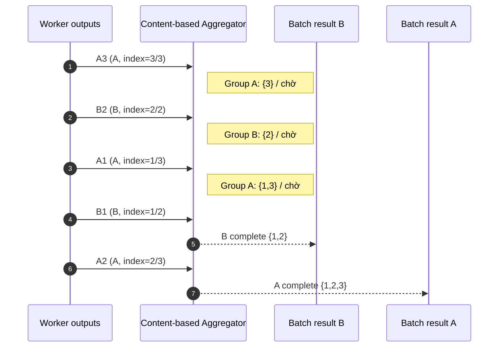
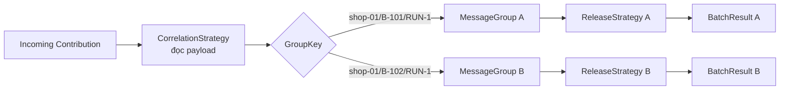
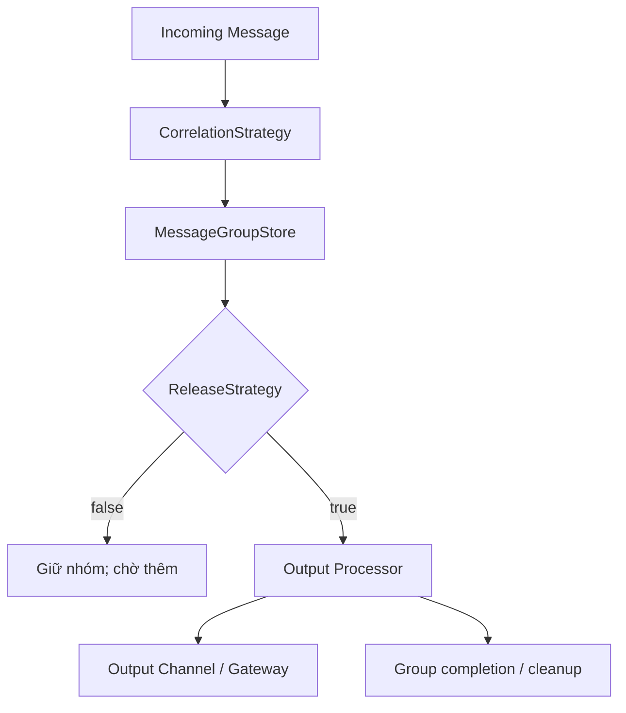
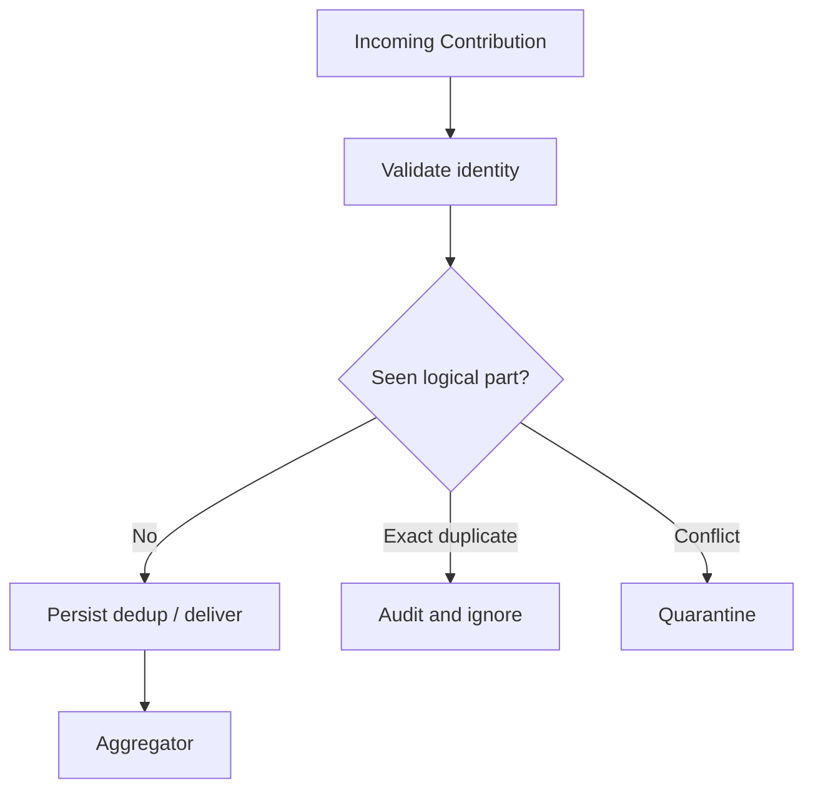
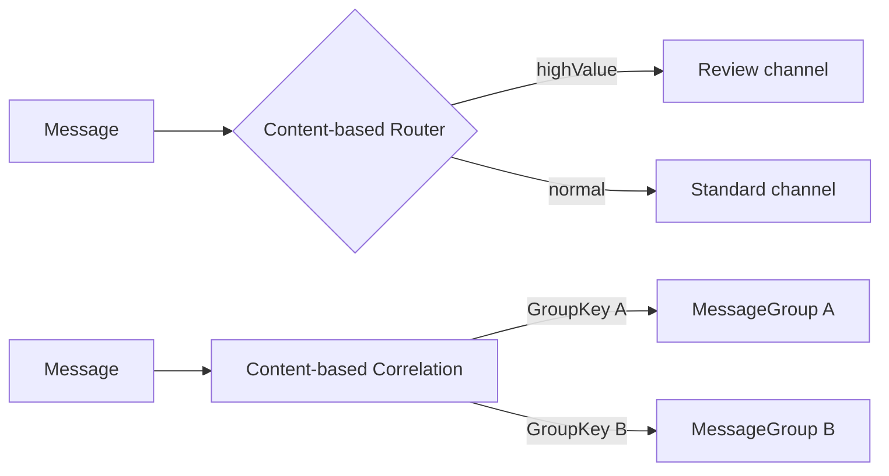
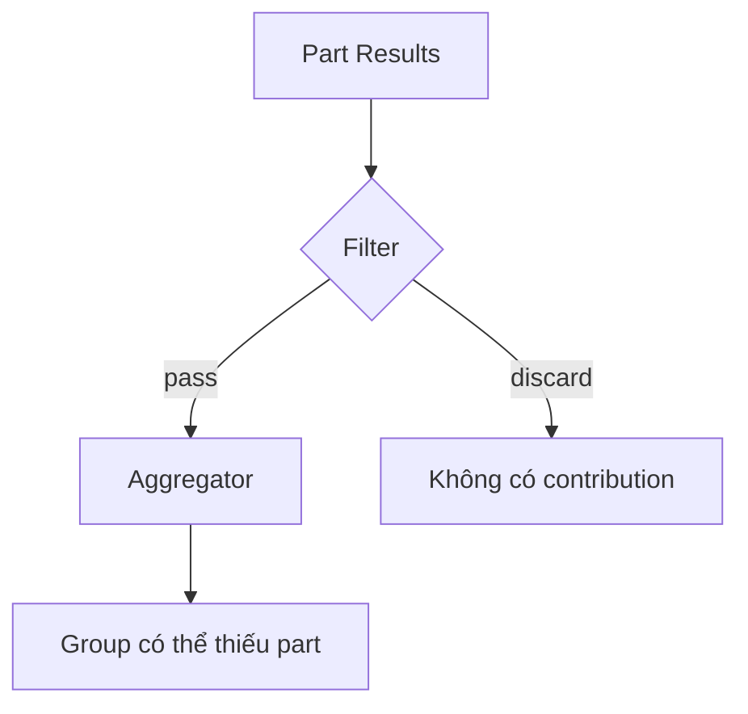
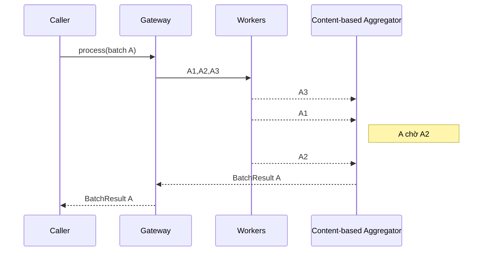
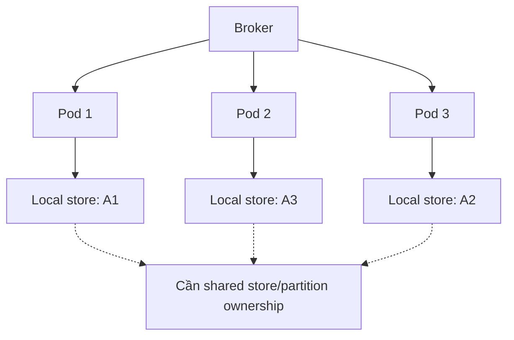
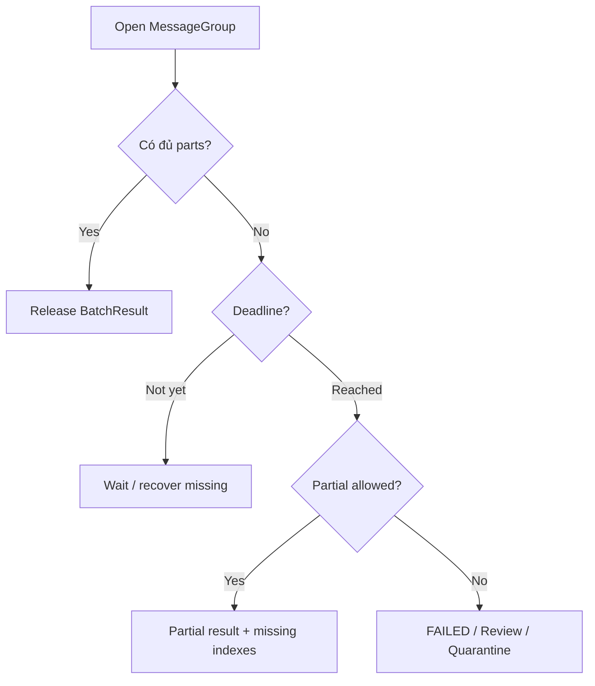

# Kiểm thử correlation với message đến xen kẽ trong Spring Integration

> **Chương:** Content-based correlation  
> **Bài học:** Kiểm thử correlation với message đến xen kẽ  
> **Module:** `SPRING_INTEGRATION_PATTERN` — học triển khai Enterprise Integration Patterns với Spring Integration để xây dựng luồng thông điệp ít phụ thuộc và dễ mở rộng; thực hành Router, Filter, Transformer, Splitter, Aggregator, Gateway, retry, error channel, correlation, đồng thời kiểm thử và theo dõi các nhánh xử lý.

## 1. Bài toán: hai nhóm message đến đan xen, không được ghép nhầm

Một hệ thống xử lý thanh toán theo từng lô. Mỗi lô được chia thành một số phần (`Contribution`), xử lý ở nhiều worker, rồi chuyển các kết quả về một **Aggregator** để tạo tổng kết cho từng lô.

Có hai lô độc lập:

- **Nhóm A:** tenant `shop-01`, batch `B-101`, run `RUN-1`, ba phần tử.
- **Nhóm B:** tenant `shop-01`, batch `B-102`, run `RUN-1`, hai phần tử.

Do xử lý song song, các message quay về theo thứ tự:

```text
A3 → B2 → A1 → B1 → A2
```

Nếu chỉ nhìn thứ tự đến, message thứ hai là B2 có thể bị xem nhầm là phần tử thứ hai của A. Nếu chỉ dùng một `correlationId` chung hoặc grouping theo một header bị mất, Aggregator cũng có thể trộn chúng.

Yêu cầu đúng:

1. A1, A2, A3 phải nằm trong **nhóm A**.
2. B1, B2 phải nằm trong **nhóm B**.
3. B được release ngay khi có B1 và B2, dù A chưa đủ A2.
4. A chỉ được release khi đã có đủ A1, A2, A3.
5. Mỗi group tạo đúng một kết quả theo hợp đồng.
6. Kết quả A không được chứa phần tử B và ngược lại.



**Ý chính:** Content-based correlation quyết định **message nào thuộc cùng một nhóm dựa trên nội dung**, bất kể thứ tự tới, thread, channel hay nhà cung cấp. Tự tạo đúng group key chưa đủ: cần **release strategy, kiểm thử xen kẽ và xử lý message thiếu/trùng**.

### Mục tiêu học tập

Sau bài này, bạn có thể:

1. Phân biệt **correlation strategy**, **release strategy** và **output processor**.
2. Chọn một khóa nhóm ổn định từ nội dung payload.
3. Ngăn trộn nhóm giữa tenant, batch và workflow run.
4. Viết `CorrelationStrategy`/Java DSL cho Aggregator.
5. Viết JUnit 5 integration tests gửi A/B đan xen, sai thứ tự.
6. Kiểm tra đầy đủ, thiếu phần, duplicate, bất nhất `expectedCount`.
7. Phân biệt technical group key với `businessCorrelationId` và `MessageHeaders.id`.
8. Thiết kế timeout, error channel, retry, persistence, idempotency và late arrivals.

## 2. Content-based correlation là gì?

**Correlation** là việc xác định những thông điệp nào có liên quan với nhau để một endpoint có state — đặc biệt là Aggregator — xử lý chúng như một nhóm.

Trong một flow đơn giản với Splitter, Spring Integration có thể áp dụng `correlationId` và sequence headers cho các message con. Nhưng không phải mọi message đều xuất phát từ Splitter; nhiều nguồn ngoài có thể chỉ cung cấp business fields như `tenantId`, `batchId`, `runId`, `partIndex`.

**Content-based correlation** dùng chính những trường đó để tính **group key**. Ví dụ:

```text
content-based key(message) =
    GroupKey(
        message.payload.tenantId,
        message.payload.batchId,
        message.payload.runId
    )
```

Một số hệ thống thích dùng header đã được tạo từ nội dung tại ingress; điều đó cũng hợp lý nếu header được **kiểm tra và gắn bởi thành phần tin cậy**. Điểm quan trọng là group key phản ánh business/workflow identity chứ không chỉ phụ thuộc vào message ID ngẫu nhiên hoặc thứ tự arrival.



### Vì sao gọi là “content-based”?

Vì khóa có thể được xác định bằng dữ liệu:

- `orderId`, `invoiceId`, `batchId`.
- `tenantId` hoặc một owner/namespace đã xác thực.
- `processingRunId`, `workflowVersion`.
- `documentGroupId` hoặc `correlationKey` thuộc schema.
- Một cặp hoặc bộ khóa tổng hợp thay vì một header đơn.

**Không có nghĩa** phải nhóm theo toàn bộ payload hoặc hash ngẫu nhiên của payload. Payload thường chứa nhiều trường thay đổi khi Transformer/Enricher xử lý; chỉ dùng một **tập trường bất biến và có ý nghĩa grouping**.

## 3. Correlation, release và tổng hợp là ba trách nhiệm độc lập

Trong Spring Integration, một Aggregator thường có ba lớp quyết định:

| Trách nhiệm | Câu hỏi | Ví dụ |
| --- | --- | --- |
| **CorrelationStrategy** | Message thuộc nhóm nào? | `GroupKey(tenant,batch,run)` |
| **ReleaseStrategy** | Nhóm đủ điều kiện xong chưa? | Có đúng các part index `1..N` |
| **Output processor** | Khi xong, tạo kết quả gì? | `BatchResult(total, parts)` |



Một group key tính đúng không chứng minh nhóm đã đủ. Ngược lại, nhóm có đủ số lượng message nhưng **khóa sai** vẫn có thể gom nhầm các kết quả không liên quan.

### Ví dụ phân biệt

Giả sử A có `expectedCount=3`:

```text
Group A nhận A3 → A1:
    correlation đúng
    release chưa được

Group A nhận tiếp A2:
    correlation đúng
    release được

Group A vô tình nhận B1:
    correlation sai
    dù group.size()==3 cũng không được coi là hoàn tất
```

Bài học do đó kiểm tra **cả identity của nhóm lẫn điều kiện hoàn tất**.

## 4. Mô hình metadata và tên gọi dễ nhầm

Một message kết quả có thể có:

```text
payload:
  tenantId = shop-01
  batchId = B-101
  runId = RUN-1
  partIndex = 2
  expectedCount = 3
  eventId = EV-A2
  amountMinorUnits = 20000

headers:
  id = <Spring Message UUID>
  businessCorrelationId = payment:B-101
  traceId = ...
  correlationId = <có thể có / do upstream tạo>
  replyChannel = <chỉ khi flow cần request-reply>
```

Các ID này không hoán đổi được:

| Dữ liệu | Vai trò | Không mặc định là |
| --- | --- | --- |
| `tenantId` | Namespace và kiểm soát cô lập | Bằng chứng đã được xác thực |
| `batchId` | Batch nghiệp vụ | ID duy nhất toàn hệ thống và mọi run |
| `runId` | Lần xử lý / workflow run | Tự động bằng message ID |
| `GroupKey(tenant,batch,run)` | Correlation của Aggregator | `businessCorrelationId` để tracing |
| `eventId` | Nhận diện logical contribution | Group key duy nhất của cả nhóm |
| `partIndex` | Thứ tự hoặc vị trí phần tử | Thứ tự xử lý hoàn tất |
| `expectedCount` | Số phần tử logic dự kiến | Số message đã nhận |
| `MessageHeaders.id` | UUID của message ở một hop | ID bền vững qua redelivery |
| `correlationId` header | Có thể phục vụ grouping mặc định | Luôn có sẵn hoặc luôn đúng |
| `businessCorrelationId` | Dùng tìm log/trace | Thay thế quyền truy cập hoặc grouping |

### Group key phải có phạm vi đúng

Đây là hai nhóm **khác nhau**, dù cùng batch:

```text
GroupKey(shop-01, B-101, RUN-1)
GroupKey(shop-01, B-101, RUN-2)
```

Một batch có thể được chạy lại do replay hoặc được xử lý ở nhiều giai đoạn. Nếu chỉ dùng `batchId`, kết quả cũ/chưa xong có thể nhập vào run mới.

Đây cũng là hai nhóm **khác nhau**, dù cùng tên batch:

```text
GroupKey(shop-01, B-101, RUN-1)
GroupKey(shop-02, B-101, RUN-1)
```

Nếu dữ liệu đa tenant, không bao giờ chỉ dựa vào một `batchId` có thể trùng giữa tenant.

## 5. Chọn khóa: tránh collision khi nối chuỗi

Phản mẫu:

```java
String key = tenantId + ":" + batchId + ":" + runId;
```

Nếu các field cho phép dấu `:`, hai bộ giá trị khác nhau có thể tạo ra cùng chuỗi:

```text
tenant = a:b, batch = c, run = d
tenant = a,   batch = b:c, run = d

Cả hai -> "a:b:c:d"
```

Tốt hơn nên:

- Dùng một **value object** gồm ba field và có `equals/hashCode` xác định.
- Hoặc dùng encoding có length-prefix/canonical representation được quy định.
- Hoặc dùng một group ID duy nhất từ registry/coordinator đã xác thực.
- Không dùng `hashCode()` Java làm khóa lưu lâu dài hoặc khóa liên dịch vụ.

Trong bài này, ta dùng Java record `GroupKey`. Bằng record, `equals/hashCode` so sánh cấu trúc của từng field, không trộn chuỗi có dấu phân cách.

### Serializable khi lưu nhóm bền vững

Khi dùng persistent `MessageGroupStore`, group key phải phù hợp serializer và schema của store. Một Java record có thể triển khai `Serializable` cho demo; production còn cần quản lý version của khóa, migration và cách encode giữa các ứng dụng không dùng Java.

## 6. Vì sao message xen kẽ là một bài test quan trọng?

Một bài test chỉ gửi tất cả message của A rồi tất cả message của B:

```text
A1, A2, A3, B1, B2
```

có thể qua được ngay cả khi code vô tình giữ state theo “nhóm đang xử lý hiện tại”, chẳng hạn biến `currentBatchId` dùng chung hoặc một buffer duy nhất.

Trong production, các nguồn chạy đồng thời sẽ xen kẽ:

```text
A3, B2, A1, B1, A2
```

Test xen kẽ phát hiện nhiều lỗi:

1. Group key không được tính cho từng message.
2. Aggregator sử dụng một biến mutable toàn cục thay vì store theo key.
3. CorrelationStrategy đọc sai field hoặc thiếu `runId`.
4. Group A nhận sai phần tử của B.
5. Group B bị chặn vì A chưa hoàn tất.
6. Release dựa trên arrival order thay vì nội dung nhóm.
7. Một kết quả chứa payload của hai tenant khác nhau.
8. Output processor lấy business ID từ message cuối của group sai.

Nên có ít nhất **hai nhóm cùng tồn tại và chưa hoàn tất** trong cùng một test, rồi hoàn tất nhóm B trước A.

## 7. Domain contract dùng cho bài thực hành

Chúng ta xây ví dụ `Contribution`. Mỗi contribution là một kết quả xử lý của một phần trong batch.

Giả định:

- Mỗi batch/run có `expectedCount` phần tử.
- Mỗi logical part có `partIndex` trong khoảng `1..expectedCount`.
- Mỗi part có `eventId` ổn định khi retry.
- `amountMinorUnits` có cùng currency/đơn vị; chưa có side effect thật.
- `tenantId`, `batchId`, `runId` đã được xác minh tại ingress.
- Aggregator phải trả **một** `BatchResult` cho mỗi group khi đủ phần tử duy nhất.

### DTO bất biến

```java
package example.integration;

import java.util.List;

public record Contribution(
    String tenantId,
    String batchId,
    String runId,
    String eventId,
    int partIndex,
    int expectedCount,
    long amountMinorUnits
) {

    public Contribution {
        if (tenantId == null || tenantId.isBlank()
                || batchId == null || batchId.isBlank()
                || runId == null || runId.isBlank()
                || eventId == null || eventId.isBlank()) {
            throw new IllegalArgumentException(
                "Thiếu identity của Contribution");
        }

        if (expectedCount <= 0
                || partIndex < 1
                || partIndex > expectedCount) {
            throw new IllegalArgumentException(
                "Invalid partIndex/expectedCount");
        }

        if (amountMinorUnits < 0) {
            throw new IllegalArgumentException(
                "Amount phải không âm");
        }
    }

    public GroupKey groupKey() {
        return new GroupKey(tenantId, batchId, runId);
    }
}

public record BatchResult(
    GroupKey key,
    int expectedCount,
    long totalMinorUnits,
    List<Contribution> contributions
) {}
```

**Lưu ý Java:** mỗi `public record` được đặt trong file `.java` riêng khi triển khai thật; bài viết nhóm cùng một code block để trình bày hợp đồng.

`BatchResult` chỉ chứa thông tin cần tổng hợp. Dùng immutable `List.copyOf(...)` khi tạo kết quả để tránh việc một thread bên ngoài thay đổi danh sách trong khi downstream đang đọc.

### Kiểu khóa nhóm

```java
package example.integration;

import java.io.Serializable;

public record GroupKey(
    String tenantId,
    String batchId,
    String runId
) implements Serializable {

    private static final long serialVersionUID = 1L;

    public GroupKey {
        if (tenantId == null || tenantId.isBlank()
                || batchId == null || batchId.isBlank()
                || runId == null || runId.isBlank()) {
            throw new IllegalArgumentException(
                "GroupKey thiếu field");
        }
    }
}
```

Dùng value object giúp Java so sánh nhóm theo **cả ba trường**.

### Tách source identity khỏi header

`MessageHeaders.id` có thể thay đổi khi message được chuyển đổi, tái tạo hoặc redeliver. `eventId` trong `Contribution` là identity **nghiệp vụ** của một logical contribution. Nếu một broker phát lại phần tử A2, nó vẫn nên mang `eventId=EV-A2` theo hợp đồng nguồn.

`correlationId` header có thể được dùng ở các pattern khác; Aggregator của ví dụ sẽ **chủ động tính nhóm từ payload**, không mặc định tin header gửi tới.

## 8. Bảng dữ liệu xen kẽ dùng xuyên suốt bài

Đầu vào được gửi theo đúng thứ tự sau, nhưng output mong muốn tách theo group:

| Arrival | Group | Part | Expected | Event ID | Amount |
| --- | --- | --- | --- | --- | --- |
| 1 | A: B-101 / RUN-1 | A3 | 3 | EV-A3 | 30 |
| 2 | B: B-102 / RUN-1 | B2 | 2 | EV-B2 | 200 |
| 3 | A: B-101 / RUN-1 | A1 | 3 | EV-A1 | 10 |
| 4 | B: B-102 / RUN-1 | B1 | 2 | EV-B1 | 100 |
| 5 | A: B-101 / RUN-1 | A2 | 3 | EV-A2 | 20 |

*Đơn vị amount trong bảng là minor units giả định.*

Kết quả kỳ vọng:

```text
Sau arrival 1: Group A = {3}       -> chưa release
Sau arrival 2: Group B = {2}       -> chưa release
Sau arrival 3: Group A = {1,3}     -> chưa release
Sau arrival 4: Group B = {1,2}     -> release B, total=300
Sau arrival 5: Group A = {1,2,3}   -> release A, total=60
```

**Quan trọng:** kết quả B xuất hiện **trước** A là đúng vì B hoàn tất trước. Correlation bảo đảm thứ tự **thuộc nhóm**, không tạo một thứ tự global giữa các nhóm.

## 9. CorrelationStrategy: tính group key từ payload

Spring Integration có interface `CorrelationStrategy` để xác định group key của một message. Trong ví dụ, strategy đọc trực tiếp `Contribution`:

```java
package example.integration;

import org.springframework.integration.aggregator.CorrelationStrategy;
import org.springframework.messaging.Message;

public final class ContributionCorrelationStrategy
        implements CorrelationStrategy {

    @Override
    public Object getCorrelationKey(Message<?> message) {
        Object payload = message.getPayload();

        if (!(payload instanceof Contribution part)) {
            throw new IllegalArgumentException(
                "Expected Contribution payload");
        }

        // Giá trị ổn định theo nội dung, không theo arrival order.
        return part.groupKey();
    }
}
```

Với cùng payload identity:

```text
A1 -> GroupKey(shop-01, B-101, RUN-1)
A2 -> GroupKey(shop-01, B-101, RUN-1)
A3 -> GroupKey(shop-01, B-101, RUN-1)

B1 -> GroupKey(shop-01, B-102, RUN-1)
B2 -> GroupKey(shop-01, B-102, RUN-1)
```

### Các đặc tính một strategy tốt cần có

- **Deterministic:** cùng identity luôn trả cùng key.
- **Pure:** không đọc hoặc sửa biến global kiểu `currentBatch`.
- **Fast:** không gọi HTTP/DB trong mỗi lần lấy key.
- **Stable:** không dùng field có thể đổi khi retry như attempt counter nếu nghiệp vụ muốn cùng group.
- **Scoped:** chứa tenant và run khi cần phân biệt.
- **Serializable/portable:** tương thích MessageGroupStore nếu có persistence.
- **Validated:** không nhận các ID trống, giả mạo hoặc không đúng schema.

### Có nên truy vấn database trong CorrelationStrategy?

Thông thường không. Nếu cần ánh xạ external key sang internal group ID, hãy **enrich/validate tại ingress trước Aggregator**, sau đó cho CorrelationStrategy đọc một field đã xác minh.

Lý do: Aggregator có thể nhận hàng nghìn message và correlation function nằm trên đường xử lý nóng. Gọi DB/network ở đây làm chậm grouping và khiến lỗi hạ tầng bị lẫn với lỗi dữ liệu.

### Header hay payload?

Một lựa chọn khác:

```text
Ingress validates payload
  -> HeaderEnricher set "verifiedGroupKey"
  -> Aggregator correlationStrategy reads verifiedGroupKey
```

Cách này hữu ích khi nhiều endpoint đã biến đổi payload. Tuy nhiên, phải phân biệt **header từ nguồn không đáng tin** và header được một thành phần tin cậy tạo ra. Không để client tự gắn `verifiedGroupKey` rồi Aggregator tin vô điều kiện.

## 10. ReleaseStrategy: chỉ release khi đủ các phần tử duy nhất

Correlation trả lời **nhóm nào**. Với một group xác định, ta còn cần biết đã đủ phần tử hay chưa.

Ví dụ A có expected count bằng 3, B bằng 2. Yêu cầu:

1. Mọi message có cùng `GroupKey`.
2. Mọi message công bố `expectedCount` giống nhau.
3. `partIndex` nằm trong `1..expectedCount`.
4. Không có hai part cùng `partIndex`.
5. Không có hai logical event cùng `eventId`.
6. Có đủ các phần tử kỳ vọng.

Chúng ta viết một rule thuần:

```java
package example.integration;

import java.util.HashSet;
import java.util.Set;

import org.springframework.integration.store.MessageGroup;
import org.springframework.messaging.Message;

public final class ContributionReleaseRules {

    private ContributionReleaseRules() {}

    public static boolean allExpectedPartsPresent(
            MessageGroup group) {

        if (group.getMessages().isEmpty()) {
            return false;
        }

        Message<?> firstMessage =
            group.getMessages().iterator().next();

        if (!(firstMessage.getPayload()
                instanceof Contribution first)) {
            return false;
        }

        GroupKey key = first.groupKey();
        int expected = first.expectedCount();

        if (expected <= 0 || group.size() != expected) {
            return false;
        }

        Set<Integer> positions = new HashSet<>();
        Set<String> eventIds = new HashSet<>();

        for (Message<?> message : group.getMessages()) {
            if (!(message.getPayload()
                    instanceof Contribution part)) {
                return false;
            }

            if (!part.groupKey().equals(key)
                    || part.expectedCount() != expected
                    || part.partIndex() < 1
                    || part.partIndex() > expected
                    || !positions.add(part.partIndex())
                    || !eventIds.add(part.eventId())) {
                return false;
            }
        }

        return positions.size() == expected
            && eventIds.size() == expected;
    }
}
```

### Điều kiện release có thực sự chống duplicate không?

Nó **ngăn release sai** khi nhóm có đúng N message nhưng các `partIndex` bị trùng. Nó **không tự xóa duplicate** và không tự phục hồi nhóm đã nhận duplicate.

Ví dụ với expectedCount=3:

```text
A1, A1-duplicate, A2:
  group.size() = 3
  positions = {1,2}
  ReleaseStrategy -> false

Sau đó A3 đến:
  group.size() = 4
  ReleaseStrategy vẫn false (rule này)
```

Đây là một nhóm bị “poisoned” cho tới khi duplicate được xử lý. Production cần deduplicate **trước** khi thêm vào group, hoặc có một thiết kế group/release processor cho phép lọc logical duplicates một cách an toàn, có audit. Trả false mãi không phải giải pháp vận hành hoàn chỉnh.

### Nhận đủ không chứng minh thành công nghiệp vụ

Nếu payload gồm `status=FAILED` nhưng là kết quả hợp lệ của một part, group vẫn có thể **hoàn thành về mặt thông tin**. Khi đó output processor tạo `BatchResult(status=FAILED/PARTIAL)`. Không nên dùng ReleaseStrategy như một vòng chờ “cho đến khi mọi part thành công” nếu lỗi là kết quả cuối hợp lệ.

Trong demo chỉ có amount không âm, chưa có status; phần vận hành sẽ thảo luận cách xử lý error outcomes.

## 11. Output processor: tạo kết quả có thứ tự ổn định

Khi group đã đủ điều kiện, output processor tổng hợp các `Contribution`.

```java
package example.integration;

import java.util.Comparator;
import java.util.List;

import org.springframework.integration.store.MessageGroup;

public final class ContributionResultFactory {

    private ContributionResultFactory() {}

    public static BatchResult aggregate(MessageGroup group) {
        List<Contribution> parts = group.getMessages().stream()
            .map(m -> (Contribution) m.getPayload())
            .sorted(Comparator.comparingInt(
                Contribution::partIndex))
            .toList();

        if (parts.isEmpty()) {
            throw new IllegalStateException("Empty group");
        }

        GroupKey key = parts.get(0).groupKey();

        long total = parts.stream()
            .mapToLong(Contribution::amountMinorUnits)
            .reduce(0L, Math::addExact);

        return new BatchResult(
            key,
            parts.get(0).expectedCount(),
            total,
            List.copyOf(parts));
    }
}
```

### Tại sao phải sort theo partIndex?

Message đến `A3,A1,A2`, nên không thể mặc định collection của `MessageGroup` trả ra `A1,A2,A3`.

Nếu downstream cần giữ đúng thứ tự dòng nguồn, sử dụng `partIndex` hoặc domain sequence đã được validate. Đây là nhiệm vụ của **output processor**, không phải correlation strategy.

### Tại sao dùng Math.addExact?

Dùng `long` cho minor units giúp tránh sai số nhị phân khi cộng số tiền nguyên, nhưng phép cộng vẫn có thể overflow. `Math.addExact` ném exception thay vì âm thầm tràn. Production cần phân loại exception và xử lý lỗi; với tiền nhiều loại currency hoặc độ lớn vượt `long`, cần mô hình số tiền chuyên biệt.

### Không dựa vào message cuối đến

Nếu tạo `batchId` từ “message cuối cùng vừa đến”, kết quả có thể sai trong một triển khai đã trộn nhóm. Tạo output từ **group được validate**, dùng group identity nhất quán; thêm test chắc chắn các part đều có key tương ứng.

## 12. Cấu hình Aggregator trong Spring Integration Java DSL

Ví dụ cấu hình tối giản nhưng có đầy đủ ba trách nhiệm:

```java
package example.integration;

import org.springframework.context.annotation.Bean;
import org.springframework.context.annotation.Configuration;
import org.springframework.integration.channel.DirectChannel;
import org.springframework.integration.channel.QueueChannel;
import org.springframework.integration.config.EnableIntegration;
import org.springframework.integration.dsl.IntegrationFlow;
import org.springframework.messaging.MessageChannel;

@Configuration
@EnableIntegration
public class ContributionFlowConfiguration {

    @Bean
    public MessageChannel contributionsInput() {
        return new DirectChannel();
    }

    @Bean
    public QueueChannel completedBatches() {
        return new QueueChannel();
    }

    @Bean
    public ContributionCorrelationStrategy
            contributionCorrelationStrategy() {
        return new ContributionCorrelationStrategy();
    }

    @Bean
    public IntegrationFlow collectContributions(
            ContributionCorrelationStrategy correlation) {

        return IntegrationFlow.from("contributionsInput")
            .aggregate(spec -> spec
                .correlationStrategy(correlation)
                .releaseStrategy(
                    ContributionReleaseRules::allExpectedPartsPresent)
                .outputProcessor(
                    ContributionResultFactory::aggregate)
                .expireGroupsUponCompletion(true))
            .channel("completedBatches")
            .get();
    }
}
```

Cấu hình minh họa trên dùng các API Java DSL thông dụng của Spring Integration. Khi tích hợp vào project thực tế, đối chiếu overload với phiên bản dependency trong module; bước kiểm thử build/QA chuyên môn thuộc quy trình sau STEP 4.

### Giải thích

**`contributionsInput`** là ingress channel của Aggregator. Producer có thể gửi các result từ nhiều nguồn hoặc nhiều worker cùng lúc.

**`.correlationStrategy(correlation)`** đọc `Contribution` và tính `GroupKey`. Nó không cần dùng `correlationId` header từ producer.

**`.releaseStrategy(...)`** kiểm tra đủ các part index và event IDs duy nhất trước khi phát output.

**`.outputProcessor(...)`** tạo một `BatchResult` có tổng amount và danh sách part được sort.

**`.expireGroupsUponCompletion(true)`** quyết định cách xử lý trạng thái group sau completion theo endpoint. Việc xóa group quá sớm có thể khiến late message mở lại group nếu không có tombstone/dedup bên ngoài; cần có chính sách lifecycle phù hợp production.

**`.channel("completedBatches")`** đưa output vào `QueueChannel` nội bộ để test. Đây không phải persistent broker và không có transaction DB.

### Vì sao không cần gán header correlationId ở mỗi message?

Vì Aggregator của ví dụ sử dụng **custom correlation strategy từ payload**. Dù producer quên `correlationId` hoặc gắn một `correlationId` khác, group vẫn được tính theo `tenantId,batchId,runId`.

Đây là lựa chọn có chủ đích cho bài học. Trong các flow khác, có thể dùng correlation strategy mặc định đọc header do Splitter hoặc một bước ingress tạo.

### Điều code này chưa cung cấp

- Deduplication trước Aggregator.
- Persistent `MessageGroupStore` và cross-instance locking.
- Timeout/expiry cho nhóm chưa hoàn tất.
- Business handler có side effect.
- API authentication/tenant authorization.
- Replay/late-message policy.
- Broker header mapping và transaction.
- Gateway request-reply với `BatchResult`.

Những khả năng đó cần được thiết kế riêng; không được suy ra chúng tự xuất hiện sau `.aggregate(...)`.

## 13. JUnit 5: fixture tạo message cho các nhóm

Chỉ test `GroupKey.equals` là chưa đủ. Bài này dùng **integration test trên luồng Spring Integration thật**.

```java
package example.integration;

import static org.junit.jupiter.api.Assertions.*;

import org.junit.jupiter.api.Test;
import org.springframework.beans.factory.annotation.Autowired;
import org.springframework.beans.factory.annotation.Qualifier;
import org.springframework.integration.channel.QueueChannel;
import org.springframework.messaging.Message;
import org.springframework.messaging.MessageChannel;
import org.springframework.messaging.support.MessageBuilder;
import org.springframework.test.annotation.DirtiesContext;
import org.springframework.test.context.junit.jupiter.SpringJUnitConfig;

@SpringJUnitConfig(ContributionFlowConfiguration.class)
@DirtiesContext(
    classMode = DirtiesContext.ClassMode.AFTER_EACH_TEST_METHOD)
class ContributionCorrelationTest {

    @Autowired
    @Qualifier("contributionsInput")
    private MessageChannel input;

    @Autowired
    @Qualifier("completedBatches")
    private QueueChannel completed;

    private Contribution item(
            String tenant,
            String batch,
            String run,
            String event,
            int index,
            int count,
            long amount) {

        return new Contribution(
            tenant, batch, run, event, index, count, amount);
    }

    private void send(Contribution part) {
        Message<Contribution> message = MessageBuilder
            .withPayload(part)
            .setHeader(
                "businessCorrelationId",
                "payment:" + part.batchId())
            .build();

        assertTrue(input.send(message));
    }

    // Các @Test bên dưới được đặt trong class này.
}
```

### Vì sao @DirtiesContext?

Các test cố tình tạo nhóm chưa đủ và không release. `@DirtiesContext` đặt trên class với `AFTER_EACH_TEST_METHOD` giúp không mang group state của test trước vào test sau. Trong dự án lớn có thể thay bằng reset group store có kiểm soát để test suite nhanh hơn.

### Không lấy Spring Message ID làm group ID

Trong fixture, mỗi lần `MessageBuilder.build()` có một Spring Message ID. CorrelationStrategy của ví dụ không đọc ID đó; nó đọc content của `Contribution`. Nếu dùng message ID làm key, mỗi part có thể thành một group riêng và không bao giờ có đủ N phần tử.

## 14. Integration test trọng tâm: A và B đến xen kẽ

Đây là test quan trọng nhất của bài học.

Gửi lần lượt `A3 → B2 → A1 → B1 → A2` và kiểm tra **B release trước A**.

Thêm method sau vào class `ContributionCorrelationTest`:

```java
@Test
void interleavedMessagesRemainInTheirOwnGroups() {
    // Arrival 1: A3
    send(item("shop-01", "B-101", "RUN-1",
        "EV-A3", 3, 3, 30L));
    assertNull(completed.receive(0));

    // Arrival 2: B2
    send(item("shop-01", "B-102", "RUN-1",
        "EV-B2", 2, 2, 200L));
    assertNull(completed.receive(0));

    // Arrival 3: A1
    send(item("shop-01", "B-101", "RUN-1",
        "EV-A1", 1, 3, 10L));
    assertNull(completed.receive(0));

    // Arrival 4: B1 -> B đã đủ 2/2.
    send(item("shop-01", "B-102", "RUN-1",
        "EV-B1", 1, 2, 100L));

    Message<?> firstOutput = completed.receive(1_000);
    assertNotNull(firstOutput);
    assertInstanceOf(
        BatchResult.class, firstOutput.getPayload());

    BatchResult resultB =
        (BatchResult) firstOutput.getPayload();

    assertEquals(
        new GroupKey("shop-01", "B-102", "RUN-1"),
        resultB.key());
    assertEquals(2, resultB.expectedCount());
    assertEquals(300L, resultB.totalMinorUnits());
    assertEquals(2, resultB.contributions().size());
    assertEquals(
        "EV-B1", resultB.contributions().get(0).eventId());
    assertEquals(
        "EV-B2", resultB.contributions().get(1).eventId());

    // A vẫn thiếu A2; không có output thứ hai.
    assertNull(completed.receive(0));

    // Arrival 5: A2 -> A đã đủ 3/3.
    send(item("shop-01", "B-101", "RUN-1",
        "EV-A2", 2, 3, 20L));

    Message<?> secondOutput = completed.receive(1_000);
    assertNotNull(secondOutput);
    assertInstanceOf(
        BatchResult.class, secondOutput.getPayload());

    BatchResult resultA =
        (BatchResult) secondOutput.getPayload();

    assertEquals(
        new GroupKey("shop-01", "B-101", "RUN-1"),
        resultA.key());
    assertEquals(3, resultA.expectedCount());
    assertEquals(60L, resultA.totalMinorUnits());
    assertEquals(3, resultA.contributions().size());

    assertEquals(
        "EV-A1", resultA.contributions().get(0).eventId());
    assertEquals(
        "EV-A2", resultA.contributions().get(1).eventId());
    assertEquals(
        "EV-A3", resultA.contributions().get(2).eventId());

    assertNull(completed.receive(0));
}
```

### Test này chứng minh những gì?

1. Có **hai group cùng tồn tại** trong MessageGroupStore.
2. Message của B không bị cộng lẫn vào group A.
3. B release trước khi A hoàn tất; một group không khóa tiến độ group khác.
4. Output B chứa đúng `B1,B2`, tổng 300.
5. Output A chứa đúng `A1,A2,A3`, tổng 60.
6. Output được sắp theo `partIndex`, không theo arrival order.
7. Không có output thừa sau khi cả hai nhóm hoàn tất.

### Vì sao dùng receive(0) sau mỗi bước?

Trong ví dụ `DirectChannel` đồng bộ, send vào Aggregator được xử lý trong cùng luồng dispatch, nên `receive(0)` là một cách kiểm tra hợp lý rằng không có output tại thời điểm đó.

Nếu flow dùng `ExecutorChannel` hoặc broker, không thể khẳng định nhóm “chưa release” chỉ bằng một lần kiểm tra queue ngay lập tức; phải dùng test đồng bộ hóa, deadline và trạng thái nhóm quan sát được theo hợp đồng.

### B release trước A có phải bảo đảm global ordering không?

Không. Đây là một kết quả của **lịch gửi cụ thể trong test đồng bộ**. Correlation bảo đảm group isolation; nó không hứa mọi group B trên production luôn hoàn tất trước group A. Với concurrency, thứ tự output giữa các nhóm có thể thay đổi.

## 15. Test hai tenant có cùng batchId và runId

Một lỗi nguy hiểm là chỉ dùng `batchId` làm correlation key. Hai tenant có thể đặt cùng mã batch:

```text
shop-01 / B-SHARED / RUN-1
shop-02 / B-SHARED / RUN-1
```

Test nên bắt lỗi trộn giữa tenant.

Thêm vào class trên:

```java
@Test
void sameBatchAndRunAcrossTenantsStayIsolated() {
    send(item("shop-01", "B-SHARED", "RUN-1",
        "T1-P1", 1, 2, 10L));
    send(item("shop-02", "B-SHARED", "RUN-1",
        "T2-P2", 2, 2, 200L));

    assertNull(completed.receive(0));

    send(item("shop-02", "B-SHARED", "RUN-1",
        "T2-P1", 1, 2, 100L));

    BatchResult tenant2 = (BatchResult)
        completed.receive(1_000).getPayload();

    assertEquals("shop-02", tenant2.key().tenantId());
    assertEquals(300L, tenant2.totalMinorUnits());
    assertEquals(2, tenant2.contributions().size());

    assertNull(completed.receive(0));

    send(item("shop-01", "B-SHARED", "RUN-1",
        "T1-P2", 2, 2, 20L));

    BatchResult tenant1 = (BatchResult)
        completed.receive(1_000).getPayload();

    assertEquals("shop-01", tenant1.key().tenantId());
    assertEquals(30L, tenant1.totalMinorUnits());
    assertEquals(2, tenant1.contributions().size());
}
```

**Lưu ý bảo mật:** Group isolation theo `tenantId` chỉ đúng khi `tenantId` đã được **xác thực/chuẩn hóa tại ingress**. Nếu client tự gửi `tenantId=shop-02` mà hệ thống tin luôn, custom correlation không ngăn được cross-tenant injection. Correlation strategy **không phải** authorization mechanism.

## 16. Test hai run của cùng một batch không bị trộn

Một batch có thể được replay:

```text
shop-01 / B-101 / RUN-1
shop-01 / B-101 / RUN-2
```

Các part của run 1 và run 2 có thể tới xen kẽ. CorrelationStrategy có `runId` giúp tách chúng.

```java
@Test
void differentRunsOfSameBatchStaySeparate() {
    send(item("shop-01", "B-101", "RUN-1",
        "R1-P2", 2, 2, 20L));
    send(item("shop-01", "B-101", "RUN-2",
        "R2-P1", 1, 2, 100L));

    assertNull(completed.receive(0));

    send(item("shop-01", "B-101", "RUN-1",
        "R1-P1", 1, 2, 10L));

    Message<?> output1 = completed.receive(1_000);
    assertNotNull(output1);
    BatchResult run1 = (BatchResult) output1.getPayload();

    assertEquals("RUN-1", run1.key().runId());
    assertEquals(30L, run1.totalMinorUnits());

    send(item("shop-01", "B-101", "RUN-2",
        "R2-P2", 2, 2, 200L));

    Message<?> output2 = completed.receive(1_000);
    assertNotNull(output2);
    BatchResult run2 = (BatchResult) output2.getPayload();

    assertEquals("RUN-2", run2.key().runId());
    assertEquals(300L, run2.totalMinorUnits());
}
```

Điều này kiểm tra cả **scope của group** chứ không chỉ thứ tự message. Nếu dùng correlation key là `batchId` duy nhất, hai run dễ trộn và tạo một tổng giá trị sai.

### Một điểm cần thống nhất khi retry

`runId` ở đây đại diện một lần xử lý logic. Retry **một child trong cùng run** nên giữ runId cũ. Nếu nghiệp vụ chủ động chạy lại **toàn bộ batch như một run mới**, dùng runId mới và chính sách completion/reconciliation riêng.

## 17. Kiểm thử khóa từ payload khi header bên ngoài không đáng tin

Một producer có thể gửi header `correlationId="shared"` cho cả A/B, hoặc bỏ header này. Nếu Aggregator đã được cấu hình content-based correlation đúng, nó không nên trộn nhóm chỉ vì header không phù hợp.

Test biến thể:

```java
@Test
void customCorrelationDoesNotTrustIncomingGroupHeader() {
    Message<Contribution> a = MessageBuilder
        .withPayload(item("shop-01", "B-A", "RUN-1",
            "EV-A1", 1, 1, 11L))
        .setHeader("correlationId", "UNTRUSTED-SHARED")
        .build();

    Message<Contribution> b = MessageBuilder
        .withPayload(item("shop-01", "B-B", "RUN-1",
            "EV-B1", 1, 1, 22L))
        .setHeader("correlationId", "UNTRUSTED-SHARED")
        .build();

    assertTrue(input.send(a));
    assertTrue(input.send(b));

    BatchResult first = (BatchResult)
        completed.receive(1_000).getPayload();
    BatchResult second = (BatchResult)
        completed.receive(1_000).getPayload();

    assertNotEquals(first.key(), second.key());
    assertEquals(
        java.util.Set.of("B-A", "B-B"),
        java.util.Set.of(
            first.key().batchId(),
            second.key().batchId()));
}
```

Điểm cần hiểu: **đối với Aggregator này**, custom strategy dùng payload thay vì header. Nhưng một downstream Aggregator/Resequencer khác vẫn có thể đọc `correlationId` header; nếu header từ nguồn sai, cần được loại bỏ/chuẩn hóa khi qua trust boundary. Không nên truyền dữ liệu sai chỉ vì một endpoint hiện tại bỏ qua nó.

## 18. Test thiếu message: không được release sớm

Giả sử nhóm A có `expectedCount=3` nhưng chỉ nhận A1 và A3. Khi nhóm thiếu A2, release strategy phải trả false.

```java
@Test
void missingPartDoesNotReleasePrematurely() {
    send(item("shop-01", "B-MISSING", "RUN-1",
        "EV-M1", 1, 3, 10L));

    send(item("shop-01", "B-MISSING", "RUN-1",
        "EV-M3", 3, 3, 30L));

    assertNull(completed.receive(0));
}
```

Test này xác nhận **không có kết quả đầy đủ khi thiếu part**. Nó không chứng minh group đã được dọn hay caller sẽ nhận được lỗi đúng hạn.

Nếu A2 bị mất vĩnh viễn:

- MessageGroup có thể nằm chờ rất lâu.
- Một Gateway đang chờ batch result có thể timeout.
- Bộ nhớ/store có thể tăng do các group chưa hoàn tất.
- Cần group timeout, expiry, recovery và metric cho missing parts.

**Không giải quyết bằng cách tự giảm `expectedCount=2` chỉ vì A2 chưa đến.** Trong một workflow hữu hạn, expected count phải được chốt từ manifest/business contract đáng tin, không cập nhật theo số message vừa thấy.

### Tình huống message đến muộn

Nếu A2 đến trước deadline, nhóm A có thể hoàn tất đúng. Nếu A2 đến sau khi group bị expire hoặc kết quả partial đã phát, cần chính sách late arrival riêng thay vì giả định Aggregator sẽ nối lại toàn bộ lịch sử.

## 19. Test duplicate: đếm ba message không đồng nghĩa có ba part

Một message có thể bị redeliver khi consumer crash, broker retry hoặc handler timeout. Giả sử chúng ta nhận:

```text
A1(eventId=EV-1)
A1(eventId=EV-1)  // redelivery cùng logical event
A2(eventId=EV-2)
```

Nếu expectedCount=3 và release theo `group.size()==3` đơn thuần, có thể release sai, thiếu A3.

Test:

```java
@Test
void duplicatePartCannotReplaceMissingPart() {
    send(item("shop-01", "B-DUP", "RUN-1",
        "EV-D1", 1, 3, 10L));

    // Một bản sao logical contribution.
    send(item("shop-01", "B-DUP", "RUN-1",
        "EV-D1", 1, 3, 10L));

    send(item("shop-01", "B-DUP", "RUN-1",
        "EV-D2", 2, 3, 20L));

    // Chưa có partIndex=3, không được release.
    assertNull(completed.receive(0));
}
```

### Hai lớp phát hiện trùng

**Trùng event ID:** cùng logical event được gửi lại, có thể bỏ qua nếu payload/version nhất quán.

**Trùng part index nhưng khác event ID:** dữ liệu có thể mâu thuẫn, chẳng hạn A1a và A1b có amount khác nhau. Không tự chọn ngẫu nhiên một record; cần conflict handling hoặc version policy.

```text
B-DUP, RUN-1:
  (partIndex=1, eventId=EV-D1, amount=10)
  (partIndex=1, eventId=EV-D1, amount=10)
    -> duplicate delivery

B-CONFLICT, RUN-1:
  (partIndex=1, eventId=EV-D1, amount=10)
  (partIndex=1, eventId=EV-D1B, amount=999)
    -> conflicting contributions
```

### Deduplication phải nằm ở đâu?

Với release rule chặt ở mục 10, một duplicate **đã được thêm vào group** có thể khiến group bị kẹt. Tốt hơn nên có một **idempotent receiver/deduplication boundary trước Aggregator**:



Cần cẩn thận về tính atomic giữa ghi dedup state và dispatch đến Aggregator. Nếu đánh dấu “seen” thành công nhưng crash trước khi message được thêm vào group, retry có thể bị bỏ qua và nhóm thiếu phần tử. Thiết kế transaction/outbox hoặc khả năng khôi phục phù hợp; không coi một `ConcurrentHashMap` là dedup bền vững khi chạy nhiều instance.

## 20. Test expectedCount không nhất quán

Giả sử A1 công bố `expectedCount=2` nhưng A2 công bố `expectedCount=3`. Cả hai có cùng group key, nhưng **không cùng hợp đồng nhóm**.

```java
@Test
void inconsistentExpectedCountMustNotRelease() {
    send(item("shop-01", "B-CONFLICT", "RUN-1",
        "EV-C1", 1, 2, 10L));

    send(item("shop-01", "B-CONFLICT", "RUN-1",
        "EV-C2", 2, 3, 20L));

    assertNull(completed.receive(0));
}
```

Khi group có expected count mâu thuẫn, ReleaseStrategy trả false. Tuy nhiên, **chỉ trả false là chưa đủ**: phải tìm nguyên nhân và đưa group vào recovery/quarantine.

### Expected count nên xuất phát từ đâu?

- Manifest của batch do producer/coordinator công bố.
- Một bản ghi workflow được lưu trước khi fan-out.
- Metadata đã được xác minh từ upstream Splitter.
- Một sự kiện đóng batch hoặc completion marker.

Không để mỗi worker tự tính expected count từ số phần tử nó đang nhìn thấy.

### Nội dung group cần kiểm tra những invariant nào?

| Invariant | Vi phạm | Hướng xử lý |
| --- | --- | --- |
| Cùng GroupKey | Có message khác tenant/batch/run | Chặn/quarantine; sửa correlation |
| Cùng expectedCount | Worker đưa size khác nhau | Fail/reconcile manifest |
| partIndex trong 1..N | Index âm, 0 hoặc vượt N | Validation error |
| Một logical contribution/index | Duplicate hoặc conflict | Dedup/conflict resolution |
| Event ID ổn định khi retry | Retry đổi ID | Sửa producer contract |
| Amount hợp lệ | Số tiền âm/overflow | Reject hoặc domain-specific failure |
| Đủ N phần tử | Thiếu part | Chờ/retry/timeout/partial |
| Group đã hoàn tất chưa | Late arrival | Completion record/late-message policy |

## 21. Test collision của key composite

Một group key làm bằng nối chuỗi không escape có thể trộn các bộ field khác nhau.

```java
@Test
void compositeGroupKeyDoesNotCollideOnDelimiters() {
    GroupKey first =
        new GroupKey("tenant:x", "batch", "run");
    GroupKey second =
        new GroupKey("tenant", "x:batch", "run");

    assertNotEquals(first, second);

    // Nối chuỗi thiếu encoding sẽ tạo một kết quả giống nhau.
    String naive1 = "tenant:x" + ":" + "batch" + ":" + "run";
    String naive2 = "tenant" + ":" + "x:batch" + ":" + "run";

    assertEquals(naive1, naive2);
}
```

Đoạn này có thể được đặt trong một class unit test riêng có import `org.junit.jupiter.api.Test` và `Assertions.*`. Kết quả chứng minh dùng record làm identity an toàn hơn việc nối string không chuẩn hóa.

### Nhưng GroupKey chưa phải lời giải cho mọi ngôn ngữ/transport

Nếu group state được lưu ở Redis/JDBC hoặc trao đổi giữa Java và một service khác, hai bên phải thống nhất biểu diễn:

- Field names và thứ tự.
- Character encoding và normalization.
- Phân biệt chữ hoa/chữ thường khi ID có quy tắc riêng.
- Phân biệt null, chuỗi rỗng, whitespace.
- Phiên bản schema khi thêm `stageId` hoặc `policyVersion`.

Một JVM record có `equals` đúng không tự quyết định cách serialization của group key giữa nhiều ngôn ngữ. Nên có canonical key hoặc một ID do coordinator cấp nếu cần cross-system grouping.

## 22. Test concurrency thật: không giả định thứ tự output của hai nhóm

Trong test xen kẽ mục 14, thứ tự gửi được kiểm soát bằng một thread. Production có thể có nhiều worker gửi đồng thời.

Một bài test concurrency nên:

1. Tạo nhiều `Contribution` thuộc ít nhất hai group.
2. Cho các thread bắt đầu gần như đồng thời.
3. Chờ tất cả tác vụ gửi hoàn thành.
4. Đọc đủ hai `BatchResult` với timeout.
5. Kiểm tra **tập group keys và tập contributions của từng group**.
6. Không assert group A phải xuất hiện trước B.
7. Không dựa vào `Thread.sleep(...)` để suy ra lúc nào xong.

Mẫu mở rộng trong `ContributionCorrelationTest`:

```java
@Test
void parallelSendersDoNotMixTwoGroups() throws Exception {
    java.util.List<Contribution> all = java.util.List.of(
        item("shop-01", "B-PAR-A", "RUN-1",
            "PA-3", 3, 3, 30L),
        item("shop-01", "B-PAR-B", "RUN-1",
            "PB-1", 1, 2, 100L),
        item("shop-01", "B-PAR-A", "RUN-1",
            "PA-1", 1, 3, 10L),
        item("shop-01", "B-PAR-B", "RUN-1",
            "PB-2", 2, 2, 200L),
        item("shop-01", "B-PAR-A", "RUN-1",
            "PA-2", 2, 3, 20L)
    );

    var executor =
        java.util.concurrent.Executors.newFixedThreadPool(5);
    var gate = new java.util.concurrent.CountDownLatch(1);
    var futures =
        new java.util.ArrayList<java.util.concurrent.Future<?>>();

    try {
        for (Contribution part : all) {
            futures.add(executor.submit(() -> {
                gate.await();
                send(part);
                return null;
            }));
        }

        gate.countDown();

        for (var future : futures) {
            future.get(5, java.util.concurrent.TimeUnit.SECONDS);
        }

        Message<?> m1 = completed.receive(2_000);
        Message<?> m2 = completed.receive(2_000);
        assertNotNull(m1);
        assertNotNull(m2);

        BatchResult r1 = (BatchResult) m1.getPayload();
        BatchResult r2 = (BatchResult) m2.getPayload();

        var byBatch = java.util.Map.of(
            r1.key().batchId(), r1,
            r2.key().batchId(), r2);

        assertEquals(2, byBatch.size());
        assertEquals(
            60L, byBatch.get("B-PAR-A").totalMinorUnits());
        assertEquals(
            300L, byBatch.get("B-PAR-B").totalMinorUnits());

        assertEquals(3,
            byBatch.get("B-PAR-A").contributions().size());
        assertEquals(2,
            byBatch.get("B-PAR-B").contributions().size());
        assertNull(completed.receive(0));
    } finally {
        executor.shutdownNow();
    }
}
```

Đây là bài kiểm tra trong **một JVM**. Nó hữu ích để phát hiện shared mutable state, nhưng không chứng minh rằng nhiều pod dùng các MessageGroupStore riêng có thể gom đúng. Test cross-process cần hạ tầng storage/partitioning phù hợp.

### Hạn chế test concurrency

Một bài test vượt qua 1 lần không chứng minh code không có race condition ở mọi lịch thread. Có thể chạy lặp lại với nhiều seed/nhóm, kết hợp kiểm tra message store lock/transaction và test tải. Nhưng **không dùng test timing không ổn định làm bằng chứng cho một semantics chưa được định nghĩa**.

## 23. Content-based correlation khác Content-based Router thế nào?

Hai pattern có tên gần giống vì đều có thể đọc payload, nhưng trách nhiệm khác nhau.



| Tiêu chí | Content-based Router | Content-based Correlation |
| --- | --- | --- |
| Câu hỏi | Message đi đâu? | Message thuộc group nào? |
| Input dùng | Payload, headers, expression | Payload, headers đã xác minh, expression |
| Output trực tiếp | Channel hoặc danh sách channels | Correlation key |
| Có state nhóm | Không phải chức năng định nghĩa của Router | Có khi dùng bởi Aggregator |
| Có release strategy | Không mặc định | Cần tại endpoint gom nhóm |
| Lỗi điển hình | Định tuyến nhầm channel | Trộn nhóm hoặc chờ không đủ |
| Test trọng tâm | Message đến đúng nhánh | A/B xen kẽ không trộn, release đúng |

Một flow có thể dùng cả hai: Router chọn handler theo loại contribution, rồi các nhánh trả result về Aggregator dùng content-based correlation. **Việc Router đổi channel không được đổi group identity một cách tùy tiện.**

## 24. Khi qua Transformer và Content Enricher: key có còn ổn định?

Một message có thể bắt đầu với payload `Contribution`, sau đó biến thành một DTO khác:

```text
Contribution
  -> Transformer
  -> EnrichedContribution
  -> Aggregator
```

Nếu CorrelationStrategy vẫn ép payload thành `Contribution`, code có thể ném exception. Có ba hướng:

1. Đặt Aggregator trước Transformer nếu hợp đồng hợp lý.
2. Định nghĩa một envelope chung, ví dụ `VerifiedCorrelationEnvelope` mang `GroupKey` và phần payload có thể thay đổi.
3. Chuyển `verifiedGroupKey` vào header bởi ingress/Transformer đáng tin, rồi CorrelationStrategy đọc header này ở tất cả downstream types.

### Ví dụ envelope

```java
public record CorrelatedPayload<T>(
    GroupKey key,
    String eventId,
    int partIndex,
    int expectedCount,
    T body
) {}
```

Envelope giúp grouping dựa trên một phần ổn định ngay cả khi `body` biến đổi qua Transformer/Enricher.

Nhưng nó không tự có bảo mật; `key` phải được tạo từ identity đã xác thực. Nếu data từ client không đáng tin, không dùng `new CorrelatedPayload<>(clientKey,...)` mà không kiểm tra.

### Content Enricher chỉ nên bổ sung dữ liệu

Nếu enrichment thêm customer tier, exchange rate hoặc metadata kiểm toán, nó không nên lặng lẽ sửa `tenantId`, `batchId`, `runId` sau khi các message đã được gắn vào group. Thay đổi identity giữa flow có thể khiến các part khác nhau trong cùng batch bị chia làm hai nhóm.

## 25. Splitter và Aggregator: khi nào dùng header correlation thay cho content?

Nếu message đến từ một Splitter của Spring Integration, framework thường tạo `correlationId`, `sequenceNumber` và `sequenceSize` khi áp dụng sequence cho các phần tử.

```text
Parent BatchMessage
  -> Splitter
      -> Child 1: correlationId=G, seq=1/3
      -> Child 2: correlationId=G, seq=2/3
      -> Child 3: correlationId=G, seq=3/3
```

Với luồng nội bộ đơn giản, **header correlation mặc định** có thể đủ. Không cần tự viết content-based strategy nếu group ID từ Splitter đã đáng tin và được bảo toàn.

Content-based correlation trở nên cần thiết khi:

- Producer ngoài không phát `correlationId` tương thích.
- Một nhóm được xác định bởi business field có scope cụ thể.
- Message đi qua nhiều transport làm mất metadata framework.
- Nhiều service tạo contributions độc lập từ cùng một workflow.
- Header correlation từ producer không đáng tin.
- Cần khôi phục group từ persistent business identity.

### Tránh ghi đè metadata của nested Splitter

Nếu một batch được split thành packages rồi lại thành line items, sẽ có **nhiều cấp nhóm**. Tính correlation từ `batchId` ở Aggregator cấp line có thể vô tình gom line của nhiều package vào một group.

Khi đó key cần thêm `packageId` hoặc `stageId` theo cấp đang tổng hợp, trong khi Aggregator cấp batch cần một key khác. Không phải mọi Aggregator trong hệ thống đều dùng cùng một khóa.

## 26. Filter giữa worker và Aggregator có thể làm mất một contribution

Một Filter có thể loại một part trước khi gửi tới Aggregator:



Nếu group kỳ vọng ba part mà Filter loại part thứ hai, Aggregator sẽ chờ vì không bao giờ nhận được nó.

Các lựa chọn:

- Tạo một `PartOutcome(status=REJECTED)` cho part bị Filter loại rồi đưa vào Aggregator.
- Nếu business chỉ tổng hợp các part pass, xác định lại expected set/count **trước** khi phát group.
- Dùng explicit completion marker, timeout hoặc partial aggregation có ghi danh sách missing.
- Dùng `discardChannel` cho recovery nếu thiết kế yêu cầu.

Không tự sửa `expectedCount` xuống hai trên một message khi các message khác vẫn công bố ba. Correlation đúng mà release contract mâu thuẫn thì group vẫn không hoàn tất.

## 27. Gateway: reply cuối phải đến từ kết quả của đúng group

Một `@MessagingGateway` có thể nhận yêu cầu xử lý batch và trả `BatchResult`. Nhưng một batch có nhiều child replies nên không được để từng worker gửi trực tiếp về Gateway nếu caller cần một kết quả tổng hợp.



Với hai batch A/B xen kẽ, Gateway của A phải nhận **result A**, Gateway của B nhận **result B**, hoặc ứng dụng phải dùng một async result store keyed theo request ID.

### Group key không tự đảm bảo reply routing

Một `GroupKey(tenant,batch,run)` chỉ giúp Aggregator biết messages thuộc nhóm nào. Nó không tự chỉ ra `replyChannel` của mỗi caller, đặc biệt sau khi đi qua broker hoặc nhiều JVM.

Cần thiết kế:

- Request ID/correlation protocol cho các caller.
- Reply destination hợp lệ.
- Mapping group ID tới request context hoặc result store.
- Timeout và late-result policy.
- Tránh sử dụng Spring `replyChannel` object của JVM qua transport mà không có mapping.

Với workflow kéo dài nhiều phút/giờ, nên trả `ACCEPTED/PENDING` rồi ghi `BatchResult` vào persistent store để caller tra cứu hoặc nhận callback, thay vì giữ Gateway chờ lâu.

## 28. Retry, idempotency và redelivery: cùng group không đồng nghĩa cùng event

Trong hệ thống at-least-once, worker có thể gửi lại contribution. Các key khác nhau phục vụ các cấp khác nhau:

```text
Group key:
  (tenantId, batchId, runId)

Logical child key:
  (tenantId, batchId, runId, partIndex)

Event key:
  eventId / eventVersion (theo contract producer)

Idempotency key cho side effect:
  (businessEventId, operationType)
```

**Không dùng chỉ GroupKey làm idempotency key cho từng part.** Nếu mọi part cùng chia sẻ key nhóm, sau khi xử lý A1 hệ thống có thể nhầm A2/A3 là duplicate.

### Retry tại worker hay chạy lại toàn batch?

- **Retry một child** sau lỗi tạm: giữ `runId`/`partIndex`/`eventId` ổn định nếu đó là cùng logical operation.
- **Re-run toàn batch** như một workflow mới: tạo `runId` mới, định nghĩa cách kết hợp/không kết hợp kết quả cũ.
- **Replay để tái dựng state cũ:** phải có policy rõ xem giữ cùng run ID, thay thế result hay tạo run mới.

Đừng để số lần retry thay đổi group identity ngoài ý muốn. Một message A2 retry thành group `RUN-2` trong khi A1/A3 vẫn `RUN-1` sẽ làm cả hai nhóm thiếu part.

## 29. Message đến muộn sau khi group hoàn tất

Giả sử B đã đủ hai part, Aggregator release và cleanup group. Một giờ sau `B2` được redeliver.

Nếu group đã bị xóa, hệ thống có thể tạo lại group B với một message duy nhất; nếu nhóm được giữ ở trạng thái completed, nó có thể áp dụng cơ chế discard/late arrival khác tùy cấu hình.

**Đừng mặc định `expireGroupsUponCompletion(true)` tự tạo một cơ chế chống trùng bền vững.**

Một design production có thể lưu:

```text
GroupCompletion(
    tenantId,
    batchId,
    runId,
    completionState=COMMITTED,
    resultVersion,
    completedAt
)
```

Khi một part tới:

1. Kiểm tra group đã hoàn tất chưa.
2. Kiểm tra event/part ID có phải duplicate hợp lệ không.
3. Nếu completed, audit và ignore/quarantine theo policy.
4. Nếu chưa, xác minh manifest và đưa vào Aggregator.
5. Không làm side effect downstream lần hai nếu result bị phát lại.

Completion record phải được giữ ít nhất trong cửa sổ redelivery/replay có liên quan. Dùng retention ngắn hơn thời gian broker có thể gửi lại message sẽ tạo lỗ hổng chống trùng.

## 30. MessageGroupStore và nhiều JVM: correlation đúng nhưng state bị phân mảnh

Content-based correlation tạo cùng `GroupKey` cho A1/A2/A3, nhưng nếu ba message đến ba pod có **MessageGroupStore in-memory riêng**, mỗi pod chỉ thấy một phần:

```text
Pod 1 MessageGroupStore: A1
Pod 2 MessageGroupStore: A3
Pod 3 MessageGroupStore: A2

Tất cả dùng cùng GroupKey,
nhưng không pod nào có đủ 3 parts.
```



Giải pháp tùy kiến trúc:

- **Partition theo group key:** cùng group tới cùng consumer/instance có quyền sở hữu nhất quán.
- **Shared/persistent MessageGroupStore:** nhiều node cùng thấy state, với locking/transaction thích hợp.
- **Workflow coordinator:** gom tại một service/state store chuyên trách.
- **Batch result store:** lưu contribution theo group key trong DB rồi finalize bằng transaction/rule.

### MessageGroupStore bền vững chưa phải exactly-once

Một worker có thể crash sau khi output đã được publish nhưng trước khi group state được đánh dấu complete. Output có thể bị phát lại. Business handler downstream cần idempotency và một completion/outbox protocol phù hợp.

Khi persist Java `GroupKey` record, còn phải bảo đảm **payload/message trong group** cũng serializable hoặc có codec phù hợp. `record` không tự triển khai `Serializable` trừ khi được khai báo; production thường chọn JSON/schema envelope hoặc DTO với serialization contract được kiểm thử.

## 31. Timeout, expiry và partial group

Một group có thể thiếu part mãi vì worker lỗi, Filter drop hoặc broker không giao đến. Phải có thời hạn.



### Group timeout không phải business success

Ví dụ A expected=3, nhận được part 1 và 3:

```text
status=PARTIAL
receivedIndexes=[1,3]
missingIndexes=[2]
totalKnown=40
```

Nếu business chấp nhận partial report, có thể release với trạng thái rõ ràng. Nếu mọi part là bắt buộc để quyết định thanh toán, phải fail/hold và không phát `SUCCESS`.

Một expiry handler cần lưu/ghi nhận:

- GroupKey và business correlation.
- Expected count, các part đã nhận.
- Missing indexes/event IDs nếu biết.
- Thời điểm nhận đầu/cuối và deadline.
- Lý do lỗi/retry attempts.
- Kết quả cuối theo policy.

### Tránh thay đổi expectedCount để “chữa” timeout

Nếu group A expected=3 mà thiếu A2, việc sửa A1/A3 thành expected=2 và giữ partIndex 1/3 không tạo ra một hợp đồng nhất quán. Khi thật sự cho phép partial, dùng **partial result policy** có ghi gaps; không giả làm full completion.

## 32. Observability: log theo group mà không trộn tenant/run

Log nên có cả group identity và logical child identity.

Ví dụ:

```text
stage=CONTRIBUTION_RECEIVED
tenant=shop-01 batch=B-101 run=RUN-1
eventId=EV-A3 index=3 expected=3

stage=GROUP_WAITING
tenant=shop-01 batch=B-101 run=RUN-1
receivedIndexes=3 missingIndexes=1,2

stage=CONTRIBUTION_RECEIVED
tenant=shop-01 batch=B-102 run=RUN-1
eventId=EV-B1 index=1 expected=2

stage=GROUP_RELEASED
tenant=shop-01 batch=B-102 run=RUN-1
receivedIndexes=1,2 totalMinorUnits=300

stage=GROUP_RELEASED
tenant=shop-01 batch=B-101 run=RUN-1
receivedIndexes=1,2,3 totalMinorUnits=60
```

Các dòng là log minh họa, không phải mặc định Spring Integration tự phát đúng format đó.

### Metric có ích

| Metric | Câu hỏi nó trả lời |
| --- | --- |
| `contributions.received` | Có bao nhiêu message vào Aggregator? |
| `groups.active` | Có bao nhiêu group chưa xong? |
| `group.age` | Group nào tồn tại quá lâu? |
| `groups.released` | Bao nhiêu group đã đủ điều kiện? |
| `groups.expired` | Bao nhiêu group thiếu part khi deadline? |
| `contributions.duplicate` | Tỷ lệ redelivery/duplicate |
| `contributions.invalid_key` | Có nhiều input không đủ identity? |
| `contributions.conflict` | Có bao nhiêu group bất nhất metadata? |
| `group.release_latency` | Từ part đầu đến completion mất bao lâu? |
| `group.late_arrivals` | Có bao nhiêu part đến sau completion? |
| `output.dispatch_failures` | Có lỗi sau khi release hay không? |

Không dùng `batchId`/`eventId` làm metric label vì cardinality lớn. Dùng structured logs và trace để truy vấn một group; hạn chế log thông tin cá nhân hoặc dữ liệu thanh toán nhạy cảm.

### Phân biệt các mốc

```text
PART_RECEIVED      : message đến ingress
GROUP_UPDATED      : message được lưu vào group
RELEASE_ELIGIBLE   : ReleaseStrategy trả true
OUTPUT_DISPATCHED  : BatchResult được gửi tới channel
BUSINESS_COMMITTED : handler downstream hoàn tất side effect
```

Release thành công **không đồng nghĩa** downstream đã commit transaction. Đây là lý do metric và audit phải phản ánh nhiều giai đoạn.

## 33. Tổng kết các phản mẫu

### 33.1. Correlation bằng ID của message cuối cùng

`MessageHeaders.id` có thể khác nhau ở mỗi part. Dùng nó để group khiến mỗi message thành một nhóm riêng.

### 33.2. Correlation chỉ bằng batchId

Hai tenant hoặc hai workflow run có thể dùng cùng batchId; dữ liệu bị trộn.

### 33.3. Dùng một biến currentBatchId toàn cục

Nhiều message đến xen kẽ sẽ cập nhật biến đó lẫn nhau. CorrelationStrategy phải tính key cho **từng message**, không lấy trạng thái từ message trước.

### 33.4. Dùng chuỗi ghép không escape

Có thể gây collision khi field chứa delimiter. Dùng composite value object hoặc canonical encoding.

### 33.5. Release khi group.size() bằng expected mà không xét duplicate

Ba message có thể chỉ đại diện hai logical parts. Dùng unique index/child ID và dedup.

### 33.6. Không xác minh expectedCount

Hai worker công bố cùng group nhưng expected size khác nhau; group có thể chờ vô hạn hoặc release sai nếu code lấy một giá trị ngẫu nhiên.

### 33.7. Tin tenantId từ payload là authorization

Correlation có scope tenant không thay thế xác thực/cấp quyền. Đảm bảo identity của tenant có nguồn đáng tin.

### 33.8. Filter drop part và không tạo result

Aggregator kỳ vọng đủ N nhưng chỉ nhận N-1. Cần recovery result, completion marker hoặc partial/timeout policy.

### 33.9. Tự tạo Message mới và làm mất metadata

Các endpoint khác có thể cần `businessCorrelationId`, `replyChannel` hoặc group metadata. Khi tạo `Message<?>` phải có header propagation contract rõ.

### 33.10. Tưởng một group store nội bộ đủ cho nhiều pod

Cùng key nhưng state ở ba JVM khác nhau không tự được hợp nhất. Cần shared store hoặc keyed routing.

### 33.11. Xóa group và không giữ completion marker

Late duplicate có thể mở group mới hoặc phát output lặp khi workflow replay. Cần lifecycle/retention/idempotency.

### 33.12. Khẳng định thứ tự release giữa hai group

Group A và B độc lập. Thứ tự completion phụ thuộc thời điểm nhận đủ parts, không phải tên group hoặc sequence của các message.

## 34. Bài thực hành: hai đơn hàng, ba nhóm, một dòng xen kẽ

**Bối cảnh:** module `SPRING_INTEGRATION_PATTERN` nhận các `Contribution` từ nhiều worker. Có hai tenant và một batch được retry ở run mới.

### Dữ liệu

```text
shop-01 / B-101 / RUN-1: A1,A2,A3 (expected=3)
shop-01 / B-101 / RUN-2: C1,C2     (expected=2)
shop-02 / B-101 / RUN-1: D1,D2     (expected=2)
```

Hãy gửi theo thứ tự xen kẽ:

```text
A3 → D2 → C1 → A1 → D1 → C2 → A2
```

### Yêu cầu

1. Định nghĩa `Contribution` bất biến và composite `GroupKey`.
2. Viết CorrelationStrategy đọc tenant/batch/run từ payload.
3. Định nghĩa expected count theo manifest đáng tin.
4. Viết ReleaseStrategy kiểm tra đủ part indexes duy nhất.
5. Viết output processor trả `BatchResult` theo đúng thứ tự partIndex.
6. Gửi input theo đúng thứ tự xen kẽ ở trên.
7. Assert D hoàn tất trước C, rồi đến A, đối với **lịch gửi đồng bộ này**.
8. Assert mỗi output có đúng tenant/run và không chứa part của group khác.
9. Test A1 gửi hai lần trước A3; group không được release sai.
10. Test một part thiếu vĩnh viễn, thiết kế expiry/partial/recovery.
11. Test `expectedCount` không nhất quán trong một group.
12. Test hai group có cùng batchId khác tenant.
13. Test cùng tenant/batch nhưng hai run khác nhau.
14. Test dùng `correlationId` header sai; custom strategy vẫn group đúng.
15. Thử `ExecutorChannel` và kiểm tra tập output, không dựa global order.
16. Mô tả việc chuyển group state qua nhiều pod và khôi phục sau restart.
17. Tạo metric active groups, duplicate, late messages, release latency.
18. Định nghĩa idempotency key cho từng part và cho final BatchResult.

### Bảng test kỳ vọng

| Tình huống | Correlation | Release |
| --- | --- | --- |
| A3,D2,C1 chưa có đủ nhóm | Tạo đúng 3 groups | Chưa group nào release |
| D1 đến sau D2 | Group shop-02/RUN-1 đủ 2/2 | Release D |
| C2 đến sau C1 | Group shop-01/RUN-2 đủ 2/2 | Release C |
| A2 đến sau A1,A3 | Group shop-01/RUN-1 đủ 3/3 | Release A |
| A có duplicate partIndex=1 | Group A nhận contribution trùng | Không release sai |
| Một part không bao giờ đến | Nhóm còn thiếu | Expiry/error/partial theo policy |
| Group completed nhận late result | Key đã completed | Ignore/quarantine/idempotent |
| Một worker đổi expectedCount | Metadata mâu thuẫn | Không release như full success |
| Group keys khác nhau dù cùng batchId | Tenant/run isolation | Không trộn |
| Multi-thread arrivals | Group key deterministic | Output đúng nhóm, global order bất định |

### Câu hỏi tự đánh giá

**Câu 1.** Vì sao không thể dùng “những message tới liên tiếp” làm nhóm?

*Vì các message từ nhiều batch/tenant/run có thể đến xen kẽ hợp lệ; group phải xác định từ identity ổn định.*

**Câu 2.** Vì sao CorrelationStrategy chưa đủ để có kết quả cuối đúng?

*Vì nó chỉ chọn group. ReleaseStrategy và output processor quyết định khi nào nhóm đủ và tạo payload gì.*

**Câu 3.** Dùng `batchId` có đủ cho hệ thống nhiều tenant và replay không?

*Thông thường không. Cần scope như tenant và workflow run để tránh trộn nhóm.*

**Câu 4.** Group có ba message, expected=3 thì có chắc đủ ba part?

*Không. Một part có thể bị redeliver. Cần kiểm tra logical child identity/part index duy nhất.*

**Câu 5.** Nếu group B release trước A thì có phải lỗi ordering?

*Không. Hai group độc lập; B có thể hoàn tất trước. Chỉ kiểm tra ordering bên trong group nếu business contract yêu cầu.*

**Câu 6.** Tại sao một test gửi đồng thời chưa chứng minh multi-pod correctness?

*Vì nhiều thread trong một JVM có thể dùng chung MessageGroupStore; nhiều pod có store riêng sẽ không tự chia sẻ state.*

**Câu 7.** Correlation key theo tenant có thay được authorization không?

*Không. Tenant identity phải được xác thực ở ingress và quyền truy cập phải được thực thi riêng.*

## 35. Checklist trước khi vận hành

- **Identity:** GroupKey phản ánh đúng tenant, batch, run và stage nếu cần.
- **Canonical:** Tránh collision khi nối chuỗi, có hợp đồng serialization.
- **Trust:** Kiểm tra identity đầu vào trước khi dùng cho grouping.
- **Determinism:** CorrelationStrategy nhanh, thuần, không phụ thuộc arrival/thread.
- **Expected parts:** Count từ manifest/coordinator, không suy từ group.size().
- **Release:** Kiểm tra đóng góp duy nhất và bất biến của group.
- **Deduplication:** Có chiến lược chặn duplicate trước khi làm hỏng group.
- **Conflict:** Phát hiện cùng partIndex nhưng payload khác.
- **Ordering:** Sort output theo domain index, không theo arrival.
- **Timeout:** Group thiếu part có deadline, expiry và recovery policy.
- **Late arrival:** Giữ completion record đủ lâu để chống replay ngoài ý muốn.
- **Idempotency:** Có khóa riêng cho child operation và group output.
- **Gateway:** Reply cuối đúng request/group, không gửi child reply trực tiếp về caller.
- **Filter/Router:** Không làm mất contribution hoặc đổi group identity tùy tiện.
- **Transformer/Enricher:** Giữ key qua schema transformations và verify headers.
- **Persistence:** MessageGroupStore, serializer, transaction/locking đáp ứng multi-node.
- **Transport:** Kiểm tra header mapper và correlation protocol giữa service.
- **Observability:** Group lifecycle, missing, duplicate, expired, emitted, committed.
- **Testing:** A/B interleaved, same batch different tenant/run, out-of-order, duplicate, missing, inconsistent count, concurrency, restart.

## 36. Kết luận

**Kiểm thử content-based correlation với message đến xen kẽ** là cách chứng minh Aggregator không phụ thuộc vào thứ tự arrival hoặc một “nhóm hiện tại” dùng chung. Một test tốt tạo **nhiều nhóm đồng thời**, gửi các part A/B đan xen, cho B hoàn tất trước A và xác nhận kết quả được tách đúng theo `GroupKey`.

Trong Spring Integration, hãy tách ba hợp đồng: **CorrelationStrategy tính group từ content**, **ReleaseStrategy xác nhận đủ đóng góp duy nhất**, và **output processor tạo kết quả có thứ tự ổn định**. Đặt scope đúng cho tenant, batch và run; kiểm tra duplicate, missing part, timeout, late arrival và group state khi chạy nhiều instance.

Khi được kiểm chứng cùng retry, idempotency, error handling và observability, content-based correlation trở thành nền tảng đáng tin cậy để xây dựng pipeline Enterprise Integration Patterns xử lý nhiều nhóm song song mà không trộn dữ liệu nghiệp vụ.
