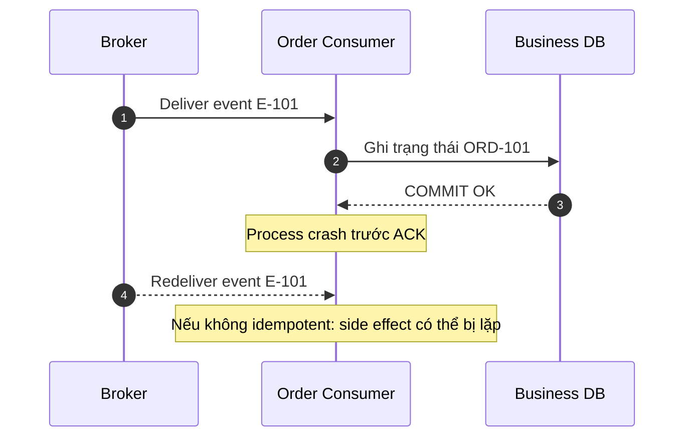
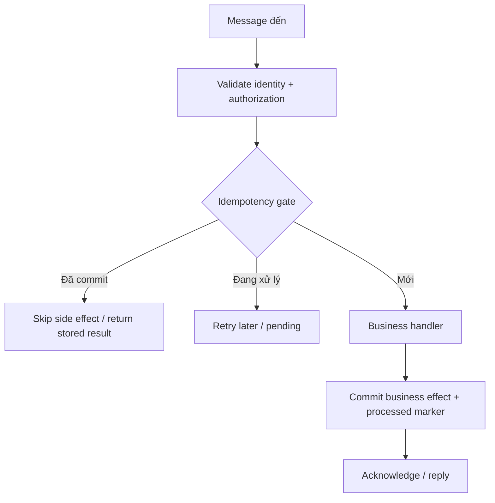
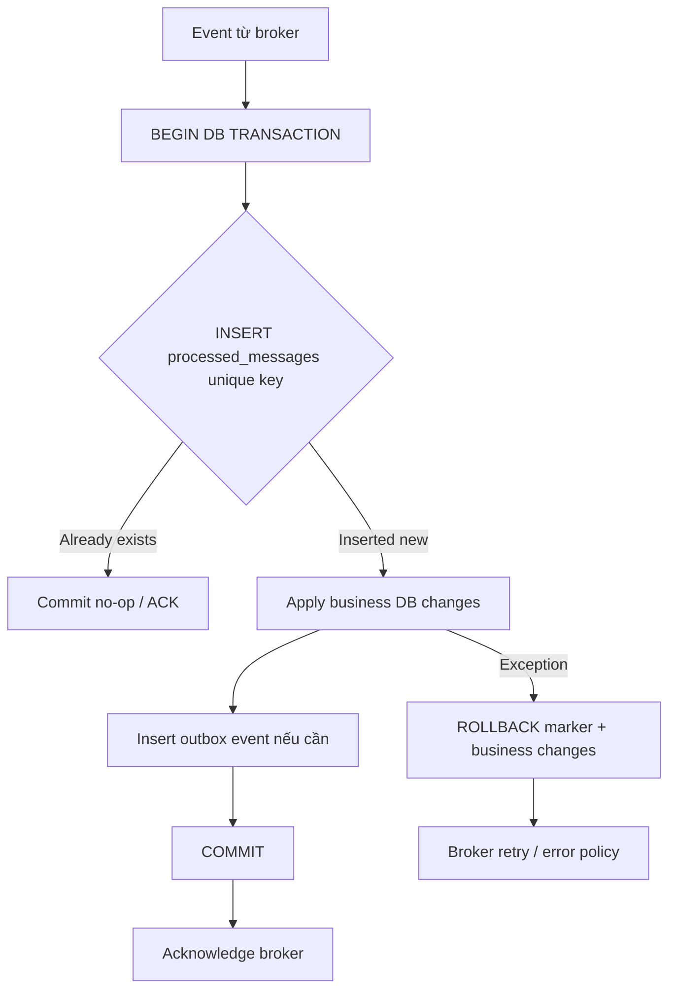
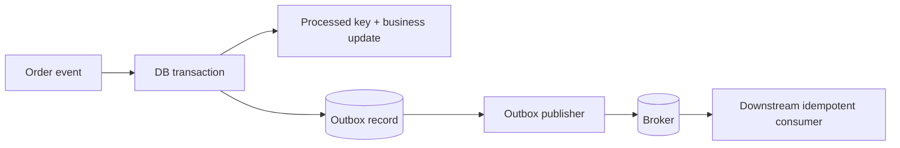
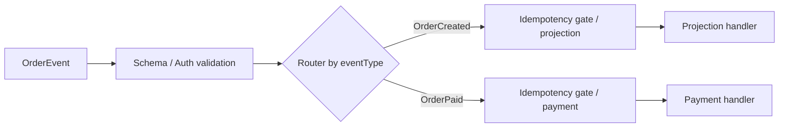
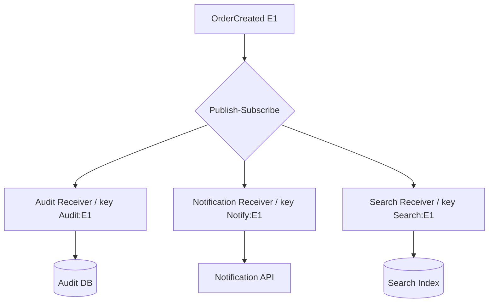

# Idempotent Receiver xử lý message lặp an toàn

Một dịch vụ nhận sự kiện `OrderCreated` từ broker, cập nhật cơ sở dữ liệu và xác nhận đã xử lý. Sau khi database commit thành công, process bị dừng ngay **trước khi gửi acknowledgment** về broker. Broker không biết tác vụ đã hoàn tất nên phát lại **cùng sự kiện**. Nếu consumer cứ nhận được message là chạy lại toàn bộ nghiệp vụ, hệ thống có thể tạo hai phiếu xuất kho, trừ tồn hai lần hoặc gửi hai thông báo.

Tình huống này không phải lỗi hiếm gặp. Retry sau timeout, broker redelivery, reconnect, nhiều instance và các thao tác commit không cùng một transaction đều có thể tạo **message lặp**. Mẫu **Idempotent Receiver** trong **Enterprise Integration Patterns (EIP)** giúp receiver nhận diện **cùng một thao tác logic đã được xử lý** và ứng xử có kiểm soát, thay vì thực hiện side effect lần thứ hai.

Bài **“Idempotent Receiver xử lý message lặp an toàn”** thuộc chương **Idempotent receiver** của module `SPRING_INTEGRATION_PATTERN`. Mục tiêu là xây dựng luồng thông điệp Spring Integration ít phụ thuộc và dễ mở rộng, biết kết hợp **Router, Filter, Transformer, Splitter, Aggregator, Gateway, retry, error channel và correlation**, đồng thời kiểm thử được đường thành công, redelivery, xung đột dữ liệu, crash và xử lý đồng thời.

> **Nguyên tắc quan trọng:** **Nhận diện duplicate chưa đồng nghĩa side effect sẽ được thực hiện đúng một lần.** Nếu ghi dấu “đã thấy” trước khi nghiệp vụ commit rồi process crash, lần redelivery có thể bị bỏ qua dù chưa có kết quả. Idempotency thực tế phải được thiết kế **cùng transaction boundary, acknowledgment và cơ chế phục hồi**.

## 1. Vì sao một message được nhận nhiều lần?

Giả sử:

```json
{
  "eventId": "a9408e98-bd75-48cb-9f4c-b07881ef9b02",
  "tenantId": "TENANT-A",
  "orderId": "ORD-101",
  "eventType": "OrderCreated",
  "schemaVersion": 1
}
```

Một consumer xử lý sự kiện này:



Message có thể được lặp vì:

- **At-least-once delivery:** broker ưu tiên không làm mất message; khi ack chưa rõ, nó có thể phát lại.
- **Producer retry:** request publish timeout nhưng broker có thể đã nhận bản đầu.
- **Consumer crash:** database commit rồi process mất trước khi ack broker.
- **Timeout của Gateway/HTTP:** caller gửi lại vì chưa thấy reply, dù backend đang xử lý hoặc đã commit.
- **Dead-letter replay:** message đã lỗi được vận hành đưa lại vào tuyến xử lý.
- **Manual reprocessing/backfill:** dữ liệu lịch sử được đọc lại.
- **Concurrent delivery:** hai instance nhận cùng logical event gần như đồng thời do retry/routing hoặc lỗi điều phối.

### 1.1. Ba loại lặp cần phân biệt

| Loại | Ví dụ | Cách xác định |
| --- | --- | --- |
| **Cùng message được giao lại** | Broker redeliver event có `eventId=E1`. | Stable event/message identity. |
| **Hai message khác nhau mô tả cùng thao tác** | Hai request capture cho cùng `paymentOperationId`. | Business operation/idempotency key. |
| **Hai thao tác hợp lệ trông tương tự** | Cùng khách đặt thêm đơn mới giống hệt đơn cũ. | Phải phân biệt bằng operation/business identity khác nhau. |

Nếu chỉ so sánh **payload bằng nhau**, có thể chặn nhầm hai giao dịch hợp lệ. Nếu chỉ so sánh `MessageHeaders.ID` mới được tạo tại mỗi lần nhận, có thể không nhận ra **cùng thao tác** sau broker adapter, retry hoặc khi producer phát lại dưới message ID mới.

## 2. Idempotency thực sự có nghĩa gì?

Một thao tác `f` được gọi là **idempotent** nếu áp dụng lặp cùng một **yêu cầu logic** không làm thay đổi kết quả quan sát được ngoài kết quả của lần áp dụng hợp lệ đầu tiên:

\[
f(f(s, k), k) = f(s, k)
\]

Trong đó `s` là trạng thái hệ thống và `k` là **idempotency key** xác định cùng một thao tác. Đây là cách diễn giải đơn giản hóa: trong hệ thống thực còn phải xét **side effect bên ngoài**, trả lời caller, event đã publish và các biến đổi theo thời gian.

Ví dụ:

| Thao tác | Mặc định có idempotent không? | Vì sao |
| --- | --- | --- |
| `SET order.status = RECEIVED` | Có thể có, nếu cùng bản ghi/trạng thái và side effect phụ được kiểm soát. | Gán cùng giá trị nhiều lần không tự cộng dồn. |
| `UPDATE stock SET quantity = quantity - 1` | **Không.** | Gọi hai lần trừ hai đơn vị. |
| `INSERT shipment không có unique key` | **Không.** | Có thể tạo hai shipment. |
| `PUT resource theo version và key ổn định` | Có thể. | Phải xét optimistic locking, response và các thao tác phụ. |
| `POST charge/payment` | **Không nên mặc định.** | Cần operation ID và cơ chế chống trùng của provider. |
| `Gửi email` | Không. | Receiver chạy lại thường gửi email lần hai nếu không có dedup. |

**Idempotent Receiver không khiến mọi handler phía sau trở thành idempotent một cách thần kỳ.** Cần biết những side effect nào cần bảo vệ, dữ liệu lưu dấu ở đâu, và liệu lưu dấu có được commit cùng business effect không.

### 2.1. “Bỏ qua duplicate” chưa phải toàn bộ yêu cầu

Khi nhận lại một request, receiver có thể:

1. **Không thực hiện lại side effect** nếu biết thao tác đã commit.
2. **Trả lại kết quả đã lưu** của lần xử lý đầu nếu caller cần response.
3. **Thông báo vẫn đang xử lý** nếu một instance khác đang giữ quyền thực thi.
4. **Từ chối xung đột** nếu cùng key nhưng payload/operation semantics khác nhau.
5. **Cho phép retry** nếu attempt trước chắc chắn chưa hoàn tất và policy cho phép.

Với hệ thống chỉ fire-and-forget, duplicate có thể được **ack mà không làm gì**. Với Gateway request–reply, chỉ drop message có thể khiến caller **timeout**; phải xác định response contract tương ứng.

## 3. Stable identity: chọn đúng khóa chống trùng

Chìa khóa của Idempotent Receiver là **định nghĩa “cùng thao tác”**. Một key đủ tốt thường có cả **consumer/operation scope** và identity do nguồn tin cậy cấp.

```text
idempotencyKey =
    (consumerName, tenantId, operationType, operationId)
```

Hoặc đối với một consumer xử lý duy nhất loại event có `eventId` toàn cục không lặp:

```text
idempotencyKey = (consumerName, eventId)
```

**Vì sao thêm `consumerName`?** Cùng event `OrderCreated` có thể được **Projection Consumer**, **Audit Consumer** và **Notification Consumer** xử lý độc lập. Nếu ba consumer dùng một key chung không kèm scope, consumer đầu tiên ghi dấu sẽ làm hai consumer còn lại bị nhận nhầm là duplicate.

### 3.1. Phân biệt ID quan trọng

| ID/metadata | Câu hỏi nó trả lời | Có nên dùng một mình làm idempotency key? |
| --- | --- | --- |
| `MessageHeaders.ID` | Đây là instance message kỹ thuật nào? | Thường **không** nếu adapter/retry tạo ID mới. |
| `eventId` | Event logic nào do producer phát? | Có thể, khi **ổn định, duy nhất và đáng tin**. |
| `orderId` | Đối tượng nghiệp vụ nào? | Thường không; cùng order có nhiều thao tác/event hợp lệ. |
| `operationId` | Thao tác như capture/reserve nào? | Thường rất phù hợp nếu ổn định qua retry. |
| `correlationId` | Những message nào thuộc cùng hội thoại/group? | **Không mặc nhiên**; nhiều part/operation có cùng correlation. |
| `sequenceNumber` | Đây là phần thứ mấy của một nhóm? | Không; mỗi nhóm đều có part 1. |
| `traceId` | Những span nào trong trace phân tán? | Không; trace có thể thay khi retry. |
| `claimId` | Dữ liệu gốc nào được lưu trong Claim Check store? | Không mặc nhiên; không nhận diện business operation. |
| Kafka offset | Record nằm ở đâu trong partition? | Không đại diện cho cùng operation khi republish sang offset khác. |

### 3.2. Key quá rộng sẽ chặn nhầm nghiệp vụ hợp lệ

Nếu key chỉ là `orderId=ORD-101`:

```text
Event 1: OrderCreated   ORD-101
Event 2: OrderPaid      ORD-101
Event 3: OrderCancelled ORD-101
```

Consumer có thể chấp nhận event đầu rồi đánh dấu hai event tiếp theo là duplicate, dù đó là các chuyển trạng thái **khác nhau và hợp lệ**. Tốt hơn:

```text
(consumerName, orderId, eventType, operationId)
```

hoặc `eventId` riêng của từng event **nếu producer bảo đảm identity** và consumer xử lý đúng event.

### 3.3. Key quá hẹp sẽ không bắt được duplicate

Nếu mỗi lần retry tạo `UUID.randomUUID()` mới rồi consumer dùng UUID đó làm key, hệ thống sẽ thấy **mỗi attempt như một thao tác mới**. Các message có thể mang payload giống nhau nhưng thiếu một **stable operationId**.

Một idempotency key tốt phải **được cấp trước lần thử đầu**, rồi **giữ nguyên** cho tất cả retry cùng thao tác; chỉ tạo key mới khi nghiệp vụ thật sự tạo thao tác mới.

### 3.4. Canonicalization và chống va chạm

Đừng ghép `tenantId + orderId` một cách tùy ý: `("AB","C")` và `("A","BC")` đều thành `ABC`. Dùng typed key/canonical encoding hoặc UUID internal:

```java
public record OperationKey(
    String consumer,
    String tenantId,
    String operationType,
    String operationId
) {
    public OperationKey {
        if (consumer == null || consumer.isBlank()
                || tenantId == null || tenantId.isBlank()
                || operationType == null || operationType.isBlank()
                || operationId == null || operationId.isBlank()) {
            throw new IllegalArgumentException("Invalid idempotency key");
        }
    }
}
```

Trong DB dùng các cột riêng hoặc key được encode có độ dài/escape/version rõ. Tránh normalize chữ hoa/chữ thường nếu domain coi chúng là hai ID khác nhau.

## 4. EIP Idempotent Receiver khác Message Filter

Một **Message Filter** quyết định message có đi tiếp theo predicate hay không. **Idempotent Receiver** dựa trên **lịch sử xử lý của một thao tác logic** và cần **state/transaction** để quyết định lần nhận hiện tại là lần đầu, retry hay duplicate.



### 4.1. Vì sao Filter vô trạng thái chưa đủ?

Một Filter kiểu:

```java
.filter(OrderEvent.class, e -> "CREATED".equals(e.eventType()))
```

chỉ kiểm tra **thuộc tính của message hiện tại**. Nó không biết cùng `eventId` đã được commit ở lần xử lý trước.

Có thể dùng **stateful MessageSelector** với `MetadataStore` để làm dedup gate, hoặc dùng **`IdempotentReceiverInterceptor`** như một advice. Nhưng ngay cả vậy, phải hiểu **khi nào state được ghi** và **state đó có nằm trong transaction của business side effect không**.

### 4.2. “Seen” khác “processed”

| Trạng thái | Ý nghĩa | Có an toàn bỏ qua retry không? |
| --- | --- | --- |
| **Unseen** | Chưa có dấu vết. | Chưa; có thể bắt đầu xử lý theo policy. |
| **In progress / reserved** | Một consumer đã nhận quyền xử lý. | Không nhất thiết; cần lease/status và recovery. |
| **Committed** | Business effect và processed marker đã commit. | Thường có thể bỏ qua **cùng operation** hoặc trả cached result. |
| **Failed retryable** | Chưa hoàn tất, có thể thử lại. | Không nên bỏ vĩnh viễn. |
| **Failed terminal** | Đã có kết quả lỗi cuối cùng. | Có thể trả lại kết quả lỗi đã lưu, không nhất thiết chạy lại. |
| **Expired / unknown** | Dấu vết quá hạn hoặc chưa xác định. | Cần chính sách replay/đối soát. |

Các trạng thái này là **mô hình do ứng dụng thiết kế**, không phải enum tự sinh bởi `IdempotentReceiverInterceptor`.

## 5. Spring Integration hỗ trợ Idempotent Receiver thế nào?

Spring Integration có những thành phần hữu ích:

- **`IdempotentReceiverInterceptor`**: advice áp dụng logic chọn message có phải duplicate, thường gắn vào endpoint/handler.
- **`MetadataStoreSelector`**: `MessageSelector` dùng metadata store để ghi nhận identity và quyết định message đã thấy.
- **`ConcurrentMetadataStore`**: abstraction có thao tác atomic như `putIfAbsent`; implementation cần thật sự có semantics đồng thời phù hợp.
- **`SimpleMetadataStore`**: store in-memory tiện demo/test, **không bền qua restart**.
- **Persistent metadata store** tương thích stack như JDBC/Redis hoặc implementation khác theo phiên bản: phục vụ nhiều instance khi được cấu hình đúng.
- **Advice/endpoint configuration** trong Spring Integration DSL để đặt gate **trước đúng handler có side effect**.

**Quan trọng về mặc định:** `IdempotentReceiverInterceptor` không nên được hiểu đơn giản là “gặp duplicate thì luôn âm thầm drop”. Cơ chế của interceptor có thể **đánh dấu header duplicate** và tiếp tục xử lý tùy cấu hình; khi muốn discard/route duplicate phải **cấu hình rõ ràng** và kiểm thử. Ngoài ra, dù đã chặn duplicate tại advice, **khả năng crash sau ghi dấu nhưng trước commit** vẫn phải được xử lý ở business boundary.

### 5.1. `MetadataStore` không phải `MessageStore`

| Abstraction | Lưu gì? | EIP liên quan |
| --- | --- | --- |
| **`ConcurrentMetadataStore`** | Key/value metadata nhỏ, chẳng hạn idempotency identity. | Idempotent Receiver. |
| **`MessageStore`** | Một `Message<?>` có thể được truy hồi theo ID. | Claim Check. |
| **`MessageGroupStore`** | Nhiều message cùng group và trạng thái release. | Aggregator, Resequencer. |

Không cất toàn bộ dữ liệu thanh toán hoặc payload nhạy cảm vào metadata store chỉ để phát hiện duplicate. Nên lưu **key và trạng thái tối thiểu** theo retention.

### 5.2. Trạng thái “first seen” có thể không đủ cho transaction

Một selector đặt key vào metadata store bằng `putIfAbsent` **trước khi handler thực thi**:

```text
T1: putIfAbsent(eventId) → NEW
T2: business handler bắt đầu
T3: JVM crash trước business commit
T4: broker redeliver eventId
T5: metadata store còn key → DUPLICATE
T6: event bị bỏ dù business effect chưa xảy ra
```

Đây là **rủi ro mất xử lý** nếu metadata ghi nhận “đã thấy” được coi như bằng chứng “đã commit”. Vì vậy, ví dụ DSL dưới đây dùng store in-memory **chỉ minh họa kỹ thuật chống duplicate tại endpoint**. Thiết kế production ở mục 8 dùng **unique key và business effect trong cùng database transaction**.

## 6. Ví dụ Java DSL: IdempotentReceiverInterceptor

Ta dùng `OrderEvent` với event ID ổn định. Handler demo chỉ ghi một dấu vết trong memory, **không làm side effect nghiệp vụ thật**.

### 6.1. DTO đầu vào và recorder kiểm thử

```java
// OrderEvent.java
import java.util.UUID;

public record OrderEvent(
    UUID eventId,
    String tenantId,
    String orderId,
    String eventType
) {
    public OrderEvent {
        if (eventId == null
                || tenantId == null || tenantId.isBlank()
                || orderId == null || orderId.isBlank()
                || eventType == null || eventType.isBlank()) {
            throw new IllegalArgumentException("Invalid event");
        }
    }
}
```

```java
// RecordingOrderHandler.java
import java.util.List;
import java.util.concurrent.CopyOnWriteArrayList;

public final class RecordingOrderHandler {
    private final List<String> accepted = new CopyOnWriteArrayList<>();

    public void record(OrderEvent event) {
        accepted.add(event.eventId().toString());
    }

    public int processedCount() {
        return accepted.size();
    }
}
```

### 6.2. Cấu hình Spring Integration

```java
// IdempotentOrderConfiguration.java
import org.springframework.beans.factory.annotation.Qualifier;
import org.springframework.context.annotation.Bean;
import org.springframework.context.annotation.Configuration;
import org.springframework.integration.channel.QueueChannel;
import org.springframework.integration.config.EnableIntegration;
import org.springframework.integration.dsl.IntegrationFlow;
import org.springframework.integration.handler.advice.IdempotentReceiverInterceptor;
import org.springframework.integration.metadata.ConcurrentMetadataStore;
import org.springframework.integration.metadata.SimpleMetadataStore;
import org.springframework.integration.selector.MetadataStoreSelector;
import org.springframework.messaging.MessageChannel;

@Configuration
@EnableIntegration
public class IdempotentOrderConfiguration {

    @Bean
    ConcurrentMetadataStore demoIdempotencyStore() {
        return new SimpleMetadataStore(); // Demo in-memory only.
    }

    @Bean("orders.duplicates")
    QueueChannel duplicates() {
        return new QueueChannel(16);
    }

    @Bean
    RecordingOrderHandler recordingOrderHandler() {
        return new RecordingOrderHandler();
    }

    @Bean
    IdempotentReceiverInterceptor orderIdempotentAdvice(
            ConcurrentMetadataStore demoIdempotencyStore,
            @Qualifier("orders.duplicates")
            MessageChannel duplicateChannel) {

        MetadataStoreSelector selector = new MetadataStoreSelector(
            message -> {
                OrderEvent event = (OrderEvent) message.getPayload();
                return "order-projection:" + event.eventId();
            },
            demoIdempotencyStore);

        IdempotentReceiverInterceptor advice =
            new IdempotentReceiverInterceptor(selector);
        advice.setDiscardChannel(duplicateChannel);
        return advice;
    }

    @Bean
    IntegrationFlow consumeOrders(
            IdempotentReceiverInterceptor orderIdempotentAdvice,
            RecordingOrderHandler recordingOrderHandler) {
        return IntegrationFlow.from("orders.events.in")
            .handle(OrderEvent.class,
                (event, headers) -> {
                    recordingOrderHandler.record(event);
                    return null; // One-way handler in this demo.
                },
                endpoint -> endpoint.advice(orderIdempotentAdvice))
            .get();
    }
}
```

**Cách hoạt động:**

1. `orders.events.in` nhận event.
2. `MetadataStoreSelector` rút key từ **stable event ID** thay vì `MessageHeaders.ID` phát sinh mỗi lần.
3. Store in-memory nhận key đầu tiên; event tiếp theo có **cùng key** được đánh giá là duplicate.
4. `IdempotentReceiverInterceptor` được áp dụng tại handler; **discard channel được khai báo tường minh**, không dựa vào mặc định của interceptor.
5. Handler chỉ ghi nhận event đầu tiên trong demo; duplicate được chuyển tới `orders.duplicates` để kiểm tra.

**Ràng buộc của snippet:** Cần dùng phiên bản Spring Integration hỗ trợ các constructor/API `MetadataStoreSelector`, `IdempotentReceiverInterceptor` và `endpoint.advice(...)` tương ứng. Nếu cấu hình khác về discard semantics, hãy đối chiếu Javadoc/version và test chính endpoint; đừng coi giả định về mặc định là contract.

**Không dùng cấu hình in-memory này để bảo vệ thanh toán hoặc trừ tồn kho trong production.** Key được ghi trước handler, store không transactional với business DB và sẽ mất khi JVM restart.

### 6.3. Vì sao key có prefix?

`"order-projection:" + eventId` chỉ có ý nghĩa khi `eventId` là UUID được cấp đáng tin và duy nhất trên phạm vi đủ rộng. Prefix thể hiện **consumer/operation scope** để một consumer khác dùng chung store vẫn được xử lý cùng event độc lập.

Nếu `eventId` chỉ unique trong tenant, cần thêm `tenantId` bằng canonical/encoding an toàn. Không trực tiếp lấy một arbitrary header do client ngoài khai mà bỏ qua validation.

## 7. Kiểm thử JUnit 5: message thứ hai có ID kỹ thuật khác vẫn là duplicate

Mục tiêu là gửi **hai instance message** có cùng `eventId` trong payload. `MessageBuilder` tạo message kỹ thuật riêng; logic idempotency phải dựa trên **identity nghiệp vụ**, không phụ thuộc vào instance của `Message<?>`.

```java
import static org.junit.jupiter.api.Assertions.*;

import java.util.UUID;
import org.junit.jupiter.api.Test;
import org.springframework.beans.factory.annotation.Autowired;
import org.springframework.context.ApplicationContext;
import org.springframework.integration.channel.QueueChannel;
import org.springframework.messaging.Message;
import org.springframework.messaging.MessageChannel;
import org.springframework.messaging.support.MessageBuilder;
import org.springframework.test.context.junit.jupiter.SpringJUnitConfig;

@SpringJUnitConfig(IdempotentOrderConfiguration.class)
class IdempotentOrderFlowTest {

    @Autowired ApplicationContext context;

    @Test
    void recordsOnlyFirstDeliveryAndRoutesDuplicate() {
        UUID eventId = UUID.fromString(
            "a9408e98-bd75-48cb-9f4c-b07881ef9b02");
        OrderEvent event = new OrderEvent(
            eventId, "TENANT-A", "ORD-101", "OrderCreated");

        Message<OrderEvent> first = MessageBuilder
            .withPayload(event)
            .build();
        Message<OrderEvent> redelivery = MessageBuilder
            .withPayload(event)
            .build();

        assertNotEquals(
            first.getHeaders().getId(),
            redelivery.getHeaders().getId());

        MessageChannel input = context.getBean(
            "orders.events.in", MessageChannel.class);
        assertTrue(input.send(first));
        assertTrue(input.send(redelivery));

        RecordingOrderHandler handler =
            context.getBean(RecordingOrderHandler.class);
        assertEquals(1, handler.processedCount());

        QueueChannel duplicates =
            context.getBean("orders.duplicates", QueueChannel.class);
        Message<?> rejected = duplicates.receive(0);
        assertNotNull(rejected);
        assertEquals(eventId,
            ((OrderEvent) rejected.getPayload()).eventId());
        assertNull(duplicates.receive(0));
    }
}
```

**Điều test chứng minh:** nếu cấu hình advice hoạt động như dự kiến, **cùng event logic** không chạy demo handler hai lần, dù hai delivery có **message ID kỹ thuật khác nhau**.

**Điều test không chứng minh:** durability, atomicity với DB, crash windows, idempotency của HTTP API, dedup giữa hai pod hay exactly-once. Khi dùng test context chung, phải tách event IDs giữa các test hoặc reset metadata store vì state có thể tồn qua test method.

### 7.1. Test cùng payload nhưng khác operation ID

Một bài test khác cần bảo đảm:

```text
Event A: eventId=E-1, orderId=ORD-101
Event B: eventId=E-2, orderId=ORD-101
```

Hai event **khác identity** nên có thể được chấp nhận cả hai nếu hợp đồng nói đó là hai thao tác hợp lệ. Không viết selector chỉ dùng `orderId` rồi chặn nhầm toàn bộ event của một order.

### 7.2. Test cùng key nhưng payload mâu thuẫn

```text
eventId=E-1, status=APPROVED
eventId=E-1, status=DECLINED
```

Đừng âm thầm coi hai message này là duplicate hoàn toàn đồng nhất. Với các event đòi nội dung bất biến, cần lưu **payload hash/version** hoặc fingerprint canonical trong record idempotency và **báo conflict/quarantine** khi cùng key nhưng nội dung khác. Một key-only selector không tự phát hiện xung đột dữ liệu.

## 8. Ranh giới an toàn hơn: transaction chung với business effect

Giả sử consumer dùng PostgreSQL để cập nhật một order projection. Muốn tránh mất processing khi crash, **processed marker và business write** nên nằm trong **cùng database transaction**:



### 8.1. Unique constraint trong database

```sql
CREATE TABLE processed_messages (
    consumer_name VARCHAR(100) NOT NULL,
    event_id UUID NOT NULL,
    processed_at TIMESTAMPTZ NOT NULL DEFAULT now(),
    PRIMARY KEY (consumer_name, event_id)
);

CREATE TABLE order_projection (
    tenant_id VARCHAR(100) NOT NULL,
    order_id VARCHAR(100) NOT NULL,
    status VARCHAR(40) NOT NULL,
    PRIMARY KEY (tenant_id, order_id)
);
```

Đây là schema **minh họa cho PostgreSQL**. Nếu `eventId` không unique trên toàn tenant, cần thêm `tenant_id` vào unique key, và cần xác minh identity nguồn. Có thể bổ sung `payload_hash`/`result_json` để phát hiện conflict và trả lại kết quả, cùng retention/index phù hợp.

### 8.2. Một transaction kiểm soát marker và cập nhật nghiệp vụ

```sql
BEGIN;

-- Idempotency claim; thành công đúng một lần cho mỗi
-- (consumer_name, event_id) khi khóa unique được enforce.
INSERT INTO processed_messages (consumer_name, event_id)
VALUES ('order-projection', :event_id)
ON CONFLICT DO NOTHING;

-- Ứng dụng phải đọc số dòng INSERT (0 hoặc 1).
-- Nếu 0: duplicate đã có record -> COMMIT no-op / ACK.
-- Nếu 1: chạy business SQL phía dưới trong CÙNG transaction.

INSERT INTO order_projection (tenant_id, order_id, status)
VALUES (:tenant_id, :order_id, 'RECEIVED')
ON CONFLICT (tenant_id, order_id)
DO UPDATE SET status = EXCLUDED.status;

-- Nếu có outbound event, có thể ghi vào outbox cùng transaction.
-- Khi lỗi nghiệp vụ: ROLLBACK cả marker và business write.

COMMIT;
```

**Đọc đúng pseudo-flow:** Lệnh SQL phía sau phải **chỉ chạy khi INSERT marker trả 1 dòng**. Đoạn trên minh họa transaction steps; khi triển khai thật, code cần branch theo update count. Không chạy cả `order_projection` update cho trường hợp duplicate.

**Độ an toàn đến từ:**

1. **Unique constraint** trên identity của thao tác xử lý tại consumer.
2. **Một database transaction** bao trùm cả marker và business effect.
3. **Rollback** marker khi business write thất bại.
4. **Ack broker sau commit**, hoặc cơ chế tương đương theo transport.
5. Khi commit xong nhưng ack mất, redelivery gặp marker và **không thực hiện lại effect**.

Điều này **không biến hai hệ thống độc lập** (DB + remote HTTP/broker) thành một distributed transaction atomic. Những side effect ngoài database cần idempotency/outbox/saga riêng.

### 8.3. Triển khai Service với Spring JDBC

```java
// TransactionalOrderProjectionService.java
import java.util.UUID;
import org.springframework.jdbc.core.JdbcTemplate;
import org.springframework.stereotype.Service;
import org.springframework.transaction.annotation.Transactional;

@Service
public class TransactionalOrderProjectionService {

    private final JdbcTemplate jdbc;

    public TransactionalOrderProjectionService(JdbcTemplate jdbc) {
        this.jdbc = jdbc;
    }

    @Transactional
    public void apply(OrderEvent event) {
        // Validate/authenticate tenant + event identity ở ingress.
        UUID id = event.eventId();

        int inserted = jdbc.update("""
            INSERT INTO processed_messages(consumer_name, event_id)
            VALUES (?, ?)
            ON CONFLICT DO NOTHING
            """, "order-projection", id);

        if (inserted == 0) {
            // Marker đã tồn tại; không làm lại business effect.
            return;
        }

        jdbc.update("""
            INSERT INTO order_projection(tenant_id, order_id, status)
            VALUES (?, ?, ?)
            ON CONFLICT (tenant_id, order_id)
            DO UPDATE SET status = EXCLUDED.status
            """, event.tenantId(), event.orderId(), "RECEIVED");

        // Nếu ném RuntimeException, marker và update cùng rollback.
        // Nếu cần publish event khác, ghi transactional outbox ở đây.
    }
}
```

**Chú ý:**

- Code này dùng **PostgreSQL-specific syntax** (`ON CONFLICT`) và giả định Spring transaction manager phù hợp với **cùng DataSource**.
- `@Transactional` phải được gọi qua Spring proxy đúng cách; self-invocation hoặc tạo instance bằng `new` có thể khiến transaction advice không áp dụng.
- Logic “set status = RECEIVED” là ví dụ; nếu event đến sai thứ tự hoặc trạng thái order đã tiến xa hơn, một UPSERT vô điều kiện có thể **lùi trạng thái**. Cần business version/state-machine guard khi phù hợp.
- Nếu event payload thay đổi nhưng giữ cùng ID, unique constraint chỉ phát hiện **same key**; vẫn phải có conflict validation theo hợp đồng.
- Không gọi API thanh toán hoặc gửi email trực tiếp trong transaction rồi nghĩ chúng sẽ tự rollback cùng DB.

### 8.4. Gắn service vào Spring Integration Flow

```java
// BusinessConsumerFlow.java
import org.springframework.context.annotation.Bean;
import org.springframework.context.annotation.Configuration;
import org.springframework.integration.config.EnableIntegration;
import org.springframework.integration.dsl.IntegrationFlow;

@Configuration
@EnableIntegration
public class BusinessConsumerFlow {

    @Bean
    IntegrationFlow transactionalOrderReceiver(
            TransactionalOrderProjectionService service) {
        return IntegrationFlow.from("orders.business.in")
            .handle(OrderEvent.class,
                (event, headers) -> {
                    service.apply(event);
                    return null; // One-way message handling.
                })
            .get();
    }
}
```

Ở đây **business service tự thực hiện dedup cùng transaction**. Có thể đặt `IdempotentReceiverInterceptor` như một **tầng tối ưu** trước service để giảm duplicate load, nhưng **không được dùng tầng “seen-before” thiếu transaction như điều kiện duy nhất để bỏ qua** khi cần bảo đảm xử lý không mất. Trong nhiều hệ thống, **chỉ cần dedup transactional ở service** là cách diễn đạt rõ ràng và dễ audit hơn.

## 9. Phân tích crash windows và ACK

Một ma trận cần kiểm chứng:

| Thời điểm crash | DB marker | Business effect | Ack broker | Kết quả sau redelivery |
| --- | --- | --- | --- | --- |
| Trước khi bắt đầu transaction | Chưa có | Chưa có | Chưa | Thử lại bình thường. |
| Sau INSERT marker, trước business write, **chưa COMMIT** | Chưa commit | Chưa commit | Chưa | Transaction rollback; redelivery xử lý lại. |
| Sau business write, trước COMMIT | Chưa commit | Chưa commit | Chưa | Rollback; redelivery xử lý lại. |
| Sau COMMIT, trước ACK | Đã commit | Đã commit | Chưa | Redelivery gặp key đã xử lý, không ghi lại. |
| Sau ACK | Đã commit | Đã commit | Có | Broker thông thường không cần giao lại message ấy; nếu replay vẫn nên no-op. |

### 9.1. Không ack trước khi business commit

```text
Sai:
    nhận message
    → ACK ngay
    → xử lý DB
    → crash
    => broker coi hoàn tất, DB chưa cập nhật
```

Nếu transport/adapter sử dụng auto-ack, phải hiểu chính xác thời điểm broker ghi nhận message và behavior khi handler ném exception. Không giả định mọi loại broker có ack semantics giống nhau.

### 9.2. Cần bảo đảm transaction rollback cả marker

```text
Sai:
    putIfAbsent(key) vào Redis hoặc metadata store
    → ghi DB thất bại
    → Redis vẫn giữ key "seen"
    → redelivery bị drop
```

Nếu không có distributed transaction, **không thể mặc định** Redis key và database write commit/rollback cùng nhau. Có thể dùng trạng thái `IN_PROGRESS`/lease/`COMPLETED` kết hợp recovery hoặc chuyển identity record vào DB transaction cùng business effect.

### 9.3. Unique key giải quyết race của hai consumer

Hai pod cùng nhận event `E1`:

```text
Pod A: INSERT processed_messages(E1) → winner
Pod B: INSERT processed_messages(E1) → wait/conflict

Pod A: business update + COMMIT
Pod B: INSERT count=0 → no-op / ACK
```

Đây là **semantics minh họa khi DB thực thi unique constraint và transaction isolation phù hợp**. Trong thực tế Pod B có thể phải chờ transaction của A hoàn tất; nếu A rollback, B có thể trở thành winner. Test concurrency và deadlocks/lock timeouts với database thực, không chỉ dùng in-memory `HashSet`.

## 10. Xử lý side effect bên ngoài database

Ví dụ receiver phải:

1. Ghi trạng thái order vào PostgreSQL.
2. Gọi Payment API.
3. Publish `OrderAccepted` lên broker.
4. Gửi email xác nhận.

Không có một local DB transaction đơn giản bao trùm cả bốn. Nếu đánh dấu processed rồi **gọi API sau commit**, process crash giữa các bước sẽ làm thiếu side effect. Nếu **gọi API trước commit**, retry sau crash có thể gọi API hai lần.

### 10.1. Idempotency key gửi tới provider

Khi Payment API hỗ trợ idempotency, gắn **cùng operation key** cho mọi retry:

```text
POST /payments/capture
Idempotency-Key: TENANT-A:PAY-OP-101

Attempt 1 → timeout ở caller, provider có thể đã capture
Attempt 2 → cùng Idempotency-Key
          → provider trả lại kết quả hoặc nhận diện duplicate
```

Đây là **mô hình khái niệm**, không phải tên header API của mọi payment provider. Phải đọc hợp đồng cụ thể: retention key, payload mismatch handling, response replay và sự khác biệt giữa timeout với failure.

### 10.2. Transactional outbox để publish event



**Ghi nhận business state + outbox row trong cùng DB transaction** tránh tình trạng DB commit mà event không có record để publish. Publisher có thể phát lặp sau crash, vì vậy **downstream vẫn cần Idempotent Receiver**.

### 10.3. Saga/workflow nhiều bước

Với các thao tác xuyên service không thể giao dịch atomic, có thể dùng:

- Stable `workflowId` và `operationId` cho từng bước.
- State machine/step log có version.
- Idempotent handler từng bước và retry có deadline.
- Compensation khi một bước thất bại sau khi bước khác đã commit.
- Đối soát “unknown outcome” thay vì coi timeout là chưa thực hiện.

**Compensation không phải rollback tức thì và cũng có thể bị thực hiện lặp**; chính các bước bù cũng cần idempotency.

## 11. Duplicate policy: bỏ qua, trả cached result hay báo conflict?

Không phải mọi receiver đều nên âm thầm drop duplicate.

| Trường hợp | Policy có thể chọn | Hợp đồng cần có |
| --- | --- | --- |
| Consumer cập nhật projection từ event | ACK/no-op nếu đã commit. | Marker bền và đúng consumer scope. |
| Command qua Gateway cần trả `OrderReceipt` | Trả **kết quả đã lưu** của cùng operation. | Persist response/status theo idempotency key. |
| Operation đang xử lý trên pod khác | Trả `PENDING` hoặc hẹn retry. | Lock/lease, timeout và tránh hai worker cùng làm. |
| Cùng key nhưng payload khác | `CONFLICT`/quarantine. | Payload hash, schema/version và owner check. |
| Event lỗi dữ liệu vĩnh viễn | Reject/DLQ sau phân loại, có thể lưu terminal failure. | Không retry vô hạn. |
| Same business order nhưng **new operation** | Cho xử lý như mới. | Identity phân biệt event/operation rõ. |

### 11.1. Cùng key nhưng khác payload

Nếu hai request:

```json
{"operationId":"CAP-101","amount":100000}
```

và

```json
{"operationId":"CAP-101","amount":250000}
```

thì **không được xem là hai request giống hệt chỉ vì key trùng**. Việc silently ignore request thứ hai có thể che lỗi gửi tiền. Nên lưu **canonical payload fingerprint** và trả `409 CONFLICT` hoặc error domain phù hợp.

Lưu ý khi hash: thứ tự field JSON, số thập phân, charset, version và loại field được phép bỏ qua phải canonical; hash không thay validation/auth.

### 11.2. Lưu response của lần đầu

Một service request–reply có thể lưu:

```text
idempotency_key = CAP-101
payload_hash = SHA256(canonical_request)
state = COMPLETED
response_code = 200
response_body = {receiptId: ...}
completed_at = ...
```

Lần retry cùng key và cùng request hash trả lại **cùng outcome**, không tạo payment mới. Đừng chỉ trả “duplicate” nếu API contract đòi receipt để caller tiếp tục workflow.

## 12. Retry: nơi đặt, khi nào dừng và cách tránh retry storm

Một message có thể được retry đồng thời ở:

- Producer HTTP client.
- Broker delivery.
- Spring Integration `RequestHandlerRetryAdvice` hoặc retry mechanism của endpoint.
- Payment/Inventory HTTP client.
- Scheduler reprocess DLQ.
- Gateway caller.

Nếu mỗi tầng retry ba lần, số attempt tới dependency có thể tăng rất nhanh. Chọn **retry owner** và phân biệt lỗi:

| Lỗi | Retry? | Lý do |
| --- | --- | --- |
| Transient DB connection failure, transaction đã rollback | Có thể, giới hạn. | Cần bảo đảm marker chưa commit. |
| Duplicate đã commit | Không cần chạy business lại. | ACK/no-op hoặc cached response. |
| Payload thiếu required key/schema lỗi | Không retry cùng payload. | Cần reject/quarantine. |
| Cùng idempotency key nhưng payload mâu thuẫn | Không retry mù quáng. | Cần conflict handling. |
| Lock/lease đang có owner khác | Chờ/retry hoặc trả PENDING có giới hạn. | Tránh hai worker chạy đồng thời. |
| HTTP timeout với external payment | Có thể **đối soát theo operation ID** trước. | Timeout không chứng minh provider chưa charge. |
| Storage/circuit breaker quá tải | Backoff + jitter, bounded concurrency. | Tránh hệ thống phục hồi bị retry storm. |

### 12.1. Retry và state `IN_PROGRESS`

Nếu triển khai một repository riêng cho command:

```text
NEW → IN_PROGRESS (owner + lease)
IN_PROGRESS → COMPLETED (result)
IN_PROGRESS → RETRYABLE_FAILED
IN_PROGRESS → TERMINAL_FAILED
IN_PROGRESS hết lease → RECOVER / RECONCILE
```

Đây là **state machine ứng dụng**, không phải cơ chế tự có của `SimpleMetadataStore`. Một key `IN_PROGRESS` không được giữ vĩnh viễn nếu worker chết. Nhưng “lease hết” không có nghĩa side effect ngoài đã rollback; trước khi takeover cần reconcile hoặc provider-side idempotency.

### 12.2. Backoff và deadline

Đặt giới hạn **max attempts**, **backoff/jitter** và **deadline**. Nếu Gateway chỉ chờ một giây, nhưng external dependency cần năm giây, không được cứ retry trong request–reply sync rồi báo thành công giả; có thể chuyển sang `PENDING` và status query.

## 13. Kết hợp với Router, Filter và Transformer

### 13.1. Đặt idempotency ở đúng nhánh có side effect



Hai handler có **operation scopes khác nhau**, không nên chia sẻ một key `orderId` quá rộng.

Nếu một event phải được cả Audit và Projection xử lý, **mỗi consumer cần dedup độc lập** theo `(consumer,eventId)`. Đặt một gate toàn cục **trước Publish–Subscribe** có thể ngăn event đến mọi subscriber, nhưng không thay được việc mỗi subscriber tự bảo vệ side effect của mình.

### 13.2. Filter và Idempotent Receiver khác nhau ở state

Một Filter có thể loại `OrderEvent` không hợp lệ theo payload. Nó không biết event đã được xử lý trước chưa. Idempotent Receiver cần **identity + state** và thường cần một **atomic claim**.

Khi dùng một selector kiểu stateful trong `.filter(...)`, việc Filter pass không nên được hiểu là **business commit**. Nếu nó ghi key trước handler, crash window ở mục 5 vẫn tồn tại.

### 13.3. Transformer phải giữ stable operation ID

Nếu Transformer biến JSON String thành `OrderEvent`, field `eventId` phải được parse/validate từ nguồn tin cậy, **không sinh UUID mới mỗi lần message được deserialize**. Ví dụ nguy hiểm:

```java
// Sai nếu đây là cùng logical event được retry:
OrderEvent rehydrateWithoutStableId(String orderId) {
    return new OrderEvent(
        java.util.UUID.randomUUID(),
        "TENANT-A", orderId, "OrderCreated");
}
```

Mỗi retry được gán ID khác làm dedup vô hiệu. Khi không có upstream event ID, cần một **stable business operation identity** có hợp đồng rõ; **không dùng hash toàn payload làm lời giải vạn năng**, vì hai operation độc lập có thể có nội dung y hệt.

### 13.4. Content Enricher có thể gọi dependency lặp

Một Content Enricher tra cứu dữ liệu read-only thường chịu được retry tốt hơn một Enricher gọi API có side effect. Nếu lookup thực sự tạo reservation hoặc tính phí, cần idempotency **ở đúng dependency**, không chỉ ở Aggregator sau đó.

## 14. Splitter, Aggregator, Resequencer và correlation

Một batch có ba phần:

```text
Batch B-101
  → Splitter seq=1/3, 2/3, 3/3
  → parallel handlers
  → Aggregator / Resequencer
```

Nếu part `seq=2` bị redeliver, nó vẫn là **cùng part logic**. Một key có thể gồm:

```text
(consumerName, batchId, batchGeneration, partId, operationType)
```

**Không dùng `sequenceNumber` đơn lẻ**: mọi batch đều có part số 1. Và nếu Splitter tạo `correlationId` từ **MessageHeaders.ID** của lần split, replay batch có thể sinh correlation ID mới; cần cân nhắc stable business key.

### 14.1. Đếm đủ message không có nghĩa đủ part duy nhất

```text
expectedParts=3
received:
  part=1
  part=2
  part=2 (duplicate)

group.size()=3 nhưng distinctParts=2
```

**Aggregator** phải release theo đủ **outcomes hợp lệ** hoặc release strategy được thiết kế cho duplicate. Idempotent receiver trước Aggregator có thể giảm việc lưu duplicate, nhưng nếu duplicate bị drop mà bản đầu chưa tạo outcome terminal, group vẫn có thể chờ mãi. Cần định nghĩa rõ:

- Mỗi part sau xử lý có **một result terminal** (SUCCESS/REJECTED/FAILED).
- Dedup dựa trên stable part identity.
- Retry khi chưa commit.
- Aggregator release/expiry và partial policy.
- Late reply sau group đã final.

### 14.2. Resequencer không chống duplicate bằng cách sắp thứ tự

Resequencer có thể phát `1,2,3` theo thứ tự, nhưng một luồng có thể nhận `1,2,2,3`. Thứ tự đúng không đồng nghĩa chỉ xử lý một lần. Phải có dedup/identity và group expiry/late handling riêng.

### 14.3. Nested groups

File chứa các order; mỗi order có các line. Có thể cần:

```text
outer group key = (tenantId, fileId, generation)
inner part key  = (tenantId, fileId, orderId, lineId, operationType)
```

Nếu chỉ có một `correlationId` phẳng, dễ nhầm identity giữa các cấp. Idempotency key phải nhận diện **side effect của từng part/operation**, không suy máy móc từ group correlation.

## 15. Scatter–Gather, Publish–Subscribe và các subscriber độc lập

Một event có thể được broadcast tới:

- Audit Consumer.
- Metrics Consumer.
- Notification Consumer.
- Search Index Consumer.



Mỗi subscriber cần **thực hiện side effect của chính mình đúng mức**, nên có **consumer-scoped idempotency**. Nếu Audit đã xử lý E1, Notification vẫn phải được quyền gửi thông báo E1 lần đầu.

### 15.1. Scatter–Gather và reply duplicate

Trong Scatter–Gather, Pricing trả lời hai lần còn Inventory chưa trả. Aggregator không được coi “hai reply” là đủ “hai recipient”. Dùng release strategy theo **tập role/recipient duy nhất**, đồng thời áp dụng dedup phù hợp ở các reply consumer.

### 15.2. Idempotent reply khác idempotent business call

Một Gather có thể loại duplicate Pricing reply, nhưng Pricing handler có thể đã gọi external API hai lần trước đó. **Dedup khi gather chỉ bảo vệ tập reply**, không tự bảo vệ side effect ở service nguồn. Đặt idempotency ở cả nơi cần thiết.

## 16. Claim Check và Idempotent Receiver

Trong một luồng Claim Check, token có thể bị redeliver:

```text
token C1 → Claim Check Out → Business handler
token C1 → Claim Check Out → Business handler (retry)
```

**Claim ID** nhận diện dữ liệu được cất, không tự nhận diện **operation** hoặc người có quyền xử lý. Nếu một claim có nhiều consumer, cả Audit và Archive có thể restore cùng payload hợp lệ. Do đó key có thể là:

```text
(consumerName, claimId, businessOperationId)
```

Nếu check-out sử dụng **remove-on-read**, lần retry có thể gặp `claim not found` ngay cả khi business handler chưa commit. Với retry, fan-out và side effect, nên thiết kế **read-many/lease/cleanup sau completion** hoặc workflow one-time claim thật sự atomic.

**Không dùng việc claim token đã được đọc như bằng chứng business effect đã commit.** Đây cũng chính là sự khác biệt giữa `SEEN` và `COMPLETED`.

## 17. Gateway request–reply: duplicate phải được trả lời nhất quán

Một Java Gateway có thể cung cấp facade:

```java
import org.springframework.integration.annotation.MessagingGateway;

@MessagingGateway(defaultRequestChannel = "commands.in")
interface OrderCommandGateway {
    OrderReceipt submit(OrderCommand command);
}

// OrderCommand/OrderReceipt do ứng dụng định nghĩa.
// Flow thực tế phải tạo reply và idempotency-aware result.
```

Nếu caller gửi `operationId=CMD-101` hai lần:

1. **Lần đầu hoàn tất:** trả receipt của lần đầu; lần hai trả lại **cùng logical outcome**.
2. **Lần đầu đang chạy:** trả `PENDING` hoặc đợi có giới hạn, không cho hai handler cùng làm side effect.
3. **Cùng ID khác payload:** trả **CONFLICT** hoặc error domain phù hợp.
4. **Lần đầu thất bại tạm thời:** cho phép retry theo policy, sau khi biết operation không còn đang chạy hoặc đã reconcile.
5. **Lần đầu đã terminal failure:** có thể trả lại failure đã lưu theo contract.

**Ví dụ `IdempotentOrderConfiguration` ở mục 6 không tạo `OrderReceipt`**; nó là one-way handler minh họa advice và duplicate discard. Khi sử dụng Gateway cần một flow có reply path và repository lưu trạng thái/kết quả của idempotent operation; đơn thuần discard duplicate có thể khiến caller timeout.

### 17.1. Gateway timeout không làm side effect “chưa xảy ra”

```text
Caller → submit(CMD-101)
Gateway replyTimeout sau 1 giây
Backend commit sau 1,5 giây
Caller retry CMD-101
```

Lần retry phải có **cùng operation ID** và receiver phải nhận ra kết quả đã commit. Không tự xem timeout là rollback; nếu backend đã gọi remote payment và không rõ outcome, cần query/reconcile qua provider key.

## 18. Error channel, DLT và acknowledgment

Trong Spring Integration, lỗi có thể đi theo:

- **Synchronous handler**: exception truyền ngược người gọi trong cùng call stack.
- **Async/poller/adapter**: exception có thể được đóng gói thành `ErrorMessage` và gửi tới `errorChannel` khi cấu hình phù hợp.
- **Broker listener**: nack/requeue/DLT/redelivery tùy transport và acknowledgment policy.

Một failure path cần phân biệt:

| Lỗi | Có phải duplicate không? | Hành động |
| --- | --- | --- |
| Key đã **COMPLETED** và payload hợp lệ | Có. | ACK/no-op hoặc replay stored response. |
| Key đang **IN_PROGRESS** | Chưa chắc. | Chờ/lease/đối soát, không chạy song song. |
| Key mới, business DB deadlock | Không. | Rollback, retry có giới hạn. |
| Malformed payload | Không. | Reject/quarantine, không retry mù quáng. |
| Key trùng, payload khác | Conflict. | Report/quarantine; không silent skip. |
| External API timeout | Outcome chưa chắc biết. | Query status theo operation ID, retry an toàn. |
| Metadata store unavailable | Chưa thể phân loại. | Fail closed hoặc retry; không mặc định xử lý như event mới. |
| Output event publish thất bại | Có thể partial completion. | Outbox/recovery; không chạy lại side effect đã commit. |

### 18.1. Không nuốt exception để broker ACK sai

Nếu một handler ném lỗi trước business commit nhưng error flow **log rồi trả success**, adapter có thể ACK dù tác vụ chưa hoàn tất. Cần hợp đồng:

- Khi nào **requeue/retry**?
- Khi nào **DLT**?
- Khi nào **terminal reject** và lưu result?
- Khi nào trả lại một response cho caller?
- Khi nào xử lý một incident có thể được manual replay?

Không dùng `errorChannel` như một cơ chế tự phục hồi idempotency. Nó chỉ là tuyến quan sát/xử lý lỗi theo topology đã cấu hình.

### 18.2. DLT replay phải dùng lại identity cũ

Nếu operator sửa một payload lỗi rồi phát lại dưới **eventId mới**, dedup không biết đó có phải cùng operation đã xử lý một phần hay không. Cần chính sách:

- Giữ `operationId` khi vẫn retry **cùng thao tác**.
- Tạo operation ID/generation mới khi thật sự thực hiện **một thao tác mới**.
- Theo dõi reason, original eventId và causal relation.
- Đánh giá trạng thái business trước khi replay nếu outcome cũ có thể đã commit.

## 19. TTL và retention của idempotency record

Giữ key **mãi mãi** có thể làm metadata store tăng vô hạn. Nhưng xóa key **quá sớm** cho phép replay cũ chạy lại side effect.

Ví dụ:

```text
10:00 Event E1 được xử lý, key được giữ 1 giờ
11:05 Key hết TTL
11:10 Broker/DLT replay E1
11:10 Receiver coi là NEW → side effect có thể lặp
```

Retention nên xét:

- Khoảng **broker retention/redelivery** và queue backlog.
- Retry/backoff lớn nhất, DLT/manual replay window.
- Thời gian command/Gateway caller có thể gửi lại cùng key.
- Quy định thanh toán/đối soát và mức độ nghiêm trọng của side effect.
- Chi phí lưu trữ, privacy và quy định lưu giữ.
- Chính sách tái sử dụng key và operation generation.

**Không có một TTL mặc định an toàn cho mọi nghiệp vụ**. Với các thao tác tài chính quan trọng, nên thiết kế identity business/state bền dài hạn và replay reconciliation, thay vì chỉ dựa vào Redis key ngắn hạn.

### 19.1. Xóa key sau failed attempt?

Nếu một attempt thất bại và đã rollback sạch **trước mọi side effect**, có thể cho phép retry. Nhưng nếu process bị timeout sau khi remote service đã commit, **xóa key ngay** để retry có thể gây lặp. Cần trạng thái `UNKNOWN/PENDING_RECONCILIATION` và đối soát.

### 19.2. Key reuse sau expiry

Nếu cùng client dùng lại `operationId=ABC` cho một command mới sau 24 giờ, hệ thống có thể chấp nhận như mới khi TTL hết. Điều đó có phù hợp hay không phải là **hợp đồng API**. Không để key reuse ngoài ý muốn tạo hai khoản thanh toán khi caller tưởng vẫn là retry cũ.

## 20. Multi-instance: dedup phải atomic và dùng chung state

`SimpleMetadataStore` chỉ lưu dữ liệu trong một JVM. Hai pod:

```text
Pod A: SimpleMetadataStore A, chưa có E1
Pod B: SimpleMetadataStore B, chưa có E1

Pod A nhận E1 → thấy NEW
Pod B nhận E1 → thấy NEW
→ cả hai có thể xử lý E1
```

Muốn nhiều instance cùng bảo vệ một operation:

1. Dùng một **durable/shared repository** với atomic uniqueness hoặc compare-and-set phù hợp.
2. Có **transaction boundary** với business state khi có thể.
3. Giới hạn concurrency/partitioning theo business key.
4. Có cách phục hồi reservation/lease khi pod chết.
5. Kiểm thử hai pod nhận **cùng key đồng thời**.
6. Xử lý store outage bằng policy an toàn, không fail open cho side effect rủi ro cao.

### 20.1. Redis `SETNX`/metadata store giải quyết gì và chưa giải quyết gì?

Một atomic `putIfAbsent` ở shared metadata store có thể bảo đảm **chỉ một caller nhận quyền “first claim” tại một thời điểm**. Nhưng nếu key được giữ sau khi handler crash, nó có thể chặn retry của một operation chưa commit. Nếu key hết lease khi handler còn đang chạy, một worker khác có thể bắt đầu thực hiện cùng side effect.

Đó là lý do **atomic claim** và **atomic business commit** là hai vấn đề khác nhau. Cần recovery/lease/fencing và provider-side idempotency nếu không cùng transaction.

### 20.2. Chống race ở business record

Ngay cả khi dedup by event ID đã đúng, hai event **khác nhau** cùng sửa một order có thể race:

```text
OrderPaid event P1
OrderCancelled event C1
```

Đó là **vấn đề concurrency/ordering**, không phải duplicate. Cần optimistic locking/version guard, partitioning theo order key hoặc state-machine validation. Idempotent Receiver **không thay thế Resequencer hoặc kiểm soát phiên bản dữ liệu**.

## 21. Security: không tin idempotency key từ nguồn chưa xác thực

Một attacker có thể gửi key của người khác hoặc cố tình chọn key:

```json
{
  "tenantId": "TENANT-B",
  "operationId": "CAP-101",
  "amount": 100000
}
```

Nếu receiver nhận mù `tenantId` từ payload và dùng chung một kho dedup toàn hệ thống:

- Attacker có thể **chiếm key** làm request hợp lệ sau bị coi duplicate.
- Hai tenant có thể trùng key và ảnh hưởng lẫn nhau.
- Payload mâu thuẫn có thể bị bỏ qua mà không audit.
- Thao tác trái phép có thể tạo business side effect nếu auth sai.

Biện pháp:

- AuthN/AuthZ trước khi tạo hoặc tin stable operation identity.
- Xác định `tenantId` từ **authenticated context** khi cần.
- Scope key theo consumer/tenant/operation.
- Validate schema và **payload hash** nếu yêu cầu cùng key có cùng nội dung.
- Rate limit và quota cho số key mới, request đang chạy, TTL và storage.
- Không đưa token/cookie/PII vào idempotency key hay metric labels.
- Bảo vệ metadata store, logs, DLT, manual replay tooling và backup.
- Dùng constant-time comparison/cryptographic primitives khi thiết kế token bí mật phù hợp; đừng coi UUID đoán khó là toàn bộ authorization.

**Idempotency không phải authorization**: một request trùng ID vẫn phải tuân thủ quyền và chính sách dữ liệu.

## 22. Observability: nhìn được duplicate mà không che lỗi mất xử lý

Các chỉ số đề xuất:

| Metric/trace | Mục tiêu |
| --- | --- |
| `idempotency_received_total` | Tổng delivery vào receiver. |
| `idempotency_first_seen_total` | Số key lần đầu quan sát. |
| `idempotency_completed_total` | Số operation đã commit thành công. |
| `idempotency_duplicate_completed_total` | Số delivery lặp của operation đã commit. |
| `idempotency_in_progress_total` | Số request đang tranh chấp một operation. |
| `idempotency_conflicts_total` | Cùng key nhưng payload/outcome mâu thuẫn. |
| `idempotency_store_failures_total` | Lỗi metadata/DB store. |
| `idempotency_rollback_total` | Lần xử lý rollback cần retry. |
| `idempotency_reconciliation_total` | Số operation outcome unknown phải đối soát. |
| `idempotency_record_age_seconds` | Tuổi record/retention. |
| `broker_redelivery_total` | Redelivery từ transport nếu adapter cung cấp. |
| `business_side_effect_attempts_total` | Số attempt thực gọi business effect. |
| `business_side_effect_commits_total` | Số commit logic thành công. |
| `outbox_publish_retries_total` | Số lần publisher outbox gửi lại. |

Đây là **tên metric gợi ý**, không phải mọi chỉ số có sẵn mặc định từ `IdempotentReceiverInterceptor`. Labels nên hữu hạn như `consumer=order-projection`, `outcome=DUPLICATE`. Không gắn `eventId`, `orderId` hay token riêng từng request vào metric labels, tránh high cardinality/PII.

### 22.1. Log an toàn

```text
event=idempotent_message_handled
consumer=order-projection
operation_ref=<opaque-reference>
delivery_kind=REDELIVERY
decision=DUPLICATE_COMPLETED
side_effect_executed=false
correlation_ref=<opaque-trace-reference>
```

```text
event=idempotency_conflict
consumer=payment-capture
operation_ref=<opaque-reference>
reason=SAME_KEY_DIFFERENT_PAYLOAD
decision=QUARANTINE
```

Log ví dụ cần được tạo từ **trạng thái đã kiểm tra**. Một `duplicateMessage` header do interceptor đánh dấu không tự chứng minh business transaction đã commit. Đừng log raw payment details, credentials hoặc toàn bộ failed message.

### 22.2. Chẩn đoán khi có side effect bị lặp

1. Producer có giữ **cùng operationId/eventId** qua retry không?
2. Transformer/adapter có tạo ID kỹ thuật mới và làm selector dùng sai ID không?
3. Dedup key có đúng **consumer/tenant/operation scope** không?
4. Hai instance có cùng shared store và atomic uniqueness không?
5. Marker được ghi **trước hay cùng transaction** với business effect?
6. Broker ACK xảy ra **trước hay sau commit**?
7. Có external HTTP API được gọi lại mà không dùng idempotency key?
8. Outbox publisher hoặc DLT replay có thể phát event lần hai không?
9. TTL key có ngắn hơn replay window không?
10. Business effect có thực sự **idempotent** với các event khác ID nhưng cùng operation không?

### 22.3. Chẩn đoán khi **mất** xử lý

1. Key bị ghi **SEEN** trước khi business commit rồi process crash?
2. Error handler có nuốt exception làm broker ACK sai?
3. Metadata store còn giữ claim từ attempt thất bại?
4. Một lease bị kẹt hoặc chưa có recovery?
5. Same key được dùng cho **hai operation khác nhau**?
6. Wrong tenant/source auth làm key bị chiếm?
7. Cleanup/TTL có xóa metadata hoặc payload quá sớm?

Một hệ thống **duplicate rate thấp** chưa chắc tốt nếu nó **bỏ qua cả những event chưa xử lý thành công**.

## 23. Ma trận kiểm thử Idempotent Receiver

| Kịch bản | Điều phải chứng minh |
| --- | --- |
| Event mới | Business effect diễn ra một lần; marker được commit đúng. |
| Cùng eventId gửi hai lần | Không thực hiện side effect lần hai. |
| Cùng eventId, MessageHeaders.ID khác | Vẫn phát hiện same logical event. |
| Hai event ID khác, cùng order | Không bị chặn nhầm nếu là hai operation hợp lệ. |
| Cùng key, payload mâu thuẫn | Conflict, không silently ignore hay overwrite kết quả đầu. |
| Lỗi trước DB commit | Rollback marker và business write; redelivery có thể xử lý lại. |
| Crash sau DB commit trước broker ACK | Redelivery no-op, không side effect trùng. |
| Hai worker nhận cùng key đồng thời | Unique constraint/atomic claim chỉ cho một commit logic. |
| Metadata store unavailable | Có policy fail/retry rõ, không fail open cho effect rủi ro. |
| Broker redelivery sau app restart | Durable marker vẫn ngăn duplicate. |
| Key TTL hết trước DLT replay | Được phát hiện và business guard vẫn an toàn. |
| Gateway retry cùng operation ID | Trả cached result/PENDING theo contract, không xử lý hai lần. |
| External payment timeout | Reconcile với provider ID, tránh capture hai lần. |
| Outbox publish lặp | Consumer downstream idempotent. |
| Một event tới hai consumer khác nhau | Mỗi consumer được xử lý một lần độc lập. |
| Splitter part trùng | Chống trùng theo `(batch,part,operation)`, group không release sai. |
| Event đến sai thứ tự nhưng khác identity | Không bị coi là duplicate; xử lý bằng version/order policy. |
| Tenant khác dùng cùng operationId | Không trộn state, auth và tenant isolation đúng. |
| Rolling deploy | Key encoding/schema tương thích, dedup không tự biến mất. |

### 23.1. Test transaction với database thật

Với PostgreSQL/Testcontainers hoặc database giống production trong môi trường test:

1. Tạo bảng `processed_messages` với unique constraint và business table.
2. Chạy cùng `eventId` từ hai thread/transaction.
3. Xác minh **chỉ một transaction thực hiện business write**.
4. Tiêm exception sau INSERT marker nhưng trước business update; xác minh **rollback xóa cả marker chưa commit**.
5. Gửi lại event, xác minh lần retry có thể commit thành công.
6. Mô phỏng commit thành công nhưng không ack, gửi lại; xác minh no-op.
7. Gửi cùng key với payload khác; kiểm tra conflict policy.

**Không chạy test này bằng in-memory `Set` rồi kết luận database race/rollback đã đúng**. Test local ở mục 7 chỉ cho thấy endpoint-level dedup demo; transactional invariant phải được kiểm chứng ở DB thật.

### 23.2. Kiểm thử hiệu năng và sự cố

- Tăng số consumer/partition, kiểm tra lock contention và unique index hot spots.
- Thử DB unavailable trong khi broker tiếp tục giao message.
- Kiểm tra backlog, bounded retries và DLT không bùng nổ.
- Thử crash sau khi outbox row commit và trước khi broker xác nhận publish.
- Thử manual replay sau khi key retention window kết thúc.
- Đo ảnh hưởng lưu **payload hash/result** vào idempotency repository.
- Không phát lộ operation key hoặc payload nhạy cảm trong logs/metrics.

## 24. Những sai lầm thường gặp

### Sai lầm 1 — “Broker đã có exactly-once nên consumer không cần idempotent”

**Không nên giả định.** Guarantee của broker/producer/consumer có phạm vi nhất định; thao tác ghi database hoặc gọi HTTP ngoài hệ thống có thể nằm ngoài phạm vi đó.

### Sai lầm 2 — “Cứ nhận message trùng là drop”

**Thiếu.** Nếu receiver là request–reply có thể cần replay kết quả; nếu lần đầu chưa commit thì không được drop; nếu payload conflict thì phải báo lỗi.

### Sai lầm 3 — “`MessageHeaders.ID` luôn ổn định qua retry”

**Sai.** Adapter/Transformer có thể tạo message instance mới. Dùng stable event/operation identity theo hợp đồng.

### Sai lầm 4 — “Có Redis SETNX trước handler là đảm bảo đúng một lần”

**Sai.** Crash trước business commit có thể để lại key và khiến retry bị bỏ. Atomic claim khác atomic business effect.

### Sai lầm 5 — “Ghi marker ở đầu transaction rồi gọi external API là atomic”

**Sai.** External API không tự rollback cùng database. Dùng provider idempotency, outbox, reconciliation hoặc saga.

### Sai lầm 6 — “Dùng orderId làm key cho mọi thao tác”

**Sai.** OrderCreated, OrderPaid, OrderCancelled có thể là ba operation hợp lệ. Scope key theo operation/consumer.

### Sai lầm 7 — “Hai message payload giống nhau chắc chắn là duplicate”

**Sai.** Hai người dùng có thể thực hiện hai thao tác hợp lệ giống nhau. Cần identity do workflow cấp.

### Sai lầm 8 — “Duplicate không còn sau restart nếu dùng SimpleMetadataStore”

**Sai.** Store in-memory mất dữ liệu sau restart; cần durable marker nếu business cần.

### Sai lầm 9 — “Một interceptor bảo vệ cả hệ thống fan-out”

**Sai.** Mỗi subscriber/consumer có side effect riêng, cần key theo consumer scope và protection ở đúng boundary.

### Sai lầm 10 — “Timeout nghĩa là provider chưa charge”

**Sai.** Caller có thể timeout sau khi provider commit. Query/reconcile và retry cùng provider operation ID.

### Sai lầm 11 — “TTL ngắn không ảnh hưởng idempotency”

**Sai.** Replay sau TTL có thể chạy lại một operation cũ. Retention phải bao trùm replay window và business policy.

### Sai lầm 12 — “Correlation ID chính là idempotency key”

**Không mặc nhiên.** Một correlation group có thể chứa nhiều part/role/operation hợp lệ, phải tách group identity khỏi effect identity.

### Sai lầm 13 — “Resequencer sắp thứ tự là loại luôn message trùng”

**Sai.** Ordering và dedup là hai yêu cầu riêng.

### Sai lầm 14 — “Error channel xử lý lỗi là tự rollback transaction”

**Sai.** Rollback phụ thuộc transaction boundary, exception propagation và adapter acknowledgment policy.

### Sai lầm 15 — “Duplicate marker đủ để chứng minh hoàn tất nghiệp vụ”

**Sai.** Cần biết marker có được commit **cùng effect** hoặc trỏ đến một terminal result đã xác nhận không.

## 25. Bài tập thực hành

**Bài 1 — Định nghĩa operation.** Với ba event `OrderCreated`, `OrderPaid`, `OrderCancelled` của cùng order, đề xuất idempotency key để không chặn nhầm những thao tác hợp lệ.

**Bài 2 — DSL interceptor.** Chạy ví dụ mục 6, gửi cùng `OrderEvent` hai lần với hai MessageHeaders.ID khác nhau. Xác minh chỉ có một call của recording handler và duplicate đi vào discard channel.

**Bài 3 — Key scope.** Hai consumer Audit và Projection cùng nhận `eventId=E1`. Định nghĩa key cho phép cả hai xử lý E1 một lần độc lập.

**Bài 4 — Crash sau marker.** Dùng in-memory metadata store ghi first-seen rồi cố ý ném exception trước business update. Phân tích vì sao redelivery bị chặn và đề xuất transaction chung.

**Bài 5 — PostgreSQL transaction.** Tạo schema ở mục 8; chạy `TransactionalOrderProjectionService` và tiêm exception giữa marker với update, xác minh rollback.

**Bài 6 — Race condition.** Gửi cùng event từ hai thread vào DB, dùng unique constraint để chỉ một transaction được coi là first processing. Kiểm tra hiệu ứng kinh doanh không bị nhân đôi.

**Bài 7 — Conflict.** Gửi hai request cùng `operationId` nhưng amount khác nhau. Thiết kế payload hash, error response và audit.

**Bài 8 — Gateway replay.** Một request hoàn tất nhưng reply bị mất. Thiết kế repository lưu result để retry cùng operation ID trả lại `OrderReceipt` mà không xử lý lại.

**Bài 9 — External Payment.** Simulate capture được provider commit nhưng client timeout. Dùng idempotency key do provider hỗ trợ và status reconciliation.

**Bài 10 — Outbox.** Ghi processed marker, business state và outbox record trong một transaction; crash publisher sau khi publish, kiểm tra consumer downstream vẫn idempotent.

**Bài 11 — Splitter.** Batch 3 part, part 2 redeliver hai lần. Thiết kế `partId` ổn định và Aggregator release theo ba outcomes duy nhất.

**Bài 12 — Nested correlation.** Một file chứa nhiều order và mỗi order nhiều line. Tách group key của Aggregator khỏi idempotency key của từng line handler.

**Bài 13 — MetadataStore TTL.** DLT replay event sau hai ngày trong khi key bị xóa sau một ngày. Mô tả rủi ro và đề xuất retention/reconciliation.

**Bài 14 — Multi-instance.** Hai pod dùng hai `SimpleMetadataStore` riêng: chứng minh mỗi pod đều coi event là mới. Đổi sang shared/transactional store và kiểm tra race.

**Bài 15 — Error flow.** Phân loại duplicate completed, in-progress, invalid payload, transient DB error và unknown external outcome để thiết kế ACK/retry/DLT.

**Bài 16 — Dashboard.** Xây metrics first-seen, completed, duplicate, conflicting, in-progress, rollback, unknown-result và broker redelivery, tránh dùng eventId làm metric label.

## 26. Checklist trước khi đưa Idempotent Receiver vào production

| Câu hỏi | Điều kiện cần kiểm chứng |
| --- | --- |
| “Cùng thao tác” đã được định nghĩa chưa? | Có identity ổn định theo nghiệp vụ, không chỉ payload equality. |
| Key có scope đúng không? | Có consumer/tenant/operation khi cần. |
| Producer giữ key qua retry? | Không sinh ID mới cho cùng logical operation. |
| Có validate key và payload không? | Schema, ownership, canonicalization, hash/version. |
| Có conflict policy không? | Cùng key khác payload không bị silent skip. |
| Dedup nằm trước đúng side effect không? | Không dùng một gate global làm sai các subscriber độc lập. |
| Store có atomic uniqueness không? | Unique constraint/atomic putIfAbsent đúng concurrency model. |
| Processed marker có cùng transaction với business DB write? | Có nếu cần bảo đảm local effect, rollback cùng nhau. |
| Có side effect ngoài DB không? | Provider idempotency/outbox/saga và reconciliation. |
| Broker ACK có sau commit không? | Đã kiểm chứng theo adapter và ack mode thật. |
| Có xử lý crash sau commit trước ACK? | Redelivery là no-op hoặc replay stored result. |
| Có xử lý crash sau first-seen trước effect? | Không bỏ mất một operation chưa commit. |
| Có duplicate khi hai pod cùng nhận không? | Shared durable store/atomic claim/transaction test. |
| Có replay sau restart không? | Idempotency record còn hoặc business guard đủ an toàn. |
| Có TTL/retention rõ không? | Bao phủ retry, DLT/manual replay và business policy. |
| Gateway cần response cho duplicate? | Có cached receipt/PENDING/conflict contract. |
| Filter/Router có làm thay đổi scope không? | Không chặn nhầm event của nhánh khác. |
| Transformer có giữ stable event ID không? | Không tạo UUID mới mỗi attempt. |
| Splitter/Aggregator/Resequencer có bảo toàn identity không? | Đủ part/outcome duy nhất, không coi correlation là dedup. |
| Error channel có xử lý đúng chưa? | Không nuốt exception làm ACK sai; retry/DLT rõ. |
| Có kiểm tra security không? | AuthN/AuthZ, tenant isolation, anti-key-claim, audit. |
| Có observability cho mất xử lý lẫn lặp side effect? | Đo completed/rollback/duplicate/conflict/unknown, không chỉ throughput. |
| Có test fault injection không? | Crash, race, timeout, replica lag, provider unknown outcome, rolling deploy. |

## Kết luận

**Idempotent Receiver xử lý message lặp an toàn** là nền tảng cho những luồng Spring Integration có retry, broker redelivery, Gateway timeout và nhiều consumer. Nó yêu cầu **một identity ổn định xác định cùng thao tác logic**, có scope phù hợp với từng consumer và side effect. Các thành phần như **`IdempotentReceiverInterceptor`**, **`MetadataStoreSelector`** và **`ConcurrentMetadataStore`** giúp triển khai lớp nhận diện duplicate, nhưng **first-seen marker không tự chứng minh nghiệp vụ đã commit**.

Để tránh cả **lặp side effect** lẫn **mất xử lý**, hãy thiết kế **idempotency record và business write trong cùng database transaction khi có thể**, ack sau commit, dùng unique constraint/concurrency control, xử lý các thao tác ngoài database bằng provider idempotency/outbox/reconciliation và giữ record đủ lâu cho retry/replay. Khi kết hợp đúng với Router, Filter, Transformer, Splitter, Aggregator, Resequencer, Scatter–Gather, Claim Check, Gateway, error channel, correlation và observability, Idempotent Receiver cho phép **chấp nhận delivery lặp mà vẫn bảo vệ được kết quả nghiệp vụ cần giữ nguyên**.
